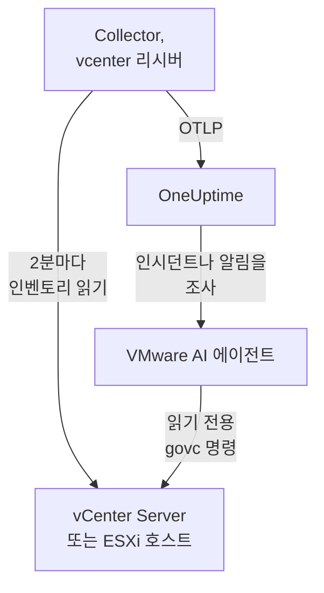

# VMware 에이전트

OneUptime VMware 에이전트는 VMware vSphere의 vCenter Server, ESXi 호스트, 가상 머신, 데이터스토어, 클러스터, 리소스 풀, vSAN을 모니터링합니다. 표준 OpenTelemetry Collector로, 그 [`vcenter` 리시버](https://github.com/open-telemetry/opentelemetry-collector-contrib/tree/main/receiver/vcenterreceiver)가 읽기 전용 사용자로 vSphere API를 읽고, 모든 메트릭에 vCenter 이름을 붙여 OneUptime으로 보냅니다. vCenter에 플러그인을 설치하지 않으며 VM 안에도 아무것도 설치하지 않습니다. 들어오는 데이터에 대해서는 [VMware 모니터](/docs/monitor/vmware-monitor)가 알림을 보냅니다.

:::cards
- [에이전트 설치](#에이전트-설치): 읽기 전용 사용자를 만든 다음 설치 스크립트, Docker Compose, systemd 중 하나를 사용합니다.
- [에이전트가 수집하는 항목](#에이전트가-수집하는-것): 모든 vSphere 객체와 그 식별 정보, 메트릭.
- [AI 에이전트](#ai-에이전트): OneUptime AI가 조사하는 동안 vCenter를 읽게 합니다.
- [문제 해결](#문제-해결): 진단 스크립트와 일반적인 문제.
:::

## 작동 방식

에이전트 하나는 vSphere 엔드포인트 하나를 모니터링합니다. 관리하는 모든 데이터센터, 클러스터, 호스트를 포함하는 **vCenter Server**이거나, 어떤 vCenter도 관리하지 않는 **독립형 ESXi 호스트**입니다. vCenter마다 에이전트를 하나씩 실행하세요. Collector는 수집할 때마다 인벤토리 전체를 한 번 순회하고(기본값은 2분마다), 객체마다 리소스를 하나씩 보냅니다. 같은 Compose 파일이 그 옆에서 OneUptime AI용 VMware AI 에이전트도 실행합니다. Docker를 쓰고 싶지 않나요? 같은 Collector를 같은 구성 그대로 모든 Linux 머신에서 systemd 서비스로도 실행할 수 있습니다.



vCenter는 첫 데이터와 함께, 에이전트가 모든 메트릭에 `vmware.vcenter.name`으로 붙이는 이름으로 스스로 등록됩니다. 에이전트를 전혀 실행하지 않고 vCenter를 모니터링하려면 [에이전트 없는 VMware](/docs/telemetry/vmware-agentless)를 참고하세요. 프로브 중 하나가 읽기 전용 계정으로 같은 데이터를 수집합니다.

## 시작하기 전에

- Docker Compose v2 플러그인이 있는 Docker Engine 20.10 이상, 또는 Docker 없이 설치하려면 systemd 235 이상이 있는 Linux 머신(x86_64 또는 arm64). 어느 경우든 머신은 HTTPS(TCP 443)로 vCenter에 연결할 수 있어야 합니다.
- vCenter Server 또는 ESXi 7.0 이상. 리시버는 vSphere 7과 8을 지원합니다.
- vSphere 사용자를 만들고 최상위 vCenter 객체에서 그 사용자에게 역할을 부여할 수 있는 계정.
- 수집 키. **프로젝트 설정 → 텔레메트리 및 APM → 수집 키**에서 만들고 값을 복사합니다.

### 에이전트를 실행할 위치

에이전트는 HTTPS로 vCenter와 통신하므로 가까이에서 실행할 필요가 없으며, vCenter Server Appliance나 모니터링 대상 클러스터의 VM에서는 실행하지 않는 것이 이상적입니다. 그 클러스터가 다운되면 모니터링도 함께 다운되기 때문입니다. 별도 하드웨어의 작은 관리용 VM, 모니터링 호스트, 또는 Docker를 실행하고(Docker가 없다면 systemd가 있는 Linux 머신) TCP 443으로 vCenter에 연결되는 어떤 머신이든 적당한 위치입니다. 선택 사항인 syslog 리스너를 쓰려면 ESXi 호스트가 syslog 포트로 에이전트에 연결할 수 있어야 합니다([ESXi syslog 보내기](#선택-사항-esxi-syslog-보내기) 참고).

## 에이전트 설치

:::steps
### 읽기 전용 vSphere 사용자 만들기

에이전트는 읽기만 합니다. 대상은 인벤토리, 성능 카운터, vSAN 통계입니다. 관리자가 아니라 기본 제공 **Read-Only** 역할을 가진 전용 계정을 주세요.

:::tabs
@tab vSphere Client
1. 계정을 만드세요. _Menu → Administration → Single Sign On → Users and Groups_ 메뉴를 열고, `vsphere.local` 도메인(또는 사용 중인 ID 소스)을 선택하고, **Add**를 클릭하고, 사용자 이름을 `oneuptime`으로 정하고 암호를 설정하세요. 그러면 사용자는 `oneuptime@vsphere.local`이 됩니다.
2. 역할을 부여하세요. _Hosts and Clusters_ 인벤토리에서 최상위 **vCenter Server** 객체를 선택하고, **Permissions** 탭을 열고, **Add**를 클릭하고, 사용자를 선택하고, 역할을 **Read-Only**로 설정한 뒤 **Propagate to children**을 선택하세요.
@tab govc
관리자 자격 증명이 있는 머신에서:

```bash
govc sso.user.create -p 'a-strong-password' -R ReadOnly oneuptime
govc permissions.set -principal oneuptime@vsphere.local -role ReadOnly -propagate=true /
```
@tab PowerCLI
관리자로 vCenter에 연결된 세션에서:

```powershell
New-SsoPersonUser -UserName oneuptime -Password 'a-strong-password'
New-VIPermission -Entity (Get-Folder -NoRecursion) -Principal 'VSPHERE.LOCAL\oneuptime' -Role ReadOnly -Propagate:$true
```
@tab ESXi Host Client
독립형 ESXi 호스트(vCenter 없음)에서는 _Host → Manage → Security & Users → Users_ 메뉴에서 사용자를 만들고, _Host → Manage → Security & Users → Permissions_ 메뉴에서 Read-Only 역할을 주세요. 또는 호스트의 셸에서 `esxcli system account add`를 실행한 다음 `esxcli system permission set --id oneuptime --role ReadOnly`를 실행하세요.
:::

> [!IMPORTANT]
> 사람들이 놓치는 부분은 전파입니다. 리시버는 데이터센터, 클러스터, 호스트, VM, 데이터스토어, 리소스 풀을 순회하며, 사용자가 볼 수 없는 객체는 모두 조용히 빠집니다. 전파 없이 vCenter 객체에 부여한 Read-Only 역할은 비어 있는 인벤토리와 0으로 가득한 대시보드를 만듭니다.

### 에이전트 설치 및 시작

:::tabs
@tab install.sh
에이전트를 실행할 머신에서 설치 스크립트를 내려받아 실행하세요:

```bash
curl -sSL https://raw.githubusercontent.com/OneUptime/oneuptime/master/agents/VMwareAgent/install.sh -o install.sh
bash install.sh
```

스크립트는 OneUptime URL, 수집 키, vCenter 이름, vCenter 엔드포인트, 읽기 전용 자격 증명(암호는 화면에 표시하지 않고 읽음), 그리고 AI 에이전트가 수정을 적용해도 되는지(그렇다면 전용 vSphere 사용자와 절대 변경하면 안 되는 VM)를 묻습니다. `/opt/oneuptime-vmware-agent`에 설치하고, `0600` 권한의 `.env` 파일을 쓰고, Docker Compose로 에이전트를 시작합니다. 각 값을 입력한 그대로 Docker Compose용 따옴표로 감싸므로, `$`, `#`, 공백, 따옴표가 들어간 암호도 입력한 그대로 동작합니다. 스크립트를 다시 실행하면 다시 묻는 대신 기존 `.env`의 내용을 모두 재사용하며, 이것이 [에이전트를 업그레이드](#에이전트-업그레이드)하는 방법입니다.
@tab Docker Compose
[VMwareAgent 디렉터리](https://github.com/OneUptime/oneuptime/tree/master/agents/VMwareAgent)에서 `docker-compose.yml`과 `otel-collector-config.yaml`을 새 폴더로 내려받은 다음, 그 옆에 `.env` 파일을 만드세요. 암호가 들어 있으므로 `chmod 600 .env`로 비공개로 유지하세요:

```bash title=".env"
ONEUPTIME_URL=YOUR_ONEUPTIME_URL
ONEUPTIME_TELEMETRY_INGESTION_KEY=YOUR_TELEMETRY_INGESTION_TOKEN
VMWARE_VCENTER_NAME=my-vcenter
VCENTER_ENDPOINT=https://vcsa.example.com
VCENTER_USERNAME=oneuptime@vsphere.local
VCENTER_PASSWORD=a-strong-password
VCENTER_INSECURE_SKIP_VERIFY=true
VCENTER_COLLECTION_INTERVAL=2m
```

`$`, `#`, 공백, 따옴표가 들어간 암호는 작은따옴표로 감쌉니다([vCenter가 로그인을 거부함](#문제-해결) 참고). 에이전트를 시작하세요:

```bash
docker compose up -d
```
@tab systemd
에이전트에는 Docker가 필요하지 않습니다. OpenTelemetry Collector 바이너리 하나와 구성 파일 하나로 이루어져 있습니다. systemd 235 이상이 있는 Linux 머신(x86_64 또는 arm64, Ubuntu 18.04, Debian 10, RHEL 8 이상)에서 에이전트가 고정한 `otelcol-contrib` 릴리스를 같은 `otel-collector-config.yaml`과 함께 systemd 서비스로 실행하세요. 에이전트가 이를 위해 제공하는 유닛 [`oneuptime-vmware-agent-native.service`](https://github.com/OneUptime/oneuptime/blob/master/agents/VMwareAgent/systemd/oneuptime-vmware-agent-native.service)는 capabilities도 쓰기 가능한 곳도 없는 일회용 비권한 사용자로 Collector를 실행합니다.

Collector, 구성, 유닛을 내려받아 `/opt/oneuptime-vmware-agent`에 설치하세요:

```bash
cd "$(mktemp -d)"
VERSION=0.161.0   # the collector release the agent pins
ARCH=$(uname -m | sed 's/x86_64/amd64/;s/aarch64/arm64/')
curl -fL -o otelcol-contrib.tar.gz \
  https://github.com/open-telemetry/opentelemetry-collector-releases/releases/download/v${VERSION}/otelcol-contrib_${VERSION}_linux_${ARCH}.tar.gz
curl -fsSLO https://raw.githubusercontent.com/OneUptime/oneuptime/master/agents/VMwareAgent/otel-collector-config.yaml
curl -fsSL -o oneuptime-vmware-agent.service \
  https://raw.githubusercontent.com/OneUptime/oneuptime/master/agents/VMwareAgent/systemd/oneuptime-vmware-agent-native.service

sudo install -d -m 0755 /opt/oneuptime-vmware-agent
sudo tar --no-same-owner --preserve-permissions -xzf otelcol-contrib.tar.gz -C /opt/oneuptime-vmware-agent otelcol-contrib
sudo install -m 0644 otel-collector-config.yaml /opt/oneuptime-vmware-agent/otel-collector-config.yaml
sudo install -m 0644 oneuptime-vmware-agent.service /etc/systemd/system/oneuptime-vmware-agent.service
```

설정은 `/opt/oneuptime-vmware-agent/.env`에 넣습니다. Docker 설치의 `.env`와 같은 변수입니다. 암호가 들어 있으므로 열기 전에 root만 읽을 수 있게 하세요:

```bash
sudo touch /opt/oneuptime-vmware-agent/.env
sudo chmod 600 /opt/oneuptime-vmware-agent/.env
sudoedit /opt/oneuptime-vmware-agent/.env
```

다음 내용을 넣으세요:

```bash
ONEUPTIME_URL=YOUR_ONEUPTIME_URL
ONEUPTIME_TELEMETRY_INGESTION_KEY=YOUR_TELEMETRY_INGESTION_TOKEN
VMWARE_VCENTER_NAME=my-vcenter
VCENTER_ENDPOINT=https://vcsa.example.com
VCENTER_USERNAME="oneuptime@vsphere.local"
VCENTER_PASSWORD="a-strong-password"
VCENTER_INSECURE_SKIP_VERIFY=true
VCENTER_COLLECTION_INTERVAL=2m
```

이 파일을 읽는 것은 셸이 아니라 systemd입니다. 사용자 이름과 암호는 큰따옴표로 감싸고, `\`는 각각 `\\`로, `"`는 각각 `\"`로 쓰세요(`DOMAIN\user`는 `"DOMAIN\\user"`). 반면 `$`, `#`, `'`와 공백은 그대로 둡니다. 이것이 모든 systemd 버전이 똑같이 읽는 형식입니다. 이전 버전(예: RHEL 8의 버전)은 작은따옴표 안에서도 백슬래시를 버립니다. 그런 다음 에이전트를 시작하고 부팅할 때마다 시작되게 하세요:

```bash
sudo systemctl daemon-reload
sudo systemctl enable oneuptime-vmware-agent
sudo systemctl restart oneuptime-vmware-agent
```

이 설치는 Collector만 실행합니다. [AI 에이전트](#ai-에이전트)는 컨테이너 이미지로만 제공됩니다. vCenter마다 에이전트를 하나씩 실행하세요. Docker 설치에서 옮겨 온다면 먼저 그쪽에서 `docker compose down`을 실행하세요. 그렇지 않으면 모든 메트릭이 두 번 들어옵니다.
:::

### 설치 확인

에이전트가 실행 중인지 확인하고 Collector의 로그를 읽으세요:

```bash
docker compose ps
docker logs -f oneuptime-vmware-agent
```

systemd로 설치했나요? 대신 서비스와 그 저널을 확인하세요:

```bash
systemctl status oneuptime-vmware-agent --no-pager
sudo journalctl -u oneuptime-vmware-agent -f
```

Collector가 시작되면 로그에 다음 줄이 보여야 합니다:

```text
Everything is ready. Begin running and processing data.
```

### OneUptime에서 vCenter 찾기

첫 번째 전체 인벤토리 순회가 끝날 때까지는 아무것도 전송되지 않으므로 수집 간격을 한 번(기본값 2분) 기다리세요. 그런 다음 **제품 → 인프라 → VMware → 모든 vCenter**를 열면 vCenter가 데이터센터, 클러스터, ESXi 호스트, 가상 머신, 데이터스토어, 리소스 풀과 함께 있습니다.
:::

## 환경 변수

Docker Compose는 이 값들을 `.env`(`docker-compose.yml` 옆의 파일)에서 읽고, systemd 설치는 `/opt/oneuptime-vmware-agent/.env`에서 읽으며, 그 유닛이 같은 기본값을 줍니다.

| 변수 | 필수 | 설명 |
| --- | --- | --- |
| `ONEUPTIME_URL` | 예 | OneUptime URL(예: `https://oneuptime.com` 또는 자체 호스팅 인스턴스). 인스턴스가 HTTP 전용이면 `http://`와 해당 포트를 사용하세요. |
| `ONEUPTIME_TELEMETRY_INGESTION_KEY` | 예 | **프로젝트 설정 → 텔레메트리 및 APM → 수집 키**의 수집 키. |
| `VMWARE_VCENTER_NAME` | 예 | OneUptime에서의 vCenter 이름으로, 모든 메트릭에 `vmware.vcenter.name` 리소스 속성으로 붙습니다. 바꾸지 마세요. 나중에 바꾸면 별도의 vCenter가 등록됩니다. 기본값은 `vmware-vcenter`입니다. |
| `VCENTER_ENDPOINT` | 예 | vCenter Server 또는 독립형 ESXi 호스트의 스킴과 호스트로, `/sdk`는 **붙이지 않습니다**. 예: `https://vcsa.example.com`. |
| `VCENTER_USERNAME` | 예 | Read-Only 역할을 가진 vSphere 사용자. 예: `oneuptime@vsphere.local`(Active Directory ID 소스라면 `DOMAIN\user`). |
| `VCENTER_PASSWORD` | 예 | 그 사용자의 암호. `$`, `#`, 공백, 따옴표가 들어 있으면 Docker 설치의 `.env`에서는 작은따옴표로 감싸고(`install.sh`가 대신 해 줍니다), systemd 설치의 파일에서는 큰따옴표로 감쌉니다([문제 해결](#문제-해결) 참고). |
| `VCENTER_INSECURE_SKIP_VERIFY` | 아니요 | `true`는 vCenter의 기본 자체 서명(VMCA) 인증서를 받아들입니다. `false`는 TLS 검증을 켠 상태로 둡니다. 기본값은 `false`입니다. |
| `VCENTER_COLLECTION_INTERVAL` | 아니요 | 인벤토리 전체를 읽는 간격. 매우 큰 vCenter에서는 `5m`이나 `10m`으로 늘리세요. 기본값은 `2m`입니다. |

AI 에이전트 자체의 설정은 [AI 에이전트](#ai-에이전트)에 있습니다.

## 에이전트가 수집하는 것

`VCENTER_COLLECTION_INTERVAL`마다 리시버는 vSphere 인벤토리 전체를 순회하고 객체마다 OpenTelemetry 리소스를 하나씩 보냅니다. 각 객체의 식별 정보는 그 **리소스 속성**에 있습니다(`vcenter.datacenter.name`, `vcenter.cluster.name`, `vcenter.host.name`, `vcenter.vm.name` / `vcenter.vm.id`, `vcenter.datastore.name`, `vcenter.resource_pool.name` / `vcenter.resource_pool.inventory_path`). 에이전트가 그 위에 `vmware.vcenter.name`을 더하므로, OneUptime은 모든 것을 vCenter 아래에 정리합니다:

| vSphere 객체 | 식별 정보(리소스 속성) | 메트릭 |
| --- | --- | --- |
| 데이터센터 | `vcenter.datacenter.name` | `vcenter.datacenter.cluster.count`, `vcenter.datacenter.host.count`, `vcenter.datacenter.vm.count`, `vcenter.datacenter.datastore.count`, `vcenter.datacenter.disk.space`, `vcenter.datacenter.cpu.limit`, `vcenter.datacenter.memory.limit` |
| 클러스터 | + `vcenter.cluster.name` | `vcenter.cluster.cpu.effective`, `vcenter.cluster.cpu.limit`, `vcenter.cluster.memory.effective`, `vcenter.cluster.memory.limit`, `vcenter.cluster.host.count`, `vcenter.cluster.vm.count`, `vcenter.cluster.vm_template.count`, `vcenter.cluster.vsan.*`(처리량, 작업, 지연 시간, 혼잡) |
| ESXi 호스트 | + `vcenter.host.name`(호스트가 클러스터에 속하면 `vcenter.cluster.name`도) | `vcenter.host.cpu.usage` / `.capacity` / `.utilization` / `.reserved`, `vcenter.host.memory.usage` / `.utilization` / `.capacity`, `vcenter.host.disk.latency.avg` / `.latency.max` / `.throughput`, `vcenter.host.network.usage` / `.throughput` / `.packet.rate` / `.packet.drop.rate` / `.packet.error.rate`, `vcenter.host.vsan.*` |
| 가상 머신 | + `vcenter.host.name`, `vcenter.vm.name`, `vcenter.vm.id`(인스턴스 UUID); `vcenter.resource_pool.*` 또는 `vcenter.virtual_app.*` | `vcenter.vm.disk.usage`, `vcenter.vm.disk.utilization`, `vcenter.vm.memory.usage` / `.utilization` / `.ballooned` / `.swapped` / `.swapped_ssd`; 전원이 켜진 VM만: `vcenter.vm.cpu.usage`, `vcenter.vm.cpu.readiness`, `vcenter.vm.cpu.utilization`, `vcenter.vm.disk.latency.avg` / `.latency.max` / `.throughput`, `vcenter.vm.network.*`, `vcenter.vm.vsan.*` |
| VM 템플릿 | `vcenter.vm_template.name`, `vcenter.vm_template.id` | `vcenter.vm.disk.usage`만 |
| 데이터스토어 | + `vcenter.datastore.name` | `vcenter.datastore.disk.usage`, `vcenter.datastore.disk.utilization` |
| 리소스 풀 | + `vcenter.resource_pool.name`, `vcenter.resource_pool.inventory_path` | `vcenter.resource_pool.cpu.usage` / `.cpu.shares`, `vcenter.resource_pool.memory.usage` / `.memory.shares` / `.memory.ballooned` / `.memory.swapped` / `.memory.granted` |

개수와 용량 메트릭은 **데이터 포인트 속성**으로 나뉘며, 이것이 바로 모니터 조건에서 필터링하고 그룹화하는 기준입니다:

| 속성 | 값 | 붙는 메트릭 |
| --- | --- | --- |
| `direction` | 디스크는 `read` / `write`, 네트워크는 `transmitted` / `received` | 디스크 지연 시간과 처리량, 네트워크 처리량과 패킷 속도 |
| `disk_state` | `available` / `used` | `vcenter.datastore.disk.usage`, `vcenter.vm.disk.usage`, `vcenter.datacenter.disk.space` |
| `status` | `red` / `yellow` / `green` / `gray`(vSphere에서 객체의 전체 상태) | `vcenter.datacenter.cluster.count` / `.host.count` / `.vm.count` |
| `power_state` | 호스트: `on` / `off` / `standby` / `unknown`; VM: `on` / `off` / `suspended` / `unknown` | `vcenter.datacenter.host.count` / `.vm.count`, `vcenter.cluster.vm.count` |
| `effective` | `true` / `false`(문자열로 저장됨) | `vcenter.cluster.host.count` |
| `object` | NIC, 디스크 또는 vCPU 인스턴스(예: `vmnic0`) | 호스트와 VM의 장치별 디스크 및 네트워크 시리즈 |
| `cpu_reservation_type` | `total` / `used` | `vcenter.host.cpu.reserved` |
| `type` | 메모리: `guest` / `host` / `overhead`, `private` / `shared`; vSAN: `read` / `write` / `unmap` | 리소스 풀 메모리 시리즈, vSAN 지연 시간과 작업 |

단위는 리시버 자체의 OTLP 단위이며 OneUptime이 표시용으로 환산합니다. CPU 사용량과 용량은 `MHz`, 사용률과 CPU 레디는 `%`, 호스트·VM·리소스 풀의 메모리는 `MiBy`, 클러스터와 데이터센터의 메모리 및 모든 디스크 공간은 `By`, 호스트와 VM의 디스크 지연 시간은 `ms`, vSAN 지연 시간은 `us`(마이크로초)입니다. 모니터 조건에서 식별 속성에는 `resource.` 접두사가 붙고(`resource.vcenter.host.name`, `resource.vmware.vcenter.name`), 데이터 포인트 속성은 접두사 없이 그대로 씁니다(`disk_state`, `power_state`, `status`).

`vcenter.host.memory.capacity`는 업스트림에서 기본적으로 꺼져 있지만, 함께 제공되는 구성에서는 켜 둡니다. OneUptime이 호스트 메모리 사용률을 계산할 때 이 값으로 나누기 때문입니다. `otel-collector-config.yaml`의 주석에 다른 선택 메트릭(`vcenter.vm.cpu.time`, `vcenter.vm.memory.granted`, `vcenter.host.memory.active`, `vcenter.host.memory.ballooned`, `vcenter.host.memory.granted`, `vcenter.vm.network.broadcast.packet.rate`, `vcenter.vm.network.multicast.packet.rate`)이 나열되어 있으며, 어느 것이든 같은 방식으로 켤 수 있습니다.

### VM 전원 상태

리시버는 VM의 전원 상태 메트릭을 보내지 않습니다. `vcenter.vm.cpu.*`는 **전원이 켜진 VM에 대해서만** 보내므로, OneUptime은 각 수집에서 들어온 것으로 상태를 추론합니다. CPU 메트릭을 보고한 VM은 **Powered on**, 메모리와 디스크 사용량만 보고한 VM은 **Powered off**입니다(또는 일시 중단됨. vSphere는 여기서 둘을 구분하지 않습니다). VM 템플릿에는 전원 상태가 없습니다. 이 추론은 **한 번의 수집 전체를 한꺼번에** 읽기 때문에, 함께 제공되는 `batch` 프로세서는 `send_batch_size`가 크고 의도적으로 `send_batch_max_size`가 없습니다. 한 번의 수집이 두 번의 내보내기로 나뉘면 인벤토리 개수가 0이 되고 VM이 "꺼짐"이 됩니다. batch 설정은 제공된 그대로 두세요.

## OneUptime의 vCenter


**개요** 페이지는 먼저 "이 vCenter가 정상인가"에 답합니다. 유효한 호스트, 용량으로 가중한 호스트 CPU와 메모리, 가장 꽉 찬 데이터스토어, VM의 최악의 CPU 레디 시간입니다. 무언가 저하되면 원인이 되는 객체를 알려 주므로 직접 찾을 필요가 없습니다.

### ESXi 호스트


### 가상 머신


전원이 꺼진 가상 머신과 템플릿도 목록에 나옵니다. vCenter는 전원이 켜진 VM에 대해서만 CPU 카운터를 보고하므로, 이들의 CPU 열에는 오해를 부르는 0 대신 N/A가 표시됩니다.

### 데이터스토어


## 선택 사항 — ESXi syslog 보내기

기본적으로 에이전트는 메트릭만 보내므로 vCenter의 **로그** 페이지는 비어 있습니다. ESXi 호스트(와 vCenter 자체)는 어떤 리스너로든 syslog를 전달할 수 있으며, 함께 제공되는 `otel-collector-config.yaml`에는 주석 처리된 `syslog` 리시버 쌍(포트 5514의 TCP와 UDP, ESXi 고유 형식인 RFC 3164)이 있고, 이는 주석 처리된 `logs` 파이프라인에 연결되어 있습니다. 이 파이프라인이 `vmware.vcenter.name`을 붙이므로 로그가 vCenter로 들어갑니다.

:::steps
### 리시버 켜기

`syslog/*` 리시버 두 개와 `logs` 파이프라인의 주석을 해제하세요(`otel-collector-config.yaml`에서).

### 포트 열기

`ports:` 블록(`docker-compose.yml`에 있음)의 주석을 해제해 머신이 `5514/tcp`와 `5514/udp`를 게시하게 한 다음 `docker compose up -d`를 실행하세요. systemd에서는 Collector가 머신 자체에서 수신하므로 게시할 포트가 없습니다. 대신 `sudo systemctl restart oneuptime-vmware-agent`를 실행하세요. 머신의 방화벽에서 ESXi 관리 네트워크에 대해 포트를 여세요.

### 각 ESXi 호스트가 에이전트를 가리키게 하기

vSphere Client에서 호스트를 선택하고 _Configure → System → Advanced System Settings_ 메뉴를 열어 `Syslog.global.logHost`를 편집하고 `udp://<agent-host>:5514`(또는 `tcp://<agent-host>:5514`, 여러 대상은 쉼표로 구분)로 설정하세요. 그런 다음 _Configure → System → Firewall → Edit → syslog_ 메뉴에서 나가는 트래픽을 허용하세요. 또는 각 호스트에서 `esxcli`로:

```bash
esxcli system syslog config set --loghost='udp://<agent-host>:5514'
esxcli system syslog reload
esxcli network firewall ruleset set --ruleset-id=syslog --enabled=true
```

PowerCLI로 클러스터 전체에 설정하려면: `Get-VMHost | Get-AdvancedSetting -Name Syslog.global.logHost | Set-AdvancedSetting -Value 'udp://<agent-host>:5514' -Confirm:$false`.
:::

syslog 리시버는 한 가지 전송 방식에서만 수신하므로 TCP와 UDP가 두 개의 리시버로 나뉘어 있습니다. 하나만 필요하면 다른 하나는 주석 처리된 채로 두세요. TLS syslog(`ssl://`)는 에이전트 앞에서 종료하세요. 리시버 자체는 일반 TCP와 UDP로 통신합니다. 표준 Collector 이미지는 syslog를 그대로 읽으므로 사용자 지정 이미지가 필요 없습니다.

## 프로젝트 레이블로 vCenter에 태그 붙이기

`oneuptime.label.`로 시작하는 리소스 속성은 vCenter의 프로젝트 레이블이 됩니다. `oneuptime.label.<dimension>=<value>`는 레이블 `<dimension>:<value>`입니다. `resource` 프로세서(`otel-collector-config.yaml`에 있음)에 `vmware.vcenter.name`과 나란히 속성을 추가하세요:

```yaml
processors:
  resource:
    attributes:
      # ...existing attributes...
      - key: oneuptime.label.team
        value: platform
        action: upsert
      - key: oneuptime.label.env
        value: production
        action: upsert
```

Collector는 시작할 때만 구성을 읽습니다. `docker compose restart oneuptime-vmware-agent`를 실행하거나, systemd라면 `sudo systemctl restart oneuptime-vmware-agent`를 실행하세요. 그러면 vCenter에 `team:platform`과 `env:production` 레이블이 표시됩니다. 레이블은 대소문자를 구분하지 않고 비교되므로 기존 `Production` 레이블은 중복되지 않고 재사용되며, 에이전트는 누군가 OneUptime에서 추가한 레이블을 절대 제거하지 않습니다.

## systemd 서비스로 실행

Docker 설치도 systemd에서 실행해 머신과 함께 시작하고 실패하면 다시 시작하게 할 수 있습니다. 그 유닛은 Docker Compose를 감싸며, 설치 스크립트가 에이전트를 두는 `/opt/oneuptime-vmware-agent`에 에이전트가 있다고 가정합니다:

```bash
sudo curl -fsSL https://raw.githubusercontent.com/OneUptime/oneuptime/master/agents/VMwareAgent/systemd/oneuptime-vmware-agent.service -o /etc/systemd/system/oneuptime-vmware-agent.service
sudo systemctl daemon-reload
sudo systemctl enable --now oneuptime-vmware-agent
```

Docker 없는 설치는 이미 자체 유닛을 가진 systemd 서비스입니다.

## 에이전트 업그레이드

에이전트는 파일이 고정한 Collector 버전을 **에이전트 버전**으로 보고합니다. 그 버전이 이 OneUptime 릴리스가 고정한 버전보다 오래되었으면, vCenter의 **개요** 페이지와 **모든 vCenter** 목록에서 그 옆에 경고 표시가 나타납니다. 이를 선택하면 다음 명령을 볼 수 있습니다. 파일이 버전을 보고하기 전에 설치된 에이전트는 이 방법으로 업그레이드할 때까지 버전을 표시하지 않습니다.

Collector는 `docker-compose.yml`에(Docker 없이 설치했다면 내려받은 릴리스로) 고정되어 있고 구성은 그 옆의 파일이므로, 가져오기만으로는 에이전트가 새 버전이 되지 않습니다:

:::tabs
@tab install.sh
`install.sh`를 다시 실행하세요. 기존 `.env`의 모든 값을 재사용하고(아무것도 다시 묻지 않음), `docker-compose.yml`과 `otel-collector-config.yaml`을 새로 고치고, 에이전트를 다시 만들어 Collector가 새 구성을 읽게 합니다.

```bash
curl -sSL https://raw.githubusercontent.com/OneUptime/oneuptime/master/agents/VMwareAgent/install.sh -o install.sh
bash install.sh
```
@tab Docker Compose
에이전트의 폴더에서 두 파일을 다시 내려받고(파일에 가한 변경이 있으면 다시 적용), 이미지를 가져와 에이전트를 다시 만드세요:

```bash
curl -fsSLO https://raw.githubusercontent.com/OneUptime/oneuptime/master/agents/VMwareAgent/docker-compose.yml
curl -fsSLO https://raw.githubusercontent.com/OneUptime/oneuptime/master/agents/VMwareAgent/otel-collector-config.yaml
docker compose pull
docker compose up -d --force-recreate
```
@tab systemd
설치 명령을 다시 실행하세요. 이 OneUptime이 고정한 릴리스를 최신 `otel-collector-config.yaml` 및 유닛과 함께 내려받고, `.env`는 그대로 둡니다(구성에 가한 변경이 있으면 다시 적용하세요). 그런 다음 서비스를 다시 시작하세요:

```bash
cd "$(mktemp -d)"
VERSION=0.161.0   # the collector release the agent pins
ARCH=$(uname -m | sed 's/x86_64/amd64/;s/aarch64/arm64/')
curl -fL -o otelcol-contrib.tar.gz \
  https://github.com/open-telemetry/opentelemetry-collector-releases/releases/download/v${VERSION}/otelcol-contrib_${VERSION}_linux_${ARCH}.tar.gz
curl -fsSLO https://raw.githubusercontent.com/OneUptime/oneuptime/master/agents/VMwareAgent/otel-collector-config.yaml
curl -fsSL -o oneuptime-vmware-agent.service \
  https://raw.githubusercontent.com/OneUptime/oneuptime/master/agents/VMwareAgent/systemd/oneuptime-vmware-agent-native.service

sudo install -d -m 0755 /opt/oneuptime-vmware-agent
sudo tar --no-same-owner --preserve-permissions -xzf otelcol-contrib.tar.gz -C /opt/oneuptime-vmware-agent otelcol-contrib
sudo install -m 0644 otel-collector-config.yaml /opt/oneuptime-vmware-agent/otel-collector-config.yaml
sudo install -m 0644 oneuptime-vmware-agent.service /etc/systemd/system/oneuptime-vmware-agent.service
sudo systemctl daemon-reload
sudo systemctl restart oneuptime-vmware-agent
```
:::

## 에이전트 제거

:::tabs
@tab Docker Compose
```bash
cd /opt/oneuptime-vmware-agent
docker compose down
```
@tab systemd
```bash
sudo systemctl disable --now oneuptime-vmware-agent
sudo rm /etc/systemd/system/oneuptime-vmware-agent.service
sudo systemctl daemon-reload
sudo rm -r /opt/oneuptime-vmware-agent
```
:::

그런 다음 더 이상 필요하지 않다면 vCenter에서 `oneuptime` 사용자의 권한을 제거하고, AI 에이전트 전용 사용자를 만들었다면 그 사용자도 제거하세요.

## AI 에이전트

에이전트의 `docker-compose.yml`은 **VMware AI 에이전트**(`oneuptime-vmware-ai-agent`, 이미지 `oneuptime/resource-ai-agent:release`)도 실행합니다. OneUptime AI가 이 vCenter의 인시던트나 알림을 조사하는 동안 이를 통해 읽기 전용 `govc` 명령(`govc vm.info web-01`, `govc events -n 50 /DC/vm/web-01`, `govc metric.sample -n 12 /DC/vm/web-01 cpu.usage.average`)을 실행하고, 허용한 경우에만 VM 전원을 다시 켜는 등의 수정을 적용합니다. Collector와 마찬가지로 `VMWARE_VCENTER_NAME`이라는 이름의 vCenter로 등록되며, OneUptime에서 vCenter의 **AI → AI 에이전트** 페이지에 표시됩니다.

- **AI 조사는 기본적으로 켜져 있습니다.** 에이전트가 연결되면 OneUptime AI가 에이전트로 이 vCenter의 인시던트와 알림을 조사하며, vCenter의 **개요** 페이지에 에이전트 상태가 표시됩니다. 중지하려면 에이전트가 실행되는 곳에서 `ONEUPTIME_AI_INVESTIGATION=false`를 설정하거나(AI 에이전트 페이지의 **AI가 할 수 있는 작업** 아래 **변경**에서 방법을 볼 수 있습니다) 에이전트를 빼세요.
- **vSphere 역할이 넘을 수 없는 한계입니다.** 조사는 Collector의 **Read-Only** 사용자(`VCENTER_USERNAME` / `VCENTER_PASSWORD`)로 로그인하며, 이 사용자는 읽기 외에는 아무것도 할 수 없습니다. 수정에는 VM 전원을 켜고, 끄고, 재설정할 수 있는 역할(`VirtualMachine.Interact.PowerOn`, `PowerOff`, `Reset`)을 가진 AI 에이전트 전용 사용자가 필요합니다. 그 역할은 AI가 수정해도 되는 폴더에만 부여하고 `ONEUPTIME_AI_VCENTER_USERNAME` / `ONEUPTIME_AI_VCENTER_PASSWORD`로 설정하세요.
- `ONEUPTIME_AI_ALLOW_WRITES=true`를 설정하지 않는 한 **읽기 전용**입니다. `ONEUPTIME_AI_WRITE_TARGETS`(VM 및 호스트 이름 또는 인벤토리 경로)는 수정이 건드릴 수 있는 범위를 제한합니다. `VCENTER_ENDPOINT`의 호스트 이름을 딴 VM(보통 vCenter 어플라이언스)은 절대 바꾸지 않으며, 어플라이언스는 그 이름으로만 알아봅니다. `VCENTER_ENDPOINT`가 IP 주소이거나 어플라이언스의 VM 이름이 다르다면, 그 VM을 에이전트가 실행되는 VM과 함께 `ONEUPTIME_AI_PROTECTED_TARGETS`에 넣으세요. `ONEUPTIME_AI_FIXES`(같은 `.env`에 있음)는 수정이 실행되는 방식을 정합니다. `ask-for-approval`(사람이 하나씩 승인), `automatic`, `bypass-approval` 중 하나이며, AI 에이전트 페이지에 읽기 전용으로 표시됩니다([에이전트가 설정하는 AI가 할 수 있는 작업](/docs/ai/infrastructure-ai-agents#what-ai-may-do-set-by-the-agent)).
- 검증을 건너뛰지 않고 vCenter 인증서를 검증하려면 그 CA를 컨테이너에 마운트하고 `VCENTER_CA_FILE`을 설정하세요. 데이터센터가 여러 개인 vCenter에서는 `GOVC_DATACENTER`를 설정하세요.
- UID 1000으로 capabilities 없이 실행되며, 게스트 작업, 스냅샷, `esxcli`나 VM을 만들거나 없애는 어떤 것도 실행하지 않습니다. OneUptime AI를 사용하지 않는다면 `oneuptime-vmware-ai-agent` 서비스를 `docker-compose.yml`에서 삭제하세요.
- Docker 없는 설치에는 AI 에이전트가 없습니다. AI 에이전트는 컨테이너 이미지로만 제공되기 때문입니다. 추가하려면 vCenter에 연결되는 아무 머신에서 Docker로 실행하세요. `docker-compose.yml`을 내려받고, 그 옆에 `.env`를 만들어 `/opt/oneuptime-vmware-agent/.env`의 설정을 Docker Compose가 원하는 대로 작은따옴표로 감싸 쓴 다음, `docker compose up -d oneuptime-vmware-ai-agent`로 AI 에이전트만 시작하세요(이미 실행 중인 Collector는 시작하지 않습니다).

실행할 수 있는 명령, 수정이 동작하는 방식, 문제 해결 방법: [Infrastructure AI Agents](/docs/ai/infrastructure-ai-agents#vmware-vcenter). 수정용 역할의 정확한 명령은 에이전트의 README에 있습니다.

## 문제 해결

:::details 먼저 진단 스크립트 실행
에이전트에는 전체 체인을 확인하는 스크립트 [`troubleshoot.sh`](https://github.com/OneUptime/oneuptime/blob/master/agents/VMwareAgent/troubleshoot.sh)가 함께 제공됩니다. 컨테이너 런타임, vCenter가 응답하고 자격 증명을 받아들이는지, 모든 메트릭에 붙은 vCenter 이름, 토큰 형식, Collector 자체 메트릭, 그리고 OneUptime이 수집 키를 받아들이는지를 확인합니다. 마지막 확인이 가장 중요합니다. OneUptime은 잘못된 키를 `401`로 거부하며(비활성화된 키나 브라우저 키는 `422`), Collector는 둘 다 영구적인 오류로 취급합니다. 배치를 버리고 `Exporting failed` 오류를 하나 기록할 뿐이므로, 컨테이너가 정상인 동안에는 놓치기 쉽습니다. 스크립트는 에이전트의 네트워크 안에서 `GET <url>/otlp/v1/validate`를 요청해 `200`(유효) 또는 `401`(무효)을 직접 받고, 이전 서버에서는 `POST /fluentd/v1/logs`로 대체하며, 같은 방식으로 `<VCENTER_ENDPOINT>/sdk/vimServiceVersions.xml`도 요청하므로 DNS, 방화벽, TLS 실패가 Collector가 겪는 그대로 드러납니다.

```bash
curl -sSL https://raw.githubusercontent.com/OneUptime/oneuptime/master/agents/VMwareAgent/troubleshoot.sh -o troubleshoot.sh
bash troubleshoot.sh    # add -d <dir> if you installed outside /opt/oneuptime-vmware-agent
```

마지막에 가장 가능성 높은 원인을 알려 주는 판정을 출력합니다.
:::

:::details Docker 없이 설치한 경우
진단 스크립트에는 Docker가 필요합니다. Docker가 없으면 Collector가 머신에서 직접 실행되므로 같은 체인을 직접 확인하세요. 서비스와 그 로그, Collector 자체 네트워크 경로에서의 vCenter API, OneUptime이 수집 키를 받아들이는지(`"valid":true`와 `"keyType":"Server"`), 그리고 Collector 자체 카운터입니다. 이 카운터는 `127.0.0.1:8890`에서 제공되며 `8888`이 아니므로 다른 Collector와 나란히 실행할 수 있습니다:

```bash
systemctl status oneuptime-vmware-agent --no-pager
sudo journalctl -u oneuptime-vmware-agent -n 100 --no-pager
curl -sk https://<vcenter-host>/sdk/vimServiceVersions.xml
curl -s -H "x-oneuptime-token: <key>" https://<oneuptime-host>/otlp/v1/validate
curl -s http://127.0.0.1:8890/metrics | grep -E 'otelcol_(receiver_accepted|exporter_sent|exporter_send_failed)_metric_points'
```

로그는 컨테이너의 로그와 같은 방식으로 읽으므로 아래 항목이 그대로 적용됩니다. 계속 다시 시작되는 서비스는 그 이유를 기록합니다. `Failed with result 'resources'`는 systemd가 `/opt/oneuptime-vmware-agent/.env`를 읽을 수 없다는 뜻이고, `cannot unmarshal the configuration` 또는 `requires positive value`는 그 안의 값이 Collector가 받아들이지 않는 값이라는 뜻입니다. systemd는 자체 규칙으로 `.env`를 읽으며, 이전 버전(예: RHEL 8의 버전)은 작은따옴표 안에서도 백슬래시를 버립니다. 사용자 이름과 암호는 큰따옴표로 감싸고, `\`는 각각 `\\`로, `"`는 각각 `\"`로 쓰세요. 이것이 모든 버전이 쓴 그대로 읽는 유일한 형식입니다. Collector는 머신의 CA 저장소를 신뢰하므로 TLS 검증을 켜 둘 수 있습니다. vCenter 루트 인증서(`.0` 파일, `certs/lin/` 아래에 있으며 `https://<vcenter>/certs/download.zip`에 들어 있음)를 `/usr/local/share/ca-certificates/`에 `.crt` 이름으로 추가하고 Debian과 Ubuntu에서는 `update-ca-certificates`를 실행하거나, `/etc/pki/ca-trust/source/anchors/`에 추가하고 RHEL에서는 `update-ca-trust`를 실행한 다음 서비스를 다시 시작하세요.
:::

:::details OneUptime에 vCenter가 나타나지 않음
1. Collector의 로그를 확인하세요: `docker logs oneuptime-vmware-agent`. 로그인 오류(`incorrect user name or password`, `InvalidLogin`)는 자격 증명이 잘못되었다는 뜻이고, `x509: certificate signed by unknown authority`는 자체 서명 인증서에 대해 TLS 검증이 켜져 있다는 뜻이며, `connection refused` 또는 `no such host`는 `VCENTER_ENDPOINT`가 잘못되었다는 뜻이고, 내보낼 때의 `401`은 수집 키가 잘못되었다는 뜻입니다.
2. 에이전트의 네트워크에서 vCenter가 응답하는지 확인하세요. Collector 이미지에는 셸도 curl도 없으므로 같은 네트워크의 컨테이너에서 요청하세요: `docker run --rm --network container:oneuptime-vmware-agent curlimages/curl -sk https://<vcenter-host>/sdk/vimServiceVersions.xml`을 실행하면 `urn:vim25`가 들어 있는 XML 문서가 출력되어야 합니다.
3. `VMWARE_VCENTER_NAME`이 설정되어 있는지 확인하세요. vCenter는 `vmware.vcenter.name` 리소스 속성으로 찾습니다.
4. 수집 간격을 한 번 기다리세요. 첫 번째 전체 인벤토리 순회가 끝날 때까지는 아무것도 전송되지 않습니다.
:::

:::details vCenter가 연결 끊김으로 표시됨
OneUptime이 15분 동안 vCenter에서 아무것도 받지 못하면 vCenter는 연결 끊김 상태가 됩니다. OneUptime은 5분마다 확인하며, OneUptime 자체가 데이터를 받지 못한 시간은 계산하지 않습니다. Collector가 실행 중인지, 로그에 내보내기 오류가 없는지, 수집이 `VCENTER_COLLECTION_INTERVAL` 안에 끝나는지 확인하세요(아래의 대규모 인벤토리 항목 참고). 다음 데이터가 들어오면 vCenter는 다시 연결됨 상태가 됩니다.
:::

:::details x509 또는 TLS 오류
vCenter 어플라이언스는 자체 VMCA가 발급한 인증서를 제시하며, 어떤 Docker 이미지도 이를 신뢰하지 않습니다. `VCENTER_INSECURE_SKIP_VERIFY=true`를 설정하거나(사설 관리 네트워크에서는 실용적인 선택), vCenter의 머신 인증서를 Collector 이미지가 신뢰하는 CA의 인증서로 바꾸세요. 엔드포인트가 `http://` URL을 가리키게 하지 **마세요**. vCenter는 API를 HTTPS로만 제공합니다.
:::

:::details vCenter가 로그인을 거부함(401 또는 InvalidLogin)
전체 주체 이름을 사용하고(`oneuptime@vsphere.local`, Active Directory ID 소스라면 `DOMAIN\user` / `user@domain.example`), `.env`에 암호가 어떻게 쓰여 있는지 확인하세요. Docker Compose v2는 따옴표가 없는 값과 큰따옴표 값에서 `$VAR` 참조를 확장하고, 공백 뒤에 오는 `#`를 주석의 시작으로 읽습니다. 그래서 `$`, `#`, 공백, 따옴표가 들어간 암호는 작은따옴표로 감싸야 하며(`VCENTER_PASSWORD='p@ss$word'`), `install.sh`가 쓰는 것도 이 형식입니다. 암호 자체에 작은따옴표가 들어 있으면 큰따옴표로 감싸고, `$`는 각각 `$$`로 쓰고 `"` / `\`는 백슬래시로 이스케이프하세요. 잠긴 계정(실패한 시도가 너무 많음)은 올바른 암호도 거부합니다. _Administration → Single Sign On → Users and Groups_ 메뉴를 확인하세요.
:::

:::details 호스트는 나타나지만 VM, 데이터스토어, 클러스터가 없음(NoPermission)
Read-Only 역할이 **Propagate to children** 없이 vCenter 객체에 부여되었거나, vCenter 루트보다 좁은 객체에 부여되었습니다. 사용자가 볼 수 없는 객체는 조용히 빠집니다. 전파를 켠 채로 최상위 vCenter 객체의 권한을 고치세요. 다음 수집에서 인벤토리가 채워집니다.
:::

:::details 모든 VM이 전원 꺼짐으로 표시됨
VM의 전원 상태는 메모리 및 디스크 데이터 포인트와 같은 수집에서 들어오는 `vcenter.vm.cpu.*` 데이터 포인트로 추론합니다([VM 전원 상태](#vm-전원-상태) 참고). `batch` 프로세서를 바꾸고 `send_batch_max_size`를 추가했다면, 큰 인벤토리가 여러 번의 내보내기로 나뉘어 CPU 데이터 포인트가 나머지와 다른 요청에 들어갑니다. 함께 제공된 batch 설정으로 되돌리세요.
:::

:::details 대규모 인벤토리: 느린 수집, vpxd.stats.maxQueryMetrics 오류
각 수집은 인벤토리 전체를 순회하며 객체 배치마다 성능 쿼리를 한 번 실행합니다. VM이 수천 개인 vCenter라면:

- `VCENTER_COLLECTION_INTERVAL`을 `5m`이나 `10m`으로 늘리세요. 간격보다 오래 걸리는 수집은 겹쳐 실행되지 않고 건너뛰므로, 너무 짧은 간격은 공백만 남깁니다.
- 리시버는 성능 쿼리마다 최대 `max_query_metrics: 256`개의 엔터티를 요청합니다. vCenter는 이를 `vpxd.stats.maxQueryMetrics`로 제한합니다(vCenter 7과 8의 기본값은 256). 관리자가 이 값을 낮췄다면 Collector는 `The maximum number of performance metrics per query exceeded`를 기록합니다. `max_query_metrics`(`otel-collector-config.yaml`에 있음)를 그에 맞게 낮추거나, _vCenter → Configure → Advanced Settings_ 메뉴에서 vCenter 설정을 높이세요.
- Collector의 메모리를 지켜보세요. 함께 제공되는 `memory_limiter`는 512 MiB까지 허용합니다. 리미터가 데이터를 버리고 있다고 로그에 나오면 `limit_mib`를 높이세요(그리고 컨테이너에 메모리를 더 주세요).
:::

:::details 독립형 ESXi 호스트 모니터링(vCenter 없음)
`VCENTER_ENDPOINT`가 호스트 자체(`https://esxi01.example.com`)를 가리키게 하고, Read-Only 역할을 가진 로컬 ESXi 사용자를 사용하세요. 호스트 하나가 아는 모든 것이 수집됩니다. 호스트, 그 VM, 데이터스토어, 리소스 풀입니다. 독립형 호스트에는 데이터센터나 클러스터 객체가 없으므로 해당 페이지는 비어 있고, vCenter REST API도 없으므로 진단 스크립트는 자격 증명 확인을 판단 불가로 보고합니다(그 경우 답은 Collector의 로그에 있습니다).
:::

:::details 메트릭이 엉뚱한 vCenter에 들어감
OneUptime은 vCenter를 `vmware.vcenter.name`으로 등록하며, 에이전트는 이 값을 `VMWARE_VCENTER_NAME`에서 가져옵니다. 첫 데이터 이후에 바꾸면 첫 vCenter의 이름이 바뀌는 대신 두 번째 vCenter가 만들어집니다.
:::

:::details 에이전트 없이 메트릭 보내기
vSphere에는 자체 OpenTelemetry 푸시가 없으므로 에이전트(또는 `vcenter` 리시버가 있는 아무 OpenTelemetry Collector)가 들어오는 길입니다. 이미 Collector를 운영 중이라면 이 에이전트를 실행하는 대신 그중 하나에 `vcenter` 리시버를 추가하세요. `vcenter` 리시버와 `resource` 프로세서를 함께 제공되는 `otel-collector-config.yaml`에서 자신의 구성으로 복사하면 됩니다. `vmware.vcenter.name` 리소스 속성이 OneUptime에 vCenter를 등록하고, `service.name` / `service.instance.id` 삭제는 데이터가 서비스 아래로 정리되지 않게 합니다. 둘 다 유지하세요.
:::

## 다음 단계

:::cards
- [VMware 모니터](/docs/monitor/vmware-monitor): 호스트, VM, 데이터스토어, 클러스터, 데이터센터, vSAN에 대해 알림을 보냅니다.
- [에이전트 없는 VMware](/docs/telemetry/vmware-agentless): 대신 프로브가 vCenter를 수집하게 합니다.
- [Infrastructure AI Agents](/docs/ai/infrastructure-ai-agents): VMware AI 에이전트가 실행할 수 있는 명령과 수정이 동작하는 방식.
- [호스트 OpenTelemetry 수집기](/docs/telemetry/host-otel-collector): VM 안이나 에이전트 머신을 운영체제 관점에서 봅니다.
:::
