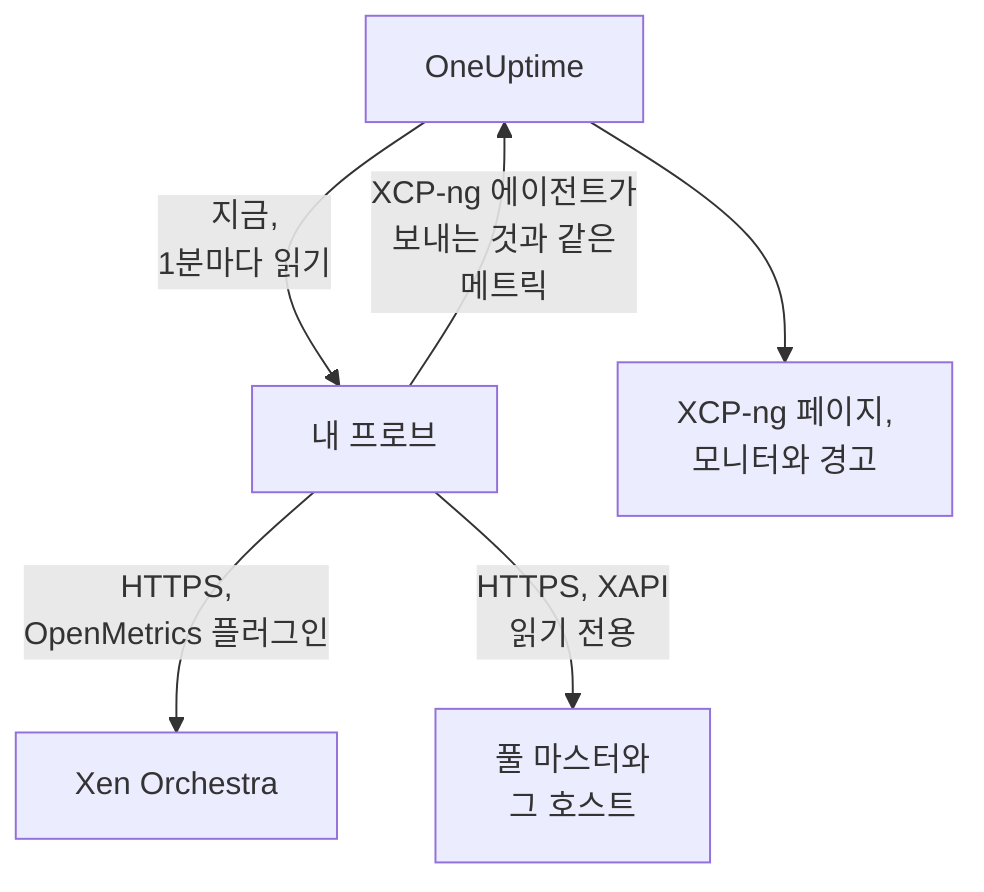

# 에이전트 없는 XCP-ng

아무것도 설치하지 않고 XCP-ng 풀을 모니터링하세요. OneUptime 프로브가 풀을 읽습니다. 풀을 관리하는 Xen Orchestra를 통해 읽거나, Xen Orchestra가 없는 풀은 풀 마스터의 XAPI에서 직접 읽습니다. 각 풀에는 [XCP-ng 에이전트](/docs/telemetry/xcp-ng)가 보내는 풀과 같은 페이지, [XCP-ng 모니터](/docs/monitor/xcp-ng-monitor), 템플릿이 제공됩니다. 설치하고, 업그레이드하고, 계속 실행해 둘 에이전트가 없습니다.

:::cards
- [시작하기 전에](#시작하기-전에): Xen Orchestra나 풀에 연결할 수 있는 프로브와 읽기 전용 접근.
- [Xen Orchestra 연결](#xen-orchestra-연결): 관리하는 모든 풀을 연결 하나로.
- [Xen Orchestra가 없는 풀 연결](#xen-orchestra가-없는-풀-연결): 풀 하나를 마스터에서 읽습니다.
- [경보, HA, 백업](#경보-ha-백업): 프로브가 메트릭 외에 읽는 것과 그로부터 받을 수 있는 경고.
- [문제 해결](#문제-해결): 각 메시지의 의미와 해결 방법.
:::

## 작동 방식

프로브는 1분마다 각 연결을 읽고 읽은 내용을 OneUptime으로 보냅니다.

- **Xen Orchestra**: 프로브가 플러그인의 시크릿으로 Xen Orchestra의 OpenMetrics 플러그인을 읽습니다. XCP-ng 에이전트와 똑같은 방식이므로 Xen Orchestra가 관리하는 모든 풀이 같은 시리즈로 들어옵니다. API 토큰이 있으면 Xen Orchestra의 REST API에서 각 풀의 경보, HA, 백업도 읽습니다.
- **풀의 XAPI**: 프로브가 풀 마스터에 로그인해 Xen Orchestra 플러그인이 직접 하는 읽기를 합니다. 풀의 레코드와, 실행 중인 각 호스트의 메트릭을 해당 호스트에서 읽습니다. 이를 플러그인이 제공하는 것과 같은 시리즈로 바꾸므로 풀은 Xen Orchestra를 통할 때와 똑같이 읽힙니다. 또한 충돌한 VM이나 HA가 잃은 호스트 같은 풀의 XAPI 메시지를 풀의 피드에 올립니다.

각 풀은 에이전트의 풀과 마찬가지로 첫 읽기에서 UUID로 등록되며 **XCP-ng → 모든 풀**에 나타납니다.

## 어떤 방식으로 연결할까

| | 프로브에서 Xen Orchestra | 프로브에서 풀의 XAPI | XCP-ng 에이전트 |
|---|---|---|---|
| 실행하는 것 | 이미 실행 중인 프로브 또는 새 프로브 | 이미 실행 중인 프로브 또는 새 프로브 | 전용 머신의 에이전트 |
| 읽는 대상 | Xen Orchestra가 관리하는 모든 풀 | 풀 하나 | Xen Orchestra가 관리하는 모든 풀 |
| 필요한 것 | OpenMetrics 플러그인의 시크릿, 선택 사항으로 읽기 전용 API 토큰 | 풀 계정: root, 또는 read-only 역할이 있는 Active Directory 사용자 | OpenMetrics 플러그인의 시크릿 |
| 시크릿을 보관하는 곳 | OneUptime에 암호화되어 프로브에만 전송 | OneUptime에 암호화되어 프로브에만 전송 | 에이전트의 `.env` 파일 |
| 경보, HA, 백업 | API 토큰이 있으면 세 가지 모두와 누락된 패치 | 경보와 HA, 백업은 제외 | 포함 안 됨 |

세 가지 모두 같은 시리즈를 보냅니다. 풀은 한 번에 그중 하나만 읽으므로 누가 읽든 기록이 한 줄로 유지됩니다.

## 시작하기 전에

- **TCP 443으로 주소에 연결할 수 있는 프로브.** 보통 같은 네트워크에 있는 [사용자 지정 프로브](/docs/probe/custom-probe)입니다. OneUptime Cloud의 공유 프로브는 XCP-ng 시크릿을 받지 않으므로 자체 프로브를 추가하세요. 자체 호스팅 인스턴스에서는 인스턴스 자체의 프로브도 읽을 수 있습니다.
- **Xen Orchestra의 경우:** OpenMetrics 플러그인이 켜진 Xen Orchestra 6.9 이상. [OpenMetrics 플러그인 켜기](/docs/telemetry/xcp-ng#openmetrics-플러그인-켜기)를 따라 시크릿을 복사하세요. 선택 사항으로, 기본 제공 역할 **Read only**가 있는 Xen Orchestra 사용자의 API 토큰. OneUptime은 토큰이 읽기만 하는지 확인하고 만료 전에 알려 줍니다.
- **Xen Orchestra가 없는 풀의 경우:** XCP-ng 8.2 이상과 마스터의 주소. XAPI의 역할은 Active Directory 사용자에게만 적용되므로 유일한 로컬 계정인 `root`는 풀의 모든 것을 바꿀 수 있습니다. 읽기 전용으로 접근하려면 풀을 Active Directory에 가입시키고 사용자에게 `read-only` 역할을 부여하세요.

> [!IMPORTANT]
> 풀은 Xen Orchestra를 통하거나 XAPI를 통해 연결하되, 둘 다 사용하지 마세요. 풀을 두 번째로 읽는 연결은 그 풀을 첫 번째 연결에 맡깁니다.

## Xen Orchestra 연결

:::steps
### 연결 열기
OneUptime에서 **XCP-ng → 연결**을 열고 **XCP-ng 연결**을 클릭합니다.

### Xen Orchestra 선택
**읽을 대상**에서 **Xen Orchestra**를 선택합니다. 브라우저에서 여는 **Xen Orchestra 주소**(예: `https://xo.example.com`)를 입력하고, 그 주소에 연결할 수 있는 프로브를 선택합니다.

### 플러그인의 시크릿 입력
**OpenMetrics 시크릿**을 붙여 넣습니다. 읽기 전용 사용자의 **API 토큰**이 있으면 추가합니다.

### 연결을 테스트하고 인증서 신뢰
**연결 테스트**를 클릭합니다. Xen Orchestra는 자체 서명한 인증서를 쓰므로 테스트에 그 인증서가 표시됩니다. 지문을 확인한 다음 **이 인증서 신뢰**를 클릭합니다. 결과에는 Xen Orchestra가 제공하는 풀이 호스트, VM, 스토리지 리포지토리와 함께 나열됩니다.

### 이름을 정하고 연결
이름의 기본값은 Xen Orchestra의 호스트 이름이며, 읽는 각 풀에도 표시됩니다. **XCP-ng 연결**을 클릭하면 연결 페이지가 열립니다.
:::

## Xen Orchestra가 없는 풀 연결

:::steps
### 연결에서 시작
OneUptime에서 **XCP-ng → 연결**을 열고 **XCP-ng 연결**을 클릭합니다.

### 풀 선택
**읽을 대상**에서 **Xen Orchestra가 없는 풀**을 선택합니다. **풀 마스터 주소**(예: `https://10.0.0.10`)를 입력하고, 그 주소에 연결할 수 있는 프로브를 선택합니다.

### 계정 입력
**사용자 이름**과 **비밀번호**를 입력합니다. `root`, 또는 read-only 역할이 있는 Active Directory 사용자를 `EXAMPLE\oneuptime`처럼 도메인과 함께 입력합니다.

### 연결을 테스트하고 마스터의 인증서 신뢰
**연결 테스트**를 클릭합니다. 각 XCP-ng 호스트는 자체 서명한 인증서를 쓰므로 테스트에 마스터의 인증서가 표시됩니다. 지문을 확인한 다음 **이 인증서 신뢰**를 클릭합니다. 결과에는 마스터가 실행하는 XCP-ng와 계정이 읽을 수 있는 항목이 표시되며, 계정이 풀을 변경할 수 있으면 경고가 표시됩니다.

### 풀 이름을 정하고 연결
**XCP-ng 연결**을 클릭하면 연결 페이지가 열립니다.
:::

연결 페이지에는 읽기 상태가 표시됩니다. 1분 안에 시작되는 첫 읽기 전까지는 **확인 중**, 그다음에는 **수집 중**으로 표시되고, 읽는 풀이 **읽는 풀**에 나타납니다.

프로브가 오프라인이거나 너무 오래되어 20분 동안 어떤 프로브도 연결을 읽으러 오지 않으면, 페이지에 **수집 안 됨**이 표시되고 그 사실을 알려 줍니다. 어떤 프로브도 연결을 읽을 수 없으면 바로 **수집 안 됨**이 표시되고 바꿀 점을 알려 줍니다. 시크릿, 사용자 이름 또는 비밀번호가 없거나, 읽을 프로브가 설정되지 않았거나, 그 프로브에 읽기가 허용되지 않거나(OneUptime Cloud의 공유 프로브 또는 다른 프로젝트의 프로브), 그 프로브의 연결이 끊어진 경우입니다.

## 에이전트가 이미 보내는 풀

XCP-ng 에이전트가 등록한 풀은 그 풀을 처음 읽는 연결이 넘겨받습니다. 기록은 한 줄로 이어지고, 풀의 피드에는 에이전트를 중지해도 된다는 내용이 표시됩니다.

> [!WARNING]
> 프로브가 풀을 읽기 시작하면 XCP-ng 에이전트를 중지하세요. 둘 다 실행되는 동안에는 모든 메트릭이 두 번 들어옵니다.

되돌리려면 풀의 **설정** 페이지를 엽니다. 그 페이지의 **데이터 수집** 카드에는 프로브가 읽는 풀에 **XCP-ng 에이전트 사용**이, 에이전트가 보내는 풀에 **프로브로 수집**이 표시됩니다. 에이전트로 되돌린 풀은 연결이 무엇을 읽든 에이전트에 남습니다.

## 인증서

프로브는 인증서 검증을 건너뛰지 않습니다. 모든 연결이 완전한 TLS 핸드셰이크를 마친 다음:

- 신뢰할 인증서가 없으면, 인증서는 입력한 주소에 대해 프로브 머신이 신뢰하는 기관에서 발급한 것이어야 합니다.
- 신뢰할 인증서가 있으면, 주소는 SHA-256 지문으로 식별되는 바로 그 인증서를 제시해야 합니다. 인증서에 어떤 이름이 적혀 있든 마찬가지입니다. Xen Orchestra 자체 인증서에는 주소가 적혀 있지 않으며, 이 방식으로 신뢰됩니다.

지문을 확인하려면 프로브 머신에서 `openssl s_client -connect xo.example.com:443 </dev/null | openssl x509 -noout -fingerprint -sha256`을 실행하고 인증서 자체와 비교하세요. 풀 마스터에서는 `openssl x509 -noout -fingerprint -sha256 -in /etc/xensource/xapi-ssl.pem`입니다.

풀의 경우 신뢰하는 것은 마스터의 인증서입니다. 풀 자체가 각 호스트가 제공하는 인증서를 나열하며, 프로브는 다른 각 호스트를 그 인증서에 고정해 읽습니다. 다른 호스트가 마스터가 되면, 프로브는 풀이 마지막 읽기에서 보증한 호스트로만 따라갑니다. 인증서가 바뀌면 읽기가 **인증서가 변경되었습니다**로 멈추고 새 인증서가 표시됩니다. 연결 페이지에서 그 인증서를 신뢰할 때까지 아무것도 전송되지 않습니다.

## 저장된 시크릿

시크릿, 토큰, 비밀번호는 암호화된 쓰기 전용 값입니다. 누구도 다시 읽을 수 없으며 API가 반환하지도 않습니다. 이 값들은 연결을 읽는 프로브에만 전송되고, 프로브는 메모리에만 보관합니다.

저장된 시크릿은 입력할 때의 주소로, 그 프로브를 거쳐, 그 인증서에만 전송됩니다. **연결 편집**에서 주소, 프로브 또는 신뢰할 인증서를 바꾸면 다시 입력해야 하므로, 연결을 편집할 수 있는 사람이 시크릿을 다른 곳으로 보낼 수 없습니다. 또한 다시 입력하지 않은 저장된 API 토큰은 삭제됩니다. 저장된 주소에서 프로브가 찾은 인증서를 신뢰하는 경우에는 시크릿이 유지됩니다. **API 토큰 제거**는 OneUptime에서 토큰을 삭제합니다. Xen Orchestra에서도 취소하세요.

## API 토큰

API 토큰은 선택 사항입니다. 메트릭은 플러그인의 시크릿으로 들어오고, 토큰으로는 각 풀의 경보, HA, 백업을 읽습니다. 토큰이 있으면 각 읽기에서 많아야 1시간에 한 번 토큰을 확인합니다.

- **읽기만 합니다.** 사용자가 관리자이거나 역할이 무언가를 바꿀 수 있는 토큰은 테스트에 실패하고 연결 페이지에 문제로 표시됩니다. OneUptime은 읽기 전용 토큰만 보관합니다.
- **OneUptime에 필요한 것을 읽습니다.** Xen Orchestra는 사용자가 읽을 수 없는 목록에 빈 목록으로 응답하므로, 토큰은 경보, 메시지, 백업 로그를 읽을 수 있어야 합니다. 기본 제공 역할 **Read only**는 세 가지를 모두 읽습니다.
- **만료될 때.** Xen Orchestra는 토큰이 만료되는 순간 그 토큰을 잊습니다. 2주 전에 연결 페이지와, 연결이 읽는 각 풀의 피드가 이를 알려 줍니다. 같은 사용자의 새 토큰을 만들어 **연결 편집**에 입력하세요.

## 경보, HA, 백업

프로브는 메트릭 외에도 XCP-ng와 Xen Orchestra가 각 풀에 대해 보고하는 내용을 읽습니다. 무엇을 읽는지는 연결에 따라 다릅니다.

| | API 토큰이 있는 Xen Orchestra | 풀의 XAPI |
|---|---|---|
| XAPI 메시지와 경보 | 읽음 | 읽음 |
| HA와 풀 마스터 | 읽음 | 읽음, HA 자체의 계획 포함 |
| 백업 작업과 그 실행 | 읽음 | 읽지 않음: 백업은 Xen Orchestra의 기능 |
| 누락된 패치 | 6시간마다 읽음, Xen Orchestra 요금제에 포함된 경우 | 읽지 않음: Xen Orchestra가 산출 |

API 토큰이 없는 Xen Orchestra 연결은 XCP-ng 에이전트처럼 메트릭만 읽습니다.

- **풀의 페이지에서.** 풀의 **개요**에는 HA 상태와 각 백업 작업의 최근 실행이, 호스트 페이지에는 누락된 패치가, VM 페이지에는 마지막 백업이 표시됩니다. 우선순위 1~4의 메시지, 마스터 변경, HA가 켜지거나 꺼지거나 더 이상 호스트 장애를 견딜 수 없게 된 경우, 실패한 백업 실행은 풀의 **피드**에 올라가고, 모든 메시지와 백업 실행은 풀의 **로그** 페이지에 레코드로 남습니다.
- **경고로.** 풀의 **권장 사항**에는 **XCP-ng 경보**와 **백업** 아래에 VM Crashed, HA Host Failed, HA State File Lost, HA Protected VM Restart Failed, Storage Failed to Plug, Storage GC Out of Space, XAPI Alarm, Pool Master Changed, Backup Job Failed 템플릿이 하나씩 있습니다. [XCP-ng 모니터](/docs/monitor/xcp-ng-monitor)는 HA Cannot Tolerate a Host Failure와 VM Not Backed Up을 더합니다.
- **첫 읽기부터.** 풀의 첫 읽기 전에 XAPI가 낸 메시지는 기록되지 않으며, 각 메시지는 한 번만 기록됩니다. 백업 로그의 첫 읽기는 일주일과 하루 전까지 거슬러 올라가므로 각 작업의 최근 실행이 바로 표시됩니다.

## 참조

| 설정 | 기본값 | 참고 |
|---|---|---|
| 읽기 간격 | 1분 | 1~60분. 1분은 XCP-ng 에이전트와 같습니다. 큰 Xen Orchestra는 부담을 줄이도록 덜 자주 읽으세요. |
| 동시 읽기 | 프로브당 4개 | 간격보다 느린 읽기는 건너뛰며 쌓이지 않습니다. |
| 가장 큰 읽기 | 약 48 MiB | 더 큰 Xen Orchestra에는 XCP-ng 에이전트가 필요합니다. |
| XAPI 메시지 | 읽기당 200개 | 풀을 연결한 시점부터 각각 한 번씩, 오래된 것부터 전달합니다. |
| 백업 실행 | 읽기당 20개 | 첫 읽기는 일주일과 하루 전까지 거슬러 올라갑니다. Xen Orchestra가 3일이 지나도 대기 중으로 표시하는 실행은 더 이상 기다리지 않습니다. |
| 누락된 패치 | 6시간마다 | Xen Orchestra를 통해, 확인 한 번에 호스트 최대 100대. |
| 연결 테스트 | 시작까지 90초 | 제때 어떤 프로브도 가져가지 않거나 150초보다 오래 실행되는 테스트는 실패로 응답합니다. |

## 문제 해결

:::details 인증서를 신뢰할 수 없습니다
Xen Orchestra와 XCP-ng 호스트는 기본적으로 자체 서명한 인증서를 씁니다. 표시된 지문을 인증서와 비교한 다음 **이 인증서 신뢰**를 클릭하세요.
:::

:::details 인증서가 변경되었습니다
새 인증서를 신뢰할 때까지 아무것도 전송되지 않습니다. 인증서를 갱신했다면 새 지문을 확인해 신뢰하고, **연결 편집**에서 시크릿을 다시 입력하세요.
:::

:::details Xen Orchestra가 시크릿을 거부했습니다
Xen Orchestra의 **Settings → Plugins → openmetrics**에서 시크릿을 다시 복사해 **연결 편집**에 입력하세요.
:::

:::details OpenMetrics 플러그인이 응답하지 않습니다
Xen Orchestra의 **Settings → Plugins**에서 **openmetrics**를 로드하고, 다시 시작한 뒤에도 돌아오도록 **Auto-load**를 켜세요.
:::

:::details 이 Xen Orchestra에는 OpenMetrics 플러그인이 없습니다
플러그인에는 Xen Orchestra 6.9 이상이 필요하며, Xen Orchestra Appliance에서는 Premium 라이선스도 필요합니다. 없으면 대신 각 풀을 XAPI로 연결하세요.
:::

:::details 연결된 풀이 없습니다
Xen Orchestra에서 연결된 풀을 보고하지 않습니다. Xen Orchestra에서 풀을 추가하거나 다시 연결한 뒤 다시 테스트하세요.
:::

:::details API 토큰으로 Xen Orchestra를 변경할 수 있습니다
OneUptime은 읽기 전용 토큰만 보관합니다. 기본 제공 역할 **Read only**의 복사본만 있고 다른 역할이 없는 사용자의 토큰을 만드세요.
:::

:::details API 토큰으로 경보, 메시지 또는 백업을 읽을 수 없습니다
토큰 사용자에게 세 가지를 모두 읽는 Xen Orchestra 기본 제공 역할 **Read only**의 복사본을 부여하세요.
:::

:::details API 토큰이 만료되었습니다
Xen Orchestra에서 읽기 전용 사용자의 새 토큰을 만들어 **연결 편집**에 입력하세요. 그동안에도 메트릭은 계속 들어옵니다.
:::

:::details XAPI가 로그인을 거부했습니다
사용자 이름과 비밀번호를 확인하세요. Active Directory 사용자는 `EXAMPLE\oneuptime`처럼 도메인과 함께 씁니다.
:::

:::details 이 호스트는 풀 마스터가 아닙니다
풀의 구성원은 메시지에 표시된 마스터의 주소로 응답합니다. 그 주소를 입력하고 다시 테스트하세요.
:::

:::details 계정이 풀을 읽을 수 없습니다
Active Directory 사용자에게 풀의 read-only 역할을 부여하거나, 그 역할이 있는 계정을 사용하세요.
:::

:::details 프로브가 응답을 받지 못합니다
프로브의 네트워크에서 TCP 443으로 주소에 연결할 수 없습니다. 방화벽에서 허용하거나, 같은 네트워크의 프로브를 선택하세요.
:::

:::details 프로브가 이 작업을 가져가지 않았습니다
프로브가 오프라인이거나, XCP-ng 읽기보다 오래된 OneUptime 버전을 실행하고 있습니다. **사용자 지정 프로브** 표에서 연결되어 있는지 확인하고 업데이트하세요.
:::

:::details 이 연결은 너무 커서 프로브로 읽을 수 없습니다
메트릭이 프로브 업로드 한 번의 한도보다 큽니다. 이 연결에는 [XCP-ng 에이전트](/docs/telemetry/xcp-ng)를 사용하세요.
:::

## 다음 단계

:::cards
- [XCP-ng 모니터](/docs/monitor/xcp-ng-monitor): 풀, 호스트, VM, 스토리지 리포지토리에 대해 경고를 보냅니다.
- [사용자 지정 프로브](/docs/probe/custom-probe): 풀의 네트워크에서 프로브를 실행합니다.
- [XCP-ng 에이전트](/docs/telemetry/xcp-ng): 대신 에이전트로 Xen Orchestra를 읽습니다.
:::
