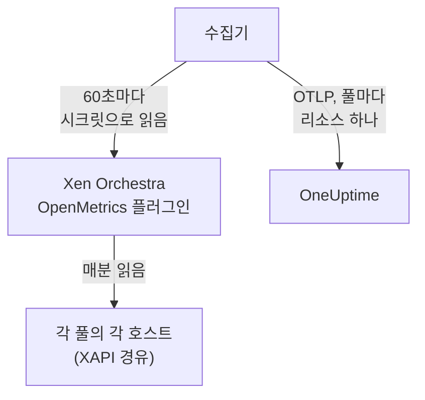

# XCP-ng 에이전트

OneUptime XCP-ng 에이전트는 Xen Orchestra가 관리하는 XCP-ng 풀과 그 호스트, VM, 스토리지 리포지토리, 가상 디스크를 감시합니다. 표준 OpenTelemetry Collector로, Xen Orchestra 자체의 OpenMetrics 플러그인을 플러그인의 시크릿으로 읽고 읽은 내용을 OneUptime으로 보내며, OneUptime에서는 각 풀이 인벤토리와 함께 나타납니다. 풀이나 Xen Orchestra의 비밀번호는 에이전트에 절대 전달되지 않습니다. 들어오는 데이터에는 [XCP-ng 모니터](/docs/monitor/xcp-ng-monitor)로 경고를 보낼 수 있습니다. 아무것도 설치하지 않고 OneUptime 프로브로 같은 풀을 읽으려면 [에이전트 없는 XCP-ng](/docs/telemetry/xcp-ng-agentless)를 참조하세요.

:::cards
- [에이전트 설치](#에이전트-설치): 플러그인을 켠 다음 설치 스크립트나 Docker Compose를 사용합니다.
- [Xen Orchestra의 인증서](#xen-orchestra의-인증서): 에이전트가 Xen Orchestra를 신뢰하는 방법이며, 검사를 건너뛰는 일은 없습니다.
- [에이전트가 수집하는 것](#에이전트가-수집하는-것): 플러그인의 모든 계열과 실제로는 비율인 카운터.
- [문제 해결](#문제-해결): 진단 스크립트와 일반적인 문제.
:::

## 얻을 수 있는 것

- **풀마다 따로.** Xen Orchestra가 관리하는 각 풀은 OneUptime에서 XCP-ng 풀이 되며, XAPI UUID로 식별되고 Xen Orchestra에서의 이름으로 표시됩니다. Xen Orchestra 하나 뒤에 있는 풀 두 개는 두 개의 풀이며, OneUptime에서 풀 이름을 바꿔도 안전합니다. 텔레메트리는 UUID로 풀에 연결됩니다.
- **그 인벤토리.** 풀의 호스트, VM, 스토리지 리포지토리, 가상 디스크와 그 상태 및 메트릭. 컨트롤 도메인(dom0)은 VM으로 보고되며, 풀의 페이지에서는 표시를 요청하지 않는 한 숨겨집니다.
- **Xen Orchestra마다 에이전트 하나.** 플러그인은 그 Xen Orchestra가 연결된 모든 풀을 제공하므로 에이전트 하나로 모두 읽으며, 나중에 연결한 풀은 다음 읽기에서 나타납니다.

## 작동 방식

에이전트는 머신 한 대에서 Docker Compose로 실행하는 컨테이너 하나입니다. OneUptime 전용 이미지가 없는 표준 OpenTelemetry Collector입니다. 60초마다 플러그인의 시크릿을 Bearer 토큰으로 사용해 Xen Orchestra 자체의 주소와 인증서로 `/openmetrics/metrics`를 요청합니다. 플러그인은 XAPI를 통해 각 호스트의 메트릭을 60초 해상도로 읽습니다. 수집기는 풀의 계열을 남기고, 풀별로 묶어 OTLP로 OneUptime에 보냅니다.



각 풀은 첫 데이터로 스스로 등록됩니다. 에이전트가 계열에 `xcp_ng.pool.id`로 붙이는 UUID와, Xen Orchestra가 붙인 이름 `xcp_ng.pool.name`이 사용됩니다. Xen Orchestra에서 이름이 없는 풀은 이름을 바꿀 때까지 "Pool" 뒤에 UUID의 앞부분이 붙은 이름이 됩니다.

## 시작하기 전에

- 감시할 풀에 연결되어 있고 OpenMetrics 플러그인이 있는 Xen Orchestra 6.9 이상. Xen Orchestra Appliance(XOA)에서는 플러그인에 Premium 라이선스가 필요합니다. 소스에서 빌드한 Xen Orchestra에는 플러그인이 들어 있습니다.
- HTTPS로 Xen Orchestra에 닿을 수 있는 머신의 Docker Compose v2 플러그인이 포함된 Docker Engine 20.10 이상, `curl`, `openssl`.
- 에이전트가 연결하는 주소를 명시한 Xen Orchestra의 인증서. Xen Orchestra가 자신을 위해 만드는 자체 서명 인증서에는 주소가 없어서 현재의 어떤 TLS 클라이언트도 검증할 수 없고, 소스에서 빌드한 Xen Orchestra는 인증서를 줄 때까지 평문 HTTP로 응답합니다. [Xen Orchestra의 인증서](#xen-orchestra의-인증서)를 참조하세요.
- 수집 키. **프로젝트 설정 → 텔레메트리 및 APM → 수집 키**에서 만들고 값을 복사합니다.
- 그 머신에서 OneUptime URL로 나가는 HTTPS.

### 지원되는 버전

| | 지원 | 이유 |
| --- | --- | --- |
| Xen Orchestra | 6.9 이상, OpenMetrics 플러그인 `xo-server-openmetrics` 1.9 포함 | 이 플러그인은 Xen Orchestra가 다시 시작해도 시크릿을 유지하고, 읽기 중 메모리 누수 수정이 들어 있으며, 풀의 페이지가 읽는 모든 계열(호스트와 VM의 상태, 스토리지 리포지토리, 가상 디스크)을 제공합니다. 이전 플러그인은 다시 시작할 때 새 시크릿을 만들어, 누군가 다시 복사할 때까지 에이전트를 차단할 수 있었습니다. |
| XCP-ng | 8.3 LTS | Vates가 2028년 11월 30일까지 지원합니다. XCP-ng 8.2는 2025년 9월 16일에 지원이 종료되었습니다. |
| XenServer | 아직 시험하지 않음 | Xen Orchestra는 관리하는 XenServer 풀을 같은 계열로 보고하므로 동작해야 하지만, 아직 OneUptime으로 시험한 사람은 없습니다. |

### 에이전트를 실행할 위치

에이전트는 HTTPS로 Xen Orchestra와 통신하므로 Docker와 그곳까지의 경로만 있으면 어느 머신에서나 실행할 수 있습니다. Xen Orchestra 머신 자체, 모니터링 호스트, 작은 관리용 VM 등입니다. 가능하면 감시 대상 풀에서 VM이 실행되지 않는 머신을 고르세요. 풀이 다운될 때 모니터링이 함께 다운되면 안 됩니다. 에이전트 하나는 Xen Orchestra 하나를 읽습니다. 여러 개라면 [여러 Xen Orchestra 읽기](#여러-xen-orchestra-읽기)를 참조하세요.

## OpenMetrics 플러그인 켜기

에이전트는 Xen Orchestra의 OpenMetrics 플러그인을 통해 플러그인의 시크릿으로 각 풀을 읽습니다.

:::steps
### 플러그인 켜기

Xen Orchestra에서 *Settings → Plugins* 를 열고 **openmetrics** 를 찾아 켭니다. 처음 시작할 때 시크릿을 만들며, Xen Orchestra는 다시 시작해도 이를 유지합니다.

### 시크릿 복사

플러그인 설정을 열고 **Prometheus secret** 을 복사합니다. 다음 단계에서 에이전트에 넘깁니다. 그곳에서 직접 시크릿을 입력해 저장할 수도 있습니다. 시크릿은 비공개로 두세요. 가진 사람은 누구나 각 풀의 메트릭을 읽을 수 있습니다.

### 응답 확인

플러그인은 Xen Orchestra 자체의 주소와 인증서로 `/openmetrics/metrics`에서 응답하며, 시크릿을 보내는 요청에만 응답합니다. 상태 검사에는 시크릿이 필요 없으므로 이 요청에 한해 `-k`로 인증서 검사를 건너뛸 수 있습니다. 에이전트는 절대 그렇게 하지 않습니다.

```bash
curl -k https://xo.example.com/openmetrics/health
```

플러그인이 실행 중이면 `{"status":"ok"}`를 반환합니다. `404`는 플러그인이 켜져 있지 않다는 뜻입니다.
:::

## 에이전트 설치

:::steps
### 에이전트 설치 및 시작

각 OneUptime은 자기 릴리스의 에이전트 설치 스크립트와 파일을 제공합니다. 아래 명령은 `https://oneuptime.com`에서 내려받으므로, 자체 호스팅 OneUptime에서는 이 주소를 사용자의 URL로 바꾸세요. 설치 스크립트는 먼저 `install.sh`로 저장되므로, 실행하기 전에 읽어 볼 수 있습니다.

:::tabs
@tab install.sh
에이전트를 실행할 머신에서 설치 스크립트를 내려받아 실행하세요:

```bash
curl -fsSL https://oneuptime.com/install/xcp-ng-agent -o install.sh
bash install.sh
```

스크립트는 OneUptime URL, 수집 키, 브라우저에서 여는 형태의 Xen Orchestra 주소(예: `https://xo.example.com` 또는 `https://10.0.0.5:8443`), 플러그인의 시크릿(입력하는 동안 표시되지 않음), OneUptime에서 이 Xen Orchestra를 부를 이름을 묻습니다. 그런 다음 Xen Orchestra의 인증서를 읽습니다. 이 머신이 이미 신뢰하는 인증서는 그 CA 번들로 검증하고, 그 밖의 인증서는 SHA-256 지문과 함께 표시하며, Xen Orchestra 머신의 지문과 비교한 뒤 **y** 로 답하면 그 인증서만 신뢰합니다. 검사를 끄는 일은 없습니다. 마지막으로, 무엇이든 설치하기 전에 시크릿으로 플러그인에 메트릭을 요청하고 Xen Orchestra가 보고하는 풀을 알려 줍니다. 설치 위치는 `/opt/oneuptime-xcp-ng-agent`이며, 권한 `0600`으로 `.env` 파일과 `xo-ca.pem`(에이전트가 Xen Orchestra에 대해 신뢰하는 인증서)을 쓰고, Docker Compose로 에이전트를 시작합니다. 스크립트를 다시 실행하면 다시 묻지 않고 그 `.env`의 모든 내용을 재사용합니다. 이것이 [에이전트를 업그레이드](#에이전트-업그레이드)하는 방법입니다.
@tab Docker Compose
사용 중인 OneUptime에서 `docker-compose.yml`과 `otel-collector-config.yaml`을 새 폴더로 내려받으세요:

```bash
mkdir oneuptime-xcp-ng-agent && cd oneuptime-xcp-ng-agent
curl -fsSLO https://oneuptime.com/install/xcp-ng-agent/docker-compose.yml
curl -fsSLO https://oneuptime.com/install/xcp-ng-agent/otel-collector-config.yaml
```

그 옆에 `.env` 파일을 만드세요. 플러그인의 시크릿이 들어 있으므로 `chmod 600 .env`로 비공개로 두세요.

```bash title=".env"
ONEUPTIME_URL=YOUR_ONEUPTIME_URL
ONEUPTIME_TELEMETRY_INGESTION_KEY=YOUR_TELEMETRY_INGESTION_TOKEN
XO_SCHEME=https
XO_ADDRESS=xo.example.com
XO_OPENMETRICS_SECRET='your-plugin-secret'
XO_NAME='Xen Orchestra'
XO_TLS_SERVER_NAME=
XCP_NG_AGENT_CONTAINER_NAME=oneuptime-xcp-ng-agent
```

`XO_ADDRESS`는 Xen Orchestra의 `host` 또는 `host:port`이며, `https://`는 붙이지 않습니다. 플러그인의 시크릿은 작은따옴표로 감싸고, 그 안의 모든 `$`는 `$$`로 씁니다. 수집기가 값을 한 번 더 읽기 때문에 `$`를 변수의 시작으로 오해합니다. `'`가 들어 있는 시크릿은 작은따옴표로 감쌀 수 없습니다. 설치 스크립트가 쓰게 하거나 Xen Orchestra에서 다른 시크릿을 고르세요.

그런 다음 Xen Orchestra의 인증서를 `xo-ca.pem`으로 `docker-compose.yml` 옆에 저장합니다. 에이전트는 Xen Orchestra를 이 파일로만 검증합니다. Xen Orchestra 자체의 인증서를 신뢰하려면 인증서를 읽고, 사용하기 전에 지문을 Xen Orchestra 머신의 지문과 비교하세요.

```bash
openssl s_client -connect xo.example.com:443 -servername xo.example.com </dev/null 2>/dev/null \
  | openssl x509 -out xo-ca.pem
openssl x509 -in xo-ca.pem -noout -fingerprint -sha256
```

자체 CA가 인증서를 발급했다면 대신 그 CA의 인증서를 `xo-ca.pem`에 복사하고, 공개 CA가 발급했다면 이 머신의 CA 번들을 복사합니다(`cp /etc/ssl/certs/ca-certificates.crt xo-ca.pem`). 에이전트를 시작합니다.

```bash
docker compose up -d
```
:::

### 에이전트가 실행 중인지 확인

```bash
docker compose ps
docker logs -f oneuptime-xcp-ng-agent
```

`docker compose ps`에 수집기 `oneuptime-xcp-ng-agent`가 표시됩니다. 시작하면 로그에 다음 줄이 나타나야 합니다.

```text
Everything is ready. Begin running and processing data.
```

### OneUptime에서 풀 찾기

**제품 → 인프라 → XCP-ng → 모든 풀** 을 엽니다. Xen Orchestra가 보고하는 각 풀은 첫 읽기 후 약 1분이 지나면 Xen Orchestra에서의 이름으로, 호스트, VM, 스토리지와 함께 나타납니다. 풀의 **토폴로지** 페이지는 이들을 하나의 지도로 그립니다. [토폴로지](/docs/telemetry/topology#리소스별-지도-열기)를 참조하세요.
:::

## Xen Orchestra의 인증서

에이전트는 읽을 때마다 Xen Orchestra의 인증서를 `xo-ca.pem`으로만 검증하며, 검사를 건너뛰는 일은 없습니다. 플러그인의 시크릿이 모든 요청에 실려 가기 때문입니다. `xo-ca.pem`에는 다음 세 가지 중 하나가 들어 있습니다.

- **Xen Orchestra 자체의 인증서**. SHA-256 지문(`XO_TLS_FINGERPRINT`)으로 고정되며, 에이전트는 그 인증서만 신뢰합니다.
- **그 인증서를 발급한 CA**(`XO_CA_FILE`). 자체 CA의 인증서인 경우입니다.
- **이 머신의 CA 번들**. 공개 CA의 인증서처럼 이 머신이 이미 신뢰하는 인증서인 경우입니다.

어느 경우든 인증서에는 에이전트가 연결하는 주소가 있어야 합니다. 에이전트는 현재의 모든 TLS 클라이언트처럼 인증서가 발급된 이름, 즉 주체 대체 이름(subject alternative names)을 검사하며, 주체 자체는 보지 않습니다. Xen Orchestra가 자신을 위해 만드는 자체 서명 인증서에는 이름이 없으므로, 고정하든 안 하든 에이전트가 신뢰할 수 없고 `x509: certificate is not valid for any names`로 실패합니다. 설치 스크립트는 이런 인증서에서 멈추고 그 이유를 알려 줍니다.

### 주소를 명시한 인증서를 Xen Orchestra에 주기

자체 CA나 공개 CA의 인증서를 쓰거나, Xen Orchestra 머신에서 Xen Orchestra의 이름과 주소를 주체 대체 이름에 넣은 자체 서명 인증서를 만드세요.

```bash
sudo mkdir -p /etc/ssl/xo
sudo openssl req -x509 -newkey rsa:2048 -nodes -days 825 \
  -subj "/CN=xo.example.com" \
  -addext "subjectAltName=DNS:xo.example.com,IP:10.0.0.5" \
  -keyout /etc/ssl/xo/key.pem -out /etc/ssl/xo/cert.pem
```

xo-server의 HTTPS 리스너가 두 파일을 가리키게 합니다. 이 파일들은 xo-server를 실행하는 사용자(기본값은 root)가 읽을 수 있어야 합니다. 설정은 별도 구성 파일에 씁니다. XOA에서는 `/etc/xo-server/config.httpscert.toml`, 소스에서 빌드한 Xen Orchestra에서는 xo-server의 `config.toml` 옆입니다. Xen Orchestra의 리스너에는 번호가 붙어 있으며, 두 번째인 `http.listen.1`이 HTTPS 리스너입니다.

```toml
[http.listen.1]
port = 443
cert = '/etc/ssl/xo/cert.pem'
key = '/etc/ssl/xo/key.pem'
```

그런 다음 `systemctl restart xo-server`로 xo-server를 다시 시작하고, 에이전트를 설치하거나 설치 스크립트를 다시 실행하세요. 스크립트는 새 인증서를 읽고 확인할 수 있도록 지문을 보여 줍니다. 또는 XOA처럼 Xen Orchestra가 직접 Let's Encrypt 인증서를 요청하게 할 수도 있습니다(Xen Orchestra 문서 참조). 공개적으로 신뢰되므로 에이전트에는 설정이 필요 없습니다. 인증서가 `XO_ADDRESS`의 주소와 다른 이름으로 Xen Orchestra를 명시한다면 `XO_TLS_SERVER_NAME`을 그 이름으로 설정하세요. 설치 스크립트는 가능하면 인증서에서 이 값을 채웁니다.

고정한 인증서가 갱신되면 에이전트는 새 인증서를 신뢰할 때까지 Xen Orchestra 읽기를 멈춥니다. 설치 스크립트를 다시 실행하면 새 지문을 보여 주고 아무것도 바꾸지 않은 채 멈춥니다. 그 지문을 Xen Orchestra 머신에서 확인한 다음, 그 지문으로 스크립트를 한 번 더 실행하세요: `XO_TLS_FINGERPRINT=<new fingerprint> bash install.sh`. Docker Compose로 설치했다면 `xo-ca.pem`을 다시 쓰고 `docker compose up -d --force-recreate`를 실행하세요.

## 환경 변수

설치 스크립트는 이 변수들을 `/opt/oneuptime-xcp-ng-agent/.env`에 씁니다. Docker Compose 설치는 `.env`(`docker-compose.yml` 옆에 있는 것)에서 읽습니다. 변수를 바꾼 뒤에는 그 폴더에서 `docker compose up -d`를 실행하세요.

| 변수 | 필수 | 설명 |
| --- | --- | --- |
| `ONEUPTIME_URL` | 예 | OneUptime URL(예: `https://oneuptime.com` 또는 자체 호스팅 인스턴스). 인스턴스가 HTTP 전용이면 `http://`와 해당 포트를 사용하세요. |
| `ONEUPTIME_TELEMETRY_INGESTION_KEY` | 예 | **프로젝트 설정 → 텔레메트리 및 APM → 수집 키**의 수집 키. |
| `XO_URL` | 설치 스크립트 | 브라우저에서 여는 형태의 Xen Orchestra 주소(예: `https://xo.example.com` 또는 `https://10.0.0.5:8443`). 설치 스크립트가 여기서 `XO_SCHEME`과 `XO_ADDRESS`를 만듭니다. |
| `XO_SCHEME` | 아니요 | `https`(기본값). `http`는 실습 환경에서만 쓰세요. 그 경우 시크릿이 암호화되지 않은 채 네트워크를 지나갑니다. |
| `XO_ADDRESS` | 예 | Xen Orchestra의 `host` 또는 `host:port`(스킴 없음). |
| `XO_OPENMETRICS_SECRET` | 예 | OpenMetrics 플러그인의 시크릿으로, Bearer 토큰으로 보냅니다. 그 안의 모든 `$`는 `$$`로 씁니다. |
| `XO_NAME` | 아니요 | OneUptime에서 이 Xen Orchestra를 부르는 이름. 읽는 각 풀에 `xen_orchestra.name`으로 붙고 각 풀의 **설정** 에 표시됩니다. 기본값은 Xen Orchestra의 주소입니다. |
| `XO_TLS_FINGERPRINT` | 설치 스크립트 | Xen Orchestra 자체 인증서의 SHA-256 지문으로, `openssl x509 -fingerprint -sha256`이 출력하는 형태이며 콜론은 선택입니다. 에이전트가 그 인증서만 신뢰할 때 씁니다. 설치 스크립트는 일치하지 않는 인증서를 거부합니다. |
| `XO_CA_FILE` | 설치 스크립트 | Xen Orchestra의 인증서를 발급한 CA 번들. 설치 스크립트가 인증서를 이것으로 검증하고 `xo-ca.pem`에 복사합니다. |
| `XO_TLS_SERVER_NAME` | 아니요 | `XO_ADDRESS`가 인증서에 없는 주소일 때 Xen Orchestra의 인증서를 검사할 이름. 비어 있으면 `XO_ADDRESS`의 호스트입니다. |
| `ONEUPTIME_AI_XO_READ_TOKEN` | 아니요 | 기본 제공 **Read only** 역할의 사본만 가진 Xen Orchestra 사용자의 토큰. 설정하면 [AI 에이전트](#ai-에이전트)가 실행되고 이 토큰으로 읽습니다. |
| `ONEUPTIME_AI_XO_WRITE_TOKEN` | 아니요 | 수정 전용: 수정을 허용하는 역할을 가진 다른 사용자의 토큰. 이것이 없으면 AI 에이전트는 아무것도 변경하지 않습니다. |
| `XCP_NG_POOL_ID` | 아니요 | AI 에이전트가 담당하는 풀의 XAPI UUID. 비어 있으면 읽기 토큰이 볼 수 있는 유일한 풀입니다. |
| `ONEUPTIME_AI_AGENT_RESOURCE_NAME` | 아니요 | AI 에이전트가 등록할 풀로 `XCP_NG_POOL_ID`를 재정의합니다. |
| `ONEUPTIME_AI_INVESTIGATION` | 아니요 | `true` 또는 `false`: OneUptime AI가 조사하는 동안 AI 에이전트의 읽기 전용 명령을 실행해도 되는지 여부. 비어 있으면 켜짐. |
| `ONEUPTIME_AI_FIXES` | 아니요 | `off`, `ask-for-approval`, `automatic` 또는 `bypass-approval`: OneUptime AI가 수정을 적용하는 방식. 비어 있으면 쓰기가 허용된 경우 `ask-for-approval`, 그렇지 않으면 `off`. |
| `ONEUPTIME_AI_ALLOW_WRITES` | 아니요 | `true`이면 AI 에이전트가 변경용 토큰으로 수정을 적용할 수 있습니다. 그 밖의 값이면 읽기 전용으로 유지됩니다. |
| `ONEUPTIME_AI_WRITE_TARGETS` | 아니요 | 수정이 건드릴 수 있는 대상(`vm/<uuid>`, `host/<uuid>`, `pbd/<uuid>` 또는 `schedule/<uuid>`), 쉼표로 구분. `*`는 임의의 문자열과 일치합니다. 비어 있으면 모두. |
| `ONEUPTIME_AI_PROTECTED_TARGETS` | 아니요 | 같은 형식으로, 누가 승인하든 OneUptime AI가 절대 변경하면 안 되는 것: AI 에이전트가 실행되는 VM과 Xen Orchestra 자체의 VM. |
| `LOG_LEVEL` | 아니요 | AI 에이전트의 로그 수준: `debug`, `info`(기본값), `warn` 또는 `error`. |
| `COMPOSE_PROFILES` | 아니요 | `xcp-ng-ai-agent`이면 AI 에이전트가 시작됩니다. 설치 스크립트는 읽기 토큰이 설정되어 있으면 이 값을 쓰고, 그렇지 않으면 뺍니다. |
| `XCP_NG_AGENT_CONTAINER_NAME` | 아니요 | 에이전트의 컨테이너 이름입니다. 기본값은 `oneuptime-xcp-ng-agent`입니다. 같은 머신에 있는 두 번째 Xen Orchestra의 에이전트에는 고유한 이름이 필요합니다. [여러 Xen Orchestra 읽기](#여러-xen-orchestra-읽기)를 참고하세요. 설치 스크립트는 이 값을 설정하지 않으면 새 에이전트의 이름을 폴더 이름을 따서 짓고, 스크립트를 다시 실행해도 그 이름을 유지합니다. |
| `XCP_NG_AI_AGENT_CONTAINER_NAME` | 아니요 | AI 에이전트의 컨테이너 이름입니다. 기본값은 `oneuptime-xcp-ng-ai-agent`입니다. 이 값을 설정하지 않으면 설치 스크립트는 두 번째 Xen Orchestra의 AI 에이전트 이름을 그 수집기 이름에 맞춰 짓고(예: `oneuptime-xcp-ng-ai-agent-lab`, 수집기 `oneuptime-xcp-ng-agent-lab`과 나란히), 스크립트를 다시 실행해도 그 이름을 유지합니다. |

## 에이전트가 수집하는 것

에이전트는 매분 플러그인을 읽고, 플러그인은 XAPI를 통해 각 호스트의 라운드 로빈 데이터베이스를 60초 해상도로 읽습니다. 에이전트는 `xcp_*` 계열을 남기고 각 계열의 풀을 보내는 리소스로 옮겨 `xcp_ng.pool.id`(바뀌지 않는 풀의 UUID)와 `xcp_ng.pool.name`으로 만듭니다.

| 범주 | 계열 |
| --- | --- |
| 풀 | `xcp_pool_connected`. Xen Orchestra가 풀에 연결되어 있는 동안 존재 |
| 호스트 | `xcp_host_status`(전원 상태와 활성화 여부), `xcp_host_uptime_seconds`, `xcp_host_cpu_average`, `xcp_host_cpu_core_usage`, `xcp_host_load`, `xcp_host_load_average`, `xcp_host_memory_*`, `xcp_host_running_vcpus`, 물리 인터페이스별 `xcp_host_network_*`, 스토리지 리포지토리별 `xcp_host_disk_*`, `xcp_host_power_consumption_watts` |
| VM | `xcp_vm_status`, `xcp_vm_uptime_seconds`, `xcp_vm_cpu_usage`, `xcp_vm_cpu_core_usage`, `xcp_vm_runstate_*`(CPU 경합), `xcp_vm_memory_*`, 인터페이스별 `xcp_vm_network_*`, 디스크별 `xcp_vm_disk_*`, `xcp_vm_power_consumption_watts` |
| 스토리지 | `xcp_sr_physical_size_bytes`, `xcp_sr_physical_usage_bytes`, `xcp_sr_virtual_size_bytes`, `xcp_vdi_virtual_size_bytes`, `xcp_vdi_physical_usage_bytes` |
| XOSTOR | `xcp_xostor_*`. XOSTOR를 실행하는 풀에서 |

컨트롤 도메인은 `is_control_domain="true"`인 VM으로 보고됩니다. Xen Orchestra의 각 계열은 이름과 레이블(`uuid`, `host_name`, `vm_name`, `sr_name`, `tags` 등)을 유지합니다. [XCP-ng 모니터](/docs/monitor/xcp-ng-monitor#수집되는-메트릭)에 모두 나와 있습니다.

### 비율인 카운터

Xen Orchestra는 처리량 계열 8개를 카운터로 지정하고 `_total`이라는 이름을 붙이지만, 각각에는 XAPI의 초당 비율이 들어 있습니다: `xcp_host_network_receive_bytes_total`, `xcp_host_network_transmit_bytes_total`, `xcp_vm_network_receive_bytes_total`, `xcp_vm_network_transmit_bytes_total`, `xcp_vm_network_receive_errors_total`, `xcp_vm_network_transmit_errors_total`, `xcp_vm_disk_read_bytes_total`, `xcp_vm_disk_write_bytes_total`. 카운터로 읽으면 네트워크와 디스크 처리량 차트가 모두 틀어집니다. 떨어지는 비율이 카운터 재설정으로 읽히기 때문입니다. 에이전트의 `transform/xcp-ng-rates` 프로세서는 이름과 값을 바꾸지 않고 이들을 게이지로 바꾸므로, OneUptime은 이를 본래의 비율(초당 바이트 또는 오류 수)로 저장합니다. OneUptime은 직접 구성한 수집기에서 아직 카운터로 들어오는 계열도 변환합니다.

### OneUptime이 더하는 것

OneUptime은 각 풀의 데이터가 들어올 때 0/1 계열 4개를 만들어 내며, 경고 템플릿이 이를 읽습니다.

| 계열 | 1인 동안 |
| --- | --- |
| `xcp_ng.host.running` | Xen Orchestra가 호스트를 Running으로 보고하는 동안. Halted이거나 상태가 Unknown이면 0 |
| `xcp_ng.host.enabled` | 호스트가 활성화된 동안. 유지 관리 모드이거나 대피 중이라 XAPI가 그 호스트에서 VM을 시작하지 않을 때는 0 |
| `xcp_ng.vm.running` | VM이 Running인 동안. Halted, Paused, Suspended이면 0 |
| `xcp_ng.vm.stopped_after_running` | 지난 24시간 동안 실행된 VM이 Halted 또는 Paused인 동안 |

Xen Orchestra나 풀의 XAPI에 연결된 프로브가 있으면, OneUptime은 프로브가 메트릭 외에 읽는 내용에서 다음 계열도 만들어 냅니다. 에이전트는 이 중 어느 것도 읽지 않습니다.

| 계열 | 값 |
| --- | --- |
| `xcp_ng.pool.ha.enabled` | 풀의 HA가 켜져 있는 동안 1, 그렇지 않으면 0 |
| `xcp_ng.pool.ha.can_tolerate_host_failure` | HA가 아직 호스트 하나의 장애를 견딜 수 있는 동안 1, 그렇지 않으면 0: XAPI를 통해서는 HA 자체의 계획, Xen Orchestra를 통해서는 장애가 난 호스트 외에 켜져 있고 활성화된 호스트 |
| `xcp_ng.pool.ha.host_failures_to_tolerate` | HA가 견디도록 설정된 호스트 장애 수(XAPI를 통해서만) |
| `xcp_ng.pool.ha.plan_exists_for` | 현재 계획이 감당하는 호스트 장애 수(XAPI를 통해서만) |
| `xcp_ng.vm.backup_overdue` | 예약된 백업 작업에 포함된 VM에 간격과 그 4분의 1(최소 1시간) 안에 성공한 백업이 없는 동안 1(Xen Orchestra를 통해서만) |
| `xcp_ng.host.missing_patches` | 호스트의 누락된 패치 수, 6시간마다 확인(Xen Orchestra를 통해서만) |

또한 모든 지점에 `xcp_ng.scope`(`pool`, `host`, `vm`, `sr`, `vdi`, `xostor` 중 하나)와 `xcp_ng.id`(그 객체의 UUID)를 붙이며, 모니터와 대시보드는 이것으로 필터링합니다. [리소스 식별](/docs/monitor/xcp-ng-monitor#리소스-식별)을 참조하세요.

### 에이전트가 유지하지 않는 것

- 어느 풀에도 속하지 않는 Xen Orchestra 자체의 프로세스 계열(`xo_*`)과 수집기 자체의 읽기 계열.
- Xen Orchestra가 IPMI로 읽는 호스트의 전력. 플러그인이 이 값을 풀 없이 보내므로 이 역시 어느 풀에도 속하지 않습니다. 각 VM의 추정 몫인 `xcp_vm_power_consumption_watts`는 유지됩니다.

## 풀의 페이지에 표시되는 것

**제품 → 인프라 → XCP-ng → 모든 풀** 에서 풀을 엽니다. 메뉴는 다음과 같습니다.

| 페이지 | 보여 주는 것 |
| --- | --- |
| **개요** | 풀의 상태와 확인이 필요한 항목, 호스트, VM, 스토리지, 가장 바쁜 VM과 호스트, 읽어 오는 Xen Orchestra와 에이전트 버전. |
| **호스트**, **VM**, **스토리지** | 각 호스트, VM, 스토리지 리포지토리마다 자체 페이지와 차트가 있습니다. **VM** 은 표시를 요청하지 않는 한 컨트롤 도메인을 숨기며, 스토리지 리포지토리의 페이지에는 그 가상 디스크가 표시됩니다. |
| **토폴로지** | 풀, 그 호스트, 각 호스트의 VM, 그들이 쓰는 스토리지 리포지토리를 하나의 지도로 보여 줍니다. |
| **리소스 사용량** | 풀의 호스트, VM, 스토리지, 디스크, 네트워크의 시간별 차트로, 호스트, VM, 스토리지 리포지토리마다 선 하나입니다. |
| **권장 사항** | 켤 수 있는 [경고 템플릿](/docs/monitor/xcp-ng-monitor#미리-만들어진-경고-템플릿)으로, 각각 모니터 하나입니다. |
| **메트릭**, **로그** | 탐색기에 표시되는 풀의 모든 계열로, 그 풀로 범위가 좁혀져 있습니다. 에이전트는 메트릭만 보내므로 **로그** 에는 풀의 `xcp_ng.pool.id`를 붙여 보낸 로그만 표시됩니다. |
| **인시던트**, **경고**, **예정된 유지 관리** | 풀을 언급하는 것들. |
| **피드** | OneUptime에서 풀에 일어난 일. 추가, 변경, 보관, 복원된 시점, 소유자, 풀에 대해 실행된 소유자 규칙과 레이블 규칙. |
| **소유자** | 수동으로 또는 소유자 규칙으로 풀에 대한 알림을 받는 사람. |
| **설정** | 이름, 읽어 오는 Xen Orchestra, 그곳에서의 이름과 에이전트 버전, 텔레메트리 보존 기간. |
| **문서** | URL과 키가 이미 채워진 이 설정 안내. |

풀의 **개요** 는 확인이 필요한 항목에서 상태를 **정상**, **저하됨**, **비정상** 중 하나로 정하고, 이를 **확인 필요** 아래에 가장 급한 것부터 보여 줍니다.

- **심각:** Halted 상태이거나 Xen Orchestra가 상태를 판단할 수 없는(Unknown) 호스트. 95% 넘게 차서 VM이 더 이상 쓸 수 없는 스토리지 리포지토리.
- **살펴볼 만함:** 비활성화되었거나 유지 관리 모드이거나 대피 중인 호스트. 지난 24시간 동안 실행되다가 Halted 또는 Paused가 된 VM. 90% 넘게 차서 Storage Repository Near Full 경고가 작동하는 스토리지 리포지토리, 또는 씬 프로비저닝으로 크기를 넘어 할당된 스토리지 리포지토리.

일시 중단된 VM(Suspended)은 의도적으로 일시 중단된 것이므로 세지 않으며, 하루 동안 아무도 실행을 보지 못한 VM이나 컨트롤 도메인도 마찬가지입니다. ISO 라이브러리와 이동식 미디어에는 VM 디스크가 없으므로 풀의 스토리지 수치에서 빠집니다.

Xen Orchestra가 풀을 15분 동안 보고하지 않으면 풀은 **연결 끊김** 이 되고, 페이지에는 마지막으로 보고된 내용이 남습니다. Xen Orchestra의 보고에서 사라진 호스트, VM, 스토리지 리포지토리, 가상 디스크는 15분 뒤 인벤토리에서 빠집니다. VM을 중지해도 삭제되지는 않습니다.

## 프로젝트 레이블로 풀 태그 지정

`oneuptime.label.`로 시작하는 리소스 속성은 에이전트가 읽는 모든 풀의 프로젝트 레이블이 됩니다. `oneuptime.label.<dimension>=<value>`는 레이블 `<dimension>:<value>`입니다. 속성은 `resource` 프로세서(`otel-collector-config.yaml` 안)의 `oneuptime.agent.version` 옆에 추가하세요.

```yaml
processors:
  resource:
    attributes:
      # ...existing attributes...
      - key: oneuptime.label.team
        value: platform
        action: upsert
      - key: oneuptime.label.env
        value: production
        action: upsert
```

수집기는 시작할 때만 구성을 읽습니다. `docker compose restart oneuptime-xcp-ng-agent`를 실행하세요. 그러면 풀에 레이블 `team:platform`과 `env:production`이 표시됩니다. 레이블은 대소문자를 구분하지 않고 비교하므로 기존 레이블 `Production`은 중복되지 않고 재사용되며, 에이전트는 누군가 OneUptime에서 추가한 레이블을 제거하지 않습니다. 설치 스크립트를 다시 실행하면 편집한 `otel-collector-config.yaml`이 교체되고, 기존 파일은 옆에 `otel-collector-config.yaml.bak.<timestamp>`로 보관됩니다.

## 여러 Xen Orchestra 읽기

에이전트 하나는 Xen Orchestra 하나와 그것이 관리하는 모든 풀을 읽습니다. 같은 머신에서 두 번째 Xen Orchestra를 읽으려면 두 컨테이너는 이름을 공유할 수 없으므로 두 번째 에이전트를 별도 `.env`와 별도 컨테이너 이름으로 별도 폴더에 설치하세요(예: `INSTALL_DIR=/opt/oneuptime-xcp-ng-agent-lab XCP_NG_AGENT_CONTAINER_NAME=oneuptime-xcp-ng-agent-lab bash install.sh`). `XCP_NG_AGENT_CONTAINER_NAME`을 지정하지 않으면 스크립트가 폴더 이름을 따서 컨테이너 이름을 짓는데, 이 예에서는 같은 이름이 됩니다. 스크립트는 그 이름을 해당 에이전트의 `.env`에 보관하므로 에이전트를 업그레이드하려고 스크립트를 다시 실행해도 이름이 유지되며, `container_name`을 예전에 `docker-compose.yml`에서 직접 수정한 에이전트도 그 이름을 유지합니다. Docker Compose를 쓴다면 대신 `XCP_NG_AGENT_CONTAINER_NAME`을 각 에이전트의 `.env`에 설정하세요. 각각 고유한 `XO_NAME`을 주면 각 풀의 **설정** 에 어느 Xen Orchestra가 읽는지 표시되며, 진단 스크립트에는 `-d`로 폴더를 넘깁니다.

같은 풀을 관리하는 두 Xen Orchestra를 통해 두 에이전트가 같은 풀을 읽게 하지 마세요. OneUptime에서는 UUID로 하나의 풀이 되어 두 번 보고됩니다.

## AI 에이전트

에이전트의 `docker-compose.yml`에는 **XCP-ng AI 에이전트**인 `oneuptime-xcp-ng-ai-agent`(이미지 `oneuptime/resource-ai-agent:release`)도 `xcp-ng-ai-agent` 프로필 아래에 있습니다. OneUptime AI가 풀의 인시던트나 경고를 조사하는 동안 이를 통해 `xo-cli` REST 명령(예: `xo-cli rest get vms fields=name_label,power_state filter=power_state:Halted` 또는 `xo-cli rest get pbds fields=attached,host,SR filter=!attached?`)을 읽기 전용으로 실행하고, 허용한 경우에만 VM 시작이나 스토리지 리포지토리의 PBD 연결 같은 수정을 적용합니다. 안에 `xo-cli` 바이너리는 없습니다. 각 명령은 수집기가 쓰는 주소와 `xo-ca.pem`으로 Xen Orchestra REST API를 정확히 한 번 호출하는 것이 됩니다. OneUptime에서 풀의 **AI 에이전트** 페이지에 나타납니다.

- **읽기 전용 토큰이 따로 필요합니다.** OpenMetrics 시크릿은 메트릭만 읽으므로, AI 에이전트는 기본 제공 **Read only** 역할의 사본만 가진 Xen Orchestra 사용자의 토큰인 `ONEUPTIME_AI_XO_READ_TOKEN`로 Xen Orchestra REST API(Xen Orchestra 6.9 이상)를 읽습니다. 이 값을 설정한 채로 `install.sh`를 실행하거나, 첫 설치에서 물을 때 입력하세요. 스크립트는 Xen Orchestra에 그 토큰을 아는지 묻고, 모드 600의 `.env`에 보관한 뒤 AI 에이전트를 시작합니다. 에이전트는 무엇이든 실행하기 전과 5분마다 토큰이 읽기만 할 수 있는지 확인합니다. 관리자의 토큰이나, 역할이 변경을 허용하는 토큰으로는 아무것도 실행하지 않습니다.
- **AI 에이전트 하나당 풀 하나.** `XCP_NG_POOL_ID`는 에이전트가 담당하는 풀로, 풀의 **설정**에 표시되는 XAPI UUID입니다. 비워 두면 토큰이 볼 수 있는 유일한 풀을 담당합니다. 풀이 여러 개인 Xen Orchestra의 경우, 풀마다 하나씩 더 실행하는 방법이 에이전트의 README에 있습니다. 프로브가 읽는 풀에는 XCP-ng 에이전트가 필요 없습니다. 같은 `docker-compose.yml`에서 그 풀을 위한 AI 에이전트만 단독으로 실행하는 방법도 README에 있습니다.
- **AI 조사는 기본적으로 켜져 있습니다.** 에이전트가 연결되면 OneUptime AI가 에이전트로 풀의 인시던트와 경고를 조사하며, 풀의 **개요**에 에이전트 상태가 표시됩니다. 중지하려면 에이전트가 실행되는 곳에서 `ONEUPTIME_AI_INVESTIGATION=false`를 설정하거나(AI 에이전트 페이지의 **AI가 할 수 있는 작업** 아래 **변경**에서 방법을 볼 수 있습니다) 토큰을 빼세요.
- **수정에는 두 번째 토큰이 필요합니다.** `ONEUPTIME_AI_ALLOW_WRITES=true`와 `ONEUPTIME_AI_XO_WRITE_TOKEN`를 설정하지 않는 한 에이전트는 읽기 전용입니다. 후자는 수정을 허용하는 역할(**VMs power state manager** 역할의 사본에 에이전트의 README가 나열하는 권한을 더한 것)을 가진 다른 사용자의 토큰이며, 변경 자체에만 쓰이고 다른 데에는 쓰이지 않습니다. `ONEUPTIME_AI_WRITE_TARGETS`(`vm/<uuid>`, `host/<uuid>`, `pbd/<uuid>`, `schedule/<uuid>`)가 수정이 건드릴 수 있는 대상을 제한합니다. 에이전트가 실행되는 VM과 Xen Orchestra 자체 VM의 UUID는 `ONEUPTIME_AI_PROTECTED_TARGETS`에 넣으세요. `ONEUPTIME_AI_FIXES`(같은 `.env`에 있음)가 수정 실행 방식, 즉 `ask-for-approval`(사람이 하나씩 승인), `automatic`, `bypass-approval` 중 하나를 정하며, AI 에이전트 페이지에는 읽기 전용으로 표시됩니다([에이전트가 설정하는 AI가 할 수 있는 작업](/docs/ai/infrastructure-ai-agents#ai가-할-수-있는-일-에이전트가-설정)).
- **수집기와 같은 방식으로 Xen Orchestra의 인증서를 검사합니다.** subjectAltName을 보고 `xo-ca.pem`만을 기준으로 검사하므로, Xen Orchestra가 스스로 만드는 인증서는 여기서도 거부됩니다([Xen Orchestra의 인증서](#xen-orchestra의-인증서)). `http://`로는 절대 Xen Orchestra를 읽지 않습니다. 토큰이 암호화되지 않은 채 네트워크를 지나가기 때문입니다.
- 기능(capability) 없이 UID 1000으로 읽기 전용 루트 파일 시스템에서 실행되며, Xen Orchestra의 사용자, 역할, 서버, 플러그인, 원격 저장소를 읽지 않고, 시크릿을 담는 속성으로 필터링하지 않으며, 무엇이든 편집, 삭제, 되돌리기, 복제하지 않습니다.

실행할 수 있는 명령, 수정 방식, 문제 해결 방법은 [Infrastructure AI Agents](/docs/ai/infrastructure-ai-agents#xcp-ng-풀)를 참조하세요. 에이전트의 README에 두 토큰의 역할과 권한이 있습니다.

## systemd 서비스로 실행

에이전트를 머신과 함께 시작하고 실패하면 다시 시작하게 하려면 systemd 유닛을 설치하세요. 유닛은 설치 스크립트가 두는 `/opt/oneuptime-xcp-ng-agent`에 에이전트가 있다고 가정합니다.

```bash
sudo curl -fsSL https://oneuptime.com/install/xcp-ng-agent/systemd/oneuptime-xcp-ng-agent.service -o /etc/systemd/system/oneuptime-xcp-ng-agent.service
sudo systemctl daemon-reload
sudo systemctl enable --now oneuptime-xcp-ng-agent
```

## 에이전트 업그레이드

에이전트는 파일이 고정한 수집기 버전을 각 풀의 **개요** 와 **설정** 에 **에이전트 버전** 으로 보고합니다. 이 OneUptime 릴리스가 고정한 버전보다 오래되면 그 옆에 경고 표시가 나타납니다. 선택하면 아래 명령을 볼 수 있습니다.

수집기 이미지는 `docker-compose.yml`에 고정되어 있고 구성은 그 옆의 파일이므로, pull만으로는 에이전트가 업데이트되지 않습니다. `install.sh`를 다시 실행하세요. 기존 `.env`의 모든 값을 재사용하고(다시 묻는 것은 없습니다), Xen Orchestra의 인증서를 같은 방식으로 검사하고, `docker-compose.yml`과 `otel-collector-config.yaml`을 새로 고치고(편집한 파일은 `<file>.bak.<timestamp>`로 보관됩니다), 이미지를 pull해 에이전트를 다시 만들므로 수집기가 새 구성을 읽습니다. `/opt/oneuptime-xcp-ng-agent` 밖에 설치한 에이전트에는 그 폴더를 지정하세요: `INSTALL_DIR=<folder> bash install.sh`. 에이전트의 컨테이너 이름은 그대로 유지됩니다.

```bash
curl -fsSL https://oneuptime.com/install/xcp-ng-agent -o install.sh
bash install.sh
```

Docker Compose로 설치했나요? 에이전트 폴더에서 두 파일을 다시 내려받고(그 안에서 바꾼 내용이 있으면 다시 적용하세요), 이미지를 pull한 뒤 에이전트를 다시 만드세요. `.env`와 `xo-ca.pem`은 그대로 남습니다.

```bash
curl -fsSLO https://oneuptime.com/install/xcp-ng-agent/docker-compose.yml
curl -fsSLO https://oneuptime.com/install/xcp-ng-agent/otel-collector-config.yaml
docker compose pull
docker compose up -d --force-recreate
```

## 에이전트 제거

```bash
cd /opt/oneuptime-xcp-ng-agent
docker compose down
```

그런 다음 다른 곳에서 읽지 않는다면 Xen Orchestra에서 OpenMetrics 플러그인을 끄세요.

## 문제 해결

:::details 먼저 진단 스크립트 실행
에이전트에는 스크립트 [`troubleshoot.sh`](https://oneuptime.com/install/xcp-ng-agent/troubleshoot.sh)가 함께 제공되며, 데이터가 흐르는 순서대로 전체 경로를 확인합니다. 컨테이너, 에이전트 자체 네트워크에서 본 Xen Orchestra의 주소, 플러그인의 상태 검사, `xo-ca.pem`에 대한 Xen Orchestra의 인증서와 고정한 인증서가 아직 표시되는 인증서와 같은지, 플러그인의 시크릿, Xen Orchestra가 보고하는 풀, 수집 키의 형식, 수집기 자체의 메트릭, 그리고 OneUptime이 수집 키를 받아들이는지입니다. 마지막 검사가 가장 중요합니다. OneUptime은 잘못된 키를 `401`(비활성화된 키나 브라우저 키는 `422`)로 거부하고, 수집기는 둘 다 영구적인 오류로 처리합니다. 배치를 버리고 `Exporting failed` 오류를 하나만 기록하므로, 컨테이너가 정상으로 남아 있는 동안 놓치기 쉽습니다. 스크립트는 에이전트의 네트워크에서 `GET <url>/otlp/v1/validate`를 호출해 즉시 `200`(유효) 또는 `401`(무효)을 받고, 이전 서버에서는 `POST /fluentd/v1/logs`로 대체합니다. 시크릿이나 키는 절대 출력하지 않습니다.

```bash
curl -fsSL https://oneuptime.com/install/xcp-ng-agent/troubleshoot.sh -o troubleshoot.sh
bash troubleshoot.sh    # add -d <dir> if you installed outside /opt/oneuptime-xcp-ng-agent
```

마지막에 가장 가능성 높은 원인을 알려 주는 판정을 출력합니다.
:::

:::details Xen Orchestra가 시크릿을 거부함(401)
수집기가 `server returned HTTP status 401 Unauthorized`를 기록합니다. *Settings → Plugins → openmetrics* 에서 시크릿을 다시 복사해 `XO_OPENMETRICS_SECRET`(`.env` 안)에 작은따옴표로 감싸고 모든 `$`를 `$$`로 써서 설정한 다음, 에이전트 폴더에서 `docker compose up -d`를 실행하세요. 6.8 이전의 Xen Orchestra는 다시 시작할 때 새 시크릿을 만들 수 있었습니다. 업그레이드하세요.
:::

:::details 플러그인이 응답하지 않음(404, 500, 502, 503)
Xen Orchestra는 응답하지만 OpenMetrics 플러그인은 응답하지 않습니다. *Settings → Plugins → openmetrics* 에서 플러그인을 켜고 Xen Orchestra가 6.9 이상인지 확인하세요. XOA에서는 플러그인에 Premium 라이선스가 필요합니다. 플러그인이 실행 중이면 `/openmetrics/health`는 시크릿 없이 `{"status":"ok"}`를 반환합니다.
:::

:::details 인증서 오류
- `x509: certificate is not valid for any names`: Xen Orchestra 자체의 자체 서명 인증서처럼 인증서에 주소가 없습니다. [주소를 명시한 인증서를 Xen Orchestra에 주세요](#주소를-명시한-인증서를-xen-orchestra에-주기).
- `x509: certificate is valid for <names>, not <address>`: 그 이름 중 하나로 연결하거나 `XO_TLS_SERVER_NAME`을 그중 하나로 설정하세요.
- `x509: cannot validate certificate for <IP> because it doesn't contain any IP SANs`: `XO_ADDRESS`가 인증서에 없는 IP 주소입니다. `XO_TLS_SERVER_NAME`을 인증서에 있는 이름으로 설정하거나, 그렇게 해 주는 설치 스크립트를 다시 실행하세요.
- `x509: certificate signed by unknown authority`: `xo-ca.pem`에 이 인증서도, 이를 발급한 CA도 없습니다. 인증서가 갱신되었거나 파일에 다른 인증서가 들어 있습니다. Xen Orchestra 머신에서 새 지문을 확인하고 그 지문으로 설치 스크립트를 실행하거나(`XO_TLS_FINGERPRINT=<new fingerprint> bash install.sh`) 파일을 다시 쓰세요.
- `unable to read CA cert`: `xo-ca.pem`이 없거나 읽을 수 없습니다. 설치 스크립트를 다시 실행하세요.
:::

:::details 읽기가 시간 초과됨(context deadline exceeded)
Xen Orchestra가 메트릭을 모으는 데 에이전트의 한도인 50초를 넘겨서 그 읽기에서는 아무것도 보내지 않습니다. 대개 풀 중 하나의 호스트가 응답하지 않는 경우입니다. Xen Orchestra에서 풀의 호스트를 확인하세요. 에이전트는 1분 뒤에 다시 읽습니다.
:::

:::details 풀이 연결 끊김 상태임
OneUptime은 15분 동안 아무것도 읽히지 않은 풀을 연결 끊김으로 표시합니다. OneUptime은 5분마다 확인하며, OneUptime 자체가 데이터를 받지 못한 시간은 세지 않습니다.

1. 이 Xen Orchestra의 모든 풀이 연결 끊김이면 에이전트를 확인하세요. 에이전트 폴더에서 `docker compose ps`와 `docker logs oneuptime-xcp-ng-agent`를 실행합니다.
2. 하나뿐이라면 Xen Orchestra가 더 이상 그 풀을 보고하지 않는 것입니다. Xen Orchestra의 *Settings → Servers* 에서 풀의 서버가 연결되어 있어야 합니다. 풀의 호스트, VM, 스토리지는 Xen Orchestra가 마지막으로 보고한 상태로 남습니다.
:::

:::details 풀이 보이지 않음
Xen Orchestra는 연결된 풀만 보고하고, 에이전트는 그 Xen Orchestra만 읽습니다. Xen Orchestra의 *Settings → Servers* 에서 풀의 서버를 연결하세요. 다음 읽기에서 풀이 OneUptime에 나타납니다. 다른 Xen Orchestra가 관리하는 풀에는 그 Xen Orchestra 옆에 별도 에이전트가 필요합니다.
:::

:::details 처리량 차트가 이상해 보임
비율을 담은 `_total` 계열 8개는 게이지로 OneUptime에 도착해야 합니다. 제공된 `otel-collector-config.yaml`을 직접 만든 것으로 바꿨다면 그 안에 `transform/xcp-ng-rates` 프로세서를 남기세요. 이 계열들은 초당 바이트 또는 오류 수 그대로 읽으세요. 여기서 초당 비율을 구하면 비율의 비율이 됩니다.
:::

:::details 에이전트 없이 메트릭 보내기
에이전트는 수집기의 표준 구성 하나로 이루어져 있으므로, 이미 실행 중인 수집기로도 같은 일을 할 수 있습니다. 제공된 구성에서 읽기 작업과 프로세서를 여러분의 구성으로 복사하세요. 리소스 속성 `xcp_ng.pool.id`는 OneUptime에 각 풀을 등록하고, `groupbyattrs` 프로세서는 각 풀을 리소스 하나로 만들며, `service.name`과 `service.instance.id`를 제거하면 데이터가 서비스 아래로 들어가지 않습니다. 이 세 가지와 `transform/xcp-ng-rates`를 남기세요.
:::

## 플러그인이 아직 다루지 않는 것

Xen Orchestra의 OpenMetrics 플러그인은 메트릭을 제공하므로, XCP-ng 풀에서 지켜볼 것 중 일부는 아직 없습니다.

- XOSTOR 외의 **알람**, **HA 상태**, **풀 마스터**, **누락된 패치**, **백업**. OneUptime 프로브가 Xen Orchestra의 REST API나 풀의 XAPI에서 읽습니다([#10997](https://github.com/OneUptime/oneuptime/issues/10997)). [에이전트 없는 XCP-ng](/docs/telemetry/xcp-ng-agentless)를 참조하세요.
- 각 VM의 **스냅숏**과 호스트 물리 인터페이스(PIF)의 **링크 상태**. 아직 어떤 프로브도 읽지 않습니다([#11328](https://github.com/OneUptime/oneuptime/issues/11328)).
- Xen Orchestra가 없는 **풀**, 또는 플러그인에 필요한 Premium 라이선스가 없는 XOA 뒤의 풀. OneUptime 프로브가 이들을 XAPI에서 직접 읽습니다([#10999](https://github.com/OneUptime/oneuptime/issues/10999)). [에이전트 없는 XCP-ng](/docs/telemetry/xcp-ng-agentless)를 참조하세요.
- VMware처럼 OneUptime 프로브가 Xen Orchestra의 플러그인을 직접 읽는 **에이전트 없는 연결**([#10996](https://github.com/OneUptime/oneuptime/issues/10996)). 같은 페이지에서 설명합니다.

## 다음 단계

:::cards
- [XCP-ng 모니터](/docs/monitor/xcp-ng-monitor): 풀, 호스트, VM, 스토리지 리포지토리에 대한 경고.
- [Proxmox 에이전트](/docs/telemetry/proxmox): 같은 방식으로 Proxmox VE 클러스터를 감시합니다.
- [호스트 OpenTelemetry 수집기](/docs/telemetry/host-otel-collector): VM 안에서 본 운영 체제의 모습.
:::
