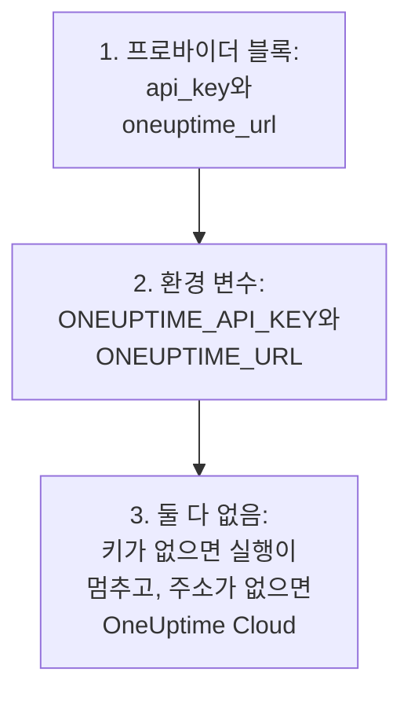
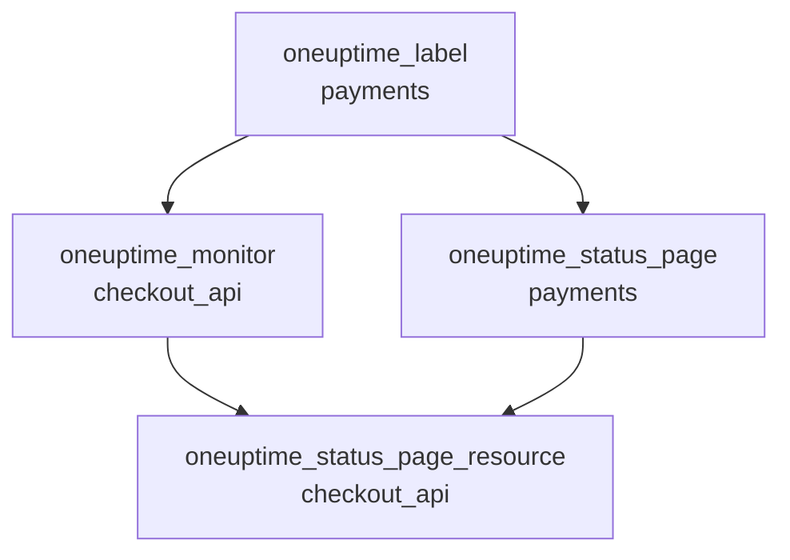

# 완전한 가이드

이 가이드는 첫 apply 이후의 일을 다룹니다. 프로바이더가 API 키를 찾는 방법, 하나 또는 여러 프로젝트를 위해 구성을 짜는 방법, 리소스끼리 서로 참조하는 방법, 관리하지 않는 레코드를 읽는 방법, state를 안전하게 지키는 방법, 그리고 업그레이드하는 방법입니다. 프로바이더가 처음이라면 [빠른 시작](/docs/terraform/quick-start)부터 시작하세요.

:::cards
- [프로바이더 설정](#프로바이더-설정): API 키와 주소, 그리고 프로바이더가 그것을 읽는 곳.
- [구성 짜기](#구성-짜기): 파일, 프로젝트, 그리고 블록 하나에서 만드는 여러 리소스.
- [이미 있는 것 읽기](#이미-있는-것-읽기): 데이터 소스와, 조회가 일치하는 방식.
- [state를 안전하게 지키기](#state를-안전하게-지키기): 원격 백엔드와, 절대 커밋하면 안 되는 것.
:::

## 프로바이더 설정

프로바이더는 설정 두 가지를 받습니다. 각 설정은 프로바이더 블록에서, 없으면 환경 변수에서 가져옵니다.

| 설정 | 환경 변수 | 둘 다 설정되지 않은 경우 |
| --- | --- | --- |
| `api_key` | `ONEUPTIME_API_KEY` | 아무것도 계획되기 전에 프로바이더가 멈춥니다: `Missing API Key` |
| `oneuptime_url` | `ONEUPTIME_URL` | `https://oneuptime.com`, 즉 OneUptime Cloud |



`oneuptime_url`은 `/api`를 뺀 OneUptime 주소입니다. 프로바이더는 주소에 스킴이 없으면 `https://`를, 끝에는 `/api`를 붙입니다. `api_key`는 민감한 값이므로 Terraform이 절대 출력하지 않습니다.

키는 관리하는 프로젝트의 API 키여야 하며, 구성에 있는 모든 종류의 레코드를 만들고, 읽고, 변경하고, 삭제할 수 있어야 합니다. [프로젝트 API 키 만들기](/docs/terraform/quick-start#프로젝트-api-키-만들기)를 참조하세요. 자체 호스팅 OneUptime의 마스터 API 키는 어떤 프로젝트에도 속하지 않으므로, 이 키로 만들기를 하면 `ProjectId required`로 실패합니다.

### 프로바이더에 키 전달하기

:::tabs
@tab 환경 변수
```bash
export ONEUPTIME_API_KEY="<your-api-key>"
# Only on a self-hosted OneUptime:
export ONEUPTIME_URL="https://oneuptime.example.com"
```

```hcl title="main.tf"
provider "oneuptime" {}
```
@tab Terraform 변수
```hcl title="variables.tf"
variable "oneuptime_api_key" {
  description = "API key of the OneUptime project"
  type        = string
  sensitive   = true
}

provider "oneuptime" {
  api_key = var.oneuptime_api_key
}
```

```hcl title="terraform.tfvars"
oneuptime_api_key = "<your-api-key>"
```
:::

환경 변수를 쓰면 키가 어떤 파일에도 남지 않습니다. 변수 파일은 자신의 컴퓨터에서 편리합니다. `terraform.tfvars`를 `.gitignore`에 추가하세요. 파이프라인에서는 파일을 쓰는 대신 `TF_VAR_oneuptime_api_key`를 설정합니다.

### CI/CD에서 실행하기

작업에 키를 시크릿으로, 환경 변수 `ONEUPTIME_API_KEY`에 넣어 전달합니다.

:::tabs
@tab GitHub Actions
```yaml title=".github/workflows/oneuptime.yml"
name: OneUptime
on:
  push:
    branches: [main]

jobs:
  apply:
    runs-on: ubuntu-latest
    env:
      ONEUPTIME_API_KEY: ${{ secrets.ONEUPTIME_API_KEY }}
    steps:
      - uses: actions/checkout@v4
      - uses: hashicorp/setup-terraform@v3
      - run: terraform init -input=false
      - run: terraform plan -input=false -out=tfplan
      - run: terraform apply -input=false tfplan
```
@tab GitLab CI
```yaml title=".gitlab-ci.yml"
apply:
  image:
    name: hashicorp/terraform:latest
    entrypoint: [""]
  rules:
    - if: $CI_COMMIT_BRANCH == $CI_DEFAULT_BRANCH
  script:
    - terraform init -input=false
    - terraform plan -input=false -out=tfplan
    - terraform apply -input=false tfplan
```
:::

GitHub에서는 **Settings → Secrets and variables → Actions**에서 시크릿을 추가하고, GitLab에서는 같은 이름의 마스킹된 CI/CD 변수를 추가합니다. state는 [원격 백엔드](#state를-안전하게-지키기)에 두어, 각 실행이 이전 실행이 남긴 state에서 시작하게 하세요.

## 구성 짜기

잘 작동하는 구성 방식의 예입니다.

```text
oneuptime/
├── main.tf          # the terraform and provider blocks
├── variables.tf     # input variables
├── outputs.tf       # the IDs other configurations need
├── shared.tf        # labels, teams and monitor statuses
├── monitors.tf      # monitors and monitor groups
├── status-pages.tf  # status pages and their domains
└── on-call.tf       # on-call policies and escalation rules
```

- **프로젝트마다 구성 하나.** API 키는 하나의 프로젝트에 속하므로, 구성은 자연스럽게 프로젝트 하나를 관리합니다.
- **공유하는 레코드는 한 번만.** 레이블, 팀, 모니터 상태는 파일 하나에 정의하고, 다른 곳에서는 주소로 참조하세요.

### 여러 프로젝트 관리하기

구성 하나로 여러 프로젝트를 관리하려면 프로젝트마다 프로바이더 별칭을 만들고, 각각에 그 프로젝트의 키를 지정합니다. 리소스는 사용할 별칭을 `provider`로 지정합니다.

```hcl
provider "oneuptime" {
  alias   = "production"
  api_key = var.production_api_key
}

provider "oneuptime" {
  alias   = "staging"
  api_key = var.staging_api_key
}

resource "oneuptime_label" "staging_critical" {
  provider = oneuptime.staging

  name  = "critical"
  color = "#FF5733"
}
```

`production_api_key`와 `staging_api_key`는 위와 같이 `sensitive`로 표시한 변수로 선언하세요.

### 블록 하나에서 여러 리소스 만들기

`for_each`는 map의 항목마다 리소스를 하나씩 만듭니다. 이 모니터들은 기준을 공유하고 이름과 주소만 다릅니다.

```hcl
variable "websites" {
  type = map(string)
  default = {
    homepage = "https://example.com"
    docs     = "https://docs.example.com"
  }
}

resource "oneuptime_monitor" "website" {
  for_each = var.websites

  name                = "Website: ${each.key}"
  monitor_type        = "Website"
  monitoring_interval = "*/5 * * * *"

  monitor_steps = [{
    monitor_destination      = each.value
    monitor_destination_type = "URL"

    criteria = [
      {
        name                  = "Offline"
        filter_condition      = "Any"
        change_monitor_status = true
        monitor_status_id     = data.oneuptime_monitor_status.offline.id

        filters = [
          {
            check_on    = "Is Online"
            filter_type = "False"
          }
        ]
      }
    ]
  }]
}
```

map에 사이트를 추가하면 다음 apply가 그 모니터를 만듭니다. 하나를 빼면 그 모니터를 삭제합니다.

## 다른 리소스 참조하기

다른 리소스의 속성을 참조하는 리소스는 그 리소스에 의존하며, Terraform은 이 참조에 따라 작업 순서를 정합니다. 여기서는 모니터와 상태 페이지가 레이블을 참조하므로, 레이블이 가장 먼저 만들어지고 가장 나중에 삭제됩니다.



```hcl
resource "oneuptime_label" "payments" {
  name        = "payments"
  description = "Payment infrastructure"
  color       = "#2ECC71"
}

resource "oneuptime_monitor" "checkout_api" {
  name         = "Checkout API"
  description  = "Availability of the checkout API"
  monitor_type = "Manual"
  labels       = [oneuptime_label.payments.id]
}

resource "oneuptime_status_page" "payments" {
  name                  = "Payments Status"
  page_title            = "Payments Status"
  is_public_status_page = true
  labels                = [oneuptime_label.payments.id]
}

resource "oneuptime_status_page_resource" "checkout_api" {
  status_page_id = oneuptime_status_page.payments.id
  monitor_id     = oneuptime_monitor.checkout_api.id
  display_name   = "Checkout API"
}
```

`depends_on`이 필요한 경우는 드뭅니다. Terraform이 속성에서 알 수 없는 순서가 있을 때만 추가하세요. `labels` 같은 ID 목록은 집합이므로 순서를 바꿔도 아무것도 바뀌지 않습니다.

## 이미 있는 것 읽기

모든 리소스에는 같은 이름의 데이터 소스가 있습니다. 데이터 소스는 이 구성이 관리하지 않는 레코드(대시보드나 다른 구성에서 만든 것)를 읽으므로, 관리를 넘겨받지 않고도 그 레코드를 참조할 수 있습니다.

```hcl
data "oneuptime_label" "critical" {
  name = "critical"
}

data "oneuptime_monitor_status" "offline" {
  is_offline_state = true
}

data "oneuptime_status_page" "main" {
  id = "5f8a1b2c-3d4e-4f6a-8b9c-0d1e2f3a4b5c"
}

resource "oneuptime_monitor" "database" {
  name         = "Database Health"
  monitor_type = "Manual"
  labels       = [data.oneuptime_label.critical.id]
}
```

조회가 일치하는 방식:

| 지정하는 것 | 찾는 것 | 오류 |
| --- | --- | --- |
| `id` | 그 ID를 가진 레코드 | 그 ID를 가진 레코드가 없으면 `Not Found` |
| 그 밖의 단순 인수, 하나 이상 | 모두와 일치하는 단 하나의 레코드 | 일치하는 것이 없으면 `Not Found`, 둘 이상이면 `Ambiguous Match` |
| `id`와 다른 인수, 또는 아무것도 없음 | 없음 | `Invalid Lookup` |

단순 인수란 텍스트, 숫자, 참 또는 거짓입니다. 이름, 우선순위, `is_offline_state` 같은 플래그 등입니다. 목록, JSON 값, 타임스탬프, 시크릿으로는 조회할 수 없습니다. 레코드를 읽기만 하는 대신 관리를 넘겨받으려면 [가져오기](/docs/terraform/importing-resources)를 하세요.

## state를 안전하게 지키기

Terraform의 state에는 Terraform이 관리하는 모든 것의 ID와 속성이 시크릿까지 포함해 들어 있습니다. state는 잠금을 지원하는 원격 백엔드에 두어, 팀이 state 하나를 공유하고 두 실행이 동시에 쓰는 일이 없게 하세요. 표준 백엔드라면 무엇이든 됩니다. 예를 들어 S3 버킷입니다.

```hcl
terraform {
  backend "s3" {
    bucket       = "my-terraform-state"
    key          = "oneuptime/production.tfstate"
    region       = "us-east-1"
    encrypt      = true
    use_lockfile = true
  }
}
```

`use_lockfile`에는 Terraform 1.10 또는 OpenTofu 1.10 이상이 필요합니다. 그 이전에는 S3 백엔드가 DynamoDB 테이블(`dynamodb_table`)로 잠급니다.

- **state를 직접 편집하지 마세요.** `terraform state mv`와 `terraform state rm`을 사용하세요.
- **`terraform.tfstate`나 시크릿이 들어 있는 `.tfvars` 파일은 절대 커밋하지 마세요.**

## 드리프트, 그리고 드리프트가 아닌 것

`terraform plan`은 OneUptime과 구성을 비교해 다른 점을 나열합니다. 다음 차이는 표시되지 않습니다.

- **시간은 시점으로 비교합니다.** `2030-06-01T02:00:00Z`와 서버가 같은 시점을 쓰는 형식은 같습니다.
- **서버가 추가하는 기본값**은 모니터의 단계에 있든 JSON 값에 있든, 여러분이 쓴 것과의 차이가 아닙니다.
- **서버가 최신으로 유지하는 것**(예: 모니터의 현재 상태)도 차이가 아닙니다.

반면 실행할 때마다 계산하는 값은 차이가 됩니다. `timestamp()`는 실행할 때마다 새 시각을 내므로 계획에 항상 표시됩니다. 대신 고정된 시각을 쓰세요.

```hcl
resource "oneuptime_scheduled_maintenance_event" "database_upgrade" {
  title       = "Database upgrade"
  description = "Planned PostgreSQL upgrade"
  starts_at   = "2030-06-01T02:00:00Z"
  ends_at     = "2030-06-01T04:00:00Z"
}
```

## 프로바이더 업그레이드

:::steps
### 릴리스 노트 읽기

[Terraform Registry](https://registry.terraform.io/providers/oneuptime/oneuptime)와 [프로바이더의 GitHub 릴리스](https://github.com/OneUptime/terraform-provider-oneuptime/releases)에 무엇이 바뀌었는지 나와 있습니다.

### 버전 제약 조건 올리기

`{{TERRAFORM_PROVIDER_VERSION}}`은 이미 모든 {{TERRAFORM_PROVIDER_MAJOR}}.x 릴리스를 사용합니다. 새 메이저 버전에는 새 제약 조건이 필요합니다.

### 새 버전 내려받기

```bash
terraform init -upgrade
```

### 적용하기 전에 계획하기

`terraform plan`을 실행하고, 계획이 비어 있거나 예상한 변경만 보여 줄 때만 적용하세요.
:::

자체 호스팅 OneUptime에서는 OneUptime을 먼저 업그레이드하고 그다음에 프로바이더를 업그레이드하세요. 프로바이더는 사용 중인 OneUptime보다 새로우면 안 됩니다. [자체 호스팅 설정](/docs/terraform/self-hosted)을 참조하세요.

## 다음 단계

:::cards
- [모니터 단계](/docs/terraform/monitor-steps): 모니터가 무엇을 확인하고 각 결과가 무엇을 뜻하는지 정합니다.
- [예제](/docs/terraform/examples): 흔히 쓰는 리소스를 위한 바로 쓸 수 있는 구성.
- [리소스 가져오기](/docs/terraform/importing-resources): 대시보드에서 만든 것을 Terraform 관리로 가져옵니다.
- [문제 해결](/docs/terraform/troubleshooting): 흔한 오류와 해결 방법.
:::
