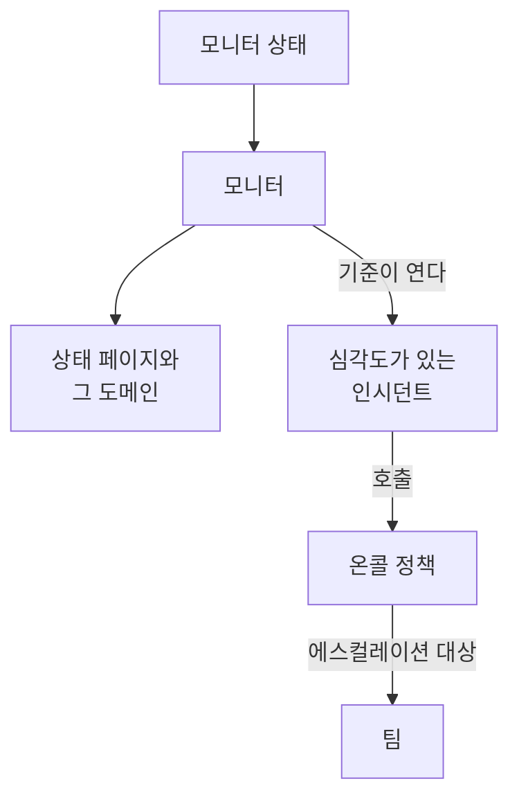

# 예제

대부분의 프로젝트가 처음 만드는 리소스를 위한, 바로 쓸 수 있는 구성입니다. 각 블록은 아래 프로바이더 설정 위에 그대로 적용되며, 대부분은 프로바이더의 엔드투엔드 테스트에서 가져온 것으로, 변경이 있을 때마다 실제 OneUptime에 적용됩니다.

:::cards
- [모니터](#모니터): 웹사이트, API, ping, 포트, SSL 인증서, heartbeat, 수동 모니터.
- [상태 페이지](#상태-페이지): 그룹과 모니터가 있는 상태 페이지와 사용자 지정 도메인.
- [팀과 온콜](#팀과-온콜): 팀과, 그 팀을 호출하는 온콜 정책.
- [인시던트와 유지 관리](#인시던트와-유지-관리): 심각도, 상태, 선언한 인시던트, 유지 관리 기간.
:::



## 프로바이더 설정

모든 예제는 API 키를 환경 변수 `ONEUPTIME_API_KEY`에 넣은 이 설정을 전제로 합니다.

```hcl title="main.tf"
terraform {
  required_providers {
    oneuptime = {
      source  = "oneuptime/oneuptime"
      version = "{{TERRAFORM_PROVIDER_VERSION}}"
    }
  }
}

provider "oneuptime" {
  # On a self-hosted OneUptime, add your OneUptime's address:
  # oneuptime_url = "https://oneuptime.example.com"
}
```

## 레이블

레이블은 레코드를 정렬하고 필터링합니다. 대부분의 리소스는 `labels`에 레이블 ID 집합을 받습니다.

```hcl
resource "oneuptime_label" "production" {
  name        = "production"
  description = "Production infrastructure"
  color       = "#FF5733"
}
```

## 모니터

아래 모니터들은 모든 프로젝트가 처음부터 가진 상태 중 세 개를 데이터 소스로 읽어 자신의 상태로 씁니다.

```hcl
data "oneuptime_monitor_status" "operational" {
  name = "Operational"
}

data "oneuptime_monitor_status" "degraded" {
  name = "Degraded"
}

data "oneuptime_monitor_status" "offline" {
  name = "Offline"
}
```

각 모니터의 `monitor_steps`는 무엇을 확인하고 각 결과를 어떻게 판정하는지 나타냅니다. 모든 속성은 [모니터 단계](/docs/terraform/monitor-steps)에서 설명합니다.

### 웹사이트 모니터

사이트가 응답하지 않으면 offline, 200으로 응답하면 online입니다. 엔드투엔드 테스트 `35-monitor-with-steps`가 이 확인을 하는 모니터를 적용합니다.

```hcl
resource "oneuptime_monitor" "website" {
  name                = "Website"
  description         = "Homepage availability and status code"
  monitor_type        = "Website"
  monitoring_interval = "*/5 * * * *"
  labels              = [oneuptime_label.production.id]

  monitor_steps = [{
    monitor_destination      = "https://example.com"
    monitor_destination_type = "URL"
    request_type             = "GET"

    criteria = [
      {
        name                  = "Offline"
        description           = "The website does not respond"
        filter_condition      = "Any"
        change_monitor_status = true
        monitor_status_id     = data.oneuptime_monitor_status.offline.id

        filters = [
          {
            check_on    = "Is Online"
            filter_type = "False"
          }
        ]
      },
      {
        name                  = "Online"
        description           = "The website responds with 200"
        filter_condition      = "All"
        change_monitor_status = true
        monitor_status_id     = data.oneuptime_monitor_status.operational.id

        filters = [
          {
            check_on    = "Is Online"
            filter_type = "True"
          },
          {
            check_on    = "Response Status Code"
            filter_type = "Equal To"
            value       = "200"
          }
        ]
      }
    ]
  }]
}
```

### API 모니터

헤더와 JSON 본문이 있는 `POST`이며, 응답이 느리면 degraded가 됩니다. 엔드투엔드 테스트 `35-monitor-with-steps`가 이와 비슷한 API 모니터를 적용합니다.

```hcl
resource "oneuptime_monitor" "orders_api" {
  name         = "Orders API"
  description  = "Health check of the orders API"
  monitor_type = "API"

  monitor_steps = [{
    monitor_destination      = "https://api.example.com/v1/health"
    monitor_destination_type = "URL"
    request_type             = "POST"
    request_headers = {
      "Content-Type" = "application/json"
      "Accept"       = "application/json"
    }
    request_body = jsonencode({ check = "health" })

    criteria = [
      {
        name                  = "Offline"
        description           = "The API does not answer, or answers with an error"
        filter_condition      = "Any"
        change_monitor_status = true
        monitor_status_id     = data.oneuptime_monitor_status.offline.id

        filters = [
          {
            check_on    = "Is Online"
            filter_type = "False"
          },
          {
            check_on    = "Response Status Code"
            filter_type = "Greater Than Or Equal To"
            value       = "500"
          }
        ]
      },
      {
        name                  = "Slow"
        description           = "The API takes more than two seconds"
        filter_condition      = "All"
        change_monitor_status = true
        monitor_status_id     = data.oneuptime_monitor_status.degraded.id

        filters = [
          {
            check_on    = "Response Time (in ms)"
            filter_type = "Greater Than"
            value       = "2000"
          }
        ]
      },
      {
        name                  = "Online"
        description           = "The API answers in time"
        filter_condition      = "All"
        change_monitor_status = true
        monitor_status_id     = data.oneuptime_monitor_status.operational.id

        filters = [
          {
            check_on    = "Is Online"
            filter_type = "True"
          }
        ]
      }
    ]
  }]
}
```

### Ping 모니터

Ping 모니터는 URL 대신 호스트 이름이나 IP 주소를 받습니다.

```hcl
resource "oneuptime_monitor" "gateway" {
  name         = "Gateway"
  description  = "The gateway answers ping"
  monitor_type = "Ping"

  monitor_steps = [{
    monitor_destination      = "gateway.example.com"
    monitor_destination_type = "Hostname"

    criteria = [
      {
        name                  = "Unreachable"
        filter_condition      = "Any"
        change_monitor_status = true
        monitor_status_id     = data.oneuptime_monitor_status.offline.id

        filters = [
          {
            check_on    = "Is Online"
            filter_type = "False"
          }
        ]
      },
      {
        name                  = "Reachable"
        filter_condition      = "All"
        change_monitor_status = true
        monitor_status_id     = data.oneuptime_monitor_status.operational.id

        filters = [
          {
            check_on    = "Is Online"
            filter_type = "True"
          }
        ]
      }
    ]
  }]
}
```

### 포트 모니터

포트 모니터는 확인할 `port`를 숫자로 추가합니다.

```hcl
resource "oneuptime_monitor" "database_port" {
  name         = "Database port"
  description  = "PostgreSQL accepts connections"
  monitor_type = "Port"

  monitor_steps = [{
    monitor_destination      = "db.example.com"
    monitor_destination_type = "Hostname"
    port                     = 5432

    criteria = [
      {
        name                  = "Closed"
        filter_condition      = "Any"
        change_monitor_status = true
        monitor_status_id     = data.oneuptime_monitor_status.offline.id

        filters = [
          {
            check_on    = "Is Online"
            filter_type = "False"
          }
        ]
      },
      {
        name                  = "Open"
        filter_condition      = "All"
        change_monitor_status = true
        monitor_status_id     = data.oneuptime_monitor_status.operational.id

        filters = [
          {
            check_on    = "Is Online"
            filter_type = "True"
          }
        ]
      }
    ]
  }]
}
```

### SSL 인증서 모니터

대시보드에서 새로 만드는 SSL 인증서 모니터처럼, 인증서가 유효하지 않으면 offline, 14일 이내에 만료되면 degraded입니다.

```hcl
resource "oneuptime_monitor" "certificate" {
  name         = "example.com certificate"
  description  = "The TLS certificate of example.com"
  monitor_type = "SSL Certificate"

  monitor_steps = [{
    monitor_destination      = "https://example.com"
    monitor_destination_type = "URL"

    criteria = [
      {
        name                  = "Not valid"
        description           = "Expired, self-signed, untrusted or not reachable"
        filter_condition      = "Any"
        change_monitor_status = true
        monitor_status_id     = data.oneuptime_monitor_status.offline.id

        filters = [
          {
            check_on    = "Is Not A Valid Certificate"
            filter_type = "True"
          }
        ]
      },
      {
        name                  = "Expires soon"
        description           = "Valid, and expires in 14 days or less"
        filter_condition      = "All"
        change_monitor_status = true
        monitor_status_id     = data.oneuptime_monitor_status.degraded.id

        filters = [
          {
            check_on    = "Is Valid Certificate"
            filter_type = "True"
          },
          {
            check_on    = "Expires In Days"
            filter_type = "Less Than Or Equal To"
            value       = "14"
          }
        ]
      },
      {
        name                  = "Valid"
        filter_condition      = "All"
        change_monitor_status = true
        monitor_status_id     = data.oneuptime_monitor_status.operational.id

        filters = [
          {
            check_on    = "Is Valid Certificate"
            filter_type = "True"
          }
        ]
      }
    ]
  }]
}
```

### 수동 모니터

수동 모니터는 아무것도 확인하지 않습니다. 상태는 직접 설정합니다. `monitor_steps`가 필요 없습니다.

```hcl
resource "oneuptime_monitor" "payment_provider" {
  name         = "Payment provider"
  description  = "Set by hand during the provider's incidents"
  monitor_type = "Manual"
}
```

### Heartbeat 모니터

수신 요청 모니터는 요청을 보내는 대신 요청이 오기를 기다립니다. 여기서는 매일 밤 보고하는 백업 작업입니다. 25시간 동안 요청이 오지 않으면 offline이 됩니다.

```hcl
resource "oneuptime_monitor" "nightly_backup" {
  name         = "Nightly backup"
  description  = "The backup job sends a heartbeat when it finishes"
  monitor_type = "Incoming Request"

  monitor_steps = [{
    criteria = [
      {
        name                  = "No heartbeat"
        filter_condition      = "Any"
        change_monitor_status = true
        monitor_status_id     = data.oneuptime_monitor_status.offline.id

        filters = [
          {
            check_on    = "Incoming Request"
            filter_type = "Not Recieved In Minutes"
            value       = "1500"
          }
        ]
      },
      {
        name                  = "Heartbeat received"
        filter_condition      = "All"
        change_monitor_status = true
        monitor_status_id     = data.oneuptime_monitor_status.operational.id

        filters = [
          {
            check_on    = "Incoming Request"
            filter_type = "Recieved In Minutes"
            value       = "1500"
          }
        ]
      }
    ]
  }]
}

output "nightly_backup_heartbeat_key" {
  value     = oneuptime_monitor.nightly_backup.incoming_request_secret_key
  sensitive = true
}
```

작업은 `terraform output -raw nightly_backup_heartbeat_key`가 출력하는 키를 써서 `https://oneuptime.com/heartbeat/YOUR_SECRET_KEY`로 요청을 보냅니다. [수신 요청 모니터](/docs/monitor/incoming-request-monitor)를 참조하세요. 서버 모니터의 에이전트도 같은 방식으로 `server_monitor_secret_key`를 써서 인증합니다.

### 모니터 그룹

모니터 그룹은 여러 모니터를 하나의 상태로 보여 줍니다.

```hcl
resource "oneuptime_monitor_group" "storefront" {
  name        = "Storefront"
  description = "Everything the shop needs"
}

resource "oneuptime_monitor_group_resource" "website" {
  monitor_group_id = oneuptime_monitor_group.storefront.id
  monitor_id       = oneuptime_monitor.website.id
}

resource "oneuptime_monitor_group_resource" "orders_api" {
  monitor_group_id = oneuptime_monitor_group.storefront.id
  monitor_id       = oneuptime_monitor.orders_api.id
}
```

## 상태 페이지

### 그룹과 모니터가 있는 상태 페이지

상태 페이지는 리소스를 보여 주며, 리소스를 그룹으로 나눌 수 있습니다. 엔드투엔드 테스트 `42-status-page-resources`가 이 구성을 적용합니다.

```hcl
resource "oneuptime_status_page" "public" {
  name                  = "Public Status"
  description           = "Customer-facing status page"
  page_title            = "System Status"
  page_description      = "Check our system status and incident history"
  is_public_status_page = true
}

resource "oneuptime_status_page_group" "services" {
  status_page_id = oneuptime_status_page.public.id
  name           = "Services"
}

resource "oneuptime_status_page_resource" "website" {
  status_page_id       = oneuptime_status_page.public.id
  status_page_group_id = oneuptime_status_page_group.services.id
  monitor_id           = oneuptime_monitor.website.id
  display_name         = "Website"
}
```

### 사용자 지정 도메인

세 리소스가 함께 동작합니다. 프로젝트의 도메인, 상태 페이지, 그리고 둘을 잇는 상태 페이지 도메인입니다. `full_domain`과 CNAME 확인 토큰은 서버가 채우므로 설정하지 마세요. 엔드투엔드 테스트 `12-status-page-domain`과 `25-status-page-with-domain`이 이 구성을 적용합니다.

```hcl
resource "oneuptime_domain" "company" {
  domain = "example.com"
}

resource "oneuptime_status_page_domain" "status" {
  domain_id      = oneuptime_domain.company.id
  status_page_id = oneuptime_status_page.public.id
  subdomain      = "status"
}

output "status_page_address" {
  # The subdomain and the domain, such as status.example.com.
  value = oneuptime_status_page_domain.status.full_domain
}
```

새 도메인은 상태 페이지가 그 도메인에서 응답하기 전에 DNS 확인을 통과해야 합니다.

## 팀과 온콜

### 팀과 그 구성원

```hcl
resource "oneuptime_team" "sre" {
  name        = "SRE"
  description = "Site reliability engineering"
}

variable "alice_user_id" {
  description = "Alice's user ID, the last part of the address of her page under Users"
  type        = string
}

resource "oneuptime_team_member" "alice" {
  team_id = oneuptime_team.sre.id
  user_id = var.alice_user_id
}
```

이미 프로젝트에 있는 사람은 바로 팀에 합류합니다. 그 밖의 사람은 초대를 받고, 수락하면 팀에 합류합니다. 엔드투엔드 테스트 `33-team-crud`가 이 팀을 적용합니다.

### 팀을 호출하는 온콜 정책

정책의 첫 번째 규칙이 팀을 호출하며, 아무도 확인하지 않으면 정책은 최대 두 번까지 처음부터 다시 시작합니다.

```hcl
resource "oneuptime_on_call_policy" "primary" {
  name                                             = "Primary on-call"
  description                                      = "First line for production incidents"
  repeat_policy_if_no_one_acknowledges             = true
  repeat_policy_if_no_one_acknowledges_no_of_times = 2
}

resource "oneuptime_escalation_rule" "first_line" {
  on_call_duty_policy_id    = oneuptime_on_call_policy.primary.id
  name                      = "Page the SRE team"
  description               = "Moves on after 5 minutes without an acknowledgement"
  order                     = 1
  escalate_after_in_minutes = 5
}

resource "oneuptime_team_on_call_duty_escalation_rule" "sre" {
  on_call_duty_policy_id                 = oneuptime_on_call_policy.primary.id
  on_call_duty_policy_escalation_rule_id = oneuptime_escalation_rule.first_line.id
  team_id                                = oneuptime_team.sre.id
}
```

모니터의 기준은 자신이 여는 인시던트의 `on_call_policy_ids`를 통해 정책을 호출합니다. [인시던트와 알림](/docs/terraform/monitor-steps#인시던트와-알림)을 참조하세요.

## 인시던트와 유지 관리

### 심각도와 상태

심각도는 인시던트의 영향 정도를 나타내고, 상태는 인시던트가 거치는 단계입니다. `order`는 각각이 표시되는 위치입니다.

```hcl
resource "oneuptime_incident_severity" "sev1" {
  name        = "SEV-1"
  description = "Full outage, all hands"
  color       = "#E74C3C"
  order       = 1
}

resource "oneuptime_incident_state" "mitigated" {
  name        = "Mitigated"
  description = "Impact contained, fix in progress"
  color       = "#F39C12"
  order       = 3
}
```

`oneuptime_alert_severity`와 `oneuptime_alert_state`는 알림에 대해 같은 방식으로 작동합니다. 엔드투엔드 테스트 `03-incident-severity`와 `04-incident-state`가 이것들을 적용합니다.

### 인시던트 선언하기

인시던트는 보통 모니터가 열지만, 인시던트도 리소스이므로 게임 데이에 잘 맞습니다. 실제 인시던트이므로 훈련은 상태 페이지에 표시하지 마세요.

```hcl
resource "oneuptime_incident" "drill" {
  title                     = "Disaster recovery drill"
  description               = "A game day: we fail over the database"
  incident_severity_id      = oneuptime_incident_severity.sev1.id
  is_visible_on_status_page = false

  should_status_page_subscribers_be_notified_on_incident_created = false
}
```

엔드투엔드 테스트 `28-incident-crud`가 인시던트를 적용합니다.

### 예약된 유지 관리

시각이 고정되어 있고 상태 페이지에 표시되는 유지 관리 기간입니다.

```hcl
resource "oneuptime_scheduled_maintenance_event" "database_upgrade" {
  title                       = "Database maintenance"
  description                 = "Planned PostgreSQL upgrade: writes pause briefly"
  starts_at                   = "2030-06-01T02:00:00Z"
  ends_at                     = "2030-06-01T04:00:00Z"
  is_visible_on_status_page   = true
  monitors                    = [oneuptime_monitor.website.id]
  change_monitor_status_to_id = data.oneuptime_monitor_status.degraded.id
}
```

시각은 RFC 3339로 쓰며, 같은 시점을 다른 방식으로 써도 변경이 아닙니다. 엔드투엔드 테스트 `30-scheduled-maintenance-crud`가 유지 관리 이벤트를 적용합니다.

이벤트가 진행되는 동안 이벤트의 모니터를 어떤 상태로 두려면, `monitors`로 모니터를 연결하고 `change_monitor_status_to_id`를 모니터 상태 중 하나로 설정하세요. 모니터는 이벤트가 시작되면 그 상태로 바뀌고, 끝나면 정상 운영 상태로 돌아갑니다. 이벤트가 시작되기 전까지 Terraform은 `change_monitor_status_to_id`를 그 자리에서 변경합니다. 이벤트가 시작된 뒤에는 모니터가 이미 그 상태에 있으므로, 그것을 바꾸는 apply는 “Change Monitor Status to can no longer be changed: this event has already started.”로 실패합니다.

## 프로브

자체 프로브는 여러분의 네트워크에서 확인을 실행합니다. 그 키는 프로브가 로그인할 때 쓰는 시크릿이므로 변수로 전달하세요.

```hcl
variable "probe_key" {
  description = "The key the probe signs in with"
  type        = string
  sensitive   = true
}

resource "oneuptime_probe" "eu_west" {
  key           = var.probe_key
  name          = "EU West"
  description   = "Probe in our eu-west-1 network"
  probe_version = "1.0.0"

  should_auto_enable_probe_on_new_monitors = true
}
```

`PROBE_ID`를 프로브의 `id`로, `PROBE_KEY`를 키로 설정해 프로브를 실행하세요. [사용자 지정 프로브](/docs/probe/custom-probe)를 참조하세요. 엔드투엔드 테스트 `23-probe-crud`가 프로브를 적용합니다.

## 다음 단계

:::cards
- [모니터 단계](/docs/terraform/monitor-steps): 모니터의 확인과 기준의 모든 속성.
- [리소스 가져오기](/docs/terraform/importing-resources): 대시보드에서 만든 것을 Terraform 관리로 가져옵니다.
- [완전한 가이드](/docs/terraform/complete-guide): 데이터 소스, state, CI/CD, 업그레이드.
:::
