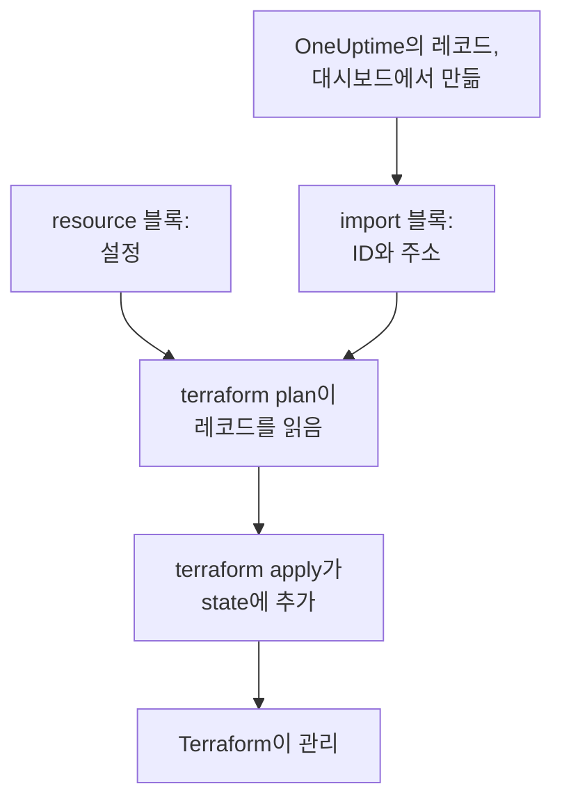
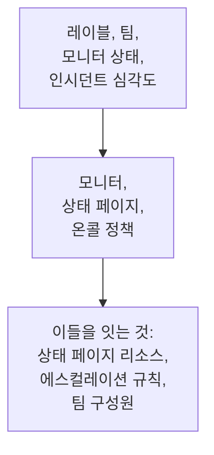

# 리소스 가져오기

Terraform으로 OneUptime을 관리하려고 처음부터 다시 만들 필요는 없습니다. 이미 있는 모니터, 상태 페이지, 팀 및 기타 레코드를 가져오면, 그때부터 Terraform이 있는 그대로 관리합니다. 가져오기는 읽기만 합니다. 계획한 변경을 적용하기 전까지 OneUptime에서는 아무것도 바뀌지 않습니다.

:::cards
- [가져오기의 작동 방식](#가져오기의-작동-방식): 가져오기가 읽는 것과 직접 작성하는 것.
- [리소스 하나 가져오기](#리소스-하나-가져오기): 대시보드의 리소스 페이지에서 네 단계로.
- [여러 리소스 가져오기](#여러-리소스-가져오기): 목록 전체의 import 블록과, Terraform이 대신 작성하는 구성.
- [리소스 관리 중단하기](#리소스-관리-중단하기): 삭제하지 않고 대시보드에 돌려줍니다.
:::

## 가져오기의 작동 방식

가져오기는 OneUptime에 이미 있는 레코드를 구성의 `resource` 블록에 연결합니다. 레코드의 ID와 레코드가 들어갈 주소를 담은 `import` 블록을 작성합니다. 다음 `terraform plan`은 ID로 레코드를 읽고, 레코드와 구성의 모든 차이와 함께 그 레코드를 가져올 것임을 보여 줍니다. `terraform apply`는 레코드를 Terraform의 state에 추가하고, 그때부터 레코드는 Terraform이 만든 다른 것과 똑같이 관리됩니다.



`resource` 블록은 레코드가 이미 그러한 모습 그대로 작성하세요. 차이가 있는 곳에서는 플랜에 가져오기와 변경이 함께 표시되고, 이를 적용하면 OneUptime의 레코드가 바뀝니다.

### 가져올 수 있는 것

프로바이더의 모든 리소스는 ID로 가져올 수 있지만, `oneuptime_file`은 예외입니다. OneUptime API는 파일을 다시 읽을 수 없으므로 프로바이더가 `Import Not Supported`로 응답합니다. 데이터 소스는 가져오지 않습니다. 레코드를 관리하지 않고 구성에서 쓰려면 대신 [데이터 소스](/docs/terraform/complete-guide#이미-있는-것-읽기)로 읽으세요.

## 시작하기 전에

- **Terraform 1.5 이상 또는 OpenTofu 1.6 이상.** 이 페이지의 `import` 블록에는 이 버전이 필요합니다. 그보다 오래된 Terraform은 [명령줄](#명령줄에서-가져오기)에서 가져옵니다.
- **가져오는 것을 읽을 수 있는 API 키.** 가져오기는 프로바이더의 키로 각 레코드를 읽으며, 이후에 관리하려면 변경 및 삭제 권한도 필요합니다. [프로젝트 API 키 만들기](/docs/terraform/quick-start#프로젝트-api-키-만들기)를 참고하세요.
- **구성 안의 프로바이더.** [빠른 시작](/docs/terraform/quick-start#terraform이-oneuptime을-가리키게-하기)처럼 설정합니다.

## 리소스 하나 가져오기

대시보드는 보고 있는 리소스의 구성을 `import` 블록과 함께 작성해 주므로, 직접 작성할 일은 거의 없습니다.

:::steps
### 리소스의 Terraform 페이지 열기

대시보드에서 모니터, 상태 페이지 또는 다른 리소스를 엽니다. 그 사이드 메뉴에서 **개발자**를 연 다음 **Terraform**을 엽니다.

### 구성 복사하기

이 페이지는 리소스의 현재 설정으로 `resource` 블록을 작성하고, ID가 담긴 `import` 블록을 작성합니다. 둘 다 `.tf` 파일에 넣으세요.

```hcl title="status-pages.tf"
resource "oneuptime_status_page" "public_status" {
  name       = "Public Status"
  page_title = "Acme Status"

  # Secrets are not shown here: master_password, embedded_overall_status_token.
  # Terraform leaves them as they are in OneUptime.
}

import {
  to = oneuptime_status_page.public_status
  id = "68a1b2c3-d4e5-4f6a-8b9c-0d1e2f3a4b02"
}
```

기본값과 다른 설정이 작성되며, 각 ID 뒤의 주석은 그 ID가 가리키는 레코드를 알려 줍니다. 시크릿은 절대 표시되지 않습니다. 리소스에 필요한 시크릿은 `sensitive`로 표시한 변수에서 읽고, 생략한 시크릿은 주석에 적힙니다.

### 플랜 실행하기

`terraform plan`을 실행합니다. 마지막에 `Plan: 1 to import, 0 to add, 0 to change, 0 to destroy.`가 나오면 Terraform이 레코드를 찾았고 구성이 레코드와 일치하는 것입니다.

### 적용하기

`terraform apply`를 실행합니다. 이제 상태 페이지가 Terraform의 state에 들어가고, 다음 플랜은 `No changes.`로 응답합니다. 그 후에는 `import` 블록을 삭제해도 되고, 리소스의 출처를 기록한 메모로 남겨 두어도 됩니다. 리소스가 관리되기 시작하면 이 블록은 더 이상 아무 일도 하지 않습니다.
:::

### 블록 직접 작성하기

대시보드 없이 두 블록을 직접 작성합니다. 리소스에 필요한 속성으로 `resource` 블록을 시작하고 `terraform plan`을 실행하세요. 구성이 레코드와 다른 곳에서는 플랜이 가져오기 옆에 변경을 보여 줍니다.

```text
  # oneuptime_label.critical will be updated in-place
  # (imported from "68a1b2c3-d4e5-4f6a-8b9c-0d1e2f3a4b03")
  ~ resource "oneuptime_label" "critical" {
      ~ color = "#FF5733" -> "#000000"
    }

Plan: 1 to import, 0 to add, 1 to change, 0 to destroy.
```

레코드의 값을 구성에 복사하고(여기서는 `color = "#FF5733"`), 플랜에 가져오기만 표시되고 변경이 없을 때까지 다시 플랜을 실행하세요. 레코드의 ID는 세 곳에 있습니다.

| 위치 | 방법 |
| --- | --- |
| 리소스 페이지 | 세부 정보 카드의 마지막에 **ID** 줄이 있습니다. ID나 그 옆의 복사 버튼을 클릭하면 ID 전체가 복사됩니다. |
| 주소 표시줄 | ID는 목록 이름 뒤에 옵니다: `/dashboard/<project-id>/monitors/<monitor-id>`. |
| API | 모든 레코드는 `_id`에 ID를 담고 있습니다. |

## 여러 리소스 가져오기

한 종류의 모니터, 상태 페이지 또는 다른 리소스를 모두 가져오려면 그 목록에서 시작하세요.

:::steps
### 목록의 Terraform 페이지 열기

목록을 연 다음, 그 사이드 메뉴에서 **개발자**와 **Terraform**을 엽니다. 예를 들어 **모니터 → 개발자 → Terraform**입니다.

### import 블록 복사하기

이 페이지는 레코드마다(처음 100개) `import` 블록을 작성하며, 주소는 레코드 이름으로 만들어집니다. 이 블록들을 `imports.tf` 같은 별도 파일에 넣으세요.

```hcl title="imports.tf"
import {
  to = oneuptime_monitor.homepage
  id = "68a1b2c3-d4e5-4f6a-8b9c-0d1e2f3a4b01"
}

import {
  to = oneuptime_monitor.checkout_api
  id = "68a1b2c3-d4e5-4f6a-8b9c-0d1e2f3a4b05"
}
```

### Terraform이 구성을 작성하게 하기

Terraform이 작성할 구성의 파일 이름을 지정해 플랜을 실행합니다. 그 파일은 아직 없어야 합니다. Terraform은 새 파일에만 씁니다.

```bash
terraform plan -generate-config-out=monitors.tf
```

Terraform은 각 레코드를 읽고 `resource` 블록을 작성합니다. 대상은 대응하는 블록이 아직 없는 각 `import` 블록입니다. 구성 생성은 실험적 기능이라고 경고하므로, 작성된 내용을 읽어 보세요.

### 검토하고 적용하기

새 파일에서 다른 레코드의 ID를 `labels = [oneuptime_label.critical.id]`처럼 그 리소스에 대한 참조로 바꾸세요. 그러면 Terraform이 작업 순서를 알 수 있습니다. 가져오기만 표시될 때까지 `terraform plan`을 실행한 다음 `terraform apply`를 실행합니다.
:::

### 프로젝트 전체

프로젝트는 목록별로 가져오되, 다른 레코드가 참조하는 레코드부터 시작하세요. 그러면 각 리소스 블록이 앞의 블록을 ID 대신 주소로 참조할 수 있습니다.



모니터 상태와 인시던트 심각도처럼 모든 프로젝트가 처음부터 가진 레코드는 가져오기보다 데이터 소스로 읽는 편이 나은 경우가 많습니다. 그러면 Terraform이 이를 참조할 수는 있지만, 변경하거나 삭제하지는 않습니다. `terraform plan`이 `No changes.`로 응답하면 프로젝트 가져오기가 끝난 것입니다.

## 명령줄에서 가져오기

`terraform import`는 리소스를 한 번에 하나씩 가져오며, 모든 버전의 Terraform과 OpenTofu에서 작동합니다. 먼저 `resource` 블록을 작성한 다음, 블록의 주소와 레코드의 ID로 명령을 실행하세요.

```bash
terraform import oneuptime_status_page.public_status 68a1b2c3-d4e5-4f6a-8b9c-0d1e2f3a4b02
terraform import oneuptime_label.critical 68a1b2c3-d4e5-4f6a-8b9c-0d1e2f3a4b03
terraform import oneuptime_team.sre 68a1b2c3-d4e5-4f6a-8b9c-0d1e2f3a4b04
```

각 명령은 `Import successful!`로 끝납니다. `import` 블록과 달리 이 명령은 먼저 검토할 플랜 없이 바로 state를 씁니다. 그 후에 `terraform plan`을 실행하고, 플랜이 `No changes.`로 응답할 때까지 구성을 고치세요.

## 리소스 관리 중단하기

리소스를 삭제하지 않고 대시보드에 돌려주려면, 그 `resource` 블록을 레코드를 유지하는 `removed` 블록으로 바꾸세요.

```hcl
removed {
  from = oneuptime_team.sre

  lifecycle {
    destroy = false
  }
}
```

플랜은 팀이 더 이상 Terraform으로 관리되지 않는다고 알려 주며, 아무것도 삭제하지 않습니다. 이를 적용한 다음 `removed` 블록을 삭제하세요. `destroy = false`를 지정한 `removed` 블록에는 Terraform 1.7 이상 또는 OpenTofu 1.10 이상이 필요합니다. 그보다 오래된 버전에서는 대신 `terraform state rm oneuptime_team.sre`를 실행하세요.

> [!WARNING]
> `resource` 블록을 삭제하면 다음 apply에서 OneUptime의 해당 레코드가 삭제됩니다. Terraform에서는 `destroy = false`가 없는 `removed` 블록도 똑같이 합니다. `lifecycle` 블록을 항상 작성하세요.

## 알아 두면 좋은 점

- **가져오기는 아무것도 바꾸지 않지만, 다음 apply는 바꿉니다.** 가져오기 옆에 변경이 표시된 플랜을 적용하면 OneUptime의 레코드가 바뀝니다. 먼저 플랜에 가져오기만 표시되게 하세요.
- **시크릿은 다시 읽지 않습니다.** 모니터 시크릿의 `secret_value`처럼 OneUptime이 절대 돌려주지 않는 시크릿은 가져온 뒤 state에 없습니다. 구성에서 이를 설정하면 첫 플랜에 변경으로 표시되고, 적용하면 시크릿이 다시 쓰입니다.
- **레코드마다 구성은 하나.** 두 구성으로 가져온 레코드는 apply할 때마다 각 구성의 내용으로 되돌려집니다.
- **가져온 레코드는 관리되는 레코드입니다.** `terraform destroy`는 Terraform이 만든 레코드처럼 이 레코드들도 OneUptime에서 삭제합니다.

## 문제 해결

:::details 메시지 “Cannot import non-existent remote object”
그 ID를 가진 레코드가 없거나, 프로바이더의 API 키가 그 레코드를 읽을 수 없습니다. OneUptime은 두 경우 모두 똑같이 응답합니다. ID와, 키가 그 종류의 레코드를 읽을 수 있는지 확인하세요.
:::

:::details 메시지 “Import Not Supported”
`oneuptime_file`은 가져올 수 없는 유일한 리소스입니다. 이를 빼고, 대신 Terraform이 새 파일을 만들게 하세요.
:::

:::details 메시지 “Invalid ID format”
레코드의 ID가 아닌 것, 예를 들어 이름이 전달되었습니다. 가져오기에는 ID, 즉 `68a1b2c3-d4e5-4f6a-8b9c-0d1e2f3a4b02` 같은 UUID를 전달합니다. 리소스 페이지에서 복사하세요.
:::

:::details 메시지 “Target generated file already exists”
`-generate-config-out`에 이미 있는 파일을 지정했습니다. 새 파일을 지정하거나, 그 파일의 내용을 다른 곳으로 옮기고 파일을 삭제하세요.
:::

:::details 메시지 “Resource already managed by Terraform”
`terraform import`에 이미 state에 있는 주소가 전달되었습니다. 레코드를 다른 주소로 가져오거나, `terraform state list`로 그 주소에 무엇이 있는지 확인하세요.
:::

## 다음 단계

:::cards
- [완전한 가이드](/docs/terraform/complete-guide): 데이터 소스, 리소스 간 참조, state.
- [모니터 단계](/docs/terraform/monitor-steps): 가져온 모니터가 확인하는 내용을 읽고 바꿉니다.
- [예제](/docs/terraform/examples): 자주 쓰는 리소스를 위한 바로 쓸 수 있는 구성.
- [문제 해결](/docs/terraform/troubleshooting): 흔한 오류와 해결 방법.
:::
