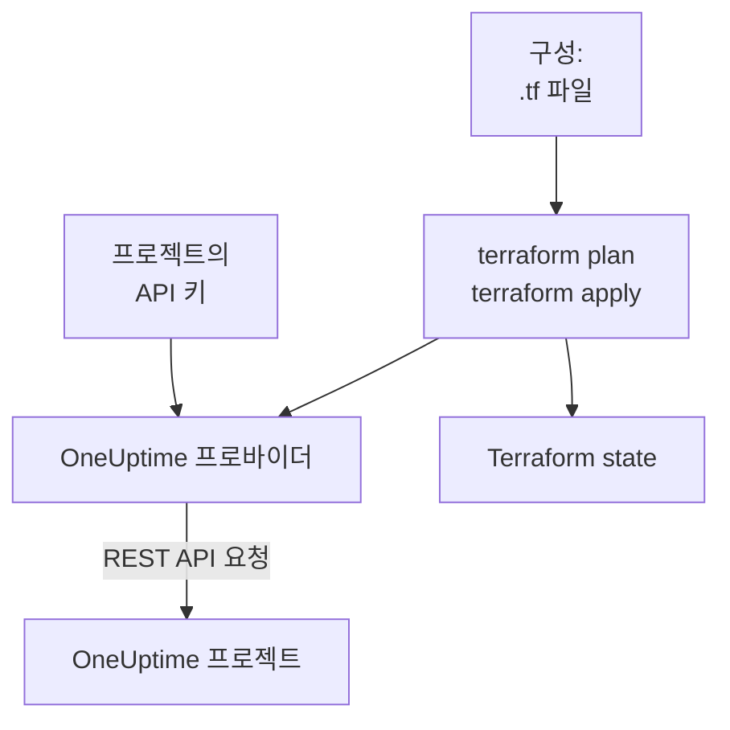

# Terraform 개요

OneUptime Terraform 프로바이더는 OneUptime 프로젝트를 코드로 관리합니다. 모니터, 상태 페이지, 온콜 정책, 팀, 레이블 등 프로젝트의 레코드를 `.tf` 파일에 기술하고, `terraform plan`으로 무엇이 바뀔지 확인한 다음, `terraform apply`로 변경을 반영합니다. OneUptime Cloud와 자체 호스팅 OneUptime 모두에서 작동하며, Terraform뿐 아니라 OpenTofu에서도 작동합니다.

:::cards
- [프로바이더의 작동 방식](#프로바이더의-작동-방식): 구성, 계획, 그리고 그 뒤의 API 요청.
- [프로바이더 설치](#프로바이더-설치): 프로바이더 블록과 고를 버전.
- [대시보드가 작성하게 하기](#대시보드가-작성하게-하기): 이미 있는 것에 대한 구성과 import 블록.
- [관리할 수 있는 것](#관리할-수-있는-것): 리소스, 데이터 소스, 그리고 속성을 쓰는 방법.
:::

## 프로바이더의 작동 방식

프로바이더는 Terraform이 레지스트리에서 내려받는 플러그인입니다. `terraform apply`를 실행하면 계획의 각 변경을 프로젝트의 API 키로 보내는 OneUptime REST API 요청으로 바꿉니다. Terraform은 만든 것을 state에 보관하므로, 다음 계획에는 그 이후에 바뀐 것만 표시됩니다.



API 키는 하나의 프로젝트에 속하며, Terraform이 그 프로젝트에서 무엇을 읽고 바꿀 수 있는지를 결정합니다. 따라서 구성 하나는 프로젝트 하나를 관리합니다. 여러 프로젝트를 관리하려면 프로젝트마다 프로바이더에 [별칭](/docs/terraform/complete-guide#여러-프로젝트-관리하기)을 지정하세요.

## 시작하기 전에

- **Terraform 1.5 이상 또는 OpenTofu 1.6 이상.** 대시보드가 작성하는 `import` 블록에는 이 버전이 필요합니다.
- **프로젝트의 API 키.** [빠른 시작](/docs/terraform/quick-start#프로젝트-api-키-만들기)에서 **프로젝트 설정 → 고급 → API 키**에서 키를 만드는 방법을 보여 줍니다.
- **OneUptime Cloud에서는 Growth 플랜 이상.** 프로젝트의 API 키는 이 플랜에서만 작동합니다.

## 프로바이더 설치

프로바이더를 `.tf` 파일에 추가합니다. `terraform init`은 Terraform Registry에서, `tofu init`은 OpenTofu Registry에서 프로바이더를 내려받습니다.

```hcl title="main.tf"
terraform {
  required_providers {
    oneuptime = {
      source  = "oneuptime/oneuptime"
      version = "{{TERRAFORM_PROVIDER_VERSION}}"
    }
  }
}

provider "oneuptime" {
  # The API key comes from the ONEUPTIME_API_KEY environment variable.
  # On a self-hosted OneUptime, add your OneUptime's address:
  # oneuptime_url = "https://oneuptime.example.com"
}
```

키를 파일에 두지 마세요. Terraform을 실행하기 전에 내보내거나, `sensitive`로 표시한 변수로 전달하세요. 프로바이더에 키와 주소를 전달하는 모든 방법은 [완전한 가이드](/docs/terraform/complete-guide#프로바이더-설정)에 있습니다.

### 버전 고르기

프로바이더 버전은 OneUptime 버전을 따릅니다. 프로바이더 {{TERRAFORM_PROVIDER_MAJOR}}.x는 OneUptime {{TERRAFORM_PROVIDER_MAJOR}}.x로 만들어집니다. 위의 제약 조건 `{{TERRAFORM_PROVIDER_VERSION}}`은 최신 {{TERRAFORM_PROVIDER_MAJOR}}.x 릴리스를 사용하며, OneUptime Cloud에는 이것이 맞습니다. 자체 호스팅 OneUptime에서는 사용 중인 OneUptime보다 새롭지 않은 최신 프로바이더를 사용하세요. 버전을 고정하는 방법은 [자체 호스팅 설정](/docs/terraform/self-hosted)에서 설명합니다.

## 대시보드가 작성하게 하기

이미 있는 리소스를 직접 작성할 필요는 없습니다. OneUptime 대시보드의 모든 리소스(모니터, 상태 페이지, 워크플로, 온콜 정책 등)에는 사이드 메뉴에 **개발자** 섹션이 있으며, 열기 전까지는 접혀 있습니다. 그 안의 **Terraform** 페이지가 여러분의 프로젝트 내용으로 채운 구성을 대신 작성해 줍니다.

:::steps
### 리소스 열기

Terraform으로 관리하려는 모니터, 상태 페이지 또는 다른 리소스를 엽니다.

### Terraform 페이지 열기

사이드 메뉴에서 **개발자**를 연 다음 **Terraform**을 엽니다.

### 구성 복사

이 페이지는 리소스의 현재 설정으로 구성을 작성하며, `import` 블록도 함께 제공합니다. 각 ID 뒤의 주석은 그 ID가 가리키는 레코드의 이름입니다(`incident_severity_id = "..." # Critical Incident`).

### 계획하고 적용하기

`terraform plan`을 실행하면 리소스를 가져오는 것과 바꿀 것이 없다는 것이 표시됩니다. 적용하면 그때부터 Terraform이 리소스를 관리합니다.
:::

구성 아래의 **더 활용하기**에는 리소스 옆에 흔히 추가하는 것들이 리소스의 주소를 참조하는 형태로 들어 있습니다. 인시던트의 소유 팀, 상태 페이지용 모니터 그룹, 온콜 정책용 에스컬레이션 규칙 등입니다.

목록 페이지(예: **인시던트** 또는 **모니터**)에도 같은 섹션이 있습니다. 거기서는 **Terraform** 페이지가 대부분의 사람이 설정하는 필드를 넣은 새 리소스를 프로젝트의 레코드를 사용해 작성합니다. 여러분의 심각도 중 하나를 쓰는 인시던트, 대시보드에서 새 모니터가 받는 기준을 여러분의 상태에 연결한 모니터 같은 것입니다. 바로 쓸 수 있는 **일반적인 구성**(그룹과 모니터가 있는 상태 페이지, 팀을 호출하는 온콜 정책, 주간 온콜 순환)과, 이미 있는 리소스마다 하나씩(처음 100개) `terraform plan -generate-config-out`에 바로 쓸 수 있는 `import` 블록도 제공합니다. 두 페이지 모두 사용 중인 OneUptime에 맞는 프로바이더 블록도 제공합니다. 올바른 `oneuptime_url`과 OneUptime에 맞는 버전 제약 조건입니다.

이 페이지들에는 시크릿이 절대 표시되지 않습니다. 구성에 시크릿이 필요하면(예: 모니터의 `Authorization` 헤더) `sensitive`로 표시한 Terraform 변수에서 읽습니다. 필요 없는 시크릿은 빠지며, Terraform은 OneUptime에 있는 값을 그대로 둡니다.

같은 섹션에는 리소스용 `curl` 명령이 있는 **API** 페이지와, Claude, GitHub Copilot 또는 Cursor를 [MCP 서버](/docs/ai/mcp-server)에 연결하는 **AI 어시스턴트** 페이지도 있습니다.

## 관리할 수 있는 것

프로바이더에는 OneUptime API로 만들 수 있는 레코드 종류마다 `oneuptime_<name>`이라는 이름의 리소스가 있습니다. 대부분의 구성은 다음 리소스로 시작합니다.

| 리소스 | 설명 |
| --- | --- |
| `oneuptime_monitor` | 모니터: 웹사이트, API, ping, 포트, SSL 인증서, 서버, 수신 요청, 수동 및 다른 모든 유형 |
| `oneuptime_monitor_status` | Operational, Degraded, Offline 같은 모니터 상태 |
| `oneuptime_monitor_group` | 하나의 상태로 표시되는 모니터 그룹 |
| `oneuptime_status_page` | 공개 또는 비공개 상태 페이지 |
| `oneuptime_status_page_domain` | 상태 페이지의 사용자 지정 도메인 |
| `oneuptime_domain` | 상태 페이지용으로 확인된 프로젝트의 도메인 |
| `oneuptime_label` | 레코드를 정렬하고 필터링하는 레이블 |
| `oneuptime_team`, `oneuptime_team_member` | 팀과 그 구성원 |
| `oneuptime_on_call_policy`, `oneuptime_escalation_rule` | 온콜 정책과, 정책이 순서대로 호출하는 규칙 |
| `oneuptime_incident`, `oneuptime_incident_severity`, `oneuptime_incident_state` | 인시던트와 그 심각도 및 상태 |
| `oneuptime_alert`, `oneuptime_alert_severity`, `oneuptime_alert_state` | 알림과 그 심각도 및 상태 |
| `oneuptime_scheduled_maintenance_event` | 예약된 유지 관리 기간 |
| `oneuptime_probe` | 여러분의 네트워크에서 확인하는 자체 프로브 |

[Terraform Registry](https://registry.terraform.io/providers/oneuptime/oneuptime/latest/docs)에는 모든 리소스와 그 속성이 모두 나와 있습니다.

### 이미 있는 것 읽기

모든 리소스에는 `data "oneuptime_label"`처럼 같은 이름의 데이터 소스가 있습니다. 데이터 소스는 이 구성이 관리하지 않는 레코드, 예를 들어 대시보드에서 만든 레코드를 읽습니다. `id`나 다른 단순 인수로 찾습니다. 지정한 인수는 모두 일치해야 하며, 모두와 일치하는 레코드는 정확히 하나여야 합니다.

```hcl
data "oneuptime_monitor_status" "offline" {
  name = "Offline"
}

# Any plain argument works. Set several, and all of them must match.
data "oneuptime_monitor_status" "offline_state" {
  is_offline_state = true
}
```

일치하는 것이 없거나 둘 이상이면 빈 답이나 임의의 답이 아니라 오류가 됩니다. 규칙은 [완전한 가이드](/docs/terraform/complete-guide#이미-있는-것-읽기)에 있습니다.

### 이름이 바뀐 리소스

리소스 이름은 IoT, vCenter 같은 단어를 나누지 않습니다. `oneuptime_iot_fleet`과 `oneuptime_vcenter`이며, 이전 프로바이더에서는 `oneuptime_io_t_fleet`과 `oneuptime_v_center`였습니다(각각의 레이블 규칙, 소유자, 피드도 마찬가지입니다). 이전 이름도 사용 중단된 별칭으로 계속 작동하며, 이전 이름을 쓰는 계획은 그 사실을 알려 줍니다. 전환하려면 구성에서 리소스 이름을 바꾸고 `moved` 블록을 추가하세요. 그러면 Terraform은 기존 리소스를 교체하지 않고 그대로 유지합니다.

```hcl
# Was: resource "oneuptime_io_t_fleet" "factory"
resource "oneuptime_iot_fleet" "factory" {
  name = "Factory floor"
}

moved {
  from = oneuptime_io_t_fleet.factory
  to   = oneuptime_iot_fleet.factory
}
```

리소스를 다른 유형으로 옮기려면 Terraform 1.8 이상이 필요합니다. 그보다 오래된 엔진에서는 당분간 이전 이름을 유지하세요. 계속 작동합니다.

## 속성을 쓰는 방법

속성은 OneUptime API를 따르며 snake_case로 씁니다.

| 값의 종류 | 쓰는 방법 | 예 |
| --- | --- | --- |
| 텍스트, 숫자, 참 또는 거짓 | 그대로 | `is_public_status_page = false` |
| 다른 레코드에 대한 참조 | 그 레코드의 ID, 보통 다른 리소스의 `id` | `incident_severity_id = oneuptime_incident_severity.sev1.id` |
| 참조 목록 | 순서가 상관없는 ID 집합 | `labels = [oneuptime_label.critical.id]` |
| 색상, 도메인 및 다른 래핑된 값 | 단순한 값 | `color = "#FF5733"` |
| 날짜와 시간 | RFC 3339 형식의 텍스트 | `starts_at = "2030-06-01T02:00:00Z"` |
| 모니터의 확인 | 타입이 있는 중첩 속성: [모니터 단계](/docs/terraform/monitor-steps) 참조 | `monitor_steps = [{ ... }]` |
| 그 밖의 구조화된 설정 | `jsonencode()`로 쓴 JSON | `log_monitor = jsonencode({ ... })` |

다음 두 종류의 값은 서버의 것이므로 쓰지 않습니다.

- **리소스 내부의 ID.** 모니터의 단계와 기준, 그리고 그 인시던트 및 알림 템플릿에는 서버가 부여하고 모든 apply에서 유지하는 ID가 있습니다. 그래서 인시던트는 자신을 연 기준을 계속 가리킵니다.
- **서버가 최신으로 유지하는 것.** 모니터의 현재 상태나 마지막으로 heartbeat를 받은 시각은 `terraform plan`과 `terraform apply`가 끝나는 사이에 바뀔 수 있습니다. 프로바이더는 여러분이 설정하지 않은 모든 것에 대해 계획된 값을 유지하고, 다음 refresh에서 서버의 값을 읽습니다. 그래서 이 때문에 apply가 실패하거나 변경으로 표시되는 일은 없습니다.

## 도움 받기

- 버그 및 기능 요청: [github.com/OneUptime/oneuptime/issues](https://github.com/OneUptime/oneuptime/issues).
- 프로바이더는 [OneUptime 메인 저장소](https://github.com/OneUptime/oneuptime)에 있는 OneUptime OpenAPI 명세에서 생성됩니다. 게시된 프로바이더 저장소는 읽기 전용이므로 문제는 메인 저장소에 보고하세요.

## 다음 단계

:::cards
- [빠른 시작](/docs/terraform/quick-start): API 키를 만들고 10분 안에 첫 리소스를 적용합니다.
- [완전한 가이드](/docs/terraform/complete-guide): 인증, 프로젝트 구성, 데이터 소스, state, 업그레이드.
- [모니터 단계](/docs/terraform/monitor-steps): 모니터가 무엇을 확인하고 각 결과가 무엇을 뜻하는지 정합니다.
- [예제](/docs/terraform/examples): 흔히 쓰는 리소스를 위한 바로 쓸 수 있는 구성.
- [리소스 가져오기](/docs/terraform/importing-resources): 대시보드에서 만든 것을 Terraform 관리로 가져옵니다.
:::
