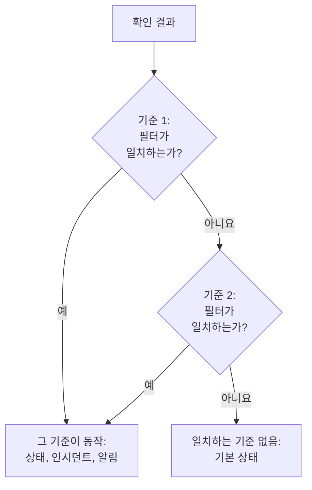
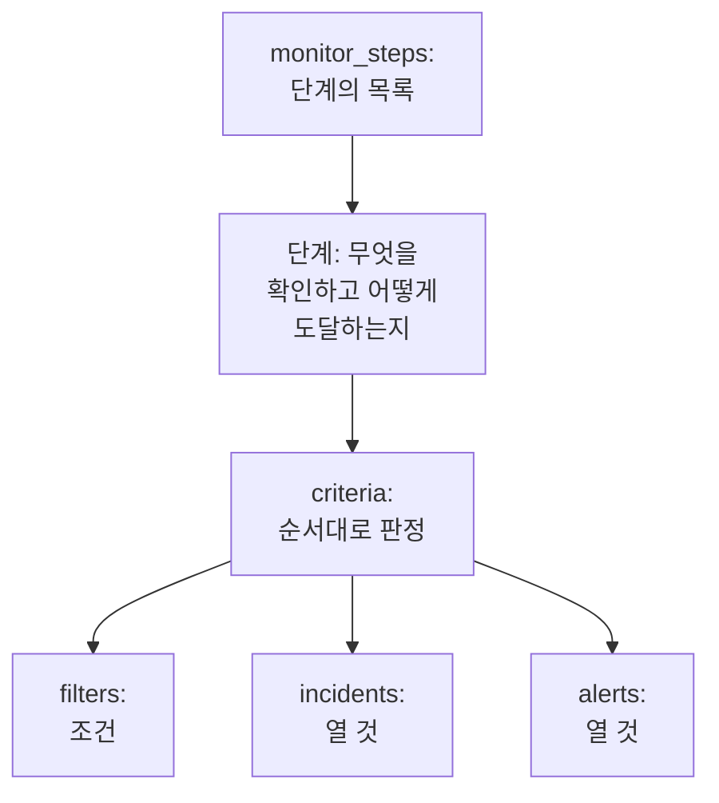

# 모니터 단계

`monitor_steps`는 모니터가 무엇을 확인하고 각 결과를 어떻게 판정하는지 나타내는 `oneuptime_monitor`의 속성입니다. 확인할 주소, 보낼 요청, 그리고 결과를 모니터 상태, 인시던트 또는 알림으로 바꾸는 기준입니다. 이 페이지는 그 모든 부분을 설명합니다.

:::cards
- [확인을 판정하는 방식](#확인을-판정하는-방식): 순서대로 놓인 기준과, 처음 일치하는 기준.
- [단계 작성하기](#단계-작성하기): 그 형태, 완전한 예, 값에 대한 두 가지 규칙.
- [필터 참조](#필터-참조): 필터가 확인할 수 있는 것과 비교하는 방식.
- [흔한 실수](#흔한-실수): 가장 자주 잘못되는 것과 그 해결 방법.
:::

## 확인을 판정하는 방식

각 확인은 결과를 냅니다. 프로브의 응답, 스크립트의 반환 값, 또는 확인이 읽는 텔레메트리입니다. 그런 다음 단계의 기준이 순서대로 결과를 판정합니다. 필터가 처음 일치한 기준이 무엇이 일어날지 정합니다. 모니터의 상태를 바꾸고, 인시던트를 열고, 알림을 열 수 있습니다. 그 확인에서는 그 뒤의 기준을 보지 않습니다.



그래서 기준의 순서가 중요합니다. 알림을 보내는 기준을 먼저, 가장 심각한 것을 가장 먼저 두고, 정상 상태 기준을 마지막에 두세요. 그 이유와 단 하나의 예외는 [기준 속성](#기준-속성)에서 설명합니다.

## 단계 작성하기

`monitor_steps`는 HCL로 바로 쓰는, 타입이 있는 객체의 목록입니다. `jsonencode()`도, `{_type, value}` 래퍼도, camelCase 키도, 써야 할 ID도 없습니다. 프로바이더가 HCL을 API 형식으로 바꾸고, 서버가 모든 단계, 기준, 인시던트 템플릿, 알림 템플릿에 ID를 부여합니다. 서버는 모든 apply에서 이 ID를 유지합니다. 각 기준과 템플릿을 대체하는 대상과 이름으로, 이름이 없으면 위치로 맞추므로, 프로브 결과는 해당 단계에 남고 인시던트는 자신을 연 기준을 계속 가리킵니다.



쓸모 있는 가장 작은 단계는 주소 하나를 확인하고, 필터 하나가 있는 기준 하나를 가집니다.

```hcl
resource "oneuptime_monitor" "example" {
  name         = "Example"
  description  = "The smallest monitor_steps"
  monitor_type = "Website"

  monitor_steps = [{
    monitor_destination      = "https://example.com"
    monitor_destination_type = "URL"
    request_type             = "GET"

    criteria = [
      {
        name             = "Check if online"
        description      = "The website responds"
        filter_condition = "All"

        filters = [
          {
            check_on    = "Is Online"
            filter_type = "True"
          }
        ]
      }
    ]
  }]
}
```

`monitor_steps`의 모든 곳에 두 가지 규칙이 적용됩니다.

- **쓰지 않는 것은 빼세요.** 설정하지 않은 속성은 API로 보내지 않습니다. 자리 표시자로 `[]`, `{}`, `""`를 쓰지 마세요. 프로바이더는 빈 문자열, 목록, map을 거부하므로, 값이 없다는 것은 항상 "설정되지 않음"을 뜻합니다.
- **필터 값은 문자열입니다.** 필터의 `value`는 숫자라도 문자열입니다. `value = 200`이 아니라 `value = "200"`입니다. `port` 같은 숫자 설정은 숫자입니다.

:::details monitor_steps가 JSON이던 프로바이더 1.x에서 옮겨 오기
프로바이더 1.x에서 `monitor_steps`는 `jsonencode({ _type = "MonitorSteps", value = { ... } })`로 쓴 JSON 문자열이었습니다. 이 페이지의 타입이 있는 속성으로 다시 쓰세요. `_type`과 `value` 래퍼를 없애고, camelCase 키를 snake_case로 쓰고(`monitorDestination`은 `monitor_destination`과 `monitor_destination_type`이, `filterCondition`은 `filter_condition`이, `checkOn`은 `check_on`이 됩니다), 모든 `id`를 삭제합니다. 이제 모든 ID를 서버가 부여하므로, issue [#2291](https://github.com/OneUptime/oneuptime/issues/2291)의 하드코딩된 임의 ID 문제도 없어졌습니다. JSON 문자열로 저장된 state는 저절로 업그레이드되지 않습니다. 새 구성을 적용하세요.
:::

### 완전한 예

이 웹사이트 모니터는 프로바이더의 엔드투엔드 테스트에 있는 웹사이트 모니터(테스트 `35-monitor-with-steps`)가 확인하는 것을 확인합니다. 사이트가 응답하지 않으면 offline, 200으로 응답하면 online입니다.

```hcl
resource "oneuptime_monitor_status" "operational" {
  name                 = "Operational"
  description          = "Monitor is operational"
  color                = "#2ecc71"
  priority             = 1
  is_operational_state = true
}

resource "oneuptime_monitor_status" "offline" {
  name                 = "Offline"
  description          = "Monitor is offline"
  color                = "#e74c3c"
  priority             = 3
  is_operational_state = false
}

resource "oneuptime_monitor" "website" {
  name         = "Website"
  description  = "Website monitor with explicit steps"
  monitor_type = "Website"

  monitor_steps = [{
    monitor_destination      = "https://example.com" # what to check
    monitor_destination_type = "URL"                 # URL, Hostname or IP
    request_type             = "GET"                 # the HTTP method

    criteria = [ # judged in order: the first match decides
      {
        name                  = "Offline"
        description           = "Check if website is offline"
        filter_condition      = "Any"
        change_monitor_status = true
        create_incidents      = false
        create_alerts         = false
        monitor_status_id     = oneuptime_monitor_status.offline.id

        filters = [
          {
            check_on    = "Is Online"
            filter_type = "False"
          }
        ]
      },
      {
        name                  = "Online"
        description           = "Check if website is online"
        filter_condition      = "All" # All: every filter, Any: at least one
        change_monitor_status = true
        create_incidents      = false
        create_alerts         = false
        monitor_status_id     = oneuptime_monitor_status.operational.id

        filters = [
          {
            check_on    = "Is Online"
            filter_type = "True"
          },
          {
            check_on    = "Response Status Code"
            filter_type = "Equal To"
            value       = "200" # a string, even for a number
          }
        ]
      }
    ]
  }]
}
```

기준은 여기서 `oneuptime_monitor_status.offline.id`가 하듯이 리소스를 통해 상태를 참조하거나, 프로젝트에 이미 있는 상태를 [데이터 소스](/docs/terraform/complete-guide#이미-있는-것-읽기)로 참조합니다.

## 단계 속성

`monitor_steps`의 각 항목은 확인할 대상 하나입니다.

| 속성 | 타입 | 사용하는 유형 | 참고 |
| --- | --- | --- | --- |
| `monitor_destination` | string | 웹사이트, API, Ping, IP, 포트, SSL 인증서, NTP | 확인할 URL, 호스트 이름 또는 IP 주소. `monitor_destination_type`이 필요합니다. |
| `monitor_destination_type` | string | 위와 같음 | 모니터 유형이 받는 것에 맞춰 `URL`, `Hostname` 또는 `IP`. 웹사이트, API, SSL 인증서 모니터에는 URL을, Ping, IP, 포트, NTP 모니터에는 호스트 이름이나 IP 주소를 씁니다. |
| `port` | number | 포트, NTP | 확인할 TCP 포트(예: `443`). NTP에서는 시간 서버가 응답하는 UDP 포트이며, 설정하지 않으면 `123`입니다. |
| `request_type` | string | 웹사이트, API | HTTP 메서드: `GET`, `POST`, `PUT`, `DELETE`, `HEAD` 또는 `PATCH`. 설정하지 않으면 서버가 `GET`을 씁니다. |
| `request_headers` | map(string) | 웹사이트, API | 보낼 헤더: `{ "Accept" = "application/json" }`. |
| `request_body` | string | API | 텍스트로 쓴 요청 본문. |
| `do_not_follow_redirects` | bool | 웹사이트, API | 리디렉션을 따라가지 않고 첫 응답에서 멈춥니다. |
| `allow_self_signed_certificates` | bool | 웹사이트, API | 자체 서명된 TLS 인증서를 허용합니다. |
| `tls_client_certificate` | string | 웹사이트, API | 상호 TLS용 클라이언트 인증서: PEM 또는 `{{monitorSecrets.name}}` 참조. |
| `tls_client_key` | string (민감) | 웹사이트, API | 클라이언트 인증서의 개인 키. 인증서와 함께 설정하세요. |
| `tls_client_key_passphrase` | string (민감) | 웹사이트, API | 개인 키의 암호 문구. |
| `request_timeout_in_ms` | number | 프로브가 하는 확인 | 시도 한 번에 걸릴 수 있는 시간(밀리초). 프로브는 60000을 넘는 값을 60000으로 낮춥니다. |
| `retry_count` | number | 프로브가 하는 확인 | 첫 시도가 실패한 뒤의 재시도 횟수. `0`이면 한 번만, `3`이면 최대 네 번 확인합니다. 프로브는 3을 넘는 값을 3으로 낮춥니다. |
| `custom_code` | string | Custom JavaScript Code, Synthetic | 단계가 실행하는 스크립트. |
| `screen_size_types` | list(string) | Synthetic | `Mobile`, `Tablet`, `Desktop`. |
| `browser_types` | list(string) | Synthetic | `Chromium`과 `Firefox`. |
| `retry_count_on_error` | number | Synthetic | 스크립트가 실패할 때의 재시도 횟수. `0`이면 한 번만 실행합니다. |
| `criteria` | list (필수) | 모두 | 각 결과를 판정하는 방식: [기준 속성](#기준-속성) 참조. |

### 모니터 유형별 설정

주소 말고도 설정할 것이 있는 모니터 유형은 그 설정(로그 쿼리, 데이터베이스 연결, 감시할 클러스터 등)을 자체 속성에 `jsonencode()`로 쓴 원시 JSON으로 둡니다: `log_monitor`, `trace_monitor`, `llm_monitor`, `metric_monitor`, `exception_monitor`, `profile_monitor`, `dns_monitor`, `domain_monitor`, `dnssec_monitor`, `sql_monitor`, `database_monitor`, `external_status_page_monitor`, `network_device_monitor`, `kubernetes_monitor`, `docker_monitor`, `docker_swarm_monitor`, `host_monitor`, `podman_monitor`, `proxmox_monitor`, `vmware_monitor`, `ceph_monitor`, `storage_array_monitor`, `iot_monitor`, `probe_status_monitor`.

그 JSON은 대시보드의 것과 같으며 키는 camelCase입니다. 그 안의 ID는 API가 쓰는 대로 `{ _type = "ObjectID", value = "..." }`로 씁니다. 서비스 하나의 오류를 세는 Logs 모니터의 예입니다.

```hcl
resource "oneuptime_service" "checkout" {
  name = "checkout"
}

resource "oneuptime_monitor" "checkout_errors" {
  name         = "Checkout errors"
  monitor_type = "Logs"

  monitor_steps = [{
    log_monitor = jsonencode({
      attributes          = {}
      body                = "error"
      severityTexts       = ["Error"]
      telemetryServiceIds = [{ _type = "ObjectID", value = oneuptime_service.checkout.id }]
      lastXSecondsOfLogs  = 300
    })

    criteria = [
      {
        name             = "Errors found"
        filter_condition = "Any"

        filters = [
          {
            check_on    = "Log Count"
            filter_type = "Greater Than"
            value       = "0"
          }
        ]
      }
    ]
  }]
}
```

> [!TIP]
> 이 JSON을 정확히 쓰는 가장 쉬운 방법: 대시보드에서 모니터를 설정한 다음, 그 모니터의 **개발자** 섹션과 **Terraform**을 여세요. 이 페이지가 `jsonencode()`까지 포함해 모니터의 `monitor_steps`를 작성합니다.

## 기준 속성

`criteria`의 각 항목은 규칙 하나입니다. 필터가 일치하면 규칙이 말하는 대로 합니다.

기준은 위에서부터 판정되며 처음 일치한 기준이 결정합니다. 그러니 알림을 보내는 기준을 먼저, 가장 심각한 것을 가장 먼저(심각, 그다음 경고), 정상 상태 기준을 마지막에 두세요. 정상 상태 기준을 맨 위에 두는 것은 절대 알림을 보내지 않는 모니터를 만드는 가장 흔한 실수입니다. `Is Online`이 `True`이거나 메트릭 값이 `Greater Than` `0` 같은 넓은 규칙은 거의 모든 확인과 일치하므로, 그 아래 기준은 결코 판정되지 않습니다. 마지막에 두면 위의 어떤 기준도 일치하지 않을 때만 일치하며, 이것이 원하는 동작입니다.

그룹화된 메트릭 모니터만 예외입니다. 메트릭 모니터의 쿼리가 그룹화되어 있으면(`metric_monitor`의 JSON에서 `metricViewConfig.queryConfigs[].metricQueryData.groupByAttributeKeys`에 `groupByAttributeKeys`가 설정됨), 모니터는 그룹(호스트, 컨테이너, 마운트 지점)마다 알림이나 인시던트를 하나씩 열고 모든 기준을 판정합니다. 그래서 같은 확인에서 심각 기준과 경고 기준이 서로 다른 호스트에 대해 발동할 수 있습니다. 둘 다 위반한 호스트도 처음 일치한 기준에 의해 한 번만 호출되므로, 가장 심각한 기준을 먼저 두는 것은 여전히 중요합니다. [메트릭 모니터](/docs/monitor/metrics-monitor)를 참조하세요.

| 속성 | 타입 | 설명 |
| --- | --- | --- |
| `name` | string (필수) | 대시보드에 표시되는 이름. |
| `description` | string | 대시보드에 표시되는 설명. |
| `filter_condition` | string (필수) | `All`: 모든 필터가 일치해야 합니다. `Any`: 하나면 충분합니다. |
| `filters` | list (필수) | 조건, 최소 하나: [필터 참조](#필터-참조) 참조. |
| `change_monitor_status` | bool | 일치하면 모니터 상태를 바꿀지 여부. |
| `monitor_status_id` | string | 바꿀 대상 `oneuptime_monitor_status`의 ID. `change_monitor_status`가 `true`일 때 설정하세요. |
| `create_incidents` | bool | 일치하면 인시던트를 열지 여부. |
| `incidents` | list | 열 인시던트. `create_incidents = true`가 아니면 빼세요. |
| `create_alerts` | bool | 일치하면 알림을 열지 여부. |
| `alerts` | list | 열 알림. `create_alerts = true`가 아니면 빼세요. |
| `is_enabled` | bool | 설정하지 않으면 서버에서 `true`. 기준을 남겨 두되 판정에 쓰지 않으려면 `false`로 설정하세요. |
| `incident_grouping` | string (JSON) | 수신 요청 모니터 전용: 요청에서 찾은 값마다 인시던트 하나(예: `jsonencode({ groupByJSONPath = "..." })`). |
| `open_for_every_email` | bool | 수신 이메일 모니터 전용: `true`이면 한 번에 하나씩이 아니라 일치하는 이메일마다 인시던트(와 알림)를 엽니다. |

### 인시던트와 알림

`incidents`의 항목은 `title`과 `description`(둘 다 필수), `incident_severity_id`, `auto_resolve_incident`, `remediation_notes`, `on_call_policy_ids`, `label_ids`, `owner_team_ids`, `owner_user_ids`, `show_incident_on_status_page`, `is_private`를 받습니다. `alerts`의 항목도 같은 것을 받지만, `alert_severity_id`와 `auto_resolve_alert`가 있고 `show_incident_on_status_page`는 없습니다.

이 기준은 모니터를 offline으로 표시하고, 온콜 정책을 호출하는 인시던트를 열며, 사이트가 돌아오면 그 인시던트를 해결합니다.

```hcl
criteria = [
  {
    name                  = "Offline"
    description           = "The site is unreachable"
    filter_condition      = "Any"
    change_monitor_status = true
    monitor_status_id     = oneuptime_monitor_status.offline.id
    create_incidents      = true

    filters = [
      {
        check_on    = "Is Online"
        filter_type = "False"
      }
    ]

    incidents = [
      {
        title                 = "Website is down"
        description           = "The website did not respond to the probe."
        incident_severity_id  = oneuptime_incident_severity.critical.id
        auto_resolve_incident = true
        on_call_policy_ids    = [oneuptime_on_call_policy.primary.id]
      }
    ]
  }
]
```

## 필터 참조

필터에는 `check_on`(무엇을 볼지), `filter_type`(어떻게 비교할지), `value`(무엇과 비교할지, 문자열로 씁니다. `True`와 `False` 같은 참·거짓 확인에서는 뺍니다)가 있습니다.

필터는 최신 확인 대신 시간 범위를 판정할 수도 있습니다. `evaluate_over_time = true`를 설정하고, `evaluate_over_time_minutes`에 시간 범위의 길이를, `evaluate_over_time_type`에 시간 범위를 읽는 방식을 지정하세요: `Average`, `Sum`, `Maximum Value`, `Minimum Value`, `All Values`, `Any Value`.

`All Values`는 시간 범위의 모든 확인이 규칙을 위반했다는 뜻이므로, 시간 범위가 데이터로 채워져야 일치합니다. 방금 만든 모니터는 첫 확인에서 일치하는 대신 시간 범위가 채워지기를 기다립니다. 시간 범위는 모니터의 `monitoring_interval`의 두 배 이상으로 하세요. 그렇지 않으면 시간 범위에 확인이 하나만 들어가고, "모든 값"이 "아무 값"과 같은 뜻이 됩니다. `Any Value`는 규칙을 위반한 확인 하나에 일치하며, 이는 의도된 동작입니다.

`evaluate_over_time_no_data_policy`는 시간 범위에 데이터가 충분하지 않은 동안 필터가 무엇을 할지 정합니다. `Ignore`(기본값)는 일치하지 않고, `Trigger`는 heartbeat처럼 데이터가 없는 것을 장애로 취급하며, `Treat As Zero`는 시간 범위를 0 하나로 비교합니다.

### 필터가 확인할 수 있는 것

모니터 유형마다 가장 많이 쓰는 `check_on` 값입니다. 대시보드의 기준 편집기도 같은 값을 제공하며, 거기에는 전부 나와 있습니다.

| 모니터 유형 | `check_on` 값 |
| --- | --- |
| 웹사이트 / API | `Is Online`, `Response Time (in ms)`, `Response Status Code`, `Response Body`, `Response Header`, `Response Header Value`, `JavaScript Expression`, `Is Request Timeout` |
| Ping / IP | `Is Online`, `Response Time (in ms)`, `Packet Loss (in %)`, `Jitter (in ms)`, `Is Request Timeout` |
| 포트 | `Is Online`, `Response Time (in ms)`(대시보드의 총 연결 시간), `Port DNS Lookup Time (in ms)`, `Port TCP Connect Time (in ms)`, `Is Request Timeout` |
| SSL 인증서 | `Is Valid Certificate`, `Is Not A Valid Certificate`, `Is Self Signed Certificate`, `Is Expired Certificate`, `Expires In Days`, `Expires In Hours` |
| 수신 요청 | `Incoming Request`, `Request Body`, `Request Header`, `Request Header Value`, `JavaScript Expression` |
| 수신 이메일 | `Email Received`, `Email Subject`, `Email From Address`, `Email To Address`, `Email Body` |
| 서버 | `Is Online`, `CPU Usage (in %)`, `Memory Usage (in %)`, `Disk Usage (in %)`(`disk_path`와 함께), `Server Process Name` |
| 로그 | `Log Count` |
| 트레이스 | `Span Count` |
| 예외 | `Exception Count` |
| 프로필 | `Profile Count`, `Function Share (in %)` |
| AI / LLM | `Bad AI Answers (in %)`, `Bad AI Answers`, `AI Answers` |
| 메트릭 | `Metric Value`(메트릭 필터는 `metric_monitor_options`에 JSON을 받을 수 있습니다) |
| 사용자 지정 코드 / Synthetic | `Result Value`(반환된 데이터의 필드 하나를 비교할 수 있으며, `custom_code_monitor_options`의 JSON으로 지정합니다. 예: `jsonencode({ resultValuePath = "status" })` — 아래 참조), `Error`, `Execution Time (in ms)` |
| DNS | `DNS Is Online`, `DNS Response Time (in ms)`, `DNS Record Value`, `DNS Record Exists` |
| 도메인 | `Domain Expires In Days`, `Domain Is Expired`, `Domain Registrar`, `Domain Name Server` |
| DNSSEC | `DNSSEC Chain Is Valid`, `DNSSEC DS Record Exists At Parent`, `DNSSEC Signature Expires In Days` |
| SQL 쿼리 | `SQL Is Online`, `SQL Query Row Count`, `SQL Query Scalar Value` |
| 데이터베이스 상태 | `Database Is Online`, `Database Metric`(계열을 지정하는 JSON을 `database_monitor_options`에 씁니다. 예: `jsonencode({ metricType = "oneuptime.monitor.database.connections.used.percent" })`), `Database Collection Error` |
| 외부 상태 페이지 | `External Status Page Is Online`, `External Status Page Active Incidents`, `External Status Page Component Status` |
| NTP | `NTP Is Online`, `NTP Is Synchronized`, `NTP Stratum`, `NTP Clock Offset (in ms)`, `NTP Response Time (in ms)`, `NTP Root Dispersion (in ms)`(`NTP Is Online`과 `NTP Is Synchronized`는 `value`를 받지 않습니다) |
| 네트워크 장치(SNMP) | `SNMP Device Is Online`(ping 또는 SNMP에 응답함), `SNMP Walk Is Succeeding`(응답하지만 워크할 수 없으면 false), `SNMP OID Value`(SNMP 필터는 `snmp_monitor_options`에 JSON을 받을 수 있습니다) |

### 필터가 비교하는 방식

| 종류 | `filter_type` 값 |
| --- | --- |
| 참 또는 거짓 | `True`, `False` |
| 숫자 | `Equal To`, `Not Equal To`, `Greater Than`, `Less Than`, `Greater Than Or Equal To`, `Less Than Or Equal To` |
| 텍스트 | `Contains`, `Not Contains`, `Starts With`, `Ends With`, `Is Empty`, `Is Not Empty` |
| Heartbeat | `Recieved In Minutes`, `Not Recieved In Minutes`(API의 철자 그대로) |
| 서버 프로세스 | `Is Executing`, `Is Not Executing` |
| 스크립트 | `Evaluates To True` |
| 이상 징후(메트릭, 로그, 트레이스용) | `Anomalously High`, `Anomalously Low`, `Anomalous` |

SSL 인증서가 14일 이내에 만료될 때 일치하는 필터:

```hcl
filters = [
  {
    check_on    = "Expires In Days"
    filter_type = "Less Than Or Equal To"
    value       = "14"
  }
]
```

프로바이더는 계획할 때 `check_on`, `filter_type` 및 다른 고정 목록을 확인하므로, 오타는 API에 무엇이든 보내기 전에 실패합니다. 이 값들은 대시보드 기준 편집기의 선택지에 API가 붙인 이름입니다.

### 스크립트 결과의 필드 하나 비교하기

사용자 지정 코드 모니터나 Synthetic 모니터의 스크립트는 `data`를 반환하고, `Result Value` 필터가 그것을 비교합니다. `data`가 객체나 배열이면 `custom_code_monitor_options`로 비교할 필드 하나를 지정합니다. 대시보드 Result Value 필터의 **필드 경로**입니다. 중첩된 필드에는 점을, 배열 항목에는 `[n]`을 쓰고, 값 전체를 비교하려면 이 속성을 빼세요.

```hcl
monitor_steps = [{
  custom_code = <<-EOT
    const response = await axios.get("https://api.example.com/health");
    // For example { status: "UP", checks: [{ name: "db", latency: 12 }] }
    return { data: response.data };
  EOT

  criteria = [
    {
      name             = "Unhealthy"
      filter_condition = "Any"
      filters = [
        {
          check_on                    = "Result Value"
          filter_type                 = "Not Equal To"
          value                       = "UP"
          custom_code_monitor_options = jsonencode({ resultValuePath = "status" })
        },
        {
          check_on                    = "Result Value"
          filter_type                 = "Greater Than"
          value                       = "500"
          custom_code_monitor_options = jsonencode({ resultValuePath = "checks[0].latency" })
        }
      ]
    }
  ]
}]
```

`Greater Than`과 다른 숫자 조건은 숫자인 필드에만 일치하고, 반환된 데이터에 없는 필드는 `Is Empty`에만 일치합니다. 경로와 조건이 작동하는 방식은 [반환된 데이터로 알림 받기](/docs/monitor/custom-code-monitor#반환된-데이터로-알림-받기)를 참조하세요.

## 흔한 실수

1. **빈 자리 표시자.** `incidents = []`, `request_headers = {}`, `description = ""`는 거부됩니다. 대신 속성을 빼세요.
2. **문자열 자리에 숫자.** 필터의 `value`는 숫자라도 문자열입니다: `value = "200"`. `port`, `retry_count`, `request_timeout_in_ms`, `evaluate_over_time_minutes` 같은 숫자 설정은 숫자를 받습니다.
3. **잘못된 대상 유형.** 호스트 이름만 있는데 `monitor_destination_type = "URL"`을 쓰거나, 전체 URL에 `Hostname`을 쓰면 확인이 실패합니다. 웹사이트와 API 모니터는 URL을, Ping, IP, 포트 모니터는 호스트 이름이나 IP 주소를 받습니다.
4. **상태 없는 상태 변경.** `monitor_status_id` 없이 `change_monitor_status = true`를 쓰면 일치는 하지만 바꿀 상태가 없습니다.
5. **ID.** `monitor_steps`의 어떤 항목에도 `id` 속성은 없습니다. 예전 JSON에서 옮겨 오는 경우 삭제하세요. ID는 서버가 부여합니다.
6. **직접 쓴 JSON.** `log_monitor`와 다른 설정은 `jsonencode()`로 쓰세요. 그러면 Terraform이 따옴표를 붙이고 JSON을 매번 같은 방식으로 씁니다. `metric_monitor`에는 대시보드가 쓰는 객체 전체를 주세요. 서버가 정규화합니다.

## 일치하는 기준이 없을 때

어떤 기준과도 일치하지 않는 확인은 모니터를 기본 상태로 둡니다. 프로젝트의 정상 운영 상태, 즉 대시보드가 새 모니터에 고르는 상태입니다. 자동 해결을 선택한 기준이 연 미해결 인시던트도 해결됩니다. 모든 결과를 직접 정하려면, 이 페이지의 예제처럼 목록 끝에 넓은 정상 상태 기준을 두세요.

## 단계가 없는 모니터

`monitor_steps`는 선택 사항이지만, 이것 없이 만든 모니터에는 결과를 판정할 기준이 없습니다. 프로브는 단계가 없는 모니터를 건너뛰고, 모니터는 시작한 상태 그대로 남습니다. state에는 이 속성이 비어 있고 계획도 깨끗하게 유지됩니다. 수동 모니터에는 단계가 필요 없습니다. 상태를 직접 설정하기 때문입니다. 다른 모든 유형은 무언가를 확인하려면 단계가 최소 하나 필요합니다.

## 전송 형식

프로바이더 뒤에서 API는 여전히 자체 JSON을 쓰며, 여기서는 모든 복합 객체가 `{_type, value}`로 래핑됩니다.

```json
{
  "_type": "MonitorSteps",
  "value": {
    "monitorStepsInstanceArray": [
      {
        "_type": "MonitorStep",
        "value": {
          "monitorDestination": { "_type": "URL", "value": "https://example.com" },
          "requestType": "GET",
          "monitorCriteria": {
            "_type": "MonitorCriteria",
            "value": { "monitorCriteriaInstanceArray": [ { "_type": "MonitorCriteriaInstance", "value": { "...": "..." } } ] }
          }
        }
      }
    ]
  }
}
```

프로바이더는 쓸 때 HCL로부터 이것을 만들고, 읽을 때 HCL로 되돌리며, 서버가 관리하는 것(ID와 서버가 추가하는 기본값)은 뺍니다. 이것을 보게 되는 것은 `monitorSteps`를 읽는 스크립트처럼 API 응답을 직접 읽을 때뿐입니다.

## 다음 단계

:::cards
- [예제](/docs/terraform/examples): 바로 쓸 수 있는 Ping, 포트, SSL 인증서, API 모니터.
- [완전한 가이드](/docs/terraform/complete-guide): 데이터 소스, state, 업그레이드.
- [메트릭 모니터](/docs/monitor/metrics-monitor): 메트릭 쿼리, 그룹화, 이상 징후.
- [문제 해결](/docs/terraform/troubleshooting): 모니터의 apply 후 일관되지 않은 결과도 포함합니다.
:::
