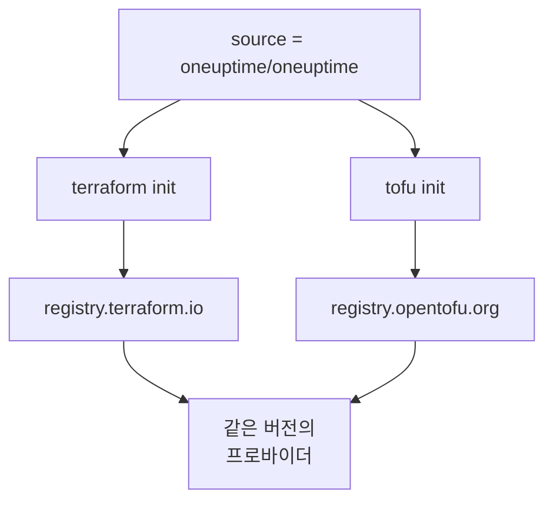

# OpenTofu

OneUptime 프로바이더는 Terraform에서처럼 [OpenTofu](https://opentofu.org)에서도 작동합니다. [OpenTofu Registry](https://search.opentofu.org/provider/oneuptime/oneuptime/latest)에 게시되며, 모든 릴리스는 게시되기 전에 두 엔진에서 같은 엔드투엔드 테스트를 통과합니다. 구성은 바뀌지 않습니다. `tofu`를, 이 문서가 `terraform`을 실행하는 모든 곳에서 실행하세요.

:::cards
- [OpenTofu에서 프로바이더 사용하기](#opentofu에서-프로바이더-사용하기): 같은 구성을 `tofu`로 실행합니다.
- [Terraform과 다른 점](#terraform과-다른-점): 레지스트리, 잠금 파일, `.tofu` 파일, 버전.
- [구성을 OpenTofu로 옮기기](#구성을-opentofu로-옮기기): 기존 구성을 네 단계로 전환합니다.
- [재사용할 수 있는 모듈](#재사용할-수-있는-모듈): 서비스 하나를 위한 모니터, 온콜 정책, 상태 페이지.
:::

## OpenTofu에서 프로바이더 사용하기

OpenTofu 1.6 이상이 필요합니다. Terraform에서와 같이 프로바이더를 선언하세요.

```hcl title="main.tf"
terraform {
  required_providers {
    oneuptime = {
      source  = "oneuptime/oneuptime"
      version = "{{TERRAFORM_PROVIDER_VERSION}}"
    }
  }
}

provider "oneuptime" {
  # The API key comes from the ONEUPTIME_API_KEY environment variable.
  # On a self-hosted OneUptime, add your OneUptime's address:
  # oneuptime_url = "https://oneuptime.example.com"
}
```

그런 다음 `tofu`로 실행합니다.

```bash
export ONEUPTIME_API_KEY="<your-api-key>"
tofu init
tofu plan
tofu apply
```

`tofu init`은 OpenTofu Registry에서 프로바이더를 다운로드합니다. [빠른 시작](/docs/terraform/quick-start), [완전한 가이드](/docs/terraform/complete-guide), [모니터 단계](/docs/terraform/monitor-steps), [예제](/docs/terraform/examples), [리소스 가져오기](/docs/terraform/importing-resources)의 모든 내용이 그대로 적용되며, 대시보드의 **Terraform** 페이지가 작성하는 구성도 바꾸지 않고 작동합니다.

### 소스 주소에 레지스트리 넣지 않기

`source = "oneuptime/oneuptime"`은 레지스트리를 지정하지 않으므로, 각 엔진은 자신의 레지스트리에서 읽습니다.



호스트 이름은 쓰지 마세요. 호스트 이름을 쓰면 모든 엔진이 그 레지스트리를 사용합니다. `registry.terraform.io/oneuptime/oneuptime`으로 쓰면 OpenTofu도 Terraform Registry에서 다운로드하고, Terraform은 OpenTofu Registry의 사본을 `authentication signature from unknown issuer`로 거부합니다.

## Terraform과 다른 점

| 항목 | OpenTofu에서 |
| --- | --- |
| 레지스트리 | `oneuptime/oneuptime`은 `registry.opentofu.org/oneuptime/oneuptime`이며, Terraform Registry와 같은 버전을 게시합니다. |
| 서명 | `tofu init`은 서명 검증을 건너뛰었다고 알려 줍니다. OpenTofu Registry에는 이 프로바이더의 서명 키가 없으므로, OpenTofu는 레지스트리의 체크섬으로 다운로드를 검증합니다. |
| `terraform` 블록 | `terraform`으로 그대로 둡니다. 언어의 일부이며, OpenTofu가 그대로 읽습니다. |
| `.tofu` 파일 | OpenTofu 1.8 이상은 `.tofu` 파일도 읽습니다. 또 `.tf` 파일은 같은 이름의 `.tofu` 파일이 있으면 건너뜁니다. Terraform은 `.tf` 파일만 읽습니다. |
| `required_version` | OpenTofu 버전은 1.6.0부터 시작하므로, Terraform용으로 쓴 `>= 1.5.0`은 모든 OpenTofu를 허용합니다. |
| 잠금 파일 | `registry.opentofu.org/oneuptime/oneuptime`이 적힙니다. 엔진을 바꾸면 그 항목이 다시 쓰이므로, 변경을 커밋하세요. |
| State | OpenTofu는 Terraform이 쓴 state를 그대로 읽습니다. |
| 변수 | `TF_VAR_name`은 OpenTofu에서도 변수를 설정합니다. |
| CLI 구성 파일 | `~/.tofurc` 또는 `~/.terraformrc`, 또는 `TF_CLI_CONFIG_FILE`이 지정하는 파일. |
| `removed` 블록 | 그 `lifecycle` 블록에는 OpenTofu 1.10 이상이 필요합니다. 이 블록이 없으면, Terraform은 레코드를 삭제하지만 OpenTofu는 리소스를 잊고 레코드를 남깁니다. |
| 이름이 바뀐 리소스 유형으로 옮기기 | `moved` 블록으로 `oneuptime_io_t_fleet`에서 `oneuptime_iot_fleet`으로, 또는 이름이 바뀐 다른 유형 사이에서 옮기려면 OpenTofu 1.12 이상이 필요합니다. |

## 구성을 OpenTofu로 옮기기

Terraform이 관리하는 구성은 state와 함께 그대로 OpenTofu로 옮겨집니다.

:::steps
### OpenTofu 설치하기

OpenTofu를 설치하세요. 프로바이더에는 1.6이면 충분하고, 1.12 이상은 `oneuptime_io_t_fleet`에서 `oneuptime_iot_fleet`으로처럼 리소스를 이름이 바뀐 유형으로 옮기는 것도 합니다.

### tofu로 초기화하기

구성 폴더에서 `tofu init`을 실행합니다. OpenTofu Registry에서 프로바이더를 다운로드하고, 잠금 파일을 바꿨다고 알려 줍니다. 이제 프로바이더 항목은 OpenTofu Registry를 가리킵니다.

### 플랜 실행하기

`tofu plan`을 실행합니다. Terraform이 남긴 state를 읽고 `No changes.`로 응답합니다.

### 잠금 파일 커밋하기

`.terraform.lock.hcl`을 커밋하고, 이제부터는 CI를 포함해 `tofu`로 구성을 실행하세요.
:::

## 재사용할 수 있는 모듈

OneUptime 저장소의 [`Examples/opentofu/`](https://github.com/OneUptime/oneuptime/tree/master/Examples/opentofu)에는 바로 실행할 수 있는 구성과, 서비스 하나를 설정하는 모듈이 있습니다. 이 모듈은 전달한 주소마다 웹사이트 모니터, 만드는 모든 것에 붙이는 레이블, 에스컬레이션 규칙이 하나인 온콜 정책, 모니터를 나열하는 상태 페이지를 만듭니다. 일반 HCL이므로 Terraform에서도 작동합니다.

```hcl title="main.tf"
module "storefront" {
  source = "github.com/OneUptime/terraform-provider-oneuptime//modules/monitoring-and-incident-response?ref=vX.Y.Z"

  service_name          = "storefront"
  status_page_is_public = true

  monitors = {
    homepage = { url = "https://example.com" }
    checkout = { url = "https://example.com/checkout" }
    api      = { url = "https://api.example.com/health", expected_status_code = "204" }
  }
}
```

`vX.Y.Z`는 [프로바이더의 릴리스](https://github.com/OneUptime/terraform-provider-oneuptime/releases) 중 최신 버전처럼 게시된 프로바이더 버전으로 바꾸세요. 모듈은 프로바이더와 함께 게시되며, 그 저장소는 릴리스마다 바뀝니다.

모듈은 모니터 상태나 인시던트 심각도를 만들지 않습니다. 모든 프로젝트가 처음부터 가진 `Operational`, `Offline`, `Critical Incident`를 이름으로 조회합니다. 프로젝트에서 이름을 바꿨다면 `operational_monitor_status_name`, `offline_monitor_status_name` 또는 `incident_severity_name`을 설정하세요.

모듈의 에스컬레이션 규칙은 누구에게 알릴지 지정하기 전까지 아무에게도 알리지 않습니다. 모듈의 출력으로 팀을 추가하세요.

```hcl title="main.tf"
resource "oneuptime_team" "storefront" {
  name = "Storefront"
}

resource "oneuptime_team_on_call_duty_escalation_rule" "storefront" {
  on_call_duty_policy_id                 = module.storefront.on_call_policy_id
  on_call_duty_policy_escalation_rule_id = module.storefront.escalation_rule_id
  team_id                                = oneuptime_team.storefront.id
}
```

## 다음 단계

:::cards
- [빠른 시작](/docs/terraform/quick-start): API 키를 만들고 첫 리소스를 적용합니다.
- [레지스트리 사용](/docs/terraform/registry): 버전 번호를 매기는 방식과 잠금 파일.
- [자체 호스팅 설정](/docs/terraform/self-hosted): 자체 OneUptime과 오프라인 머신을 위한 미러.
- [문제 해결](/docs/terraform/troubleshooting): 흔한 오류와 해결 방법.
:::
