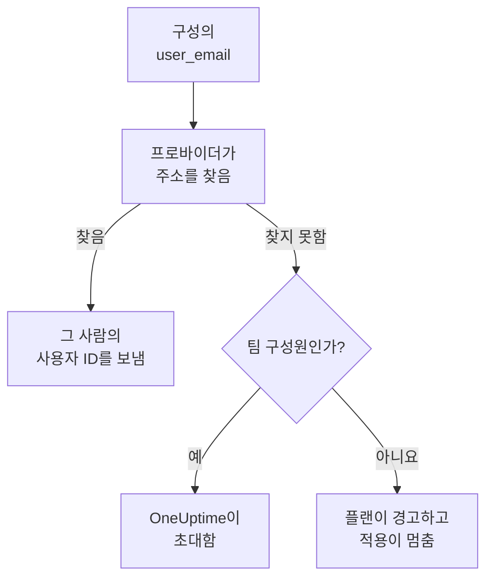

# 사용자와 팀

프로젝트에 누가 있는지 Terraform 구성에 기록하세요. 팀과 그 구성원, 온콜 담당자, 누가 무엇을 소유하는지입니다. 모든 사람을 이메일 주소로 지정하면 프로바이더가 그 사람을 찾고, 프로젝트에 처음 오는 사람은 초대합니다.

:::cards
- [이메일 주소로 사람 지정하기](#이메일-주소로-사람-지정하기): 모든 사용자 ID 옆에 있는 속성.
- [사람 맞이하기](#사람-맞이하기): 누군가를 초대하고 팀, 온콜 당번, 소유할 것을 맡깁니다.
- [사람 내보내기](#사람-내보내기): 누군가를 빼는 일과, 그때 OneUptime이 함께 빼는 것.
- [이미 있는 구성원 가져오기](#이미-있는-구성원-가져오기): 그 팀과 주소로.
:::

## 작동 방식

프로바이더는 API 키의 프로젝트에 속한 사람, 즉 구성원과 프로젝트에 초대된 사람 중에서 주소를 찾습니다. 찾은 사람의 ID를 API에 보냅니다. 프로젝트의 누구도 가지지 않은 주소로 지정한 팀 구성원은 대신 그 주소를 초대합니다.



검색하는 곳은 API 키 자신의 프로젝트뿐입니다. 그 밖의 사람은 절대 찾지 않으며, 프로바이더는 어떤 주소가 다른 곳에 계정을 가지고 있는지도 알 수 없습니다.

## 시작하기 전에

- **프로젝트의 팀을 읽을 수 있는 API 키.** 프로바이더는 팀을 통해 사람을 찾습니다.
- **새로운 사람을 추가하려면, 사람을 초대할 수 있는 키.** [사람 초대](/docs/permissions/inviting-people)를 참고하세요.

## 이메일 주소로 사람 지정하기

사람을 지정하는 모든 리소스는 사용자 ID 옆에 그 사람의 이메일 주소도 받습니다. 둘 중 하나를 지정하세요.

| 사용자 ID | 이메일 주소 |
| --- | --- |
| `user_id` | `user_email` |
| `owner_users` | `owner_user_emails` |
| `assigned_to_user_id` | `assigned_to_user_email` |
| `override_user_id` | `override_user_email` |

주소는 대소문자에 상관없이 찾으며, 쓴 그대로 state에 유지됩니다. 사용자 ID가 채워지므로 다른 리소스가 그것을 참조할 수 있습니다.

## 사람 맞이하기

이 구성은 프로젝트에 처음 오는 Alice를 팀에 추가하고, 첫날부터 온콜 당번을 맡기며, 이미 프로젝트에 있는 Bob을 모니터의 소유자로 만듭니다.

```hcl title="people.tf"
resource "oneuptime_team" "sre" {
  name        = "SRE"
  description = "Site reliability engineering"
}

# New to the project: OneUptime invites her.
resource "oneuptime_team_member" "alice" {
  team_id    = oneuptime_team.sre.id
  user_email = "alice@example.com"
}

resource "oneuptime_on_call_policy_schedule" "weekly" {
  name     = "SRE weekly"
  timezone = "UTC"
}

resource "oneuptime_on_call_schedule_layer" "weekly" {
  on_call_duty_policy_schedule_id = oneuptime_on_call_policy_schedule.weekly.id
  name                            = "Weekly"
  starts_at                       = "2030-01-07T09:00:00Z"
  hand_off_time                   = "2030-01-14T09:00:00Z"
}

# Named through her membership, so she is invited first.
resource "oneuptime_on_call_schedule_layer_user" "alice" {
  on_call_duty_policy_schedule_id       = oneuptime_on_call_policy_schedule.weekly.id
  on_call_duty_policy_schedule_layer_id = oneuptime_on_call_schedule_layer.weekly.id
  user_id                               = oneuptime_team_member.alice.user_id
}

resource "oneuptime_monitor" "api" {
  name         = "Public API"
  monitor_type = "Manual"
}

# In the project already: named by his address.
resource "oneuptime_monitor_user_owner" "api" {
  monitor_id = oneuptime_monitor.api.id
  user_email = "bob@example.com"
}
```

`terraform apply`는 대시보드에서 하는 초대처럼 Alice를 이메일로 초대합니다. 계정이 없으면 OneUptime이 만들어 줍니다. `has_accepted_invitation`은 수락할 때까지 `false`로 남으며, 수락해도 플랜의 변경이 되지 않습니다. 이미 프로젝트에 있는 사람은 새 팀에 바로 들어갑니다.

이 구성이 초대하는 사람을 온콜에 넣거나 소유자로 만들려면 `user_id = oneuptime_team_member.<name>.user_id`로 그 사람의 멤버십을 참조하세요. 그러면 Terraform은 다른 곳에서 지정하기 전에 그 사람을 초대합니다. 프로젝트의 누구도 가지지 않은 주소는 플랜에서는 경고, 적용에서는 오류가 됩니다.

## 사람 찾기

데이터 소스 `oneuptime_user`는 `email`, `name`, `id` 중 하나로 사람을 찾고, 그 사람의 사용자 ID, 이름, 참여 여부, 속한 팀을 읽습니다.

```hcl
data "oneuptime_user" "alice" {
  email = "alice@example.com"
}

output "alice_teams" {
  value = data.oneuptime_user.alice.team_ids
}
```

## 사람 내보내기

그 사람의 멤버십을 구성에서 지우고 적용하세요. 프로젝트의 마지막 팀에서 빠지면 프로젝트에서도 빠지고, OneUptime은 그 사람을 모든 온콜 일정, 에스컬레이션 규칙, 대리에서 빼며, 소유한 것에서도 뺍니다. 끝난 인시던트, 알림, 유지 관리 이벤트를 제외한 모든 것입니다. 그 사람을 지정하는 블록도 같은 변경에서 지우세요. 그러지 않으면 다음 플랜이 더 이상 프로젝트에 없는 사람을 위해 그것들을 다시 만듭니다.

그 사람의 OneUptime 계정은 그대로 그 사람의 것이고, 떠나는 것은 프로젝트뿐입니다. 구성원을 남겨야 하는 팀은 수락한 마지막 구성원을 빼지 못하게 합니다.

## 이미 있는 구성원 가져오기

멤버십의 ID는 어느 화면에도 나오지 않으므로, 팀의 ID와 그 사람의 주소로 가져오세요.

```bash
terraform import oneuptime_team_member.alice 6b1d1c2e-4f3a-4b5c-8d6e-7f8091a2b3c4/alice@example.com
```

주소는 쓴 그대로 남으니 구성과 똑같이 쓰세요. 멤버십 자체의 ID로도 가져올 수 있으며, 이때 주소는 OneUptime에서 소문자로 읽어 옵니다.

소유자와 온콜 행도 같은 방식으로, 속한 대상으로 가져옵니다. 모니터의 소유자는 모니터의 ID와 그 사람의 주소로 가져옵니다. 소유자 팀이나 에스컬레이션 규칙이 호출하는 팀처럼 팀이나 일정을 가리키는 행은 두 ID로 가져옵니다.

```bash
terraform import oneuptime_monitor_user_owner.api 68a1b2c3-d4e5-4f6a-8b9c-0d1e2f3a4b01/bob@example.com
terraform import oneuptime_escalation_rule_team.sre 68a1b2c3-d4e5-4f6a-8b9c-0d1e2f3a4b06/6b1d1c2e-4f3a-4b5c-8d6e-7f8091a2b3c4
```

## 누군가 주소를 바꿀 때

OneUptime에서 주소를 바꾼 사람도 Terraform에게는 같은 사람입니다. 새 주소를 쓰기 전까지는 아무것도 바뀌지 않으며, 쓰면 `user_email`만 바뀝니다.

## 문제 해결

:::details 플랜이 주소가 아직 이 프로젝트에 없다고 할 때
프로젝트에도, 초대된 사람 중에도 그 주소를 가진 사람이 없습니다. 먼저 `oneuptime_team_member`로 그 사람을 초대하세요. 그 멤버십이 같은 구성에 있다면 주소 대신 `user_id = oneuptime_team_member.<name>.user_id`로 참조하세요. OneUptime에서 주소를 바꾼 사람이라면 새 주소를 쓰세요.
:::

:::details 적용이 사용자가 이미 이 팀에 초대되었다고 할 때
그 사람은 이미 팀에 있습니다. 만드는 대신 그 멤버십을 가져오세요. [이미 있는 구성원 가져오기](#이미-있는-구성원-가져오기)와 같습니다.
:::

## 다음 단계

:::cards
- [리소스 가져오기](/docs/terraform/importing-resources): 프로젝트의 나머지도 Terraform으로 관리하세요.
- [사람 초대](/docs/permissions/inviting-people): OneUptime에서 초대가 작동하는 방식.
- [예제](/docs/terraform/examples): 자주 쓰는 리소스를 위한, 바로 쓸 수 있는 구성.
:::
