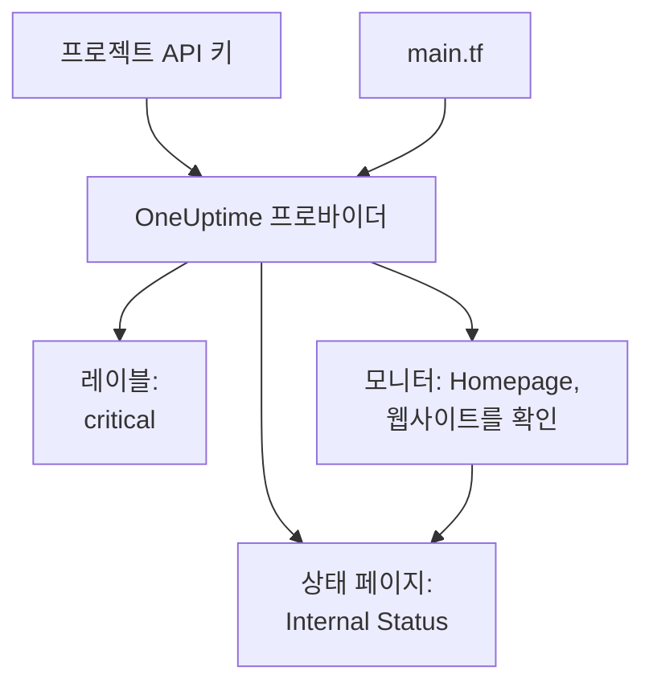

# 빠른 시작

이 가이드는 아무것도 없는 상태에서 Terraform이 관리하는 OneUptime 프로젝트까지 약 10분 만에 안내합니다. API 키를 만들고, Terraform이 프로젝트를 가리키게 한 다음, 레이블, 웹사이트를 확인하는 모니터, 그 모니터를 보여 주는 비공개 상태 페이지를 적용합니다. 그런 다음 그중 하나를 바꾸고 정리합니다.

:::cards
- [시작하기 전에](#시작하기-전에): Terraform, 프로젝트, API 키를 쓸 수 있는 플랜.
- [첫 리소스 만들기](#첫-리소스-만들기): API 키부터 적용된 계획까지 여섯 단계로.
- [리소스 변경하기](#리소스-변경하기): 구성을 편집하고, 계획하고, 적용합니다.
- [문제 해결](#문제-해결): 첫 실행이 멈출 수 있는 오류.
:::



## 시작하기 전에

- **Terraform 1.5 이상 또는 OpenTofu 1.6 이상.** OpenTofu에서는 이 가이드가 `terraform`을 실행하는 곳마다 `tofu`를 실행합니다.
- **OneUptime 프로젝트.** [oneuptime.com](https://oneuptime.com) 또는 자체 OneUptime에 있고, API 키를 만들 수 있는 프로젝트.
- **OneUptime Cloud에서는 Growth 플랜 이상.** 프로젝트의 API 키는 이 플랜에서만 작동합니다.

## 첫 리소스 만들기

:::steps
### 프로젝트 API 키 만들기

OneUptime 대시보드에서 **프로젝트 설정 → 고급 → API 키**를 열고 **API 키 만들기**를 클릭합니다. `terraform` 같은 **이름**을 지정하고, **접근**에서 **프로젝트 관리자**를 고르세요. Terraform은 관리하는 모든 종류의 레코드를 만들고, 읽고, 변경하고, 삭제하며, **프로젝트 관리자**는 그 모두를 할 수 있습니다. 범위가 더 좁은 키가 필요하면 **나중에 권한 선택**을 고르고 키 페이지에서 필요한 권한만 추가하세요.

키는 오늘부터 1년 뒤에 만료됩니다. 다른 날짜를 고르려면 만들기 전에 **추가 필드**를 열거나, 나중에 키 페이지에서 날짜를 바꾸세요. 키를 만들면 키 페이지가 열립니다. **API 키 세부 정보** 카드에서 **API 키**를 복사하세요.

### Terraform이 키를 쓸 수 있게 하기

키가 파일에 남지 않도록, Terraform을 실행하는 셸의 환경 변수 `ONEUPTIME_API_KEY`에 키를 넣습니다.

:::tabs
@tab Linux
```bash
export ONEUPTIME_API_KEY="<your-api-key>"
```
@tab macOS
```bash
export ONEUPTIME_API_KEY="<your-api-key>"
```
@tab Windows
```powershell
$env:ONEUPTIME_API_KEY = "<your-api-key>"
```
:::

### Terraform이 OneUptime을 가리키게 하기

빈 폴더를 만들고, 그 안에 `main.tf`라는 파일을 만듭니다.

```hcl title="main.tf"
terraform {
  required_providers {
    oneuptime = {
      source  = "oneuptime/oneuptime"
      version = "{{TERRAFORM_PROVIDER_VERSION}}"
    }
  }
}

provider "oneuptime" {
  # The API key comes from ONEUPTIME_API_KEY.
  # On a self-hosted OneUptime, add your OneUptime's address:
  # oneuptime_url = "https://oneuptime.example.com"
}
```

자체 호스팅 OneUptime에서는 프로바이더 버전을 고르기 전에 [자체 호스팅 설정](/docs/terraform/self-hosted)을 읽으세요.

### 리소스 기술하기

다음 블록을 `main.tf`에 추가합니다. 모든 프로젝트가 처음부터 가진 모니터 상태 중 두 개를 읽고, 레이블, `https://example.com`을 5분마다 확인하는 모니터(여기에 여러분의 웹사이트를 넣으세요), 그리고 그 모니터를 보여 주는 비공개 상태 페이지를 만듭니다.

```hcl title="main.tf"
data "oneuptime_monitor_status" "operational" {
  name = "Operational"
}

data "oneuptime_monitor_status" "offline" {
  name = "Offline"
}

resource "oneuptime_label" "critical" {
  name        = "critical"
  description = "Resources that page on-call when down"
  color       = "#FF5733"
}

resource "oneuptime_monitor" "homepage" {
  name                = "Homepage"
  description         = "Checks that the homepage responds"
  monitor_type        = "Website"
  monitoring_interval = "*/5 * * * *"
  labels              = [oneuptime_label.critical.id]

  monitor_steps = [{
    monitor_destination      = "https://example.com"
    monitor_destination_type = "URL"
    request_type             = "GET"

    criteria = [
      {
        name                  = "Offline"
        description           = "The homepage does not respond"
        filter_condition      = "Any"
        change_monitor_status = true
        monitor_status_id     = data.oneuptime_monitor_status.offline.id

        filters = [
          {
            check_on    = "Is Online"
            filter_type = "False"
          }
        ]
      },
      {
        name                  = "Online"
        description           = "The homepage responds"
        filter_condition      = "All"
        change_monitor_status = true
        monitor_status_id     = data.oneuptime_monitor_status.operational.id

        filters = [
          {
            check_on    = "Is Online"
            filter_type = "True"
          }
        ]
      }
    ]
  }]
}

resource "oneuptime_status_page" "internal" {
  name                  = "Internal Status"
  description           = "Status of our internal services"
  page_title            = "Service Status"
  is_public_status_page = false
}

resource "oneuptime_status_page_resource" "homepage" {
  status_page_id = oneuptime_status_page.internal.id
  monitor_id     = oneuptime_monitor.homepage.id
  display_name   = "Homepage"
}

output "monitor_id" {
  value = oneuptime_monitor.homepage.id
}
```

모니터의 `monitor_steps`는 무엇을 확인하고 각 결과가 무엇을 뜻하는지 나타냅니다. 각 확인 후에는 처음 일치한 기준이 상태를 정합니다. 각 부분은 [모니터 단계](/docs/terraform/monitor-steps)에서 설명합니다.

### 계획하고 적용하기

:::tabs
@tab Terraform
```bash
terraform init
terraform plan
terraform apply
```
@tab OpenTofu
```bash
tofu init
tofu plan
tofu apply
```
:::

`init`은 프로바이더를 내려받습니다. 계획은 `Plan: 4 to add, 0 to change, 0 to destroy.`로 끝납니다. `yes`를 입력해 적용하세요. 끝나면 Terraform이 새 모니터의 ID를 출력합니다.

### 대시보드 확인하기

OneUptime 대시보드에서:

- **모니터**에 `critical` 레이블이 붙은 `Homepage`가 표시됩니다. 첫 확인 결과는 몇 분 안에 들어옵니다.
- **상태 페이지**에 `Homepage`를 보여 주는 `Internal Status`가 표시됩니다.
- **프로젝트 설정 → 기본 → 레이블**에 설정한 색상의 `critical`이 표시됩니다.

`terraform plan`을 다시 실행하세요. `No changes.`라고 답합니다. OneUptime에는 구성에 적힌 그대로가 들어 있습니다.
:::

## 리소스 변경하기

대시보드가 아니라 구성을 바꾸세요. `main.tf`에서 레이블의 `color`를 `"#2ECC71"`로 설정한 다음, 계획하고 적용합니다.

```bash
terraform plan
terraform apply
```

계획은 `Plan: 0 to add, 1 to change, 0 to destroy.`로 끝나며, 레이블은 그 자리에서 변경됩니다. Terraform이 관리하는 리소스를 누군가 대시보드에서 바꾸면 그 변경이 다음 계획에 표시되고, 적용하면 구성에 적힌 내용으로 되돌아갑니다.

## 정리하기

시험 삼아 해 본 것이라면 구성이 만든 것을 삭제하세요.

```bash
terraform destroy
```

레이블, 모니터, 상태 페이지와 그 리소스가 삭제됩니다. 두 모니터 상태는 남습니다. 데이터 소스는 읽기만 하기 때문입니다.

## 문제 해결

:::details 메시지 “Missing API Key”
프로바이더가 API 키를 찾지 못했습니다. Terraform을 실행하는 셸에서 `ONEUPTIME_API_KEY`를 내보내거나 프로바이더 블록에 `api_key`를 설정한 다음, 명령을 다시 실행하세요.
:::

:::details 메시지 “the OneUptime API returned status 400: Invalid API Key”
키를 잘못 입력했거나, 만료되었거나, 삭제되었거나, `oneuptime_url`이 가리키는 것과 다른 OneUptime의 키입니다. 키 페이지에서 키를 다시 복사하거나 새 키를 만드세요.
:::

:::details 메시지 “the OneUptime API returned status 402: API keys need the Growth plan”
OneUptime Cloud에서 프로젝트의 API 키는 Growth 플랜 이상에서만 작동합니다. **프로젝트 설정 → 결제 및 청구서 → 결제**에서 프로젝트를 업그레이드하면 같은 키가 다시 작동합니다.
:::

:::details 메시지 “the OneUptime API returned status 422: You do not have permissions to create Monitor”
키에 그 종류의 레코드에 대한 권한이 없습니다. 키 페이지에서 **프로젝트 관리자**나 메시지에 나온 권한을 부여하세요.
:::

:::details 메시지 “No monitor status matches {name = "Offline"}”
프로젝트의 모니터 상태 이름이 다릅니다. **모니터 → 설정 → 모니터 상태**에 보이는 이름을 쓰거나, 대신 `is_offline_state = true`로 상태를 찾으세요.
:::

## 다음 단계

:::cards
- [완전한 가이드](/docs/terraform/complete-guide): 인증, 프로젝트 구성, 데이터 소스, state, 업그레이드.
- [모니터 단계](/docs/terraform/monitor-steps): 모니터가 무엇을 확인하고 각 결과가 무엇을 뜻하는지 정합니다.
- [예제](/docs/terraform/examples): 흔히 쓰는 리소스를 위한 바로 쓸 수 있는 구성.
- [리소스 가져오기](/docs/terraform/importing-resources): 대시보드에서 만든 것을 Terraform 관리로 가져옵니다.
:::
