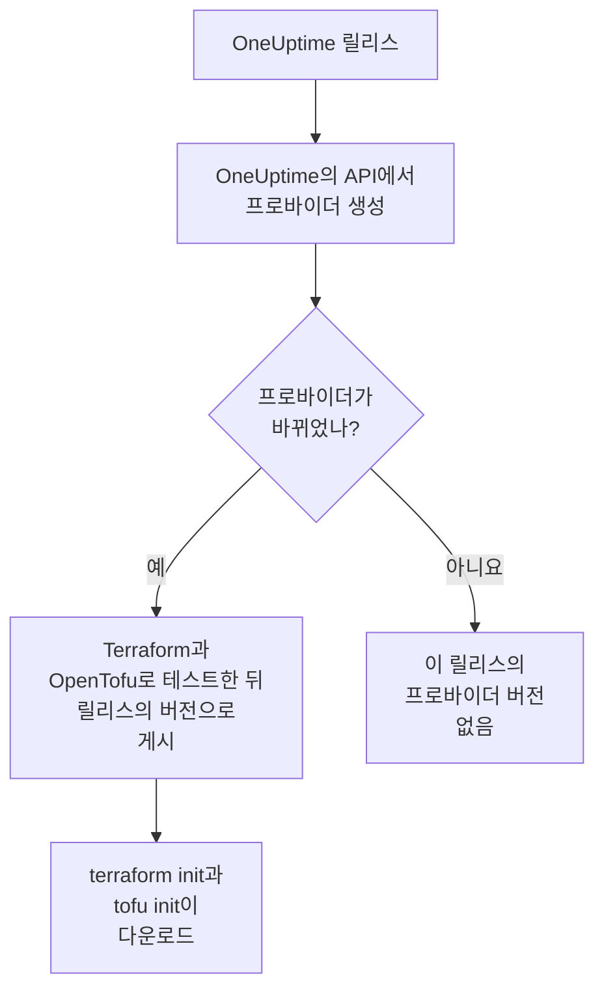

# 레지스트리 사용

OneUptime 프로바이더는 [Terraform Registry](https://registry.terraform.io/providers/oneuptime/oneuptime)와 [OpenTofu Registry](https://search.opentofu.org/provider/oneuptime/oneuptime/latest)에 게시됩니다. `terraform init`과 `tofu init`이 그곳에서 다운로드하므로 직접 설치할 것은 없습니다. 이 페이지에서는 무엇이 게시되는지, 버전 번호를 매기는 방식, 더 새로운 버전으로 옮기는 방법을 설명합니다.

:::cards
- [게시되는 것](#게시되는-것): 플랫폼별 프로바이더, 그 레퍼런스와 버전.
- [버전 번호를 매기는 방식](#버전-번호를-매기는-방식): 프로바이더의 버전은 그것을 게시한 OneUptime 릴리스입니다.
- [잠금 파일](#잠금-파일): 모든 머신이 설치하는 버전과 체크섬.
- [더 새로운 버전으로 옮기기](#더-새로운-버전으로-옮기기): 바뀐 점을 읽고, 다운로드하고, 플랜을 실행합니다.
:::

## 게시되는 것

OneUptime의 각 릴리스는 OneUptime 자체 API에서 프로바이더를 생성합니다. 프로바이더가 바뀌었으면, 릴리스는 Terraform과 OpenTofu에서 엔드투엔드 테스트를 통과한 뒤 릴리스의 버전으로 프로바이더를 게시합니다.



| 무엇 | 어디에 |
| --- | --- |
| Linux, macOS, Windows, FreeBSD, OpenBSD, Solaris용 프로바이더 | `terraform init`과 `tofu init`이 다운로드하며, OneUptime이 서명한 체크섬이 함께 제공됩니다 |
| 모든 리소스와 데이터 소스의 레퍼런스와 각각의 모든 속성 | 레지스트리 문서. 모니터, 상태 페이지, 인시던트, 온콜 등 제품별로 묶여 있습니다 |
| OpenTofu에서 프로바이더를 사용하는 가이드 | 레지스트리의 가이드 |
| 모든 버전(최신순) | 레지스트리의 버전 목록 |

레퍼런스에는 각 속성이 무엇인지 나와 있습니다. 이 문서는 그것들을 함께 사용하는 방법을 보여 줍니다. [Terraform 개요](/docs/terraform/index)에서 시작하세요.

## 버전 번호를 매기는 방식

프로바이더의 버전은 그것을 게시한 OneUptime 릴리스의 버전입니다. 프로바이더 {{TERRAFORM_PROVIDER_MAJOR}}.0.20은 OneUptime {{TERRAFORM_PROVIDER_MAJOR}}.0.20과 함께 나왔습니다. 프로바이더가 바뀌지 않은 릴리스는 아무것도 게시하지 않으므로 버전에는 빈틈이 있고, 정확한 버전 하나를 지정한 제약은 존재하지 않는 버전을 가리킬 수 있습니다. 대신 범위를 작성하세요.

| 사용하는 것 | 제약 | Terraform이 설치하는 것 |
| --- | --- | --- |
| OneUptime Cloud | `{{TERRAFORM_PROVIDER_VERSION}}` | 최신 {{TERRAFORM_PROVIDER_MAJOR}}.x 프로바이더 |
| 자체 호스팅 OneUptime | 자체 OneUptime의 버전에서 끝나는 범위. 예: `>= {{TERRAFORM_PROVIDER_MAJOR}}.0, <= {{TERRAFORM_PROVIDER_MAJOR}}.0.40` | 자체 OneUptime보다 새롭지 않은 최신 프로바이더 |

자체 호스팅 OneUptime에서는 자체 OneUptime보다 새로운 프로바이더가 그 OneUptime에 아직 없는 설정을 보낼 수 있습니다. 범위를 작성하는 방법은 [자체 호스팅 설정](/docs/terraform/self-hosted#프로바이더-버전-고르기)에 나와 있습니다.

```hcl title="main.tf"
terraform {
  required_providers {
    oneuptime = {
      source  = "oneuptime/oneuptime"
      version = "{{TERRAFORM_PROVIDER_VERSION}}"
    }
  }
}
```

소스 주소는 레지스트리를 지정하지 않습니다. Terraform은 Terraform Registry에서, OpenTofu는 OpenTofu Registry에서 읽으며, 두 레지스트리는 같은 버전을 게시합니다.

## 잠금 파일

`terraform init`은 선택한 버전과 다운로드의 체크섬을 `.terraform.lock.hcl`에 기록합니다. 이 파일을 커밋하세요. 그러면 다른 버전을 고를 때까지 모든 머신과 모든 CI 실행이 정확히 그 버전을 설치합니다. 체크섬은 레지스트리가 게시하는 모든 플랫폼을 다루므로, 잠금 파일 하나로 Linux, macOS, Windows 머신을 모두 지원합니다.

```hcl title=".terraform.lock.hcl"
provider "registry.terraform.io/oneuptime/oneuptime" {
  version     = "{{TERRAFORM_PROVIDER_MAJOR}}.0.20"
  constraints = "{{TERRAFORM_PROVIDER_VERSION}}"
  hashes = [
    "h1:...",
    "zh:...",
  ]
}
```

잠금 파일에는 레지스트리가 적힙니다. OpenTofu는 `registry.opentofu.org/oneuptime/oneuptime`이라고 쓰고, Terraform은 같은 자리에 `registry.terraform.io/oneuptime/oneuptime`이라고 씁니다. 그래서 엔진을 바꾸면 잠금 파일이 바뀝니다. `init`이 항목을 바꾸고, 그 변경을 커밋하라고 알려 줍니다.

## 더 새로운 버전으로 옮기기

:::steps
### 바뀐 점 읽기

[OneUptime의 릴리스](https://github.com/OneUptime/oneuptime/releases)에는 프로바이더를 포함해 각 릴리스에서 바뀐 점이 나와 있습니다. [프로바이더의 릴리스](https://github.com/OneUptime/terraform-provider-oneuptime/releases)는 이전 릴리스 이후의 변경으로 연결됩니다.

### 다운로드하기

```bash
terraform init -upgrade
```

`init -upgrade`는 제약이 허용하는 최신 버전을 골라 보여 주고 `.terraform.lock.hcl`을 업데이트합니다. 제약 `{{TERRAFORM_PROVIDER_VERSION}}`은 모든 {{TERRAFORM_PROVIDER_MAJOR}}.x 릴리스를 받아들입니다. 새 메이저 버전에는 새 제약이 필요합니다.

### 적용하기 전에 플랜 실행하기

`terraform plan`을 실행하고, 플랜이 비어 있거나 예상한 변경만 보여 줄 때만 적용하세요. 업데이트된 잠금 파일을 커밋하세요.
:::

자체 호스팅 OneUptime에서는 OneUptime을 먼저 업그레이드한 다음 프로바이더 범위의 상한을 올리세요.

## 코드의 위치

프로바이더는 [OneUptime 메인 저장소](https://github.com/OneUptime/oneuptime)에서 OneUptime API로부터 생성되며, 각 버전은 그것을 게시한 릴리스에서 빌드됩니다. 프로바이더 자체 저장소인 [OneUptime/terraform-provider-oneuptime](https://github.com/OneUptime/terraform-provider-oneuptime)에는 생성기가 작성한 것이 들어 있으므로, 변경은 메인 저장소에서 합니다. 문서 문제를 포함한 문제는 [github.com/OneUptime/oneuptime/issues](https://github.com/OneUptime/oneuptime/issues)에 보고하세요.

## 다음 단계

:::cards
- [자체 호스팅 설정](/docs/terraform/self-hosted): 자체 OneUptime을 위한 버전 범위와 오프라인 머신을 위한 미러.
- [OpenTofu](/docs/terraform/opentofu): 같은 프로바이더와 구성을 `tofu`로.
- [완전한 가이드](/docs/terraform/complete-guide): 인증, 프로젝트 구성, 데이터 소스, state, 업그레이드.
- [문제 해결](/docs/terraform/troubleshooting): 흔한 오류와 해결 방법.
:::
