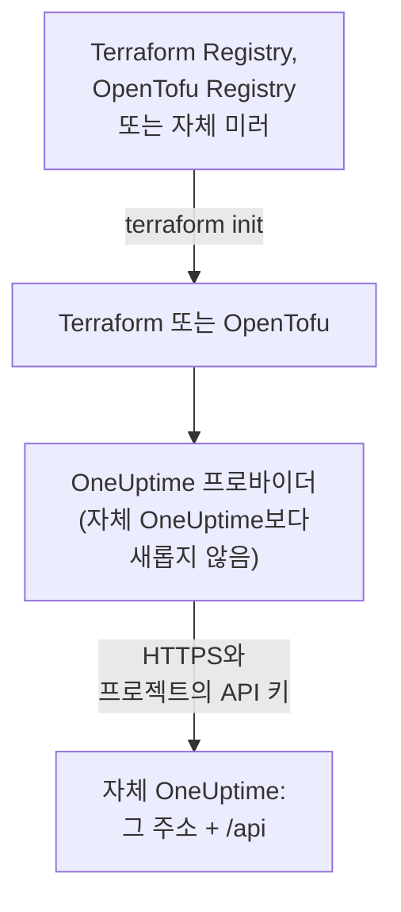

# 자체 호스팅 설정

프로바이더는 자체 OneUptime에서도 OneUptime Cloud에서와 똑같이 작동합니다. 리소스, 속성, 프로젝트 API 키가 모두 같습니다. 직접 설정할 것은 OneUptime의 주소, 그에 맞는 프로바이더 버전, 그리고 필요한 경우 인터넷에 연결되지 않은 머신을 위한 미러와 사설 인증 기관에 대한 신뢰입니다.

:::cards
- [프로바이더가 자체 OneUptime을 가리키게 하기](#프로바이더가-자체-oneuptime을-가리키게-하기): 그 주소와 프로젝트의 API 키.
- [프로바이더 버전 고르기](#프로바이더-버전-고르기): 자체 OneUptime보다 새롭지 않은 최신 프로바이더.
- [인터넷 연결 없이](#인터넷-연결-없이): 프로바이더를 네트워크 안에 미러링합니다.
- [TLS 및 인증서](#tls-및-인증서): 사설 인증 기관, 프록시, 일반 HTTP.
:::



## 프로바이더가 자체 OneUptime을 가리키게 하기

`oneuptime_url`에는 대시보드를 여는 주소, 즉 경로 없는 스킴과 호스트를 설정합니다. 주소에 스킴이 없으면 프로바이더가 `https://`를 붙이고, 끝에 `/api`를 붙이므로, `https://oneuptime.example.com`은 모든 요청을 `https://oneuptime.example.com/api`로 보냅니다.

```hcl title="main.tf"
terraform {
  required_providers {
    oneuptime = {
      source  = "oneuptime/oneuptime"
      version = "{{TERRAFORM_PROVIDER_MATCHING}}"
    }
  }
}

provider "oneuptime" {
  oneuptime_url = "https://oneuptime.example.com"
  # The API key comes from the ONEUPTIME_API_KEY environment variable.
}
```

주소는 대신 환경 변수 `ONEUPTIME_URL`에서 가져올 수도 있으므로, 하나의 구성으로 여러 설치를 가리킬 수 있습니다.

```bash
export ONEUPTIME_URL="https://oneuptime.example.com"
export ONEUPTIME_API_KEY="<your-api-key>"
```

주소는 설치가 제공되는 호스트입니다. Docker Compose에서는 `HOST`와 `HTTP_PROTOCOL`(`config.env` 안), Helm 차트에서는 `host`와 `httpProtocol`(values 안)입니다.

키는 관리하는 프로젝트의 API 키로, OneUptime Cloud와 마찬가지로 자체 OneUptime 대시보드의 **프로젝트 설정 → 고급 → API 키**에서 만듭니다. 자체 호스팅 OneUptime의 마스터 API 키는 어떤 프로젝트에도 속하지 않으므로, 이 키로 하는 생성은 `ProjectId required`로 실패합니다.

> [!TIP]
> 이 블록은 자체 OneUptime이 대신 작성해 줍니다. 대시보드에서 아무 리소스나 목록을 연 다음, 그 사이드 메뉴에서 **개발자**와 **Terraform**을 여세요. 표시되는 프로바이더 블록에는 자체 OneUptime의 주소와 그에 맞는 버전 범위가 들어 있습니다.

## 프로바이더 버전 고르기

자체 OneUptime보다 새롭지 않은, 게시된 최신 프로바이더를 사용하세요. 프로바이더 버전은 OneUptime의 버전을 따릅니다. 프로바이더를 바꾸는 OneUptime 릴리스는 릴리스 자체의 버전 번호로 프로바이더를 게시하며, 자체 OneUptime보다 새로운 프로바이더는 그 OneUptime에 아직 없는 설정을 보낼 수 있습니다.

그러니 대시보드처럼 자체 OneUptime의 버전에서 끝나는 범위를 작성하세요. 위 블록은 `{{TERRAFORM_PROVIDER_MATCHING}}`를 사용합니다. 이 문서를 제공하는 OneUptime에 맞는 범위이므로, 자체 OneUptime에서 이 문서를 읽고 있다면 그 범위가 바로 맞는 범위입니다. 그렇지 않다면 자신의 버전을 써넣으세요.

:::steps
### 자체 OneUptime의 버전 확인하기

자체 OneUptime에 물어보세요.

```bash
curl https://oneuptime.example.com/version
```

응답은 `{"version":"{{TERRAFORM_PROVIDER_MAJOR}}.0.40","commit":"..."}` 같은 JSON입니다. 마스터 관리자라면 관리자 대시보드 헤더의 에디션 라벨을 열어 확인할 수도 있습니다: [현재 버전 확인하기](/docs/installation/upgrading#현재-버전-확인하기)를 참고하세요.

### 범위에 써넣기

범위는 메이저 버전에서 시작해 자신의 버전에서 끝납니다. OneUptime {{TERRAFORM_PROVIDER_MAJOR}}.0.40의 경우:

```hcl title="main.tf"
terraform {
  required_providers {
    oneuptime = {
      source  = "oneuptime/oneuptime"
      version = ">= {{TERRAFORM_PROVIDER_MAJOR}}.0, <= {{TERRAFORM_PROVIDER_MAJOR}}.0.40"
    }
  }
}
```

Terraform은 범위 안의 최신 프로바이더를 사용합니다. 프로바이더를 바꾸지 않은 OneUptime 릴리스는 프로바이더를 게시하지 않으며, 범위는 존재하지 않는 버전을 건너뜁니다.

### 프로바이더 다운로드하기

`terraform init`을 실행합니다. 설치한 버전을 보여 주고 `.terraform.lock.hcl`에 기록합니다.
:::

업그레이드할 때는 OneUptime을 먼저 업그레이드하세요. 그런 다음 범위의 상한을 새 버전으로 올리고 `terraform init -upgrade`를 실행합니다.

## 인터넷 연결 없이

Terraform을 실행하는 머신이 레지스트리에 닿을 수 없으면, 프로바이더를 네트워크 안에 한 번 복사하고 Terraform이 그 사본을 가리키게 하세요.

:::steps
### 프로바이더 미러링하기

인터넷에 연결된 머신에서, 구성이 있는 폴더에서 머신들이 실행되는 모든 플랫폼용 프로바이더를 다운로드합니다. `-platform` 없이 실행하면 명령은 자신이 실행되는 플랫폼용 프로바이더만 다운로드합니다.

:::tabs
@tab Terraform
```bash
terraform providers mirror -platform=linux_amd64 -platform=darwin_arm64 /srv/terraform-mirror
```
@tab OpenTofu
```bash
tofu providers mirror -platform=linux_amd64 -platform=darwin_arm64 /srv/terraform-mirror
```
:::

폴더에는 `registry.terraform.io/oneuptime/oneuptime/`처럼 레지스트리 주소 아래에 프로바이더가 들어 있습니다. 이 폴더를 네트워크 안으로 복사하세요.

### Terraform이 미러를 가리키게 하기

OneUptime 프로바이더는 폴더에서, 나머지는 평소처럼 설치하는 CLI 구성 파일을 작성합니다.

:::tabs
@tab Terraform
```hcl title="mirror.tfrc"
provider_installation {
  filesystem_mirror {
    path    = "/srv/terraform-mirror"
    include = ["registry.terraform.io/oneuptime/oneuptime"]
  }
  direct {
    exclude = ["registry.terraform.io/oneuptime/oneuptime"]
  }
}
```
@tab OpenTofu
```hcl title="mirror.tfrc"
provider_installation {
  filesystem_mirror {
    path    = "/srv/terraform-mirror"
    include = ["registry.opentofu.org/oneuptime/oneuptime"]
  }
  direct {
    exclude = ["registry.opentofu.org/oneuptime/oneuptime"]
  }
}
```
:::

Terraform과 OpenTofu가 모두 읽는 `TF_CLI_CONFIG_FILE`에 이 파일을 지정하세요: `export TF_CLI_CONFIG_FILE=/etc/terraform/mirror.tfrc`.

### 초기화하기

`terraform init`을 실행하면 미러에서 프로바이더를 설치합니다. 잠금 파일에 이제 이 플랫폼의 체크섬만 있다는 경고가 나옵니다. 모든 플랫폼의 체크섬을 기록하려면, 인터넷에 연결된 머신에서 `terraform providers lock`을 같은 `-platform` 옵션으로 실행하고, `.terraform.lock.hcl`을 구성과 함께 커밋하세요.
:::

버전 범위를 올릴 때마다 미러를 다시 만드세요.

## TLS 및 인증서

프로바이더는 Terraform을 실행하는 머신의 신뢰 저장소로 자체 OneUptime의 인증서를 검증하며, 검증을 건너뛰는 설정은 없습니다. 인증서가 사설 인증 기관에서 발급된 경우, Terraform을 실행하는 모든 머신과 CI 러너의 신뢰 저장소에 그 인증 기관을 추가하세요.

:::tabs
@tab Debian / Ubuntu
```bash
sudo cp my-ca.crt /usr/local/share/ca-certificates/
sudo update-ca-certificates
```
@tab RHEL / Fedora
```bash
sudo cp my-ca.crt /etc/pki/ca-trust/source/anchors/
sudo update-ca-trust
```
:::

CI 컨테이너처럼 Linux에서 신뢰 저장소를 바꿀 수 없는 곳에서는, 자신의 인증 기관과 공개 인증 기관이 담긴 파일을 `SSL_CERT_FILE`에 설정하세요. macOS와 Windows에서는 인증 기관을 시스템 인증서 저장소에 추가합니다.

- **프록시.** 프로바이더는 요청을 `HTTPS_PROXY`의 프록시를 통해 보내지만, `NO_PROXY`의 호스트에는 직접 보냅니다. OneUptime 앞의 리버스 프록시는 모든 `/api` 경로와 `APIKey` 헤더를 바꾸지 않고 통과시켜야 합니다.
- **일반 HTTP.** `http://` 주소도 테스트용 설치라면 작동합니다. API 키는 요청마다 전송되므로, 그 밖의 경우에는 HTTPS를 사용하세요.

## 문제 해결

:::details 메시지 “x509: certificate signed by unknown authority”
Terraform을 실행하는 머신이 자체 OneUptime의 인증서를 신뢰하지 않습니다. [TLS 및 인증서](#tls-및-인증서)에 나온 대로 인증 기관을 추가하세요.
:::

:::details 메시지 “invalid character '<' looking for beginning of value”
API 대신 웹 페이지가 응답했습니다. `oneuptime_url`에 경로가 들어 있거나, 프록시가 응답했습니다. 자체 OneUptime의 주소만 설정하세요.
:::

:::details 메시지 “no available releases match the given constraints”
버전 제약에 맞는 게시된 프로바이더가 없습니다. 예를 들어 OneUptime이 게시한 적 없는 버전 하나만 지정한 제약입니다. [프로바이더 버전 고르기](#프로바이더-버전-고르기)에 나온 대로 범위를 작성하세요.
:::

:::details 메시지 “ProjectId required”
키가 어떤 프로젝트에도 속하지 않는 마스터 API 키입니다. **프로젝트 설정 → 고급 → API 키**에서 프로젝트의 API 키를 만드세요.
:::

다른 오류와 각 오류의 의미는 [문제 해결](/docs/terraform/troubleshooting)에 있습니다.

## 다음 단계

:::cards
- [빠른 시작](/docs/terraform/quick-start): API 키를 만들고 첫 리소스를 적용합니다.
- [레지스트리 사용](/docs/terraform/registry): 프로바이더가 게시되는 곳과 버전 번호를 매기는 방식.
- [문제 해결](/docs/terraform/troubleshooting): 흔한 오류와 해결 방법.
- [업그레이드](/docs/installation/upgrading): 프로바이더 범위를 올리기 전에 자체 OneUptime을 업그레이드합니다.
:::
