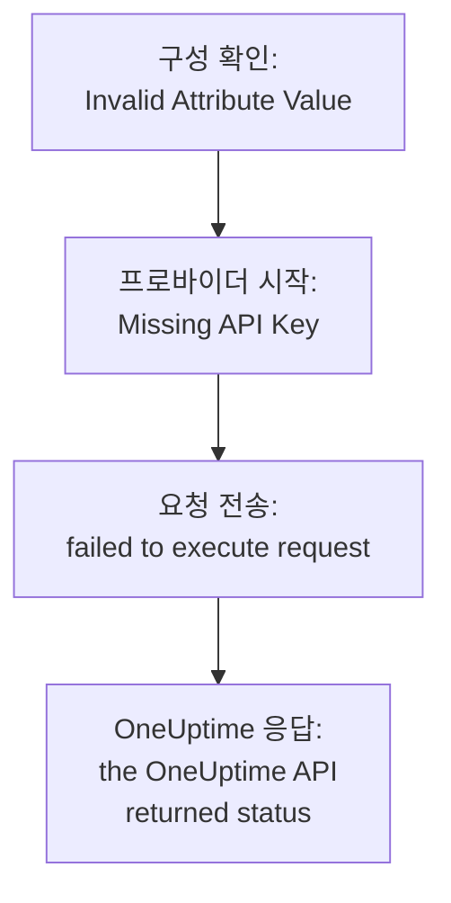

# 문제 해결

Terraform이 출력한 메시지나 겪은 일을 아래 표에서 찾으세요. 각 행이 해결 방법으로 안내합니다. 표 다음의 섹션에서는 각 오류를 발생 위치별로 묶어 설명합니다.

:::cards
- [오류 찾기](#오류-찾기): 이 페이지의 모든 메시지와 증상, 그리고 해결 방법.
- [API 키, 권한, 플랜](#api-키-권한-플랜): OneUptime이 프로바이더의 키를 거부할 때.
- [안정되지 않는 플랜](#안정되지-않는-플랜): 계속 돌아오는 변경과 state에서 사라지는 리소스.
- [자체 호스팅 OneUptime에 연결하기](#자체-호스팅-oneuptime에-연결하기): 주소, 인증서, 프록시.
:::

## 오류 찾기

| 메시지 또는 증상 | 해야 할 일 |
| --- | --- |
| `Missing API Key` | 프로바이더에 키를 전달하세요: [`Missing API Key` 또는 `Invalid API Key`](#missing-api-key-또는-invalid-api-key) 참고 |
| `Invalid API Key` | 키를 다시 복사하거나 새로 만드세요: [`Missing API Key` 또는 `Invalid API Key`](#missing-api-key-또는-invalid-api-key) 참고 |
| `ProjectId required` | 마스터 키가 아닌 프로젝트의 API 키를 사용하세요: [`ProjectId required`](#projectid-required) 참고 |
| `You do not have permissions to create Monitor` | 메시지에 나온 권한을 키에 부여하세요: [키에 권한이 없음](#키에-권한이-없음) 참고 |
| `API keys need the Growth plan` | 프로젝트를 Growth 플랜으로 되돌리세요: [결제 필요](#결제-필요) 참고 |
| 리소스나 설정 하나에 대한 `402` | 플랜을 업그레이드하거나 설정을 기본값으로 두세요: [결제 필요](#결제-필요) 참고 |
| `This project has been blocked` | 마스터 관리자에게 프로젝트 차단 해제를 요청하세요: [차단된 프로젝트](#차단된-프로젝트) 참고 |
| `references records that are not in this project` | 자신의 프로젝트에 있는 레코드의 ID를 사용하세요: [다른 프로젝트의 ID](#다른-프로젝트의-id) 참고 |
| 데이터 소스의 `Not Found` 또는 `Ambiguous Match` | 조회 인수를 고치세요: [아무것도 찾지 못하거나 여러 개를 찾는 조회](#아무것도-찾지-못하거나-여러-개를-찾는-조회) 참고 |
| `Cannot import non-existent remote object` | ID와 키의 권한을 확인하세요: [리소스 가져오기](/docs/terraform/importing-resources#문제-해결) 참고 |
| `Provider produced inconsistent result after apply` | 프로바이더를 업그레이드하세요: [apply 후 일관되지 않은 결과](#apply-후-일관되지-않은-결과) 참고 |
| 추가하지 않은 리소스를 플랜이 만듦 | 키가 더 이상 그 리소스를 읽을 수 없고, OneUptime이 `404`로 응답했습니다. 키에 읽기 권한을 돌려준 다음 `terraform import`로 리소스를 가져오세요: [리소스가 state에서 사라지고 다음 apply가 다시 만듦](#리소스가-state에서-사라지고-다음-apply가-다시-만듦) 참고 |
| apply 후 `priority`나 `order`가 바뀜 | 각각에 다른 것이 가지지 않은 번호를 주세요: [움직이는 우선순위나 순서](#움직이는-우선순위나-순서) 참고 |
| `Invalid Configuration for Read-Only Attribute` | 구성에서 그 속성을 제거하세요: [읽기 전용 속성](#읽기-전용-속성) 참고 |
| `has been renamed to` | `moved` 블록으로 리소스 유형의 이름을 바꾸세요: [이름이 바뀐 리소스 유형](#이름이-바뀐-리소스-유형) 참고 |
| Terraform으로 만든 모니터에 확인 항목이 표시되지 않음 | OneUptime을 업그레이드하세요: [단계 ID 이전에 만든 모니터](#단계-id-이전에-만든-모니터) 참고 |
| `must contain at least 1 elements` | 비워 두는 대신 속성을 생략하세요: [빈 값](#빈-값) 참고 |
| `.tf` 파일 안의 대시보드 JSON | HCL로 작성하세요: [대시보드의 JSON](#대시보드의-json) 참고 |
| `no available releases match the given constraints` | 정확한 버전 하나가 아니라 버전 범위를 사용하세요: [게시된 적 없는 버전](#게시된-적-없는-버전) 참고 |
| `x509: certificate signed by unknown authority` | 인증 기관을 신뢰하도록 설정하세요: [인증서](#인증서) 참고 |
| `invalid character '<' looking for beginning of value` | `oneuptime_url`이 OneUptime 자체를 가리키게 하세요: [API 대신 웹 페이지](#api-대신-웹-페이지) 참고 |
| `connection refused` 또는 `Client.Timeout exceeded` | 주소, 네트워크, 프록시를 확인하세요: [실패하는 연결](#실패하는-연결) 참고 |

## 오류를 읽는 방법

오류는 실패한 단계를 알려 주고, 메시지는 오류가 어디서 왔는지 알려 줍니다.



- `Invalid Attribute Value`처럼 요청 전에 나오는 오류는 구성에 관한 것입니다. 프로바이더는 OneUptime과 통신하기 전에 구성을 확인합니다.
- `failed to execute request`는 요청이 응답을 받지 못했다는 뜻입니다: [자체 호스팅 OneUptime에 연결하기](#자체-호스팅-oneuptime에-연결하기)를 참고하세요.
- `the OneUptime API returned status`는 OneUptime의 응답입니다. 상태 코드와 그 뒤의 메시지가 OneUptime이 무엇을 거부했는지 알려 줍니다.

프로바이더는 무엇을 하고 있었는지 알려 줍니다. 변경에는 `Unable to create monitor`와 `Unable to update monitor`, 리소스를 읽을 때는 `Unable to parse label response`입니다. OneUptime이 거부한 읽기는 `Parse Error`라는 요약으로 보고되지만, 그 뒤의 메시지는 OneUptime의 응답이지 구문 분석 문제가 아닙니다.

## API 키, 권한, 플랜

### `Missing API Key` 또는 `Invalid API Key`

`Missing API Key`는 프로바이더가 요청을 보내기 전에 멈추게 합니다. 프로바이더 블록의 `api_key`도, 환경 변수 `ONEUPTIME_API_KEY`도 설정되어 있지 않습니다. Terraform을 실행하는 셸에서 변수를 내보내거나, `sensitive`로 표시한 변수로 키를 전달하세요.

`Invalid API Key`는 OneUptime이 모르는 키에 대한 응답입니다. 잘못 입력했거나, 만료되었거나, 삭제된 키이거나, `oneuptime_url`이 가리키는 것과 다른 OneUptime의 키입니다. **프로젝트 설정 → 고급 → API 키**에 있는 키 페이지에서 키를 다시 복사하거나 새 키를 만드세요.

### `ProjectId required`

프로바이더에는 관리하는 프로젝트의 API 키가 필요합니다. 프로젝트는 그 키에서 정해집니다. 자체 호스팅 OneUptime의 마스터 API 키는 어떤 프로젝트에도 속하지 않으므로, 이 키로 하는 생성은 모두 `ProjectId required`로 실패합니다. [프로젝트 API 키 만들기](/docs/terraform/quick-start#프로젝트-api-키-만들기)처럼 프로젝트의 API 키를 만들어 대신 사용하세요.

### 키에 권한이 없음

`You do not have permissions to create Monitor`와 비슷한 메시지는 상태 `422`와 함께 옵니다. 키가 그 종류의 레코드에 그 작업을 할 수 없다는 뜻입니다. 메시지에는 이를 허용할 권한이 나옵니다. **프로젝트 설정 → 고급 → API 키**에서 키 페이지를 열고 그중 하나나 **프로젝트 관리자**를 부여하세요. 가져오기에는 읽기 권한만 있으면 됩니다.

### 결제 필요

- **모든 요청에 402 Payment Required** — `API keys need the Growth plan...`: OneUptime Cloud에서 프로젝트가 **Growth**보다 낮은 플랜에 있고, 프로젝트의 API 키는 프로바이더의 키를 포함해 그보다 낮은 플랜에서 작동을 멈춥니다. 프로젝트가 Growth로 돌아올 때까지 `terraform plan`을 포함해 프로바이더의 모든 호출이 거부됩니다. 돌아오면 같은 키가 다시 작동하며, 구성은 바꿀 필요가 없습니다. **프로젝트 설정 → 결제 및 청구서 → 결제**에서 업그레이드하거나, 그동안 대시보드에서 프로젝트를 관리하세요. [플랜 미만의 API 키와 SCIM](/docs/api-reference/api-reference#플랜-미만의-api-키와-scim)을 참고하세요.
- **402 Payment Required** — OneUptime 플랜의 한도에 도달했거나, 구성이 플랜에 포함되지 않은 설정(비공개 상태 페이지, 이메일 보고서, 공개 대시보드, IP 허용 목록 등)을 켭니다. `terraform apply`가 그 설정으로 리소스를 만들든 나중에 바꾸든 마찬가지입니다. Terraform은 OneUptime의 메시지를 그대로 보여 줍니다. 플랜을 업그레이드하거나 구성을 줄이세요.

이런 설정을 기본값으로 되돌리는 것, 즉 기능을 끄는 것은 모든 플랜에서 됩니다. 그래서 유료 기능을 끄는 구성은 평가판이 끝나거나 플랜이 내려간 뒤에도 적용됩니다.

플랜에서 판매하며 플랜이 내려간 뒤에도 프로젝트에 남는 리소스(SSO 프로바이더, SCIM 연결, API 키, 온콜 일정, Slack 및 Microsoft Teams 규칙과 요약)도 마찬가지입니다. 플랜보다 낮은 상태에서(프로바이더의 API 키 자체에 필요한 Growth에 프로젝트가 아직 있는 동안) 프로젝트가 이미 가진 것은 계속 읽을 수 있고(그래서 `terraform plan`과 `import`가 작동합니다), 삭제할 수 있으며(그래서 구성에서 빼거나 `terraform destroy`를 적용할 수 있습니다), `is_enabled` 속성이 있으면 끌 수 있습니다. 만들기, 바꾸기, 다시 켜기는 여전히 402로 응답합니다.

템플릿, 사용자 지정 필드, 모니터 그룹처럼 플랜에서 판매하는 다른 리소스는 읽는 데에도 플랜이 필요합니다. 그래서 이들을 새로 고치는 플랜은 402로 응답합니다. 그래도 삭제는 할 수 있으며, 예를 들어 `terraform destroy -refresh=false`를 사용합니다.

Growth보다 낮은 플랜에서는 API 키의 권한을 하나씩 삭제할 수 없습니다. 차단 권한을 삭제하면 키의 접근 범위가 넓어지기 때문입니다. 권한 리소스에 `terraform state rm`을 실행한 다음 키를 삭제하면, 키의 권한도 함께 사라집니다.

### 차단된 프로젝트

`This project has been blocked. Please contact your administrator.`는 상태 `403`과 함께 옵니다. 마스터 관리자가 프로젝트를 차단했으며, 차단이 풀릴 때까지 마스터 관리자 외에는 누구도 프로젝트에서 작업할 수 없습니다. 프로젝트의 API 키도 마찬가지입니다.

## 레코드와 조회

### 다른 프로젝트의 ID

리소스가 지정하는 모든 ID(모니터의 레이블, 상태 페이지 그룹의 상태 페이지, 네트워크 장치의 사이트, 에스컬레이션 규칙의 팀 등)는 API 키가 속한 프로젝트의 레코드여야 합니다. 다른 프로젝트 레코드의 ID, 존재하지 않는 ID, 키가 읽을 수 없는 레코드의 ID는 모두 같은 응답을 받으며, 그 응답에는 필드와 ID가 나옵니다.

```text
This network device references records that are not in this project: Network Site "…". Please pick values from this project and try again.
```

보통은 ID를 다른 프로젝트의 구성이나 state에서 복사했거나, 레코드가 Terraform 밖에서 삭제되었다는 뜻입니다. 리터럴 ID 대신 같은 구성 안의 리소스나 데이터 소스(`oneuptime_label.critical.id`)로 레코드를 참조하고 다시 적용하세요. 사용자로 지정한 사람은 프로젝트의 구성원이어야 합니다.

### 아무것도 찾지 못하거나 여러 개를 찾는 조회

데이터 소스는 레코드를 정확히 하나 찾거나 플랜을 멈춥니다. `Not Found`는 그 `id`를 가진 레코드가 없거나 설정한 인수와 일치하는 레코드가 없다는 뜻이고, `Ambiguous Match`는 여러 레코드가 일치한다는 뜻입니다. 인수를 고치거나, 인수를 더 설정해 조회를 하나로 좁히거나, `id`로 레코드를 조회하세요. 규칙은 [이미 있는 것 읽기](/docs/terraform/complete-guide#이미-있는-것-읽기)에 있습니다.

## 안정되지 않는 플랜

### apply 후 일관되지 않은 결과

`Provider produced inconsistent result after apply`는 프로바이더가 계획한 것과 다른 값을 돌려주었다는 뜻입니다. 예전 프로바이더는 서버가 계산하는 값에서 이런 일이 있었습니다. 서버가 `monitor_steps` 안에 추가하는 기본값, 서버가 다른 형식으로 쓰던 타임스탬프, `probe_version` 같은 래핑된 값, 그리고 수신 요청 모니터가 마지막으로 하트비트를 받은 시각처럼 서버가 최신으로 유지하는 속성입니다. 또 API가 소수를 텍스트로 보내면 null로 읽었기 때문에, 상태 페이지 막대 색상 규칙의 apply는 매번 `uptime_percent_greater_than_or_equal_to`에서 실패했습니다. 현재 프로바이더는 이 모든 경우를 처리합니다. 타임스탬프는 시각으로 비교하고, 레이블 목록은 집합으로 다루며, 숫자는 작성한 그대로 다시 읽고, 설정하지 않은 속성은 다음 새로 고침이 서버 값을 읽을 때까지 계획된 값을 유지합니다.

:::steps
1. 프로바이더를 업그레이드하세요: 프로바이더 요구 사항에 `version = "{{TERRAFORM_PROVIDER_VERSION}}"`를 그대로 두고 `terraform init -upgrade`를 실행합니다.
2. 다시 적용하세요. 실패한 apply가 tainted로 표시해 둔 리소스는 한 번 교체되고, 그 뒤의 플랜은 비어 있습니다. 대신 리소스를 그대로 유지하려면 먼저 주소를 지정해 표시를 지우세요: `terraform untaint oneuptime_status_page_history_chart_bar_color.operational`.
:::

현재 프로바이더에서도 이렇게 실패하면 [github.com/OneUptime/oneuptime/issues](https://github.com/OneUptime/oneuptime/issues)에 보고해 주세요. 프로바이더 버전, 리소스 유형, 실패하는 가장 작은 `resource` 블록, 전체 오류를 함께 보내 주세요. 오류에는 값이 바뀐 속성이 나오며, 이것이 보내 주실 내용 중 가장 유용합니다.

### 리소스가 state에서 사라지고 다음 apply가 다시 만듦

ID로 읽으면 존재하지 않는 레코드에도, API 키가 읽을 수 없는 레코드에도 `404`로 응답합니다. API는 보여 주지 않는 레코드에 대해서는 아무것도 말하지 않습니다. Terraform은 새로 고침 중의 `404`를 Terraform 밖에서 삭제된 리소스로 받아들입니다. 리소스를 state에서 빼고, 다음 `terraform apply`가 아직 남아 있는 리소스 옆에 그것을 다시 만듭니다.

이는 리소스를 관리하는 키가 더 이상 그 리소스를 읽을 수 없을 때 일어납니다. 키의 읽기 권한이 리소스에 없는 레이블이나 키의 팀이 소유한 리소스로 제한되었거나, 차단이 리소스를 가져갔거나, 리소스의 레이블이나 소유자가 바뀐 경우입니다.

**플랜 전에:**

- 키가 관리하는 리소스 유형마다, 관리하는 모든 리소스에 닿는 읽기 권한을 키에 부여하세요. 범위를 **전체**로 하거나, 그 리소스들이 가진 레이블로 제한합니다. 키의 업데이트 및 삭제 권한은 읽을 수 있는 것에만 미칩니다.
- 적용하기 전에 플랜을 읽으세요. 추가하지 않았는데 생성 예정인 리소스는 키가 더 이상 읽을 수 없는 리소스입니다.

**state가 이미 리소스를 잃은 경우:** 키에 읽기 권한을 돌려준 다음, 적용하는 대신 리소스를 [가져오세요](/docs/terraform/importing-resources). 그러면 Terraform이 두 번째 리소스를 만들지 않고 이미 있는 리소스를 넘겨받습니다. 사본이 이미 만들어졌다면 원하지 않는 쪽을 삭제하세요.

### 움직이는 우선순위나 순서

모니터 상태, 인시던트와 알림의 상태와 심각도, 그리고 대시보드에서 순서를 정하는 다른 목록은 각 번호를 한 번만 가집니다. 다른 것이 가지지 않은 번호는 작성한 그대로 유지됩니다. 다른 것이 이미 가진 번호는 넘겨받고, 그 사이에 있는 것들은 대시보드에서 끌어다 놓을 때처럼 한 칸씩 내려갑니다. 그래서 같은 번호로 구성된 두 항목은 apply할 때마다 자리를 바꿉니다.

`101`, `102`, `103`처럼 사이를 띄워 각각에 고유한 번호를 주고, Terraform이 관리하는 것의 순서는 대시보드에서 끌어다 놓지 말고 Terraform에서 바꾸세요.

### 읽기 전용 속성

`Invalid Configuration for Read-Only Attribute`는 OneUptime만 쓰는 속성을 구성이 설정하면 플랜을 멈춥니다. 누가 레코드를 만들었는지, 누가 보관, 해결, 확인했는지는 요청에서 기록됩니다. 로그인한 사람이 기록되며, API 키로 한 요청에서는 아무도 기록되지 않습니다. Terraform은 API 키로 로그인합니다. 그래서 `created_by_user_id`를 비롯해 `_by_user_id`로 끝나는 모든 속성은 리소스나 데이터 소스에서 읽을 수는 있지만 설정할 수는 없습니다. `archived_at`도 마찬가지입니다. `is_archived`를 설정하면 리소스가 보관된 시각이 기록되며, 바꾸지 않고 다시 적용해도 그 시각이 유지됩니다. 리소스 블록에서 그 속성을 제거하세요. 리소스의 다른 부분은 바뀌지 않습니다.

### 이름이 바뀐 리소스 유형

`has been renamed to`는 리소스 유형의 이름이 바뀌었다고 경고합니다. 이제 리소스 유형은 IoT나 vCenter 같은 단어를 나누지 않습니다: `oneuptime_iot_fleet`과 `oneuptime_vcenter`이며, 예전 프로바이더는 이를 나누었습니다(`oneuptime_io_t_fleet`, `oneuptime_v_center`). 예전 이름은 사용 중단된 별칭으로 계속 작동합니다. 아무것도 교체하지 않고 바꾸려면, 구성에서 리소스 이름을 바꾸고 리소스가 옮겨졌다고 Terraform에 알려 주세요.

```hcl
resource "oneuptime_iot_fleet" "factory" {
  name = "Factory floor"
}

moved {
  from = oneuptime_io_t_fleet.factory
  to   = oneuptime_iot_fleet.factory
}
```

그러면 `terraform plan`에는 이동만 표시되고 다른 변경은 없습니다. 리소스 유형 간 이동에는 Terraform 1.8 이상 또는 OpenTofu 1.12 이상이 필요합니다. 그보다 오래된 버전에서는 예전 이름을 그대로 두세요. 계속 작동합니다. 데이터 소스도 같은 방식으로 이름이 바뀌었습니다. 이름만 바꾸고 나머지는 그대로 두면 됩니다.

### 단계 ID 이전에 만든 모니터

모니터 단계 안의 ID(각 단계, 조건, 인시던트 및 알림 템플릿의 ID)는 서버가 부여합니다. 예전 OneUptime 버전은 조건에만 ID를 주었고, 그것도 쓸 때마다 새로 주었습니다. 그래서 API로 쓴 모니터는, 프로바이더가 만든 모든 모니터가 그랬듯이, ID 없는 단계로 저장되었습니다. 프로브는 여전히 모니터를 확인했고 상태도 여전히 바뀌었지만, 모니터 페이지는 확인 항목을 찾지 못했고, 인시던트는 스스로 해결되지 못했으며, `monitor_steps`를 바꾸는 `terraform apply`는 그때마다 열린 인시던트를 조건에서 떼어 냈습니다.

현재 OneUptime은 생성할 때 각각에 ID를 주고, apply할 때마다 이를 유지하며, 업그레이드할 때 기존 모니터에서 빠진 ID를 채웁니다. 구성은 바뀌지 않습니다. 여전히 작성할 ID는 없습니다. 예전 동작 때문에 열린 채로 남은 인시던트는, 그것을 연 조건이 아직 있다면 모니터가 다음에 복구될 때 닫힙니다. 이전 apply가 조건을 교체한 인시던트는 한 번 직접 해결해야 합니다.

## 프로바이더가 거부하는 구성

### 빈 값

프로바이더는 `monitor_steps`와 그 부분에 있는 빈 목록, 맵, 텍스트를 거부합니다. 예를 들어 `monitor_steps = []`, `request_headers = {}`, `request_body = ""`입니다.

```text
Attribute monitor_steps list must contain at least 1 elements, got: 0
```

대신 속성을 생략하세요. 없는 속성은 설정되지 않은 것입니다. 각 부분이 무엇을 받는지는 [모니터 단계](/docs/terraform/monitor-steps)에 나와 있습니다.

### 대시보드의 JSON

대시보드와 API가 리소스에 대해 보여 주는 JSON은 API가 보내는 내용이지 Terraform 구성이 아닙니다. Terraform에서 속성 이름은 스네이크 케이스이고, 값을 쓰는 방식도 다르며, 많은 필드는 서버의 것입니다. `.tf` 파일에 붙여 넣으면 작동하지 않습니다.

- 리소스를 넘겨받으려면 [가져오세요](/docs/terraform/importing-resources). 대시보드의 **Terraform** 페이지가 구성을 작성해 줍니다.
- 새로 작성하려면 [예제](/docs/terraform/examples)에서 시작하세요.
- 모니터 단계에는 [모니터 단계](/docs/terraform/monitor-steps)에서 설명하는 타입이 있는 `monitor_steps` 속성을 작성하세요. `{_type, value}` 래퍼를 빼고, camelCase 키를 snake_case로 쓰고, 모든 `id`를 생략합니다.

## 버전과 레지스트리

### 게시된 적 없는 버전

`no available releases match the given constraints`는 게시된 어떤 버전도 버전 제약에 맞지 않는다는 뜻입니다. 모든 OneUptime 릴리스가 프로바이더를 게시하지는 않습니다. 프로바이더가 바뀌지 않은 릴리스는 아무것도 게시하지 않으므로, 정확한 버전 하나를 지정한 제약은 존재하지 않는 버전을 가리킬 수 있습니다. 대신 범위를 사용하세요.

```hcl
terraform {
  required_providers {
    oneuptime = {
      source  = "oneuptime/oneuptime"
      version = "{{TERRAFORM_PROVIDER_VERSION}}"
    }
  }
}
```

자체 호스팅 OneUptime에서는 [자체 호스팅 설정](/docs/terraform/self-hosted#프로바이더-버전-고르기)에 나온 것처럼 범위의 상한을 OneUptime의 버전으로 정하세요. 버전 번호를 매기는 방식은 [레지스트리 사용](/docs/terraform/registry#버전-번호를-매기는-방식)에서 설명합니다.

## 자체 호스팅 OneUptime에 연결하기

### 인증서

`x509: certificate signed by unknown authority`는 Terraform을 실행하는 머신이 OneUptime이 제시하는 인증서(보통 사설 인증 기관의 인증서)를 신뢰하지 않는다는 뜻입니다. 프로바이더는 그 머신의 신뢰 저장소로 인증서를 검증합니다. Terraform을 실행하는 모든 머신과 CI 러너에서 그곳에 인증 기관을 추가하세요: [TLS 및 인증서](/docs/terraform/self-hosted#tls-및-인증서)를 참고하세요. 검증을 건너뛰는 설정은 없습니다.

### API 대신 웹 페이지

`invalid character '<' looking for beginning of value`는 프로바이더가 API를 기대한 곳에서 웹 페이지가 응답했다는 뜻입니다. `oneuptime_url`의 호스트 뒤에 `/dashboard` 같은 경로가 붙어 있거나, OneUptime 앞의 프록시가 대신 응답했습니다. `oneuptime_url`에는 `https://oneuptime.example.com`처럼 OneUptime의 주소만 설정하세요. `/api`는 프로바이더가 직접 붙입니다.

### 실패하는 연결

`failed to execute request`에 `connection refused`, `no such host` 또는 `Client.Timeout exceeded`가 붙어 있으면 응답이 돌아오지 않았다는 뜻입니다. 주소와 포트가 맞고 Terraform을 실행하는 곳에서 닿을 수 있는지 확인하고, 머신이 프록시를 통해 인터넷에 나간다면 `HTTPS_PROXY`를 설정하세요. 프로바이더는 각 응답을 최대 60초 기다립니다. 응답이 없거나 응답이 `429`, `502`, `503`, `504`이면 읽기나 삭제를 최대 세 번 시도하지만, 생성이나 변경은 다시 시도하지 않습니다. 생성이 이렇게 실패했다면, 생성되었을 수도 있으니 다시 적용하기 전에 대시보드를 확인하세요.

## 더 자세한 정보 얻기

프로바이더는 경고를 Terraform의 로그에 씁니다. 경고를 보려면 `TF_LOG_PROVIDER=WARN`을 붙여 명령을 실행하고, 파일에 남기려면 `TF_LOG_PATH`도 붙이세요.

```bash
TF_LOG_PROVIDER=WARN TF_LOG_PATH=terraform.log terraform plan
```

`OneUptime rejected a column in the select; dropping it and retrying`은 OneUptime이 프로바이더의 키에 보내지 않은 열을 알려 줍니다. 보통 권한이 없어서입니다. 그 속성은 state에서 비어 있으므로, 플랜마다 변경으로 표시될 수 있습니다.

## 그래도 해결되지 않나요?

[github.com/OneUptime/oneuptime/issues](https://github.com/OneUptime/oneuptime/issues)에 이슈를 열고, 프로바이더 버전(`terraform version`이 `init` 후에 보여 줍니다), 리소스 블록, 전체 오류를 함께 보내 주세요. 프로바이더는 OneUptime 코드에서 생성되므로, 그 이슈는 메인 저장소에서 관리합니다.

## 다음 단계

:::cards
- [리소스 가져오기](/docs/terraform/importing-resources): 대시보드에서 만든 것을 넘겨받고, 가져오기 오류를 고칩니다.
- [자체 호스팅 설정](/docs/terraform/self-hosted): 자체 OneUptime의 주소, 버전, 인증서.
- [완전한 가이드](/docs/terraform/complete-guide): 인증, 데이터 소스, state, 업그레이드.
- [모니터 단계](/docs/terraform/monitor-steps): 모니터 확인 항목의 모든 속성.
:::
