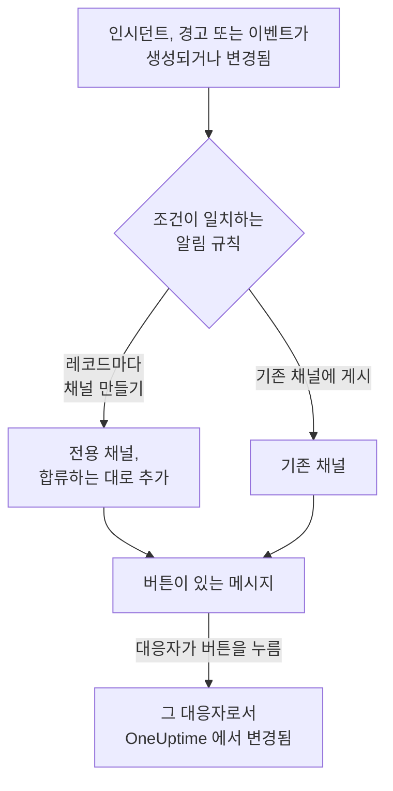

# Mattermost

OneUptime 을 Mattermost 서버에 연결하면 인시던트, 경고, 에피소드, 예정된 유지 관리, 모니터, 온콜 업데이트를 채널에 게시하고, 인시던트마다 전용 채널을 두고, 대응자가 Mattermost 를 떠나지 않고 인지, 해결, 메모 추가, 상태 변경을 하게 할 수 있습니다.

:::cards
- [Mattermost 연결하기](#mattermost-연결하기): OneUptime 용 봇 계정을 만든 다음, 그 토큰으로 프로젝트를 연결합니다.
- [자신의 계정 연결하기](#자신의-mattermost-계정-연결하기): 자신의 Mattermost 계정을 OneUptime 계정에 연결합니다.
- [알림 규칙](#알림-규칙): 어떤 이벤트를 어디에 게시하고, 어떤 이벤트에 전용 채널을 줄지 정합니다.
- [레코드 채널에 있는 사람](#레코드-채널에-있는-사람): 레코드 페이지에서 채널에 있는 사람을 보고, 참여하고, 사람을 추가합니다.
- [Mattermost 에서 조치하기](#mattermost-에서-인시던트-경고-이벤트-조치하기): OneUptime 메시지의 버튼입니다.
- [네트워크와 자체 호스팅](#네트워크와-자체-호스팅): 각 서버가 접근할 수 있어야 하는 곳입니다.
:::

## 작동 방식

두 가지 연결로 이것이 작동합니다.

- **프로젝트의 연결** 은 한 번만 합니다. Mattermost 서버에 있는 봇 계정으로, OneUptime 이 게시하는 각 팀에 속해 있습니다. 이 봇이 메시지를 게시하고, 채널을 만들고, 채널에 사람들을 추가합니다.
- **각 사람의 연결** 은 그 사람의 Mattermost 계정을 OneUptime 계정에 연결한 것입니다. 버튼은 그 사람으로서, 프로젝트에서의 그 사람의 권한으로 작동합니다.

하나의 Mattermost 팀을 프로덕션과 스테이징처럼 여러 프로젝트에 연결할 수 있습니다. 버튼은 그 메시지가 다루는 레코드의 프로젝트에서 작동합니다.

## 시작하기 전에

- **프로젝트를 연결할 수 있는 역할:** **프로젝트 소유자**, **프로젝트 관리자** 또는 **프로젝트 구성원**. 연결을 해제하려면 **프로젝트 소유자** 또는 **프로젝트 관리자** 가 필요합니다.
- 봇 계정을 만들 수 있는 **Mattermost 서버**, 또는 봇 계정을 대신 만들어 줄 수 있는 Mattermost 관리자. Mattermost Cloud 와 자체 호스팅 Mattermost 모두 사용할 수 있습니다.
- 알림 규칙과 요약에 필요한 **OneUptime Cloud 의 Growth 플랜**.

Mattermost 를 위해 OneUptime 자체 서버에서 설정할 것은 없습니다. 각 프로젝트가 자체 Mattermost 서버와 봇 계정을 사용합니다.

## Mattermost 연결하기

:::steps
### Mattermost 에서 봇 계정 만들기

Mattermost 에서 **System Console** > **Integrations** > **Bot Accounts** 를 열고 **Enable Bot Account Creation** 이 켜져 있는지 확인합니다. 그런 다음 **Integrations** > **Bot Accounts** > **Add Bot Account** 로 이동해 이름을 `oneuptime` 으로 지정하고 저장합니다. Mattermost 는 봇의 액세스 토큰을 한 번만 보여 주므로 복사해 두세요.

### 팀에 봇 추가하기

OneUptime 이 게시할 각 팀에, 사람을 추가할 때처럼 봇을 추가합니다. **Main Menu** > **Invite People** 에서 `@oneuptime` 을 초대하세요. OneUptime 은 봇이 속한 팀에서만 채널을 만들고 게시합니다.

### 프로젝트 연결하기

OneUptime 에서 **프로젝트 설정** > **워크스페이스** > **Mattermost** 로 이동해 **Mattermost와 연결** 을 클릭합니다. `https://chat.example.com` 같은 서버 주소와 봇의 액세스 토큰을 입력합니다. OneUptime 은 무엇이든 저장하기 전에 서버에서 토큰을 확인합니다. 봇이 여러 팀에 속해 있으면 OneUptime 이 어느 팀을 기본 팀으로 할지 묻습니다. 기본 팀은 팀을 지정하지 않은 알림 규칙이 채널을 만드는 팀입니다. 워크스페이스가 연결되기 전까지는 인시던트, 경고, 예정된 유지 관리, 모니터, 온콜 메뉴의 **워크스페이스** 섹션에 **워크스페이스 연결** 이 있으며, 이것도 여기로 연결됩니다.

### 알림 규칙 추가하기

**인시던트** > **워크스페이스** > **Mattermost** 로 이동해 규칙을 만듭니다. 예를 들어 새 인시던트마다 Mattermost 채널을 만들고 대응하는 모든 사람을 참여시키는 규칙입니다. [알림 규칙](#알림-규칙) 을 참조하세요.
:::

봇의 액세스 토큰은 OneUptime 서버에만, 프로젝트의 다른 비밀 정보와 함께 암호화되어 보관되며 다시 표시되지 않습니다. 서버 주소, 팀 목록, 봇의 사용자 이름은 Mattermost 설정 페이지에서 프로젝트의 모든 사람에게 표시됩니다.

프로젝트는 하나의 Mattermost 서버에만 연결됩니다. 다른 서버로 옮기려면 먼저 연결을 해제하세요. **프로젝트 설정** > **워크스페이스** > **Mattermost** 에서 **⋯** > **Mattermost 연결 해제** 를 선택합니다. 연결을 해제하면 모든 멤버의 Mattermost 계정 연결도 해제되고, 해당 Mattermost 알림 방법과 이를 사용하는 온콜 규칙도 제거됩니다. 알림 규칙과 요약은 다시 연결할 때를 위해 유지됩니다.

## 여러 팀

OneUptime 은 Mattermost 서버의 팀 중 봇이 속한 모든 팀에서 작동합니다.

1. Mattermost 에서 OneUptime 을 사용할 각 팀에, 사람을 추가할 때처럼 봇을 추가합니다. 팀을 열고 **Main Menu** > **Invite People** 을 선택합니다.
2. **프로젝트 설정** > **워크스페이스** > **Mattermost** 의 **Mattermost 팀 목록** 카드에 그 팀들이 기본 팀부터 표시됩니다. 다른 팀에 봇을 추가한 뒤 **새로고침** 을 클릭하세요.

- **규칙이 사용하는 팀.** 알림 규칙은 채널이 있는 **Mattermost 팀** 을 선택합니다. 비워 두면 규칙은 기본 팀에 채널을 만들고, 지정한 채널도 먼저 그곳에서 찾은 다음 봇의 다른 팀에서 찾습니다.
- **요약이 사용하는 팀.** **인시던트** 와 **알림** 의 **요약** 탭에 있는 요약도 채널이 있는 **Mattermost 팀** 을 선택합니다. 비워 두면 요약은 채널을 먼저 기본 팀에서 찾은 다음 봇의 다른 팀에서 찾습니다.
- **기본 팀.** 프로젝트를 연결한 팀입니다. 프로젝트를 연결할 수 있는 역할이라면 카드의 **기본값으로 설정** 으로 다른 팀을 기본 팀으로 만들 수 있습니다.
- **OneUptime 이 작동하는 곳.** OneUptime 메시지의 버튼과 버튼이 여는 양식은 그 각각의 팀에서 작동합니다. 봇이 제거된 팀에서는 버튼이 그 팀이 더 이상 연결되어 있지 않다고만 알립니다.
- **봇이 제거된 기본 팀.** 카드에 그렇다고 표시됩니다. Mattermost 에서 봇을 다시 추가하거나 다른 팀을 기본 팀으로 설정하세요.
- **규칙이 지정한, 봇이 제거된 팀.** 규칙의 카드에 그렇다고 표시되며, 규칙은 대신 다른 팀을 사용하지 않습니다. Mattermost 에서 봇을 그 팀에 다시 추가하거나 규칙에서 다른 팀을 선택하세요. 규칙의 양식에는 이전 선택이 그대로 표시되므로 바꿀 수 있습니다.

## 자신의 Mattermost 계정 연결하기

Mattermost 에는 OneUptime 이 안내할 수 있는 로그인 화면이 없으므로, 대신 OneUptime 의 봇이 내 Mattermost 계정으로 링크가 담긴 다이렉트 메시지를 보냅니다.

:::steps
1. **사용자 설정** > **워크스페이스** > **Mattermost** 로 이동합니다. OneUptime 이 내 이메일 주소를 가진 Mattermost 계정을 찾습니다. 찾으면 **@your-username에게 링크 보내기** 를 클릭합니다. 찾지 못하면 **나에게 링크 보내기** 를 클릭하고 Mattermost 사용자 이름을 입력합니다.
2. Mattermost 에서 OneUptime 봇이 보낸 다이렉트 메시지를 열고 **Connect my account** 를 클릭합니다.
3. 링크가 OneUptime 을 열고, OneUptime 이 내 계정을 연결합니다.
:::

링크는 요청한 것과 같은 브라우저에서 여세요. 링크는 그 브라우저에서만, 한 번만, 15 분 동안만 작동합니다. 이로써 요청한 사람이 두 계정을 모두 가지고 있다는 것이 증명되므로, 누구도 다른 사람의 Mattermost 계정을 연결할 수 없습니다. 링크를 요청하지 않았다면 무시하세요. 요청한 브라우저에서 열기 전까지는 아무것도 연결되지 않습니다.

계정 연결은 이 프로젝트에 속합니다. 같은 Mattermost 팀에 연결된 다른 프로젝트에서는 그 프로젝트에서도 연결하세요.

## Mattermost 에서 호출 받기

온콜 중에 다이렉트 메시지로 호출을 받으려면 Mattermost 를 알림 방법 중 하나로 추가합니다.

:::steps
1. 자신의 Mattermost 계정을 연결합니다 ( [자신의 Mattermost 계정 연결하기](#자신의-mattermost-계정-연결하기) 참조).
2. **사용자 설정** > **알림 방법** 으로 이동해 **워크스페이스 앱** 탭을 열고 **Mattermost 계정 추가** 를 클릭합니다.
3. 해당 행에서 **Send Test Message** 를 클릭합니다. 프로젝트의 봇이 보낸 다이렉트 메시지로 메시지가 도착합니다.
:::

추가하면 바로 온콜 규칙에 포함되므로, 그때부터 호출이 Mattermost 로 옵니다. 어떤 호출을 받을지는 **사용자 설정** > **나에게 연락하는 방법** 에서 변경합니다. 각 호출에는 인지 링크와 에스컬레이션 링크가 있습니다. Mattermost 계정 연결을 해제하면 이 알림 방법과 이를 사용하는 온콜 규칙이 제거됩니다.

## 알림 규칙

알림 규칙은 어떤 이벤트를 Mattermost 의 어디에 게시할지 정합니다. 각 제품에는 자체 규칙이 있으며, 메뉴의 **워크스페이스** > **Mattermost** 에 있습니다. **인시던트** ( **인시던트 에피소드** 와 **요약** 탭 포함), **알림** ( **경고 에피소드** 와 **요약** 포함), **예정된 유지 관리**, **모니터**, **온콜**, **보안 이벤트**, **SLOs** 입니다. Slack 의 규칙과 같은 방식으로 작동합니다. 조건, 대상, 규칙이 게시하는 업데이트, 채널에 참여하는 사람은 [알림 규칙](/docs/workspace-connections/slack#알림-규칙) 을 참조하세요. 온콜 메시지는 Slack과 같이 인계 때마다 한 줄입니다. [온콜 메시지](/docs/workspace-connections/slack#온콜-메시지)를 참고하세요. 온콜 근무가 끝나는 시간 같은 메시지 속 시간은 UTC로 표시됩니다. Mattermost는 읽는 사람 각자의 시간대로 보여 줄 수 없기 때문입니다.

규칙이 만드는 채널에는 해당 레코드의 이름이 붙습니다. 인시던트 INC-42는 `inc-42` 가 됩니다. Mattermost 는 영문 소문자, 숫자, `-` 및 `_` 를 최대 64자까지 받으며, 이름은 영문자나 숫자로 시작하고 끝나야 합니다. 규칙 양식은 입력하는 동안 이름을 보여 줍니다. 같은 이름의 채널이 이미 있으면 (보관된 채널 등) OneUptime 이 `-2`, `-3` 처럼 번호를 붙입니다. 비공개 인시던트, 경고, 에피소드에는 비공개 채널이 만들어집니다.

기존 채널에 게시하려면 채널 주소에 나오는 이름 (예: `chat.example.com/team/channels/incidents` 의 `incidents`) 이나 표시 이름을 입력합니다. OneUptime 은 공개 채널에 처음 게시할 때 스스로 참여합니다. 비공개 채널에는 규칙이 게시하기 전에 Mattermost 에서 봇을 추가하세요. 봇이 여러 팀에 속해 있으면 규칙에서 채널이 있는 팀도 선택합니다. [여러 팀](#여러-팀) 을 참조하세요.

사람들은 자신이 연결한 Mattermost 계정으로, 그렇지 않으면 자신의 이메일 주소를 가진 Mattermost 계정으로 규칙의 채널에 참여합니다. 이메일 주소로 찾는 것은 서버가 봇에게 이메일 주소를 보여 줄 때만 가능합니다 ( **System Console** > **Site Configuration** > **Users and Teams** > **Show Email Address** ). OneUptime 은 추가하지 못한 사람을 채널의 메시지 하나에 모두 나열하고, 계정을 연결하는 링크를 함께 보냅니다.

자체 채널이 있는 인시던트, 경고, 에피소드, 예정된 유지 관리 이벤트는 OneUptime 페이지 헤더의 상태 버튼 옆에 **Mattermost에서 열기** 가 있습니다. 이 버튼은 그 채널을 Mattermost 서버에서 새 탭으로 엽니다. 자체 채널이 두 개인 레코드는 버튼 아래에 둘 다 나열합니다. Slack이나 Microsoft Teams에도 채널이 있는 레코드에는 대신 **채널 열기** 버튼 하나가 있고, 모든 채널을 나열합니다. 규칙이 게시하는 기존 채널은 제공되지 않습니다.

규칙 행의 **규칙 테스트** 는 Slack 에서와 마찬가지로 그 규칙의 테스트 메시지를 규칙이 지정한 채널에 게시합니다.

OneUptime 의 메시지는 인용한 내용으로 누구에게도 알리지 않습니다. `@channel`, `@here`, `@someone` 이 들어 있는 이름이나 설명은 쓰인 그대로 표시되며, 아무에게도 알림이 가지 않습니다.

## 레코드 채널에 있는 사람

자체 Mattermost 채널이 있는 인시던트, 경고, 에피소드, 예정된 유지보수 이벤트는 OneUptime 페이지에 **Mattermost 채널** 카드가 있습니다. 카드는 Mattermost 서버에서 채널을 여는 링크로 채널을 보여 주고, 비공개 채널인지와 채널에 있는 사람을 본인부터 보여 줍니다. Mattermost 관리자 없이 카드에서 다음을 할 수 있습니다.

- **채널 참여** 는 채널에 없을 때 나를 추가합니다.
- **사람 추가** 는 프로젝트의 사람과 팀 목록을 엽니다. 사람을 고르면 그 사람을, 팀을 고르면 팀의 모든 사람을 추가합니다.

추가는 OneUptime 봇이 하며, 규칙의 채널에 사람을 추가할 때와 같습니다. 봇은 자신이 만든 채널에 계속 남아 있으므로, 모두가 나간 비공개 채널에도 이렇게 다시 들어갈 수 있습니다. Slack 이나 Microsoft Teams 에도 채널이 있는 레코드는 하나의 **채팅 채널** 카드에 모두 표시합니다.

- **사람을 추가할 수 있는 사람.** 레코드를 편집할 수 있는 사람입니다. 인시던트라면 **프로젝트 소유자**, **프로젝트 관리자**, **프로젝트 구성원**, **인시던트 관리자**, **인시던트 구성원**, 또는 사용자 지정 역할의 **Edit Incident** 이고, 경고, 에피소드, 이벤트에는 각각 같은 권한이 필요합니다 (예: **Edit Alert**). 그 밖의 사람은 채널에 있는 사람과 들어가는 방법을 봅니다.
- **추가할 수 있는 사람.** OneUptime 이 Mattermost 에서 찾을 수 있고 채널이 있는 팀에 있는 사람입니다. 그 사람이 연결한 계정으로, 그렇지 않으면 서버가 봇에게 이메일 주소를 보여 줄 때 그 이메일 주소로 찾습니다. 그 팀의 게스트 계정도 추가할 수 있습니다. Mattermost 에서는 채널 멤버가 게스트를 추가할 수 있기 때문입니다. 추가하지 못한 사람은 이유와 함께 카드에 표시됩니다.
- **기록되는 내용.** 누가 누구에 의해 추가되었는지가 레코드의 피드 ( **채널 멤버 추가됨** ) 와 **프로젝트 설정** > **알림** > **알림 로그** 의 **워크스페이스** 탭에 기록됩니다.
- **보관된 채널.** 카드는 채널에 있는 사람을 계속 보여 주지만, Mattermost 에서 보관을 해제할 때까지 아무도 추가하지 않습니다.
- **봇이 제거된 채널.** Mattermost 는 공개 채널이라도 채널에 있는 사람에게만 구성원을 보여 줍니다. 그래서 카드에 채널을 볼 수 없다고 표시됩니다. 채널에 있는 사람이 Mattermost 에서 봇을 다시 추가할 수 있습니다. 공개 채널에는 OneUptime 이 다음에 그곳에 게시할 때 스스로 다시 참여하기도 합니다.
- **사람을 내보내려면.** OneUptime 은 사람을 추가만 합니다. 채널에서 사람을 내보내는 것은 Mattermost 에서 하세요.

## Mattermost 에서 인시던트, 경고, 이벤트 조치하기

OneUptime 의 메시지에는 버튼과, 덜 쓰이는 작업을 위한 **More actions** 메뉴가 있습니다. 각 버튼은 본인으로서, 프로젝트에서의 본인의 권한으로 작동하며, 본인에게만 보이는 메시지로 답합니다.

| 레코드 | 버튼과 메뉴 |
| --- | --- |
| **인시던트** | **Acknowledge**, **Resolve**, **Add Note**, 메뉴에는 **Change Severity** 와 **Change State** |
| **경고** | **Acknowledge**, **Resolve**, **Add Note**, **Change State**, **Execute On-Call Policy** |
| **인시던트 에피소드, 경고 에피소드** | **Acknowledge**, **Resolve**, **Add Note**, **Change State**, **Execute On-Call Policy** |
| **예정된 유지 관리** | **Mark as Ongoing**, **Mark as Complete**, **Add Note**, **Change State** |

**Add Note**, **Change State**, **Change Severity**, **Execute On-Call Policy** 는 Mattermost 에서 양식을 엽니다. 인시던트나 예정된 유지 관리 이벤트의 메모는 상태 페이지에 표시되는 공개 메모일 수도 있고 비공개 메모일 수도 있습니다. 비공개 인시던트의 메모는 항상 비공개이며, 경고의 메모도 항상 비공개입니다. 모든 메시지에는 OneUptime 에서 해당 레코드를 여는 링크도 있어, 그 밖의 모든 작업은 거기서 할 수 있습니다. 프로젝트의 공개 메모에 승인이 필요하면 양식에서 보낸 공개 메모는 승인을 기다리며, 나만 보는 메시지가 누구를 기다리는지 알려 줍니다. [공개 노트 승인](/docs/incidents/notes-owners-and-feed#공개-노트-승인)을 참고하세요.

Mattermost 계정이 아직 연결되어 있지 않으면 버튼이 **사용자 설정** > **워크스페이스** > **Mattermost** 링크와 함께 그렇다고 알려 줍니다. 계정을 연결한 다음 버튼을 다시 누르세요.

버튼을 누를 때마다 누가 눌렀는지와 함께 **프로젝트 설정** > **알림** > **알림 로그** 의 **워크스페이스** 탭에 기록됩니다.

## 공개 노트 승인하기

프로젝트의 공개 노트에 승인이 필요하고 알림 설정에서 **공개 메모 승인** 에 Mattermost를 켜 두었다면, 내가 승인하는 단계를 기다리는 공개 노트가 OneUptime 봇과의 다이렉트 메시지로 하나씩 옵니다. 누가 보냈는지, 어느 단계를 기다리는지, 노트, **Approve**, **Reject**, 그리고 OneUptime의 노트로 가는 링크입니다. **Approve** 는 그 단계에 대해 승인합니다. 마지막 단계에서는 **Approve and publish** 로 표시되고, 노트가 즉시 게시됩니다. **Reject** 는 사유를 묻는 양식을 엽니다. 사유는 필수이며 노트 작성자가 봅니다. 버튼은 OneUptime과 같은 규칙으로 나로서 동작하고, 나만 보는 메시지로 답합니다. 다른 사람이 결정한 뒤에, 또는 노트나 그 단계가 바뀐 뒤에 누르면 아무것도 결정하지 않고 무슨 일이 있었는지 알려 줍니다. 노트가 결정되면 그 노트에 대한 모든 승인자의 메시지가, 내 메시지도 포함해, 무슨 일이 있었는지 알려 주도록 바뀝니다. 그 단계에서 승인되어 이제 누구를 기다리는지, 게시되었는지, 거부되었는지, 변경되었거나 다시 승인 요청되었는지, 승인 없이 게시되었는지, 삭제되었는지입니다. OneUptime의 노트로 가는 링크는 남고 **Approve** 와 **Reject** 는 사라집니다. Mattermost 계정이 연결되어 있지 않으면 **사용자 설정** > **워크스페이스** > **Mattermost** 에서 연결한 뒤 버튼을 다시 누르세요. 노트가 기다리는 동안 승인 단계가 바뀌어 노트가 더는 내 단계를 기다리지 않거나 더는 나에게 요청하지 않으면, 그 노트에 대한 내 메시지도 바뀌고, 노트가 이제 기다리는 사람은 자기 메시지를 받습니다. [공개 노트 승인](/docs/incidents/notes-owners-and-feed#공개-노트-승인) 을 참고하세요.

## 네트워크와 자체 호스팅

두 서버가 서로 통신합니다.

- **OneUptime 이 Mattermost 서버를 호출합니다.** 게시하고, 채널을 만들고, 사람을 추가하기 위해서입니다. OneUptime Cloud 에서는 인터넷에서 Mattermost 서버에 접근할 수 있어야 합니다. 자체 호스팅 OneUptime 은 운영자가 `ALLOW_PRIVATE_NETWORK_WEBHOOKS` 또는 `PRIVATE_NETWORK_WEBHOOK_ALLOWLIST` 로 사설 주소를 허용하면 사설 네트워크의 Mattermost 서버에 접근할 수 있습니다. OneUptime 은 자신이 실행되는 머신의 주소나 클라우드 메타데이터 주소를 호출하지 않으며, 리디렉션을 따르지도 않습니다.
- **Mattermost 서버가 OneUptime 을 호출합니다.** 누군가 버튼을 누르거나 양식을 제출할 때입니다. 호출 대상은 `https://<your OneUptime>/api/mattermost/interactive` 와 `/api/mattermost/dialog` 입니다. OneUptime 의 주소가 사설 주소라면 Mattermost 의 **System Console** > **Environment** > **Developer** > **Allow untrusted internal connections to** 에 그 호스트를 추가하세요. 그렇지 않으면 버튼이 작동하지 않습니다.

OneUptime 이 게시하는 모든 버튼에는 게시된 Mattermost 팀에 대한 서명이 있으며, 버튼을 누를 때 확인됩니다. OneUptime 이 서명하지 않은 버튼 입력이나 다른 팀에서 보낸 입력은 아무 효과가 없습니다.

## 문제 해결

| 보이는 내용 | 해야 할 일 |
| --- | --- |
| **Mattermost did not accept the access token** | 봇의 토큰을 다시 복사하세요. Mattermost 는 토큰을 한 번만 보여 주므로, 필요하면 **Integrations** > **Bot Accounts** 에서 새 토큰을 만드세요. |
| **The bot account is not a member of any team** | Mattermost 에서 봇을 팀에 추가한 다음 다시 연결하세요. |
| 봇을 추가한 팀이 **Mattermost 팀 목록** 카드에 없음 | 카드에서 **새로고침** 을 클릭하세요. |
| **OneUptime's bot is not a member of this Mattermost team** | 봇이 나간 팀을 선택했습니다. Mattermost 에서 봇을 그 팀에 추가한 다음 **새로고침** 을 클릭하세요. |
| **OneUptime's bot may not create channels in the Mattermost team this rule names** | Mattermost 에서 봇을 그 팀에 추가하거나, 규칙에서 다른 팀을 선택하세요. |
| **OneUptime's bot is not a member of the Mattermost team chosen for the channel** | Mattermost 에서 봇을 그 팀에 추가하거나, 규칙에서 다른 팀을 선택하세요. |
| **OneUptime's bot is no longer a member of the project's default Mattermost team** | Mattermost 에서 봇을 그 팀에 다시 추가하거나, 다른 팀을 기본 팀으로 설정하세요. |
| **OneUptime could not reach the Mattermost server** | 주소와, OneUptime 이 그 주소에 접근할 수 있는지 확인하세요. [네트워크와 자체 호스팅](#네트워크와-자체-호스팅) 을 참조하세요. |
| **The bot is not a member of the private Mattermost channel** | Mattermost 에서 봇을 채널에 추가하세요. |
| 버튼이 아무것도 하지 않거나, Mattermost 가 작업을 완료할 수 없다고 표시함 | Mattermost 가 OneUptime 에 접근할 수 없습니다. [네트워크와 자체 호스팅](#네트워크와-자체-호스팅) 을 참조하세요. |
| 링크가 담긴 다이렉트 메시지가 오지 않음 | 사용자 이름과, 봇이 내가 속한 팀에 있는지 확인하세요. |
| 채널 카드에 OneUptime 에서 채널을 볼 수 없다고 표시됩니다 | 채널이 삭제되었거나 봇이 채널에서 제거되었습니다. 채널이 아직 있다면 채널에 있는 사람이 Mattermost 에서 봇을 다시 추가할 수 있습니다. |
| 채널 카드에 어떤 사람이 Mattermost 팀에 없다고 표시됩니다 | Mattermost 에서 그 사람을 채널이 있는 팀에 추가한 다음 다시 추가하세요. |
