# Microsoft Teams

OneUptime 을 Microsoft Teams 에 연결하면 인시던트, 경고, 에피소드, 예정된 유지 관리, 모니터, 온콜 업데이트를 채널과 채팅에 게시하고, 인시던트마다 전용 채널을 두고, 대응자가 Teams 에서 조치하게 할 수 있습니다. 인지, 해결, 메모 추가, 온콜 호출, 인시던트 선언, OneUptime AI 에게 질문하기를 할 수 있습니다.

:::cards
- [Microsoft Teams 연결하기](#microsoft-teams-연결하기): 관리자 동의, 본인의 로그인, 각 팀의 앱.
- [알림 규칙](#알림-규칙): 어떤 이벤트를 어디에 게시하고, 어떤 이벤트에 전용 채널을 줄지 정합니다.
- [OneUptime 봇과 대화하기](#oneuptime-봇과-대화하기): 봇과의 채팅에서 쓰는 명령, 질문, 양식.
- [Microsoft Teams 에서 인시던트, 경고, 이벤트 조치하기](#microsoft-teams-에서-인시던트-경고-이벤트-조치하기): OneUptime 카드의 버튼입니다.
:::

## 작동 방식

```mermaid title="OneUptime 의 이벤트에서 Microsoft Teams 카드까지"
flowchart TB
    event["인시던트, 경고 또는 이벤트가<br/>생성되거나 변경됨"] --> rules{"조건이 일치하는<br/>알림 규칙"}
    rules -->|"Create Microsoft Teams Channel"| own["선택한 팀의<br/>전용 채널"]
    rules -->|"기존 채널 또는<br/>채팅에 게시"| existing["채널과 채팅"]
    own --> card["버튼이 있는 카드"]
    existing --> card
    card -->|"대응자가 버튼을 누름"| change["그 대응자로서<br/>OneUptime 에서 변경됨"]
```

세 가지가 있어야 이것이 작동합니다.

- **프로젝트의 연결** 은 한 번만 합니다. Microsoft 365 관리자가 조직을 위해 OneUptime 앱에 동의합니다.
- 알림을 받으려는 **각 팀의 OneUptime 앱**. Microsoft 는 봇이 추가된 팀에만 게시를 허용합니다.
- **각 사람의 연결** 은 그 사람의 Microsoft Teams 계정을 OneUptime 계정에 연결한 것입니다. 버튼, 명령, 반응은 그 사람으로서, 프로젝트에서의 그 사람의 권한으로 작동합니다.

## 시작하기 전에

- **프로젝트를 연결할 수 있는 역할:** **Project Owner**, **Project Admin** 또는 **Project Member**. 제거하려면 **Project Owner** 또는 **Project Admin** 이 필요합니다.
- 조직 전체에 대해 한 번 관리자 동의를 부여할 **Microsoft 365 관리자**.
- 알림 규칙과 요약에 필요한 **OneUptime Cloud 의 Growth 플랜**. [Growth 플랜 미만의 알림 규칙](#growth-플랜-미만의-알림-규칙) 을 참조하세요.
- **자체 호스팅 서버에서는** 먼저 그 서버용으로 설정한 Teams 봇. [Microsoft Teams 통합](/docs/self-hosted/microsoft-teams-integration) 을 참조하세요.

## Microsoft Teams 연결하기

:::steps
### 관리자 동의 부여하기

**프로젝트 설정** > **워크스페이스** > **Microsoft Teams** 로 이동해 **관리자 동의 부여** 를 클릭합니다. Microsoft 365 관리자가 로그인해 조직에 대해 OneUptime 앱을 허용합니다. 그러면 카드에 **Admin Consent Completed** 가 표시됩니다. 워크스페이스가 연결되기 전까지는 인시던트, 경고, 예정된 유지 관리, 모니터, 온콜 메뉴의 **워크스페이스** 섹션에 **Slack 또는 Teams 연결** 가 있으며, 이것도 여기로 연결됩니다.

### 본인의 계정 연결하기

**Connect with Microsoft Teams** 를 클릭하고 회사 계정으로 로그인합니다. OneUptime 이 조직의 팀을 읽으며, **팀 보기** 에서 그 목록을 볼 수 있습니다.

### 각 팀에 OneUptime 앱 추가하기 (필수)

계정을 연결하는 것만으로는 충분하지 않습니다. Microsoft 는 OneUptime 봇이 추가된 팀에만 게시를 허용하므로, 알림을 받으려는 각 팀에서 다음을 수행합니다.

- Microsoft Teams 에서 **팀 이름** (채널 이름이 아님) 옆의 "..." 를 클릭합니다.
- **Manage team** > **Apps** > **More apps** 를 선택하고, **OneUptime** 을 찾아 **Add** 를 클릭합니다.

OneUptime Cloud 에서는 **Teams 스토어 열기** 가 Microsoft Teams 스토어에서 앱을 열며, 거기서 **Add to a team** 으로도 같은 작업을 할 수 있습니다. 자체 호스팅 서버에서는 대신 **앱 매니페스트 Zip 다운로드** 의 패키지를 설치합니다. 서버의 봇이 들어 있는 것은 이 패키지뿐입니다. 테스트 알림에서 OneUptime 앱이 팀에 설치되어 있지 않다고 나오면, 빠뜨린 것이 바로 이 단계입니다.

### 다른 모든 사람 연결하기

각 사람은 **사용자 설정** > **워크스페이스** > **Microsoft Teams** 에서 **Connect my account with Microsoft Teams** 로 자신의 Microsoft Teams 계정을 연결해, 본인으로서 인시던트를 조치하고 다이렉트 메시지를 받습니다. 이 섹션은 프로젝트가 Microsoft Teams 에 연결되면 나타납니다.

### 알림 규칙 추가하기

**인시던트** > **워크스페이스** > **Microsoft Teams** 로 이동합니다. **워크스페이스** 섹션에는 프로젝트가 연결한 채팅 워크스페이스만 표시되므로, **Microsoft Teams** 는 연결된 뒤에 나타납니다. 규칙을 만든 다음 (예: 인시던트가 생성되면 Teams 채널에 게시하는 규칙) 그 행에서 **테스트 규칙** 을 클릭합니다.
:::

> [!NOTE]
> OneUptime 을 본인용으로 설치하거나 채팅에 추가하는 것은 다른 설치이며, 이것으로는 팀의 채널에 게시할 수 없습니다. **비공개 채널** 에는 채널 자체에 앱을 추가해야 합니다. 채널을 열고 "..." > **Manage channel** > **Apps** > **Add an app** 을 선택합니다. **공유 채널** 은 알림을 받을 수 없습니다. Microsoft Teams 는 공유 채널에서 봇을 지원하지 않습니다.

## 알림 규칙

알림 규칙은 어떤 이벤트를 Microsoft Teams 의 어디에 게시할지 정합니다. 각 제품에는 자체 규칙이 있으며, 메뉴의 **워크스페이스** > **Microsoft Teams** 에 있습니다.

| 제품 | **Microsoft Teams** 페이지의 탭 |
| --- | --- |
| **인시던트** | **인시던트**, **인시던트 에피소드**, **Summary** |
| **알림** | **알림**, **경고 에피소드**, **Summary** |
| **예정된 유지 관리** | 규칙 목록 하나 |
| **모니터** | 규칙 목록 하나 |
| **온콜 듀티** | 규칙 목록 하나 |

규칙 만들기는 네 단계로 진행됩니다.

| 단계 | 설정하는 내용 |
| --- | --- |
| **기본** | **규칙 이름** 과 **규칙 설명**. |
| **조건** | 규칙이 실행되는 이벤트. 예를 들어 심각도, 상태, 레이블, 모니터, 제목의 단어로 정합니다. 조건이 없으면 모든 이벤트에서 실행됩니다. 조건이 둘 이상이면 **일치 조건** 으로 모두 일치해야 하는지, 하나만 일치하면 되는지 정합니다. |
| **대상** | 게시할 곳. 선택한 팀의 기존 채널, 선택한 채팅, 선택한 팀에 새로 만드는 채널, 또는 이들의 조합입니다. |
| **Video Call** | 인시던트와 경고만 해당. 각각에 대해 통화를 시작합니다. [화상 통화](/docs/workspace-connections/video-calls) 를 참조하세요. |

규칙이 만드는 채널의 이름은 **New Microsoft Teams Channel Name** 뒤에 레코드 번호를 붙인 것입니다 (예: `oneuptime-incident-42`). 규칙이 초대하는 사람을 받는 것은 생성된 채널뿐입니다. 비공개 인시던트, 경고, 에피소드에는 비공개 채널이 만들어집니다. 이후 레코드의 모든 업데이트 (상태 변경, 메모, 새 소유자) 는 레코드의 채널과 채팅에 게시됩니다.

**프로젝트 설정** > **워크스페이스** > **Microsoft Teams** 에는 OneUptime 이 팀에서 볼 수 있는 채널과 OneUptime 이 추가된 채팅이 표시되고, 각각의 옆에 **테스트 보내기** 가 있습니다. 채팅은 Microsoft Teams 에서 OneUptime 앱이 추가되면 나타나며, **Refresh Chats** 는 새 채팅과 현재 이름을 가져옵니다.

## 규칙 테스트

규칙 행의 **테스트 규칙** 은 그 규칙의 테스트 메시지를 규칙이 지정한 채널에 게시해, 도착하는 것을 확인할 수 있게 합니다. 이벤트마다 채널을 만드는 규칙이라면 테스트도 채널을 하나 만들고 규칙의 대상자를 초대합니다.

**프로젝트 설정** > **워크스페이스** > **Microsoft Teams** 의 채널 옆에 있는 **테스트 보내기** 와 마찬가지로, 알림 규칙을 만들 권한이 필요합니다. **Project Owner**, **Project Admin**, **Project Member**, **Settings Admin**, **Settings Member**, 또는 사용자 지정 역할의 **Create Workspace Notification Rule** 과 **Read Workspace Notification Rule** 입니다. 규칙을 보기만 할 수 있는 사람 (예: **Viewer** ) 에게는 **테스트 규칙** 이 잠기며, 툴팁에 필요한 것이 표시됩니다. API 는 그 사람의 테스트를 "You do not have permission to send test notifications in this project." 로 거부합니다. OneUptime Cloud 에서는 규칙을 추가할 때와 마찬가지로 규칙 테스트에도 **Growth** 플랜이 필요합니다.

OneUptime Cloud 에서는 채널이나 채팅 옆의 **테스트 보내기** 에도 **Growth** 플랜이 필요합니다. 채널에 게시하는 것은 규칙과 요약이 하는 일이기 때문입니다. 요약의 **지금 테스트 보내기** 에는 요약을 만들 권한 (사용자 지정 역할의 **Create Workspace Notification Summary** 와 **Read Workspace Notification Summary** ) 과, OneUptime Cloud 에서는 **Growth** 플랜이 필요합니다. 그 밖의 사람에게는 잠기며, 툴팁에 필요한 것이 표시됩니다. 읽기 전용으로 연결된 MCP 클라이언트는 어떤 테스트도 보낼 수 없습니다.

## 요약

**인시던트** > **워크스페이스** > **Microsoft Teams** (및 **알림** ) 의 **Summary** 탭은 지정한 채널에 정기 요약을 게시합니다. 인시던트나 경고가 몇 건이었는지, 얼마나 빨리 인지되고 해결되었는지, 그리고 링크가 포함된 목록입니다. 새 요약은 매주 발송되며 최근 7일을 다룹니다. **첫 보고서 전송 시각** 을 비워 두면 첫 요약은 다음 주, 일, 월의 시작 09:00 에 발송되며, 언제인지는 양식에 표시됩니다.

요약은 **시간대** 의 시계에 맞춰 발송되며, 시간대의 초기값은 사용자의 시간대입니다. 요약은 그 시간대에서 일 년 내내 같은 시각을 유지합니다. 베를린 09:00 으로 설정한 요약은 일광 절약 시간으로 시계가 바뀐 뒤에도 베를린 시간 09:00 에 발송되며, 메시지의 날짜도 베를린 기준입니다. API 에서는 `timezone` 을 `Europe/Berlin` 같은 IANA 시간대 이름으로 보냅니다. 시간대 없이 만든 요약은 만든 사람의 프로필 시간대를 사용하고, API 키로 만든 경우에는 UTC 를 사용합니다.

요약 양식은 네 단계입니다. **기본 정보** (이름, 채널, 그 **팀 이름** ), **일정**, **콘텐츠** ( **포함할 항목** ), **필터** (집계할 인시던트나 경고) 입니다.

## Growth 플랜 미만의 알림 규칙

OneUptime Cloud 에서 알림 규칙과 요약은 **Growth** 플랜 이상에서 사용할 수 있습니다. 그보다 낮은 플랜의 프로젝트는 이미 있는 규칙과 요약을 유지하며, 이들은 계속 Microsoft Teams 에 게시합니다. 그래서 각 제품 (인시던트, 경고, 예정된 유지 관리, 온콜, 모니터) 의 **Microsoft Teams** 페이지에는 플랜 안내와 그 아래의 목록 ( **아직 설정되어 있는 알림 규칙**, **아직 설정되어 있는 요약** ) 이 표시됩니다. 규칙을 삭제하거나, 요약을 끄거나 삭제하세요. 규칙과 요약을 추가하거나 변경하려면 **Growth** 가 필요합니다.

## Microsoft Teams 에서 호출 받기

온콜 중에 다이렉트 메시지로 호출을 받으려면 Microsoft Teams 를 알림 방법 중 하나로 추가합니다.

:::steps
1. 자신의 Microsoft Teams 계정을 연결합니다 ( [Microsoft Teams 연결하기](#microsoft-teams-연결하기) 참조).
2. **사용자 설정** > **알림 방법** 로 이동해 **Workspace Apps** 탭을 열고 **Add Microsoft Teams Account** 를 클릭합니다.
3. 해당 행에서 **Send Test Message** 를 클릭합니다. Microsoft Teams 채팅으로 메시지가 도착합니다.
:::

추가하면 바로 온콜 규칙에 포함되므로, 그때부터 호출이 Microsoft Teams 로 옵니다. 어떤 호출을 받을지는 **사용자 설정** > **온콜 규칙** 에서 변경합니다.

## 메시지를 메모로 저장하기

OneUptime 이 인시던트, 경고, 에피소드, 예정된 유지 관리 이벤트를 위해 만든 채널에서 메시지나 답글에 반응하면, OneUptime 이 그것을 해당 레코드의 메모로 저장합니다. 반응은 1분 이내에 감지되며, 스레드에 답글로 알려 줍니다.

| 반응 | 저장 형식 |
| --- | --- |
| 📌 또는 📍 | 팀만 볼 수 있는 비공개 메모 |
| 📣 또는 📢 | 상태 페이지에 표시되는 공개 메모. 인시던트와 예정된 유지 관리 이벤트만 해당합니다. |

메모는 본인으로서, 본인의 권한으로 저장되므로 자신의 Microsoft Teams 계정이 연결되어 있어야 하고, OneUptime 앱이 팀에 있어야 합니다.

## OneUptime 봇과 대화하기

개인 채팅에서 봇에게 메시지를 보내거나, 채널이나 그룹 채팅에서 OneUptime 을 @멘션합니다. 채널과 그룹 채팅에서는 멘션될 때만 응답합니다.

| 메시지 | 봇이 하는 일 |
| --- | --- |
| `help` | 할 수 있는 일을 나열합니다. |
| `ask <question>`, 또는 일상적인 말로 하는 모든 질문 | OneUptime AI 가 로그, 트레이스, 메트릭, 인시던트, 모니터에 대해 답변합니다. 예를 들어 "지금 다운된 모니터는?" 입니다. 답변은 읽기만 합니다. |
| `create incident [title]` | 제목이 채워진 인시던트 양식을 엽니다. |
| `create maintenance [title]` | 제목이 채워진 예정된 유지 관리 양식을 엽니다. |
| `show active incidents`, `show active alerts` | 지금 열려 있는 것을 나열합니다. |
| `show scheduled maintenance`, `show ongoing maintenance` | 예정된, 또는 진행 중인 유지 관리 이벤트를 나열합니다. |

OneUptime AI 에게 질문하려면 프로젝트에서 AI 가 켜져 있어야 합니다. [AI에게 질문](/docs/ai/ask-ai) 을 참조하세요.

## Microsoft Teams 에서 인시던트와 유지 관리 만들기

OneUptime 봇에게 `create incident` 또는 `create maintenance` 를 입력하면, 개인 채팅, 채널, 그룹 채팅 어디서든 입력한 사람을 위한 양식이 열립니다. 양식은 그 사람으로서 작성됩니다. 그 사람의 Microsoft Teams 계정이 연결된 OneUptime 계정 ( [Microsoft Teams 연결하기](#microsoft-teams-연결하기) 참조) 으로서, 그 계정의 프로젝트 권한으로 제출됩니다. 계정이 연결되지 않았거나 OneUptime 계정이 더 이상 프로젝트의 멤버가 아닌 사람은 양식 대신 무엇을 해야 하는지 안내를 받습니다.

- **사용할 수 있는 사람.** OneUptime 에서 인시던트를 선언하거나 예정된 유지 관리 이벤트를 만들 수 있는 사람입니다. 인시던트에는 **Project Owner**, **Project Admin**, **Project Member**, **Incident Admin**, **Incident Member** (사용자 지정 역할에서는 **Create Incident** ), 이벤트에는 **Scheduled Maintenance Admin** 과 **Scheduled Maintenance Member** ( **Create Scheduled Maintenance** ) 입니다. 그 밖의 사람에게는 그렇게 알리며 양식을 주지 않습니다.
- **양식이 제공하는 것.** 각 목록 (심각도, 모니터, 모니터 상태, 온콜 정책, 레이블) 에는 OneUptime 의 같은 목록과 마찬가지로 양식을 요청한 사람이 읽을 수 있는 것이 들어 있으며, 카드의 "not shown" 안내도 그것만 셉니다. 일부 레이블로 제한된 역할이라면 그 레이블이 붙은 모니터와 온콜 정책입니다. 전혀 읽을 수 없는 목록은 빠집니다. 보관된 온콜 정책은 제공되지 않습니다.
- **양식이 지정할 수 있는 것.** 채널이나 그룹 채팅에서는 그곳에 있는 누구나 양식을 제출할 수 있으며, 제출한 사람으로서 그 사람의 권한으로 제출됩니다. 인시던트나 이벤트는 그 권한으로 만들어지고 그 사람의 작업으로 기록됩니다. 그 사람이 읽을 수 없는 모니터, 온콜 정책, 레이블, 심각도, 상태, 또는 다른 프로젝트의 것은 프로젝트에 없는 것처럼 거부되며 아무것도 만들어지지 않습니다. 봇은 "One of the values you picked ... is not available in this project any more. Please pick it again." 라고 응답합니다.

인시던트, 경고, 에피소드의 **Execute On-Call Policy** 도 같은 방식으로 작동합니다. 온콜 정책을 실행할 권한 ( **Project Owner**, **Project Admin**, **Project Member**, **On-Call Admin**, **On-Call Member**, 또는 사용자 지정 역할의 **Create On-Call Duty Policy Execution Log** ) 과 해당 인시던트, 경고, 에피소드를 읽을 권한이 필요하며, 그 사람이 읽을 수 있는 활성 온콜 정책이 제공됩니다. 카드에서 모니터나 온콜 정책을 볼 때도 버튼을 누른 사람으로서 읽습니다.

## Microsoft Teams 에서 인시던트, 경고, 이벤트 조치하기

OneUptime 카드의 버튼은 개인 채팅, 채널, 그룹 채팅 어디서든 누른 사람으로서 작동합니다. 그 사람의 Microsoft Teams 계정이 연결된 OneUptime 계정으로서, 그 계정의 프로젝트 권한으로 작동합니다. 인시던트, 경고, 에피소드의 **Acknowledge**, **Resolve**, **Change State**, **Add Note**, **Execute On-Call Policy**, 그리고 예정된 유지 관리 이벤트의 **Mark as Ongoing**, **Mark as Complete**, **Change State**, **Add Note** 는 각각 OneUptime 에서 같은 동작이 하는 것과 같은 변경을 하며, 그 변경은 OneUptime 에서 그 사람의 작업으로 기록됩니다. 레코드의 상태 타임라인과 피드에 누가 상태를 변경했는지 표시되고, 메모도 그 사람의 것이 됩니다. 반응으로 메시지에서 저장한 메모도 같은 방식으로 게시됩니다.

- **사용할 수 있는 사람.** OneUptime 에서 같은 변경을 할 수 있는 사람입니다. 인시던트를 인지, 해결하거나 상태를 변경하려면 그 상태를 변경할 권한이 필요합니다. **Project Owner**, **Project Admin**, **Project Member**, **Incident Admin**, **Incident Member**, 또는 사용자 지정 역할의 **Create Incident State Timeline** 입니다. 경고, 에피소드, 예정된 유지 관리 이벤트에는 각 종류에 맞는 같은 권한 (예: **Create Alert State Timeline** ) 이 필요하고, 메모에는 그 종류의 메모를 게시할 권한이 필요합니다. OneUptime 의 상태 패널과 마찬가지로, 인시던트나 경고 자체를 편집할 권한은 요구하지 않습니다. 그 밖의 사람에게는 그렇게 알리며 아무것도 바뀌지 않습니다.
- **대상 레코드.** OneUptime 에서와 마찬가지로 그 사람이 읽을 수 있는 레코드입니다. 일부 레이블로 제한된 역할이라면 그 레이블이 붙은 인시던트, 경고, 에피소드, 이벤트입니다. 다른 레코드나 다른 프로젝트의 레코드에 있는 버튼에는 해당 레코드가 "was not found in this project, or you do not have access to it." 라는 응답이 오며 아무것도 바뀌지 않습니다. OneUptime Cloud 에서는 프로젝트의 플랜에 포함되지 않은 변경은 필요한 플랜과 함께 거부됩니다.
- **Change State 가 제공하는 것.** 그 사람이 읽을 수 있는 상태 중 레코드가 다음으로 옮겨 갈 수 있는 상태를 프로젝트의 순서대로 제공합니다. 현재 상태보다 앞선 상태는 없습니다. 이는 인시던트, 경고, 예정된 유지 관리 이벤트와 마찬가지로 에피소드에도 적용되는데, 상태 변경으로 레코드가 목록의 위쪽으로 되돌아가는 일은 없기 때문입니다 ( [순서는 표시 취향이 아니라 실제 제약입니다](/docs/incidents/states-and-severities#순서는-표시-취향이-아니라-실제-제약입니다) 참조). 읽을 수 있는 상태가 하나도 없으면 봇은 "No incident states are available to you in this project. Ask a project admin for access to them." 라고 말하고, 레코드가 도달할 수 있는 마지막 상태에 있으면 "There is no later state to move this incident to." 라고 말합니다. 어느 경우에도 빈 카드는 표시되지 않습니다.
- **Escalate.** 카드의 **Escalate** 는 카드가 다루는 인시던트, 경고, 에피소드에 대해 그 온콜 정책을, 누른 사람으로서 **Execute On-Call Policy** 와 같은 권한으로 실행합니다. 그중 어느 것도 다루지 않는 카드에는 "This on-call policy can only be executed for an incident, an alert or an episode. Open the record you are paging about and use Execute On-Call Policy there." 라는 응답이 오며, 아무도 호출되지 않습니다.

## 연결 해제

- **Disconnect** 는 자신의 Microsoft Teams 계정 연결만 해제하며, 함께 자신의 Microsoft Teams 알림 방법을 제거합니다.
- **프로젝트 설정** > **워크스페이스** > **Microsoft Teams** 의 **Uninstall OneUptime from Microsoft Teams** 는 프로젝트의 연결을 해제합니다. OneUptime 은 Microsoft Teams 에 게시를 멈추고, **워크스페이스** 메뉴에도 더 이상 표시되지 않습니다. 알림 규칙과 요약은 다시 연결할 때를 위해 유지됩니다.

> [!WARNING]
> 제거하면 프로젝트의 모든 멤버의 Microsoft Teams 계정 연결도 해제되고, Microsoft Teams 알림 방법과 그것을 사용하던 온콜 규칙도 제거됩니다. 프로젝트는 하나의 Microsoft 365 조직에만 연결됩니다. 다른 조직으로 옮기려면 먼저 제거하세요.

## 문제 해결

:::details 테스트에서 OneUptime 앱이 팀에 설치되어 있지 않다고 표시됨
봇이 그 팀에 없어서 Microsoft 가 게시를 거부했습니다. 팀에 앱을 추가하거나 ( [Microsoft Teams 연결하기](#microsoft-teams-연결하기) 참조), 비공개 채널이라면 채널 자체에 추가하세요. 한 팀에 추가해도 다른 팀에는 아무 효과가 없습니다.
:::

:::details Microsoft Teams 가 연결되지 않음
Microsoft 가 연결 없이 돌려보내면, 시작한 페이지에 **Microsoft Teams가 연결되지 않았습니다** 가 표시되고 한 문장으로 이유를 알려 줍니다. 권한이 없거나, 링크가 이미 사용되었거나 만료되었거나, 다른 Microsoft 365 조직에 로그인했거나, 조직에 아직 팀이 없는 경우입니다. 각 문장과 대처 방법은 [연결이 완료되지 않음](/docs/self-hosted/microsoft-teams-integration#연결이-완료되지-않음) 을 참조하세요.
:::

:::details 봇이 내 계정이 연결되지 않았다고 말함
프로젝트가 연결된 조직에 로그인한 상태로 **사용자 설정** > **워크스페이스** > **Microsoft Teams** 에서 **Connect my account with Microsoft Teams** 로 연결하세요. 다른 조직의 게스트 계정은 같은 계정이 아닙니다.
:::

:::details 자체 호스팅 서버에서 모든 알림이 실패함
팀에 설치한 Teams 앱은 서버가 만든 패키지여야 하며, Microsoft 가 서버의 봇 엔드포인트에 접근할 수 있어야 합니다. [Microsoft Teams 통합](/docs/self-hosted/microsoft-teams-integration#문제-해결) 의 문제 해결을 참조하세요.
:::

## 다음 단계

:::cards
- [Slack](/docs/workspace-connections/slack): Slack 에서의 같은 알림과 조치.
- [화상 통화](/docs/workspace-connections/video-calls): 모든 인시던트에 통화를 주고, 업데이트와 함께 게시합니다.
- [Microsoft Teams 통합](/docs/self-hosted/microsoft-teams-integration): 자체 호스팅 서버에서 Teams 봇을 설정합니다.
- [인시던트 선언](/docs/incidents/declaring-incidents): 인시던트가 시작되는 모든 방법과, 그때 실행되는 것.
:::
