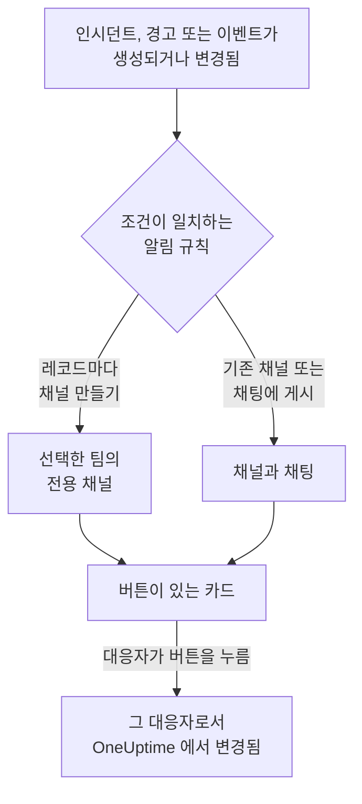

# Microsoft Teams

OneUptime 을 Microsoft Teams 에 연결하면 인시던트, 경고, 에피소드, 예정된 유지 관리, 모니터, 온콜 업데이트를 채널과 채팅에 게시하고, 인시던트마다 전용 채널을 두고, 대응자가 Teams 에서 조치하게 할 수 있습니다. 인지, 해결, 메모 추가, 온콜 호출, 인시던트 선언, OneUptime AI 에게 질문하기를 할 수 있습니다.

:::cards
- [Microsoft Teams 연결하기](#microsoft-teams-연결하기): 관리자 동의, 본인의 로그인, 각 팀의 앱.
- [모두에게 연결 요청하기](#모두에게-연결-요청하기): 계정을 연결하지 않은 모든 멤버에게 한 번에 메시지를 보냅니다.
- [알림 규칙](#알림-규칙): 어떤 이벤트를 어디에 게시하고, 어떤 이벤트에 전용 채널을 줄지 정합니다.
- [OneUptime 봇과 대화하기](#oneuptime-봇과-대화하기): 봇과의 채팅에서 쓰는 명령, 질문, 양식.
- [온콜 태그](#온콜-태그): 팀의 태그를 온콜 담당자와 같게 유지하고 호출합니다.
- [Microsoft Teams 에서 인시던트, 경고, 이벤트 조치하기](#microsoft-teams-에서-인시던트-경고-이벤트-조치하기): OneUptime 카드의 버튼입니다.
:::

## 작동 방식

세 가지가 있어야 이것이 작동합니다.

- **프로젝트의 연결** 은 한 번만 합니다. Microsoft 365 관리자가 조직을 위해 OneUptime 앱에 동의합니다.
- 알림을 받으려는 **각 팀의 OneUptime 앱**. Microsoft 는 봇이 추가된 팀에만 게시를 허용합니다.
- **각 사람의 연결** 은 그 사람의 Microsoft Teams 계정을 OneUptime 계정에 연결한 것입니다. 버튼, 명령, 반응은 그 사람으로서, 프로젝트에서의 그 사람의 권한으로 작동합니다.

하나의 Microsoft 365 조직을 프로덕션과 스테이징처럼 여러 프로젝트에 연결할 수 있습니다. 카드의 버튼은 그 카드가 전송된 프로젝트 (예: 카드가 다루는 인시던트의 프로젝트) 에서 작동합니다. 봇에 보내는 메시지는 그것이 전송된 채널 (예: 인시던트 채널) 의 프로젝트에서 작동하고, 그렇지 않으면 보낸 사람의 Microsoft Teams 계정이 연결된 유일한 프로젝트에서 작동합니다. 어느 쪽인지 알 수 없으면 봇은 보낸 사람에게 어느 프로젝트인지 묻고, 그 사람이 속한 프로젝트마다 버튼을 보여 줍니다. 하나를 고르면 그 프로젝트에서 계속 진행합니다. OneUptime AI 와의 대화에서는 고른 프로젝트가 이어지는 질문에도 적용되며, 질문 없이 1시간이 지나면 다시 묻습니다.

## 시작하기 전에

- **프로젝트를 연결할 수 있는 역할:** **프로젝트 소유자**, **프로젝트 관리자** 또는 **프로젝트 구성원**. 제거하려면 **프로젝트 소유자** 또는 **프로젝트 관리자** 가 필요합니다.
- 조직 전체에 대해 한 번 관리자 동의를 부여할 **Microsoft 365 관리자**.
- 알림 규칙과 요약에 필요한 **OneUptime Cloud 의 Growth 플랜**. [Growth 플랜 미만의 알림 규칙](#growth-플랜-미만의-알림-규칙) 을 참조하세요.
- **자체 호스팅 서버에서는** 먼저 그 서버용으로 설정한 Teams 봇. [Microsoft Teams 통합](/docs/self-hosted/microsoft-teams-integration) 을 참조하세요.

## Microsoft Teams 연결하기

:::steps
### 관리자 동의 부여하기

**프로젝트 설정** > **워크스페이스** > **Microsoft Teams** 로 이동해 **관리자 동의 부여** 를 클릭합니다. Microsoft 365 관리자가 로그인해 조직에 대해 OneUptime 앱을 허용합니다. 그러면 카드에 **Admin Consent Completed** 가 표시됩니다. 워크스페이스가 연결되기 전까지는 인시던트, 경고, 예정된 유지 관리, 모니터, 온콜 메뉴의 **워크스페이스** 섹션에 **Slack 또는 Teams 연결** 가 있으며, 이것도 여기로 연결됩니다.

### 본인의 계정 연결하기

**Connect with Microsoft Teams** 를 클릭하고 회사 계정으로 로그인합니다. OneUptime 이 조직의 팀을 읽으며, **팀 보기** 에서 그 목록을 볼 수 있습니다.

### 각 팀에 OneUptime 앱 추가하기 (필수)

계정을 연결하는 것만으로는 충분하지 않습니다. Microsoft 는 OneUptime 봇이 추가된 팀에만 게시를 허용하므로, 알림을 받으려는 각 팀에서 다음을 수행합니다.

- Microsoft Teams 에서 **팀 이름** (채널 이름이 아님) 옆의 "..." 를 클릭합니다.
- **Manage team** > **Apps** > **More apps** 를 선택하고, **OneUptime** 을 찾아 **Add** 를 클릭합니다.

OneUptime Cloud 에서는 **Teams 스토어 열기** 가 Microsoft Teams 스토어에서 앱을 열며, 거기서 **Add to a team** 으로도 같은 작업을 할 수 있습니다. 자체 호스팅 서버에서는 대신 **앱 매니페스트 Zip 다운로드** 의 패키지를 설치합니다. 서버의 봇이 들어 있는 것은 이 패키지뿐입니다. 테스트 알림에서 OneUptime 앱이 팀에 설치되어 있지 않다고 나오면, 빠뜨린 것이 바로 이 단계입니다.

### 다른 모든 사람 연결하기

각 사람은 **사용자 설정** > **워크스페이스** > **Microsoft Teams** 에서 **Connect my account with Microsoft Teams** 로 자신의 Microsoft Teams 계정을 연결해, 본인으로서 인시던트를 조치하고 다이렉트 메시지를 받습니다. 이 섹션은 프로젝트가 Microsoft Teams 에 연결되면 나타납니다. 팀 전체를 한 번에 참여시키려면 [모두에게 연결 요청하기](#모두에게-연결-요청하기) 를 참조하세요.

### 알림 규칙 추가하기

**인시던트** > **워크스페이스** > **Microsoft Teams** 로 이동합니다. **워크스페이스** 섹션에는 프로젝트가 연결한 채팅 워크스페이스만 표시되므로, **Microsoft Teams** 는 연결된 뒤에 나타납니다. 규칙을 만든 다음 (예: 인시던트가 생성되면 Teams 채널에 게시하는 규칙) 그 행에서 **테스트 규칙** 을 클릭합니다.
:::

> [!NOTE]
> OneUptime 을 본인용으로 설치하거나 채팅에 추가하는 것은 다른 설치이며, 이것으로는 팀의 채널에 게시할 수 없습니다. **비공개 채널** 에는 채널 자체에 앱을 추가해야 합니다. 채널을 열고 "..." > **Manage channel** > **Apps** > **Add an app** 을 선택합니다. **공유 채널** 은 알림을 받을 수 없습니다. Microsoft Teams 는 공유 채널에서 봇을 지원하지 않습니다.

## 모두에게 연결 요청하기

관리자를 포함해 누구도 다른 사람의 Microsoft Teams 계정을 연결할 수 없습니다. 각자 자신의 계정으로 로그인해야 합니다. 팀 전체를 참여시키려면 **프로젝트 소유자** 또는 **프로젝트 관리자** 가 **프로젝트 설정** > **워크스페이스** > **Microsoft Teams** 에서 모두에게 한 번에 요청합니다. **Members' Microsoft Teams accounts** 카드에는 연결을 마친 멤버 수가 표시됩니다. **Ask everyone to connect** 를 누르면 OneUptime 봇이 아직 연결하지 않은 각 멤버에게 메시지를 보냅니다. 메시지에는 클릭 한 번으로 계정을 연결하는 **Connect Microsoft Teams account** 버튼이 있습니다.

- **메시지를 받는 사람.** Microsoft Teams 계정을 연결하지 않았고 OneUptime 앱이 추가된 팀에 속한 프로젝트의 모든 멤버이며, 그 팀에서 이메일 주소나 사용자 계정 이름(UPN)으로 찾습니다. 지난 24시간 안에 요청을 받은 사람에게는 다시 요청하지 않으므로, 다음 날 다시 요청하면 아직 연결하지 않은 사람에게만 다시 알림이 갑니다.
- **카드가 알려 주는 내용.** 메시지를 보내는 동안에는 진행 상황을, 그다음에는 누가 요청했는지와 메시지를 받은 멤버 수를 보여 줍니다. OneUptime 이 찾지 못한 멤버는 카드에 이름이 표시됩니다. 그 멤버의 팀에 앱을 추가하거나, 본인이 **사용자 설정** > **워크스페이스** > **Microsoft Teams** 에서 직접 연결하게 하세요.
- **버튼이 연결하는 것.** 버튼을 누르고 로그인한 사람의 Microsoft Teams 계정을 그 사람 자신의 OneUptime 계정에 연결합니다. 메시지를 다른 사람에게 전달해도 원래 받은 멤버에게는 아무것도 연결되지 않습니다.

## 알림 규칙

알림 규칙은 어떤 이벤트를 Microsoft Teams 의 어디에 게시할지 정합니다. 각 제품에는 자체 규칙이 있으며, 메뉴의 **워크스페이스** > **Microsoft Teams** 에 있습니다.

| 제품 | **Microsoft Teams** 페이지의 탭 |
| --- | --- |
| **인시던트** | **인시던트**, **인시던트 에피소드**, **요약** |
| **알림** | **알림**, **경고 에피소드**, **요약** |
| **예정된 유지 관리** | 규칙 목록 하나 |
| **모니터** | 규칙 목록 하나 |
| **온콜 듀티** | 규칙 목록 하나 |

규칙 만들기는 네 단계로 진행됩니다.

| 단계 | 설정하는 내용 |
| --- | --- |
| **기본** | **규칙 이름** 과 **규칙 설명**. |
| **조건** | 규칙의 대상이 되는 이벤트. 예를 들어 심각도, 상태, 레이블, 모니터, 제목의 단어로 정합니다. 조건은 이벤트가 생성될 때와 OneUptime이 그 이벤트에 대해 업데이트를 게시할 때마다 다시 확인되므로, 인지된 인시던트에 대한 규칙은 인시던트가 인지될 때 동작합니다. 새 규칙은 모든 이벤트가 대상입니다(예: **모든 인시던트**). 범위를 좁히려면 **조건과 일치하는 인시던트만** 을 고르고 조건을 추가합니다. 조건이 둘 이상이면 **일치 조건** 으로 모두 일치해야 하는지, 하나만 일치하면 되는지 정합니다. |
| **대상** | 게시할 곳. 선택한 팀의 기존 채널, 선택한 채팅, 선택한 팀에 인시던트마다 만드는 채널 (경고, 에피소드, 이벤트, 모니터, 온콜 정책도 마찬가지), 또는 이들의 조합입니다. 단계 아래의 **이 규칙이 하는 일** 이 규칙 카드처럼 그 동작을 문장으로 알려 줍니다. |
| **Video Call** | 인시던트와 경고만 해당. 각각에 대해 통화를 시작합니다. [화상 통화](/docs/workspace-connections/video-calls) 를 참조하세요. |

규칙이 만드는 채널에는 해당 레코드의 이름이 붙습니다. 인시던트 INC-42는 `inc-42`, 경고 ALT-7은 `alt-7` 이 되고, 번호 접두사가 없는 프로젝트에서는 인시던트 42가 `incident-42` 가 됩니다. **채널 이름 접두사** 에 입력한 텍스트는 그 앞에 붙어 `prod-` 이면 `prod-inc-42` 가 되며, 양식은 입력하는 동안 이름을 보여 줍니다. 예정된 유지보수 이벤트에서는 접두사가 번호 접두사를 대신하여, SM-5는 `sm-5` 가 되고 `maint-` 이면 `maint-5` 가 됩니다. OneUptime은 문자, 숫자, 공백, `-` 및 `_` 를 Microsoft Teams가 받는 50자까지 남깁니다. 팀에 같은 이름의 채널이 이미 있으면 (다른 프로젝트의 채널이나 최근 30일 안에 삭제된 채널 등) OneUptime이 `-2`, `-3` 처럼 번호를 붙입니다.

규칙의 채널은 이벤트가 처음 규칙과 일치할 때 만들어집니다. 이벤트가 생성될 때, 또는 아직 진행 중인 이벤트가 업데이트로 일치하게 될 때입니다. 인지된 인시던트에 대한 규칙은 인시던트가 인지될 때 채널을 만듭니다. Microsoft Teams는 팀의 채널을 팀의 모든 사람에게 보여 주므로, OneUptime은 채널에 사람을 한 명씩 추가하지 않습니다. 규칙 양식의 **채널에 참여하는 사람** 에 나오듯이 선택한 팀의 모든 사람이 채널을 열 수 있습니다. 비공개 인시던트, 경고, 에피소드에는 비공개 채널이 만들어지며, 그 멤버만 볼 수 있습니다. 사람은 Microsoft Teams에서 추가하세요.

온콜 담당자에게 알리려면 규칙 양식의 **온콜 담당자 멘션** 에서 그 담당자의 온콜 스케줄을 고르세요. 채널이 만들어지면 OneUptime은 레코드의 첫 메시지 바로 뒤에 그 스케줄에서 온콜인 사람을 @멘션하는 메시지를 채널에 게시하므로, Microsoft Teams가 그 사람에게 알립니다. 아무도 호출되지 않습니다. OneUptime은 그 사람이 OneUptime에 연결한 Microsoft Teams 계정으로, 그렇지 않으면 이메일 주소로 팀에서 각 사람을 찾습니다. 팀에 없는 사람은 팀의 채널을 열 수 없으므로, 대신 메시지에 이유와 함께 이름이 표시됩니다. 비공개 채널은 그 멤버만 열 수 있으므로, 온콜 담당자를 Microsoft Teams에서 채널에 추가하세요.

이후 레코드의 모든 업데이트 (상태 변경, 메모, 새 소유자) 는 레코드의 채널에 게시되고, 규칙이 지정한 기존 채널과 채팅에도 규칙의 조건이 일치하는 동안 게시됩니다. OneUptime은 Microsoft Teams 채널을 보관할 수 없으므로, 레코드가 끝나도 규칙의 채널은 남아 있습니다. Microsoft Teams에서 보관하거나 삭제하세요.

자체 채널이 있는 인시던트, 경고, 에피소드, 예정된 유지보수 이벤트는 OneUptime 페이지 헤더의 상태 버튼 옆에 **Microsoft Teams에서 열기** 가 있습니다. 이 버튼은 그 채널을 새 탭에서 Microsoft Teams 앱이나 브라우저로 엽니다. 자체 채널이 두 개인 레코드는 버튼 아래에 둘 다 나열합니다. Slack과 Microsoft Teams 모두에 채널이 있는 레코드에는 대신 **채널 열기** 버튼 하나가 있고, 모든 채널을 나열합니다. 규칙이 게시하는 기존 채널과 채팅은 제공되지 않습니다.

레코드 페이지에는 **Microsoft Teams 채널** 카드도 있어, 채널을 열 수 있는 사람을 알려 줍니다. 팀의 모든 사람이거나, 비공개 채널이면 그 멤버이며, 멤버는 채널 소유자가 Microsoft Teams에서 추가합니다. OneUptime은 Microsoft Teams 채널에 있는 사람을 바꾸지 않습니다. Slack 채널이면 카드가 채널에 있는 사람을 보여 주고 사람을 추가합니다. [레코드 채널에 있는 사람](/docs/workspace-connections/slack#레코드-채널에-있는-사람)을 참고하세요.

채널과 채팅은 읽기 쉽게 유지됩니다. 각 업데이트는 한 번만 게시되고, 레코드의 첫 상태는 레코드를 알리는 카드 안에 들어가며 따로 게시되지 않습니다. 온콜 정책의 실행은 하나의 카드이며, 에스컬레이션이 진행되는 대로 편집됩니다. 누가 호출되었는지, 몇 번 어떤 방법으로 호출되었는지, 누가 호출되지 않았고 왜 그런지, 누가 확인했는지가 담깁니다. 새 카드는 누군가 조치해야 할 때만 게시됩니다. 에스컬레이션 규칙이 아무에게도 닿지 않았거나, 아무도 확인하지 않은 채 실행이 끝났을 때입니다. 레코드의 소유자나 상태 페이지 구독자에게 알렸다는 사실은 OneUptime 의 레코드 피드에 남습니다.

**프로젝트 설정** > **워크스페이스** > **Microsoft Teams** 에는 OneUptime 이 팀에서 볼 수 있는 채널과 OneUptime 이 추가된 채팅이 표시되고, 각각의 옆에 **테스트 보내기** 가 있습니다. 채팅은 Microsoft Teams 에서 OneUptime 앱이 추가되면 나타나며, **Refresh Chats** 는 새 채팅과 현재 이름을 가져옵니다.

## 규칙 테스트

규칙 행의 **테스트 규칙** 은 그 규칙의 테스트 메시지를 규칙이 지정한 채널에 게시해, 도착하는 것을 확인할 수 있게 합니다. 이벤트마다 채널을 만드는 규칙이라면 테스트도 채널을 하나 만들고 규칙의 대상자를 초대합니다.

**프로젝트 설정** > **워크스페이스** > **Microsoft Teams** 의 채널 옆에 있는 **테스트 보내기** 와 마찬가지로, 알림 규칙을 만들 권한이 필요합니다. **프로젝트 소유자**, **프로젝트 관리자**, **프로젝트 구성원**, **설정 관리자**, **설정 구성원**, 또는 사용자 지정 역할의 **Create Workspace Notification Rule** 과 **Read Workspace Notification Rule** 입니다. 규칙을 보기만 할 수 있는 사람 (예: **뷰어** ) 에게는 **테스트 규칙** 이 잠기며, 툴팁에 필요한 것이 표시됩니다. API 는 그 사람의 테스트를 "You do not have permission to send test notifications in this project." 로 거부합니다. OneUptime Cloud 에서는 규칙을 추가할 때와 마찬가지로 규칙 테스트에도 **Growth** 플랜이 필요합니다.

OneUptime Cloud 에서는 채널이나 채팅 옆의 **테스트 보내기** 에도 **Growth** 플랜이 필요합니다. 채널에 게시하는 것은 규칙과 요약이 하는 일이기 때문입니다. 요약의 **지금 테스트 보내기** 에는 요약을 만들 권한 (사용자 지정 역할의 **Create Workspace Notification Summary** 와 **Read Workspace Notification Summary** ) 과, OneUptime Cloud 에서는 **Growth** 플랜이 필요합니다. 그 밖의 사람에게는 잠기며, 툴팁에 필요한 것이 표시됩니다. 읽기 전용으로 연결된 MCP 클라이언트는 어떤 테스트도 보낼 수 없습니다.

## 요약

**인시던트** > **워크스페이스** > **Microsoft Teams** (및 **알림** ) 의 **요약** 탭은 지정한 채널에 정기 요약을 게시합니다. 인시던트나 경고가 몇 건이었는지, 얼마나 빨리 인지되고 해결되었는지, 그리고 링크가 포함된 목록입니다. 새 요약은 매주 발송되며 최근 7일을 다룹니다. **첫 보고서 전송 시각** 을 비워 두면 첫 요약은 다음 주, 일, 월의 시작 09:00 에 발송되며, 언제인지는 양식에 표시됩니다.

요약은 **시간대** 의 시계에 맞춰 발송되며, 시간대의 초기값은 사용자의 시간대입니다. 요약은 그 시간대에서 일 년 내내 같은 시각을 유지합니다. 베를린 09:00 으로 설정한 요약은 일광 절약 시간으로 시계가 바뀐 뒤에도 베를린 시간 09:00 에 발송되며, 메시지의 날짜도 베를린 기준입니다. API 에서는 `timezone` 을 `Europe/Berlin` 같은 IANA 시간대 이름으로 보냅니다. 시간대 없이 만든 요약은 만든 사람의 프로필 시간대를 사용하고, API 키로 만든 경우에는 UTC 를 사용합니다.

요약 양식은 네 단계입니다. **기본 정보** (이름, 채널, 그 **팀 이름** ), **일정**, **콘텐츠** ( **포함할 항목** ), **필터** (집계할 인시던트나 경고) 입니다.

## Growth 플랜 미만의 알림 규칙

OneUptime Cloud 에서 알림 규칙과 요약은 **Growth** 플랜 이상에서 사용할 수 있습니다. 그보다 낮은 플랜의 프로젝트는 이미 있는 규칙과 요약을 유지하며, 이들은 계속 Microsoft Teams 에 게시합니다. 그래서 각 제품 (인시던트, 경고, 예정된 유지 관리, 온콜, 모니터) 의 **Microsoft Teams** 페이지에는 플랜 안내와 그 아래의 목록 ( **아직 설정되어 있는 알림 규칙**, **아직 설정되어 있는 요약** ) 이 표시됩니다. 규칙을 삭제하거나, 요약을 끄거나 삭제하세요. 규칙과 요약을 추가하거나 변경하려면 **Growth** 가 필요합니다.

## Microsoft Teams 에서 호출 받기

온콜 중에 다이렉트 메시지로 호출을 받으려면 Microsoft Teams 를 알림 방법 중 하나로 추가합니다.

:::steps
1. 자신의 Microsoft Teams 계정을 연결합니다 ( [Microsoft Teams 연결하기](#microsoft-teams-연결하기) 참조).
2. **사용자 설정** > **알림 방법** 로 이동해 **Workspace Apps** 탭을 열고 **Add Microsoft Teams Account** 를 클릭합니다.
3. 해당 행에서 **Send Test Message** 를 클릭합니다. Microsoft Teams 채팅으로 메시지가 도착합니다.
:::

추가하면 바로 온콜 규칙에 포함되므로, 그때부터 호출이 Microsoft Teams 로 옵니다. 어떤 호출을 받을지는 **사용자 설정** > **온콜 규칙** 에서 변경합니다.

## 메시지를 메모로 저장하기

OneUptime 이 인시던트, 경고, 에피소드, 예정된 유지 관리 이벤트를 위해 만든 채널에서 메시지나 답글에 반응하면, OneUptime 이 그것을 해당 레코드의 메모로 저장합니다. 반응은 1분 이내에 감지되며, 스레드에 답글로 알려 줍니다.

| 반응 | 저장 형식 |
| --- | --- |
| 📌 또는 📍 | 팀만 볼 수 있는 비공개 메모 |
| 📣 또는 📢 | 상태 페이지에 표시되는 공개 메모. 인시던트와 예정된 유지 관리 이벤트만 해당합니다. 비공개 인시던트에서는 비공개 노트가 되며, 확인 메시지가 그 이유를 알려 줍니다. |

메모에는 Microsoft Teams 에서 보이던 그대로의 메시지가 담깁니다. 서식, 링크와 코드, 이름으로 표시된 멘션된 사람, 그리고 파일과 이미지로 가는 링크입니다. 공개 메모에는 파일과 이미지가 빠집니다. 팀에서만 열리기 때문입니다.

메모는 메시지를 쓴 사람의 말입니다. 그 사람의 Microsoft Teams 계정이 연결되어 있으면 OneUptime 이름으로, 그렇지 않으면 Teams 에 표시되는 이름으로 나타납니다. 비공개 메모는 얼마나 나중에 저장하든 타임라인에서 메시지가 게시된 시점에 놓입니다. 공개 메모는 저장한 시점에 놓이며, 상태 페이지에도 그 시점부터 표시됩니다. 누가 저장했는지는 타임라인에 표시됩니다. 메시지가 이미 채널에 있으므로 메모를 채널에 다시 게시하지 않습니다.

메모는 본인으로서, 본인의 권한으로 저장되며, OneUptime 앱이 팀에 있어야 합니다. Microsoft Teams 계정이 아직 연결되어 있지 않으면 OneUptime 이 본인을 멘션한 답글로 연결을 요청하고, 연결하는 즉시 메시지를 저장하는 버튼을 함께 보냅니다.

## OneUptime 봇과 대화하기

개인 채팅에서 봇에게 메시지를 보내거나, 채널이나 그룹 채팅에서 OneUptime 을 @멘션합니다. 채널과 그룹 채팅에서는 멘션될 때만 응답합니다.

| 메시지 | 봇이 하는 일 |
| --- | --- |
| `help` | 할 수 있는 일을 나열합니다. |
| `incident [title or number]` | 제목이 채워진 인시던트 양식을 엽니다. `42` 나 `INC-42` 같은 인시던트 번호를 쓰면 대신 그 인시던트를 보여 줍니다. [Microsoft Teams 에서 인시던트 관리하기](#microsoft-teams-에서-인시던트-관리하기) 를 참조하세요. |
| `maintenance [title]` | 제목이 채워진 예정된 유지 관리 양식을 엽니다. |
| `oncall` | 볼 수 있는 각 온콜 스케줄에서 지금 온콜인 사람, 언제까지인지, 다음은 누구인지 나열합니다. |
| `page [who] [message]` | @멘션한 사람들을 메시지 내용으로 호출하거나, 누구를 호출할지 고르는 카드를 보냅니다. [Microsoft Teams 에서 누군가 호출하기](#microsoft-teams-에서-누군가-호출하기) 를 참조하세요. |
| `ask [question]`, 또는 일상적인 말로 하는 모든 질문 | OneUptime AI 가 로그, 트레이스, 메트릭, 인시던트, 모니터에 대해 답변합니다. 예를 들어 "지금 다운된 모니터는?" 입니다. 답변은 읽기만 합니다. |
| `show active incidents`, `show active alerts` | 지금 열려 있는 것을 나열합니다. |
| `show scheduled maintenance`, `show ongoing maintenance` | 예정된, 또는 진행 중인 유지 관리 이벤트를 나열합니다. |

`show` 목록을 제외하면 Slack 에서 `/oneuptime` 뒤에 오는 단어와 같습니다. `create incident` 와 `create maintenance` 도 계속 작동합니다. OneUptime AI 에게 질문하려면 자신의 Microsoft Teams 계정이 연결되어 있고 프로젝트에서 AI 가 켜져 있어야 합니다. 계정이 연결되어 있지 않으면 봇은 스레드나 채팅마다 한 번, **Connect Microsoft Teams account** 버튼으로 연결을 요청합니다. [AI에게 질문](/docs/ai/ask-ai) 을 참조하세요.

## Microsoft Teams 의 내 홈

OneUptime 봇에게 `home` 을 입력하면 봇이 내 홈으로 답합니다. 내가 볼 수 있는 범위에서 프로젝트에 무슨 일이 일어나고 있는지 보여 주는 카드입니다.

- **내 온콜.** 지금 온콜인 온콜 스케줄과 언제까지인지, 또는 다음 근무입니다.
- **열려 있는 것.** 내가 읽을 수 있는 가장 최근의 열린 인시던트와 경고이며, 각각 OneUptime 의 페이지로 연결됩니다.
- **버튼.** **Declare incident** 와 **Page someone** 은 `incident` 와 `page` 처럼, **Who's on call** 은 `oncall` 처럼 답하며, **Refresh** 는 카드를 그 자리에서 다시 읽습니다.

OneUptime 앱을 나에게 추가하면 봇이 바로 내 홈을 보냅니다. 홈과 `show` 목록은 나로서 읽으므로 내 Microsoft Teams 계정이 연결되어 있어야 합니다. 연결되기 전까지 봇은 **Connect Microsoft Teams account** 버튼으로 답합니다. **사용자 설정** > **워크스페이스** > **Microsoft Teams** 의 **Microsoft Teams에서 OneUptime 열기** 는 Teams 에서 앱을 엽니다.

앱이 팀에 추가되면 봇이 그 팀에서 인사합니다. 질문하는 방법과, 팀의 채널에 게시하는 알림 규칙을 추가하는 위치를 알려 줍니다.

## Microsoft Teams 에서 인시던트와 유지 관리 만들기

OneUptime 봇에게 `incident` 또는 `maintenance` 를 입력하면, 개인 채팅, 채널, 그룹 채팅 어디서든 입력한 사람을 위한 양식이 열립니다. 양식은 그 사람으로서 작성됩니다. 그 사람의 Microsoft Teams 계정이 연결된 OneUptime 계정 ( [Microsoft Teams 연결하기](#microsoft-teams-연결하기) 참조) 으로서, 그 계정의 프로젝트 권한으로 제출됩니다. 계정이 연결되지 않았거나 OneUptime 계정이 더 이상 프로젝트의 멤버가 아닌 사람은 양식 대신 그 사람을 멘션하는 답글로 무엇을 해야 하는지 안내를 받습니다.

- **사용할 수 있는 사람.** OneUptime 에서 인시던트를 선언하거나 예정된 유지 관리 이벤트를 만들 수 있는 사람입니다. 인시던트에는 **프로젝트 소유자**, **프로젝트 관리자**, **프로젝트 구성원**, **인시던트 관리자**, **인시던트 구성원** (사용자 지정 역할에서는 **Create Incident** ), 이벤트에는 **예정된 유지 관리 관리자** 와 **예정된 유지 관리 구성원** ( **Create Scheduled Maintenance** ) 입니다. 그 밖의 사람에게는 그렇게 알리며 양식을 주지 않습니다.
- **양식이 제공하는 것.** 각 목록 (심각도, 모니터, 모니터 상태, 온콜 정책, 레이블) 에는 OneUptime 의 같은 목록과 마찬가지로 양식을 요청한 사람이 읽을 수 있는 것이 들어 있으며, 카드의 "not shown" 안내도 그것만 셉니다. 일부 레이블로 제한된 역할이라면 그 레이블이 붙은 모니터와 온콜 정책입니다. 전혀 읽을 수 없는 목록은 빠집니다. 보관된 온콜 정책은 제공되지 않습니다.
- **양식이 지정할 수 있는 것.** 채널이나 그룹 채팅에서는 그곳에 있는 누구나 양식을 제출할 수 있으며, 제출한 사람으로서 그 사람의 권한으로 제출됩니다. 인시던트나 이벤트는 그 권한으로 만들어지고 그 사람의 작업으로 기록됩니다. 그 사람이 읽을 수 없는 모니터, 온콜 정책, 레이블, 심각도, 상태, 또는 다른 프로젝트의 것은 프로젝트에 없는 것처럼 거부되며 아무것도 만들어지지 않습니다. 봇은 "One of the values you picked ... is not available in this project any more. Please pick it again." 라고 응답합니다.

인시던트, 경고, 에피소드의 **Execute On-Call Policy** 도 같은 방식으로 작동합니다. 온콜 정책을 실행할 권한 ( **프로젝트 소유자**, **프로젝트 관리자**, **프로젝트 구성원**, **온콜 관리자**, **온콜 구성원**, 또는 사용자 지정 역할의 **Create On-Call Duty Policy Execution Log** ) 과 해당 인시던트, 경고, 에피소드를 읽을 권한이 필요하며, 그 사람이 읽을 수 있는 활성 온콜 정책이 제공됩니다. 카드에서 모니터나 온콜 정책을 볼 때도 버튼을 누른 사람으로서 읽습니다.

## Microsoft Teams 에서 누군가 호출하기

채널이나 그룹 채팅에서 `@OneUptime page @Nawaz Dhandala The checkout API is throwing 500s` 는 Nawaz 를 바로 호출합니다. OneUptime 은 메시지를 제목으로 하는 경고를 만들고, @멘션한 각 사람은 자신의 온콜 규칙에 따라 누군가 경고를 확인할 때까지 전화, SMS, 푸시 알림 또는 이메일을 받습니다.

- **바로 호출되는 사람.** @멘션한 사람과 @멘션한 태그가 따르는 스케줄에서 지금 온콜인 사람으로, 뒤에 메시지가 이어질 때입니다 ( [온콜 태그](#온콜-태그) 참고). OneUptime 은 그 사람의 Microsoft Teams 계정이 연결된 OneUptime 계정으로, 그렇지 않으면 Microsoft Teams 에 있는 그 사람의 이메일 주소로 사람을 알아봅니다. 프로젝트 밖의 사람은 호출되지 않습니다.
- **그 밖의 경우에는 카드가 옵니다.** 아무도 @멘션하지 않았거나 (봇과의 개인 채팅처럼), 메시지가 없거나, 볼 수 있는 온콜 스케줄을 따르지 않는 태그를 지정했거나, OneUptime 이 알아볼 수 없는 사람이 있으면, 봇이 입력한 내용이 채워진 **Page someone** 카드로 응답하고, 고르지 못한 사람을 알려 줍니다. 사람, 팀, 온콜 스케줄 (지금 그 스케줄에서 온콜인 사람을 호출합니다) 또는 온콜 정책 (에스컬레이션 규칙에 따라 호출합니다) 을 골라 제출하세요. 대화에 있는 누구나 자신으로서 카드를 제출할 수 있습니다. 호출이 끝나면 카드가 제거되므로, 아무도 같은 카드로 두 번 호출하지 않습니다.
- **표시되는 곳.** 대화에는 호출이 하나의 카드로 표시되고 계속 최신 상태로 유지됩니다. 누가 어떻게 호출되었는지, 누가 확인했는지가 나옵니다. 봇이 그 카드를 게시할 수 없으면, 봇의 답글이 누가 호출되었는지를 경고 링크와 함께 알려 줍니다.
- **호출할 수 있는 사람.** 온콜 정책 실행과 경고 생성을 모두 할 수 있는 사람입니다. **프로젝트 소유자**, **프로젝트 관리자**, **프로젝트 구성원**, 또는 **온콜 구성원** 과 **경고 구성원** 을 함께 가진 사람 (사용자 지정 역할에서는 **Create On-Call Duty Policy Execution Log** 와 **Create Alert** ) 입니다. 온콜 정책 없이 사람, 팀 또는 스케줄을 직접 호출하려면 프로젝트의 모든 온콜 정책에 대한 액세스도 필요합니다. 그 밖의 사람에게는 답글로 그렇게 알리며, 아무도 호출되지 않습니다. OneUptime Cloud 에서는 호출에 Growth 플랜이 필요합니다. 그보다 낮은 플랜에서는 OneUptime 이 필요한 플랜을 알려 주며, 아무도 호출되지 않습니다.

## 온콜 태그

`@Payments on-call` 같은 Microsoft Teams 태그를 하나 이상의 온콜 스케줄에서 지금 온콜인 사람과 같게 유지하면, 그 팀의 누구나 태그를 @멘션해 담당자에게 연락할 수 있습니다. OneUptime 은 인계와 재정의 때마다 태그의 멤버를 바꾸고, 15 분마다 확인합니다.

:::steps
### 태그를 스케줄에 연결하기

**온콜 듀티** > **온콜 스케줄** 에서 스케줄을 엽니다. **Microsoft Teams 태그** 카드에서 **태그 연결** 을 클릭하고, 팀을 고른 뒤 태그 이름을 입력합니다. 그 이름의 팀 태그나 OneUptime 이 만드는 새 태그가 됩니다. 태그의 멤버는 바로 온콜 담당자로 바뀝니다.

### 보조 스케줄에도 연결하기

기본과 보조 온콜 담당자를 모두 담으려면 보조 스케줄 페이지에서도 같은 태그를 연결합니다. 하나의 태그는 스케줄을 몇 개든 따를 수 있습니다.
:::

- **카드에 표시되는 내용.** 각 태그에 지금 있는 사람, 그 팀, 태그가 따르는 다른 스케줄, 그리고 **최신** 인지 여부입니다. 태그에는 그 팀의 멤버만 들어갈 수 있으므로, 팀에 없는 온콜 담당자는 이유와 함께 표시됩니다.
- **온콜인 사람이 없을 때.** OneUptime 은 누군가 온콜이 될 때까지 태그에서 모두를 뺍니다. Microsoft Teams 는 빈 태그를 만들 수 없으므로, 새 태그에는 팀의 온콜 담당자가 필요합니다.
- **태그 호출하기.** `@OneUptime page @Payments on-call The checkout API is down` 은 태그가 따르는 스케줄에서 온콜인 사람을 호출합니다. [Microsoft Teams 에서 누군가 호출하기](#microsoft-teams-에서-누군가-호출하기) 를 참고하세요.
- **Microsoft 365 에 필요한 것.** 태그를 바꾸려면 앱의 `TeamworkTag.ReadWrite.All` 권한이 필요하며, Microsoft 365 관리자가 **프로젝트 설정** > **워크스페이스** > **Microsoft Teams** 의 **관리자 동의 부여** 로 부여합니다. OneUptime 이 태그를 관리할 수 있게 되기 전에 조직이 동의했다면 한 번 더 동의하세요.
- **연결할 수 있는 사람.** 스케줄을 편집할 수 있는 역할입니다. **프로젝트 소유자**, **프로젝트 관리자**, **프로젝트 구성원**, **온콜 관리자**, **온콜 구성원**, 또는 사용자 지정 역할의 **Edit On-Call Duty Policy Schedule** 입니다. OneUptime Cloud 에서는 연결하려면 **Growth** 플랜이 필요합니다.
- **연결을 해제하면.** OneUptime 은 태그 변경을 멈춥니다. 태그와 멤버는 Microsoft Teams 에 그대로 남습니다.

## Microsoft Teams 에서 인시던트 관리하기

인시던트 카드에는 **Acknowledge Incident**, **Resolve Incident**, **Add Note**, **View Incident** 네 개의 버튼이 있고, 나머지는 점 세 개 버튼인 메뉴에 있습니다.

| 메뉴 항목 | 하는 일 |
| --- | --- |
| **Change Severity** | 인시던트의 심각도를 설정합니다. |
| **Change Incident State** | 인시던트를 이후 상태로 옮깁니다. |
| **Assign Role** | 누군가에게 인시던트의 역할을 줍니다. 예를 들면 **Incident Commander** 입니다. 한 사람만 맡는 역할은 그 사람에게 넘어갑니다. |
| **Page Someone** | 누군가 인시던트를 확인할 때까지, 인시던트에 대해 사람, 팀, 스케줄에서 지금 온콜인 사람, 또는 온콜 정책을 호출합니다. |
| **Edit Custom Fields** | 인시던트의 사용자 지정 필드를 설정하며, 각 필드에는 인시던트의 값이 채워져 있습니다. 비워 둔 필드는 지워집니다. |

봇에 입력한 `incident 42` 는 인시던트 42 와 이 버튼들, 메뉴로 답합니다. 번호는 OneUptime 에 표시되는 대로 입력합니다: `42`, `#42` 또는 `INC-42`. 인시던트 전용 채널에서는 `incident` 만으로 그 인시던트를 보여 줍니다.

- **사용할 수 있는 사람.** Slack 에서처럼 OneUptime 에서 같은 변경을 할 수 있는 사람입니다. [Slack 에서 인시던트 관리하기](/docs/workspace-connections/slack#slack-에서-인시던트-관리하기) 를 참조하세요. 각 항목은 카드로 답하며, 카드는 누른 사람이 볼 수 있는 인시던트 내용으로 채워집니다. 대화에 있는 누구나 본인으로서, 자기 권한으로 카드를 제출할 수 있습니다.
- **그다음에 일어나는 일.** OneUptime 에서처럼 카드를 제출한 사람으로서 변경이 이루어지고, 인시던트의 피드가 무엇이 바뀌었는지 알립니다. 봇은 그 사람을 멘션하는 답글로 이를 알리고, 아무도 두 번 제출하지 않도록 카드를 삭제합니다. **Page Someone** 은 누가 호출되었는지, 또는 아무도 호출되지 않은 이유를 알립니다. 이미 해결된 인시던트는 아무도 호출하지 않습니다.
- **Microsoft Teams 에서 다른 점.** 카드는 필드 아래에 무엇이 잘못되었는지 표시할 수 없습니다. 맞지 않는 값은 답글로 알리고, 카드는 고쳐서 다시 제출할 수 있도록 남습니다. 날짜와 시간 필드는 내 시간대의 날짜와 시간입니다. 오래된 Teams 클라이언트는 메뉴를 추가 버튼으로 표시합니다. `incident 42` 는 대화에서 답하므로, 대화에 있는 모두가 인시던트를 볼 수 있습니다.
- **메뉴 이전에 게시된 카드.** 그 카드에는 **Execute On-Call Policy** 버튼이 남아 계속 작동합니다. **Page Someone** 으로도 온콜 정책을 호출할 수 있습니다. 경고와 에피소드는 자기 버튼을 유지합니다.

## Microsoft Teams 에서 인시던트, 경고, 이벤트 조치하기

OneUptime 카드의 버튼은 개인 채팅, 채널, 그룹 채팅 어디서든 누른 사람으로서 작동합니다. 그 사람의 Microsoft Teams 계정이 연결된 OneUptime 계정으로서, 그 계정의 프로젝트 권한으로 작동합니다. 인시던트, 경고, 에피소드의 **Acknowledge**, **Resolve**, **Change State**, **Add Note**, **Execute On-Call Policy**, 그리고 예정된 유지 관리 이벤트의 **Mark as Ongoing**, **Mark as Complete**, **Change State**, **Add Note** 는 각각 OneUptime 에서 같은 동작이 하는 것과 같은 변경을 하며, 그 변경은 OneUptime 에서 그 사람의 작업으로 기록됩니다. 레코드의 상태 타임라인과 피드에 누가 상태를 변경했는지 표시되고, 메모도 그 사람의 것이 됩니다. 반응으로 메시지에서 저장한 메모도 같은 방식으로 게시됩니다.

- **사용할 수 있는 사람.** OneUptime 에서 같은 변경을 할 수 있는 사람입니다. 인시던트를 인지, 해결하거나 상태를 변경하려면 그 상태를 변경할 권한이 필요합니다. **프로젝트 소유자**, **프로젝트 관리자**, **프로젝트 구성원**, **인시던트 관리자**, **인시던트 구성원**, 또는 사용자 지정 역할의 **Create Incident State Timeline** 입니다. 경고, 에피소드, 예정된 유지 관리 이벤트에는 각 종류에 맞는 같은 권한 (예: **Create Alert State Timeline** ) 이 필요하고, 메모에는 그 종류의 메모를 게시할 권한이 필요합니다. OneUptime 의 상태 패널과 마찬가지로, 인시던트나 경고 자체를 편집할 권한은 요구하지 않습니다. 그 밖의 사람에게는 그렇게 알리며 아무것도 바뀌지 않습니다.
- **대상 레코드.** OneUptime 에서와 마찬가지로 그 사람이 읽을 수 있는 레코드입니다. 일부 레이블로 제한된 역할이라면 그 레이블이 붙은 인시던트, 경고, 에피소드, 이벤트입니다. 다른 레코드의 버튼은 이유를 알려 주며 아무것도 바뀌지 않습니다. 그 사람의 역할이 미치지 않는 인시던트에서는 "your access in this project does not include this incident. Ask a project admin for access to it.", 그 사람이 소유자가 아닌 비공개 인시던트에서는 "this incident is private, so only its owners and the project's owners and admins can see it. Ask one of them to add you as an owner.", 그 사이 삭제된 인시던트에서는 "the incident was not found. It may have been deleted." 라는 응답이 옵니다. OneUptime Cloud 에서는 프로젝트의 플랜에 포함되지 않은 변경은 필요한 플랜과 함께 거부됩니다.
- **Change State 가 제공하는 것.** 그 사람이 읽을 수 있는 상태 중 레코드가 다음으로 옮겨 갈 수 있는 상태를 프로젝트의 순서대로 제공합니다. 현재 상태보다 앞선 상태는 없습니다. 이는 인시던트, 경고, 예정된 유지 관리 이벤트와 마찬가지로 에피소드에도 적용되는데, 상태 변경으로 레코드가 목록의 위쪽으로 되돌아가는 일은 없기 때문입니다 ( [순서는 표시 취향이 아니라 실제 제약입니다](/docs/incidents/states-and-severities#순서는-표시-취향이-아니라-실제-제약입니다) 참조). 읽을 수 있는 상태가 하나도 없으면 봇은 "No incident states are available to you in this project. Ask a project admin for access to them." 라고 말하고, 레코드가 도달할 수 있는 마지막 상태에 있으면 "There is no later state to move this incident to." 라고 말합니다. 어느 경우에도 빈 카드는 표시되지 않습니다.
- **비공개 인시던트의 Add Note.** 비공개 인시던트에는 공개 노트를 추가할 수 없으므로, 카드는 노트 유형을 묻지 않고 비공개 노트를 추가합니다. 비공개가 되기 전에 보낸 카드도 비공개 노트를 추가하고, 그렇다고 알려 줍니다. [비공개 인시던트에는 비공개 노트만](/docs/incidents/notes-owners-and-feed#비공개-인시던트에는-비공개-노트만) 섹션을 참고하세요.
- **Escalate.** 카드의 **Escalate** 는 카드가 다루는 인시던트, 경고, 에피소드에 대해 그 온콜 정책을, 누른 사람으로서 **Execute On-Call Policy** 와 같은 권한으로 실행합니다. 그중 어느 것도 다루지 않는 카드에는 "This on-call policy can only be executed for an incident, an alert or an episode. Open the record you are paging about and use Execute On-Call Policy there." 라는 응답이 오며, 아무도 호출되지 않습니다.
- **답변을 받는 곳.** 같은 대화 (채널에서는 카드의 스레드) 에서 그 사람을 멘션하는 답글로 받으므로 Microsoft Teams 가 그 사람에게 알립니다. 너무 늦게 누른 버튼은 누가 언제 먼저 했는지 알려 줍니다. 예: "Incident INC-2 was already acknowledged by Simon Lee at 6:07 PM."
- **계정이 연결되어 있지 않은 경우.** 답글은 **Connect Microsoft Teams account** 버튼으로 연결을 요청합니다. 이 버튼은 OneUptime 에서 그 사람의 Microsoft Teams 설정을 열고, 필요하면 OneUptime 에 로그인한 뒤 한 단계로 계정을 연결합니다. 그런 다음 OneUptime 은 그 사람이 누른 작업을 그 사람으로서 마무리하고 같은 대화에서 답합니다. 양식을 여는 버튼이나 명령이라면 다시 누르거나 입력하라고 안내합니다. 버튼은 30 분 동안 한 번, 누른 Microsoft 계정에 대해서만 작동합니다.

## 연결 해제

- **연결 해제** 는 자신의 Microsoft Teams 계정 연결만 해제하며, 함께 자신의 Microsoft Teams 알림 방법을 제거합니다.
- **프로젝트 설정** > **워크스페이스** > **Microsoft Teams** 의 **Uninstall OneUptime from Microsoft Teams** 는 프로젝트의 연결을 해제합니다. OneUptime 은 Microsoft Teams 에 게시를 멈추고, **워크스페이스** 메뉴에도 더 이상 표시되지 않습니다. 알림 규칙과 요약은 다시 연결할 때를 위해 유지됩니다.

> [!WARNING]
> 제거하면 프로젝트의 모든 멤버의 Microsoft Teams 계정 연결도 해제되고, Microsoft Teams 알림 방법과 그것을 사용하던 온콜 규칙도 제거됩니다. 프로젝트는 하나의 Microsoft 365 조직에만 연결됩니다. 다른 조직으로 옮기려면 먼저 제거하세요.

## 문제 해결

:::details 테스트에서 OneUptime 앱이 팀에 설치되어 있지 않다고 표시됨
봇이 그 팀에 없어서 Microsoft 가 게시를 거부했습니다. 팀에 앱을 추가하거나 ( [Microsoft Teams 연결하기](#microsoft-teams-연결하기) 참조), 비공개 채널이라면 채널 자체에 추가하세요. 한 팀에 추가해도 다른 팀에는 아무 효과가 없습니다.
:::

:::details Microsoft Teams 가 연결되지 않음
Microsoft 가 연결 없이 돌려보내면, 시작한 페이지에 **Microsoft Teams가 연결되지 않았습니다** 가 표시되고 한 문장으로 이유를 알려 줍니다. 권한이 없거나, 링크가 이미 사용되었거나 만료되었거나, 다른 Microsoft 365 조직에 로그인했거나, 조직에 아직 팀이 없는 경우입니다. 각 문장과 대처 방법은 [연결이 완료되지 않음](/docs/self-hosted/microsoft-teams-integration#연결이-완료되지-않음) 을 참조하세요.
:::

:::details 봇이 내 계정이 연결되지 않았다고 말함
봇의 답글에서 **Connect Microsoft Teams account** 를 눌러 한 단계로 연결하거나, **사용자 설정** > **워크스페이스** > **Microsoft Teams** 에서 **Connect my account with Microsoft Teams** 로 연결하세요. 어느 쪽이든 프로젝트가 연결된 조직에 로그인하며, 그 조직의 게스트라면 게스트로 로그인합니다. 게스트인데 이전에 자신의 조직 계정을 연결했다면 다시 연결하세요.
:::

:::details 자체 호스팅 서버에서 모든 알림이 실패함
팀에 설치한 Teams 앱은 서버가 만든 패키지여야 하며, Microsoft 가 서버의 봇 엔드포인트에 접근할 수 있어야 합니다. [Microsoft Teams 통합](/docs/self-hosted/microsoft-teams-integration#문제-해결) 의 문제 해결을 참조하세요.
:::

## 다음 단계

:::cards
- [Slack](/docs/workspace-connections/slack): Slack 에서의 같은 알림과 조치.
- [화상 통화](/docs/workspace-connections/video-calls): 모든 인시던트에 통화를 주고, 업데이트와 함께 게시합니다.
- [Microsoft Teams 통합](/docs/self-hosted/microsoft-teams-integration): 자체 호스팅 서버에서 Teams 봇을 설정합니다.
- [인시던트 선언](/docs/incidents/declaring-incidents): 인시던트가 시작되는 모든 방법과, 그때 실행되는 것.
:::
