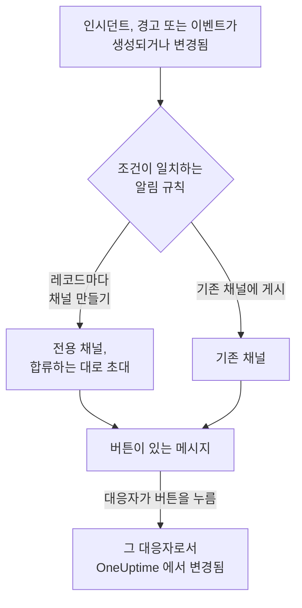

# Slack

OneUptime 을 Slack 에 연결하면 인시던트, 경고, 에피소드, 예정된 유지 관리, 모니터, 온콜 업데이트를 채널에 게시하고, 인시던트마다 전용 채널을 두고, 대응자가 Slack 을 떠나지 않고 조치하게 할 수 있습니다. 인지, 해결, 메모 추가, 온콜 호출, 인시던트 선언을 할 수 있습니다.

:::cards
- [Slack 연결하기](#slack-연결하기): 워크스페이스에 OneUptime 을 설치한 다음 자신의 계정을 연결합니다.
- [모두에게 연결 요청하기](#모두에게-연결-요청하기): 계정을 연결하지 않은 모든 멤버에게 한 번에 메시지를 보냅니다.
- [알림 규칙](#알림-규칙): 어떤 이벤트를 어디에 게시하고, 어떤 이벤트에 전용 채널을 줄지 정합니다.
- [레코드 채널에 있는 사람](#레코드-채널에-있는-사람): 레코드 페이지에서 채널에 있는 사람을 보고, 참여하고, 사람을 추가합니다.
- [/oneuptime 명령](#oneuptime-명령): 인시던트를 선언하고, 유지 관리를 예약하고, 온콜 담당자를 확인하고, AI 에게 질문합니다.
- [온콜 사용자 그룹](#온콜-사용자-그룹): 사용자 그룹을 온콜 담당자와 같게 유지하고 호출합니다.
- [Slack 에서 인시던트, 경고, 이벤트 조치하기](#slack-에서-인시던트-경고-이벤트-조치하기): OneUptime 메시지의 버튼입니다.
:::

## 작동 방식

두 가지 연결로 이것이 작동합니다.

- **프로젝트의 연결** 은 한 번만 합니다. Slack 워크스페이스에 설치된 OneUptime 앱입니다. 이 앱이 메시지를 게시하고, 채널을 만들고, 사람들을 초대합니다.
- **각 사람의 연결** 은 그 사람의 Slack 계정을 OneUptime 계정에 연결한 것입니다. 버튼, 명령, 이모지 반응은 그 사람으로서, 프로젝트에서의 그 사람의 권한으로 작동합니다.

하나의 Slack 워크스페이스를 프로덕션과 스테이징처럼 여러 프로젝트에 연결할 수 있습니다. 버튼이나 양식은 해당 레코드의 프로젝트에서 작동합니다. 명령이나 OneUptime 에 보내는 메시지는 그것이 작성된 채널 (예: 인시던트 채널) 의 프로젝트에서 작동하고, 그렇지 않으면 내 Slack 계정이 연결된 유일한 프로젝트에서 작동합니다. 어느 쪽인지 알 수 없으면 OneUptime 은 내가 속한 프로젝트를 알려 주고, 원하는 프로젝트의 채널에서 다시 시도하라고 안내합니다.

## 시작하기 전에

- **프로젝트를 연결할 수 있는 역할:** **프로젝트 소유자**, **프로젝트 관리자** 또는 **프로젝트 구성원**. 앱을 제거하려면 **프로젝트 소유자** 또는 **프로젝트 관리자** 이 필요합니다.
- 앱을 설치할 수 있는 **Slack 워크스페이스**.
- 알림 규칙과 요약에 필요한 **OneUptime Cloud 의 Growth 플랜**. [Growth 플랜 미만의 알림 규칙](#growth-플랜-미만의-알림-규칙) 을 참조하세요.
- **자체 호스팅 서버에서는** 먼저 그 서버용으로 설정한 Slack 앱. [Slack 통합](/docs/self-hosted/slack-integration) 을 참조하세요.

## Slack 연결하기

:::steps
### Slack 워크스페이스에 OneUptime 설치하기

**프로젝트 설정** > **워크스페이스** > **Slack** 으로 이동해 **Connect with Slack** 을 클릭합니다. 워크스페이스를 선택하고 OneUptime 을 허용합니다. Slack 이 같은 페이지로 돌려보내며, 이제 이 페이지에 프로젝트가 연결된 워크스페이스 이름이 표시됩니다. 워크스페이스가 연결되기 전까지는 인시던트, 경고, 예정된 유지 관리, 모니터, 온콜 메뉴의 **워크스페이스** 섹션에 **Slack 또는 Teams 연결** 가 있으며, 이것도 여기로 연결됩니다.

### 자신의 Slack 계정 연결하기

앱을 설치하면 설치한 사람의 계정이 연결됩니다. 다른 모든 사람은 **사용자 설정** > **워크스페이스** > **Slack** 에서 **Connect my account with Slack** 으로 자신의 Slack 계정을 연결해, 본인으로서 인시던트를 조치하고 다이렉트 메시지를 받습니다. 이 섹션은 프로젝트가 Slack 에 연결되면 나타납니다. 팀 전체를 한 번에 참여시키려면 [모두에게 연결 요청하기](#모두에게-연결-요청하기) 를 참조하세요.

### 알림 규칙 추가하기

**인시던트** > **워크스페이스** > **Slack** 으로 이동합니다. **워크스페이스** 섹션에는 프로젝트가 연결한 채팅 워크스페이스만 표시되므로, **Slack** 은 연결된 뒤에 나타납니다. 규칙을 만듭니다. 예를 들어 새 인시던트마다 Slack 채널을 만들고 대응하는 모든 사람(호출된 사람, 인시던트 책임자, 소유자)을 참여시키는 규칙입니다. [알림 규칙](#알림-규칙) 을 참조하세요.

### 규칙 테스트하기

규칙 행에서 **테스트 규칙** 을 클릭합니다. 규칙이 지정한 채널에 테스트 메시지가 도착합니다. [규칙 테스트](#규칙-테스트) 를 참조하세요.
:::

## 모두에게 연결 요청하기

관리자를 포함해 누구도 다른 사람의 Slack 계정을 연결할 수 없습니다. 각자 자신의 계정으로 로그인해야 합니다. 팀 전체를 참여시키려면 **프로젝트 소유자** 또는 **프로젝트 관리자** 이 **프로젝트 설정** > **워크스페이스** > **Slack** 에서 모두에게 한 번에 요청합니다. **Members' Slack accounts** 카드에는 연결을 마친 멤버 수가 표시됩니다. **Ask everyone to connect** 는 아직 연결하지 않은 각 멤버에게 Slack 에서 OneUptime 의 다이렉트 메시지를 보냅니다. 메시지에는 클릭 한 번으로 계정을 연결하는 **Connect Slack account** 버튼이 있습니다.

- **메시지를 받는 사람.** Slack 계정을 연결하지 않은 프로젝트의 모든 멤버이며, Slack 에서는 이메일 주소로 찾습니다. 지난 24시간 안에 요청을 받은 사람에게는 다시 요청하지 않으므로, 다음 날 다시 요청하면 아직 연결하지 않은 사람에게만 다시 알림이 갑니다.
- **카드가 알려 주는 내용.** 메시지를 보내는 동안에는 진행 상황을, 그다음에는 누가 요청했는지와 메시지를 받은 멤버 수를 보여 줍니다. OneUptime 이 Slack 에서 이메일 주소로 찾지 못한 멤버는 카드에 이름이 표시됩니다. 이 멤버들은 **사용자 설정** > **워크스페이스** > **Slack** 에서 직접 연결합니다.
- **버튼이 연결하는 것.** 버튼을 누르고 로그인한 사람의 Slack 계정을 그 사람 자신의 OneUptime 계정에 연결합니다. 메시지를 다른 사람에게 전달해도 원래 받은 멤버에게는 아무것도 연결되지 않습니다.

## 알림 규칙

알림 규칙은 어떤 이벤트를 Slack 의 어디에 게시할지 정합니다. 각 제품에는 자체 규칙이 있으며, 메뉴의 **워크스페이스** > **Slack** 에 있습니다.

| 제품 | **Slack** 페이지의 탭 |
| --- | --- |
| **인시던트** | **인시던트**, **인시던트 에피소드**, **요약** |
| **알림** | **알림**, **경고 에피소드**, **요약** |
| **예정된 유지 관리** | 규칙 목록 하나 |
| **모니터** | 규칙 목록 하나 |
| **온콜 듀티** | 규칙 목록 하나 |

규칙 만들기는 네 단계로 진행됩니다.

| 단계 | 설정하는 내용 |
| --- | --- |
| **기본** | **규칙 이름** 과 **규칙 설명**. |
| **조건** | 규칙의 대상이 되는 이벤트. 예를 들어 심각도, 상태, 레이블, 모니터, 제목의 단어로 정합니다. 조건은 이벤트가 생성될 때와 OneUptime이 그 이벤트에 대해 업데이트를 게시할 때마다 다시 확인되므로, 인지된 인시던트에 대한 규칙은 인시던트가 인지될 때 동작합니다. 새 규칙은 모든 이벤트가 대상입니다(예: **모든 인시던트**). 범위를 좁히려면 **조건과 일치하는 인시던트만** 을 고르고 조건을 추가합니다. 조건이 둘 이상이면 **일치 조건** 으로 모두 일치해야 하는지, 하나만 일치하면 되는지 정합니다. |
| **대상** | 게시할 곳. 채널 이름을 지정하는 **기존 채널에 게시** , 참여할 사람을 지정하는 **인시던트마다 채널 만들기** (경고, 에피소드, 이벤트, 모니터, 온콜 정책도 마찬가지), 또는 둘 다입니다. 단계 아래의 **이 규칙이 하는 일** 이 규칙 카드처럼 그 동작을 문장으로 알려 줍니다. |
| **Video Call** | 인시던트와 경고만 해당. 각각에 대해 통화를 시작합니다. [화상 통화](/docs/workspace-connections/video-calls) 를 참조하세요. |

규칙이 만드는 채널에는 해당 레코드의 이름이 붙습니다. 인시던트 INC-42는 `inc-42`, 경고 ALT-7은 `alt-7` 이 되고, 번호 접두사가 없는 프로젝트에서는 인시던트 42가 `incident-42` 가 됩니다. **채널 이름 접두사** 에 입력한 텍스트는 그 앞에 붙어 `prod-` 이면 `prod-inc-42` 가 되며, 양식은 입력하는 동안 이름을 보여 줍니다. 예정된 유지보수 이벤트에서는 접두사가 번호 접두사를 대신하여, SM-5는 `sm-5` 가 되고 `maint-` 이면 `maint-5` 가 됩니다. Slack은 영문 소문자, 숫자, `-` 및 `_` 를 최대 80자까지 받습니다. 같은 이름의 채널이 이미 있으면 (다른 프로젝트의 채널이나 보관된 채널 등) OneUptime이 `-2`, `-3` 처럼 번호를 붙입니다.

규칙의 채널은 이벤트가 처음 규칙과 일치할 때 만들어집니다. 이벤트가 생성될 때, 또는 아직 진행 중인 이벤트가 업데이트로 일치하게 될 때입니다. 인지된 인시던트에 대한 규칙은 인시던트가 인지될 때 채널을 만듭니다. 비공개 인시던트, 경고, 에피소드에는 비공개 채널이 만들어집니다.

**채널에 참여하는 사람** 에는 규칙이 채널에 추가하는 사람이 나옵니다. 채널을 만들 때뿐 아니라 레코드에 합류할 때마다 추가됩니다. **온콜 대응자(호출될 때)** , **인시던트 책임자 및 기타 인시던트 역할(배정될 때)** (인시던트와 인시던트 에피소드), **소유자(추가될 때)** 이며, 새 규칙에서는 모두 선택되어 있습니다. 그리고 **추가로 초대** 의 사람, 팀, 온콜 스케줄이 채널을 만들 때 참여합니다. 인시던트 책임자는 보통 누군가 인시던트를 처음 인지할 때 배정되며, 그때 채널에 참여합니다. 인시던트 역할에 전용 확인란이 생기기 전에 저장된 규칙은 소유자나 온콜 대응자를 추가할 때 인시던트 역할도 추가하며, 그 확인란은 선택된 상태로 표시됩니다. 규칙이 게시하는 기존 채널에는 아무도 추가되지 않습니다.

**추가로 초대** 의 온콜 스케줄에서는 채널을 만들 때 그 스케줄에서 온콜인 사람이 스케줄 페이지에 표시된 대로 참여하며, 호출되지는 않습니다. 일부 인시던트의 채널에만 사람을 추가하려면 두 번째 규칙에 그 조건과 그 사람을 지정하고 **채널 이름 접두사** 를 첫 번째 규칙과 같게 하세요. 채널을 만들 때 인시던트와 일치하는 규칙들은 그 채널을 함께 쓰며, 각 규칙이 지정한 사람을 추가합니다.

이후 레코드의 모든 업데이트 (상태 변경, 메모, 새 소유자) 는 레코드의 채널에 게시되고, 규칙이 지정한 기존 채널에도 규칙의 조건이 일치하는 동안 게시됩니다. **인시던트가 해결되면 채널 보관** 이 켜져 있으면 (경고, 에피소드, 이벤트, 모니터, 온콜 정책에도 같은 설정이 있습니다), 채널을 만든 규칙이 레코드가 해결, 완료 또는 삭제될 때 그 시점의 조건과 관계없이 채널을 보관합니다. 이미 해결된 상태로 생성된 인시던트, 경고, 에피소드에는 전용 채널이 만들어지지 않지만, 생성 메시지는 여전히 규칙이 지정한 채널로 갑니다. [이미 인지되었거나 해결된 상태로 선언된 인시던트](/docs/incidents/declaring-incidents#이미-인지되었거나-해결된-상태로-선언된-인시던트) 를 참조하세요.

자체 채널이 있는 인시던트, 경고, 에피소드, 예정된 유지보수 이벤트는 OneUptime 페이지 헤더의 상태 버튼 옆에 **Slack에서 열기** 가 있습니다. 이 버튼은 그 채널을 새 탭에서 Slack 앱이나 브라우저로 엽니다. 자체 채널이 두 개인 레코드는 버튼 아래에 둘 다 나열합니다. Slack과 Microsoft Teams 모두에 채널이 있는 레코드에는 대신 **채널 열기** 버튼 하나가 있고, 모든 채널을 나열합니다. 규칙이 게시하는 기존 채널은 제공되지 않습니다.

채널은 읽기 쉽게 유지됩니다. 각 업데이트는 한 번만 게시되고, 레코드의 첫 상태는 레코드를 알리는 메시지 안에 들어가며 따로 게시되지 않습니다. 온콜 정책의 실행은 하나의 메시지이며, 에스컬레이션이 진행되는 대로 편집됩니다. 누가 호출되었는지, 몇 번 어떤 방법으로 호출되었는지, 누가 호출되지 않았고 왜 그런지, 누가 확인했는지가 담깁니다. 새 메시지는 누군가 조치해야 할 때만 게시됩니다. 에스컬레이션 규칙이 아무에게도 닿지 않았거나, 아무도 확인하지 않은 채 실행이 끝났을 때입니다. Slack 계정을 OneUptime 에 연결하지 않은 사람은 그 사람의 이메일 주소를 가진 Slack 계정으로 추가됩니다. 어느 방법으로도 OneUptime 이 찾지 못한 사람이나 Slack 의 게스트는 채널에 추가할 수 없습니다. OneUptime 은 채널마다 한 번, 해당하는 사람을 모두 나열하는 하나의 메시지로 이를 알리고, 목록이 늘어나면 그 메시지를 편집합니다. 그 메시지의 **Connect Slack account** 링크를 보내 주면 한 단계로 계정을 연결할 수 있습니다. 레코드의 소유자나 상태 페이지 구독자에게 알렸다는 사실은 OneUptime 의 레코드 피드에 남습니다.

**프로젝트 설정** > **워크스페이스** > **Slack** 에는 OneUptime 이 볼 수 있는 채널이 표시되고, 각 채널 옆에 **테스트 보내기** 가 있습니다. OneUptime 은 공개 채널에 처음 게시할 때 스스로 참여합니다. 비공개 채널은 Slack 에서 OneUptime 앱을 초대한 뒤에만 목록에 표시되고 게시할 수 있습니다.

## 레코드 채널에 있는 사람

자체 Slack 채널이 있는 인시던트, 경고, 에피소드, 예정된 유지보수 이벤트는 OneUptime 페이지에 **Slack 채널** 카드가 있습니다. 카드는 Slack 에서 채널을 여는 링크로 채널을 보여 주고, 비공개 채널인지와 채널에 있는 사람을 본인부터 보여 줍니다. Slack 관리자 없이 카드에서 다음을 할 수 있습니다.

- **채널 참여** 는 채널에 없을 때 나를 추가합니다.
- **사람 추가** 는 프로젝트의 사람과 팀 목록을 엽니다. 사람을 고르면 그 사람을, 팀을 고르면 팀의 모든 사람을 추가합니다.

추가는 OneUptime 앱이 하며, 규칙의 채널에 사람을 추가할 때와 같습니다. 앱은 자신이 만든 채널에 계속 남아 있으므로, 모두가 나간 비공개 채널에도 이렇게 다시 들어갈 수 있습니다.

- **사람을 추가할 수 있는 사람.** 레코드를 편집할 수 있는 사람입니다. 인시던트라면 **프로젝트 소유자**, **프로젝트 관리자**, **프로젝트 구성원**, **인시던트 관리자**, **인시던트 구성원**, 또는 사용자 지정 역할의 **Edit Incident** 이고, 경고, 에피소드, 이벤트에는 각각 같은 권한이 필요합니다 (예: **Edit Alert**). 그 밖의 사람은 채널에 있는 사람과 들어가는 방법을 봅니다.
- **추가할 수 있는 사람.** OneUptime 이 Slack 에서 찾을 수 있는 사람입니다. 그 사람이 연결한 Slack 계정으로, 그렇지 않으면 Slack 이 가진 그 사람의 이메일 주소로 찾습니다. 추가하지 못한 사람은 이유와 함께 카드에 표시됩니다. 예를 들면 Slack 이 채널에 들이지 않는 게스트입니다.
- **기록되는 내용.** 누가 누구에 의해 추가되었는지가 레코드의 피드 ( **채널 멤버 추가됨** ) 와 **프로젝트 설정** > **알림** > **알림 로그** 의 **워크스페이스** 탭에 기록됩니다.
- **사람을 내보내려면.** OneUptime 은 사람을 추가만 합니다. 채널에서 사람을 내보내는 것은 Slack 에서 하세요.

## 규칙 테스트

규칙 행의 **테스트 규칙** 은 그 규칙의 테스트 메시지를 규칙이 지정한 채널에 게시해, 도착하는 것을 확인할 수 있게 합니다. 이벤트마다 채널을 만드는 규칙이라면 테스트도 채널을 하나 만들고 규칙의 대상자를 초대합니다.

**프로젝트 설정** > **워크스페이스** > **Slack** 의 채널 옆에 있는 **테스트 보내기** 와 마찬가지로, 알림 규칙을 만들 권한이 필요합니다. **프로젝트 소유자**, **프로젝트 관리자**, **프로젝트 구성원**, **설정 관리자**, **설정 구성원**, 또는 사용자 지정 역할의 **Create Workspace Notification Rule** 과 **Read Workspace Notification Rule** 입니다. 규칙을 보기만 할 수 있는 사람 (예: **뷰어** ) 에게는 **테스트 규칙** 이 잠기며, 툴팁에 필요한 것이 표시됩니다. API 는 그 사람의 테스트를 "You do not have permission to send test notifications in this project." 로 거부합니다. OneUptime Cloud 에서는 규칙을 추가할 때와 마찬가지로 규칙 테스트에도 **Growth** 플랜이 필요합니다.

OneUptime Cloud 에서는 채널 옆의 **테스트 보내기** 에도 **Growth** 플랜이 필요합니다. 채널에 게시하는 것은 규칙과 요약이 하는 일이기 때문입니다. 요약의 **지금 테스트 보내기** 에는 요약을 만들 권한 (사용자 지정 역할의 **Create Workspace Notification Summary** 와 **Read Workspace Notification Summary** ) 과, OneUptime Cloud 에서는 **Growth** 플랜이 필요합니다. 그 밖의 사람에게는 잠기며, 툴팁에 필요한 것이 표시됩니다. 읽기 전용으로 연결된 MCP 클라이언트는 어떤 테스트도 보낼 수 없습니다.

## 요약

**인시던트** > **워크스페이스** > **Slack** (및 **알림** ) 의 **요약** 탭은 지정한 채널에 정기 요약을 게시합니다. 인시던트나 경고가 몇 건이었는지, 얼마나 빨리 인지되고 해결되었는지, 그리고 링크가 포함된 목록입니다. 새 요약은 매주 발송되며 최근 7일을 다룹니다. **첫 보고서 전송 시각** 을 비워 두면 첫 요약은 다음 주, 일, 월의 시작 09:00 에 발송되며, 언제인지는 양식에 표시됩니다.

요약은 **시간대** 의 시계에 맞춰 발송되며, 시간대의 초기값은 사용자의 시간대입니다. 요약은 그 시간대에서 일 년 내내 같은 시각을 유지합니다. 베를린 09:00 으로 설정한 요약은 일광 절약 시간으로 시계가 바뀐 뒤에도 베를린 시간 09:00 에 발송되며, 메시지의 날짜도 베를린 기준입니다. API 에서는 `timezone` 을 `Europe/Berlin` 같은 IANA 시간대 이름으로 보냅니다. 시간대 없이 만든 요약은 만든 사람의 프로필 시간대를 사용하고, API 키로 만든 경우에는 UTC 를 사용합니다.

요약 양식은 네 단계입니다. **기본 정보** (이름과 채널), **일정**, **콘텐츠** ( **포함할 항목** ), **필터** (집계할 인시던트나 경고) 입니다.

## Growth 플랜 미만의 알림 규칙

OneUptime Cloud 에서 알림 규칙과 요약은 **Growth** 플랜 이상에서 사용할 수 있습니다. 그보다 낮은 플랜의 프로젝트는 이미 있는 규칙과 요약을 유지하며, 이들은 계속 Slack 에 게시합니다. 그래서 각 제품 (인시던트, 경고, 예정된 유지 관리, 온콜, 모니터) 의 **Slack** 페이지에는 플랜 안내와 그 아래의 목록 ( **아직 설정되어 있는 알림 규칙**, **아직 설정되어 있는 요약** ) 이 표시됩니다. 규칙을 삭제하거나, 요약을 끄거나 삭제하세요. 규칙과 요약을 추가하거나 변경하려면 **Growth** 가 필요합니다.

## Slack 에서 호출 받기

온콜 중에 다이렉트 메시지로 호출을 받으려면 Slack 을 알림 방법 중 하나로 추가합니다.

:::steps
1. 자신의 Slack 계정을 연결합니다 ( [Slack 연결하기](#slack-연결하기) 참조).
2. **사용자 설정** > **알림 방법** 로 이동해 **Workspace Apps** 탭을 열고 **Add Slack Account** 를 클릭합니다.
3. 해당 행에서 **Send Test Message** 를 클릭합니다. Slack 다이렉트 메시지로 메시지가 도착합니다.
:::

추가하면 바로 온콜 규칙에 포함되므로, 그때부터 호출이 Slack 으로 옵니다. 어떤 호출을 받을지는 **사용자 설정** > **온콜 규칙** 에서 변경합니다.

## 메시지를 메모로 저장하기

인시던트, 경고, 에피소드, 예정된 유지 관리 이벤트의 채널에서 메시지에 반응하면, OneUptime 이 그 메시지를 해당 레코드의 메모로 저장하고 스레드에 답글로 알려 줍니다.

| 반응 | 저장 형식 |
| --- | --- |
| 📌 핀 이모지 또는 Slack 자체의 **Pin to channel** | 팀만 볼 수 있는 비공개 메모 |
| 📢 메가폰 또는 확성기 이모지 | 상태 페이지에 표시되는 공개 메모. 인시던트와 예정된 유지 관리 이벤트만 해당합니다. 비공개 인시던트에서는 비공개 노트가 되며, 확인 메시지가 그 이유를 알려 줍니다. |

메모에는 Slack 에서 보이던 그대로의 메시지가 담깁니다. 서식, 링크와 코드, 이름으로 표시된 멘션된 사람과 채널, 그리고 파일과 이미지로 가는 링크입니다. 공개 메모에는 파일과 이미지가 빠집니다. 팀에서만 열리기 때문입니다.

메모는 메시지를 쓴 사람의 말입니다. 그 사람의 Slack 계정이 연결되어 있으면 OneUptime 이름으로, 그렇지 않으면 Slack 에 표시되는 이름으로 나타납니다. 비공개 메모는 얼마나 나중에 저장하든 타임라인에서 메시지가 게시된 시점에 놓입니다. 공개 메모는 저장한 시점에 놓이며, 상태 페이지에도 그 시점부터 표시됩니다. 누가 저장했는지는 타임라인에 표시됩니다. 메시지가 이미 채널에 있으므로 메모를 채널에 다시 게시하지 않습니다.

메모는 본인으로서, 본인의 권한으로 저장됩니다. Slack 계정이 아직 연결되어 있지 않으면 OneUptime 이 본인만 보는 메시지로 연결을 요청하고, 연결하는 즉시 메시지를 저장하는 버튼을 함께 보냅니다. 몇 명이 반응하든 메시지는 한 번만 저장됩니다.

## /oneuptime 명령

OneUptime 의 Slack 명령은 `/oneuptime` 하나입니다. 그 뒤에 입력하는 단어가 할 일을 정하고, 그 밖의 내용은 OneUptime AI 에게 하는 질문이 됩니다.

| 명령 | 하는 일 |
| --- | --- |
| `/oneuptime help` | 명령 목록을 예와 함께 보여 줍니다. |
| `/oneuptime incident [title or number]` | 제목이 채워진 인시던트 양식을 엽니다. `42` 나 `INC-42` 같은 인시던트 번호를 쓰면 대신 그 인시던트를 보여 줍니다. [Slack 에서 인시던트 관리하기](#slack-에서-인시던트-관리하기) 를 참조하세요. |
| `/oneuptime maintenance [title]` | 제목이 채워진 예정된 유지 관리 양식을 엽니다. |
| `/oneuptime oncall` | 볼 수 있는 각 온콜 스케줄에서 지금 온콜인 사람, 언제까지인지, 다음은 누구인지 나열합니다. |
| `/oneuptime page [who] [message]` | @멘션한 사람들을 메시지 내용으로 호출하거나, 누구를 호출할지 고르는 양식을 엽니다. [Slack 에서 누군가 호출하기](#slack-에서-누군가-호출하기) 를 참조하세요. |
| `/oneuptime ask [question]`, 또는 모든 질문 | OneUptime AI 가 로그, 트레이스, 메트릭, 인시던트, 모니터에 대해 답변합니다. |

`help` 와 `oncall` 의 답변은 명령 아래에 나만 보이는 메시지로 표시됩니다. `incidnet` 처럼 첫 단어가 명령의 오타로 보이면, OneUptime AI 의 답변 대신 비슷한 명령을 받습니다. 인시던트와 유지 관리 양식은 본인으로서 동작합니다. [Slack 에서 인시던트와 유지 관리 만들기](#slack-에서-인시던트와-유지-관리-만들기) 을 참조하세요.

> [!NOTE]
> `/oneuptime incident` 와 `/oneuptime maintenance` 가, 다른 Slack 앱의 같은 이름 명령과 충돌할 수 있던 `/incident` 와 `/maintenance` 를 대신합니다. 이전 매니페스트로 만든 Slack 앱은 앱이 업데이트될 때까지 이 명령을 유지하며, 같은 양식을 엽니다. [이전 매니페스트로 만든 앱](/docs/self-hosted/slack-integration#이전-매니페스트로-만든-앱) 을 참조하세요.

## Slack 의 OneUptime 홈

Slack 사이드바의 **Apps** 에서 OneUptime 을 열면 **Home** 탭에 내가 볼 수 있는 범위에서 프로젝트에 무슨 일이 일어나고 있는지가 표시되며, 열 때마다 다시 읽습니다.

- **내 온콜.** 지금 온콜인 온콜 스케줄과 언제까지인지, 또는 다음 근무입니다.
- **열려 있는 것.** 내가 읽을 수 있는 가장 최근의 열린 인시던트와 경고이며, 각각 OneUptime 의 페이지로 연결됩니다.
- **버튼.** **Declare incident**, **Schedule maintenance**, **Page someone** 은 `/oneuptime incident`, `/oneuptime maintenance`, `/oneuptime page` 와 같은 양식을 열고, **Who's on call** 은 `/oneuptime oncall` 처럼 답합니다.

홈은 나로서 읽으므로 내 Slack 계정이 연결되어 있어야 합니다. 연결되기 전까지 홈에는 **Connect Slack account** 버튼이 있고, 연결하면 바로 내 홈이 표시됩니다.

누군가 OneUptime 을 채널에 추가하면 OneUptime 은 그 채널에 인사를 게시합니다. 질문하는 방법과, 그 채널에 게시하는 알림 규칙을 추가하는 위치를 알려 줍니다. **Messages** 탭을 처음 열면 OneUptime 이 그곳에서 환영 메시지를 보냅니다. Slack 에서 무엇을 하는지와 시작하는 방법을 알려 줍니다.

## Slack 에서 OneUptime AI 에게 질문하기

로그, 트레이스, 메트릭, 인시던트, 모니터에 대해 일상적인 말로 질문하세요. 채널에서 OneUptime 을 @멘션하거나 다이렉트 메시지를 보내면 스레드에서 답변합니다. `/oneuptime ask which monitors are down?` 은 답변을 채널에 게시합니다. 두 방법 모두 자신의 Slack 계정이 연결되어 있고 프로젝트에서 AI 가 켜져 있어야 합니다. Slack 의 답변은 읽기만 합니다. 무언가를 변경하려면 버튼을 사용하세요. [AI에게 질문](/docs/ai/ask-ai) 을 참조하세요.

OneUptime 은 자신에게 향한 것에만 답변합니다.

- **자신의 대화에서는 답글만 달면 됩니다.** 스레드가 아닌 채널에서 질문하면 그 아래 스레드에서 대화가 시작됩니다. 거기에 답글을 달면 OneUptime 을 다시 멘션하지 않아도 계속 질문할 수 있고, 다른 사람은 OneUptime 을 멘션해서 대화에 참여합니다.
- **그 밖의 스레드에서는 OneUptime 을 멘션합니다.** 예를 들어 인시던트 메시지 아래의 스레드에서는 매번 멘션하세요. 그곳에서 사람들이 서로 주고받는 글에는 답변하지 않습니다.
- **Slack 계정이 연결되어 있지 않은 경우.** OneUptime 은 대화마다 한 번, 본인에게만 보이는 메시지로 **Connect Slack account** 버튼과 함께 연결을 요청합니다.

## Slack 에서 인시던트와 유지 관리 만들기

`/oneuptime incident` 와 `/oneuptime maintenance` 는 본인이 작성해 본인으로서 제출하는 양식을 엽니다. 자신의 Slack 계정이 연결된 OneUptime 계정 ( [Slack 연결하기](#slack-연결하기) 참조) 으로서, 그 계정의 프로젝트 권한으로 제출됩니다. Slack 계정이 연결되어 있지 않거나 OneUptime 계정이 더 이상 프로젝트의 멤버가 아니면, OneUptime 이 명령을 실행한 곳에서 본인에게만 보이는 메시지로 무엇을 해야 하는지 알려 주며 양식은 열리지 않습니다. **Create New Incident** 와 **Create Scheduled Event** 바로 가기도 같은 양식을 엽니다.

- **사용할 수 있는 사람.** OneUptime 에서 인시던트를 선언하거나 예정된 유지 관리 이벤트를 만들 수 있는 사람입니다. 인시던트에는 **프로젝트 소유자**, **프로젝트 관리자**, **프로젝트 구성원**, **인시던트 관리자**, **인시던트 구성원** (사용자 지정 역할에서는 **Create Incident** ), 이벤트에는 **예정된 유지 관리 관리자** 와 **예정된 유지 관리 구성원** ( **Create Scheduled Maintenance** ) 입니다. 그 밖의 사람에게는 명령을 실행한 곳에서 그렇게 알리며 양식은 열리지 않습니다.
- **양식이 제공하는 것.** 각 목록 (심각도, 모니터, 모니터 상태, 온콜 정책, 레이블) 에는 OneUptime 의 같은 목록과 마찬가지로 본인이 읽을 수 있는 것이 들어 있습니다. 일부 레이블로 제한된 역할이라면 그 레이블이 붙은 모니터와 온콜 정책입니다. 전혀 읽을 수 없는 목록은 양식에서 빠집니다. 보관된 온콜 정책은 제공되지 않습니다.
- **양식이 지정할 수 있는 것.** 인시던트나 이벤트는 본인의 권한으로 만들어지고 본인의 작업으로 기록됩니다. 읽을 수 없는 모니터, 온콜 정책, 레이블, 심각도, 상태, 또는 다른 프로젝트의 것은, 접근 권한이 바뀌기 전에 연 양식에서라도 프로젝트에 없는 것처럼 거부되며 아무것도 만들어지지 않습니다. OneUptime 이 채널에서 본인에게만 보이는 메시지로 그 이유를 알려 줍니다.

인시던트, 경고, 에피소드의 **Execute On-Call Policy** 도 같은 방식으로 작동합니다. 온콜 정책을 실행할 권한 ( **프로젝트 소유자**, **프로젝트 관리자**, **프로젝트 구성원**, **온콜 관리자**, **온콜 구성원**, 또는 사용자 지정 역할의 **Create On-Call Duty Policy Execution Log** ) 과 해당 인시던트, 경고, 에피소드를 읽을 권한이 필요하며, 본인이 읽을 수 있는 활성 온콜 정책이 제공됩니다.

## Slack 에서 누군가 호출하기

`/oneuptime page @nawaz The checkout API is throwing 500s` 는 Nawaz 를 바로 호출합니다. OneUptime 은 메시지를 제목으로 하는 경고를 만들고, @멘션한 각 사람은 자신의 온콜 규칙에 따라 누군가 경고를 확인할 때까지 전화, SMS, 푸시 알림 또는 이메일을 받습니다.

- **바로 호출되는 사람.** @멘션한 사람과 @멘션한 사용자 그룹이 따르는 스케줄에서 지금 온콜인 사람으로, 뒤에 메시지가 이어질 때입니다 ( [온콜 사용자 그룹](#온콜-사용자-그룹) 참고). OneUptime 은 그 사람의 Slack 계정이 연결된 OneUptime 계정으로, 그렇지 않으면 Slack 이 가진 그 사람의 이메일 주소로 사람을 알아봅니다. 프로젝트 밖의 사람은 호출되지 않습니다.
- **그 밖의 경우에는 양식이 열립니다.** 아무도 @멘션하지 않았거나, 메시지가 없거나, `@here` 또는 볼 수 있는 온콜 스케줄을 따르지 않는 사용자 그룹을 지정했거나, OneUptime 이 알아볼 수 없는 사람이 있으면, 입력한 내용이 채워진 **Page someone** 양식이 열리고, 고르지 못한 사람이 표시됩니다. 사람, 팀, 온콜 스케줄 (지금 그 스케줄에서 온콜인 사람을 호출합니다) 또는 온콜 정책 (에스컬레이션 규칙에 따라 호출합니다) 을 골라 제출하세요. `/oneuptime page Primary The disk is full` 처럼 맨 앞에 입력한 이름은 그 이름의 스케줄, 팀 또는 정책을 고릅니다.
- **표시되는 곳.** 채널에는 호출이 하나의 메시지로 표시되고 계속 최신 상태로 유지됩니다. 누가 어떻게 호출되었는지, 누가 확인했는지가 나옵니다. OneUptime 이 게시할 수 없는 곳, 예를 들어 초대받지 않은 비공개 채널에서는 본인에게만 보이는 메시지가 누가 호출되었는지를 경고 링크와 함께 알려 줍니다.
- **호출할 수 있는 사람.** 온콜 정책 실행과 경고 생성을 모두 할 수 있는 사람입니다. **프로젝트 소유자**, **프로젝트 관리자**, **프로젝트 구성원**, 또는 **온콜 구성원** 과 **경고 구성원** 을 함께 가진 사람 (사용자 지정 역할에서는 **Create On-Call Duty Policy Execution Log** 와 **Create Alert** ) 입니다. 온콜 정책 없이 사람, 팀 또는 스케줄을 직접 호출하려면 프로젝트의 모든 온콜 정책에 대한 액세스도 필요합니다. 그 밖의 사람에게는 명령을 실행한 곳에서 그렇게 알리며, 아무도 호출되지 않습니다. OneUptime Cloud 에서는 호출에 Growth 플랜이 필요합니다. 그보다 낮은 플랜에서는 OneUptime 이 필요한 플랜을 알려 주며, 아무도 호출되지 않습니다.

## 온콜 사용자 그룹

`@payments-oncall` 같은 Slack 사용자 그룹을 하나 이상의 온콜 스케줄에서 지금 온콜인 사람과 같게 유지하면, 누구나 그 그룹을 @멘션해 담당자에게 연락할 수 있습니다. OneUptime 은 인계와 재정의 때마다 그룹의 멤버를 바꾸고, 15 분마다 확인합니다.

:::steps
### 사용자 그룹을 스케줄에 연결하기

**온콜 듀티** > **온콜 스케줄** 에서 스케줄을 엽니다. **Slack 사용자 그룹** 카드에서 **사용자 그룹 연결** 을 클릭한 다음, 워크스페이스의 사용자 그룹 하나를 고르거나 이름과 핸들로 **새 사용자 그룹 만들기** 를 고릅니다. 그룹의 멤버는 바로 온콜 담당자로 바뀝니다.

### 보조 스케줄에도 연결하기

기본과 보조 온콜 담당자를 모두 담으려면 보조 스케줄 페이지에서도 같은 그룹을 연결합니다. 하나의 그룹은 스케줄을 몇 개든 따를 수 있습니다.
:::

- **카드에 표시되는 내용.** 각 그룹에 지금 있는 사람, 그룹이 따르는 다른 스케줄, 그리고 **최신** 인지 여부입니다. 그룹에 넣을 수 없는 온콜 담당자는 이유와 함께 표시됩니다. OneUptime 은 연결된 Slack 계정으로, 그렇지 않으면 Slack 이 가진 이메일 주소로 사람을 찾고, Slack 은 게스트를 사용자 그룹에 넣지 않습니다.
- **온콜인 사람이 없을 때.** Slack 은 빈 사용자 그룹을 유지할 수 없으므로, OneUptime 은 누군가 온콜이 될 때까지 그룹을 끄고, 그 뒤 다시 켭니다.
- **그룹 호출하기.** `/oneuptime page @payments-oncall The checkout API is down` 은 그룹이 따르는 스케줄에서 온콜인 사람을 호출합니다. [Slack 에서 누군가 호출하기](#slack-에서-누군가-호출하기) 를 참고하세요.
- **Slack 에 필요한 것.** 사용자 그룹은 Slack 유료 플랜의 기능이고, 워크스페이스에 따라 소유자와 관리자만 변경할 수 있습니다. 어느 쪽인지, 무엇을 해야 하는지는 카드에 표시됩니다. OneUptime 이 사용자 그룹을 관리할 수 있게 되기 전에 Slack 을 연결했다면 **프로젝트 설정** > **워크스페이스** > **Slack** 에서 한 번 다시 연결하세요.
- **연결할 수 있는 사람.** 스케줄을 편집할 수 있는 역할입니다. **프로젝트 소유자**, **프로젝트 관리자**, **프로젝트 구성원**, **온콜 관리자**, **온콜 구성원**, 또는 사용자 지정 역할의 **Edit On-Call Duty Policy Schedule** 입니다. OneUptime Cloud 에서는 연결하려면 **Growth** 플랜이 필요합니다.
- **연결을 해제하면.** OneUptime 은 그룹 변경을 멈춥니다. 그룹과 멤버는 Slack 에 그대로 남습니다.

## Slack 에서 인시던트 관리하기

인시던트 메시지에는 **Acknowledge Incident**, **Resolve Incident**, **Add Note**, **View Incident** 네 개의 버튼이 있고, 나머지는 그 뒤의 점 세 개 버튼인 메뉴에 있습니다.

| 메뉴 항목 | 하는 일 |
| --- | --- |
| **Change Severity** | 인시던트의 심각도를 설정합니다. |
| **Change Incident State** | 인시던트를 이후 상태로 옮깁니다. |
| **Assign Role** | 누군가에게 인시던트의 역할을 줍니다. 예를 들면 **Incident Commander** 입니다. 한 사람만 맡는 역할은 그 사람에게 넘어갑니다. |
| **Page Someone** | 누군가 인시던트를 확인할 때까지, 인시던트에 대해 사람, 팀, 스케줄에서 지금 온콜인 사람, 또는 온콜 정책을 호출합니다. |
| **Edit Custom Fields** | 인시던트의 사용자 지정 필드를 설정하며, 각 필드에는 인시던트의 값이 채워져 있습니다. 비워 둔 필드는 지워집니다. |

`/oneuptime incident 42` 는 인시던트 42 를 이 버튼들과 메뉴와 함께, 나만 보이는 메시지로 보여 줍니다. 번호는 OneUptime 에 표시되는 대로 입력합니다: `42`, `#42` 또는 `INC-42`. 인시던트 전용 채널에서는 `/oneuptime incident` 만으로 그 인시던트를 보여 줍니다.

- **사용할 수 있는 사람.** OneUptime 에서 같은 변경을 할 수 있는 사람입니다. **Change Severity** 와 **Edit Custom Fields** 에는 인시던트를 편집할 권한이 필요합니다: **프로젝트 소유자**, **프로젝트 관리자**, **프로젝트 구성원**, **인시던트 관리자**, **인시던트 구성원**, 또는 사용자 지정 역할의 **Edit Incident** 입니다. **Assign Role** 에는 **Create Incident Member** 가 필요하고, 한 사람만 맡는 역할을 옮기려면 **Delete Incident Member** 도 필요합니다. **Page Someone** 에는 **Execute On-Call Policy** 와 같은 권한이 필요합니다. 그 밖의 사람에게는 이유를 알리며, 양식은 열리지 않습니다.
- **양식이 제공하는 것.** 프로젝트에서 내가 읽을 수 있는 것입니다. 인시던트의 모니터에서 복사되는 사용자 지정 필드는 다시 복사되므로 빠지며, 한 양식에는 필드가 40 개까지 들어갑니다. 나머지는 OneUptime 에서 편집하세요.
- **그다음에 일어나는 일.** 양식이 닫히고, OneUptime 에서처럼 본인으로서 변경이 이루어집니다. 인시던트의 피드와 그에 따라 인시던트의 채널이 무엇이 바뀌었는지 알리며, 사용자 지정 필드는 새 값과 함께 알립니다. 숫자 대신 텍스트처럼 필드에 맞지 않는 값은 필드 아래에 표시되고, 양식은 열린 채로 남습니다. **Page Someone** 은 누가 호출되었는지, 또는 아무도 호출되지 않은 이유를 알립니다. 이미 해결된 인시던트는 아무도 호출하지 않습니다.
- **메뉴 이전에 게시된 메시지.** 그 메시지에는 **Execute On-Call Policy** 버튼이 남아 계속 작동합니다. **Page Someone** 으로도 온콜 정책을 호출할 수 있습니다. 경고와 에피소드는 자기 버튼을 유지합니다.

## Slack 에서 인시던트, 경고, 이벤트 조치하기

OneUptime 의 Slack 메시지에 있는 버튼도 본인으로서 작동합니다. 자신의 Slack 계정이 연결된 OneUptime 계정으로서, 그 계정의 프로젝트 권한으로 작동합니다. 인시던트, 경고, 에피소드의 **Acknowledge**, **Resolve**, **Change State**, **Add Note**, **Execute On-Call Policy**, 그리고 예정된 유지 관리 이벤트의 **Mark as Ongoing**, **Mark as Complete**, **Change State**, **Add Note** 는 각각 OneUptime 에서 같은 동작이 하는 것과 같은 변경을 하며, 그 변경은 OneUptime 에서 본인의 작업으로 기록됩니다. 레코드의 상태 타임라인과 피드에 본인이 상태를 변경했다고 표시되고, 메모도 본인의 것이 됩니다. 이모지 반응으로 메시지에서 저장한 메모도 같은 방식으로 게시됩니다.

- **사용할 수 있는 사람.** OneUptime 에서 같은 변경을 할 수 있는 사람입니다. 인시던트를 인지, 해결하거나 상태를 변경하려면 그 상태를 변경할 권한이 필요합니다. **프로젝트 소유자**, **프로젝트 관리자**, **프로젝트 구성원**, **인시던트 관리자**, **인시던트 구성원**, 또는 사용자 지정 역할의 **Create Incident State Timeline** 입니다. 경고, 에피소드, 예정된 유지 관리 이벤트에는 각 종류에 맞는 같은 권한 (예: **Create Alert State Timeline** ) 이 필요하고, 메모에는 그 종류의 메모를 게시할 권한이 필요합니다. 그 밖의 사람에게는 그렇게 알리며 아무것도 바뀌지 않습니다.
- **대상 레코드.** OneUptime 에서와 마찬가지로 본인이 읽을 수 있는 레코드입니다. 일부 레이블로 제한된 역할이라면 그 레이블이 붙은 인시던트, 경고, 에피소드, 이벤트입니다. 다른 레코드의 버튼은 이유를 알려 주며 아무것도 바뀌지 않습니다. 역할이 미치지 않는 인시던트에서는 "your access in this project does not include this incident. Ask a project admin for access to it.", 소유자가 아닌 비공개 인시던트에서는 "this incident is private, so only its owners and the project's owners and admins can see it. Ask one of them to add you as an owner.", 그 사이 삭제된 인시던트에서는 "the incident was not found. It may have been deleted." 라는 응답이 옵니다. OneUptime Cloud 에서는 프로젝트의 플랜에 포함되지 않은 변경은 필요한 플랜과 함께 거부됩니다.
- **Change State 가 제공하는 것.** 본인이 읽을 수 있는 상태 중 레코드가 다음으로 옮겨 갈 수 있는 상태를 프로젝트의 순서대로 제공합니다. 현재 상태보다 앞선 상태는 없습니다. 이는 인시던트, 경고, 예정된 유지 관리 이벤트와 마찬가지로 에피소드에도 적용되는데, 상태 변경으로 레코드가 목록의 위쪽으로 되돌아가는 일은 없기 때문입니다 ( [순서는 표시 취향이 아니라 실제 제약입니다](/docs/incidents/states-and-severities#순서는-표시-취향이-아니라-실제-제약입니다) 참조). 읽을 수 있는 상태가 하나도 없으면 "No incident states are available to you in this project. Ask a project admin for access to them." 라고 알리고, 레코드가 도달할 수 있는 마지막 상태에 있으면 "There is no later state to move this incident to." 라고 알립니다. 어느 경우에도 빈 양식은 열리지 않습니다.
- **비공개 인시던트나 에피소드의 Add Note.** 비공개 인시던트나 에피소드에는 공개 노트를 추가할 수 없으므로, 양식은 노트 유형을 묻지 않고 비공개 노트를 추가합니다. 비공개가 되기 전에 연 양식도 비공개 노트를 추가하고, 그렇다고 알려 줍니다. [비공개 인시던트에는 비공개 노트만](/docs/incidents/notes-owners-and-feed#비공개-인시던트에는-비공개-노트만) 섹션을 참고하세요.
- **답변을 받는 곳.** 버튼이 있는 메시지 아래에, 본인에게만 보이는 메시지로 받습니다. Slack이 이를 받지 않을 때만 다이렉트 메시지로 받습니다. 너무 늦게 누른 버튼은 누가 언제 먼저 했는지 알려 줍니다. 예: "Incident INC-2 was already acknowledged by Simon Lee at 6:07 PM."
- **Slack 계정이 연결되어 있지 않은 경우.** 답변은 **Connect Slack account** 버튼으로 연결을 요청합니다. 이 버튼은 OneUptime 에서 본인의 Slack 설정을 열고, 필요하면 OneUptime 에 로그인한 뒤 한 단계로 계정을 연결합니다. 그런 다음 OneUptime 은 본인이 누른 작업을 본인으로서 마무리하고 같은 메시지 아래에 답변합니다. 양식을 여는 버튼이나 명령이라면 다시 누르거나 실행하라고 안내합니다. 버튼은 30 분 동안 한 번, 누른 Slack 계정에 대해서만 작동합니다. 다른 사람으로 Slack 에 로그인되어 있으면 아무것도 연결하지 않습니다.

## 연결 해제

- **연결 해제** 는 자신의 Slack 계정 연결만 해제하며, 함께 자신의 Slack 알림 방법을 제거합니다.
- **프로젝트 설정** > **워크스페이스** > **Slack** 의 **Uninstall OneUptime from Slack** 은 프로젝트의 연결을 해제합니다. OneUptime 은 Slack 에 게시를 멈추고, **워크스페이스** 메뉴에도 더 이상 표시되지 않습니다. 알림 규칙과 요약은 다시 연결할 때를 위해 유지됩니다.

> [!WARNING]
> 제거하면 프로젝트의 모든 멤버의 Slack 계정 연결도 해제되고, Slack 알림 방법과 그것을 사용하던 온콜 규칙도 제거됩니다. Slack 으로 호출을 받던 사람은 Slack 을 다시 추가할 때까지 다른 알림 방법으로 호출을 받습니다.

## 내 Slack 데이터

OneUptime 은 설치할 때 허용한 권한으로, 이 기능들에 필요한 것만 Slack 에서 읽습니다.

- **OneUptime 에게 보낸 메시지.** OneUptime 을 @멘션한 메시지, 다이렉트 메시지로 보낸 메시지, OneUptime 과의 대화에서 단 답글을 그 스레드나 다이렉트 메시지의 이전 메시지와 함께 읽어, OneUptime AI 가 답변할 수 있게 합니다. Slack 은 OneUptime 이 들어가 있는 채널과 그룹 DM 의 다른 메시지도 보내지만, OneUptime 은 그 메시지에 답하지도 않고 보관하지도 않습니다.
- **메모로 저장하는 메시지.** 인시던트, 경고, 에피소드, 예정된 유지 관리 이벤트의 채널에서 📌 또는 📢 로 반응하거나 고정한 메시지를, 작성자의 이름과 함께 해당 레코드의 메모로 저장합니다.
- **채널과 사람의 이름.** 게시할 채널을 고를 수 있도록 게시할 수 있는 채널의 이름을, 누가 무엇을 쓰거나 했는지 보여 주도록 사람의 이름을, 그리고 레코드 자체 채널에 있는 사람을 레코드 페이지가 보여 줄 때 읽습니다.
- **이메일 주소.** Slack 이 가진 그 사람의 이메일 주소로, 그 사람이 Slack 계정을 연결하지 않았을 때 그 Slack 계정을 OneUptime 계정과 맞춰 봅니다. 그 사람을 호출하거나, 온콜 사용자 그룹에 넣거나, 레코드의 채널에 추가하거나, 계정을 연결하도록 요청하기 위해서입니다.
- **사용자 그룹.** 온콜 스케줄에 쓸 그룹을 고를 수 있도록 워크스페이스의 사용자 그룹을, 연결한 그룹을 지금 온콜인 사람과 같게 유지하도록 그 그룹의 사람들을 읽습니다.

OneUptime 이 보관하는 것(워크스페이스 이름, 그 채널, 사람들이 연결한 Slack 계정, 메모, 사용자 그룹)은 프로젝트와 함께 저장됩니다. OneUptime 이 데이터를 어떻게 다루는지는 [개인정보 처리방침](https://oneuptime.com/legal/privacy) 을 참조하세요.

## 문제 해결

:::details 규칙이 아무것도 게시하지 않음
**테스트 규칙** 로 규칙의 조건을 확인하세요. 테스트가 도착하면 규칙의 조건이 이벤트와 일치하지 않은 것입니다. 도착하지 않으면 Slack 페이지에 이유가 표시됩니다. 비공개 채널의 경우 먼저 Slack 에서 OneUptime 앱을 그 채널에 초대하세요. OneUptime 이 게시한 모든 메시지와 Slack 이 거부한 모든 메시지는 **프로젝트 설정** > **알림** > **알림 로그** 의 **워크스페이스** 탭에 표시됩니다.
:::

:::details 규칙의 채널에 누군가 빠져 있음
규칙 카드의 **그다음** 에 규칙이 초대하는 사람이 나옵니다. 각 사람은 레코드에 합류할 때 채널에 참여합니다. 호출된 사람은 호출될 때, 인시던트 책임자는 배정될 때, 소유자는 추가될 때, 그리고 채널을 만들 때 이미 레코드에 있던 사람은 그때 참여합니다. 그 사람이 연결한 계정으로도, 이메일 주소로도 OneUptime 이 Slack 에서 찾지 못한 사람은 추가할 수 없습니다. OneUptime은 채널에서 그 사람의 이름을 언급하고 계정을 연결하는 링크를 함께 보냅니다. 지금 추가하려면 레코드의 **Slack 채널** 카드에서 **사람 추가** 를 누르세요.
:::

:::details 모두가 비공개 채널에서 나감
OneUptime 에서 인시던트, 경고, 에피소드 또는 이벤트를 열고 **Slack 채널** 카드에서 **채널 참여** 를 누른 다음, **사람 추가** 로 다른 사람들을 다시 데려오세요. 필요한 것은 레코드를 편집할 권한이며, Slack 관리자는 필요 없습니다. OneUptime 앱이 아직 채널에 있어서 앱이 사람을 추가합니다. OneUptime 이 채널을 볼 수 없다고 카드에 표시되면, 채널이 삭제되었거나 앱이 채널에서 제거된 것입니다. 채널에 있는 사람이 `/invite @OneUptime` 을 입력하면 앱을 다시 추가할 수 있습니다.
:::

:::details Slack 이 연결되지 않음
Slack 이 연결 없이 돌려보내면, 시작한 페이지에 **Slack이 연결되지 않았습니다** 가 표시되고 한 문장으로 이유를 알려 줍니다. 권한이 없거나, 링크가 이미 사용되었거나 만료되었거나, 다른 워크스페이스에 로그인했거나, 서버가 Slack 용으로 설정되지 않은 경우입니다. 각 문장과 대처 방법은 [연결이 완료되지 않음](/docs/self-hosted/slack-integration#연결이-완료되지-않음) 을 참조하세요.
:::

:::details 버튼이나 명령에서 Slack 계정이 연결되지 않았다고 표시됨
그 답변의 **Connect Slack account** 를 눌러 한 단계로 연결하거나, **사용자 설정** > **워크스페이스** > **Slack** 에서 **Connect my account with Slack** 으로 연결하세요. 더 이상 프로젝트의 멤버가 아니면 OneUptime 이 대신 그렇게 알리고, 본인을 위해 아무것도 조치하지 않습니다.
:::

:::details 스레드의 답글에 OneUptime 이 답변하지 않음
멘션이 없는 답글에는 OneUptime AI 와의 본인 대화, 즉 채널에서 질문한 글 아래의 스레드에서만 답변합니다. 그 밖의 스레드, 예를 들어 인시던트 메시지 아래의 스레드에서는 OneUptime 을 @멘션하세요. Slack 계정이 연결되어 있지 않으면 OneUptime 은 메시지마다가 아니라 대화마다 한 번만 연결을 요청합니다. 그 메시지의 **Connect Slack account** 를 누르거나, **사용자 설정** > **워크스페이스** > **Slack** 에서 연결하세요. [Slack 에서 OneUptime AI 에게 질문하기](#slack-에서-oneuptime-ai-에게-질문하기) 를 참조하세요.
:::

:::details 알림은 도착하지만 버튼과 명령이 아무것도 하지 않음
자체 호스팅 서버에서는 버튼, 양식, 명령을 위해 Slack 이 OneUptime 에 접근할 수 있어야 합니다. 알림에는 아웃바운드 접근만 필요합니다. [자체 호스팅 배포의 네트워크 접근](/docs/self-hosted/slack-integration#자체-호스팅-배포의-네트워크-접근) 을 참조하세요.
:::

## 다음 단계

:::cards
- [Microsoft Teams](/docs/workspace-connections/microsoft-teams): Microsoft Teams 에서의 같은 알림과 조치.
- [화상 통화](/docs/workspace-connections/video-calls): 모든 인시던트에 통화를 주고, 업데이트와 함께 게시합니다.
- [Slack 통합](/docs/self-hosted/slack-integration): 자체 호스팅 서버에서 Slack 앱을 설정합니다.
- [인시던트 선언](/docs/incidents/declaring-incidents): 인시던트가 시작되는 모든 방법과, 그때 실행되는 것.
:::
