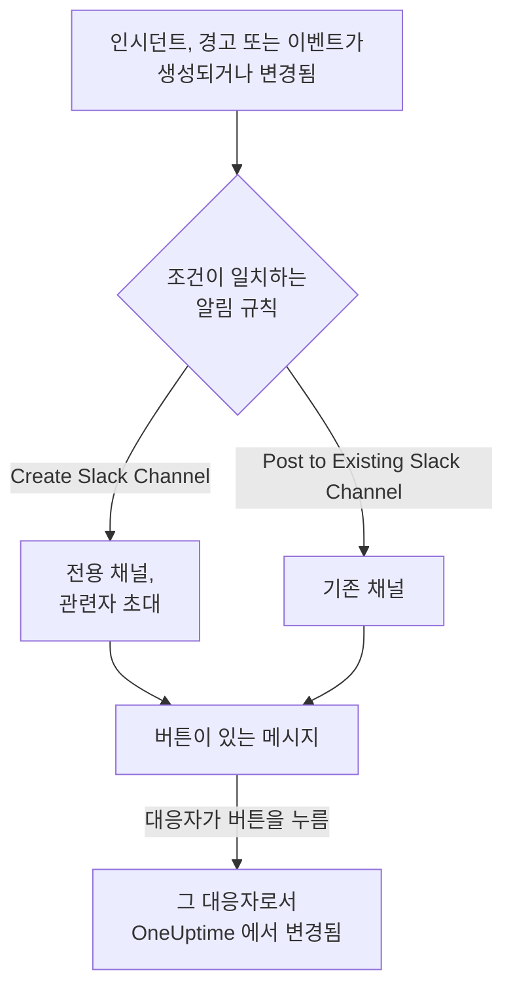

# Slack

OneUptime 을 Slack 에 연결하면 인시던트, 경고, 에피소드, 예정된 유지 관리, 모니터, 온콜 업데이트를 채널에 게시하고, 인시던트마다 전용 채널을 두고, 대응자가 Slack 을 떠나지 않고 조치하게 할 수 있습니다. 인지, 해결, 메모 추가, 온콜 호출, 인시던트 선언을 할 수 있습니다.

:::cards
- [Slack 연결하기](#slack-연결하기): 워크스페이스에 OneUptime 을 설치한 다음 자신의 계정을 연결합니다.
- [알림 규칙](#알림-규칙): 어떤 이벤트를 어디에 게시하고, 어떤 이벤트에 전용 채널을 줄지 정합니다.
- [Slack 에서 인시던트와 유지 관리 만들기](#slack-에서-인시던트와-유지-관리-만들기): `/incident` 와 `/maintenance` 를 본인으로서 사용합니다.
- [Slack 에서 인시던트, 경고, 이벤트 조치하기](#slack-에서-인시던트-경고-이벤트-조치하기): OneUptime 메시지의 버튼입니다.
:::

## 작동 방식

두 가지 연결로 이것이 작동합니다.

- **프로젝트의 연결** 은 한 번만 합니다. Slack 워크스페이스에 설치된 OneUptime 앱입니다. 이 앱이 메시지를 게시하고, 채널을 만들고, 사람들을 초대합니다.
- **각 사람의 연결** 은 그 사람의 Slack 계정을 OneUptime 계정에 연결한 것입니다. 버튼, 명령, 이모지 반응은 그 사람으로서, 프로젝트에서의 그 사람의 권한으로 작동합니다.

## 시작하기 전에

- **프로젝트를 연결할 수 있는 역할:** **Project Owner**, **Project Admin** 또는 **Project Member**. 앱을 제거하려면 **Project Owner** 또는 **Project Admin** 이 필요합니다.
- 앱을 설치할 수 있는 **Slack 워크스페이스**.
- 알림 규칙과 요약에 필요한 **OneUptime Cloud 의 Growth 플랜**. [Growth 플랜 미만의 알림 규칙](#growth-플랜-미만의-알림-규칙) 을 참조하세요.
- **자체 호스팅 서버에서는** 먼저 그 서버용으로 설정한 Slack 앱. [Slack 통합](/docs/self-hosted/slack-integration) 을 참조하세요.

## Slack 연결하기

:::steps
### Slack 워크스페이스에 OneUptime 설치하기

**프로젝트 설정** > **워크스페이스** > **Slack** 으로 이동해 **Connect with Slack** 을 클릭합니다. 워크스페이스를 선택하고 OneUptime 을 허용합니다. Slack 이 같은 페이지로 돌려보내며, 이제 이 페이지에 프로젝트가 연결된 워크스페이스 이름이 표시됩니다. 워크스페이스가 연결되기 전까지는 인시던트, 경고, 예정된 유지 관리, 모니터, 온콜 메뉴의 **워크스페이스** 섹션에 **Slack 또는 Teams 연결** 가 있으며, 이것도 여기로 연결됩니다.

### 자신의 Slack 계정 연결하기

앱을 설치하면 설치한 사람의 계정이 연결됩니다. 다른 모든 사람은 **사용자 설정** > **워크스페이스** > **Slack** 에서 **Connect my account with Slack** 으로 자신의 Slack 계정을 연결해, 본인으로서 인시던트를 조치하고 다이렉트 메시지를 받습니다. 이 섹션은 프로젝트가 Slack 에 연결되면 나타납니다.

### 알림 규칙 추가하기

**인시던트** > **워크스페이스** > **Slack** 으로 이동합니다. **워크스페이스** 섹션에는 프로젝트가 연결한 채팅 워크스페이스만 표시되므로, **Slack** 은 연결된 뒤에 나타납니다. 규칙을 만듭니다. 예를 들어 새 인시던트마다 Slack 채널을 만들고 인시던트 소유자를 초대하는 규칙입니다. [알림 규칙](#알림-규칙) 을 참조하세요.

### 규칙 테스트하기

규칙 행에서 **테스트 규칙** 을 클릭합니다. 규칙이 지정한 채널에 테스트 메시지가 도착합니다. [규칙 테스트](#규칙-테스트) 를 참조하세요.
:::

## 알림 규칙

알림 규칙은 어떤 이벤트를 Slack 의 어디에 게시할지 정합니다. 각 제품에는 자체 규칙이 있으며, 메뉴의 **워크스페이스** > **Slack** 에 있습니다.

| 제품 | **Slack** 페이지의 탭 |
| --- | --- |
| **인시던트** | **인시던트**, **인시던트 에피소드**, **Summary** |
| **알림** | **알림**, **경고 에피소드**, **Summary** |
| **예정된 유지 관리** | 규칙 목록 하나 |
| **모니터** | 규칙 목록 하나 |
| **온콜 듀티** | 규칙 목록 하나 |

규칙 만들기는 네 단계로 진행됩니다.

| 단계 | 설정하는 내용 |
| --- | --- |
| **기본** | **규칙 이름** 과 **규칙 설명**. |
| **조건** | 규칙이 실행되는 이벤트. 예를 들어 심각도, 상태, 레이블, 모니터, 제목의 단어로 정합니다. 조건이 없으면 모든 이벤트에서 실행됩니다. 조건이 둘 이상이면 **일치 조건** 으로 모두 일치해야 하는지, 하나만 일치하면 되는지 정합니다. |
| **대상** | 게시할 곳. 채널 이름을 지정하는 **Post to Existing Slack Channel**, 새 채널 이름과 초대할 사람을 지정하는 **Create Slack Channel**, 또는 둘 다입니다. |
| **Video Call** | 인시던트와 경고만 해당. 각각에 대해 통화를 시작합니다. [화상 통화](/docs/workspace-connections/video-calls) 를 참조하세요. |

규칙이 만드는 채널의 이름은 **New Slack Channel Name** 뒤에 레코드 번호를 붙인 것입니다 (예: `oneuptime-incident-42`). 규칙이 초대하는 사람을 받는 것은 생성된 채널뿐입니다. 레코드의 소유자, 선택한 팀과 사용자, 그리고 인시던트와 경고의 경우 호출되는 대로 온콜 담당자가 초대됩니다. 비공개 인시던트, 경고, 에피소드에는 비공개 채널이 만들어집니다. 이후 레코드의 모든 업데이트 (상태 변경, 메모, 새 소유자) 는 레코드의 채널과 규칙이 지정한 기존 채널에 게시됩니다. 이미 해결된 상태로 생성된 인시던트, 경고, 에피소드에는 전용 채널이 만들어지지 않지만, 생성 메시지는 여전히 규칙이 지정한 채널로 갑니다. [이미 인지되었거나 해결된 상태로 선언된 인시던트](/docs/incidents/declaring-incidents#이미-인지되었거나-해결된-상태로-선언된-인시던트) 를 참조하세요.

**프로젝트 설정** > **워크스페이스** > **Slack** 에는 OneUptime 이 볼 수 있는 채널이 표시되고, 각 채널 옆에 **테스트 보내기** 가 있습니다. OneUptime 은 공개 채널에 처음 게시할 때 스스로 참여합니다. 비공개 채널은 Slack 에서 OneUptime 앱을 초대한 뒤에만 목록에 표시되고 게시할 수 있습니다.

## 규칙 테스트

규칙 행의 **테스트 규칙** 은 그 규칙의 테스트 메시지를 규칙이 지정한 채널에 게시해, 도착하는 것을 확인할 수 있게 합니다. 이벤트마다 채널을 만드는 규칙이라면 테스트도 채널을 하나 만들고 규칙의 대상자를 초대합니다.

**프로젝트 설정** > **워크스페이스** > **Slack** 의 채널 옆에 있는 **테스트 보내기** 와 마찬가지로, 알림 규칙을 만들 권한이 필요합니다. **Project Owner**, **Project Admin**, **Project Member**, **Settings Admin**, **Settings Member**, 또는 사용자 지정 역할의 **Create Workspace Notification Rule** 과 **Read Workspace Notification Rule** 입니다. 규칙을 보기만 할 수 있는 사람 (예: **Viewer** ) 에게는 **테스트 규칙** 이 잠기며, 툴팁에 필요한 것이 표시됩니다. API 는 그 사람의 테스트를 "You do not have permission to send test notifications in this project." 로 거부합니다. OneUptime Cloud 에서는 규칙을 추가할 때와 마찬가지로 규칙 테스트에도 **Growth** 플랜이 필요합니다.

OneUptime Cloud 에서는 채널 옆의 **테스트 보내기** 에도 **Growth** 플랜이 필요합니다. 채널에 게시하는 것은 규칙과 요약이 하는 일이기 때문입니다. 요약의 **지금 테스트 보내기** 에는 요약을 만들 권한 (사용자 지정 역할의 **Create Workspace Notification Summary** 와 **Read Workspace Notification Summary** ) 과, OneUptime Cloud 에서는 **Growth** 플랜이 필요합니다. 그 밖의 사람에게는 잠기며, 툴팁에 필요한 것이 표시됩니다. 읽기 전용으로 연결된 MCP 클라이언트는 어떤 테스트도 보낼 수 없습니다.

## 요약

**인시던트** > **워크스페이스** > **Slack** (및 **알림** ) 의 **Summary** 탭은 지정한 채널에 정기 요약을 게시합니다. 인시던트나 경고가 몇 건이었는지, 얼마나 빨리 인지되고 해결되었는지, 그리고 링크가 포함된 목록입니다. 새 요약은 매주 발송되며 최근 7일을 다룹니다. **첫 보고서 전송 시각** 을 비워 두면 첫 요약은 다음 주, 일, 월의 시작 09:00 에 발송되며, 언제인지는 양식에 표시됩니다.

요약은 **시간대** 의 시계에 맞춰 발송되며, 시간대의 초기값은 사용자의 시간대입니다. 요약은 그 시간대에서 일 년 내내 같은 시각을 유지합니다. 베를린 09:00 으로 설정한 요약은 일광 절약 시간으로 시계가 바뀐 뒤에도 베를린 시간 09:00 에 발송되며, 메시지의 날짜도 베를린 기준입니다. API 에서는 `timezone` 을 `Europe/Berlin` 같은 IANA 시간대 이름으로 보냅니다. 시간대 없이 만든 요약은 만든 사람의 프로필 시간대를 사용하고, API 키로 만든 경우에는 UTC 를 사용합니다.

요약 양식은 네 단계입니다. **기본 정보** (이름과 채널), **일정**, **콘텐츠** ( **포함할 항목** ), **필터** (집계할 인시던트나 경고) 입니다.

## Growth 플랜 미만의 알림 규칙

OneUptime Cloud 에서 알림 규칙과 요약은 **Growth** 플랜 이상에서 사용할 수 있습니다. 그보다 낮은 플랜의 프로젝트는 이미 있는 규칙과 요약을 유지하며, 이들은 계속 Slack 에 게시합니다. 그래서 각 제품 (인시던트, 경고, 예정된 유지 관리, 온콜, 모니터) 의 **Slack** 페이지에는 플랜 안내와 그 아래의 목록 ( **아직 설정되어 있는 알림 규칙**, **아직 설정되어 있는 요약** ) 이 표시됩니다. 규칙을 삭제하거나, 요약을 끄거나 삭제하세요. 규칙과 요약을 추가하거나 변경하려면 **Growth** 가 필요합니다.

## Slack 에서 호출 받기

온콜 중에 다이렉트 메시지로 호출을 받으려면 Slack 을 알림 방법 중 하나로 추가합니다.

:::steps
1. 자신의 Slack 계정을 연결합니다 ( [Slack 연결하기](#slack-연결하기) 참조).
2. **사용자 설정** > **알림 방법** 로 이동해 **Workspace Apps** 탭을 열고 **Add Slack Account** 를 클릭합니다.
3. 해당 행에서 **Send Test Message** 를 클릭합니다. Slack 다이렉트 메시지로 메시지가 도착합니다.
:::

추가하면 바로 온콜 규칙에 포함되므로, 그때부터 호출이 Slack 으로 옵니다. 어떤 호출을 받을지는 **사용자 설정** > **온콜 규칙** 에서 변경합니다.

## 메시지를 메모로 저장하기

인시던트, 경고, 에피소드, 예정된 유지 관리 이벤트의 채널에서 메시지에 반응하면, OneUptime 이 그 메시지를 해당 레코드의 메모로 저장하고 스레드에 답글로 알려 줍니다.

| 반응 | 저장 형식 |
| --- | --- |
| 📌 핀 이모지 또는 Slack 자체의 **Pin to channel** | 팀만 볼 수 있는 비공개 메모 |
| 📢 메가폰 또는 확성기 이모지 | 상태 페이지에 표시되는 공개 메모. 인시던트와 예정된 유지 관리 이벤트만 해당합니다. |

메모는 본인으로서, 본인의 권한으로 저장되므로 자신의 Slack 계정이 연결되어 있어야 합니다. 몇 명이 반응하든 메시지는 한 번만 저장됩니다.

## Slack 에서 OneUptime AI 에게 질문하기

로그, 트레이스, 메트릭, 인시던트, 모니터에 대해 일상적인 말로 질문하세요. 채널에서 OneUptime 을 @멘션하거나 다이렉트 메시지를 보내면 스레드에서 답변하며, 더 질문하려면 그 스레드에 답글을 답니다. `/oneuptime ask which monitors are down?` 은 답변을 채널에 게시합니다. 두 방법 모두 자신의 Slack 계정이 연결되어 있고 프로젝트에서 AI 가 켜져 있어야 합니다. Slack 의 답변은 읽기만 합니다. 무언가를 변경하려면 버튼을 사용하세요. [AI에게 질문](/docs/ai/ask-ai) 을 참조하세요.

## Slack 에서 인시던트와 유지 관리 만들기

`/incident` 와 `/maintenance` 는 본인이 작성해 본인으로서 제출하는 양식을 엽니다. 자신의 Slack 계정이 연결된 OneUptime 계정 ( [Slack 연결하기](#slack-연결하기) 참조) 으로서, 그 계정의 프로젝트 권한으로 제출됩니다. Slack 계정이 연결되어 있지 않거나 OneUptime 계정이 더 이상 프로젝트의 멤버가 아니면, OneUptime 이 다이렉트 메시지로 무엇을 해야 하는지 알려 주며 양식은 열리지 않습니다. **Create New Incident** 와 **Create Scheduled Event** 바로 가기도 같은 양식을 엽니다.

- **사용할 수 있는 사람.** OneUptime 에서 인시던트를 선언하거나 예정된 유지 관리 이벤트를 만들 수 있는 사람입니다. 인시던트에는 **Project Owner**, **Project Admin**, **Project Member**, **Incident Admin**, **Incident Member** (사용자 지정 역할에서는 **Create Incident** ), 이벤트에는 **Scheduled Maintenance Admin** 과 **Scheduled Maintenance Member** ( **Create Scheduled Maintenance** ) 입니다. 그 밖의 사람에게는 다이렉트 메시지로 그렇게 알리며 양식은 열리지 않습니다.
- **양식이 제공하는 것.** 각 목록 (심각도, 모니터, 모니터 상태, 온콜 정책, 레이블) 에는 OneUptime 의 같은 목록과 마찬가지로 본인이 읽을 수 있는 것이 들어 있습니다. 일부 레이블로 제한된 역할이라면 그 레이블이 붙은 모니터와 온콜 정책입니다. 전혀 읽을 수 없는 목록은 양식에서 빠집니다. 보관된 온콜 정책은 제공되지 않습니다.
- **양식이 지정할 수 있는 것.** 인시던트나 이벤트는 본인의 권한으로 만들어지고 본인의 작업으로 기록됩니다. 읽을 수 없는 모니터, 온콜 정책, 레이블, 심각도, 상태, 또는 다른 프로젝트의 것은, 접근 권한이 바뀌기 전에 연 양식에서라도 프로젝트에 없는 것처럼 거부되며 아무것도 만들어지지 않습니다. OneUptime 이 다이렉트 메시지로 그 이유를 알려 줍니다.

인시던트, 경고, 에피소드의 **Execute On-Call Policy** 도 같은 방식으로 작동합니다. 온콜 정책을 실행할 권한 ( **Project Owner**, **Project Admin**, **Project Member**, **On-Call Admin**, **On-Call Member**, 또는 사용자 지정 역할의 **Create On-Call Duty Policy Execution Log** ) 과 해당 인시던트, 경고, 에피소드를 읽을 권한이 필요하며, 본인이 읽을 수 있는 활성 온콜 정책이 제공됩니다.

## Slack 에서 인시던트, 경고, 이벤트 조치하기

OneUptime 의 Slack 메시지에 있는 버튼도 본인으로서 작동합니다. 자신의 Slack 계정이 연결된 OneUptime 계정으로서, 그 계정의 프로젝트 권한으로 작동합니다. 인시던트, 경고, 에피소드의 **Acknowledge**, **Resolve**, **Change State**, **Add Note**, **Execute On-Call Policy**, 그리고 예정된 유지 관리 이벤트의 **Mark as Ongoing**, **Mark as Complete**, **Change State**, **Add Note** 는 각각 OneUptime 에서 같은 동작이 하는 것과 같은 변경을 하며, 그 변경은 OneUptime 에서 본인의 작업으로 기록됩니다. 레코드의 상태 타임라인과 피드에 본인이 상태를 변경했다고 표시되고, 메모도 본인의 것이 됩니다. 이모지 반응으로 메시지에서 저장한 메모도 같은 방식으로 게시됩니다.

- **사용할 수 있는 사람.** OneUptime 에서 같은 변경을 할 수 있는 사람입니다. 인시던트를 인지, 해결하거나 상태를 변경하려면 그 상태를 변경할 권한이 필요합니다. **Project Owner**, **Project Admin**, **Project Member**, **Incident Admin**, **Incident Member**, 또는 사용자 지정 역할의 **Create Incident State Timeline** 입니다. 경고, 에피소드, 예정된 유지 관리 이벤트에는 각 종류에 맞는 같은 권한 (예: **Create Alert State Timeline** ) 이 필요하고, 메모에는 그 종류의 메모를 게시할 권한이 필요합니다. 그 밖의 사람에게는 다이렉트 메시지로 그렇게 알리며 아무것도 바뀌지 않습니다.
- **대상 레코드.** OneUptime 에서와 마찬가지로 본인이 읽을 수 있는 레코드입니다. 일부 레이블로 제한된 역할이라면 그 레이블이 붙은 인시던트, 경고, 에피소드, 이벤트입니다. 다른 레코드나 다른 프로젝트의 레코드에 있는 버튼에는 해당 레코드가 "was not found in this project, or you do not have access to it." 라는 응답이 오며 아무것도 바뀌지 않습니다. OneUptime Cloud 에서는 프로젝트의 플랜에 포함되지 않은 변경은 필요한 플랜과 함께 거부됩니다.
- **Change State 가 제공하는 것.** 본인이 읽을 수 있는 상태 중 레코드가 다음으로 옮겨 갈 수 있는 상태를 프로젝트의 순서대로 제공합니다. 현재 상태보다 앞선 상태는 없습니다. 이는 인시던트, 경고, 예정된 유지 관리 이벤트와 마찬가지로 에피소드에도 적용되는데, 상태 변경으로 레코드가 목록의 위쪽으로 되돌아가는 일은 없기 때문입니다 ( [순서는 표시 취향이 아니라 실제 제약입니다](/docs/incidents/states-and-severities#순서는-표시-취향이-아니라-실제-제약입니다) 참조). 읽을 수 있는 상태가 하나도 없으면 "No incident states are available to you in this project. Ask a project admin for access to them." 라고 알리고, 레코드가 도달할 수 있는 마지막 상태에 있으면 "There is no later state to move this incident to." 라고 알립니다. 어느 경우에도 빈 양식은 열리지 않습니다.

## 연결 해제

- **Disconnect** 는 자신의 Slack 계정 연결만 해제하며, 함께 자신의 Slack 알림 방법을 제거합니다.
- **프로젝트 설정** > **워크스페이스** > **Slack** 의 **Uninstall OneUptime from Slack** 은 프로젝트의 연결을 해제합니다. OneUptime 은 Slack 에 게시를 멈추고, **워크스페이스** 메뉴에도 더 이상 표시되지 않습니다. 알림 규칙과 요약은 다시 연결할 때를 위해 유지됩니다.

> [!WARNING]
> 제거하면 프로젝트의 모든 멤버의 Slack 계정 연결도 해제되고, Slack 알림 방법과 그것을 사용하던 온콜 규칙도 제거됩니다. Slack 으로 호출을 받던 사람은 Slack 을 다시 추가할 때까지 다른 알림 방법으로 호출을 받습니다.

## 문제 해결

:::details 규칙이 아무것도 게시하지 않음
**테스트 규칙** 로 규칙의 조건을 확인하세요. 테스트가 도착하면 규칙의 조건이 이벤트와 일치하지 않은 것입니다. 도착하지 않으면 Slack 페이지에 이유가 표시됩니다. 비공개 채널의 경우 먼저 Slack 에서 OneUptime 앱을 그 채널에 초대하세요. OneUptime 이 게시한 모든 메시지와 Slack 이 거부한 모든 메시지는 **프로젝트 설정** > **알림** > **알림 로그** 의 **워크스페이스** 탭에 표시됩니다.
:::

:::details Slack 이 연결되지 않음
Slack 이 연결 없이 돌려보내면, 시작한 페이지에 **Slack이 연결되지 않았습니다** 가 표시되고 한 문장으로 이유를 알려 줍니다. 권한이 없거나, 링크가 이미 사용되었거나 만료되었거나, 다른 워크스페이스에 로그인했거나, 서버가 Slack 용으로 설정되지 않은 경우입니다. 각 문장과 대처 방법은 [연결이 완료되지 않음](/docs/self-hosted/slack-integration#연결이-완료되지-않음) 을 참조하세요.
:::

:::details 버튼이나 명령에서 Slack 계정이 연결되지 않았다고 표시됨
**사용자 설정** > **워크스페이스** > **Slack** 에서 **Connect my account with Slack** 으로 연결하세요. 더 이상 프로젝트의 멤버가 아니면 OneUptime 이 대신 그렇게 알리고, 본인을 위해 아무것도 조치하지 않습니다.
:::

:::details 알림은 도착하지만 버튼과 명령이 아무것도 하지 않음
자체 호스팅 서버에서는 버튼, 양식, 명령을 위해 Slack 이 OneUptime 에 접근할 수 있어야 합니다. 알림에는 아웃바운드 접근만 필요합니다. [자체 호스팅 배포의 네트워크 접근](/docs/self-hosted/slack-integration#자체-호스팅-배포의-네트워크-접근) 을 참조하세요.
:::

## 다음 단계

:::cards
- [Microsoft Teams](/docs/workspace-connections/microsoft-teams): Microsoft Teams 에서의 같은 알림과 조치.
- [화상 통화](/docs/workspace-connections/video-calls): 모든 인시던트에 통화를 주고, 업데이트와 함께 게시합니다.
- [Slack 통합](/docs/self-hosted/slack-integration): 자체 호스팅 서버에서 Slack 앱을 설정합니다.
- [인시던트 선언](/docs/incidents/declaring-incidents): 인시던트가 시작되는 모든 방법과, 그때 실행되는 것.
:::
