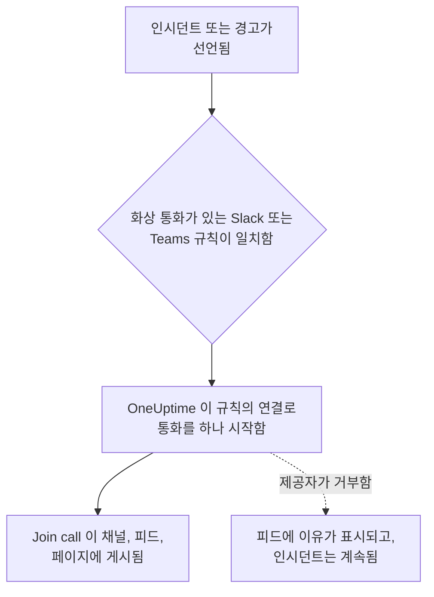

# 화상 통화

모든 인시던트와 경고에 전용 통화를 줍니다. 새 인시던트나 경고에 대해 Slack 또는 Microsoft Teams 알림 규칙이 실행되면, OneUptime 은 전용 회의 (Zoom 회의, Google Meet, Microsoft Teams 회의, 또는 인시던트 Slack 채널의 허들) 를 시작하고 인시던트의 업데이트가 가는 모든 곳에 **Join call** 버튼을 게시합니다. 대응자는 한 번의 클릭으로 참여하며, 새벽 3시에 누군가 회의를 만들어 링크를 돌릴 필요가 없습니다.

:::cards
- [작동 방식](#작동-방식): 규칙이 통화를 시작하고, 대응자는 어디서든 참여합니다.
- [한 번의 클릭으로 연결하기](#한-번의-클릭으로-연결하기): Zoom, Google Meet, Microsoft Teams 에 로그인만으로 연결합니다.
- [제공자](#제공자): 자체 앱의 서비스 ID, 고정 회의 링크, 또는 Slack 허들.
- [수동으로 통화 시작하기](#수동으로-통화-시작하기): 인시던트나 경고의 페이지에서 시작합니다.
- [통화 녹취록](#통화-녹취록): 인시던트 통화에서 오간 말과, OneUptime AI 가 그 안에서 읽어 내는 근본 원인.
:::

## 작동 방식



:::steps
### 제공자 연결하기

**프로젝트 설정** > **워크스페이스** > **Video Calls** 로 이동해 Zoom, Google Meet, Microsoft Teams 중 하나를 연결하거나 고정 회의 링크를 추가합니다. OneUptime Cloud 에서는 Zoom, Google Meet, Microsoft Teams 연결이 한 번의 클릭입니다. 로그인하고 OneUptime 이 회의를 만들도록 허용합니다 ( [한 번의 클릭으로 연결하기](#한-번의-클릭으로-연결하기) 참조). Slack 허들에는 프로젝트의 Slack 연결 외에 아무것도 필요하지 않습니다.

### 규칙에서 켜기

인시던트나 경고에 대한 Slack 또는 Microsoft Teams 알림 규칙을 엽니다 (예: **인시던트** > **워크스페이스** > **Slack** ). 규칙의 **Video Call** 단계에서 **Start a video call for the incident** 를 켜고 통화를 진행할 곳을 선택합니다.

### 한 번의 클릭으로 참여하기

규칙이 실행되면 OneUptime 이 인시던트에 대한 통화를 하나 시작하고, 인시던트의 업데이트가 가는 채널과 인시던트의 피드에 **Join call** 버튼과 함께 게시합니다. 인시던트 페이지에는 **Video Call** 카드에 통화가, 헤더에 **통화 참가** 버튼이 표시됩니다.
:::

어떤 인시던트가 통화를 받을지는 규칙의 조건이 정합니다. Sev1 인시던트에만 브리지를 열려면 규칙에 **심각도** 조건을 줍니다. 통화는 진행 중으로 선언된 인시던트와 경고에 대해 시작됩니다. 이미 해결된 상태로 생성된 인시던트는 통화를 받지 않습니다.

### 인시던트당 통화 하나

통화는 통화가 진행되는 장소마다 인시던트당 한 번만 시작됩니다. 같은 연결을 고른 규칙은 통화 하나를 공유하며, 규칙은 그 연결의 통화가 이미 있는 인시던트에 두 번째 통화를 시작하지 않습니다. 서로 다른 장소를 고른 규칙은 각자 통화를 시작합니다. 예를 들어 대응자를 위한 Zoom 회의와 인시던트 Slack 채널의 허들입니다.

### 통화를 시작할 수 없을 때

인시던트 선언은 화상 통화 제공자를 기다리지 않습니다. 통화는 인시던트가 생성된 뒤에 시작되므로, 제공자가 느리거나 실패해도 인시던트나 온콜 호출이 늦어지지 않습니다.

제공자가 거부하면 (만료된 시크릿, 누락된 권한, 삭제된 호스트 등) 인시던트의 피드에 규칙의 통화를 시작할 수 없었다는 내용이 제공자의 이유와 함께 표시되므로, 대응자는 인시던트 페이지에서 통화를 시작하면 된다는 것을 알 수 있습니다. 규칙의 실행은 워크스페이스 알림 로그에 **화상 통화 시작** 로 기록되며, **프로젝트 설정** > **워크스페이스** > **Video Calls** 의 연결 행에는 통화가 다시 시작될 때까지 오류가 표시됩니다.

### 비공개 인시던트

회의 이름은 대상 인시던트의 번호와 제목으로 정해지며, 회의 설명에는 인시던트로 돌아가는 링크가 들어갑니다. 비공개 인시던트의 경우, 회의에 초대된 모든 사람이 회의 이름을 볼 수 있으므로 제목은 빠집니다.

## 한 번의 클릭으로 연결하기

OneUptime Cloud 에서는 Zoom, Google Meet, Microsoft Teams 연결이 한 번의 클릭으로 끝나며, 제공자 쪽에서 설정할 것이 없습니다.

:::steps
1. **프로젝트 설정** > **워크스페이스** > **Video Calls** 로 이동해 Zoom, Google Meet, Microsoft Teams 중 하나에서 **연결** 를 클릭합니다.
2. **Continue to Zoom** (또는 Google, Microsoft) 을 클릭해 로그인하고, OneUptime 이 회의를 만들도록 허용합니다.
3. 연결이 완료된 상태로 화상 통화 페이지로 돌아옵니다. **Start a test meeting** 으로 처음부터 끝까지 확인한 다음, Slack 또는 Microsoft Teams 알림 규칙에서 그 연결을 선택합니다.
:::

모든 회의는 로그인한 계정으로 만들어지며, 그 계정이 호스트가 됩니다. 사람이 퇴사해도 통화가 계속 시작되도록, 본인 계정 대신 incidents@example.com 같은 공유 계정으로 로그인하세요. 연결 행에는 어떤 계정으로 로그인했는지 표시됩니다.

| 제공자 | 로그인에 사용할 계정 | OneUptime 이 할 수 있는 일 |
| --- | --- | --- |
| Zoom | Zoom 사용자. Basic (무료) 사용자가 호스트인 회의는 40분 후 종료됩니다. | 그 사용자의 회의 만들기 (`meeting:write:meeting`) 와 사용자가 누구인지 읽기 (`user:read:user`). [통화 녹취록](#통화-녹취록) 을 위해 그 사용자 회의의 클라우드 녹화 녹취록 읽기 (`cloud_recording:read:list_recording_files`, `cloud_recording:read:meeting_transcript`). |
| Google Meet | Google Meet 을 사용할 수 있는 Google 계정. | 그 계정으로 Meet 공간 만들기 (`meetings.space.created`) 와 이메일 주소 읽기. |
| Microsoft Teams | Microsoft Teams 를 쓰는 회사 또는 학교 계정. 개인 Microsoft 계정으로는 Teams 회의를 만들 수 없습니다. | 그 계정으로 온라인 회의 만들기 (위임된 권한 `OnlineMeetings.ReadWrite`) 와 로그인 상태 유지 (`offline_access`). [인시던트 통화 녹화와 녹취](#모든-통화를-녹화하고-녹취하기) 를 위해 그 계정의 캘린더에 회의 넣기 (`Calendars.ReadWrite`) 와 회의 녹취록 읽기 (`OnlineMeetingTranscript.Read.All`, 관리자가 승인). |

로그인으로 만든 연결에도 누가 기다릴지 정하는 설정이 있습니다. Google Meet 은 **Who can join**, Microsoft Teams 는 **Who skips the lobby** 입니다. 연결 행의 **편집** 로 변경합니다.

OneUptime 이 통화 녹취록을 읽기 전에 로그인한 Zoom 연결은 전처럼 통화를 시작하지만, 다시 로그인할 때까지 녹취록은 읽을 수 없습니다. 행의 **Reconnect** 가 Zoom 에 녹취록 권한을 요청합니다.

**인시던트 통화 녹화 및 녹취** 가 꺼져 있을 때 로그인한 Microsoft Teams 연결은 전처럼 통화를 시작하지만 녹화하지는 않습니다. 이 설정을 켜면 행의 **Reconnect** 가 Microsoft 에 캘린더와 녹취록 권한도 요청합니다.

### 로그인 상태 유지

OneUptime 은 로그인의 새로 고침 토큰을 암호화해 보관하고 최소 일주일에 한 번 갱신하므로, 프로젝트에 인시던트가 아무리 오래 없어도 사용하지 않아서 만료되는 일은 없습니다. 로그인이 작동하지 않게 되면 (계정이 OneUptime 을 제거했거나, 삭제 또는 정지되었거나, 조직의 정책이 다시 로그인을 요구하는 경우), 연결 행에 다음 인시던트 때가 아니라 OneUptime 이 알아챈 그날 이유와 함께 **작동 안 함** 이 표시됩니다. 행의 **Reconnect** 로 다시 로그인합니다.

같은 계정으로 로그인한 연결은 모든 프로젝트에서 로그인 하나를 공유합니다. Zoom 은 계정당 로그인을 하나만 보관하므로, 같은 Zoom 사용자를 다시 연결하면 그 모든 연결의 로그인이 대체됩니다.

### 다시 연결하기와 제거하기

연결 행의 **Reconnect** 는 같은 계정이나 다른 계정으로 다시 로그인합니다. 계정이 OneUptime 을 제거한 뒤나, 인시던트 회의를 다른 계정으로 옮길 때 사용합니다.

연결을 삭제하면, 그 로그인을 사용하는 다른 연결이 없어지는 즉시 Zoom 과 Google 에서 OneUptime 의 접근 권한이 철회됩니다. Microsoft 의 경우 계정의 **My Apps** (myapps.microsoft.com) 에서 OneUptime 을 제거합니다. Zoom App Marketplace 에서 Zoom 계정의 OneUptime 을 제거하면 그 계정으로 로그인한 모든 연결에서 로그인이 삭제되며, 다시 연결할 때까지 그 연결에는 **작동 안 함** 이 표시됩니다.

### Microsoft 가 관리자를 요구하는 경우

일부 Microsoft 365 조직은 관리자만 앱을 승인할 수 있습니다. Microsoft 가 관리자 승인이 필요하다고 하면, Microsoft 365 관리자에게 Microsoft Teams 를 연결하거나 [Microsoft Entra 관리 센터](https://entra.microsoft.com/) 의 **Enterprise applications** > **Admin consent requests** 에서 OneUptime 을 승인해 달라고 요청하세요. Teams 통화를 녹화하는 프로젝트에는 모든 조직에서 이 승인이 한 번 필요합니다. 앱이 회의 녹취록을 읽도록 허용할 수 있는 사람은 관리자뿐이기 때문입니다.

### 대신 자체 앱 사용하기

사람의 로그인 대신 서비스 ID 로 연결하려면 (Zoom 의 Server-to-Server OAuth 앱, 도메인 전체 위임이 있는 Google 서비스 계정, Microsoft Entra 앱 등록), 연결 대화 상자에서 **Use your own Zoom app** (또는 Google, Microsoft) 을 클릭합니다. 각각은 [제공자](#제공자) 에서 설명합니다. 한 번의 클릭용 앱을 설정하지 않은 자체 호스팅 서버에서는 **연결** 가 바로 이 양식을 엽니다. 설정 방법은 [자체 호스팅 서버에서 한 번의 클릭으로 연결하기](#자체-호스팅-서버에서-한-번의-클릭으로-연결하기) 를 참조하세요.

## 수동으로 통화 시작하기

인시던트나 경고 페이지의 **Video Call** 카드에는 **Start call** (통화가 이미 있으면 **Start another** ) 이 있습니다. 프로젝트의 연결 중 하나나 인시던트 Slack 채널의 허들을 선택하거나, 직접 회의 링크를 붙여 넣습니다. 통화는 규칙이 시작한 통화처럼 인시던트의 채널과 피드에 게시됩니다.

카드의 **제거** 는 인시던트 페이지에서 통화를 뺍니다. 회의 자체는 삭제되지 않으며, 링크가 있는 사람은 여전히 참여할 수 있습니다.

통화를 시작하고 제거하려면 인시던트 (또는 경고) 를 다룰 권한이 필요합니다. **프로젝트 소유자**, **프로젝트 관리자**, **프로젝트 구성원**, **인시던트 관리자**, **인시던트 구성원**, 또는 사용자 지정 역할의 **Create Incident Video Call** 과 **Delete Incident Video Call** 입니다. 인시던트를 읽을 수 있는 모든 사람이 그 통화를 볼 수 있습니다.

## 통화 녹취록

대응자가 통화에서 하는 말, 즉 무엇을 확인했고 무엇을 의심하며 무엇을 결정했는지는 인시던트를 어떻게 처리했는지에 대한 가장 좋은 기록이지만, 통화가 끝나면 사라집니다. 인시던트의 통화는 녹취록을 보관하고, OneUptime AI 는 그것을 읽어 통화가 가리키는 근본 원인을 찾습니다. 읽은 내용은 대응자가 사용하기 전까지 인시던트에 반영되지 않습니다.

:::steps
### 통화 후에 녹취록 가져오기

인시던트의 **Video Call** 카드에서 **Zoom에서 가져오기**, **Google Meet에서 가져오기** 또는 **Microsoft Teams에서 가져오기** 가 OneUptime 이 그곳에서 시작한 회의의 녹취록을 읽습니다 (Microsoft Teams 의 경우, 모든 통화를 녹화하고 녹취하는 동안 시작한 회의). 다른 통화에서는 **녹취록 추가** 가 회의 도구가 저장한 파일 (`.vtt`, `.srt` 또는 `.txt`, 최대 5 MB) 이나 붙여 넣은 녹취록을 받습니다. [모든 통화를 녹화하고 녹취하도록](#모든-통화를-녹화하고-녹취하기) 해 두면, 통화가 끝난 뒤 OneUptime 이 녹취록을 직접 가져옵니다.

### OneUptime AI 가 읽기

1~2분 안에 인시던트의 **OneUptime AI** 카드에 **제안된 근본 원인** 가 **확인되지 않음** 표시와 함께 나타나고, 근거가 된 녹취록 줄이 시각과 화자와 함께 인용됩니다. 그 아래에는 통화에서 나온 나머지 내용이 접힌 채로 있습니다. 발견 사항 ( **통화에서 확인됨** 목록과 **가설** 목록), 시도한 것, 결정, 후속 조치, 미해결 질문입니다. 읽은 내용은 인시던트의 피드에도 게시되고, 거기서 인시던트의 Slack 및 Microsoft Teams 채널로 전달됩니다.

### 사용하거나 기각하기

**근본 원인으로 사용** 는 제안을 인용과 함께 근본 원인 편집기에서 엽니다. 필요한 부분을 고치고 저장하면, 본인의 편집으로 인시던트의 근본 원인이 되고 피드에 기록됩니다. **닫기** 는 제안을 제쳐 두고, **실행 취소** 는 다시 되돌립니다.
:::

OneUptime AI 는 통화에서 원인이 언급된 경우에만, 그렇게 말한 줄과 함께 원인을 제안하고, 그 줄을 녹취록에 있는 그대로 인용합니다. 통화에서 원인이 정리되지 않았으면, 카드는 추측하는 대신 **근본 원인을 제안할 만큼 통화에서 충분히 논의되지 않았습니다** 라고 표시합니다.

### 모든 통화를 녹화하고 녹취하기

누구도 통화 녹화나 녹취록 가져오기를 기억할 필요가 없도록 **프로젝트 설정** > **워크스페이스** > **Video Calls** 에서 **인시던트 통화 녹화 및 녹취** 를 켭니다. 켜져 있는 동안에는 다음과 같이 동작합니다.

- OneUptime 은 자신이 시작하는 인시던트 회의마다 Zoom 에는 클라우드 녹화를, Google Meet 에는 녹취를, Microsoft Teams 에는 자동 녹화와 녹취를 요청합니다. 통화를 게시하는 메시지가 누군가 참여하기 전에 이 사실을 알립니다.
- 통화가 끝나면 OneUptime 이 **Zoom에서 가져오기** 처럼 녹취록을 직접 가져오고, OneUptime AI 가 그것을 읽습니다. 그때까지 **Video Call** 카드에는 기다리는 중이라고 표시됩니다.
- OneUptime AI 가 읽은 내용은 인시던트의 피드와 그 Slack 및 Microsoft Teams 채널로 갑니다. 확인되지 않았다고 표시된 제안 근본 원인, 이어서 확인된 것, 시도한 것, 결정된 것, 후속 조치, 미해결 질문입니다.
- 녹취록이 도착하기 전에 인시던트가 해결되면, 자동 포스트모템 초안은 통화에서 오간 말을 반영할 수 있도록 녹취록을 기다립니다. 제공자가 녹취록을 준비하는 동안은 최대 6시간, 아직 녹취록이 생길 기미가 없으면 1시간입니다.

이 설정은 사람을 녹화하므로 기본적으로 꺼져 있습니다. 해당 통화의 모든 참여자에게 녹화 또는 녹취 중이라는 사실이 표시되므로, 조직에서 이를 허용하는지 확인하세요. Zoom 은 계정이 오디오 녹취록을 켜고 클라우드에 녹화할 때만 녹취록을 보관하고, Google Meet 은 녹취록이 있는 Google Workspace 버전에서만 보관합니다. Slack 허들과 회의 링크는 녹화되지 않으며, 경고 통화도 녹화되지 않습니다. 이들의 녹취록은 직접 추가하세요.

Microsoft 는 캘린더에 있는 Teams 회의의 녹취록만 앱이 읽을 수 있게 하므로, OneUptime 은 인시던트 회의마다 주최자의 캘린더에 넣고 회의 옵션에서 자동 녹화와 녹취를 켭니다. 이를 위해 연결에는 Microsoft Graph 권한 두 가지, `Calendars.ReadWrite` 와 `OnlineMeetingTranscript.Read.All` 이 더 필요합니다. 앱 등록에 이 권한들을 추가하거나 ( [Microsoft Teams](#microsoft-teams) 참조), 로그인으로 만든 연결이라면 **Reconnect** 를 클릭하세요. 주최자의 Teams 회의 정책이 클라우드 녹화, 녹취, 자동 녹화를 허용해야 하며, 조직에서 앱의 녹취록 접근을 꺼 두지 않았어야 합니다. OneUptime 이 캘린더에 넣지 못한 통화도 녹화 없이 그대로 시작되며, 그 **Video Call** 카드에 이유가 표시됩니다.

### 각 제공자가 보관하는 것

| 통화 | 녹취록을 얻는 방법 | 필요한 것 |
| --- | --- | --- |
| Zoom | **Zoom에서 가져오기** | 오디오 녹취록을 켜고 클라우드에 녹화한 회의, 또는 AI Companion 의 회의 요약을 켠 회의. 연결에는 녹취록 스코프가 필요하며 ( [Zoom](#zoom) 참조), 그 이전에 로그인한 연결에는 **Reconnect** 가 필요합니다. Zoom 은 회의가 끝난 뒤 녹취록을 준비하며, 보통 회의 길이의 두 배 이내에 끝납니다. |
| Google Meet | **Google Meet에서 가져오기** | 통화에서 켠 녹취록 (녹취록이 있는 Google Workspace 버전). 그 밖에 설정할 것은 없습니다. OneUptime 은 자신이 만든 회의의 녹취록을 읽습니다. Google 은 앱이 읽을 수 있도록 녹취록을 30일 동안 보관합니다. |
| Microsoft Teams | **Microsoft Teams에서 가져오기** | [모든 통화를 녹화하고 녹취하는](#모든-통화를-녹화하고-녹취하기) 동안 OneUptime 이 시작한 회의. Microsoft 는 캘린더에 있는 회의의 녹취록만 앱이 읽을 수 있게 하며, 회의를 60일 동안 보관합니다. 그 밖의 Teams 회의에는 **녹취록 추가** 를 사용합니다. Teams 에서 회의 요약을 열고, 녹취록을 연 다음 `.vtt` 파일로 다운로드하세요. |
| 회의 링크 또는 Slack 허들 | **녹취록 추가** | 회의 도구나 허들 메모가 보관하는 녹취록. |

### 누가 무엇을 할 수 있는지

녹취록을 가져오기, 추가, 바꾸기, 제거, 다시 읽히기와 제안 기각에는 인시던트의 통화를 시작할 권한이 필요합니다. **프로젝트 소유자**, **프로젝트 관리자**, **프로젝트 구성원**, **인시던트 관리자**, **인시던트 구성원**, 또는 사용자 지정 역할의 **Create Incident Video Call** 입니다. **근본 원인으로 사용** 에는 인시던트의 근본 원인을 편집할 권한이 필요합니다. 인시던트를 읽을 수 있는 모든 사람이 그 통화의 녹취록과 OneUptime AI 가 그 안에서 읽은 내용을 볼 수 있습니다.

### OneUptime AI 가 읽는 것

녹취록을 읽는 것은 조사와 같은 AI 작업입니다. 프로젝트에서 AI 가 켜져 있을 때만 실행되고, 프로젝트의 AI 사용량과 일일 한도에 포함됩니다 ( [비용 관리](/docs/ai/ai-sre#비용-관리) 참조). 긴 녹취록은 나누어 읽습니다. AI 가 꺼져 있으면 녹취록은 보관되고 카드에 읽지 않았다고 표시됩니다. 녹취록을 제거하면 OneUptime AI 가 그 안에서 읽은 내용도 제거되지만, 인시던트의 근본 원인은 유지됩니다. AI 포스트모템 초안도 인시던트의 통화에서 오간 말을 읽습니다 ( [포스트모템](/docs/incidents/postmortems) 참조).

## 제공자

이 섹션은 자체 앱의 서비스 ID 로 제공자를 연결하는 방법을 다룹니다. Zoom 의 Server-to-Server OAuth 앱, Google 서비스 계정, Microsoft Entra 앱 등록입니다. 서비스 ID 는 사람에게 의존하지 않으므로 누가 퇴사하든 계속 작동합니다. 대신 로그인으로 연결하려면 [한 번의 클릭으로 연결하기](#한-번의-클릭으로-연결하기) 를 참조하세요.

자격 증명은 저장 시 암호화되며 API 가 반환하지 않습니다. 연결을 편집할 때 비워 둔 자격 증명은 저장된 값이 유지됩니다.

연결 양식의 **Start test meeting** 과 연결 행의 **테스트** 는 연결의 설정으로 실제 회의를 만들고 그 링크를 표시합니다. 자격 증명, 제공자 쪽 권한, 호스트가 함께 작동하는지 증명하는 유일한 확인입니다. 어디에도 아무것도 게시되지 않습니다.

제공자를 연결하려면 **프로젝트 소유자**, **프로젝트 관리자**, **설정 관리자**, 또는 사용자 지정 역할의 **Create Video Call Connection** 과 **Edit Video Call Connection** 이 필요합니다.

### Zoom

OneUptime 은 Zoom **Server-to-Server OAuth** 앱을 통해 인시던트마다 Zoom 회의를 만들며, 직접 고른 라이선스가 있는 Zoom 사용자가 호스트가 됩니다.

:::steps
1. [Zoom App Marketplace](https://marketplace.zoom.us/) 에서 **Develop** > **Build App** 을 선택하고 **Server-to-Server OAuth** 앱을 만듭니다. 만들려면 Zoom 계정 관리자나 Server-to-Server OAuth 앱을 허용하는 역할이 필요합니다.
2. 앱의 **Scopes** 페이지에서 **meeting:write:meeting:admin** (사용자의 회의 만들기) 을 추가합니다. 세분화된 스코프 이전에 만든 앱은 대신 **meeting:write:admin** 을 사용할 수 있습니다. OneUptime 이 [통화 녹취록](#통화-녹취록) 도 읽게 하려면 **cloud_recording:read:list_recording_files:admin** 과 **cloud_recording:read:meeting_transcript:admin** 을 추가합니다 (세분화된 스코프 이전에 만든 앱은 **recording:read:admin** ).
3. **Activate** 를 클릭해 앱을 활성화한 다음, **App Credentials** 페이지의 **Account ID**, **Client ID**, **클라이언트 시크릿** 을 연결 양식에 복사합니다.
4. **Meeting host** 를 입력합니다. 라이선스가 있는 Zoom 사용자의 이메일이며, 사람이 퇴사해도 회의가 계속 작동하도록 incidents@example.com 같은 서비스 계정이 이상적입니다. Basic (무료) 사용자가 호스트인 회의는 40분 후 종료됩니다.
5. 호스트는 절대 참여하지 않는 서비스 계정이므로, 대응자는 호스트를 기다리지 않고 참여합니다. Zoom 계정의 **Waiting room** 설정이 켜진 채로 잠겨 있지 않은지 확인하세요. 잠겨 있으면 아무도 들어갈 수 없습니다.
:::

| 필드 | 찾을 수 있는 곳 |
| --- | --- |
| Account ID | 앱의 **App Credentials** 페이지 |
| Client ID | 앱의 **App Credentials** 페이지 |
| Client secret | 앱의 **App Credentials** 페이지 |
| Meeting host | 모든 회의의 호스트가 되는, 라이선스가 있는 Zoom 사용자의 이메일 |

### Google Meet

OneUptime 은 도메인 전체 위임으로 Google Workspace 사용자로서 동작하는 Google Cloud 서비스 계정을 통해, Google Meet REST API 로 인시던트마다 Google Meet 을 만듭니다.

:::steps
1. [Google Cloud 콘솔](https://console.cloud.google.com/) 에서 프로젝트를 선택하거나 만들고, 그 프로젝트에 **Google Meet REST API** 를 사용 설정합니다.
2. **IAM & Admin** > **Service accounts** 에서 서비스 계정을 만듭니다. 그것을 열고 **Keys** > **Add key** > **Create new key** 로 이동해 **JSON** 을 선택한 다음, 다운로드한 파일을 연결 양식의 **Service account JSON key** 에 붙여 넣습니다.
3. [Google 관리 콘솔](https://admin.google.com/) 에서 **Security** > **Access and data control** > **API controls** > **Manage Domain Wide Delegation** 을 열고 **Add new** 를 클릭합니다. 서비스 계정의 숫자 **Client ID** 와 스코프 `https://www.googleapis.com/auth/meetings.space.created` 를 입력합니다.
4. 서비스 계정이 대신 동작할 Google Workspace 사용자를 **Create meetings as** 에 입력합니다. incidents@example.com 같은 전용 계정입니다. 모든 회의는 이 사용자가 소유합니다.
:::

**Who can join** 은 누가 요청 없이 참여할지 정합니다. **People in your organization join directly, others ask to join** (기본값) 이면 Google Workspace 외부의 사람은 참여를 요청하고 통화 중인 사람이 그들을 허락합니다. **Anyone with the link joins directly** 이면 아무도 기다리지 않습니다.

도메인 전체 위임이 작동하기 시작하려면 몇 분이 걸릴 수 있습니다. 위임을 추가한 직후 테스트에서 Google 이 서비스 계정이 사용자로서 동작하도록 허용하지 않았다고 나오면, 몇 분 기다린 뒤 다시 테스트하세요.

### Microsoft Teams

OneUptime 은 라이선스가 있는 Teams 사용자를 대신해 회의를 주최하는 Microsoft Entra 앱 등록을 통해, Microsoft Graph 로 인시던트마다 Microsoft Teams 회의를 만듭니다.

:::steps
1. [Microsoft Entra 관리 센터](https://entra.microsoft.com/) 에서 **App registrations** > **New registration** 을 열고 단일 테넌트 앱을 등록합니다. 그 **Directory (tenant) ID** 와 **Application (client) ID** 를 복사합니다.
2. **API permissions** 에서 Microsoft Graph **application** 권한 **OnlineMeetings.ReadWrite.All** (그리고 [인시던트 통화 녹화와 녹취](#모든-통화를-녹화하고-녹취하기) 도 하려면 **Calendars.ReadWrite** 와 **OnlineMeetingTranscript.Read.All** ) 을 추가한 다음 **Grant admin consent** 를 클릭합니다.
3. **Certificates & secrets** 에서 클라이언트 시크릿을 만들고, Secret ID 가 아닌 **Value** 를 연결 양식의 **클라이언트 시크릿** 에 붙여 넣습니다.
4. 주최자를 고릅니다. 라이선스가 있는 Teams 사용자이며, 서비스 계정이 이상적입니다. Entra 관리 센터의 **Users** 에서 그 **Object ID** 를 복사해 **Organizer object ID** 에 입력합니다.
5. 애플리케이션 액세스 정책으로 앱이 주최자의 회의를 만들 수 있게 합니다. Teams PowerShell 에서 `Connect-MicrosoftTeams` 다음에 아래 두 명령을 실행합니다.
:::

```powershell
New-CsApplicationAccessPolicy -Identity OneUptime-Meetings -AppIds "<application-client-id>"
Grant-CsApplicationAccessPolicy -PolicyName OneUptime-Meetings -Identity "<organizer-object-id>"
```

정책이 적용되기까지 최대 30분이 걸릴 수 있습니다. 그때까지 테스트는 앱이 주최자의 회의를 만들 수 없다고 보고합니다.

같은 정책으로 앱은 주최자 회의의 녹취록도 읽을 수 있습니다. `Calendars.ReadWrite` 는 앱이 조직의 모든 캘린더를 변경할 수 있게 합니다. 주최자의 캘린더로 제한하려면 **API permissions** 대신 [Exchange Online 의 애플리케이션용 RBAC](https://learn.microsoft.com/exchange/permissions-exo/application-rbac) 로, 범위를 주최자로 지정해 부여하세요.

**Who skips the lobby** 는 누가 기다리지 않고 참여할지 정합니다. **People in your organization skip the lobby** (기본값) 이면 그 밖의 사람은 회의 참가자가 허락할 때까지 로비에서 기다립니다. **Everyone skips the lobby** 이면 아무도 기다리지 않습니다.

### 회의 링크

고정 회의 링크는 모든 인시던트에서 같은 방입니다. Zoom 개인 회의실, 반복되는 Microsoft Teams 또는 Google Meet 회의, Webex 개인 회의실, Jitsi 방 등입니다. 인시던트마다 아무것도 만들어지지 않으므로 승인할 것이 없습니다.

:::steps
1. 팀이 이미 쓰는 도구에서 만료되지 않는 회의를 만듭니다.
2. 그 https 참여 링크를 연결 양식의 **Meeting link** 에 붙여 넣습니다.
:::

이 연결로 시작된 모든 인시던트와 경고가 방을 공유하므로, 동시에 발생한 두 인시던트도 방을 공유합니다. 호스트 없이도 참여할 수 있는 회의인지 확인하세요.

### Slack 허들

Slack 규칙은 대신 인시던트 Slack 채널의 허들을 시작할 수 있습니다. 연결할 것은 없습니다. 규칙의 **Video Call** 단계에서 **Slack huddle** 을 선택합니다.

허들은 규칙이 인시던트를 위해 만드는 채널에서 진행되며, 규칙이 기존 채널에 게시하는 경우에는 그 첫 번째 채널에서 진행됩니다. 따라서 규칙은 채널을 만들거나 기존 채널에 게시해야 합니다. **허들 참가** 버튼은 Slack 에서 채널의 허들을 엽니다. 처음 연 대응자가 허들을 시작하고, 그 뒤의 모든 사람은 거기에 참여합니다. Slack 에는 앱이 허들을 시작하는 방법이 없으므로, 누군가 열기 전까지 허들에는 아무도 없습니다.

Slack 허들은 Slack 규칙 전용입니다. Microsoft Teams 규칙은 프로젝트의 화상 통화 연결 중 하나로 통화를 시작합니다.

## API 사용하기

통화는 인시던트 (`IncidentVideoCall`) 나 경고 (`AlertVideoCall`) 에 붙는 레코드입니다. 인시던트의 `_id` 와 다음 중 하나로 만듭니다.

- `videoCallConnectionId`: 그 연결로 새 회의를 시작합니다.
- `SlackHuddle` 로 설정한 `provider`: 인시던트 Slack 채널의 허들입니다.
- `joinUrl` (선택적으로 `title`): 직접 지정한 회의 링크입니다.

```json
{
  "data": {
    "projectId": "<project-id>",
    "incidentId": "<incident-id>",
    "videoCallConnectionId": "<connection-id>"
  }
}
```

`POST /api/video-call-connection/test` 는 저장된 연결 (`{ "connectionId": "..." }`) 이나 아직 저장되지 않은 설정 (`{ "provider": "Zoom", "config": { ... }, "secrets": { ... } }`) 으로 테스트 회의를 시작하고, 그 `joinUrl` 을 반환합니다.

연결의 `authMethod` 는 연결이 로그인하는 방식을 나타냅니다. 로그인으로 만든 연결은 `OAuth`, 자체 앱의 자격 증명을 쓰는 연결은 `AppCredentials`, 회의 링크는 값이 없습니다. 로그인으로 만드는 연결은 대시보드에서 로그인해야만 만들 수 있습니다. API 로는 이름을 바꾸고 `config` 를 변경할 수 있으며, 그 `connectedAccount` 는 어떤 계정으로 로그인했는지 나타냅니다.

## 자체 호스팅 서버에서 한 번의 클릭으로 연결하기

OneUptime Cloud 에는 한 번의 클릭 연결을 위한 자체 Zoom, Google, Microsoft 앱이 있습니다. 자체 호스팅 서버는 앱을 설정한 제공자마다 이를 제공합니다. 설정하지 않으면 **연결** 는 자체 앱용 양식을 엽니다.

제공자마다 OAuth 앱을 하나 만들고, 서버의 호스트로 다음 리디렉션 URI 를 등록합니다.

| 제공자 | 리디렉션 URI | 환경 변수 | Helm 값 |
| --- | --- | --- | --- |
| Zoom | `https://<host>/api/video-call-oauth/zoom/callback` | `ZOOM_APP_CLIENT_ID`, `ZOOM_APP_CLIENT_SECRET`, `ZOOM_APP_WEBHOOK_SECRET_TOKEN` | `zoomApp.clientId`, `zoomApp.clientSecret`, `zoomApp.webhookSecretToken` |
| Google Meet | `https://<host>/api/video-call-oauth/google-meet/callback` | `GOOGLE_MEET_APP_CLIENT_ID`, `GOOGLE_MEET_APP_CLIENT_SECRET` | `googleMeetApp.clientId`, `googleMeetApp.clientSecret` |
| Microsoft Teams | `https://<host>/api/video-call-oauth/microsoft-teams/callback` | `MICROSOFT_TEAMS_MEETINGS_APP_CLIENT_ID`, `MICROSOFT_TEAMS_MEETINGS_APP_CLIENT_SECRET` | `microsoftTeamsMeetingsApp.clientId`, `microsoftTeamsMeetingsApp.clientSecret` |

- **Zoom**: [Zoom App Marketplace](https://marketplace.zoom.us/) 에서 **Develop** > **Build App** 을 선택하고 사용자가 관리하는 **General App** 을 만듭니다. **Basic Information** 에서 **Development** 와 **Production** 탭 모두와 OAuth 허용 목록에 리디렉션 URI 를 OAuth Redirect URL 로 추가하고, **Production** 탭에서 **Deauthorization Notification** 엔드포인트 URL 을 `https://<host>/api/video-call-oauth/zoom/events` 로 설정합니다. **Scopes** 에서 `meeting:write:meeting` 과 `user:read:user` 를 추가합니다. [통화 녹취록](#통화-녹취록) 을 읽게 하려면 `cloud_recording:read:list_recording_files` 와 `cloud_recording:read:meeting_transcript` 도 추가합니다. **Features** > **Access** 의 **Secret Token** 이 `ZOOM_APP_WEBHOOK_SECRET_TOKEN` 입니다. **Development** 자격 증명은 자신의 Zoom 계정 사용자에게만 작동하고, **Production** 자격 증명은 Zoom 이 앱을 검토하고 게시하면 모든 사람에게 작동합니다.
- **Google Meet**: [Google Cloud 콘솔](https://console.cloud.google.com/) 에서 **Google Meet REST API** 를 사용 설정하고, 스코프 `openid`, `email`, `https://www.googleapis.com/auth/meetings.space.created` 로 OAuth 동의 화면 ( **Google Auth Platform** ) 을 구성한 다음, 리디렉션 URI 로 **Web application** 유형의 OAuth 클라이언트를 만듭니다. 앱을 프로덕션에 게시하세요. 테스트 상태로 둔 앱은 7일 후 로그인을 잃습니다. Google 은 Meet 스코프를 요청하는 앱을 검토하며, 검토가 끝날 때까지 사람들은 로그인 전에 경고를 봅니다.
- **Microsoft Teams**: [Microsoft Entra 관리 센터](https://entra.microsoft.com/) 에서 **Accounts in any organizational directory** 용 앱을 등록하고, 리디렉션 URI 를 **Web** 리디렉션 URI 로 추가하고, Microsoft Graph 위임 권한 `openid`, `profile`, `email`, `offline_access`, `OnlineMeetings.ReadWrite` (그리고 [통화를 녹화하고 녹취하는](#모든-통화를-녹화하고-녹취하기) 프로젝트가 요청하는 `Calendars.ReadWrite` 와 `OnlineMeetingTranscript.Read.All`) 를 추가한 다음, 클라이언트 시크릿을 만듭니다. Microsoft Teams 봇의 등록 (`MICROSOFT_TEAMS_APP_CLIENT_ID`) 이 아닌 별도의 등록을 사용하세요. 앱에 확인된 게시자가 없는 동안에는 대부분의 조직에서 관리자의 동의가 필요합니다. 조직에서 다중 테넌트 앱을 허용하지 않는다면 **Accounts in this organizational directory only** 용으로 등록하고, `MICROSOFT_TEAMS_MEETINGS_APP_TENANT_ID` (Helm 에서는 `microsoftTeamsMeetingsApp.tenantId`) 를 해당 앱의 **Directory (tenant) ID** 로 설정하세요. 그러면 로그인이 조직의 테넌트에서 이루어지며, 조직의 구성원과 게스트만 로그인할 수 있습니다. Microsoft 365 테넌트가 미국 정부 클라우드에 있다면 해당 클라우드의 Microsoft Entra 관리 센터에서 앱을 등록하고, [Microsoft Teams 봇](/docs/self-hosted/microsoft-teams-integration#미국-정부-클라우드)과 마찬가지로 `MICROSOFT_TEAMS_CLOUD`를 설정하세요. 그러면 로그인과 회의가 그 클라우드의 호스트로 갑니다.

클라이언트 ID 는 공개 정보입니다. 어떤 제공자가 한 번의 클릭으로 연결되는지 알 수 있도록 대시보드로 전송됩니다. 시크릿과 웹훅 시크릿 토큰은 비밀로 유지하세요. 워커가 매일 갱신할 때가 된 로그인을 갱신하므로 앱과 같은 값이 필요합니다.

## 문제 해결

:::details 인시던트에 대해 통화가 시작되지 않음
규칙이 인시던트와 일치했는지 ( **테스트 규칙** ), 규칙의 **Video Call** 단계가 켜져 있는지, 인시던트가 진행 중으로 선언되었는지 확인하세요. 이미 해결된 상태로 생성된 인시던트는 통화를 받지 않습니다. 그 연결로 인시던트에 대한 통화를 이미 시작한 규칙은 다른 통화를 시작하지 않습니다.
:::

:::details 피드에 통화를 시작할 수 없었다고 표시됨
제공자가 거부했으며, 피드에 그 이유가 나와 있습니다. 그동안 인시던트 페이지에서 통화를 시작하세요. 그런 다음 연결 행에서 **테스트** 를 실행합니다. 만료된 클라이언트 시크릿이나 누락된 권한처럼 제공자 쪽 설정을 고치는 동안 같은 이유가 표시됩니다.
:::

:::details 연결에 작동 안 함 이 표시됨
그 로그인이 작동하지 않게 되었습니다. 계정이 OneUptime 을 제거했거나, 삭제 또는 정지되었거나, 다시 로그인해야 합니다. 그 행에서 **Reconnect** 를 클릭하세요. 그때까지 그 연결이 시작해야 할 통화는 시작되지 않습니다.
:::

:::details 사람들이 로비나 대기실에서 기다림
연결 행의 **편집** 로 **Who can join** (Google Meet) 또는 **Who skips the lobby** (Microsoft Teams) 를 변경하세요. Zoom 의 경우 계정의 **Waiting room** 설정이 켜진 채로 잠겨 있지 않은지 확인하세요.
:::

:::details Zoom에서 가져오기가 녹취록을 찾지 못함
Zoom 은 오디오 녹취록을 켜고 클라우드에 녹화한 회의나, AI Companion 의 회의 요약을 켠 회의의 녹취록만 보관하며, 회의가 끝난 뒤 준비합니다. 어느 경우인지는 카드에 표시됩니다. 나중에 다시 시도하거나, 인시던트 회의에서 둘 중 하나를 켜세요. 그동안에는 **녹취록 추가** 로 저장해 둔 녹취록을 추가할 수 있습니다.
:::

:::details Video Call 카드가 계속 녹취록을 기다림
통화가 끝나면 OneUptime 은 몇 분마다 Zoom, Google Meet 또는 Microsoft Teams 에 녹취록을 요청하며, 통화가 오래될수록 간격을 늘려 통화가 시작된 뒤 3일 동안 계속합니다. 녹취록은 제공자가 준비를 마친 뒤 몇 분 안에 들어오며, Zoom 은 준비하는 데 통화 길이의 약 두 배까지 걸립니다. **Zoom에서 가져오기** 는 즉시 요청합니다. 제공자가 녹취록을 보관하지 않으면 카드에 그렇게 표시됩니다. Zoom 계정이 오디오 녹취록을 켜고 클라우드에 녹화하는지, 사용하는 Google Workspace 버전에 녹취록이 있는지, 또는 Teams 주최자의 회의 정책이 자동 녹화를 허용하는지 확인하세요.
:::

:::details Microsoft Teams 통화가 녹화되지 않음
OneUptime 이 회의를 주최자의 캘린더에 넣지 못해 평소 방식으로 녹화 없이 통화를 시작했으며, **Video Call** 카드에 그 이유가 표시됩니다. 대개 연결에 `Calendars.ReadWrite` 나 `OnlineMeetingTranscript.Read.All` 이 없는 경우입니다. 앱 등록에 이 권한들을 추가하고 관리자 동의를 부여하거나, 로그인으로 만든 연결이라면 **Reconnect** 를 클릭하세요. 그 뒤에 시작된 통화는 녹화됩니다.
:::

:::details OneUptime AI 가 녹취록을 읽지 못함
이유는 카드에 표시됩니다. 프로젝트에서 AI 가 꺼져 있거나, 프로젝트가 AI 일일 한도에 도달했거나, AI 제공자가 거부한 경우입니다. 해결한 뒤 카드의 **다시 시도** 으로 다시 읽습니다.
:::

## 다음 단계

:::cards
- [Slack](/docs/workspace-connections/slack): 통화를 시작하는 규칙과 그 규칙이 게시하는 채널.
- [Microsoft Teams](/docs/workspace-connections/microsoft-teams): Microsoft Teams 에서의 같은 규칙과 통화.
- [Microsoft Teams 통합](/docs/self-hosted/microsoft-teams-integration): 자체 호스팅 서버에서 Teams 봇을 설정합니다.
- [인시던트 선언](/docs/incidents/declaring-incidents): 인시던트가 시작될 때 일어나는 일.
:::
