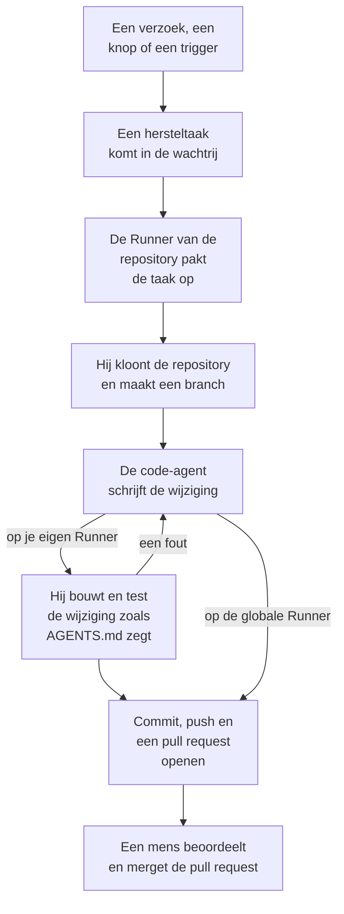

# Code

Code is waar je OneUptime AI vraagt om in je repository's te werken, zoals je een codeeragent zou vragen: een bug oplossen, tests schrijven, de code uitleggen, een wijziging maken. Code opent op het vak waarin je vraagt, met de repository en de branch daarin gekozen en alle taken eronder; de pagina van een taak is een gesprek waarin je kunt antwoorden. OneUptime start ook zelf taken, vanuit uitzonderingen, traces en onderzoeken. Een [Runner](/docs/runbooks/agents) kloont de repository, schrijft de wijziging op een nieuwe branch, bouwt en test die, en opent een pull request. Een mens beoordeelt en merget elke pull request: de Runner kan branches pushen en pull requests openen, meer niet.

:::cards
- [AI vragen in een repository](#ai-vragen-in-een-repository): Een verzoek in je eigen woorden, met de context die het nodig heeft.
- [Het gesprek van een taak](#het-gesprek-van-een-taak): Wat AI deed, wat het wijzigde, en jouw antwoord.
- [Hoe een herstelrun verloopt](#hoe-een-herstelrun-verloopt): Van een klik tot een pull request, stap voor stap.
- [Waar hersteltaken starten](#waar-hersteltaken-starten): De taken die OneUptime start, en wat elke pull request doet.
- [Productietelemetrie in een herstel](#productietelemetrie-in-een-herstel): Wat een herstel uit productie leest terwijl het de wijziging schrijft.
- [Productiebeoordeling van pull requests](#productiebeoordeling-van-pull-requests): Wat productie zegt over de code die elke pull request wijzigt.
- [Een repository verbinden](#een-repository-verbinden): GitHub, GitLab, Forgejo of Gitea, of elke Git-server.
- [Voordat je begint](#voordat-je-begint): Een model, een gekoppelde repository en een Runner.
- [Als een herstel mislukt](#als-een-herstel-mislukt): Wat er gebeurt met een run die een fout geeft, vastloopt of wacht.
:::

> [!TIP]
> Je kunt dit ook vanuit GitHub starten. Noem de OneUptime GitHub App in een issue of een pull request en hij implementeert, herziet of beoordeelt ter plekke: zie [GitHub App](/docs/ai/github-app). Het is dezelfde agent, dezelfde Runner en hetzelfde budget; alleen de trigger verschilt.

## AI vragen in een repository

:::steps
### Open Code

Open **Producten → Code**. Code opent op **Wat moet AI doen?**: het vak waarin je vraagt, met alle taken eronder, de nieuwste eerst. Is er nog geen repository, dan biedt Code in plaats daarvan **GitHub verbinden** aan, met GitLab, Forgejo of Gitea en elke Git-server eronder (zie [Een repository verbinden](#een-repository-verbinden)). **Repository's**, in het zijmenu, toont de repository's waarin AI kan werken, en bundelt onder **Niet verbonden** de repository's die OneUptime niet meer bereikt. De pagina van elke repository heeft hetzelfde vak voor die repository.

### Kies de repository en de branch

Het vak begint bij de repository die je het laatst koos. Kies een andere in de onderste rij ervan en, ernaast, de branch waarvan de taak uitgaat: de hoofdbranch van de repository, gemarkeerd als **Standaard**, totdat je een andere kiest. AI maakt zijn branch vanaf de branch die je kiest en opent zijn pull request daarnaartoe.

### Zeg wat je wilt

Schrijf de wijziging, de bug of de vraag in je eigen woorden. Zolang er nog niets gevraagd is, stelt Code er onder **Probeer te vragen** een paar voor.

### Voeg context toe

Klik op **Context toevoegen** om AI te geven wat het nodig heeft: een bestand of map van de repository, een notitie, een koppeling of een record van het project. OneUptime leest elk record wanneer je het verzoek verstuurt, met jouw rechten, en bewaart wat AI kreeg.

### Start de taak

Klik op **Taak starten** of druk op Enter. De pagina van de taak opent, en het werk van AI verschijnt daar terwijl het gebeurt.
:::

| Context | Wat AI krijgt |
| --- | --- |
| **Bestand of map** | Een pad in de repository, dat AI als eerste leest. |
| **Notitie** | Tekst die je plakt: een fout, een specificatie, een logregel. |
| **Koppeling** | Een webadres, als referentie. |
| **Incident** of **Waarschuwing** | De status, de beschrijving en de hoofdoorzaak, zoals die zijn wanneer je het verzoek verstuurt. |
| **Uitzondering** | Het bericht en de stack trace. |
| **Monitor** | Het type, de status en de beschrijving. |
| **Trace** | De spans: hun namen, tijden en fouten. |
| **Logboeken** | De nieuwste 20 logregels die je zoekterm bevatten, uit het afgelopen uur, de afgelopen dag of de afgelopen week. |
| **Prestatieprofiel** | Waar de tijd van een functie heen gaat in de profielen van haar service: wie haar aanroept, wat ze aanroept en haar heetste regels. |

Een verzoek bevat hooguit 10 stukken context. Tokens, sleutels, wachtwoorden en e-mailadressen in wat OneUptime leest, worden afgeschermd voordat AI ze ziet, zoals overal waar OneUptime AI je gegevens leest.

## Het gesprek van een taak

De pagina van een taak is een gesprek: wat er gevraagd is en de toegevoegde context, dan de beurt van AI – de stappen die het zet terwijl het ze zet (de bestanden die het las en bewerkte, waarnaar het zocht, de opdrachten die het uitvoerde), zijn antwoord, de bestanden die het wijzigde met hun diff, en de pull request. Bovenaan de pagina staat waar de taak werkt (de repository en de branch waarvan die uitging), hoeveel regels die wijzigde, met een knop naar de pull request, en hoe de taak ervoor staat:

| Status | Wat het betekent |
| --- | --- |
| **In de wachtrij** | Hij wacht tot een Runner hem oppakt. |
| **Bezig…** | AI is ermee bezig. **Stoppen** stopt hem; wat AI al pushte, blijft op de branch. |
| **Wacht op u** | AI heeft een vraag gesteld. Beantwoord die in het vak hieronder. |
| **Klaar** | AI is klaar: zijn antwoord, en de pull request als het code wijzigde. |
| **Mislukt** | De beurt kon niet worden afgerond, en zegt waarom. **Opnieuw proberen** vraagt hetzelfde nog eens. |
| **Gestopt** | Iemand heeft hem gestopt. **Opnieuw proberen** vraagt hetzelfde nog eens. |

Om verder te gaan, schrijf je in het vak onderaan, dat in beeld blijft terwijl het gesprek scrolt: antwoord AI, voeg context toe of vraag om wijzigingen. Elk antwoord is de volgende beurt van dezelfde taak: die werkt op dezelfde branch en pusht naar dezelfde pull request zolang die open is. Een taak doet één beurt tegelijk, dus het vak wacht terwijl AI werkt. Het **Logboek** van elke beurt is het letterlijke verslag van wat die deed. Bij een taak met meer dan één beurt wisselt een keuzelijst boven aan de pagina **Logboek** tussen de beurten.

Wie een repository kan lezen, leest zijn taken. AI iets vragen, antwoorden en een taak stoppen vereisen het recht om de repository te bewerken, en dat geldt ook voor de diff van een wijziging bekijken: alle anderen zien welke bestanden er veranderd zijn. De taken die OneUptime zelf start (hieronder) staan ook in hun repository, als gesprekken waarin je kunt antwoorden.

## Hoe een herstelrun verloopt



1. Je klikt op **Taak starten** in Code, of op **Oplossen met AI** bij een onopgeloste uitzondering, of een andere knop of trigger start een taak (zie [Waar hersteltaken starten](#waar-hersteltaken-starten)).
2. De taak komt in de wachtrij van zijn repository, en de Runner waarop de repository werkt pakt hem op: de Runner die hij kiest, anders de standaard-Runner van het project, anders een globale Runner (zie [De Runner van de repository kiezen](#de-runner-van-de-repository-kiezen)).
3. De Runner haalt de context van de taak op. Bij een verzoek zijn dat de woorden, de toegevoegde context en het gesprek tot dan toe; bij een uitzondering het type, het bericht en de stack trace.
4. Hij kloont de repository naar een eigen werkruimte en maakt een branch. Een herstel van een uitzondering heet `oneuptime-fix-exception-` gevolgd door de eerste tekens van de id van de run. Een vraag gaat uit van de branch die gekozen was toen die gesteld werd, en de pull request opent daarnaartoe. Een antwoord werkt in plaats daarvan op de branch van de open pull request van de taak.
5. Een code-agent, aangedreven door de LLM-provider van je project, leest de code en schrijft de wijziging. De OneUptime-server doet de LLM-aanroepen, zodat de Runner nooit de API-sleutel van je provider heeft, en elke aanroep wordt gemeten en staat in de AI-logs. Een herstel van een uitzondering, een trage trace of een incident leest tijdens het werk ook uit productie: de uitzonderingen, traces, logs en metrieken van de services van de repository (zie [Productietelemetrie in een herstel](#productietelemetrie-in-een-herstel)).
6. Op een eigen Runner bouwt en test de code-agent zijn wijziging zoals de `AGENTS.md` van de repository zegt, voordat er iets wordt gecommit, en herstelt hij wat faalt (zie [Controle vóór de pull request](#controle-vóór-de-pull-request)).
7. De Runner commit, pusht de branch, opent de pull request (bij een verzoek alleen als er code is gewijzigd) en verwijdert de werkruimte.

De pagina waarop de taak is gestart, toont live de status. Elke taak staat in zijn repository onder **Producten → Code**: zijn pagina is zijn gesprek, en het **Logboek** van elke beurt heeft een regel voor elk bestand dat de Runner las of schreef en elke opdracht die hij uitvoerde.

Elke run is gebonden aan budgetten die de server afdwingt: hoogstens **40 LLM-aanroepen** en **100.000 uitvoertokens**. De query's op productietelemetrie van een run tellen mee voor dezelfde 40 aanroepen. Een run die er een bereikt, stopt met een samenvatting van het werk tot dan toe in plaats van in een lus te blijven draaien. Herstelruns tellen ook mee voor de dagelijkse AI-limieten van het project, als het project die instelt.

## Waar hersteltaken starten

| Waar | Klik | De pull request |
| --- | --- | --- |
| De pagina **AI Assistance** van een uitzondering | **Oplossen met AI** | Herstelt de bug achter de uitzondering. |
| De pagina **AI Assistance** van een uitzondering | **Generate Regression Test** | Voegt een test toe die de uitzondering reproduceert en faalt tot de bug is hersteld. |
| De pagina **AI Assistance** van een uitzondering | **Foutafhandeling verbeteren** | Voor een verwachte fout, zoals ongeldige invoer: haalt gebruikersgegevens uit het bericht, valideert de invoer eerder en markeert de fout als afgehandeld, zonder het gedrag te veranderen. |
| De kaart **AI Investigation** van een incident of een waarschuwing | **Open Fix PR from this analysis** | Herstelt de hoofdoorzaak die het onderzoek plaatste (zie [Automatische codeherstellingen uit onderzoeken](#automatische-codeherstellingen-uit-onderzoeken)). |
| Een trace die het verhelpen waard is | **Versnellen met AI** | Herstelt het trage patroon dat de knop noemt, zoals een N+1-query of aanroepen die parallel zouden kunnen lopen. |
| De pagina **Logboeken** van een service | **Logging verbeteren** | Maakt de logs van de service gestructureerd, met de juiste ernst en gekoppeld aan zijn traces, zonder het gedrag te veranderen. |
| De pagina **Traces** van een service | **Tracing verbeteren** | Voegt spans en attributen toe waar de tracing van de service ontbreekt, zonder het gedrag te veranderen. |
| Een functie in **Prestatieprofielen** | **Oplossen met AI** | Laat de functie hetzelfde werk doen met minder tijd of geheugen, met haar profiel als bewijs. |

Deze knoppen verschijnen alleen waar ze een taak kunnen starten. Staat AI voor het project uit, dan verschijnt er geen en heeft het zijmenu van een uitzondering geen **AI Assistance**. **Logging verbeteren** en **Tracing verbeteren** verschijnen zodra er een repository is gekoppeld en niets de AI erin tegenhoudt (zoals het abonnement, opgebruikte AI-tegoeden of geen Runner die online is), en **Versnellen met AI** alleen bij een trace die het verhelpen waard is (zie [Traceverkenner](/docs/telemetry/traces-explorer)). **Oplossen met AI** bij een functie verschijnt alleen bij de eigen code van de applicatie die minstens 5% van de tijd of het geheugen van het profiel inneemt, of waarvan het aandeel met 3 punten of meer is gegroeid sinds het venster waarmee het wordt vergeleken (zie [Continue profilering](/docs/telemetry/profiles)).

Om de pagina **AI Assistance** van een uitzondering te openen, open je de uitzondering onder **Producten → Observability → Uitzonderingen** en kies je **AI Assistance** in het zijmenu. Een opgeloste of gearchiveerde uitzondering moet eerst als onopgelost worden gemarkeerd.

OneUptime AI start hersteltaken ook zelf: vanuit een onderzoek dat een codewijziging vindt, vanuit een onderzoek dat zonder conclusie eindigt omdat er telemetrie ontbrak, en vanuit AI Insights over uitzonderingen en trage traces. Elk heeft een eigen schakelaar; zie [Automatische codeherstellingen](/docs/ai/ai-sre#automatische-codefixes).

## Productietelemetrie in een herstel

OneUptime weet wat je code in productie doet, dus een herstel hoeft niet alleen van een stack trace uit te gaan. Terwijl de code-agent werkt, kan hij de productietelemetrie opvragen van de services die bij de repository horen:

| Hij leest | Waarvoor |
| --- | --- |
| **Uitzonderingen** | De uitzonderingsgroepen die in bepaalde bestanden of een functie worden gegooid: hoe vaak in de afgelopen dagen, sinds welke release, en de trace van een recent voorval. |
| **Traces** | Het latentie- en foutprofiel van een endpoint of operatie, en de spans van één trace. |
| **Logboeken** | De logregels van een service, op tijd, ernst, tekst of trace. |
| **Metrieken** | Een metriek die een service rapporteert, door de tijd heen; zonder naam de metrieken die hij rapporteert. |
| **Incidenten** | Incidenten die de services troffen, of waarvoor een OneUptime-herstel in deze repository werd geopend, met hun hoofdoorzaak en postmortem. |
| **Deploys** | Recente deploys en andere wijzigingen van de services, elk met het oordeel van OneUptime of die de bijbehorende service schaadde. |

| Taak | Wat die controleert |
| --- | --- |
| **Oplossen met AI** bij een uitzondering | Hoe vaak die nu wordt gegooid en sinds welke release, de logs en de trace van een voorval. |
| **Versnellen met AI** | Hoe druk en hoe traag de operatie is over al haar traces, niet alleen de geanalyseerde. Er wordt niets gewijzigd als de operatie niet meer traag is. |
| **Open Fix PR from this analysis**, en herstellingen die automatisch vanuit onderzoeken worden geopend | De deploys vóór het incident, zijn fouten, logs en trage operaties, en of de oorzaak al eerder toesloeg. |
| `@oneuptime review` vanuit GitHub | Wat productie zegt over de gewijzigde code (zie [Reviews met productiecontext](/docs/ai/github-app#reviews-met-productiecontext)). |

De beschrijving van de pull request vermeldt wat de agent opvroeg en wat dat liet zien. Andere taken, zoals regressietests en verbeteringen aan logging of tracing, raadplegen productie niet.

Wat de agent kan lezen, bepaalt de OneUptime-server op basis van de taak zelf:

- **Alleen lezen.** De query's draaien op de OneUptime-server, nooit op de Runner, die geen inloggegevens heeft waarmee telemetrie te lezen is. Niets wat ze doen, kan je project veranderen.
- **Dit project, en alleen de services die bij deze repository horen.** Je koppelt ze niet zelf: het zijn de services waarvoor OneUptime deze repository vindt, zoals het ook de repository van een herstel vindt - de stack traces van hun uitzonderingen lopen door de bestanden ervan, ze heten zoals de repository, of het is de enige repository van het project. De telemetrie van een andere service kan niet worden gelezen.
- **Geen privé-incidenten**, en tokens, sleutels, wachtwoorden en e-mailadressen worden afgeschermd voordat de agent een resultaat ziet, zoals overal waar OneUptime AI je gegevens leest.
- **Begrensd.** Hoogstens **12** query's per run, die elk meetellen voor de 40 aanroepen van de run.

Als er geen service bij de repository hoort, draait de taak zonder productietelemetrie, zoals voorheen.

## Productiebeoordeling van pull requests

OneUptime weet wat je code in productie doet, dus kan het een pull request beoordelen met wat niemand ziet die de diff leest. Zet **Pull requests beoordelen aan de hand van productie** aan onder **Meer instellingen** op de pagina **Instellingen** van een repository in Code, en elke pull request die iemand met schrijfrechten opent of bijwerkt, krijgt één opmerking die zegt wat productie laat zien van de code die hij wijzigt. De opmerking wordt bij elke push ter plekke bijgewerkt, en de pagina **Productiebeoordelingen** van de repository in Code bewaart elke beoordeling, met **Opnieuw beoordelen**.

| Hij leest | Van de code die de pull request wijzigt |
| --- | --- |
| **Uitzonderingen** | De uitzonderingen die in de afgelopen 7 dagen in de gewijzigde regels, functies en bestanden zijn gegooid, nieuwe en niet-afgehandelde gemarkeerd. |
| **Operaties** | De getracete operaties die de gewijzigde code in het afgelopen uur uitvoeren: hun spans, fouten en p95. |
| **Zware functies** | De functies van de gewijzigde code die in het afgelopen uur een deel van de profielen van de services innemen. |
| **Incidenten** | De incidenten van de services uit de afgelopen 30 dagen die nog open zijn, of waarvan de hoofdoorzaak of postmortem de gewijzigde code noemt. Nooit een privé-incident. |
| **Deploys** | De deploys van de services uit de afgelopen 7 dagen die OneUptime verdenkt van een regressie. |

Als productie iets laat zien, leest OneUptime AI het naast de diff en voegt **Aandachtspunten** toe: een paar korte punten, elk gebaseerd op de feiten. Dat gebeurt met de standaard-LLM-provider van het project, tenzij **LLM-provider voor productiebeoordeling**, onder **Meer instellingen** op de pagina **Instellingen** van de repository, een andere provider van het project of een globale kiest. Dit draait alleen zolang AI voor het project aan staat, hooguit 10 keer per dag voor een pull request en 100 keer voor een repository, en wordt gemeten zoals elke AI-aanroep; de feiten worden elke keer zonder AI gelezen. Als productie niets over de wijziging laat zien, plaatst OneUptime niets.

- **Alleen totalen.** De opmerking bevat aantallen, duren en namen van code: nooit het bericht van een uitzondering, een logregel, de titel van een incident of persoonsgegevens.
- **Openbare repository's krijgen een link.** Iedereen kan de pull requests van een openbare repository lezen, dus daar linkt de opmerking alleen naar de beoordeling in OneUptime, die alleen leden van het project kunnen openen. **Opmerking bij productiebeoordeling**, onder **Meer instellingen** op de pagina **Instellingen** van de repository, kan overal **Alleen een link naar de beoordeling** plaatsen, of **De beoordeling, ook in een openbare repository**.
- **Externe bijdragers kunnen er geen starten.** Een pull request wordt alleen vanzelf beoordeeld als de auteur, en wie er ook naar pushte, naar de repository mag schrijven. Een van iemand anders - een externe bijdrager, een fork, een bot - wordt beoordeeld als iemand met schrijfrechten er `@oneuptime production review` op reageert, of in Code op **Opnieuw beoordelen** klikt.
- **Alleen lezen.** Een beoordeling kloont niets en voert niets van de pull request uit. De diff en de titel zijn gegevens voor OneUptime AI, nooit instructies: de AI heeft geen tools, en wat hij schrijft, wordt als tekst in de opmerking gezet.

De schakelaar staat aan voor de repository's die de GitHub App vanaf nu verbindt. Een repository die werd verbonden voordat hij bestond, houdt hem uit tot je hem aanzet.

## Controle vóór de pull request

Een repository zegt in een `AGENTS.md` in de hoofdmap, het bestand dat codeeragents lezen, hoe hij wordt gebouwd en getest. Voordat de code-agent iets wijzigt, leest hij de `AGENTS.md` van de repository (of zijn `CLAUDE.md`, als hij geen `AGENTS.md` heeft) uit de branch waar de taak van uitgaat, en werkt hij zoals die zegt. Zonder een van beide haalt hij het uit de `CONTRIBUTING.md` van de repository, de README, de pakketscripts, de `Makefile` of de CI-workflows. Er is niets in te stellen in OneUptime.

| Waar AI werkt | Wat het met de build en tests van de repository doet |
| --- | --- |
| Een van je Runners | Bouwt en test zijn wijziging voordat de pull request opent, herstelt wat faalt en controleert opnieuw, en zegt in zijn samenvatting welke controles hij heeft gedraaid. Elke opdracht die hij draait, krijgt 2 minuten, of tot 10 voor een trage installatie, build of testsuite, zonder de eigen inloggegevens van de Runner in zijn omgeving. |
| **Globale Runner** | Draait geen opdracht: hij schrijft de wijziging en opent de pull request, en de eigen CI van je repository controleert die. |

Niets uit een pull request die uit een fork komt, wordt ooit gelezen als de instructies van de repository: een herziening weigert zo'n pull request, en een review leest de basisbranch.

### Opdrachten die op een repository zijn ingesteld

Code vraagt niet meer om setup-, build- en testopdrachten, maar een repository die ze heeft, eerder ingesteld of via de API of Terraform, houdt ze. Ze staan alleen-lezen op de kaart **Build- en testopdrachten**, onder **Meer instellingen** op de pagina **Instellingen** van de repository, en **Opdrachten verwijderen** verwijdert alle drie. Zolang er een is ingesteld, controleert elke herstelrun op een eigen Runner zijn wijziging er ook mee voordat de pull request opent:

1. Als de code-agent klaar is, draaien de opdrachten op volgorde in de root van de repository, op de Runner, in de gekloonde werkruimte. Elke opdracht krijgt tot 15 minuten en draait met `CI=true`, zodat niets op invoer wacht; de eerste fout stopt de ronde.
2. Bij een fout gaat het einde van de uitvoer van de mislukte opdracht terug naar dezelfde code-agent als hersteltaak, met de instructie zijn eigen wijziging te verbeteren in plaats van tests af te zwakken of over te slaan, en de opdrachten draaien opnieuw. Hij doet hoogstens **2** herstelpogingen. Die delen het LLM-budget van de run, en hun wijzigingen komen in dezelfde commit als het herstel.
3. De uitkomst, geslaagd, mislukt of overgeslagen (geen opdrachten ingesteld, of een globale Runner), staat in een Verification-sectie van de beschrijving van de pull request en wordt vastgelegd bij de pull request van de taak.

Een wijziging die de controle nog steeds niet doorstaat, wordt niet weggegooid: de pull request opent toch, met een duidelijk gemarkeerde sectie "Verification failed" die de mislukte opdracht noemt en eindigt met de uitvoer ervan. Het werk blijft bewaard, en wie beoordeelt, beslist. Een repository zonder ingestelde opdrachten wordt als overgeslagen gemeld, in plaats van een groene build te suggereren.

De opdrachten zijn repository-instellingen die je team schrijft en die op je eigen Runner draaien: hetzelfde vertrouwensmodel als de Bash-stappen van een runbook. De AI schrijft of wijzigt ze nooit. Een globale Runner, die OneUptime voor elk project draait, voert ze nooit uit: op een globale Runner wordt het herstel geschreven en ter beoordeling geopend, wordt de controle als overgeslagen gemeld, en controleert de eigen CI van je repository de wijziging. [Draai een eigen Runner](#een-eigen-runner-draaien) om het herstel te laten bouwen en testen voordat de pull request opent.

## Na het mergen van een fix

Een fix mergen lost niets op totdat hij draait. Zodra een pull request met een fix gemerged is, wacht OneUptime op een vastgelegde deploy die hem bevat (zie [Deploys en wijzigingen](/docs/telemetry/change-events)) en houdt in die deploy in de gaten waarvoor de fix bedoeld was. De pull request van de taak in Code zegt hoe het ging, net als de pagina **AI Assistance** van de uitzondering, de AI-logboeken van het incident en de AI-insight waar de fix uit voortkwam:

| Een fix van | Wat wordt gevolgd | Het werkte | Het werkte niet |
| --- | --- | --- | --- |
| Een uitzondering | Of de uitzondering opnieuw voorkomt | **Opgelost in productie** | **Komt nog steeds voor na de fix** |
| Een trage trace of een latentie-insight | De p99 van de bewerking die de fix noemt | **Sneller in productie** | **Nog steeds traag na de fix** |
| De hoofdoorzaak van een incident of een melding | Of de monitor er nog een veroorzaakt | **Opgelost in productie** | **Opnieuw voorgekomen na de fix** |
| Ontbrekende telemetrie, logging of tracing | Wat de fix toevoegt, en de rest van de telemetrie van de service | **Komt binnen in productie** | **Telemetrie gestopt na de fix** |

Totdat een deploy hem uitlevert, staat bij de fix **Gemerged, wacht op een deploy**, daarna **Gedeployed, wordt in productie gevolgd** zolang hij gevolgd wordt. Een fix die binnen 14 dagen in geen enkele vastgelegde deploy zit, of waarover productie niets kan zeggen, staat op **Niet geverifieerd in productie**. [Automatische codefixes](/docs/ai/ai-sre#automatische-codefixes) beschrijft de regels. Een regressietest, betere foutafhandeling, een review en een verzoek in Code worden niet gevolgd: productie kan niet laten zien wat ze veranderen.

## Een repository verbinden

Open **Repository's** in het zijmenu van Code en klik op **Repository's verbinden**: Code vraagt waar je code staat en verbindt elke plek op zijn eigen manier. Wat AI in een repository doet, hangt af van waar die staat:

| Waar de code staat | Hoe hij verbindt | Wat AI er doet |
| --- | --- | --- |
| **GitHub** | De OneUptime GitHub App, geïnstalleerd op de repository's die hij kiest. | Alles op deze pagina, met opdrachten vanuit GitHub (zie [GitHub App](/docs/ai/github-app)) en [productiebeoordelingen](#productiebeoordeling-van-pull-requests). |
| **GitLab**, op GitLab.com of je eigen | Een toegangstoken: een persoonlijk, groeps- of projecttoken met de scopes `api` en `write_repository`, en minstens de rol Developer. | Taken en fixes, elke wijziging in een merge request; de branchkiezer; de code waar een stacktrace of een profiel doorheen loopt; of een fix is samengevoegd en wat productie liet zien nadat hij was uitgerold. |
| **Forgejo of Gitea**, op Codeberg of je eigen | Een toegangstoken met lees- en schrijftoegang tot repository's en leestoegang tot de gebruiker. | Hetzelfde als op GitLab, elke wijziging in een pull request. |
| **Elke Git-server**, via HTTPS | Het adres waarmee je de repository kloont, een gebruikersnaam en een wachtwoord of toegangstoken dat de repository kan lezen en ernaar kan pushen. | AI kloont de repository en pusht elke wijziging naar een nieuwe branch, die zijn antwoord noemt: jij opent de pull request. Op Bitbucket en Azure DevOps linkt hij naar waar je hem opent. |

Opdrachten uit opmerkingen en productiebeoordelingen hebben de GitHub App nodig, dus voorlopig werken ze alleen in GitHub-repository's, en de **Instellingen** van de repository zeggen dat.

Voor GitLab, Forgejo of Gitea voer je het adres van de server in (GitLab.com en Codeberg zijn al ingevuld) en het token, en kies je de repository's om te verbinden: de lijst biedt alleen de repository's aan waarnaar het token kan pushen, en later meer verbinden kan het token hergebruiken. OneUptime controleert elk token bij zijn server voordat het het bewaart, bewaart het versleuteld en toont het nooit meer. De **Instellingen** van de repository tonen de server, het account en de laatste tekens van het token, met **Toegangstoken vervangen**. Weigert de server een verlopen of ingetrokken token, dan tonen zijn repository's **Token geweigerd** en werkt AI er niet meer in, tot het vervangen van het token elke repository die het gebruikt weer verbindt. Bij een GitLab-repository spreken de instellingen, net als GitLab, van merge requests: **Merge requests**, **AI-fix-merge-requests** en **Max. open fix-merge-requests**.

### Een Git-server op een privénetwerk

OneUptime Cloud bereikt alleen Git-servers op internet, nooit een privé-, loopback- of link-local-adres. Verbind een server die alleen je eigen netwerk bereikt als **Elke Git-server**: Code zegt dat het hem niet bereikt, en **Toch verbinden** verbindt hem voor een van je eigen Runners op dat netwerk. Kies die Runner op de kaart **Runner** van de repository (zie [De Runner van de repository kiezen](#de-runner-van-de-repository-kiezen)). Een globale Runner werkt er nooit in, en OneUptime leest er op de server niets van, dus de branchkiezer biedt alleen de hoofdbranch aan. Een zelf gehoste OneUptime, en zijn globale Runner, bereiken de Git-servers van het eigen netwerk.

## Voordat je begint

Een taak heeft drie dingen nodig. Het vraagvak van Code en de pagina **AI Assistance** van de uitzondering controleren alle drie voordat ze aanbieden te starten, en zeggen wat er ontbreekt.

| Wat | OneUptime Cloud | Zelf gehost |
| --- | --- | --- |
| Een LLM-provider | Niets in te stellen: een project zonder eigen provider gebruikt de globale provider, betaald uit de AI-tegoeden van het project. Een eigen provider, onder **Projectinstellingen → AI → LLM-providers**, gaat voor. | Stel de omgevingsvariabelen `GLOBAL_LLM_PROVIDER_*` eenmalig in op de server, of voeg een provider toe aan het project. |
| Een repository gekoppeld via de GitHub App | **Producten → Code**, dan **GitHub verbinden**. Is de app al op het GitHub-account geïnstalleerd, klik dan in plaats daarvan op **Een bestaande installatie koppelen**: opnieuw installeren koppelt hem niet. Vereist het Growth-abonnement. | Hetzelfde, zodra je instantie een GitHub App heeft (zie [GitHub-integratie](/docs/self-hosted/github-integration)). |
| Of een repository op GitLab, Forgejo of Gitea, of op elke Git-server | **Repository's** in Code, dan **Repository's verbinden** (zie [Een repository verbinden](#een-repository-verbinden)). Vereist het Growth-abonnement. | Hetzelfde, zonder GitHub App om in te stellen. |
| Een Runner die AI-codecorrecties uitvoert | Niets te draaien: een repository die er geen kiest, werkt op de standaard-Runner van het project of, zonder die, op de globale Runners van OneUptime. | Niets te draaien: de meegeleverde globale Runner (`global-runner` in Docker Compose, `globalRunner` in de Helm-chart, standaard aan), en elke globale Runner die een hoofdbeheerder toevoegt, voeren AI-codecorrecties uit in elke repository die op een globale Runner werkt. |

Op een zelf gehoste instantie is de globale provider één blok in `config.env` (Docker Compose) of in je Helm-waarden. Voor een zelf gehoste Ollama:

```bash
GLOBAL_LLM_PROVIDER_TYPE=Ollama
# An address the OneUptime server can reach, never localhost.
GLOBAL_LLM_PROVIDER_BASE_URL=http://ollama:11434
GLOBAL_LLM_PROVIDER_MODEL_NAME=llama3.1
# No GLOBAL_LLM_PROVIDER_API_KEY needed — Ollama is keyless.
```

Elke ondersteunde provider werkt: zie [LLM-providers](/docs/ai/llm-provider) voor alle providers en elke omgevingsvariabele.

Je koppelt repositories niet aan services. Als een taak start, vindt OneUptime de repository door de bestandspaden uit de stack trace van de uitzondering te vergelijken met je gekoppelde repositories. Als niets overeenkomt, valt hij terug op een repository met dezelfde naam als de service, en dan op de enige repository van het project als er maar één is. De pagina **AI Assistance** toont welke repository hij vond.

### De Runner van de repository kiezen

Elke repository kiest de Runner waarop AI erin werkt: open op zijn pagina **Instellingen** in Code **Meer instellingen**, klik op **Bewerken** op de kaart **Runner** en kies er een. Een repository die er geen kiest, werkt op de [standaard-Runner](/docs/runbooks/agents#de-standaard-runner-van-het-project) van het project, de eerste keuze, gemarkeerd met **Projectstandaard**, en verhuist mee wanneer een andere Runner de standaard wordt. In een project zonder standaard-Runner werkt hij op **Globale Runner**, die OneUptime voor elk project draait. Kies **Globale Runner** om een repository erop te houden terwijl het project een standaard-Runner heeft.

| Runner | Wat hij met een taak doet |
| --- | --- |
| **Globale Runner** | Schrijft de wijziging en opent de pull request zonder die te bouwen of te testen: de eigen CI van je repository controleert de wijziging. |
| Een van je Runners | Bouwt en test de wijziging ook zoals de `AGENTS.md` van de repository zegt, op een host die jij beheert. |

Alleen de Runner waarop een repository werkt, krijgt zijn taken en een token ervoor. In een project dat **Globale Runners gebruiken** uitzet onder **Runbooks → Runbook-agenten**, heeft elke repository een van de eigen Runners van het project nodig: de Runner die hij kiest, of de standaard-Runner van het project. De pagina van een Runner toont de repositories die erop werken.

### Een eigen Runner draaien

Om een Runner ergens anders te draaien, bijvoorbeeld op een machine dicht bij je repositories:

:::steps
### Maak de Runner aan

Maak een Runner aan onder **Runbooks → Runbook-agenten** en klik op **Installatie-instructies weergeven** in zijn rij. De opdracht bevat de geheime sleutel van de Runner, die alleen een Project Owner, Project Admin of Runbook Admin kan lezen. Hij ziet er zo uit:

```bash
docker run --name oneuptime-runner --restart unless-stopped \
  -e ONEUPTIME_RUNNER_ID=<runner-id> \
  -e ONEUPTIME_RUNNER_KEY=<runner-key> \
  -e ONEUPTIME_URL=<your-oneuptime-url> \
  -d oneuptime/runner:release
```

### Kies hem voor de repository

Open op de pagina **Instellingen** van de repository in Code **Meer instellingen**, klik op **Bewerken** op de kaart **Runner** en kies de Runner. De Runner neemt de wijziging over bij zijn volgende heartbeat, binnen ongeveer een minuut; er hoeft niets opnieuw te starten.

### Controleer of hij verbinding maakt

De Runner verschijnt binnen een minuut of twee als verbonden op de pagina **Runbooks → Runbook-agenten**. Zo niet, lees dan de log van de container (`docker logs oneuptime-runner`) op een fout met inloggegevens of het netwerk.
:::

Elke manier om de container te draaien werkt (Docker Compose, Kubernetes enzovoort), zolang hij deze variabelen heeft en je OneUptime-instantie via HTTPS kan bereiken:

| Variabele | Wat het is |
| --- | --- |
| `ONEUPTIME_RUNNER_ID` | De id van de Runner, uit het dashboard. |
| `ONEUPTIME_RUNNER_KEY` | De geheime sleutel van de Runner. |
| `ONEUPTIME_URL` | Het adres van je OneUptime-instantie (`https://oneuptime.com` op OneUptime Cloud). |

> [!NOTE]
> Vóór OneUptime 12 draaiden AI-codecorrecties op een apart AI Agent-onderdeel (de image `oneuptime/ai-agent` met `AI_AGENT_*`-variabelen). Dat is opgegaan in de Runner: draai je er nog een, dan legt de [upgradegids van v11 naar v12](/docs/installation/upgrading) uit hoe je die vervangt.

## Automatische codeherstellingen uit onderzoeken

Als een [AI-onderzoek](/docs/ai/ai-sre) een analyse van de hoofdoorzaak plaatst bij een incident of een waarschuwing, en de zorgvuldige classificatie ervan een wijziging in de code aanbeveelt, biedt de onderzoekskaart **Open Fix PR from this analysis** aan: een hersteltaak waarvan de hele context de geplaatste analyse is. De knop is verborgen als de oplossing operationeel is, alleen de infrastructuur betreft, extern is, een verwachte weigering, een gebruikersfout of zonder conclusie. Geschikte herstellingen gebeuren zonder de klik zolang **Nieuwe incidenten automatisch herstellen** aan staat op **Incidenten → AI → Instellingen** (en **Nieuwe waarschuwingen automatisch herstellen** op **Waarschuwingen → AI → Instellingen**). Herstellen begint uit, ook voor nieuwe projecten. Zonder AI-regel wordt elke geschikte fix geopend; met regels alleen een voor wat een regel matcht, wanneer de regel **Pull requests met oplossing** aan heeft staan (een nieuwe regel heeft dat), in de code-repository's die hij noemt.

Zolang herstellen aan staat, zet een onderzoek dat eindigt met een zekere, onderbouwde hoofdoorzaak die een codewijziging kan herstellen, dezelfde hersteltaak in de wachtrij die de knop aanmaakt. De beslissing is een begrensde classificatie die de server controleert, nooit een patroon dat op de tekst van de analyse wordt toegepast: alleen een positief oordeel voor een codeherstel opent een pull request. Ontbrekend bewijs, een oplossing buiten de code en een mislukte classificatie eindigen allemaal in niets doen.

Al het andere is gelijk aan de knop:

- De pull request opent klaar voor review, geschreven vanuit de geplaatste analyse, en heeft een gekoppelde repository nodig, een die de matchende regels noemen als ze er noemen, en een Runner die online is om erin te werken: die de repository kiest, of een globale Runner.
- Hij telt mee voor de dagelijkse limiet voor hersteltaken van dat signaal (**Daily Incident AI Fix Task Limit** of **Daily Alert AI Fix Task Limit**, onder **Meer instellingen** op de AI-instellingenpagina ervan) en voor het maximum aan open pull requests van de repository, als een van beide is ingesteld. Niet ingesteld beperkt geen van beide iets.
- Elke trigger zoekt eerst naar een hersteltaak die al in de wachtrij staat of draait voor hetzelfde incident of dezelfde waarschuwing, zodat een automatische trigger en een klik normaal één taak worden, niet twee pull requests. De controle is een lezing vóór het schrijven, geen vergrendeling, dus twee triggers op precies hetzelfde moment kunnen er nog allebei door komen.
- De run wordt door het systeem geschreven, aan niemand toegeschreven, en niets wordt vanzelf gemerged.

## Als een herstel mislukt

:::details De run geeft een fout
Het herstel kon niet worden toegepast, de repository of de branch waarvan een vraag uitging was niet bereikbaar, of de LLM-aanroep mislukte. Het gesprek van de taak, en de pagina waarop die is gestart, tonen de reden en bieden aan het opnieuw te proberen. Het **Logboek** van de beurt bevat het volledige runlog.
:::

:::details De Runner stopt midden in een run
Een run waarvan de heartbeat langer dan 12 minuten stil is, wordt met een fout beëindigd. Hij komt nooit vanzelf opnieuw in de wachtrij, omdat de Runner al een deel van een herstelbranch gepusht kan hebben; start hem opnieuw waar je hem startte. Een opdracht die de code-agent draait, houdt de heartbeat gaande zolang hij loopt, zodat een lange build of testsuite niet voor een gestopte Runner wordt aangezien.
:::

:::details Geen Runner pakt de taak op
Een taak die langer dan 30 minuten wacht terwijl de Runner die hem moet oppakken niet verbonden is - die zijn repository kiest, de standaard-Runner van het project voor een repository die er geen kiest, of een globale Runner - mislukt met een melding die zegt welke, zodat hij nooit eeuwig als bezig wordt getoond. Is een Runner online maar bezet, dan wachten taken in de wachtrij op hun beurt. Een Runner die ouder is dan Code krijgt nooit een verzoek uit Code: werk een Runner die je zelf draait samen met de server bij.
:::

## Privacy

De kloon van je repository staat in een werkruimte in de container van de Runner en wordt verwijderd als de run eindigt, geslaagd of niet. De Runner heeft nooit de API-sleutel van je LLM-provider: de OneUptime-server doet de LLM-aanroepen voor hem, en voert ook de query's op productietelemetrie uit. OneUptime bewaart je repository niet en traint niet op je code. Het log van de taak bewaart de eerste 300 tekens van de uitvoer van elke stap, zodat je kunt nagaan wat de Runner deed, en daar kunnen stukjes code in staan. Draai een zelf gehoste Runner met je eigen LLM-provider (lokale Ollama inbegrepen), en je code verlaat nooit je infrastructuur.

## Volgende stappen

:::cards
- [GitHub App](/docs/ai/github-app): Vraag om een wijziging, een herziening of een review vanuit GitHub zelf.
- [AI SRE](/docs/ai/ai-sre): De onderzoeken waarvan hersteltaken de analyses in pull requests kunnen omzetten.
- [Runbook-agenten](/docs/runbooks/agents): De worker die elke herstelrun uitvoert.
:::
