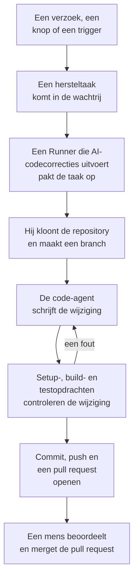

# Code

Code is waar je OneUptime AI vraagt om in je repository's te werken, zoals je een codeeragent zou vragen: een bug oplossen, tests schrijven, de code uitleggen, een wijziging maken. Code opent op je gekoppelde repository's; de pagina van een repository bevat zijn taken en het vak waarin je vraagt; de pagina van een taak is een gesprek waarin je kunt antwoorden. OneUptime start ook zelf taken, vanuit uitzonderingen, traces en onderzoeken. Een [Runner](/docs/runbooks/agents) kloont de repository, schrijft de wijziging op een nieuwe branch, bouwt en test die, en opent een pull request. Een mens beoordeelt en merget elke pull request: de Runner kan branches pushen en pull requests openen, meer niet.

:::cards
- [AI vragen in een repository](#ai-vragen-in-een-repository): Een verzoek in je eigen woorden, met de context die het nodig heeft.
- [Het gesprek van een taak](#het-gesprek-van-een-taak): Wat AI deed, wat het wijzigde, en jouw antwoord.
- [Hoe een herstelrun verloopt](#hoe-een-herstelrun-verloopt): Van een klik tot een pull request, stap voor stap.
- [Waar hersteltaken starten](#waar-hersteltaken-starten): De taken die OneUptime start, en wat elke pull request doet.
- [Voordat je begint](#voordat-je-begint): Een model, een gekoppelde repository en een Runner.
- [Als een herstel mislukt](#als-een-herstel-mislukt): Wat er gebeurt met een run die een fout geeft, vastloopt of wacht.
:::

> [!TIP]
> Je kunt dit ook vanuit GitHub starten. Noem de OneUptime GitHub App in een issue of een pull request en hij implementeert, herziet of beoordeelt ter plekke: zie [GitHub App](/docs/ai/github-app). Het is dezelfde agent, dezelfde Runner en hetzelfde budget; alleen de trigger verschilt.

## AI vragen in een repository

:::steps
### Open een repository

Open **Producten → Code**. Daar staan de repository's van het project, elk met de taken waaraan AI werkt, de taken die op jou wachten en zijn open pull requests. Is er nog geen, dan biedt Code **GitHub verbinden** aan (zie [Voordat je begint](#voordat-je-begint)).

### Zeg wat je wilt

Schrijf op de pagina van de repository de wijziging, de bug of de vraag in je eigen woorden. Een repository zonder taken stelt er onder **Probeer te vragen** een paar voor.

### Voeg context toe

Klik op **Context toevoegen** om AI te geven wat het nodig heeft: een bestand of map van de repository, een notitie, een koppeling of een record van het project. OneUptime leest elk record wanneer je het verzoek verstuurt, met jouw rechten, en bewaart wat AI kreeg.

### Start de taak

Klik op **Taak starten** of druk op Enter. De pagina van de taak opent, en het werk van AI verschijnt daar terwijl het gebeurt.
:::

| Context | Wat AI krijgt |
| --- | --- |
| **Bestand of map** | Een pad in de repository, dat AI als eerste leest. |
| **Notitie** | Tekst die je plakt: een fout, een specificatie, een logregel. |
| **Koppeling** | Een webadres, als referentie. |
| **Incident** of **Waarschuwing** | De status, de beschrijving en de hoofdoorzaak, zoals die zijn wanneer je het verzoek verstuurt. |
| **Uitzondering** | Het bericht en de stack trace. |
| **Monitor** | Het type, de status en de beschrijving. |
| **Trace** | De spans: hun namen, tijden en fouten. |
| **Logboeken** | De nieuwste 20 logregels die je zoekterm bevatten, uit het afgelopen uur, de afgelopen dag of de afgelopen week. |
| **Prestatieprofiel** | Waar de tijd van een functie heen gaat in de profielen van haar service: wie haar aanroept, wat ze aanroept en haar heetste regels. |

Een verzoek bevat hooguit 10 stukken context. Tokens, sleutels, wachtwoorden en e-mailadressen in wat OneUptime leest, worden afgeschermd voordat AI ze ziet, zoals overal waar OneUptime AI je gegevens leest.

## Het gesprek van een taak

De pagina van een taak is een gesprek: wat er gevraagd is en de toegevoegde context, dan de beurt van AI – de stappen die het zet terwijl het ze zet (de bestanden die het las en bewerkte, waarnaar het zocht, de opdrachten die het uitvoerde), zijn antwoord, de bestanden die het wijzigde met hun diff, en de pull request. Bovenaan de pagina staat hoe de taak ervoor staat:

| Status | Wat het betekent |
| --- | --- |
| **In de wachtrij** | Hij wacht tot een Runner hem oppakt. |
| **Bezig…** | AI is ermee bezig. **Stoppen** stopt hem; wat AI al pushte, blijft op de branch. |
| **Wacht op u** | AI heeft een vraag gesteld. Beantwoord die in het vak hieronder. |
| **Klaar** | AI is klaar: zijn antwoord, en de pull request als het code wijzigde. |
| **Mislukt** | De beurt kon niet worden afgerond, en zegt waarom. **Opnieuw proberen** vraagt hetzelfde nog eens. |
| **Gestopt** | Iemand heeft hem gestopt. **Opnieuw proberen** vraagt hetzelfde nog eens. |

Om verder te gaan, schrijf je in het vak onderaan: antwoord AI, voeg context toe of vraag om wijzigingen. Elk antwoord is de volgende beurt van dezelfde taak: die werkt op dezelfde branch en pusht naar dezelfde pull request zolang die open is. Een taak doet één beurt tegelijk, dus het vak wacht terwijl AI werkt. Het **Logboek** van elke beurt is het letterlijke verslag van wat die deed.

Wie een repository kan lezen, leest zijn taken. AI iets vragen, antwoorden en een taak stoppen vereisen het recht om de repository te bewerken, en dat geldt ook voor de diff van een wijziging bekijken: alle anderen zien welke bestanden er veranderd zijn. De taken die OneUptime zelf start (hieronder) staan ook in hun repository, als gesprekken waarin je kunt antwoorden.

## Hoe een herstelrun verloopt



1. Je klikt op **Taak starten** in een repository, of op **Oplossen met AI** bij een onopgeloste uitzondering, of een andere knop of trigger start een taak (zie [Waar hersteltaken starten](#waar-hersteltaken-starten)).
2. De taak komt in de wachtrij, en een beschikbare Runner met **Voert AI-codecorrecties uit** ingeschakeld pakt hem op.
3. De Runner haalt de context van de taak op. Bij een verzoek zijn dat de woorden, de toegevoegde context en het gesprek tot dan toe; bij een uitzondering het type, het bericht en de stack trace.
4. Hij kloont de repository naar een eigen werkruimte en maakt een branch. Een herstel van een uitzondering heet `oneuptime-fix-exception-` gevolgd door de eerste tekens van de id van de run. Een antwoord werkt in plaats daarvan op de branch van de open pull request van de taak.
5. Een code-agent, aangedreven door de LLM-provider van je project, leest de code en schrijft de wijziging. De OneUptime-server doet de LLM-aanroepen, zodat de Runner nooit de API-sleutel van je provider heeft, en elke aanroep wordt gemeten en staat in de AI-logs.
6. Heeft de repository controleopdrachten, dan bouwt en test een eigen Runner de wijziging voordat hij iets commit, en geeft hij een fout terug aan de code-agent om te herstellen (zie [Controle vóór de pull request](#controle-vóór-de-pull-request)).
7. De Runner commit, pusht de branch, opent de pull request (bij een verzoek alleen als er code is gewijzigd) en verwijdert de werkruimte.

De pagina waarop de taak is gestart, toont live de status. Elke taak staat in zijn repository onder **Producten → Code**: zijn pagina is zijn gesprek, en het **Logboek** van elke beurt heeft een regel voor elk bestand dat de Runner las of schreef en elke opdracht die hij uitvoerde.

Elke run is gebonden aan budgetten die de server afdwingt: hoogstens **40 LLM-aanroepen** en **100.000 uitvoertokens**. Een run die er een bereikt, stopt met een samenvatting van het werk tot dan toe in plaats van in een lus te blijven draaien. Herstelruns tellen ook mee voor de dagelijkse AI-limieten van het project, als het project die instelt.

## Waar hersteltaken starten

| Waar | Klik | De pull request |
| --- | --- | --- |
| De pagina **AI Assistance** van een uitzondering | **Oplossen met AI** | Herstelt de bug achter de uitzondering. |
| De pagina **AI Assistance** van een uitzondering | **Generate Regression Test** | Voegt een test toe die de uitzondering reproduceert en faalt tot de bug is hersteld. |
| De pagina **AI Assistance** van een uitzondering | **Foutafhandeling verbeteren** | Voor een verwachte fout, zoals ongeldige invoer: haalt gebruikersgegevens uit het bericht, valideert de invoer eerder en markeert de fout als afgehandeld, zonder het gedrag te veranderen. |
| De kaart **AI Investigation** van een incident of een waarschuwing | **Open Fix PR from this analysis** | Herstelt de hoofdoorzaak die het onderzoek plaatste (zie [Automatische codeherstellingen uit onderzoeken](#automatische-codeherstellingen-uit-onderzoeken)). |
| Een trace die het verhelpen waard is | **Versnellen met AI** | Herstelt het trage patroon dat de knop noemt, zoals een N+1-query of aanroepen die parallel zouden kunnen lopen. |
| De pagina **Logboeken** van een service | **Logging verbeteren** | Maakt de logs van de service gestructureerd, met de juiste ernst en gekoppeld aan zijn traces, zonder het gedrag te veranderen. |
| De pagina **Traces** van een service | **Tracing verbeteren** | Voegt spans en attributen toe waar de tracing van de service ontbreekt, zonder het gedrag te veranderen. |
| Een functie in **Prestatieprofielen** | **Oplossen met AI** | Laat de functie hetzelfde werk doen met minder tijd of geheugen, met haar profiel als bewijs. |

Deze knoppen verschijnen alleen waar ze een taak kunnen starten. Staat AI voor het project uit, dan verschijnt er geen en heeft het zijmenu van een uitzondering geen **AI Assistance**. **Logging verbeteren** en **Tracing verbeteren** verschijnen zodra er een repository is gekoppeld, en **Versnellen met AI** alleen bij een trace die het verhelpen waard is (zie [Traceverkenner](/docs/telemetry/traces-explorer)). **Oplossen met AI** bij een functie verschijnt alleen bij de eigen code van de applicatie die minstens 5% van de tijd of het geheugen van het profiel inneemt, of waarvan het aandeel met 3 punten of meer is gegroeid sinds het venster waarmee het wordt vergeleken (zie [Continue profilering](/docs/telemetry/profiles)).

Om de pagina **AI Assistance** van een uitzondering te openen, open je de uitzondering onder **Producten → Observability → Uitzonderingen** en kies je **AI Assistance** in het zijmenu. Een opgeloste of gearchiveerde uitzondering moet eerst als onopgelost worden gemarkeerd.

OneUptime AI start hersteltaken ook zelf: vanuit een onderzoek dat een codewijziging vindt, vanuit een onderzoek dat zonder conclusie eindigt omdat er telemetrie ontbrak, en vanuit AI Insights over uitzonderingen en trage traces. Elk heeft een eigen schakelaar; zie [Automatische codeherstellingen](/docs/ai/ai-sre#automatische-codefixes).

## Controle vóór de pull request

Een repository kan tot drie controleopdrachten hebben op zijn pagina **Instellingen** in Code:

| Opdracht | Voorbeeld | Wanneer die draait |
| --- | --- | --- |
| **Setup Command** | `npm ci` | Eerst, om afhankelijkheden te installeren. |
| **Build Command** | `npm run build` | Na de setup. |
| **Test Command** | `npm test` | Als laatste. |

Is er een ingesteld, dan controleert elke herstelrun zijn wijziging voordat de pull request opent:

1. Als de code-agent klaar is, draaien de opdrachten op volgorde in de root van de repository, op de Runner, in de gekloonde werkruimte. Elke opdracht krijgt tot 15 minuten en draait met `CI=true`, zodat niets op invoer wacht; de eerste fout stopt de ronde.
2. Bij een fout gaat het einde van de uitvoer van de mislukte opdracht terug naar dezelfde code-agent als hersteltaak, met de instructie zijn eigen wijziging te verbeteren in plaats van tests af te zwakken of over te slaan, en de opdrachten draaien opnieuw. Hij doet hoogstens **2** herstelpogingen. Die delen het LLM-budget van de run, en hun wijzigingen komen in dezelfde commit als het herstel.
3. De uitkomst, geslaagd, mislukt of overgeslagen (geen opdrachten ingesteld, of een gedeelde Runner), staat in een Verification-sectie van de beschrijving van de pull request en wordt vastgelegd bij de pull request van de taak.

Een wijziging die de controle nog steeds niet doorstaat, wordt niet weggegooid: de pull request opent toch, met een duidelijk gemarkeerde sectie "Verification failed" die de mislukte opdracht noemt en eindigt met de uitvoer ervan. Het werk blijft bewaard, en wie beoordeelt, beslist. Een repository zonder ingestelde opdrachten wordt als overgeslagen gemeld, in plaats van een groene build te suggereren.

De opdrachten zijn repository-instellingen die je team schrijft en die op je eigen Runner draaien: hetzelfde vertrouwensmodel als de Bash-stappen van een runbook. De AI schrijft of wijzigt ze nooit. De gedeelde Runners van OneUptime voeren ze nooit uit: op een gedeelde Runner wordt het herstel geschreven en ter beoordeling geopend, wordt de controle als overgeslagen gemeld, en controleert de eigen CI van je repository de wijziging. [Draai een eigen Runner](#een-eigen-runner-draaien) om het herstel te laten bouwen en testen voordat de pull request opent.

## Voordat je begint

Een taak heeft drie dingen nodig. De pagina van een repository in Code en de pagina **AI Assistance** van de uitzondering controleren alle drie voordat ze aanbieden te starten, en zeggen wat er ontbreekt.

| Wat | OneUptime Cloud | Zelf gehost |
| --- | --- | --- |
| Een LLM-provider | Niets in te stellen: een project zonder eigen provider gebruikt de globale provider, betaald uit de AI-tegoeden van het project. Een eigen provider, onder **Projectinstellingen → AI → LLM-providers**, gaat voor. | Stel de omgevingsvariabelen `GLOBAL_LLM_PROVIDER_*` eenmalig in op de server, of voeg een provider toe aan het project. |
| Een repository gekoppeld via de GitHub App | **Producten → Code**, dan **GitHub verbinden**. Is de app al op het GitHub-account geïnstalleerd, klik dan in plaats daarvan op **Een bestaande installatie koppelen**: opnieuw installeren koppelt hem niet. Vereist het Growth-abonnement. | Hetzelfde, zodra je instantie een GitHub App heeft (zie [GitHub-integratie](/docs/self-hosted/github-integration)). |
| Een Runner die AI-codecorrecties uitvoert | Niets te draaien: de gedeelde Runners van OneUptime doen het. | De service `runner` van Docker Compose, of de Runner van de Helm-chart (`runner.enabled`, standaard aan), registreert zichzelf en voert AI-codecorrecties uit. |

Op een zelf gehoste instantie is de globale provider één blok in `config.env` (Docker Compose) of in je Helm-waarden. Voor een zelf gehoste Ollama:

```bash
GLOBAL_LLM_PROVIDER_TYPE=Ollama
# An address the OneUptime server can reach, never localhost.
GLOBAL_LLM_PROVIDER_BASE_URL=http://ollama:11434
GLOBAL_LLM_PROVIDER_MODEL_NAME=llama3.1
# No GLOBAL_LLM_PROVIDER_API_KEY needed — Ollama is keyless.
```

Elke ondersteunde provider werkt: zie [LLM-providers](/docs/ai/llm-provider) voor alle providers en elke omgevingsvariabele.

Je koppelt repositories niet aan services. Als een taak start, vindt OneUptime de repository door de bestandspaden uit de stack trace van de uitzondering te vergelijken met je gekoppelde repositories. Als niets overeenkomt, valt hij terug op een repository met dezelfde naam als de service, en dan op de enige repository van het project als er maar één is. De pagina **AI Assistance** toont welke repository hij vond.

### Een eigen Runner draaien

Om een Runner ergens anders te draaien, bijvoorbeeld op een machine dicht bij je repositories:

:::steps
### Maak de Runner aan

Maak een Runner aan onder **Runbooks → Runbook-agenten** en klik op **Installatie-instructies weergeven** in zijn rij. De opdracht bevat de geheime sleutel van de Runner, die alleen een Project Owner, Project Admin of Runbook Admin kan lezen. Hij ziet er zo uit:

```bash
docker run --name oneuptime-runner --restart unless-stopped \
  -e ONEUPTIME_RUNNER_ID=<runner-id> \
  -e ONEUPTIME_RUNNER_KEY=<runner-key> \
  -e ONEUPTIME_URL=<your-oneuptime-url> \
  -d oneuptime/runner:release
```

### Zet AI-codecorrecties aan

Zet **Voert AI-codecorrecties uit** aan op de Runner. Het staat standaard uit, en de Runner neemt de wijziging over bij zijn volgende heartbeat, binnen ongeveer een minuut; er hoeft niets opnieuw te starten.

### Controleer of hij verbinding maakt

De Runner verschijnt binnen een minuut of twee als verbonden op de pagina **Runbooks → Runbook-agenten**. Zo niet, lees dan de log van de container (`docker logs oneuptime-runner`) op een fout met inloggegevens of het netwerk.
:::

Elke manier om de container te draaien werkt (Docker Compose, Kubernetes enzovoort), zolang hij deze variabelen heeft en je OneUptime-instantie via HTTPS kan bereiken:

| Variabele | Wat het is |
| --- | --- |
| `ONEUPTIME_RUNNER_ID` | De id van de Runner, uit het dashboard. |
| `ONEUPTIME_RUNNER_KEY` | De geheime sleutel van de Runner. |
| `ONEUPTIME_URL` | Het adres van je OneUptime-instantie (`https://oneuptime.com` op OneUptime Cloud). |

> [!NOTE]
> Vóór OneUptime 12 draaiden AI-codecorrecties op een apart AI Agent-onderdeel (de image `oneuptime/ai-agent` met `AI_AGENT_*`-variabelen). Dat is opgegaan in de Runner: draai je er nog een, dan legt de [upgradegids van v11 naar v12](/docs/installation/upgrading) uit hoe je die vervangt.

## Automatische codeherstellingen uit onderzoeken

Als een [AI-onderzoek](/docs/ai/ai-sre) een analyse van de hoofdoorzaak plaatst bij een incident of een waarschuwing, en de zorgvuldige classificatie ervan een wijziging in de code aanbeveelt, biedt de onderzoekskaart **Open Fix PR from this analysis** aan: een hersteltaak waarvan de hele context de geplaatste analyse is. De knop is verborgen als de oplossing operationeel is, alleen de infrastructuur betreft, extern is, een verwachte weigering, een gebruikersfout of zonder conclusie. Geschikte herstellingen gebeuren zonder de klik zolang de schakelaar **Een pull request met een fix openen wanneer een onderzoek een codewijziging vindt** aan staat. Hij hoort bij het herstellen: hij staat onder **Nieuwe incidenten automatisch herstellen** op **Incidenten → AI → Instellingen** (en onder **Nieuwe waarschuwingen automatisch herstellen** op **Waarschuwingen → AI → Instellingen**), gaat aan als herstellen aangaat, en opent alleen pull requests zolang herstellen aan staat. Beide beginnen uit, ook voor nieuwe projecten.

Zolang hij aan staat, zet een onderzoek dat eindigt met een zekere, onderbouwde hoofdoorzaak die een codewijziging kan herstellen, dezelfde hersteltaak in de wachtrij die de knop aanmaakt. De beslissing is een begrensde classificatie die de server controleert, nooit een patroon dat op de tekst van de analyse wordt toegepast: alleen een positief oordeel voor een codeherstel opent een pull request. Ontbrekend bewijs, een oplossing buiten de code en een mislukte classificatie eindigen allemaal in niets doen.

Al het andere is gelijk aan de knop:

- De pull request opent klaar voor review, geschreven vanuit de geplaatste analyse, en heeft een repository nodig die via de GitHub App is gekoppeld en een Runner met **Voert AI-codecorrecties uit** ingeschakeld.
- Hij telt mee voor de dagelijkse limiet voor hersteltaken van dat signaal (**Daily Incident AI Fix Task Limit** of **Daily Alert AI Fix Task Limit**, onder **Meer instellingen** op de AI-instellingenpagina ervan) en voor het maximum aan open pull requests van de repository, als een van beide is ingesteld. Niet ingesteld beperkt geen van beide iets.
- Elke trigger zoekt eerst naar een hersteltaak die al in de wachtrij staat of draait voor hetzelfde incident of dezelfde waarschuwing, zodat een automatische trigger en een klik normaal één taak worden, niet twee pull requests. De controle is een lezing vóór het schrijven, geen vergrendeling, dus twee triggers op precies hetzelfde moment kunnen er nog allebei door komen.
- De run wordt door het systeem geschreven, aan niemand toegeschreven, en niets wordt vanzelf gemerged.

## Als een herstel mislukt

:::details De run geeft een fout
Het herstel kon niet worden toegepast, de repository was niet bereikbaar of de LLM-aanroep mislukte. Het gesprek van de taak, en de pagina waarop die is gestart, tonen de reden en bieden aan het opnieuw te proberen. Het **Logboek** van de beurt bevat het volledige runlog.
:::

:::details De Runner stopt midden in een run
Een run waarvan de heartbeat langer dan 12 minuten stil is, wordt met een fout beëindigd. Hij komt nooit vanzelf opnieuw in de wachtrij, omdat de Runner al een deel van een herstelbranch gepusht kan hebben; start hem opnieuw waar je hem startte.
:::

:::details Geen Runner pakt de taak op
Een taak die langer dan 30 minuten wacht terwijl er geen Runner met **Voert AI-codecorrecties uit** verbonden is, mislukt met een melding om de Runner te controleren, zodat hij nooit eeuwig als bezig wordt getoond. Is een Runner online maar bezet, dan wachten taken in de wachtrij op hun beurt. Een Runner die ouder is dan Code krijgt nooit een verzoek uit Code: werk een Runner die je zelf draait samen met de server bij.
:::

## Privacy

De kloon van je repository staat in een werkruimte in de container van de Runner en wordt verwijderd als de run eindigt, geslaagd of niet. De Runner heeft nooit de API-sleutel van je LLM-provider: de OneUptime-server doet de LLM-aanroepen voor hem. OneUptime bewaart je repository niet en traint niet op je code. Het log van de taak bewaart de eerste 300 tekens van de uitvoer van elke stap, zodat je kunt nagaan wat de Runner deed, en daar kunnen stukjes code in staan. Draai een zelf gehoste Runner met je eigen LLM-provider (lokale Ollama inbegrepen), en je code verlaat nooit je infrastructuur.

## Op de roadmap

Gepland, en **vandaag nog niet beschikbaar**:

- **Ondersteuning voor GitLab.** Repositories worden alleen via de GitHub App gekoppeld.
- **Meer telemetrie in een herstel.** De traces, logs en metrieken rond een uitzondering meegeven aan het herstel, verder dan de stack trace.

## Volgende stappen

:::cards
- [GitHub App](/docs/ai/github-app): Vraag om een wijziging, een herziening of een review vanuit GitHub zelf.
- [AI SRE](/docs/ai/ai-sre): De onderzoeken waarvan hersteltaken de analyses in pull requests kunnen omzetten.
- [Runbook-agenten](/docs/runbooks/agents): De worker die elke herstelrun uitvoert.
:::
