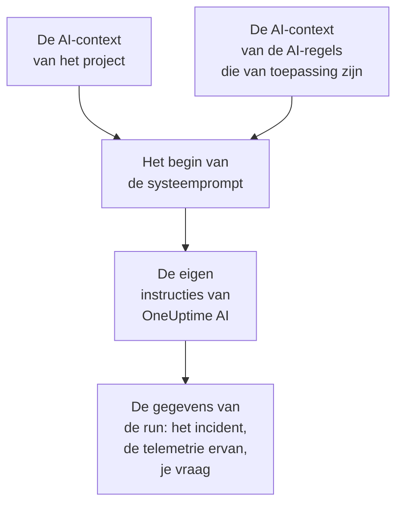

# AI-context

De AI-context is wat je team voor OneUptime AI opschrijft over je eigen systemen: hoe ze samenhangen, van wie elk symptoom is, waar de logs staan en welke woorden je team gebruikt. OneUptime AI leest hem als eerste in elk onderzoek, elke fix, elk postmortem-concept en elk gesprek met AI vragen, en begint zo bij wat je team al weet.

:::cards
- [De AI-context schrijven](#de-ai-context-schrijven): Eén kaart in de AI-instellingen van het project.
- [De eigen notities van een AI-regel](#de-eigen-notities-van-een-ai-regel): Notities over waar één regel op van toepassing is.
- [Wat hem leest](#wat-hem-leest): De functies die hem lezen, en de functies die dat niet doen.
- [Wat een run heeft gelezen](#wat-een-run-heeft-gelezen): Elke run laat de notities zien die hij heeft gekregen.
:::

## Zo werkt het

OneUptime AI zet de AI-context helemaal aan het begin van zijn systeemprompt, vóór zijn eigen instructies en de gegevens van de run: eerst de notities van het project, dan die van de AI-regels die van toepassing zijn. Hij leest ze als achtergrondkennis van je team. Ze zijn geen bewijs van wat er nu gebeurt, en ze veranderen nooit de eigen regels van OneUptime AI.

Omdat de notities als eerste komen en van de ene run tot de volgende gelijk blijven, horen ze bij het begin van de prompt dat providers in de cache bewaren. Bij Anthropic markeert OneUptime de systeemprompt voor de cache; OpenAI, Azure OpenAI en de andere providers die een herhaald begin van een prompt in de cache bewaren, doen dat zelf. Notities die niet zijn veranderd, kosten minder om opnieuw te lezen.

## De AI-context schrijven

:::steps
### AI Features openen
Open **Projectinstellingen → AI → AI Features**. De kaart **AI-context** staat onder **AI inschakelen**.

### De notities schrijven
Klik op **AI-context toevoegen**, of op **Bewerken** zodra er notities zijn. Schrijf in Markdown, of klik op **Beginnen met een opzet** voor een kop voor elk soort notitie.

### Ze opslaan
Klik op **Wijzigingen opslaan**. De kaart toont de notities, hoe lang ze zijn en ongeveer hoeveel tokens een model eraan leest.
:::

Schrijf op wat je zou vertellen aan iemand die net in het team begint:

| Soort notitie | Bijvoorbeeld |
| --- | --- |
| Hoe je systemen samenhangen | `checkout-api` levert de afrekenpagina en is afhankelijk van `payments-db`. |
| Van wie elk symptoom is | Een 502 op de afrekenpagina is van het team Betalingen: controleer eerst `payments-db`. |
| Waar de logs staan | De logs van het afrekenen staan in Loki onder `app=checkout`. |
| De woorden van je team | PSP is onze betaaldienstverlener. |

> [!WARNING]
> Laat geheimen weg: iedereen die kan zien wat een AI-run heeft gedaan, kan de notities lezen die hij heeft gekregen.

## De eigen notities van een AI-regel

Een AI-regel kan eigen notities hebben over de incidenten of waarschuwingen waarop hij van toepassing is: de diensten van één product, wie ze beheert, waar hun logs staan. Schrijf ze in het veld **AI-context** van de regel, onder **Meer velden**, na **LLM-provider**. Een regel die alleen elke keer zijn runbooks uitvoert, vraagt OneUptime AI niets en heeft dus geen AI-context om te schrijven.

- Een onderzoek leest de notities van het project, dan die van elke ingeschakelde AI-regel die onderzoekt en van toepassing is op het incident of de waarschuwing, in de volgorde van de namen van de regels.
- Een fix leest de notities van het project, dan die van zijn eigen regel.
- Het gesprek over een incident of een waarschuwing leest dezelfde notities als het onderzoek ervan.

## Wat hem leest

| Functie | Wat die leest |
| --- | --- |
| Onderzoeken van AI SRE, en hun nieuwe controles wanneer er een nieuwe waarschuwing opent | De notities van het project, en die van de AI-regels die van toepassing zijn |
| De fixes die een AI-regel start: hun plannen, opdrachten en MCP-servers | De notities van het project, en die van de regel |
| AI vragen, en het gesprek over een incident of een waarschuwing | De notities van het project; bij een incident of een waarschuwing ook die van de AI-regels die van toepassing zijn |
| Antwoorden in Slack en Microsoft Teams | De notities van het project |
| Postmortem-concepten, voor incidenten en episodes | De notities van het project |
| De triage van AI Insights en die van beveiligingszaken | De notities van het project |

Aanroepen die alleen herformuleren of beoordelen wat ze krijgen, lezen hem niet: concepten van notities en openbare notities, samenvattingen van gesprekken, de samenvatting, de zekerheid en het cijfer van een onderzoek, en de titel van een gesprek. Evenmin de prompts die mensen zelf schrijven, in de AI-stap van een workflow.

## Limieten

| Wat | Maximaal |
| --- | --- |
| De AI-context van het project | 20.000 tekens |
| De AI-context van een AI-regel | 5.000 tekens |
| Alle AI-context die één run leest | 30.000 tekens |

Het formulier telt de tekens terwijl je typt en weigert op te slaan boven de limiet, en de API ook. Een run leest eerst de notities van het project, dan die van elke regel die van toepassing is, in de volgorde van hun namen. Een regel waarvan de notities de run boven de 30.000 tekens zouden brengen, wordt helemaal weggelaten, en de activiteit van de run zegt dat.

Het aantal tokens is een schatting: de grootte van de notities in UTF-8-bytes gedeeld door 4, naar boven afgerond. Elk model telt tokens op zijn eigen manier, dus de telling van een provider kan afwijken, vooral bij tekst die niet in het Engels is.

## Wat een run heeft gelezen

Elke run legt woord voor woord vast welke notities hij heeft gelezen. Zijn activiteit zegt **AI-context van het project gelezen**, of van hoeveel AI-regels hij ook de notities heeft gelezen, met ongeveer hoeveel tokens dat was. **Bekijken** opent de notities zoals de run ze heeft gelezen: eerst die van het project, dan die van elke regel onder zijn naam, ook nadat ze zijn gewijzigd. Als de notities van een regel zijn weggelaten vanwege de limiet van de run, zegt een melding dat.

## Wie hem kan wijzigen

- **Project Owner** en **Project Admin** kunnen de AI-context van het project wijzigen. **Project Member**, **Viewer** en **Read Project** kunnen hem lezen.
- De notities van een AI-regel horen bij de regel: wie de regel kan wijzigen, kan ze wijzigen.
- De notities worden alleen ooit gelezen voor hun eigen project: geen enkele run leest de AI-context van een ander project.

Via de API of Terraform zijn de notities van het project de `aiContext` van het project, en die van een AI-regel de eigen `aiContext` van de regel.

## Volgende stappen

:::cards
- [AI SRE](/docs/ai/ai-sre): Laat OneUptime AI elk nieuw incident en elke nieuwe waarschuwing onderzoeken.
- [AI vragen](/docs/ai/ask-ai): Vraag in een gesprek naar de gegevens van je project.
- [LLM-providers](/docs/ai/llm-provider): Kies het model dat de notities leest.
:::
