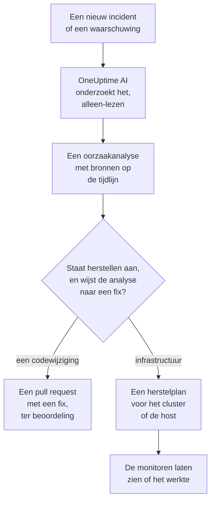
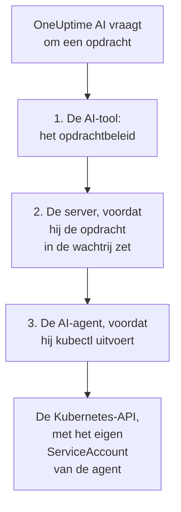

# AI SRE

OneUptime AI is je AI-Site Reliability Engineer. Zodra een nieuw incident of een nieuwe waarschuwing wordt gemeld, komt het in actie, onderzoekt het aan de hand van je eigen telemetrie (logs, metrics, traces, exceptions, monitoren en recente wijzigingen) en plaatst het een oorzaakanalyse met bronvermelding op de tijdlijn van het incident of de waarschuwing, meestal voordat de on-call-engineer de melding heeft uitgelezen.

Elke bewering in de analyse heeft een bronvermelding die rechtstreeks linkt naar de exacte gegevens die haar onderbouwen, en het onderzoek zelf is **strikt alleen-lezen**: OneUptime AI kan tijdens het onderzoeken nooit iets in je project wijzigen.

:::cards
- [Zo werkt het](#zo-werkt-het): Van een nieuw incident naar een analyse met bronnen, en naar een fix wanneer je die toestaat.
- [AI-onderzoeken inschakelen](#ai-onderzoeken-inschakelen): De schakelaars, en wat ze nodig hebben.
- [Clustertoegang: laat OneUptime AI kubectl uitvoeren](#clustertoegang-laat-oneuptime-ai-kubectl-uitvoeren): Onderzoeken, en herstellen, binnen Kubernetes.
- [Kostenbeheersing](#kostenbeheersing): Limieten voor incidenten, voor waarschuwingen en voor het hele project.
:::

## Zo werkt het

OneUptime AI doet drie dingen voor een nieuw incident of een nieuwe waarschuwing, en elk heeft een eigen schakelaar:

- **Het onderzoekt** (standaard aan). Het leest je telemetrie, en de clusters en hosts waarop een AI-agent draait, en plaatst een oorzaakanalyse met bronvermelding. Een onderzoek wijzigt niets.
- **Het herstelt** (standaard uit). Als herstellen aan staat, wordt een zekere analyse een fix: een pull request voor een wijziging in je code, of een plan met opdrachten voor een cluster of host, uitgevoerd zoals de AI-agent van dat cluster of die host toestaat.
- **Het leert.** De pagina's van AI Insights vertellen wat steeds misgaat, afgeleid uit alles wat is vastgelegd.



Een analyse die geen oorzaak vindt, wordt stil geplaatst, zonder iemand op te roepen (zie [Stille modus](#stille-modus)), en zonder oorzaak wordt er niets hersteld.

## Wat het onderzoek plaatst

Als een onderzoek klaar is, plaatst OneUptime AI een oorzaakanalyse met deze secties:

- **Summary**: een of twee zinnen die een opgeroepen engineer in vijf seconden kan lezen.
- **Most likely root cause**: de hypothese, met alleen de zekerheid die het bewijs toelaat, en elke feitelijke bewering met bronvermelding. Is de telemetrie onvoldoende, dan zegt de AI dat duidelijk en somt ze op wat ze heeft gecontroleerd in plaats van te gokken.
- **Evidence**: de belangrijkste bevindingen die de hypothese ondersteunen of uitsluiten, elk met bronvermelding.
- **Suggested next steps**: concrete acties voor de on-call-engineer.

Bij incidenten wordt de analyse in de feed van het incident geplaatst **en** als interne notitie bij het incident (waar de hulpverleners samenwerken). Bij waarschuwingen wordt ze in de feed van de waarschuwing geplaatst.

Terwijl het onderzoek loopt, toont de pagina van het incident of de waarschuwing een live paneel **AI Investigation** dat elke stap beschrijft (welke tools draaiden, wat ze vonden en hoe lang ze duurden), zodat je het kunt zien nadenken. Mislukt een onderzoek, dan toont het paneel de reden in plaats van een stille leemte.

Een onderzoek loopt tot het klaar is: het heeft **geen tijdslimiet** en geen klein querybudget, dus het kan elke query en elke kubectl- of infrastructuuropdracht uitvoeren die het nodig heeft. Een lange opdrachtuitvoer (een `kubectl describe node` van een drukke node, de logs van een pod) wordt nooit afgekapt: OneUptime AI leest die pagina voor pagina. Wil je een harde stop, stel dan per signaaltype een **tijdslimiet voor onderzoeken** in (zie **Kostenbeheersing** hieronder).

### Als de logboeken niets te zeggen hadden

Een onderzoek dat geen oorzaak kon vaststellen, en in geen van zijn zoekopdrachten een logregel vond, zegt waarom op de kaart **AI Investigation**, onder zijn rapport, met de weg vooruit:

- **Geen logboeken om te lezen**: er bereikte geen logboek OneUptime vanaf het uur voor het begin van het incident of de waarschuwing. **Logboeken instellen** opent de installatiegids van de logboeken: stuur de logboeken van uw diensten naar OneUptime, dan kan het volgende onderzoek ze gebruiken.
- **Geen logboeken over dit incident** (bij een waarschuwing **Geen logboeken over deze waarschuwing**): er bereikten logboeken OneUptime, en geen zoekopdracht van het onderzoek vond er iets over. **Logboeken instellen** helpt als een betrokken dienst zijn logboeken nog niet stuurt, en **Niet-gelogde storingen vinden** opent **Logboeken → AI**, dat de storingen vindt die uw code niet logt en de logging toevoegt met een pull request.

OneUptime beslist dit op grond van wat het weet, nooit op grond van wat de analyse zegt: hetzelfde door de server gecontroleerde oordeel als de [stille modus](#stille-modus), de eigen logzoekopdrachten van het onderzoek, en één controle of er in die periode een logboek het project bereikte. Een onderzoek dat de oorzaak vond, of een logregel, zegt niets van dien aard.

## Wat een onderzoek leest

Een onderzoek begint bij het incident of de waarschuwing en bij de infrastructuur waaraan het is gekoppeld: de hosts, Docker- en Podman-hosts, Kubernetes-clusters, databases en services die de monitors ervan bewaken. Een website-, API- of synthetische monitor bewaakt waaraan je hem koppelt onder **Monitor → Overzicht → Gekoppelde resources**, dus koppel hem aan de hosts die leveren wat hij controleert, en elk onderzoek van zijn incidenten begint daar. Vóór dat alles leest het de [AI-context](/docs/ai/ai-context) van het project: wat je team voor OneUptime AI over je eigen systemen heeft opgeschreven, met de notities van de AI-regels die van toepassing zijn.

- De waarschuwingen op die infrastructuur die in de 30 minuten vóór het incident zijn geopend, of nog open staan, de nieuwste eerst, zoals de waarschuwing voor hoge CPU van de host achter een trage site. Privéwaarschuwingen worden weggelaten.
- De eigen metrics van de infrastructuur, gelezen zoals mensen ze lezen. Hostmetrics zoals `system.cpu.utilization` en `system.memory.utilization` worden één keer per status gerapporteerd, en de statussen tellen op tot 100%, dus één gemiddelde over alle zegt niets. OneUptime AI leest ze status voor status (bezette CPU is user plus system), en elke metric per container, per koppelpunt of naar elk ander attribuut.
- De containers van een Docker- of Podman-host: de drukste naar CPU, geheugen of herstarts, en de containers die niets meer melden. Een gestopte container stuurt niets in plaats van nul, dus de cijfers van de hele host verbergen hem.
- De wijzigingen die zijn vastgelegd in de 2 uur vóór het incident of de waarschuwing (deploys, Kubernetes-rollouts, configuratiewijzigingen en de fixes die OneUptime uitvoerde), en welke daarvan door de telemetrie van de bijbehorende services verdacht worden: een service die direct na een wijziging meetbaar slechter werd. Zie [Deploys en wijzigingen](/docs/telemetry/change-events).

De activiteit van het onderzoek op de kaart **AI Investigation** zegt hoeveel open of recente waarschuwingen het heeft gelezen, en op welke resources.

### Opnieuw gecontroleerd als er een nieuwe waarschuwing opent

Een onderzoek begint zodra een incident wordt gemeld, en een hostwaarschuwing die een paar minuten aan metrics nodig heeft, kan daarna openen. Opent er binnen 30 minuten na het incident een waarschuwing op de gekoppelde infrastructuur van het incident, nadat het onderzoek die heeft gelezen, en staat het incident nog open, dan controleert OneUptime AI het incident nog één keer met die waarschuwing in de hand. De nieuwe analyse begint met **Checked again** en de waarschuwing die de controle startte, en de activiteit zegt het ook. Liet een AI-regel OneUptime AI wachten voordat het het incident onderzocht, dan tellen die minuten in plaats daarvan vanaf het moment dat dat onderzoek klaar was (zie [Wachten voor het onderzoek](#wachten-voor-het-onderzoek)).

Dat gebeurt hoogstens één keer per incident, met dezelfde schakelaars en limieten als een nieuw onderzoek: **AI inschakelen**, _Nieuwe incidenten onderzoeken_, de AI-tegoeden en de dagelijkse en gelijktijdigheidslimieten. Er is niets in te schakelen. Een vervolgcontrole voert de automatische herstelacties nooit opnieuw uit en krijgt zelf nooit een vervolg, en het onderzoek van een waarschuwing wordt niet opnieuw gecontroleerd.

## Praat met OneUptime AI over het incident

De kaart **AI Investigation** eindigt met een gesprek, **Ask OneUptime AI**, dat iedereen deelt die het incident of de waarschuwing kan zien. Het is één kaart, wat er ook boven gebeurde: onder een rapport stel je vervolgvragen, en als er geen automatisch onderzoek liep (of het stopte voor het rapport) is de eerste suggestie **Wat is de hoofdoorzaak?**, waarmee OneUptime AI op verzoek onderzoekt. De suggesties volgen waar het incident of de waarschuwing staat: na de bevestiging stelt geen enkele meer voor om te bevestigen, en na het oplossen vragen ze hoe de reactie verliep en wat herhaling zou voorkomen.

- **Vervolgvragen stellen**: "welke pods gebruiken het meeste geheugen?", "wat veranderde er vlak voordat dit begon?", "is er nog iets anders getroffen?". OneUptime AI bouwt voort op zijn rapport, vraagt verse gegevens op (en voert alleen-lezen kubectl- of infrastructuuropdrachten uit waar het toegang heeft, op de clusters en resources die je mag zien) en voorziet elke bewering van een bron.
- **Het laten handelen**: "bevestig dit incident", "plaats een statusupdate dat we het onderzoeken", "roep de database-on-call op", "verhoog de ernst". Het gebruikt dezelfde acties als AI vragen en handelt altijd **met je eigen rechten**, dus het kan nooit meer doen dan jij.
- **Kies hoe het handelt** met de schakelaar in het berichtvak, die ernaast zegt wat de gekozen modus betekent: _Auto-run_ (de standaard: het handelt meteen op een duidelijk verzoek), _Ask to act_ (het toont eerst een goedkeuringskaart, die iedereen bij het incident kan goedkeuren of weigeren) of _Alleen-lezen_.
- **Eén gedeeld gesprek.** Elke vraag toont wie haar stelde, iedereen ziet live hetzelfde gesprek en iedereen kan een lopend antwoord stoppen. Grafieken en tabellen in een antwoord worden getoond aan wie de vraag stelde; alle anderen zien het antwoord met bronnen. Elk antwoord somt zijn **Bronnen** op, en een bron met een eigen pagina (logs, metrics, een monitor) opent die. Een lang gesprek opent bij de nieuwste berichten, met een knop erboven (bijvoorbeeld **Show 6 earlier messages**) die de rest terughaalt.

Een incident of waarschuwing dat OneUptime AI niet heeft onderzocht en niet heeft hersteld omdat AI ervoor uit stond — uit voor het project, _Nieuwe incidenten onderzoeken_ (of voor waarschuwingen) uit toen het werd aangemaakt, geen AI-regel die onderzoekt die erbij paste, of de ernst onder het minimum — krijgt in plaats daarvan een kaart van één regel: **AI-onderzoek staat uit** (of **AI staat uit voor dit project**, zolang dat zo is; **AI-onderzoek stond uit** zodra het weer aan staat), en waarom. Het pijltje, **Wat je kunt doen**, opent wat je moet aanzetten, met een link naar waar je dat wijzigt voor wie het mag wijzigen, en wie het kan wijzigen voor alle anderen; een wijziging geldt alleen voor nieuwe incidenten en waarschuwingen, niet voor dit incident. Zolang AI aan staat, opent **Ask OneUptime AI** op de regel het gesprek, en een gesprek dat iemand al is begonnen staat vanzelf onder de regel. De kaart **Herstel** wordt dan weggelaten: de regel zegt waarom er niets is hersteld.

## AI-onderzoeken inschakelen

Autonome onderzoeken staan **standaard aan voor nieuwe projecten**. Dat geldt ook voor postmortem-concepten en AI Insights. Herstellen begint uitgeschakeld, en de pull requests die erbij horen worden alleen geopend zolang het aan staat (zie [Automatische codefixes](#automatische-codefixes)). Een project dat vóór deze standaard is aangemaakt, houdt zijn instelling; schakel onderzoeken in zoals in stap 3, of met **Inschakelen** op de pagina **AI-agent** van een willekeurig Kubernetes-cluster (Project Owner of Project Admin). Zo controleer of wijzig je ze:

:::steps
1. **Configureer een LLM-provider.** Zelf gehoste installaties gebruiken hun eigen sleutel (of draaien volledig afgeschermd met een lokale Ollama): zie [LLM-providers](/docs/ai/llm-provider). Gebruikers van OneUptime Cloud kunnen de vooraf geconfigureerde globale provider gebruiken, gefactureerd als gemeten AI-tokens, dus het project heeft AI-tegoed nodig: een projecteigenaar of iemand met **Manage Billing** voegt het toe op **Projectinstellingen → AI → AI-tegoeden**, waar **Automatisch bijvullen** voorkomt dat het opraakt.
2. **Zorg dat AI voor het project is ingeschakeld** (standaard is dat zo): **AI inschakelen**, op **Projectinstellingen → AI → AI Features**.
3. **Kies per signaaltype** (beide aan voor nieuwe projecten):
   - Incidenten: **Incidenten → AI → Instellingen**: schakel _Nieuwe incidenten onderzoeken_ in.
   - Waarschuwingen: **Waarschuwingen → AI → Instellingen**: schakel _Nieuwe waarschuwingen onderzoeken_ in.
:::

Elk AI-gedrag op die pagina's is een schakelaar die opslaat zodra je hem omzet; er is geen knop Opslaan. De incidentpagina heeft er drie, onder **Wat OneUptime AI doet**: _Nieuwe incidenten onderzoeken_, _Nieuwe incidenten automatisch herstellen_ en _Een postmortem opstellen wanneer een incident is opgelost_. De waarschuwingspagina heeft dezelfde, zonder de postmortem. _Nieuwe incidenten automatisch herstellen_ (en _Nieuwe waarschuwingen automatisch herstellen_) begint **uit**, ook voor nieuwe projecten: het laat OneUptime AI je infrastructuur wijzigen, dus een project zet het zelf aan; zie [Welke incidenten worden onderzocht en hersteld](#welke-incidenten-worden-onderzocht-en-hersteld). De pull requests die het opent, een fix voor je code en de telemetrie die een onderzoek miste, horen erbij, en elke AI-regel stelt ze in: zonder regel worden beide geopend, en een regel kan elk van de twee uitzetten onder **Meer velden** (zie [Automatische codefixes](#automatische-codefixes)). Project Owners en Project Admins kunnen ze wijzigen; voor alle anderen is elke schakelaar vergrendeld en staat erbij welke rechten nodig zijn.

De pagina's zeggen twee dingen alleen als ze waar zijn. Staat **AI inschakelen** uit, dan draait er niets op, en de pagina zegt dat bovenaan, met de schakelaar AI inschakelen zelf voor wie hem mag wijzigen (Project Owners, en iedereen met Manage Billing); alle anderen horen wie het kan. Heeft het project geen LLM-provider die OneUptime AI kan gebruiken (helemaal geen, of wel providers maar geen enkele als standaard ingesteld), dan zegt de pagina ook dat, met een link naar **Projectinstellingen → AI → LLM-providers**. Op OneUptime Cloud telt de globale provider mee, dus daar wordt niets gezegd.

Incidenten en waarschuwingen worden onafhankelijk geconfigureerd, zodat je elk signaaltype een eigen gelijktijdigheidslimiet, dagelijks tokenbudget, budget voor fix-taken en eigen regels kunt geven. Geen van die limieten geldt totdat je hem instelt: ze zijn onderaan elke pagina ingeklapt onder **Meer instellingen**; zie **Kostenbeheersing** hieronder. Een AI-instelling voor waarschuwingen wijzigen, wijzigt niet de bijbehorende instelling voor incidenten, en omgekeerd.

Herstellen bouwt voort op onderzoeken: zolang **Nieuwe incidenten automatisch herstellen** (of voor waarschuwingen) aan staat, opent een onderzoek dat met zekerheid een codewijziging in een repository vaststelt automatisch een pull request met een fix; zie **Automatische codefixes** hieronder.

## Clustertoegang: laat OneUptime AI kubectl uitvoeren

Standaard kan een onderzoek alleen de telemetrie gebruiken die je agents versturen. Voor een Kubernetes-signaal is dat vaak niet genoeg: "pods die in Pending blijven hangen" is een planningsprobleem dat je diagnosticeert door de pod te beschrijven en de events ervan te lezen, niet door naar een metric te kijken. De **Kubernetes-AI-agent** laat OneUptime AI precies dat doen en, als je het toestaat, herstellen wat het vindt.

De pagina van elk cluster heeft een sectie **AI** in het zijmenu:

- **Agent**: de pagina **AI-agent** van het cluster: of de agent verbonden is, wat AI op het cluster mag doen en alles wat aandacht nodig heeft, elk met de stap die het oplost. Dezelfde uitleg verschijnt in het onderzoekspaneel van het incident wanneer AI alleen met gegevens van OneUptime moest onderzoeken.
- **Inzichten**: de pagina **AI-inzichten** van het cluster: wat OneUptime AI over het cluster te weten kwam, wat steeds misgaat en waarom, en wat je eraan kunt doen (zie [Wat AI op een cluster heeft geleerd](#wat-ai-op-een-cluster-heeft-geleerd)).
- **Logboeken**: de pagina **AI-logboeken** van het cluster: alles wat OneUptime AI op het cluster deed, het nieuwste eerst (zie [Alles wat AI op een cluster deed](#alles-wat-ai-op-een-cluster-deed)).

Het **Overzicht** van het cluster eindigt met een kaart **AI-agent** die de pagina van de AI-agent samenvat: of de agent verbonden is, of **Onderzoeken met kubectl** aan staat, hoe fixes worden uitgevoerd (**Uit**, **Om goedkeuring vragen**, **Automatisch** of **Goedkeuring overslaan**) en wat aandacht nodig heeft, met een link naar de pagina van de AI-agent, waar ze worden gewijzigd.

### De Kubernetes-AI-agent: standaard aan, alleen-lezen

De chart van de [Kubernetes-agent van OneUptime](/docs/telemetry/kubernetes-agent) draait standaard de Kubernetes-AI-agent: één kleine pod (`component=ai-agent`, image `oneuptime/kubernetes-ai-agent`) met een **alleen-lezen** ServiceAccount. Hij maakt verbinding met de API-sleutel die de chart al gebruikt, dus in het dashboard hoeft niets te worden ingesteld: binnen een minuut toont de pagina van de AI-agent van het cluster hem als **Verbonden** en staat **Onderzoeken met kubectl** aan, tenzij iemand daar al AI-instellingen voor het cluster had gekozen, die blijven zoals ze zijn.

Werk bij een agent die is geïnstalleerd voordat de Kubernetes-AI-agent bestond eerst je chartindex bij en voer daarna de upgrade uit:

```bash
helm repo update
helm upgrade kubernetes-agent oneuptime/kubernetes-agent \
  --namespace oneuptime-agent --reset-then-reuse-values \
  --set aiAgent.enabled=true
```

`kubernetes-agent` in `oneuptime-agent` zijn de releasenaam en de namespace die de installatie-instructies van het dashboard gebruiken; heb je de agent met andere namen geïnstalleerd, gebruik dan de jouwe (`helm list -A | grep kubernetes-agent` toont ze). Zonder `helm repo update` kan Helm de chart gebruiken waarmee je hebt geïnstalleerd, die `aiAgent` niet kent en faalt met `Additional property aiAgent is not allowed`. Upgrade bij een zelf gehoste OneUptime eerst OneUptime en dan de chart: zie [De agent upgraden](/docs/telemetry/kubernetes-agent#de-agent-upgraden). Om de chart zonder de AI-agent te draaien, geef je `--set aiAgent.enabled=false` mee.

**Verbinding testen**, in het menu **⋯** naast de status van de agent op de pagina van de AI-agent, voert `kubectl version` en `kubectl auth can-i --list` via de agent uit en toont de resultaten: wat hij kan bereiken en wat hij mag doen. Zegt de pagina dat de agent niet verbonden is, lees dan zijn log met `kubectl logs -n oneuptime-agent -l component=ai-agent --tail=100`. Een sleutel met een **Vastgezette servicenaam** kan de agent niet registreren: geef de chart een sleutel zonder. Weigert de server een registratie, dan zegt het log of de weigering vanzelf verdwijnt (een eerdere agent-pod die zich nog meldt, of de oude Runner in het cluster die tijdens een upgrade nog aan het afsluiten is) of wat je moet wijzigen. **Agent resetten**, in hetzelfde menu, laat de server de sleutel van de agent vergeten zodra je bevestigt; de pod maakt binnen enkele minuten vanzelf weer verbinding.

De Kubernetes-AI-agent is geen Runner en verschijnt nooit onder Runbooks → Runbook-agenten. Hij gebruikt alleen zijn eigen ServiceAccount, dus OneUptime geeft hem nooit inloggegevens, hij wordt nooit gebruikt als Bash/SSH-host voor runbooks en hij wordt nooit geaccepteerd als opdracht-Runner van een AI-regel.

### Wat AI mag doen: ingesteld door de agent

Wat OneUptime AI op een cluster mag doen, wordt ingesteld waar de agent draait, in de chart, met twee waarden:

- `aiAgent.investigation`: `true`: AI mag tijdens het onderzoeken alleen-lezen kubectl op het cluster uitvoeren. `false`: het onderzoekt nog steeds, met de gegevens die OneUptime al heeft.
- `aiAgent.fixes`: hoe AI een fix toepast: `off`, `ask-for-approval`, `automatic` of `bypass-approval` (zie [Zo werken fixes](#zo-werken-fixes)). Elk niveau behalve `off` geeft de AI-agent schrijftoegang; met `off` heeft hij die niet en weigert hij zelf elke schrijfactie.

De AI-agent meldt beide bij elke heartbeat aan OneUptime, en OneUptime past ze toe op het cluster. **Wat AI mag doen** op de pagina van de AI-agent van het cluster toont ze (**Aan** en het fixniveau, in het groen zodra ze aan staan) zonder dat je ze daar kunt wijzigen; **Wijzigen** toont elke optie met de exacte `helm upgrade` die haar instelt. Een wijziging die ergens anders wordt gedaan (op de pagina van de AI-agent, via de API of Terraform) wordt geweigerd zolang de agent ze instelt.

Een release die geen van beide waarden instelt, laat de agent zijn standaardwaarden gebruiken (onderzoek aan; fixes uit, of ask-for-approval met het oudere `aiAgent.remediation.enabled=true`). OneUptime past die standaardwaarden alleen toe op een cluster waarvan niemand de AI-instellingen op de pagina van de AI-agent heeft gekozen: daar gekozen instellingen blijven zoals ze zijn, en de pagina toont de opdracht die ze naar de chart verplaatst. Hetzelfde geldt voor een cluster waarvan de AI-agent te oud is om ze te melden: de chart upgraden met de twee waarden verplaatst ze.

### AI laten herstellen wat het vindt

Fixes staan uit totdat je ze inschakelt met `aiAgent.fixes`, wat de AI-agent ook schrijftoegang geeft, bij voorkeur alleen in de namespaces die AI mag herstellen en met node-bewerkingen uitgeschakeld:

```bash
helm repo update
helm upgrade kubernetes-agent oneuptime/kubernetes-agent \
  --namespace oneuptime-agent --reset-then-reuse-values \
  --set aiAgent.enabled=true \
  --set aiAgent.investigation=true \
  --set aiAgent.fixes=ask-for-approval \
  --set "aiAgent.remediation.namespaces={web,api}" \
  --set aiAgent.remediation.nodeOperations=false
```

Of voor het hele cluster:

```bash
helm repo update
helm upgrade kubernetes-agent oneuptime/kubernetes-agent \
  --namespace oneuptime-agent --reset-then-reuse-values \
  --set aiAgent.enabled=true \
  --set aiAgent.investigation=true \
  --set aiAgent.fixes=ask-for-approval \
  --set-json 'aiAgent.remediation.namespaces=[]'
```

Vervang `{web,api}` door de namespaces die AI mag herstellen. Elke opgegeven namespace moet al bestaan: de chart maakt in elk ervan één RoleBinding aan en maakt nooit een namespace aan, dus een ontbrekende laat de hele installatie of upgrade mislukken (de collector inbegrepen) met `namespaces "api" not found`. Maak hem eerst aan, of haal hem van de lijst; haal een namespace van de lijst voordat je hem verwijdert. Laat je de vlag weg bij een upgrade, dan blijft de lijst die in de release is opgeslagen behouden, dus om terug te gaan naar het hele cluster geef je `--set-json 'aiAgent.remediation.namespaces=[]'` mee (Helm 3.10+), zoals de tweede opdracht doet, en niet `={}`, dat Helm leest als één lege naam en dat de chart weigert. `--set aiAgent.remediation.namespaces=null` zet een opgeslagen lijst niet terug onder `--reuse-values`: Helm houdt de opgeslagen lijst aan. `aiAgent.remediation.nodeOperations=false` houdt fixes weg van nodes; zet het op `true` om AI nodes te laten afschermen, vrijgeven, leegmaken en van taints te laten voorzien (een drain, een taint of een patch van een node wacht nog steeds op een mens).

Gebruik `automatic` of `bypass-approval` in plaats van `ask-for-approval` voor meer autonomie, en `--set aiAgent.fixes=off` om fixes weer uit te schakelen, wat ook de schrijftoegang weghaalt. Fixes hebben ook twee projectschakelaars nodig. **Nieuwe incidenten automatisch herstellen** (op **Incidenten → AI → Instellingen**) en **Nieuwe waarschuwingen automatisch herstellen** (op **Waarschuwingen → AI → Instellingen**) beginnen uit: totdat er een aan staat, wordt er niets nieuws van die soort hersteld. **AI inschakelen** (**Projectinstellingen → AI → AI Features**) staat aan tenzij iemand het heeft uitgeschakeld; het schakelt alle AI voor het project uit, wat de configuratie van een agent ook zegt.

### Op welke incidenten de fixes van een cluster werken

Zolang **Nieuwe incidenten automatisch herstellen** aan staat en er geen AI-regel is ingesteld, herstelt OneUptime AI elk nieuw incident waaraan het cluster is gekoppeld, in de modus die de pagina van zijn AI-agent instelt, en hetzelfde voor waarschuwingen met **Nieuwe waarschuwingen automatisch herstellen**. Met regels herstelt het alleen de incidenten waarop een regel past die met OneUptime AI herstelt (zie [Welke incidenten worden onderzocht en hersteld](#welke-incidenten-worden-onderzocht-en-hersteld)). Waaraan het niet is gekoppeld, raakt het niet aan, hoe duidelijk de oorzaak ook in het cluster ligt. Een incident of waarschuwing is aan een cluster gekoppeld wanneer:

- de telemetrie waaruit het is ontstaan het cluster noemt (een metric-, log- of tracemonitor op de gegevens van het cluster);
- de monitor ervan een Kubernetes-monitor van het cluster is;
- de monitor ervan aan het cluster is gekoppeld onder **Monitor → Overzicht → Gekoppelde resources**, de manier om een website-, API- of synthetische monitor te koppelen aan het cluster dat levert wat hij controleert;
- AI vragen het op de pagina van het cluster heeft gemeld, of het op verzoek aan het cluster heeft gekoppeld;
- iemand het cluster bij het melden heeft gekozen onder **Andere getroffen resources** (een gekoppelde monitor kiezen voegt het daar voor je toe).

Elk incident en elke waarschuwing zegt op de kaart **Herstel** of het aan een cluster was gekoppeld en wat de fixes van het cluster deden; zie [Wat het automatische herstel deed](#wat-het-automatische-herstel-deed). Hetzelfde geldt voor een infrastructuurresource en zijn AI-agent.

### Wie het mag wijzigen

Zolang de Kubernetes-AI-agent onderzoek en fixes instelt, wijzigt degene die de waarden van de chart op het cluster mag wijzigen ze; OneUptime weigert een wijziging die ergens anders wordt gedaan. De regels hieronder gelden voor wat in OneUptime blijft (de kubectl-allowlist en de koppeling aan de vorige Runner in het cluster) en voor onderzoek en fixes op een cluster waarvan de instellingen nog in OneUptime worden ingesteld (zie [Wat AI mag doen: ingesteld door de agent](#wat-ai-mag-doen-ingesteld-door-de-agent)).

Fixes inschakelen (elke overgang van **Uit** naar een andere modus) en ze versoepelen (overschakelen naar **Automatisch** of **Goedkeuring overslaan**, de kubectl-allowlist schrijven of een Runner koppelen) vereist een Project Owner, een Project Admin of het recht **Edit AI Rule**, dezelfde mensen die een AI-regel mogen aanmaken die herstelt zonder te vragen. **Agent resetten** vereist dezelfde mensen als fixes inschakelen. Ze aanscherpen (**Uit**, terug naar **Om goedkeuring vragen**, de allowlist of de Runner-koppeling leegmaken) staat open voor iedereen die het cluster mag bewerken, net als **Verbinding testen** en het goedkeuren van een fix die OneUptime AI ervoor voorstelt. Voor dit alles is het recht nodig om juist dat cluster te bewerken: een recht dat beperkt is tot bepaalde labels, of tot de clusters die van jou of je teams zijn, reikt alleen tot die clusters, en een blokkaderegel met labels neemt de clusters weg die ze dragen.

### Wat een onderzoek mag uitvoeren

Met toegang voert een onderzoek **alleen-lezen** kubectl uit via de AI-agent (`get`, `describe`, `logs`, `events`, `top`, `rollout status/history`, `auth can-i`), zoveel opdrachten als het nodig heeft, en vermeldt elke opdracht als bron zoals elk ander bewijs. De uitvoer wordt nooit afgekapt: de agent bewaart er tot een megabyte van, en OneUptime AI leest een lange uitvoer pagina voor pagina. Drie onafhankelijke controles houden het alleen-lezen: het beleid dat elke opdracht indeelt, de server die weigert iets anders voor een onderzoek in de wachtrij te zetten, en de AI-agent, die hetzelfde beleid opnieuw controleert voordat hij kubectl start. "Alleen-lezen: er is niets in je systemen gewijzigd" blijft letterlijk waar.



### Zo werken fixes

**Oplossingen** op de pagina van de AI-agent hebben vier instellingen (de `aiAgent.fixes` van de chart: `off`, `ask-for-approval`, `automatic`, `bypass-approval`):

- **Uit**: AI onderzoekt alleen.
- **Om goedkeuring vragen**: na de oorzaakanalyse stelt OneUptime AI met kubectl een diagnose en stelt het kleinste kubectl-plan op dat de oorzaak aanpakt, bijvoorbeeld `kubectl rollout restart deployment/web -n web`. Het plan verschijnt bij het incident met de onderbouwing, het verwachte effect en de rollback; een mens keurt het met één klik goed, en OneUptime voert precies die opdrachten uit. Herstellen de monitoren niet, dan wordt de rollback uitgevoerd en stelt OneUptime AI nog één plan op, opnieuw ter goedkeuring, met de mislukte poging voor ogen, zodat het een andere aanpak kiest of zegt waar een mens naar moet kijken.
- **Automatisch**: veilige wijzigingen worden vanzelf uitgevoerd; een riskantere wijziging nooit. Kon de ronde alleen riskantere fixes vinden, dan eindigt ze met precies die voor te stellen ter goedkeuring met één klik. Heeft ze ook een veilige fix uitgevoerd, dan blijft de riskantere in de analyse en wordt die alleen voorgesteld als de verificatie laat zien dat de veilige fix de monitoren niet heeft hersteld, door de vervolgronde, die om goedkeuring vraagt. Zet de vorm van een riskantere opdracht op de allowlist op de pagina van de AI-agent en ook die wordt vanzelf uitgevoerd. De automatische modus lost het signaal ook op zodra de verificatie bevestigt dat de monitoren zijn hersteld, en hij heeft een stroomonderbreker van drie onbewaakte fixes per cluster per uur: daarboven, of zolang een andere onbewaakte ronde van OneUptime AI hetzelfde cluster nog wijzigt of verifieert, stelt een ronde haar plan ter goedkeuring voor in plaats van het uit te voeren.
- **Goedkeuring overslaan**: AI vraagt niets. Elke wijziging die het beleid toestaat, riskantere inbegrepen, wordt vanzelf uitgevoerd, net als de vervolgronde na een mislukte verificatie; het signaal lost zichzelf op zodra de verificatie het herstel bevestigt. Wat in elke modus een mens nodig heeft (hieronder), wacht nog steeds op een mens. Een ronde stelt haar plan ook ter goedkeuring voor in plaats van het uit te voeren, en zegt bij het incident waarom, wanneer:
  - de stroomonderbreker per uur (drie onbewaakte fixes per cluster per uur) is geactiveerd of niet kan worden gecontroleerd;
  - een andere onbewaakte ronde van OneUptime AI hetzelfde cluster nog wijzigt, of daar nog een fix verifieert (een waarschuwing en een incident van één monitor zijn het gebruikelijke geval), of dat niet kan worden gecontroleerd;
  - het de vervolgronde is na een fix waarvan de rollback niet is voltooid.

**Eerst terugdraaien.** Als OneUptime een Kubernetes-rollout op het cluster als verdacht voor het incident heeft gemarkeerd (zie [Deploys en wijzigingen](/docs/telemetry/change-events)), probeert OneUptime AI die terug te draaien vóór elke andere fix. OneUptime stelt de `kubectl rollout undo` samen uit de vastgelegde wijziging, nooit uit wat het model schrijft, en die wordt uitgevoerd of wacht op goedkeuring zoals elke veilige wijziging in de modus van het cluster. Hij wordt niet aangeboden als de Deployment na die rollout opnieuw is gewijzigd, omdat het terugdraaien dan ook de latere wijziging ongedaan zou maken.

**Workloads die Argo CD, Flux of Helm declareert.** Veel clusters declareren hun workloads in git en laten Argo CD of Flux dat toepassen, of installeren ze met Helm, en een kubectl-wijziging aan wat daar is gedeclareerd blijft niet: Argo CD zet haar binnen seconden terug als de Application self-heal aan heeft (anders bij de volgende synchronisatie), Flux bij zijn volgende reconciliatie en een Helm-release bij zijn volgende upgrade. Daarom leest OneUptime, voordat OneUptime AI een kubectl-wijziging uitvoert of voorstelt, met alleen-lezen kubectl via de AI-agent van het cluster het object dat ze wijzigt (bij een ReplicaSet de bijbehorende Deployment) en wie het declareert: Argo CD (de annotatie `argocd.argoproj.io/tracking-id`, het label `argocd.argoproj.io/instance` of zijn field manager), Flux (de labels `kustomize.toolkit.fluxcd.io/*` of `helm.toolkit.fluxcd.io/*`) of een Helm-release (de annotatie `meta.helm.sh/release-name` of het label `app.kubernetes.io/managed-by: Helm`). Een wijziging die Argo CD of Flux terugzet (`rollout undo`, eerst terugdraaien inbegrepen, `scale` als git het aantal replica's vastlegt, `set image/env/resources`, `patch`, een workload verwijderen) wordt nooit vanzelf uitgevoerd, in geen enkele modus, Goedkeuring overslaan en de allowlist inbegrepen: ze wordt voorgesteld ter goedkeuring met één klik als **tijdelijke oplossing**, en het plan noemt de blijvende oplossing, dezelfde wijziging in git (het manifest, de Helm-values of de Kustomize-overlay waaruit de workload ontstaat). Argo CD en Helm laten met rust wat git niet declareert, zoals een `rollout restart`, een `rollout pause` of een toegevoegde annotatie, dus zo'n wijziging wordt uitgevoerd zoals de modus van het cluster bepaalt. Een Flux-Kustomization verwijdert zelfs dat bij zijn volgende reconciliatie, dus daar zijn een pauze, een label of een annotatie ook een tijdelijke oplossing. Een herstart wordt bij Flux toch uitgevoerd zoals de modus bepaalt: als Flux de annotatie ervan verwijdert, herstarten de pods nog een keer, maar de herstart wordt niet ongedaan gemaakt. Een falende pod verwijderen wordt uitgevoerd zoals de modus bepaalt, wie de workload ook declareert: git declareert nooit een pod, en zijn ReplicaSet vervangt hem. Een Helm-release zet een wijziging pas bij zijn volgende upgrade terug, dus daar wordt de wijziging ook uitgevoerd zoals de modus van het cluster bepaalt, en het plan zegt dat ze tijdelijk is.

**De verificatie merkt een teruggezette fix op.** OneUptime leest het object dat een kubectl-fix wijzigt vlak voordat en vlak nadat ze wordt uitgevoerd, en opnieuw om de paar minuten zolang het verificatievenster open is. Een fix die weer op haar oude waarden staat (teruggezet door Argo CD, Flux, een Helm-upgrade, een operator of een autoscaler) laat de verificatie meteen mislukken, en de notitie zegt wie haar terugzette en waar de blijvende wijziging hoort. Haar rollback wordt niet uitgevoerd: het cluster heeft haar al ongedaan gemaakt, en ongedaan maken zou de fix opnieuw kunnen toepassen. Een wijziging die Argo CD of Flux terugzet, wordt aan het einde van haar venster beoordeeld, niet zodra de monitoren herstellen. Een herstart laat niets over om in de gaten te houden: de pods ervan zijn vervangen, wat er later ook met de annotatie gebeurt.

Een **veilige** wijziging raakt precies één object met een naam: `rollout restart/undo/pause/resume`, `scale` (naar alles behalve 0), een pod met een naam verwijderen, `cordon`/`uncordon`, en `label`/`annotate` op één Pod, Deployment, StatefulSet, DaemonSet, ReplicaSet, Job of CronJob met een naam en een gewone sleutel (geen gereserveerde zoals `*.kubernetes.io/…` of `*.k8s.io/…`). Al het andere dat het beleid toestaat is **riskanter**: dezelfde werkwoorden op een kale soort (`rollout restart deployment`), op meerdere objecten, met een selector of met `--all`; `scale` naar 0; een job verwijderen; `taint`; `drain`; `patch`; `set image/env/resources`; `create`; verwijderen met `--force`; en labels of annotaties op elke andere soort of met een gereserveerde sleutel.

Sommige grenzen gelden in **elke** modus, Goedkeuring overslaan inbegrepen, en geen enkele regel op de allowlist verandert ze:

- Een schrijfactie in **kube-system**, **kube-public** of **kube-node-lease** heeft altijd een mens nodig. Een custom resource wordt beoordeeld op de namespace waarin hij wordt geschreven, ook een waarvan de naam lijkt op een ingebouwde soort op clusterniveau (`nodes.example.com`, `namespaces.example.com`).
- Een `drain`, een `taint` of een `patch` van een node heeft altijd een mens nodig. Een node leegmaken zet pods uit in elke namespace (de drie hierboven en die van de agent zelf inbegrepen), en een `NoExecute`-taint zet ze ook uit, of `kubectl taint` hem nu instelt of een `patch` van de node.
- De AI-agent wijzigt nooit iets in zijn eigen namespace (een fix daar zou de Kubernetes-agent, of de AI-agent zelf, kunnen wegschalen), niets buiten de namespaces waarin zijn chart hem laat schrijven (`aiAgent.remediation.namespaces`), en geen node wanneer zijn chart node-bewerkingen heeft uitgeschakeld (`aiAgent.remediation.nodeOperations=false`). OneUptime leest die reikwijdte uit wat de AI-agent meldt en weigert zo'n fix wanneer OneUptime AI hem voorstelt en opnieuw wanneer iemand hem goedkeurt, dus hij bereikt de AI-agent nooit als mislukte fix; de AI-agent weigert hem ook, voordat hij `kubectl` start.
- Destructieve opdrachten (hieronder) worden nooit uitgevoerd, zelfs niet met goedkeuring van een mens.

De allowlist van de automatische modus wordt woord voor woord vergeleken met de ontlede opdracht, niet als vrije tekst: `*` staat voor precies één woord (een image, een naam), nooit voor extra objecten, vlaggen of een tweede `-n`, en elke vlag die de opdracht gebruikt, moet in de regel uitgeschreven staan. `kubectl set image deployment/web * -n web` staat een nieuwe image toe voor `web` in `web`, verder niets. Een regel moet zijn werkwoord uitschrijven (en de subopdracht van `rollout`, `set` of `create`) in plaats van daarvoor `*` te gebruiken, en moet na de optionele `kubectl` aan het begin meer dan één woord hebben; een regel die deze regels breekt, zoals `scale` of `kubectl *`, zou nooit een wijziging vooraf kunnen goedkeuren en wordt bij het opslaan geweigerd.

:::details Opdrachten die nooit worden uitgevoerd, en hoe een opdracht wordt gelezen
Sommige opdrachten worden **nooit** uitgevoerd, in welke modus ook en zelfs met goedkeuring van een mens. Het opdrachtbeleid weigert ze, en het wordt drie keer afgedwongen (door de tool van de server, door het knelpunt waar de server opdrachten in de wachtrij zet en door de AI-agent voordat hij `kubectl` start): `exec`, `attach`, `cp`, `port-forward`, `proxy`, `debug`, `run`, `edit`, `apply`, `replace`, `diff`, kubectl-plug-ins en elk ander werkwoord dat niet op de lijst staat, elke invoer uit een bestand (`-f`, `-k`) of uitvoerindeling die een bestand leest (`-o jsonpath-file=`, `-o go-template-file=`, `-o custom-columns-file=`, `--template`, en een kale `-o jsonpath`/`go-template`/`custom-columns` zonder inline template), vlaggen voor inloggegevens, voor imitatie (`--as`, `--as-group`, `--as-uid`, `--as-user-extra`), voor clusterselectie, `--kuberc`, voor de ruwe API en voor uitgebreide logging, Secret-objecten met **elk** werkwoord (OneUptime AI leest, wijzigt, verwijdert of maakt nooit een Secret, en `create secret`, `create token` en `set env --resolve` worden samen daarmee geweigerd), alles wat RBAC toekent (`create role`, `create clusterrole`, `create rolebinding`, `create clusterrolebinding`, `set subject`), `certificate approve`, `set serviceaccount`, `create deployment`, `create cronjob` of `create job` met `--image` (`create job --from=cronjob/…` blijft een riskantere wijziging), `expose --overrides` of `--override-type` (de override kan kubectl een Job, een ClusterRoleBinding of elke andere soort object laten maken in plaats van een Service), een `patch`-body die geen JSON is (kubectl zou hem als YAML lezen, waarvan de tags een veld kunnen schrijven dat geen enkele controle ziet), patches die het ServiceAccount, de volumes of de beveiligingsinstellingen van een pod-template wijzigen (hostpoorten, de opt-out van de gebruikersnamespace `hostUsers` en de runtimeklasse `runtimeClassName` inbegrepen), patches die een heel deel van een pod-template vervangen in plaats van er velden in te zetten (een strategic-merge `$patch: replace`, een merge patch die een hele `containers`-lijst zet, of een JSON patch die de pod-spec vervangt of verwijdert), wat die instellingen zou laten vallen zonder ze te noemen, een label of annotatie op Namespace-objecten die met `--all` of een selector zijn gekozen in plaats van op naam, elke schrijfactie (`patch`, `label`, `annotate`, `set`) op RBAC-objecten, CustomResourceDefinitions, APIServices, configuraties van admission-webhooks of admission-beleid, schrijfacties met `--all-namespaces`, `delete --all`, en het verwijderen van namespaces, nodes, volumes, CRD's of clusterrollen. Vlaggen worden ontleed zoals kubectl ze ontleedt, zodat een verboden vlag of soort zich niet achter een andere kan verstoppen: gecombineerde korte vlaggen worden letter voor letter gesplitst (`-As` wordt herkend), vlaggen met een optionele waarde (`--cascade`, `--dry-run`, `--validate`) slikken nooit het volgende woord in, en elke vlag behalve `-n`/`--namespace`, `--request-timeout` en `--match-server-version` moet na het werkwoord komen (en na de subopdracht van `rollout`, `set`, `create`, `auth`, `cluster-info` en `top`), omdat kubectl de opdracht kiest voordat het vlaggen ontleedt. De AI-agent levert zijn eigen vastgezette kubectl (v1.36.5) mee en schakelt kuberc uit, zodat een kuberc-bestand geen standaardwaarden of aliassen aan een opdracht kan toevoegen nadat het beleid die heeft gecontroleerd. Hij geeft elke opdracht een privé-kubeconfig voor zijn eigen ServiceAccount die naar het gekoppelde tokenbestand wijst, nooit een kopie van het token.
:::

### Wat de RBAC van de AI-agent begrenst, en wat niet

:::details Wat de RBAC van de chart toekent
De RBAC van de chart is een aparte laag naast het beleid, en begrenst **waar** de AI-agent mag schrijven, niet wat een schrijfactie mag doen. Alleen-lezen-toegang (get/list/watch, podlogs) wordt voor het hele cluster toegekend. `aiAgent.remediation.enabled` voegt patch/update toe op Deployments, StatefulSets, DaemonSets, ReplicaSets en hun scale-subresource, Jobs, CronJobs, Pods en HPA's; create op Jobs en HPA's; en delete alleen op Pods en Jobs. `aiAgent.remediation.nodeOperations` (standaard aan) voegt cordon, uncordon, taint en drain op nodes toe, voor het hele cluster; zet het op `false` en de chart kent geen node-RBAC toe en meldt dat aan de AI-agent (`ONEUPTIME_KUBECTL_ALLOW_NODE_OPERATIONS=false`), die dan cordon, uncordon, drain, taint en label/annotate/patch op een node weigert voordat hij kubectl start; en omdat de AI-agent de schakelaar meldt, weigert OneUptime zo'n fix al wanneer hij wordt voorgesteld of goedgekeurd. Hij kent nooit Secrets, `exec`, `attach`, `port-forward`, ServiceAccount-tokens, imitatie, CRD's of RBAC-schrijfrechten toe, dus het verwijderen van elke andere soort, of het labelen van een Service, ConfigMap, Ingress, Namespace of PVC, mislukt bij de API-server met `Forbidden`, ook als een mens het heeft goedgekeurd. De twee lagen zijn geen kopieën van elkaar: voor RBAC zijn `apply`, `edit`, `replace`, schrijfacties met `--all-namespaces` en `delete --all` gewone patch-, update- en delete-aanroepen, en alleen het beleid houdt ze tegen.
:::

:::warning Wat schrijftoegang betekent
Wees je er wel van bewust wat die schrijftoegang betekent: **patch/update op workloads, pods en CronJobs, en create op Jobs, in een namespace staat gelijk aan elke image draaien als elk ServiceAccount in die namespace en de Secrets ervan lezen.** Een pod-template kan elke image, elk ServiceAccount en elk Secret-volume noemen, en RBAC heeft geen werkwoord "patch, maar niet de pod-template"; dat geen enkele regel `exec` of Secrets noemt, verandert daar niets aan. Daarom weigert het beleid te wijzigen met welk ServiceAccount, welke beveiligingsinstellingen, volumes, opdracht of Secret-koppeling een pod draait (beveiligingspatches van de pod-template, patches die de pod-spec of een hele `containers`-lijst vervangen, `set serviceaccount`, `create … --image`, `expose --overrides`, patch-bodies die geen JSON zijn), daarom hebben de beschermde namespaces altijd een mens nodig, en daarom bestaat `aiAgent.remediation.namespaces`. Het beleid weigert **niet** om een image te wijzigen: `set image`, of een patch van een imageveld, is een riskantere wijziging (de nieuwe image draait als het eigen ServiceAccount van de workload, met diens Secrets) die een mens goedkeurt, tenzij het cluster goedkeuringen overslaat of de allowlist ervan de opdracht noemt. Zonder `aiAgent.remediation.namespaces` is de schrijfrol voor het hele cluster gekoppeld (kube-system, kube-public, kube-node-lease en de eigen namespace van de agent inbegrepen, omdat RBAC geen namespaces kan uitsluiten van een koppeling voor het hele cluster), en daar houden het beleid en de AI-agent de grens, niet RBAC. Met die waarde koppelt de chart de rol precies in de namespaces die je opgeeft, weigert OneUptime een schrijfactie ergens anders wanneer die wordt voorgesteld of goedgekeurd, en weigert de AI-agent haar nog een keer voordat hij kubectl start.
:::

### Wat AI op een cluster heeft geleerd

De pagina **AI-inzichten** van het cluster (AI → Inzichten) vertelt je wat er over het cluster de moeite waard is om te weten uit de laatste 30 dagen: geen overzicht van wat AI deed, maar wat het ontdekte:

- **Wat OneUptime AI vond**: de paar dingen die het meest tellen, het belangrijkste eerst, elk met de incidenten en waarschuwingen erachter en één volgende stap:
  - een probleem dat steeds terugkomt: hoe vaak (elk incident en elke waarschuwing die het veroorzaakte telt mee, onderzocht of niet) en welk deel van het geheel dat is, of het deze week nieuw is of erger wordt, het tijdstip waarop het meestal begint (in je eigen tijdzone), de delen van het cluster die het raakt, wat het laatste onderzoek vond en de eerste stap die het rapport daarvan voorstelt;
  - een fix die het probleem niet oploste, en fixes die op je goedkeuring wachten;
  - een risico dat werd opgemerkt voordat iemand werd opgeroepen: een open [inzicht](#inzichten-proactieve-detectie) met ernst High of Medium over de eigen telemetrie van het cluster;
  - de node, pod, namespace of workload achter meerdere verschillende problemen, gelinkt naar zijn eigen pagina in het cluster;
  - wat AI zelf heeft hersteld en of de fix standhield, en (wanneer je team elke fix heeft goedgekeurd die AI voorstelde) dat AI fixes zoals deze zelf zou kunnen toepassen;
  - een probleem dat steeds terugkwam en na een fix ophield.

  Als er niets opvalt, zegt de pagina dat.
- **Andere problemen**: al het andere waar AI naar keek, gegroepeerd naar wat het veroorzaakte (één monitor is één probleem, voor hoeveel pods of nodes hij ook afging), het vaakst voorkomende eerst: hoe vaak, welke namespaces, workloads, pods of nodes het raakt, wat het laatste onderzoek vond en voorstelt, wat er met de door AI voorgestelde fixes gebeurde, en wat je team en de beoordeling van de bevindingen zeiden. Een probleem dat meer dan eens voorkwam, wordt gemarkeerd als **Terugkerend**, **Nieuw deze week** of **Wordt erger**.
- **Waar problemen ontstaan**: de delen van het cluster die het vaakst naar voren kwamen, en in hoeveel verschillende problemen.
- **Opgemerkt voordat iemand werd opgeroepen**: de andere open inzichten die de detectoren over de eigen telemetrie van het cluster hebben vastgelegd.
- **Wat OneUptime AI hier deed**: de voetnoot: hoeveel onderzoeken, fixes en opdrachten er waren en hoeveel daarvan mislukten, onderzoeken per dag, waar de door AI voorgestelde fixes terechtkwamen en of de toegepaste het probleem oplosten, en wat er misging in het eigen werk van AI (mislukte onderzoeken, opdrachten die de agent nooit oppakte, bevindingen die je team afwees), elk met waar je moet kijken.

Met **AI inschakelen** uit voor het project, of zonder LLM-provider die OneUptime AI kan gebruiken, zegt de pagina dat bovenaan: er wordt niets nieuws onderzocht, dus er verschijnt niets nieuws.

Alles op de pagina komt uit wat OneUptime al heeft vastgelegd (de incidenten en waarschuwingen, de onderzoeken ervan en wat ze concludeerden, de oordelen erover, de fixes en de opdrachten), en er wordt geen model aangeroepen om haar op te bouwen: de woorden die van AI zelf zijn (een bevinding, een voorgestelde stap) zijn geschreven door het onderzoek dat ze vond, en worden als de zijne getoond. Iedereen die het cluster kan zien, kan de pagina zien, en ze noemt alleen incidenten en waarschuwingen die die persoon mag lezen.

### Alles wat AI op een cluster deed

De pagina **AI-logboeken** van het cluster (AI → Logboeken) is het overzicht van alles wat OneUptime AI daar deed, het nieuwste eerst: elk onderzoek met zijn incident of waarschuwing en zijn samenvatting, elke fix die het voorstelde of uitvoerde met zijn status, en elke kubectl-opdracht (voor onderzoek of fix) met de opdracht, de status en wanneer ze draaide. De samenvatting van een onderzoek is de TL;DR ervan of, wanneer er geen TL;DR kon worden geschreven, de samenvatting waarmee het rapport opent. Deze pagina heette eerder AI Insights; een bladwijzer van het oude adres opent nu de pagina AI Insights, die hiernaar linkt.

### Via de vorige Runner in het cluster

Clusters die met een eerdere chart zijn ingericht (`aiAccess.enabled=true`), bereiken OneUptime AI via de vorige Runner in het cluster totdat de chart wordt geüpgraded. De upgrade vervangt die Runner door de Kubernetes-AI-agent en neemt de instellingen ervan over: zie [De agent upgraden](/docs/telemetry/kubernetes-agent#de-agent-upgraden).

Een Runner buiten het cluster bereikt het niet meer: dat deed hij met Kubernetes-runbook-inloggegevens, en runbook-inloggegevens zijn verwijderd. Een cluster dat de chart van de Kubernetes-agent niet draait, krijgt het kubectl van OneUptime AI door die te installeren: de Kubernetes-AI-agent van de chart is de weg naar binnen.

## Toegang tot de infrastructuur: Docker, Podman, Swarm, Proxmox, VMware, Ceph, databases en hosts

Dezelfde soort toegang bestaat voor de rest van je infrastructuur. Een resource-AI-agent (image `oneuptime/resource-ai-agent`) draait naast de collector van een Docker- of Podman-host, een Docker Swarm-cluster, een Proxmox-cluster, een VMware vCenter, een Ceph-cluster of een databaseserver (of op zichzelf op een Linux-host) en laat OneUptime AI daar tijdens het onderzoeken alleen-lezen opdrachten uitvoeren (`docker logs`, `pvesh get`, `govc vm.info`, `ceph health detail`, een vaste catalogus van databasediagnoses, `systemctl status`, `journalctl`, …) en, alleen als je de agent start met `ONEUPTIME_AI_ALLOW_WRITES=true` en een fixniveau (`ONEUPTIME_AI_FIXES`), fixes toepassen met dezelfde vier modi en dezelfde drie controles als een Kubernetes-cluster. Net als bij een cluster wordt wat AI op zo'n resource mag doen ingesteld waar de agent ervan draait (`ONEUPTIME_AI_INVESTIGATION`, `ONEUPTIME_AI_FIXES`) en alleen-lezen getoond op de pagina van de AI-agent ervan. Elke zulke resource heeft dezelfde pagina's **AI-agent**, **Inzichten** en **Logboeken**. Zie [AI-agents voor de infrastructuur](/docs/ai/infrastructure-ai-agents) voor hoe je ze installeert, wat elk ervan mag uitvoeren en hun beveiligingsmodel.

## Stille modus

Een onderzoek dat geen oorzaak kan vaststellen, plaatst zijn analyse op de tijdlijn **zonder** je Slack- of Teams-werkruimte of de on-call te pingen. Een niet-antwoord mag nooit iemand oproepen: de analyse staat er als iemand kijkt, maar niemand wordt gewekt voor "niet doorslaggevend". Zekere analyses melden zich gewoon bij de werkruimte.

Of een analyse als zeker telt, beslist een door de server gecontroleerd signaal, niet wat de tekst van de analyse zegt: een onderzoek dat geen bewijs verzamelde (geen geslaagde telemetriequery's, geen bronvermeldingen) wordt altijd als niet doorslaggevend behandeld, en anders deelt een aparte, beperkte controle de analyse in. Mislukt die controle zelf, dan kiest OneUptime AI bij twijfel voor melden: de stille modus faalt luider, nooit stil.

## Automatische codefixes

Een zekere analyse die een codewijziging in een repository aanbeveelt, kan een stap verder gaan dan melden: ze opent de fix. Pull requests met een fix horen bij herstellen: ze worden alleen geopend zolang **Nieuwe incidenten automatisch herstellen** (op **Incidenten → AI → Instellingen**) of **Nieuwe waarschuwingen automatisch herstellen** (op **Waarschuwingen → AI → Instellingen**) aan staat, en herstellen begint **uit**, ook voor nieuwe projecten. Zonder AI-regel worden ze geopend voor elk onderzoek dat in aanmerking komt; met regels bepaalt elke regel het voor wat hij matcht, met **Pull requests met oplossing** onder **Meer velden**, aan bij een nieuwe regel. Er wordt niets geopend totdat het project een verbonden repository en een Runner met de codefix-mogelijkheid heeft. Een onderzoek dat in aanmerking komt, zet automatisch dezelfde fix-taak in de wachtrij als de knop **Open Fix PR from this analysis** in het onderzoekspaneel: een AI-agenttaak die de geplaatste analyse omzet in een pull request, klaar voor review. De knop gebruikt dezelfde aanbeveling en is verborgen bij analyses waarvan de oplossing operationeel, alleen infrastructureel, extern, een verwachte weigering, een gebruikersfout of niet doorslaggevend is.

**Pull requests voor telemetrie**, ernaast onder **Meer velden** van een regel en ook aan bij een nieuwe regel, zijn voor de onderzoeken die niet doorslaggevend eindigen omdat de logs, traces of metrics die ze nodig hadden ontbraken: OneUptime AI opent een pull request die die instrumentatie toevoegt aan de betrokken codepaden, voor je team om te reviewen. Ze hebben een verbonden repository nodig (zie [Een repository verbinden](/docs/ai/ai-agent#een-repository-verbinden)), en worden ook alleen geopend zolang herstellen aan staat.

Een pull request verandert niets totdat je team hem mergt, maar herstellen doet meer dan ze openen. Om de pull requests te krijgen zonder dat OneUptime AI je clusters of hosts wijzigt, schakel je herstellen in, laat je **Oplossingen** uit op de pagina **AI-agent** van elk Kubernetes-cluster en elke host (uit is daar de standaard) en voeg je geen AI-regel toe: met herstellen aan en zonder regel herstelt OneUptime AI alleen waar een pagina van een AI-agent dat toestaat. Met regels ingesteld wordt een pull request alleen geopend voor een incident (of waarschuwing) dat een regel matcht, wanneer een matchende regel die pull request aan heeft staan, en alleen in de code-repository's die de matchende regels noemen; een matchende regel die er geen noemt, staat elke verbonden repository toe.

Via de API of Terraform is herstellen het projectveld `enableAutomaticIncidentRemediation` (`enableAutomaticAlertRemediation` voor waarschuwingen), en elke AI-regel heeft `openCodeFixPullRequests` en `openTelemetryPullRequests`, allebei `true` tenzij je ze instelt, en `codeRepositories`, leeg voor elke verbonden repository. De projectvelden die eerder de twee pull requests bevatten, bestaan niet meer; zie [de upgradenotitie](/docs/installation/upgrading#de-pull-requestschakelaars-zijn-verhuisd-naar-de-regels-voor-automatisch-herstel).

Dezelfde beperkte, door de server gecontroleerde indeling die over de zekerheid beslist, beslist ook of een wijziging in de repository gepast is. Alleen een positieve indeling als codefix biedt de pull request aan of opent hem automatisch. Een onderzoek dat geen door de server gecontroleerd bewijs verzamelde, een oplossing zonder code aanbeveelt of waarvan de indeling mislukte, opent er nooit een: het aanmaken van PR's faalt altijd richting niets doen. Al het andere is gelijk aan de handmatige knop: de pull request wordt klaar voor review geopend, heeft een verbonden repository en een Runner met de codefix-mogelijkheid nodig, telt mee voor de daglimiet voor fix-taken van dat signaaltype en voor de limiet op open PR's van de repository wanneer een van beide is ingesteld, en per incident of waarschuwing kan er hooguit één fix-taak tegelijk actief zijn. Het onderzoek zelf blijft alleen-lezen: de fix draait als een aparte, volledig gelogde agenttaak. Zie [Code](/docs/ai/ai-agent) voor hoe pull requests met een fix werken, inclusief de build- en testverificatie die vóór het openen van elke pull request draait.

**Geverifieerd in productie.** Een fix mergen lost de exception niet op; hem uitvoeren wel. Zodra een AI-fix voor een exception is gemerged, wacht OneUptime op een vastgelegde deploy van de service van de exception die de commit van de fix bevat (zie [Deploys en wijzigingen](/docs/telemetry/change-events)) en houdt het daarna de exception in die deploy in de gaten. Treedt de exception opnieuw op, dan wordt de fix gemarkeerd als **Komt nog steeds voor na de fix** en wordt de exception heropend. Blijft ze minstens een dag weg, en lang genoeg dat ze in het tempo van de week vóór de fix minstens 3 keer zou zijn opgetreden, dan wordt de fix gemarkeerd als **Opgelost in productie** en wordt de exception opgelost. Een fix die binnen 14 dagen in geen enkele vastgelegde deploy zit, of een exception die te zeldzaam is om 7 rustige dagen iets te laten betekenen, wordt gemarkeerd als **Niet geverifieerd in productie**. De fix-taak van de exception laat zien welke het is.

**De andere fixes worden beoordeeld op wat ze oplossen.** Een fix van een trage trace of van een latentie-insight, een fix van de hoofdoorzaak die een onderzoek vond en een verbetering van de telemetrie wachten op dezelfde deploy en worden daarna beoordeeld op waarvoor ze bedoeld waren:

- **Een trage bewerking** — haar p99 in de uitgerolde fix tegenover de week vóór de merge, zodra de fix een dag op minstens 100 spans heeft gedraaid, gelezen in de versie van de deploy wanneer de telemetrie van de service die meldt. Minstens een vijfde sneller is **Sneller in productie**, en de latentie-insight die om de fix vroeg, wordt afgehandeld; helemaal niet sneller is **Nog steeds traag na de fix**, en de insight vraagt weer aandacht.
- **De hoofdoorzaak van een incident of een melding** — de monitor die het veroorzaakte. Elk incident of elke melding die hij na de deploy veroorzaakt, is **Opnieuw voorgekomen na de fix**, vermeld in de feed van beide; een dag rustig, en lang genoeg dat hij in het tempo van de 30 dagen vóór de fix er 3 zou hebben veroorzaakt, is **Opgelost in productie**, vermeld in de feed van het onderzochte incident. Zolang een van zijn incidenten open blijft, veroorzaakt een monitor geen ander, dus die tijd telt niet.
- **Ontbrekende telemetrie, logging of tracing** — wat de wijzigingen van de fix toevoegen en in de week vóór de merge niet voorkwam: de naam van een span, de sleutel van een attribuut, het bericht van een log. Zodra iets daarvan uit de uitgerolde fix binnenkomt, of een service die geen spans of logs stuurde ermee begint, en de fix een dag heeft gedraaid, is het **Komt binnen in productie**; een service die gestaag spans of logs stuurde en na de deploy niets meer stuurt, is **Telemetrie gestopt na de fix**.

Een fix waarover binnen 7 dagen na de deploy niets te zeggen valt (14 voor de hoofdoorzaak van een incident), is **Niet geverifieerd in productie**. Code toont het oordeel over elke pull request met een fix, net als de AI-logboeken van het incident en de insight die om de fix vroeg.

## Welke incidenten worden onderzocht en hersteld

Twee schakelaars op de AI-instellingenpagina van elk signaaltype beslissen wat OneUptime AI uit zichzelf met een nieuw incident doet: _Nieuwe incidenten onderzoeken_ (standaard aan) en _Nieuwe incidenten automatisch herstellen_ (standaard uit); waarschuwingen hebben hun eigen paar. **AI-regels**, ingeklapt onder **Meer instellingen** op dezelfde pagina, beperken ze allebei: aan welke nieuwe incidenten OneUptime AI werkt, en wat het met elk ervan doet. De meeste projecten hebben er geen nodig.

- Zonder regel onderzoekt OneUptime AI elk nieuw incident meteen en herstelt het, zolang _Nieuwe incidenten automatisch herstellen_ aan staat, elk ervan op de Kubernetes-clusters en hosts waaraan het is gekoppeld, in de modus die de pagina van de AI-agent van elk ervan instelt, en kan het het passende runbook van het project kiezen, dat het ter goedkeuring voorstelt.
- Met regels onderzoekt OneUptime AI alleen de incidenten die passen bij minstens één ingeschakelde regel, en herstelt het alleen die waarbij een regel past die herstelt, elk zoals de passende regels zeggen. De andere zeggen dat: een incident buiten de regels op zijn kaart **AI Investigation** (**This incident was outside the AI rules that investigate at creation**), waar je OneUptime AI er toch naar kunt vragen, en een incident waarbij alleen regels pasten die niet herstellen op zijn kaart **Herstel**. Regels die niet kunnen worden gelezen, houden een onderzoek nooit tegen: het incident wordt onderzocht alsof er geen waren. Als elke ingeschakelde regel **Niet herstellen** zegt, wordt er niets hersteld, en _Nieuwe incidenten automatisch herstellen_ zegt dat onder de schakelaar.

Een AI-regel stelt drie vragen, elk in een eigen stap:

1. **Overeenkomst**: bij welke incidenten de regel past: **Alle incidenten**, waar een nieuwe regel mee begint, of **Alleen incidenten die aan de voorwaarden voldoen** op monitoren, ernstniveaus, labels, monitorlabels, titel en beschrijving, dezelfde voorwaarden als de andere incident- en waarschuwingsregels van het project.
2. **Onderzoeken**: wanneer OneUptime AI onderzoekt waarbij de regel past: **Meteen**, of **Alleen als het na een wachttijd nog open is** (zie [Wachten voor het onderzoek](#wachten-voor-het-onderzoek)).
3. **Herstel**: wat OneUptime AI doet nadat het heeft onderzocht. **Niet herstellen**: het plaatst wat het vindt en wijzigt niets. **Eerst om goedkeuring vragen**: er draait niets totdat iemand de fix met één klik goedkeurt. **Herstellen zonder te vragen**: OneUptime AI herstelt meteen overal waar de instellingen van de AI-agent dat toestaan (een cluster of host die op goedkeuring vragen staat, vraagt nog steeds) en start de runbooks die je hebt gekozen. Een nieuwe regel vraagt eerst om goedkeuring.

Zonder onderzoek is er geen herstel, dus elke regel die in het dashboard wordt gemaakt, onderzoekt. Een regel die een regel voor automatisch herstel was voordat de twee soorten regels één werden, of die een API- of Terraform-client aanmaakt zonder het te zeggen, kan alleen herstellen: zijn kolom **Onderzoekt en herstelt** zegt **Onderzoekt niet**, zijn stap **Onderzoeken** zegt het, en **Ook onderzoeken** maakt er een regel van zoals elke andere. Zo'n regel beslist nooit welke incidenten worden onderzocht: OneUptime AI onderzoekt waarbij hij past wanneer een andere regel dat doet, of wanneer geen ingeschakelde regel onderzoekt. Een regel die niet onderzoekt en niet herstelt, wordt geweigerd.

OneUptime AI herstelt via de AI-agent op het cluster of de host die het incident raakt, met het runbook van het project dat erbij past, als er een is, en met een pull request wanneer de fix een wijziging in je code is. Wat de meeste regels nooit wijzigen, is ingeklapt onder **Meer velden**, aan het einde van de laatste stap van de regel; de runbooks, de Runner en de twee pull requests zijn er alleen voor een regel die herstelt:

- **Code-repositories**: de repository's die OneUptime AI mag lezen terwijl het onderzoekt en herstelt, en waarin het pull requests mag openen. Is er geen gekozen (**Alle verbonden repository's**), dan mag het elke repository gebruiken die met het project is verbonden.
- **MCP-servers**: de [externe MCP-servers](/docs/ai/external-mcp-servers) die OneUptime AI voor de regel mag gebruiken: alleen hun tools die lezen terwijl het onderzoekt, en ook de andere wanneer het herstelt. Is er geen gekozen (**Alle MCP-servers**), dan mag het alle ingeschakelde servers van het project gebruiken, en elke wijziging via die servers wacht op goedkeuring; kies er een paar zodat het alleen die gebruikt, en zodat een regel die herstelt zonder te vragen hun wijzigingen zelf doorvoert.
- **LLM-provider**: de LLM-provider die OneUptime AI voor de regel gebruikt: het onderzoek, en de runbooks die het kiest, de opdrachten die het opstelt, zijn herstellingen via MCP-servers, zijn pull requests en het werk van de AI-agent op het cluster of de host. Is er geen gekozen, dan is het de standaardprovider van het project, anders de globale (zie [Welke LLM-provider een regel gebruikt](#welke-llm-provider-een-regel-gebruikt)). Een regel die alleen herstelt en op **Elke keer uitvoeren** staat, gebruikt geen AI en heeft er dus geen.
- **Runbooks**: de runbooks die OneUptime AI voor de regel mag uitvoeren. Is er geen gekozen (**Elk runbook**), dan mag het elk ingeschakeld runbook van het project kiezen; kies er een paar zodat het alleen die uitvoert. Een runbook dat het uit alle runbooks kiest, wordt altijd ter goedkeuring voorgesteld. Een runbook dat het uit de eigen runbooks van de regel kiest, start meteen bij een regel die herstelt zonder te vragen, tenzij een andere passende regel eerst vraagt, de AI-agent het incident al herstelt op een cluster of host, of de regel al de meeste runbooks heeft gestart die hij in een uur mag starten.
- **Elke keer uitvoeren**: de regel start elk runbook dat hij noemt voor elk incident waarbij hij past, elke keer op dezelfde manier, in plaats van OneUptime AI te laten beslissen. Het verschijnt zodra de regel runbooks noemt.
- **Runner**: waar OneUptime AI Bash-opdrachten voor de regel uitvoert. De lijst toont je eigen Runners en **Globale Runner**: een nieuwe regel begint met de standaard-Runner van het project, die bovenaan staat, of met **Globale Runner** als het project geen standaard heeft. Een globale Runner wordt door alle projecten gedeeld en voert nooit een shell uit, dus op **Globale Runner** voert OneUptime AI geen eigen Bash-opdrachten voor de regel uit; kies een van je Runners om ze binnen je netwerk te laten uitvoeren. In een project dat geen globale Runners gebruikt, of op een server die er geen draait, toont het veld in plaats daarvan **Geen Runner**. Opdrachten op het getroffen Kubernetes-cluster of de getroffen host lopen altijd via de AI-agent daarvan, wat de regel ook kiest. Pas als je een van je Runners kiest, mag OneUptime AI er opdrachten op uitvoeren: een Runner heeft daar geen schakelaar voor.
- **Pull requests met oplossing** en **Pull requests voor telemetrie**: of OneUptime AI een pull request met een fix opent, of een die ontbrekende telemetrie toevoegt, voor de incidenten die de regel matcht (zie [Automatische codefixes](#automatische-codefixes)). Bij een nieuwe regel staan ze allebei aan.

Passen meerdere regels, dan draait elk ervan: OneUptime AI onderzoekt het incident één keer, na de kortste van hun wachttijden, en herstelt het één keer, en elke regel die zijn runbooks elke keer uitvoert, voert ze uit. Vraagt een passende regel die met OneUptime AI herstelt vóór het herstellen, dan vraagt elke fix van OneUptime AI voor het incident eerst, en de bijbehorende regel op de kaart **Herstel** noemt die regel. Een passende regel die niet herstelt, voegt niets toe aan het herstel.

Een regel die is opgeslagen voordat regels werden vereenvoudigd, blijft doen wat hij deed. Een regel die AI opdrachten op Runners liet samenstellen, of een van de runbooks van het project liet kiezen, verschijnt als **OneUptime AI: opdrachten op Runners** of **OneUptime AI: kiest een runbook** en blijft dat doen; hij zet de fixes van clusters en hosts niet aan en laat ze niet vragen. Zijn andere instellingen (de opdracht-allowlist, de opdracht-Runners, het verificatievenster) blijven behouden, en worden ingesteld via de API of Terraform. Bij het bewerken staat erbij wat hij doet, en **Herstellen als een nieuwe regel** laat hem herstellen zoals een nieuwe regel, eerst vragend totdat je iets anders kiest.

Via de API is een AI-regel een `AutoRemediationRule`, op `/api/auto-remediation-rule`: de route, de rechten en de id's die de regels voor automatisch herstel hadden. `investigates` en `fixes` zeggen wat hij doet (`false` en `true` als je ze niet instelt, zodat een oudere client nog steeds regels aanmaakt die alleen herstellen), en `onlyIfOpenAfterMinutes` is zijn wachttijd. In Terraform is het `oneuptime_ai_rule`; `oneuptime_auto_remediation_rule` werkt nog, maar is verouderd. De eigen route en Terraform-resource van de onderzoeksregels bestaan niet meer: zie [de upgradenotitie](/docs/installation/upgrading#onderzoeksregels-en-regels-voor-automatisch-herstel-zijn-nu-ai-regels).

**Opdrachten op Runners.** Een opdracht die OneUptime AI samenstelt voor een regel die een **Runner** kiest, of voor een regel die is opgeslagen om opdrachten op Runners samen te stellen, is een Bash-opdracht die draait op de eigen host van die Runner, met wat de host mag bereiken. OneUptime AI stelt geen SSH-opdrachten meer samen: zo'n opdracht bereikte een andere host met runbook-inloggegevens, en runbook-inloggegevens zijn verwijderd, dus een opgeslagen plan dat er nog een bevat, wordt niet goedgekeurd en draait nooit. Een kubectl-opdracht draait via de Kubernetes-AI-agent van het cluster, of de vorige Runner in het cluster, met zijn eigen ServiceAccount (zie [Clustertoegang](#clustertoegang-laat-oneuptime-ai-kubectl-uitvoeren)).

### Welke LLM-provider een regel gebruikt

Elke OneUptime AI-regel – AI-regels en postmortem-regels – kan onder **Meer velden** de **LLM-provider** kiezen die OneUptime AI gebruikt voor wat de regel start: een van de eigen providers van het project, of een globale. De meeste regels kiezen er geen. Wat een regel start, gebruikt in deze volgorde:

1. de provider die de regel kiest;
2. zonder die de standaardprovider van het project, de provider die als standaard is ingesteld onder **Projectinstellingen → AI → LLM-providers**;
3. zonder standaard de globale provider.

Een leeg veld noemt de provider waarvoor het staat, en de ingeklapte samenvatting van **Meer velden** doet dat ook als er meer dan één provider is om uit te kiezen.

- **Alles wat de regel start.** De provider van een AI-regel schrijft het onderzoek, de nieuwe controle wanneer een nieuwe waarschuwing opent, en de beoordeling wanneer het incident is opgelost; **Nu onderzoeken**, en OneUptime AI vragen een onderzoek te starten, gebruiken hem ook. Bij een regel die herstelt, werkt hij ook de herstellingen van de regel uit en opent haar pull requests, en een latere ronde van een herstelling gebruikt de provider van de ronde ervoor. De provider van een postmortem-regel schrijft het concept en kiest het sjabloon ervan.
- **Meerdere regels.** Als meerdere regels die onderzoeken passen, beslist de eerste ervan op naam die een provider kiest. Als meerdere regels die herstellen passen, werkt elke regel zijn eigen herstellingen uit met zijn eigen provider, en wat ze delen – het werk van de AI-agent op het cluster of de host, en de pull requests – gebruikt de eerste ervan op naam die er een kiest. Een passende regel die er geen kiest, verbergt nooit de keuze van een andere. Bij een postmortem beslist de regel die over de sjablonen beslist ook over de provider.
- **Een provider die niet meer gebruikt kan worden.** Een provider verwijderen haalt hem uit elke regel die hem koos. Werk dat daarvoor in de wachtrij is gezet, en een provider die het project niet meer kan gebruiken, vallen terug op de standaardprovider van het project, anders op de globale. Een globale provider die met AI-tegoed wordt betaald, valt alleen terug op de eigen standaardprovider van het project wanneer het tegoed op is of de dagelijkse AI-uitgavenlimiet van het project hem stopt; zonder eigen standaard stopt het werk.
- **De run zegt welke.** Een run waarvan de regel een provider koos, zegt in zijn activiteit welke provider hij gebruikte, of welke hij in plaats daarvan gebruikte, en waarom. Een postmortem-concept zegt het in de feed van het incident.
- **Wie er een mag kiezen.** Een provider kiezen vraagt toestemming om de LLM-providers van het project te lezen. Een aangepaste rol die regels bewerkt maar geen providers leest, kan er geen kiezen, en een bewerking die hij doet, behoudt de provider die de regel koos.

Via de API of Terraform is de provider van elke regel haar `llmProviderId`, leeg voor geen, en een AI-run legt de provider die zijn regel koos vast in zijn eigen `llmProviderId`.

### Wachten voor het onderzoek

Veel incidenten zijn binnen een paar minuten voorbij: een controle die heen en weer springt, een deploy die zich vanzelf herstelt. Een AI-regel kan OneUptime AI laten wachten voordat het de incidenten onderzoekt waar de regel bij past, en alleen de incidenten laten onderzoeken die na de wachttijd nog open zijn. Onder **Wanneer onderzoeken** kiest elke regel een van twee antwoorden:

- **Meteen**: OneUptime AI begint zodra het incident wordt gemeld. Een nieuwe regel begint hiermee, en elke regel die is opgeslagen voordat regels konden wachten, houdt dit.
- **Alleen als het na een wachttijd nog open is**: OneUptime AI wacht de **Wachttijd (minuten)** van de regel af, van 1 tot 1440 (een dag), geteld vanaf het moment dat het incident wordt gemeld. Een incident dat tijdens de wachttijd wordt opgelost, wordt niet onderzocht, en de kaart **AI Investigation** ervan zegt waarom: **Resolved before the investigation started**. In de API en Terraform is de wachttijd het veld `onlyIfOpenAfterMinutes` van de regel; leeg betekent geen wachttijd.

Terwijl een incident wacht, toont de kaart **AI Investigation** ervan **Wachten** en het tijdstip waarop OneUptime AI het onderzoekt als het dan nog open is, en de kolom **Onderzoekt en herstelt** van de regeltabel zegt wanneer elke regel onderzoekt. Wie het incident mag bewerken, kan het onderzoek eerder starten met **Nu onderzoeken** op de kaart, of door OneUptime AI te vragen het te starten. Het begint meteen, wat de regels, de ondergrens voor de ernst of de afkoelperiode ook zeggen, zolang AI aan staat, een LLM-provider en AI-tegoed heeft en er geen limiet is bereikt.

- **Meerdere regels.** Als meerdere ingeschakelde regels passen, beslist de kortste wachttijd, en een passende regel die meteen onderzoekt, betekent meteen.
- **Wijzigingen tijdens de wachttijd.** Als de ernst, labels, monitors, titel of beschrijving van het incident veranderen terwijl het wacht, volgt de wachttijd de regels waar het dan bij past: een ernst waarvan de regel korter of helemaal niet wacht, beëindigt de wachttijd eerder.
- **Als de wachttijd eindigt.** Het incident wordt gecontroleerd zoals een nieuw incident: de schakelaars, de regels, de ondergrens voor de ernst, de afkoelperiode en de limieten. Wachten de regels waar het nu bij past langer, dan wacht het tot dan door. Past het bij geen enkele regel meer of houdt iets anders het tegen, dan wordt het niet onderzocht, en de kaart zegt waarom, gemarkeerd met **Beslissing vastgelegd toen het wachten voorbij was**.
- **Herstellen wacht niet.** Automatisch herstel begint wanneer het incident wordt gemeld, zoals wanneer er geen onderzoek in de wachtrij komt, en het onderzoek na de wachttijd start het nooit opnieuw (zie [Automatisch herstel wacht op de analyse](#automatisch-herstel-wacht-op-de-analyse)).
- **Een nieuwe waarschuwing daarna.** De vervolgcontrole telt haar 30 minuten vanaf het moment dat het onderzoek klaar was, niet vanaf het melden van het incident (zie [Opnieuw gecontroleerd als er een nieuwe waarschuwing opent](#opnieuw-gecontroleerd-als-er-een-nieuwe-waarschuwing-opent)).

Waarschuwingen werken op dezelfde manier, op **Waarschuwingen → AI → Instellingen**, geteld vanaf het aanmaken van de waarschuwing.

## Automatisch herstel wacht op de analyse

Wanneer het project nieuwe incidenten of waarschuwingen automatisch herstelt (**Nieuwe incidenten automatisch herstellen** en **Nieuwe waarschuwingen automatisch herstellen**, met de AI-regels onder **Meer instellingen** op **Incidenten → AI → Instellingen** en **Waarschuwingen → AI → Instellingen**), wacht herstellen op het onderzoek, **eerst de oorzaakanalyse**:

- Wanneer een nieuw incident of een nieuwe waarschuwing **een AI-onderzoek in de wachtrij zet**, wordt het automatische herstel daarvan uitgesteld totdat het onderzoek **is afgerond**, met elke definitieve uitkomst: de analyse is geplaatst, de run mislukt na zijn nieuwe pogingen, hij verloopt in de wachtrij, of hij raakt verouderd. Pas dan draaien de AI-regels, zodat de herstelplanner altijd de geplaatste oorzaakanalyse als invoer heeft in plaats van ermee te racen.
- Wanneer **er geen onderzoek in de wachtrij komt** (onderzoeken uitgeschakeld, of een ondergrens voor de ernst, een afkoelperiode of een budget dat je hebt ingesteld sloeg het over), gaat het herstel direct af wanneer het incident of de waarschuwing wordt aangemaakt, precies zoals voorheen. Automatisch herstel hangt nooit af van de vraag of de baan voor AI-onderzoeken is ingeschakeld.
- Wanneer een AI-regel OneUptime AI **laat wachten voor het onderzoek** (zie [Wachten voor het onderzoek](#wachten-voor-het-onderzoek)), wacht het herstel niet mee: het gaat af wanneer het incident of de waarschuwing wordt aangemaakt, zoals wanneer er geen onderzoek in de wachtrij komt.
- Een incident of waarschuwing die **al opgelost werd aangemaakt**, wordt niet onderzocht en niet hersteld: het was voorbij voordat het werd vastgelegd. De kaart **AI Investigation** ervan zegt dat, en je kunt OneUptime AI er toch naar vragen. Zie [Al bevestigd of opgelost gemeld](/docs/incidents/declaring-incidents#al-bevestigd-of-opgelost-gemeld).

Een onderzoek dat mislukt, verloopt of verouderd raakt, geeft het herstel toch vrij: het uitstel vertraagt het herstel totdat de uitkomst bekend is; het annuleert het nooit.

Terwijl het herstel wacht, zegt de kaart **Herstel** van het incident of de waarschuwing dat, en toont ze wat er gebeurde zodra het onderzoek is afgerond.

Automatisch herstel hangt af van twee schakelaars. **Nieuwe incidenten automatisch herstellen** (of voor waarschuwingen), uit totdat het project het inschakelt: staat het uit, dan wordt geen enkel nieuw incident (of waarschuwing) hersteld. En **AI inschakelen** (**Projectinstellingen → AI → AI Features**), de hoofdschakelaar voor AI van het project: staat die uit, dan draait geen enkele AI-regel (zelfs geen regel die een runbook zonder AI start) en wordt geen enkel cluster of geen enkele resource hersteld.

## Wat het automatische herstel deed

Elk incident en elke waarschuwing heeft een kaart **Herstel** die zegt wat het automatische herstel ermee deed, ook als het niets deed. Telkens wanneer de engine het incident of de waarschuwing beoordeelt, legt hij één regel vast per manier waarop het kan worden hersteld:

- **Elk Kubernetes-cluster waaraan het is gekoppeld**: OneUptime AI startte een fix (en of die om goedkeuring vraagt of vanzelf draait); fixes staan uit op het cluster; fixes staan aan maar zijn geblokkeerd, met de reden en de volgende stap die de pagina van de AI-agent van het cluster geeft; het cluster heeft er al een fix voor; of de fix kon niet starten.
- **Elke infrastructuurresource waaraan het is gekoppeld**: hetzelfde, en dat een andere gekoppelde resource de ene AI-fix kreeg die een incident krijgt.
- **De AI-regels**: met ingestelde regels paste er geen (en hoeveel er werden gecontroleerd), of alleen regels die niet herstellen, dus er werd niets hersteld; of wat elke passende regel deed: OneUptime AI het incident laten herstellen (eerst vragend of niet), een runbook voorgesteld of gestart, AI opdrachten laten samenstellen of een runbook laten kiezen, of het lukte niet, en waarom.
- **Het project**: **Nieuwe incidenten automatisch herstellen** (of voor waarschuwingen) staat uit; **AI inschakelen** staat uit, dus er draait niets; het incident heeft al het maximale aantal fixes dat het kan krijgen; of de beoordeling stopte bij een fout.

Is het incident aan helemaal geen cluster en geen infrastructuurresource gekoppeld, dan zegt de kaart dat in één regel (de meest voorkomende reden dat er niets werd hersteld), met wat je moet doen: voeg onder **Getroffen resources** de host, het cluster of de database toe waar het om gaat, en OneUptime AI probeert het opnieuw zolang het incident open is, zoals bij een nieuw incident. Een incident met monitoren krijgt ook een link naar elk ervan, waar je ze kunt koppelen aan wat ze bewaken, zodat het volgende incident dat ze veroorzaken gekoppeld is. Elke regel linkt naar waar het wordt gewijzigd: de pagina van de AI-agent van het cluster of de resource, de AI-instellingen van het incident (of de waarschuwing), waar de herstelschakelaar en de regels ervan staan, **AI inschakelen** of de LLM-providers. Incidenten en waarschuwingen die zijn aangemaakt voordat dit werd vastgelegd, tonen de kaart alleen als er iets werd voorgesteld. Als AI voor een incident helemaal uit stond, zegt de regel van de kaart **AI Investigation** waarom er niets is hersteld, en wordt de kaart **Herstel** weggelaten.

## OneUptime AI reageert eerst

Een on-call-regel voor incidenten of waarschuwingen kan OneUptime AI de oproep eerst laten oppakken. Kies onder **Meer velden** bij **Wanneer moet deze regel oproepen?** voor **Nadat OneUptime AI het heeft geprobeerd**. Als OneUptime AI mag oplossen waar een passend incident of een passende waarschuwing over gaat, wachten de beleidsregels van de regel terwijl AI onderzoekt, herstelt en de oplossing controleert, hoogstens de tijd die bij **Maximaal zo lang op OneUptime AI wachten (minuten)** is ingesteld: standaard 10 minuten, van 1 tot 30. Wordt de oplossing van AI bevestigd, dan lost OneUptime AI het record op en wordt niemand opgeroepen.

Anders roept de regel meteen op, en de feed van het record zegt waarom, als een persoon het record heeft gemaakt, het de hoogste ernst van het project heeft, in de 5 minuten ervoor 3 of meer andere waarschuwingen en incidenten zijn geopend, OneUptime AI het niet mag onderzoeken of automatisch oplossen, er geen monitor aan gekoppeld is, of geen gekoppeld Kubernetes-cluster of gekoppelde resource een AI-agent op **Automatisch** of **Goedkeuring overslaan** heeft.

Zolang AI een oproep vasthoudt, toont de kaart **AI Investigation** wanneer het oproepen begint, met **Nu oproepen** voor iedereen die er meteen een persoon op wil. Elke minuut controleert OneUptime elke oproep die AI vasthoudt en begint meteen op te roepen, met de reden, als:

- het onderzoek niet start, op een AI-regel wacht of niet afrondt;
- AI geen oplossing vindt die het zelf mag uitvoeren, of de oplossing goedkeuring van een persoon nodig heeft;
- de oplossing van AI de monitors niet herstelt;
- iemand op **Nu oproepen** drukt, het record de hoogste ernst bereikt of veel records tegelijk opengaan;
- AI of automatisch oplossen wordt uitgezet, of de regel AI niet langer eerst laat reageren.

De uitvoeringslogboeken van het beleid tonen hoe elk vasthouden eindigde. Via de API of Terraform is de `whenToPage` van de regel `After OneUptime AI` en is `aiHoldTimeInMinutes` de wachttijd.

## Wat OneUptime AI leerde, en alles wat het deed

De sectie **AI** van de zijmenu's van Incidenten en Waarschuwingen opent met twee pagina's die terugkijken op wat OneUptime AI voor dat signaaltype deed. Geen van beide wijzigt iets: beide tonen alleen wat er is vastgelegd, en alleen voor de incidenten (of waarschuwingen) die je mag zien.

- **Inzichten** (**Incidenten → AI → Inzichten**, **Waarschuwingen → AI → Inzichten**): dezelfde pagina AI Insights die een cluster heeft (zie [Wat AI op een cluster heeft geleerd](#wat-ai-op-een-cluster-heeft-geleerd)), over de incidenten (of waarschuwingen) van de laatste 30 dagen, op de server berekend uit wat is vastgelegd:
  - **Wat OneUptime AI vond**: de paar dingen die het meest tellen, elk met de incidenten erachter en één volgende stap: een incident dat steeds terugkomt (hoe vaak en welk deel van het geheel dat is, of het deze week nieuw is of erger wordt, wanneer het meestal begint, de monitoren die het veroorzaakten, wat AI vond en de stap die het voorstelt), een fix die niet hielp of op goedkeuring wacht, de incidenten waar AI niet naar keek en waarom (met de weg naar de instelling die dat bepaalt, voor wie die mag wijzigen), de service of monitor achter meerdere verschillende problemen, wat AI zelf heeft hersteld, en (wanneer je team elke fix heeft goedgekeurd die AI voorstelde) de manier om AI fixes zoals deze zelf te laten toepassen.
  - **Andere problemen**: de rest van waar AI naar keek, gegroepeerd naar de monitor die het veroorzaakte (op titel als er geen is), het vaakst voorkomende eerst: hoe vaak, de monitoren erachter, welke hosts, pods of andere onderdelen het raakt, wat het laatste onderzoek vond en voorstelt, wat er met de door AI voorgestelde fixes gebeurde, en wat je team en de automatische beoordeling van de bevindingen vonden.
  - **Monitoren die steeds falen** en **Services die steeds falen**: de monitoren achter, en de services getroffen door, de meeste incidenten van de 30 dagen, onderzocht of niet.
  - **Wat OneUptime AI hier deed**: de voetnoot: hoeveel onderzoeken er waren en hoeveel van de in de 30 dagen aangemaakte incidenten AI onderzocht, de fixes en opdrachten en hoeveel daarvan mislukten, onderzoeken per dag, waar de fixes en de pull requests met een fix terechtkwamen, en waarom AI de andere niet onderzocht, met de weg naar de AI-instellingen die dat bepalen.

  Om de aantallen fixes te zien, heb je het recht nodig om suggesties voor automatisch herstel te lezen; zonder dat recht worden ze weggelaten, niet als nul getoond.
- **Logboeken** (**Incidenten → AI → Logboeken**, **Waarschuwingen → AI → Logboeken**): elk onderzoek, elke fix, elke pull request met een fix en elke opdracht, het nieuwste eerst, elk gelinkt aan het incident of de waarschuwing ervan. De samenvatting van een onderzoek is de TL;DR ervan of, wanneer er geen TL;DR kon worden geschreven, de samenvatting waarmee het rapport opent. Filter op één soort, en gebruik **Oudere vermeldingen laden** om terug te bladeren. Opdrachten vereisen het recht om Runner-taken te lezen, en fixes het recht om suggesties voor automatisch herstel te lezen; de pagina zegt welke soorten ze voor jouw rol weglaat.

De AI-instellingen en de AI-regels stonden vroeger op `…/settings/ai` en `…/settings/auto-remediation-rules`, en de regels daarna op `…/ai/auto-remediation-rules`; die adressen werken nog steeds en openen **AI → Instellingen**, waar de regels nu staan, onder **Meer instellingen**.

## Kostenbeheersing

Elke limiet hieronder is optioneel, en geen ervan geldt totdat je hem instelt: met automatisch onderzoek aan wordt elk nieuw incident en elke nieuwe waarschuwing onderzocht, wat de ernst ook is, en niets begrenst hoeveel onderzoeken of fix-taken er draaien. Het aantal waarschuwingen kan veel hoger zijn dan het aantal incidenten, dus dit zijn de knoppen om aan te draaien als je een plafond wilt.

Ze zijn onderaan de AI-instellingenpagina van elk signaaltype ingeklapt onder **Meer instellingen**, samen met de AI-regels (zie [Welke incidenten worden onderzocht en hersteld](#welke-incidenten-worden-onderzocht-en-hersteld)) en, op de pagina voor incidenten, de postmortem-regels (zie [Automatisch postmortem](#automatisch-postmortem)), op **Incidenten → AI → Instellingen** en **Waarschuwingen → AI → Instellingen**, in drie secties die elk op één pagina worden bewerkt: **Welke incidenten worden onderzocht** (of waarschuwingen: de ondergrens voor de ernst en de afkoelperiode), **Onderzoekslimieten** (de gelijktijdigheidslimiet en de tijdslimiet) en **Daglimieten** (de limieten voor tokens en fix-taken). Ingeklapt noemt **Meer instellingen** zijn regeltabellen en de drie secties en zegt wat de standaardwaarden doen (elk incident of elke waarschuwing wordt onderzocht, wat de ernst ook is, elk wordt hersteld zolang herstellen aan staat, elk opgelost incident krijgt een postmortem-concept, en niets begrenst hoeveel OneUptime AI doet) en toont, zodra er een regel of limiet is ingesteld, de tabel of sectie die hem bevat. Uitgeklapt is het één kaart: elke tabel en elke set limieten is er een sectie van, met een eigen titel en een eigen knop **Bewerken** of **Aanmaken**, van de volgende gescheiden door een scheidingslijn.

| Instelling | Gedrag |
| --- | --- |
| Ondergrens voor de ernst | Alleen incidenten of waarschuwingen met een minimale ernst of hoger worden onderzocht. Niet ingesteld (de standaard) betekent **elke ernst**. |
| Afkoelperiode voor heronderzoek | Een herhaald incident of een herhaalde waarschuwing van een monitor die binnen de afkoelperiode is onderzocht, wordt niet opnieuw onderzocht: de eerste analyse blijft staan. Niet ingesteld (de standaard) of 0 betekent **geen afkoelperiode**: elk incident en elke waarschuwing wordt onderzocht. Hoogstens 1440 minuten (een dag). |
| Gelijktijdigheidslimiet | Hoeveel onderzoeken van dit signaaltype tegelijk draaien. Incidenten en waarschuwingen hebben aparte pools. Niet ingesteld (de standaard) betekent **geen limiet**: elk onderzoek start meteen. Een limiet die je instelt is minstens 1, zonder maximum; alleen dan wachten onderzoeken in de wachtrij op een vrije plek, en ze verlopen na 30 minuten. |
| Tijdslimiet voor onderzoeken | Optioneel. Stopt een onderzoek na zoveel minuten en rapporteert wat het vond. Niet ingesteld (de standaard) betekent **geen tijdslimiet**: het onderzoek loopt tot het klaar is, met alleen een beveiliging tegen ontsporen van 100 LLM-aanroepen en 300 tool-aanroepen. Een afgerond onderzoek gebruikt daarnaast één piepkleine aanroep voor de zekerheidsindeling (hoogstens 20 uitvoertokens), gemeten en meegeteld voor de dagelijkse tokenlimiet. |
| Dagelijkse tokenlimiet | Optioneel maximum aan tokens per UTC-dag voor autonoom AI-werk dat aan dit signaaltype is gekoppeld, inclusief onderzoeken, herstel en vervolgfix-taken. Gebruik door incidenten en door waarschuwingen wordt apart geteld. Wordt een limiet bereikt, dan wordt alleen het AI-werk van dat signaaltype gepauzeerd tot de volgende dag: interactieve AI-chat wordt nooit geblokkeerd. Niet ingesteld (de standaard) betekent **geen limiet**; stel **0** in om die baan te pauzeren. |
| Dagelijkse limiet voor fix-taken | Maximaal aantal aan incidenten of waarschuwingen gekoppelde fix-taken dat per UTC-dag wordt aangemaakt. Elk signaaltype heeft een eigen limiet. Niet ingesteld (de standaard) betekent **geen limiet**; stel 0 in om de fix-taken van die baan te pauzeren. |

AI-werk buiten incidenten en waarschuwingen (de triage van inzichten, en fix-taken voor exceptions, inzichten en prestatieregressies) heeft geen eigen instelling en geen van de limieten uit de tabel; alleen de eigen daglimieten van het project (hieronder) gelden ervoor. De pull requests ervan tellen mee voor **Max. open fix-pull-requests** van een repository, onder **Meer instellingen** op de pagina **Instellingen** van de repository: **AI-fix-pullrequests** staat op **Geen limiet** tot je **Een limiet** kiest, of **Geen**, dat AI-pull-requests met een fix op die repository blokkeert.

### Hoe tokens worden geteld

Elke tokenlimiet op deze pagina telt de tokens van een aanroep naar wat ze kosten, en dat doen de AI-logboeken en, op OneUptime Cloud, het AI-tegoed ook. Een token dat het model vers leest, en elk token dat het schrijft, telt als één. Een onderzoek of een antwoord van AI vragen bestaat uit veel aanroepen, en elke aanroep stuurt het hele gesprek opnieuw: het deel dat de provider al kent, levert hij uit zijn promptcache, voor een fractie van de prijs. Een token dat uit die cache wordt gelezen, of erin wordt geschreven, telt voor wat het model van de aanroep ervoor rekent ten opzichte van een nieuw token: bij Claude en de huidige modellen van OpenAI telt een gelezen token als een tiende token (een twintigste bij Claude Opus 5.5 en Sonnet 5.5, de helft bij gpt-4o), en een token dat in de cache van Anthropic, of vanaf GPT-5.6 in die van OpenAI, wordt geschreven als één en een kwart. Een model waarvan OneUptime geen cacheprijs kent, telt een gelezen token als een tiende token en een geschreven token als één en een kwart.

De AI-logboeken (**Projectinstellingen → AI → AI-logboeken**) tonen elke aanroep met de tokens die tellen en, daaronder, hoeveel tokens hij in totaal gebruikte en hoeveel daarvan uit de cache kwamen of erin gingen. Bij Anthropic, Claude in Microsoft Foundry inbegrepen, markeert OneUptime de systeemprompt, de tools en het gesprek voor de cache, zodat elke aanroep van een onderzoek alles vóór zijn nieuwste toolresultaten uit de cache leest. OpenAI en Azure OpenAI cachen een herhaalde prompt uit zichzelf.

### De eigen daglimieten van het project

Boven elke limiet in de tabel kan een project begrenzen wat OneUptime AI op een dag gebruikt, wat het ook doet: AI vragen, onderzoeken, postmortem-concepten, pull requests met een fix, triage van inzichten, workflows, runbooks en vragen in Slack of Microsoft Teams, allemaal. De limieten staan op **Projectinstellingen → AI → AI Features**, ingeklapt onder **Meer instellingen**, in de sectie **Daglimieten** daarvan:

- **Dagelijkse AI-tokenlimiet**: het maximale aantal tokens dat de AI van het project per dag mag gebruiken, via welke LLM-provider ook.
- **Dagelijkse AI-uitgavenlimiet (USD)**, op OneUptime Cloud: het maximale AI-tegoed, in hele Amerikaanse dollars, dat de AI van het project per dag mag uitgeven. Alleen AI die op het AI-tegoed van het project wordt gefactureerd telt mee, dus deze limiet stopt nooit AI die op de eigen LLM-provider van het project draait. Zelf gehoste installaties factureren AI niet, dus daar is deze limiet er niet.

Niet ingesteld (de standaard) betekent **geen limiet**. Een limiet is een geheel getal van minstens 1; gebruik **AI inschakelen** om AI uit te zetten. Een dag is een UTC-dag, net als bij de limieten voor incidenten en waarschuwingen: het gebruik wordt vanaf middernacht UTC geteld, en de telling begint opnieuw om de volgende middernacht UTC. Ingeklapt zegt de sectie wat er geldt en wat AI vandaag gebruikte, bijvoorbeeld "Hoogstens 200.000 tokens per dag. Vandaag gebruikt: 45.210 tokens." Alleen een projecteigenaar of iemand met **Manage Billing** kan de limieten wijzigen: dezelfde mensen die AI kunnen uitzetten.

Zodra een limiet is bereikt, stopt nieuw AI-werk tot middernacht UTC. Een aanroep die al loopt, wordt afgemaakt, en elke aanroep daarna wordt geweigerd met één zin die zegt welke limiet is bereikt, hoeveel er is gebruikt, en wie het waar kan wijzigen: "A project owner or someone with Manage Billing can raise or remove the limit in Project Settings → AI → AI Features → More settings." AI vragen, een knop **Generate with AI**, een workflow, een runbookstap, en Slack en Microsoft Teams antwoorden met die zin, en elke geweigerde aanroep staat in de AI-logboeken (**Projectinstellingen → AI → AI-logboeken**) met de status **Budget Exceeded**. Automatische onderzoeken, postmortem-concepten en de triage van inzichten worden helemaal niet gestart. Een incident of waarschuwing die in de tussentijd wordt aangemaakt, zegt dat op de kaart van het AI-onderzoek, met een link naar de limieten voor de mensen die ze kunnen wijzigen. De dagelijkse tokenlimieten voor incidenten en waarschuwingen blijven onder die van het project gelden: AI stopt bij welke het eerst wordt bereikt.

#### Als een limiet is bereikt

**De eigenaren van het project krijgen een e-mail.** De eerste keer dat een limiet OneUptime AI op een UTC-dag stopt, krijgt elke projecteigenaar één e-mail: welke limiet, hoeveel het project er vandaag van gebruikte, wanneer hij wordt teruggezet, en een link naar **Projectinstellingen → AI → AI Features**, waar ze hem kunnen verhogen of verwijderen. Hij komt één keer per dag per limiet: de tokenlimiet en de uitgavenlimiet sturen elk hun eigen e-mail, en die dag wordt er niets meer verstuurd, hoeveel aanroepen er ook worden geweigerd. Het is dezelfde e-mail die de eigenaren over facturering krijgen, en hij verschijnt net als die in de e-maillogboeken van het project.

**Overgeslagen incidenten en waarschuwingen worden na het terugzetten onderzocht.** Een incident of waarschuwing die niet werd onderzocht omdat een limiet was bereikt, wordt onderzocht zodra de limiet AI niet meer stopt: na middernacht UTC, of zodra een eigenaar de limiet verhoogt of verwijdert. Alleen zolang het nog open is en minder dan een dag oud, en maar één keer. De instellingen van dat moment gelden, net als voor een nieuw incident of een nieuwe waarschuwing: zolang AI inschakelen of automatisch onderzoek uit staat, er geen LLM-provider of AI-tegoed is, of de dagelijkse tokenlimiet voor incidenten of waarschuwingen is bereikt, blijft het wachten; de ondergrens voor de ernst en de afkoelperiode kunnen het nog steeds overslaan, en de kaart ervan zegt dan waarom. Een record dat in de tussentijd is opgelost, of waarvoor iemand OneUptime AI in de tussentijd om een onderzoek heeft gevraagd, wordt niet opnieuw onderzocht. Elke vijf minuten worden er een paar opgepakt, de nieuwste eerst, en alleen zolang de onderzoekswachtrij van het project niets anders heeft wachten, zodat nieuwe incidenten en waarschuwingen voorgaan; wordt de limiet opnieuw bereikt, dan wachten de rest op het volgende terugzetten.

### Als het AI-tegoed op is

Op OneUptime Cloud wordt OneUptime AI op de globale provider betaald uit het AI-tegoed van het project, op **Projectinstellingen → AI → AI-tegoeden**. Wat er gebeurt als het op is, hangt af van **Automatisch bijvullen**, op dezelfde pagina:

- **Automatisch bijvullen aan**: de AI-aanroep die als eerste ziet dat het tegoed op is, voegt het bedrag toe waarop automatisch bijvullen is ingesteld, schrijft dat af van de kaart van het project en draait dan. Aanroepen die op hetzelfde moment binnenkomen, schrijven één keer van de kaart af. Automatisch bijvullen inschakelen terwijl het tegoed onder de drempel ervan ligt, vult het meteen bij, zoals het automatisch bijvullen van het sms- en belsaldo doet.
- **Automatisch bijvullen uit**: OneUptime AI stopt. Elke AI-aanroep wordt geweigerd met de melding wie tegoed kan toevoegen, en waar: "A project owner or someone with Manage Billing can add AI credits in Project Settings → AI → AI Credits." Elke geweigerde aanroep staat in de AI-logboeken (**Projectinstellingen → AI → AI-logboeken**) met de status **Insufficient Balance**. Automatische onderzoeken en postmortem-concepten worden niet gestart, en de pagina's van de AI-agents en Code zeggen dat het project geen AI-tegoed meer heeft.
- **Automatisch bijvullen kon de kaart niet belasten** (er is geen betaalmethode, of de kaart werd geweigerd): OneUptime AI stopt op dezelfde manier, en de eigenaren krijgen de e-mail die zegt dat het bijvullen is mislukt. Automatisch bijvullen probeert de kaart een uur later opnieuw. Handmatig tegoed toevoegen, of automatisch bijvullen opnieuw opslaan, probeert het meteen. Tot die tijd zegt **AI-tegoeden** dat bovenaan tegen iedereen die het opent: een projecteigenaar of iemand met **Manage Billing** wordt gevraagd de betaalmethode te controleren of tegoed toe te voegen, en alle anderen horen wie het kan.

**De eigenaren van het project krijgen een e-mail** de eerste keer dat OneUptime AI stopt omdat het tegoed op is: wanneer de aanroep die het laatste tegoed opmaakt klaar is, of wanneer een AI-aanroep wordt geweigerd of een onderzoek wordt overgeslagen. De e-mail zegt wat je moet doen en linkt naar **AI-tegoeden**. Hij komt één keer per keer dat het tegoed opraakt; nadat er tegoed is toegevoegd, stuurt de volgende keer dat het opraakt er weer een.

## Vertrouwen en veiligheid

- **Altijd alleen-lezen.** Autonome onderzoeken draaien met een samengestelde set alleen-lezen tools (query's op metrics, logs, traces, exceptions en wijzigingen, inclusief `baseline_anomaly`, dat een metric beoordeelt tegen zijn geleerde normale bereik per uur van de week). De AI kan vanuit een onderzoek niets bevestigen, oplossen, oproepen of wijzigen.
- **Bronvermeldingen worden op de server aangemaakt** uit tool-aanroepen die echt zijn uitgevoerd: het model kan geen bronvermelding verzinnen naar gegevens die het nooit heeft gelezen.
- **Volledig audittrail.** Elk onderzoek wordt vastgelegd als een AI-run met een geordend spoor van gebeurtenissen (elke LLM-aanroep en elke tool-aanroep), en elke LLM-aanroep wordt gemeten op de pagina AI-logboeken (**Projectinstellingen → AI → AI-logboeken**) met tokenaantallen en kosten.
- **Geheimen worden weggelakt** uit toolresultaten voordat er iets naar het LLM wordt gestuurd (tokens, inloggegevens, sleutelpatronen).
- **Afbeeldingen blijven buiten wat het model leest.** Een afbeelding die in de tekst van een incident of waarschuwing is ingesloten - de schermafbeelding van een synthetische monitor in de beschrijving, een in een notitie geplakte afbeelding - is honderden kilobytes aan base64 die het model niet kan lezen en die bij elke aanroep zou worden gefactureerd. Op de plek ervan komt een korte notitie, zoals `[image omitted: JPEG, 340 KB]`, en de activiteit van het onderzoek zegt wat er is weggelaten. Een beschrijving, oorzaak of notitie van meer dan 4.000 tekens wordt op dezelfde manier ingekort, en eindigt met een notitie die zegt hoeveel er ontbreekt (16.000 tekens in een opgesteld postmortem of notitie). Mensen zien nog steeds elke afbeelding: alleen wat het model leest, verandert.
- **Zelf gehost = geen uitgaand verkeer naar derden.** Met je eigen LLM-provider (inclusief een lokale Ollama) verlaat telemetrie nooit je infrastructuur.
- **Wat het schrijft, doet niets.** OneUptime AI schrijft vanuit je telemetrie, en telemetrie kan tekst bevatten die bedoeld is om het te sturen. Waar zijn Markdown ook terechtkomt - het rapport in de feed en de interne notitie, een opgesteld postmortem, de notities, statusupdates en incidentbeschrijvingen die het schrijft, en zijn antwoorden in Slack en Microsoft Teams - het behoudt zijn koppen, lijsten, tabellen en code, maar een Slack-vermelding zoals `<!channel>` erin waarschuwt niemand, een afbeelding verschijnt als link, een link toont zijn woorden en zijn adres zoals ze zijn geschreven (een kaal adres blijft een link die laat zien waar hij heen gaat), en een HTML-tag verschijnt als tekst.

## Automatisch postmortem

Los van onderzoeken kan OneUptime AI automatisch een postmortem opstellen wanneer een incident is opgelost. Het is een eigen schakelaar (**Een postmortem opstellen wanneer een incident is opgelost**, op de AI-instellingenpagina voor incidenten, **Incidenten → AI → Instellingen**), zodat je kunt onderzoeken zonder op te stellen, of opstellen zonder te onderzoeken. Hij staat **standaard aan voor nieuwe projecten**; een project dat vóór deze standaard is aangemaakt, houdt zijn instelling. Het concept overschrijft nooit een bestaande postmortem-notitie, en wordt niet geschreven in een postmortem waarvoor **Publiceren op statuspagina** al aan staat: daar zou het ongecontroleerd op de statuspagina belanden, en abonnees zouden erover worden ingelicht. Het wordt geschreven met de LLM-provider van het project, of met de provider die de passende postmortem-regel kiest (zie [Welke LLM-provider een regel gebruikt](#welke-llm-provider-een-regel-gebruikt)), en verschijnt in het postmortem-tabblad van het incident, zodat een mens het kan beoordelen.

**Postmortem-regels**, ingeklapt onder **Meer instellingen** op dezelfde pagina, bepalen welke opgeloste incidenten een concept krijgen en welke postmortem-sjablonen het mag volgen. Zonder regel krijgt elk opgelost incident er een, in de standaardopzet van OneUptime AI. Met regels beslist de eerste ingeschakelde regel die bij het incident past, vanaf de bovenkant van de lijst; een incident waar geen regel bij past, krijgt geen concept, en zolang de regels niet kunnen worden gelezen, krijgt geen enkel incident er een. Zie [Kiezen welke incidenten een concept krijgen, en met welk sjabloon](/docs/incidents/postmortems#kiezen-welke-incidenten-een-concept-krijgen-en-met-welk-sjabloon).

## Inzichten: proactieve detectie

Onderzoeken reageren op incidenten en waarschuwingen. **AI-inzichten** letten op problemen voordat er iemand wordt opgeroepen: elke 15 minuten doorzoeken deterministische detectoren je telemetrie op problemen die (nog) geen monitor hebben laten afgaan. Er zit **geen AI in de bewakingslus**: de detectoren zijn statistische controles met vaste drempels, dus het altijd actieve deel van de functie gebruikt geen tokens en kan geen bevinding verzinnen. De drempels zijn bewust voorzichtig: een inzicht betekent dat er echt iets is verschoven, niet dat een getal wiebelde.

Waar de detectoren op letten:

| Detector | Gaat af wanneer | Ernst |
| ------------------------- | ------------------------------------------------------------------------------------------------------------------------------------------------------------------------------------------------------------------------------------------------------------------------------------------ | ------------------------------------------------------------------------------------------------------- |
| Nieuwe exceptions | Een exception die in de laatste 24 uur voor het eerst is gezien, is al 3+ keer voorgekomen | Medium; High vanaf 50+ keer |
| Pieken in exceptions | Een bekende exception springt in het laatste uur naar 10+ keer, tegen 5×+ haar normale uurtempo, inclusief een lang sluimerende exception die weer wakker wordt | Medium; High vanaf 10× |
| Pieken in foutlogs | Het projectbrede volume aan Error/Fatal-logs bereikt in het laatste uur 100+, tegen 3×+ het uurgemiddelde van de vorige dag; het inzicht noemt de services die het meest bijdragen | Medium; High vanaf 10× |
| Latentieregressies in traces | De p99-latentie van een service over het laatste uur is minstens 1 seconde en 2×+ zijn p99 van de voorafgaande 24 uur, met genoeg verkeer om betekenisvol te zijn. De detector duikt in een representatieve trage trace en legt vast wat hij vond (N+1-querypatronen, dominante trage spans) als bewijs bij het inzicht | Medium; High vanaf 4× |
| Metric-drift | Het gemiddelde van een metric is deze week 50%+ verschoven ten opzichte van dezelfde metric vorige week | Altijd Low: de richting van de drift zegt niets over of de verandering slecht is, dus drift wordt nooit automatisch hersteld |
| Deployregressies | Een service werd in de 30 minuten na een vastgelegde deploy meetbaar slechter dan in de 30 minuten ervoor, volgens de drempels waarmee een onderzoek een wijziging verdacht noemt (zie [Deploys en wijzigingen](/docs/telemetry/change-events)). Het inzicht noemt de deploy: de versie, de commit en wat er verschoof | Medium; High als twee signalen verschoven of een tiende van de spans mislukte |

Elke bevinding wordt een **inzicht** in een rustige inbox: **Producten → AI → Insights** in het dashboard. De inbox begint met waar je eerst naar moet kijken: de open bevinding die het meest telt (de ernstigste, de laatst geziene) met de conclusie van de triage ervan, de service achter de meeste open bevindingen als er een uitspringt, en hoeveel er deze week nieuw zijn. Inzichten **roepen nooit iemand op en openen nooit incidenten**; ze wachten tot iemand kijkt. Een terugkerende bevinding werkt het bestaande inzicht bij (laatst gezien, aantal keer) in plaats van duplicaten op te stapelen, een bevinding die je sluit blijft 7 dagen uit je inbox, en elke scan legt per project hoogstens 10 nieuwe inzichten vast.

Als er een LLM-provider is geconfigureerd, krijgt elk nieuw inzicht ook een **triage-analyse**: een alleen-lezen AI-onderzoek met bronvermelding (dezelfde engine, hetzelfde audittrail en hetzelfde budget per run als autonome onderzoeken) dat de waarschijnlijke oorzaak, de impact en de ene volgende actie beoordeelt die de moeite waard is. De triage van inzichten hangt niet aan een incident of waarschuwing, dus verbruikt nooit het tokenbudget voor incidenten of waarschuwingen. Het resultaat wordt op de pagina van het inzicht opgeslagen. Zonder provider krijg je de inzichten nog steeds; je slaat alleen de AI-triage over.

Optioneel kan OneUptime AI ook een **pull request met een fix** openen voor de soorten inzichten met het sterkste bewijs: nieuwe en pieken in exceptions (via de bestaande pijplijn voor het herstellen van exceptions) en latentieregressies in traces (gebaseerd op het spanbewijs dat bij het inzicht is vastgelegd). Pieken in foutlogs, metric-drift en deployregressies worden nooit automatisch hersteld. Elke automatische fix-PR wordt klaar voor review geopend en vereist een menselijke review: automatisch mergen bestaat niet. AI-werk buiten incidenten en waarschuwingen heeft geen dagelijkse limiet voor fix-taken, dus het enige plafond waar deze pull requests op stuiten is de limiet op open PR's van de repository, als je die instelt. Zolang het eigen AI-gedeelte van Uitzonderingen aan staat, worden nieuwe en sterk toenemende uitzonderingen in plaats daarvan daar onderzocht en verholpen, zoals de AI-regels ervan zeggen: zie [Uitzonderingen volgen](/docs/telemetry/exceptions#nieuwe-en-stijgende-uitzonderingen-vinden-en-oplossen-met-ai).

Alle drie de instellingen staan **standaard aan voor nieuwe projecten** (een project dat vóór deze standaard is aangemaakt, houdt zijn instelling), op **Producten → AI → Insights → Instellingen**. Elk is een schakelaar die opslaat zodra je hem omzet:

1. **Telemetrie bewaken op problemen**: zet de bewakingslus, de inbox en de triage aan.
2. **Een pull request met een fix openen wanneer een inzicht naar je code wijst**: zet het aanmaken van fix-taken aan voor inzichten die in aanmerking komen. Daarvoor is dezelfde inrichting nodig als voor de handmatige stroom "Fix with AI": een verbonden repository en een LLM-provider.
3. **Verwachte uitzonderingen archiveren**: groepen exceptions die de triage als verwachte weigeringen indeelt (geweigerde aanmeldingen, planlimieten, scanners die een bewuste validatie laten afgaan) worden gearchiveerd, zodat ze niet meer als onopgelost verschijnen. Gebruikersfouten en infrastructuurtoestanden worden dat nooit, en je kunt een gearchiveerde groep terughalen via het tabblad **Gearchiveerd**.

Met **AI inschakelen** uit worden inzichten nog steeds gevonden (de detectoren gebruiken geen AI), maar geen enkel inzicht krijgt triage, wordt gearchiveerd of hersteld; de instellingenpagina zegt dat bovenaan. Zonder LLM-provider die OneUptime AI kan gebruiken, zegt ze dat inzichten geen triage krijgen.

Elk inzicht heeft de knoppen **Bevestigen** en **Sluiten**: gebruik ze ook als je niets met de bevinding doet. Je stemmen om te bevestigen of te sluiten zijn de manier waarop de precisie van elke detector wordt gemeten, en die gemeten precisie bepaalt welke soorten inzichten in de loop van de tijd meer automatisering verdienen. Sluiten houdt dezelfde bevinding ook de volgende 7 dagen uit je inbox.

## Vereisten en grenzen

- Er moet een LLM-provider zijn geconfigureerd (projectspecifiek of de globale provider in de cloud).
- Onderzoeken starten alleen bij **nieuw aangemaakte** incidenten en waarschuwingen: de schakelaars aanzetten onderzoekt geen eerdere signalen.
- De controle `baseline_anomaly` heeft ongeveer twee weken metricgeschiedenis nodig voordat de basislijnen per uur van de week betrouwbaar zijn; daarvoor meldt ze "insufficient baseline data" in plaats van te gokken.
- Op OneUptime Cloud met de globale provider verbruiken onderzoeken gemeten AI-tokens (zie **Projectinstellingen → AI → AI-tegoeden**). Gebruik je eigen providersleutel voor ongemeten gebruik, of begrens wat AI per dag mag uitgeven met een dagelijkse AI-uitgavenlimiet (Projectinstellingen → AI → AI Features → Meer instellingen).

## Problemen oplossen

:::details Een incident werd niet onderzocht
De kaart **AI Investigation** ervan zegt waarom: AI staat uit voor het project, er is geen LLM-provider of geen AI-tegoed, een limiet is bereikt, het incident viel buiten de AI-regels of onder de ondergrens voor de ernst, de monitor ervan werd binnen de afkoelperiode onderzocht, het werd al opgelost aangemaakt, of het werd opgelost tijdens de wachttijd van een AI-regel. Zolang een regel OneUptime AI laat wachten, zegt de kaart in plaats daarvan wanneer het onderzoekt. Vraag OneUptime AI op de kaart om het nu te onderzoeken. Als AI voor het incident uit stond en er ook niets is hersteld, is de kaart één regel: open daarop **Wat je kunt doen** om te zien wat je moet aanzetten.
:::

:::details De analyse zegt dat er geen oorzaak kon worden gevonden
Het onderzoek vond te weinig bewijs: het zegt wat het heeft gecontroleerd. Zorg dat de service de logs, traces of metrics verstuurt waarin de oorzaak zichtbaar zou zijn, en geef het cluster of de host een AI-agent zodat OneUptime AI erin kan kijken. Zolang herstellen aan staat, opent OneUptime AI een pull request die toevoegt wat ontbrak, tenzij de matchende AI-regels **Pull requests voor telemetrie** uitzetten.
:::

:::details Er werd niets hersteld
De kaart **Herstel** van het incident heeft een regel voor elke manier waarop het had kunnen worden hersteld, met de reden waarom niet en een link naar waar dat wordt gewijzigd: herstellen uit, geen cluster of host aan het incident gekoppeld, fixes uit op de pagina van de AI-agent, of geen passende AI-regel. Als AI voor het incident helemaal uit stond, zegt de regel van de kaart **AI Investigation** dat in plaats daarvan.
:::

:::details OneUptime AI is voor vandaag gestopt
Een daglimiet of het AI-tegoed is op. De weigering zegt welke en wie het kan wijzigen; zie [Kostenbeheersing](#kostenbeheersing).
:::

## Volgende stappen

:::cards
- [AI-agents voor de infrastructuur](/docs/ai/infrastructure-ai-agents): Laat OneUptime AI binnenkijken in Docker, Proxmox, VMware, Ceph, databases en hosts.
- [Code](/docs/ai/ai-agent): Hoe een pull request met een fix wordt geschreven en gecontroleerd.
- [AI vragen](/docs/ai/ask-ai): Vraag alles over je project, vanaf elke pagina.
:::
