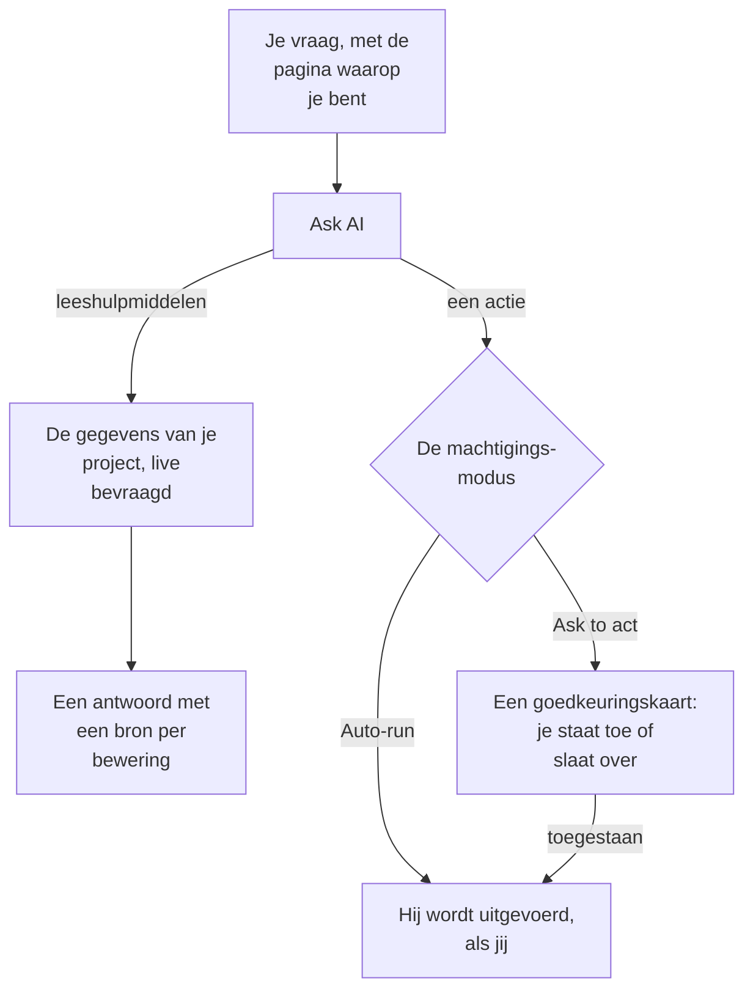

# AI vragen

AI vragen is de chat van OneUptime over de gegevens van je project. Vraag naar logs, traces, metrieken, uitzonderingen, incidenten, waarschuwingen, monitoren, bereikbaarheidsdiensten, statuspagina's, SLO's, runbooks of workflows: de chat bevraagt je project live, onderbouwt elke bewering met een bron en handelt voor je wanneer je dat toestaat.

:::cards
- [AI vragen openen](#ai-vragen-openen): Vanuit de kopbalk, het toetsenbord, een grafiek of een eigen pagina.
- [Wat hij kan zien](#wat-hij-kan-zien): De gegevens die hij leest om je te antwoorden.
- [Acties en machtigingsmodi](#acties-en-machtigingsmodi): Kies of hij mag handelen en wanneer hij eerst vraagt.
- [Acties gebeuren als jij](#acties-gebeuren-als-jij): Jouw machtigingen, jouw naam bij elke wijziging.
:::

## Hoe AI vragen antwoordt

AI vragen antwoordt alleen met wat zijn hulpmiddelen teruggeven: hij voert query's uit op je project in plaats van uit het geheugen te antwoorden. Elk feit in een antwoord heeft een bronchip die de query erachter toont en de gelezen gegevens opent. Vraag je hem iets te wijzigen, dan bepaalt de machtigingsmodus van het gesprek of hij het je eerst vraagt. Vóór je vraag leest hij de [AI-context](/docs/ai/ai-context) van het project: wat je team voor OneUptime AI over je eigen systemen heeft opgeschreven.

In de modus **Alleen-lezen** krijgt het model nooit acties aangeboden, dus het gesprek leest alleen.

## AI vragen openen

| Waar | Hoe |
| --- | --- |
| Elke pagina | Klik op **Ask AI** in de kopbalk, of druk op `Ctrl` + `I` (`Cmd` + `I` op een Mac). Terwijl je in een tekstvak of editor typt, blijven die toetsen de cursiefsneltoets van de editor. |
| Het opdrachtenpalet | Druk op `Ctrl` + `K` (`Cmd` + `K` op een Mac) en kies **Ask AI**. |
| Een foutpatroon in de logs, of de bevindingen van een grafiek | Klik op **Explain with AI**: AI vragen opent met het bewijs als een vraag die je kunt aanpassen voordat je hem verstuurt. |
| Een eigen pagina | Open **Producten → AI → Chat** voor een werkruimte over de hele pagina. Elk gesprek daar heeft een eigen adres, zodat je een draad als bladwijzer kunt bewaren of in het kanaal van een incident kunt plakken. |

Bij een incident of waarschuwing heeft de kaart **AI Investigation** een eigen gesprek, **Ask OneUptime AI**, dat iedereen deelt die dat incident of die waarschuwing kan zien: zie [Met OneUptime AI over het incident praten](/docs/ai/ai-sre#praat-met-oneuptime-ai-over-het-incident).

## Wat hij kan zien

AI vragen leest je project met je eigen machtigingen, dus hij ziet wat jij mag zien en niets meer.

| Gebied | Wat AI vragen leest |
| --- | --- |
| Telemetrie | Logzoekopdrachten en histogrammen, trace-aggregaties en span-bomen, metrieken, uitzonderingen, beveiligingsgebeurtenissen, real user monitoring en Web Vitals, recente wijzigingen en anomaliecontroles tegen geleerde baselines. |
| Infrastructuur | Hosts, Docker, Podman, Kubernetes, Docker Swarm, Proxmox, VMware vCenter, Ceph, opslagarrays, serverless functies, cloudomgevingen, IoT-vloten en netwerkapparaten: wat er in de inventaris staat, hun gemelde verbindingsstatus, trends in metrieken, aantallen logs per ernst en samenvattingen van trace-operaties. Een query omvat zowel telemetrie die een service noemt als telemetrie die een infrastructuurresource noemt. |
| Incidentrespons | Incidenten en waarschuwingen, met statusfilters ("wat is er nu actief?"), hun activiteitentijdlijnen (statuswijzigingen, interne en openbare notities, de feed) en eigenaren, en een zoekfunctie in eerdere incidenten om te hergebruiken hoe ze zijn opgelost. |
| Bereikbaarheid | Wie nu dienst heeft, beleid en escalatieketens, en of recente oproepen zijn afgeleverd en bevestigd. |
| Het eigen werk van de AI | De resultaten van AI SRE-onderzoeken en AI Insights, zodat "wat heeft de AI gevonden?" wordt beantwoord vanuit de gepubliceerde analyse in plaats van opnieuw te worden uitgezocht. |
| Platform | Monitoren (met statusfilters), gepland onderhoud, statuspagina's en hun aankondigingen, SLO's, runbooks, workflowruns, de gezondheid van probes, teams en de code van gekoppelde repository's. |

## Paginacontext

AI vragen weet vanaf welke pagina je hem hebt geopend. Op een incidentpagina betekent "waarom is dit gebeurd?" dat incident, en het invoervak toont een chip met het onderwerp van de pagina; verwijder die om over het hele project te vragen. Ga je naar een andere pagina terwijl het paneel open is, dan gaat de context mee. Het gesprek onthoudt zijn eerste onderwerp ook op de server, zodat een vervolgvraag dagen later "dit incident" nog goed begrijpt.

Infrastructuurlijsten en resourcepagina's bieden vragen aan voor het soort resource dat je bekijkt. Open een Kubernetes-cluster en vraag "Welke metrieken zijn de afgelopen 24 uur veranderd?", of open een Docker-host en vraag "Vat de ernst van de logs en de trace-fouten van de afgelopen zes uur samen." Bewijslinks leiden terug naar de pagina van de resource. Leesacties respecteren je machtigingen voor project, resources en telemetrie, inclusief beperkingen op eigenaarschap en labels.

Op een onderliggende pagina legt de context ook de pod, container, VM, het proces of het andere onderdeel vast dat je hebt gekozen. De infrastructuurhulpmiddelen lezen de telemetrie van de bovenliggende resource; ze kunnen één onderdeel niet meten aan de hand van alleen zijn naam. AI vragen zegt dat, en raadt geen Kubernetes-namespace die de pagina niet geeft. Een verbindingsstatus is niet de gezondheid van een workload, en ontbrekende telemetrie betekent niet dat een resource gezond is.

## Opdrachten op je infrastructuur

Geopend op de pagina van een resource waarvan de AI-agent verbonden is (een host, een Docker- of Podman-host, een Docker Swarm-cluster, een Proxmox-cluster, een VMware vCenter, een Ceph-cluster, een databaseserver of een Kubernetes-cluster), voert AI vragen er via die agent opdrachten op uit wanneer je erom vraagt: "voer `uptime` uit op deze host" of "toon de laatste 100 regels van `journalctl -u nginx`". Het antwoordt met wat er terugkwam, met een bronvermelding zoals elk ander bewijs. Geopend op een incident of een waarschuwing bereikt het de resources die eraan gekoppeld zijn.

- Het voert alleen de alleen-lezen-opdrachten uit die een AI-onderzoek op dat soort resource mag uitvoeren (zie [AI-agents voor de infrastructuur](/docs/ai/infrastructure-ai-agents)), hoogstens 30 voor één antwoord via elk soort agent, gecontroleerd door OneUptime en opnieuw door de agent, in elke machtigingsmodus. Een wijziging via de agent, zoals het herstarten van een service, wordt nooit vanuit AI vragen uitgevoerd: je krijgt in plaats daarvan de exacte opdracht, en de agent wijzigt alleen iets wanneer OneUptime AI een incident of waarschuwing herstelt, volgens de eigen fix-instellingen van de resource. De eigen acties van AI vragen, zoals het uitvoeren van een runbook, volgen de machtigingsmodus van het gesprek, zoals hieronder beschreven.
- Het bereikt alleen de resources die je mag bekijken, en alleen zolang AI-onderzoek voor de resource aan staat.
- Wanneer het daar geen opdracht kan uitvoeren (er is geen agent verbonden, de agent is offline, of AI-onderzoek staat uit voor de resource), zegt het dat, met wat er moet veranderen, en antwoordt het in plaats daarvan op basis van de gegevens van je project.

## Acties en machtigingsmodi

Elk gesprek heeft een machtigingsmodus, die je in het invoervak kiest, naast het veld waarin je typt:

| Modus | Wat er gebeurt |
| --- | --- |
| **Ask to act** | De standaard. AI vragen stelt elke actie voor op een goedkeuringskaart, en niets wordt uitgevoerd tot je er **Allow** of **Overslaan** voor kiest, of **Deny all**. |
| **Auto-run** | Acties worden uitgevoerd zodra het model erom vraagt, nog steeds beperkt tot wat jouw rol mag. Gebruik dit met zorg. |
| **Alleen-lezen** | Het model krijgt helemaal geen acties aangeboden: AI vragen kan alleen lezen. |

Wat AI vragen kan doen als een modus het toestaat:

- Een incident aanmaken, incidenten en waarschuwingen bevestigen of oplossen, en de ernst van een incident wijzigen.
- Een incident of waarschuwing koppelen aan de infrastructuur en services waar het om gaat. Een incident dat het aanmaakt op de pagina van een resource, zoals die van een host, wordt aan die resource gekoppeld, en de goedkeuringskaart noemt wat elke actie koppelt. OneUptime AI onderzoekt en herstelt waaraan een incident of waarschuwing is gekoppeld.
- Een interne notitie plaatsen bij een incident of waarschuwing. Interne notities verschijnen nooit op een statuspagina.
- Een openbare statusupdate bij een incident publiceren. Dat is een aparte actie, omdat de abonnees van de statuspagina een melding krijgen.
- Een bereikbaarheidsbeleid oproepen, een runbook uitvoeren of een AI-onderzoek van een incident of waarschuwing starten.
- Een codewijziging voorstellen: committen op een nieuwe branch van een gekoppelde repository en een pull request openen. Hij schrijft nooit naar de standaardbranch of een beschermde branch, dus een mens merget de wijziging nog altijd.

## Acties gebeuren als jij

Elke actie van AI vragen gebeurt als jij: hij voert dezelfde wijziging uit als het dashboard voor dezelfde actie, met je eigen machtigingen in het project, en de wijziging wordt aan jou toegeschreven. Een incident bevestigen vanuit de chat geeft dezelfde statuswijziging als het statuspaneel van het incident, zodat de tijdlijn en de feed van het incident laten zien dat jij de status hebt gewijzigd. Een oproep die vanuit de chat is verstuurd, toont jou als degene die hem heeft gestart.

- **Wat elke actie nodig heeft.** De machtiging die het dashboard voor dezelfde wijziging vraagt. Een incident bevestigen of oplossen vereist de machtiging om de status te wijzigen: **Projecteigenaar**, **Projectbeheerder**, **Projectlid**, **Incidentbeheerder** en **Incidentlid**, of **Create Incident State Timeline** in een aangepaste rol; een waarschuwing vereist dezelfde machtiging voor waarschuwingen (**Create Alert State Timeline**). Een bereikbaarheidsbeleid oproepen vereist de machtiging om het uit te voeren (**Create On-Call Duty Policy Execution Log**), en een runbook uitvoeren vereist de machtiging om runbook-uitvoeringen te starten: een rol die runbooks uitvoert, voor de runbooks die zijn labels bereiken, of **Create Runbook Execution** in een aangepaste rol, die elk runbook van het project bereikt. De ernst van een incident wijzigen, een AI-onderzoek van een incident of waarschuwing starten en code naar een gekoppelde repository schrijven vereist de machtiging om dat incident, die waarschuwing of die repository te wijzigen. Een actie die je niet mag uitvoeren, wordt geweigerd, en de AI vertelt je welke machtiging nodig is. Heb je de machtiging maar blokkeert een team waarvan je lid bent haar, dan vertelt de AI je dat: een blokkering op bepaalde labels weigert die actie in AI vragen voor elke record, niet alleen voor records met die labels.
- **Welke records.** De records die je mag wijzigen, zoals overal in OneUptime: met een rol die beperkt is tot bepaalde labels, of tot de records die je bezit, verandert een actie op een andere record niets. Een runbook wordt alleen uitgevoerd als je machtiging om runbook-uitvoeringen te starten het bereikt. In OneUptime Cloud wordt een actie die het abonnement van het project niet omvat, geweigerd met het abonnement dat nodig is.
- **Als een actie wordt geweigerd.** Er verandert niets, en de AI zegt duidelijk dat de actie niet is uitgevoerd, en waarom, in plaats van het opnieuw te proberen.
- **Slack, Microsoft Teams en AI-onderzoeken.** De antwoorden van de AI in Slack en Microsoft Teams, en autonome AI-onderzoeken, lezen alleen: ze voeren geen van deze acties uit. Wil je vanuit Slack of Microsoft Teams handelen, gebruik dan de knoppen bij de berichten van OneUptime, die ook als jij handelen (zie [Slack](/docs/workspace-connections/slack#handelen-op-incidenten-waarschuwingen-en-gebeurtenissen-vanuit-slack) en [Microsoft Teams](/docs/workspace-connections/microsoft-teams#handelen-op-incidenten-waarschuwingen-en-gebeurtenissen-vanuit-microsoft-teams)).

## Een gesprek sturen

- **Stop hem.** Terwijl AI vragen werkt, wordt de verzendknop een stopknop. Stop een run op elk moment en vraag meteen iets anders.
- **Kies het model.** De providerkiezer in het invoervak toont de LLM-providers van je project en de globale, met de standaard gemarkeerd. Een nieuw gesprek gebruikt de standaard.
- **Beoordeel een antwoord.** **Good answer** en **Poor answer** worden bij het bericht opgeslagen, zodat de kwaliteit van de antwoorden in de loop van de tijd te meten is.
- **Bekijk de kosten.** De voettekst van het nieuwste antwoord toont de kosten, de tokens en hoeveel query's het heeft uitgevoerd, en elke query is een bronchip die de gegevens erachter opent.
- **Bewaar een kopie.** **Download conversation** bewaart de draad met **Download as Markdown**, om te lezen of in een ticket te plakken, of met **Download as PDF**, om aan iemand te geven.

## Vereisten

- **Een LLM-provider.** AI vragen gebruikt de standaard-LLM-provider van het project (zie [LLM-providers](/docs/ai/llm-provider)). In OneUptime Cloud werkt hij meteen met de globale provider, betaald uit het AI-tegoed van het project; een zelf gehoste installatie configureert een provider, of de omgevingsvariabelen van de globale provider. Antwoorden zijn zo goed als het model: een klein zelf gehost model zonder betrouwbare toolaanroepen antwoordt slecht.
- **Het Growth-abonnement, in OneUptime Cloud.** Een project met een lager abonnement ziet dat AI niet in zijn abonnement zit, met een link naar **Projectinstellingen → Facturering en facturen → Facturering**.
- **AI ingeschakeld voor het project.** **AI inschakelen**, op **Projectinstellingen → AI → AI Features**, zet elke AI-functie van het project uit, AI vragen inbegrepen. Het staat aan, tenzij iemand het heeft uitgezet.

AI vragen telt mee voor de eigen dagelijkse AI-limieten van het project wanneer het project die instelt (Projectinstellingen → AI → AI Features → Meer instellingen): is er een bereikt, dan toont AI vragen een zin die zegt welke limiet is bereikt, dat OneUptime AI om middernacht UTC weer begint en wie de limiet kan verhogen of verwijderen. De eigenaren van het project krijgen een e-mail de eerste keer dat er op een dag een limiet wordt bereikt. De dagelijkse limieten voor incidenten en waarschuwingen houden AI vragen nooit tegen. Zie [de eigen dagelijkse limieten van het project](/docs/ai/ai-sre#de-eigen-daglimieten-van-het-project).

## Problemen oplossen

:::details AI vragen zegt dat AI niet beschikbaar is
Het paneel zegt waarom voordat je typt: het abonnement van het project omvat geen AI, **AI inschakelen** staat uit, of het project heeft geen LLM-provider. Elke melding linkt naar de pagina waar je dat wijzigt.
:::

:::details Een actie werd geweigerd
AI vragen zegt welke machtiging de actie nodig heeft, of welk team haar blokkeert. Vraag iemand die de wijziging mag uitvoeren, of vraag een projecteigenaar om je rol de machtiging te geven. Er is niets gewijzigd.
:::

:::details Antwoorden zijn vaag of gebruiken nooit gegevens
Controleer het model achter de provider. AI vragen heeft een model nodig dat betrouwbaar hulpmiddelen aanroept; kleine lokale modellen antwoorden vaak zonder één query uit te voeren. Zie [LLM-providers](/docs/ai/llm-provider).
:::

## Volgende stappen

:::cards
- [AI SRE](/docs/ai/ai-sre): Laat OneUptime AI elk nieuw incident en elke nieuwe waarschuwing onderzoeken.
- [LLM-providers](/docs/ai/llm-provider): Kies het model dat AI vragen en de andere AI-functies gebruiken.
- [MCP-server](/docs/ai/mcp-server): Vraag naar OneUptime vanuit Claude, Cursor of VS Code.
:::
