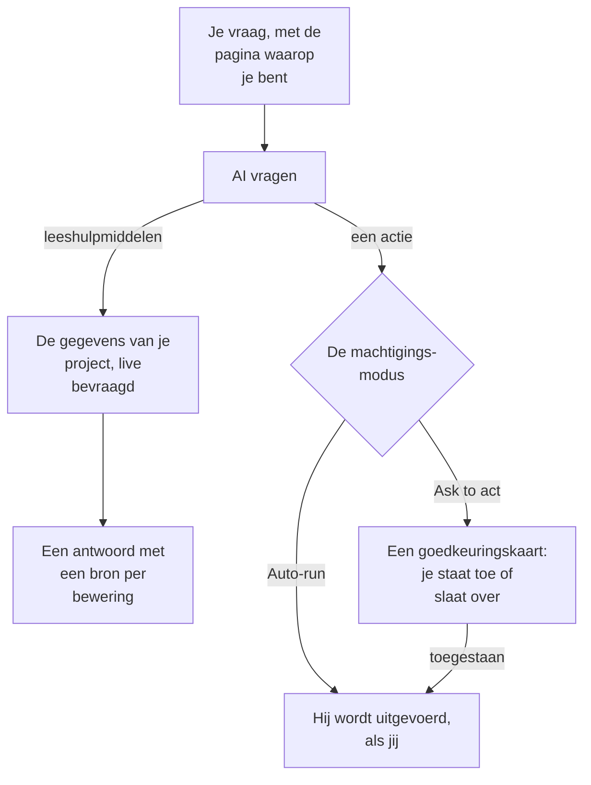

# AI vragen

AI vragen is de chat van OneUptime over de gegevens van je project. Vraag naar logs, traces, metrieken, uitzonderingen, incidenten, waarschuwingen, monitoren, bereikbaarheidsdiensten, statuspagina's, SLO's, runbooks of workflows: de chat bevraagt je project live, onderbouwt elke bewering met een bron en handelt voor je wanneer je dat toestaat.

:::cards
- [AI vragen openen](#ai-vragen-openen): Vanuit de kopbalk, het toetsenbord, een grafiek of het productmenu.
- [Wat hij kan zien](#wat-hij-kan-zien): De gegevens die hij leest om je te antwoorden.
- [Acties en machtigingsmodi](#acties-en-machtigingsmodi): Kies of hij mag handelen en wanneer hij eerst vraagt.
- [Acties gebeuren als jij](#acties-gebeuren-als-jij): Jouw machtigingen, jouw naam bij elke wijziging.
:::

## Hoe AI vragen antwoordt

AI vragen antwoordt alleen met wat zijn hulpmiddelen teruggeven: hij voert query's uit op je project in plaats van uit het geheugen te antwoorden. Elk feit in een antwoord heeft een bronchip die de query erachter toont en de gelezen gegevens opent. Vraag je hem iets te wijzigen, dan bepaalt de machtigingsmodus van het gesprek of hij het je eerst vraagt. Vóór je vraag leest hij de [AI-context](/docs/ai/ai-context) van het project: wat je team voor OneUptime AI over je eigen systemen heeft opgeschreven.

In de modus **Alleen-lezen** krijgt het model nooit acties aangeboden, dus het gesprek leest alleen.

## Vragen over OneUptime

AI vragen beantwoordt ook vragen over OneUptime zelf: 'Hoe krijg ik een sms als mijn site plat ligt?', 'Wat is een episode?', 'Waar voeg ik een tweede telefoonnummer toe?'. Het antwoordt uit deze documentatie, de kopie die uw OneUptime zelf serveert, dus het werkt zonder internettoegang en stuurt niets naar nieuwe plekken. Een vertaalde pagina leest het in uw taal, bij elke stap noemt het de pagina en de sectie, en staat iets niet in de documentatie, dan zegt het dat in plaats van te gokken.

Een antwoord op 'hoe doe ik' eindigt met een knop die de pagina van uw project opent waar u het doet, zoals **Monitor maken** of **Meldingsmethoden**. Die opent alleen pagina's die OneUptime heeft: de pagina's die Zoeken (`Ctrl` + `K`) vindt.

## AI vragen openen

| Waar | Hoe |
| --- | --- |
| Elke pagina | Klik op **AI vragen** in de kopbalk, of druk op `Ctrl` + `I` (`Cmd` + `I` op een Mac). Terwijl je in een tekstvak of editor typt, blijven die toetsen de cursiefsneltoets van de editor. |
| Het opdrachtenpalet | Druk op `Ctrl` + `K` (`Cmd` + `K` op een Mac) en kies **AI vragen**. |
| Een foutpatroon in de logs, of de bevindingen van een grafiek | Klik op **Uitleggen met AI**: AI vragen opent met het bewijs als een vraag die je kunt aanpassen voordat je hem verstuurt. |
| Het productmenu | Open **Producten → AI → Chat**. AI vragen opent naast de pagina waarop je was. Elk gesprek heeft een eigen adres, zodat je het als bladwijzer kunt bewaren en ernaar kunt terugkeren. |

AI vragen opent aan de zijkant van het venster, en de pagina maakt er ruimte voor: er verdwijnt niets achter, dus je kunt op de pagina verder werken, naar andere pagina's gaan en opnieuw vragen. Sleep de rand om hem breder of smaller te maken. Druk erin op `Esc`, of klik nogmaals op **AI vragen**, om de pagina het hele venster terug te geven. Terwijl hij open is, gaat `Ctrl` + `I` (`Cmd` + `I` op een Mac) van de pagina naar het vak waarin je typt, en sluit hem van daaruit. Het gesprek blijft waar je het liet: open AI vragen opnieuw om verder te gaan. Sluit je hem terwijl hij nog antwoordt, dan zegt een melding in de hoek wanneer het antwoord klaar is, en opent die het. Op een tablet of telefoon, waar geen ruimte is voor beide, opent hij boven de pagina, en op een telefoon vult hij het hele scherm.

Bij een incident of waarschuwing heeft de kaart **OneUptime AI** een eigen gesprek, **OneUptime AI vragen**, dat iedereen deelt die dat incident of die waarschuwing kan zien: zie [Met OneUptime AI over het incident praten](/docs/ai/ai-sre#praat-met-oneuptime-ai-over-het-incident).

## Wat hij kan zien

AI vragen leest je project met je eigen machtigingen, dus hij ziet wat jij mag zien en niets meer.

| Gebied | Wat AI vragen leest |
| --- | --- |
| Telemetrie | Logzoekopdrachten en histogrammen, trace-aggregaties en span-bomen, metrieken, uitzonderingen, beveiligingsgebeurtenissen, real user monitoring en Web Vitals, recente wijzigingen en anomaliecontroles tegen geleerde baselines. |
| Infrastructuur | Hosts, Docker, Podman, Kubernetes, Docker Swarm, Proxmox, VMware vCenter, Ceph, opslagarrays, serverless functies, cloudomgevingen, IoT-vloten en netwerkapparaten: wat er in de inventaris staat, hun gemelde verbindingsstatus, trends in metrieken, aantallen logs per ernst en samenvattingen van trace-operaties. Een query omvat zowel telemetrie die een service noemt als telemetrie die een infrastructuurresource noemt. |
| Incidentrespons | Incidenten en waarschuwingen, met statusfilters ("wat is er nu actief?"), hun activiteitentijdlijnen (statuswijzigingen, interne en openbare notities, de feed) en eigenaren, en een zoekfunctie in eerdere incidenten om te hergebruiken hoe ze zijn opgelost. |
| Bereikbaarheid | Wie nu dienst heeft, beleid en escalatieketens, en of recente oproepen zijn afgeleverd en bevestigd. |
| Het eigen werk van de AI | De resultaten van AI SRE-onderzoeken en AI Insights, zodat "wat heeft de AI gevonden?" wordt beantwoord vanuit de gepubliceerde analyse in plaats van opnieuw te worden uitgezocht. |
| Platform | Monitoren (met statusfilters), gepland onderhoud, statuspagina's en hun aankondigingen, SLO's, runbooks, workflowruns, de gezondheid van probes, teams en de code van gekoppelde repository's op GitHub, GitLab, Forgejo, Gitea en Azure DevOps (zie [Wat AI leest in een Git-repository](/docs/ai/ai-agent#wat-ai-leest-in-een-git-repository)). |

## Paginacontext

AI vragen weet vanaf welke pagina je hem hebt geopend. Op een incidentpagina betekent "waarom is dit gebeurd?" dat incident: het invoervak toont een chip met het onderwerp van de pagina, en de vragen die hij voorstelt zijn die van die pagina. Verwijder de chip om over het hele project te vragen, en voeg hem op dezelfde manier weer toe. Open AI vragen op een andere pagina en de context gaat mee. Het gesprek onthoudt zijn eerste onderwerp ook op de server, zodat een vervolgvraag dagen later "dit incident" nog goed begrijpt.

Op een incident, een waarschuwing, een monitor of een onderhoudsgebeurtenis volgen de vragen ook waar dat record staat, gelezen elke keer dat AI vragen erop opent. Een opgelost incident vraagt hoe de reactie verliep en wat zou voorkomen dat het opnieuw gebeurt, een opgeloste waarschuwing of het een echt probleem was en hoe vaak waarschuwingen zoals deze afgaan, en een monitor die niet operationeel is vraagt waarom. Een onderhoudsgebeurtenis die nog niet is begonnen vraagt of de monitoren vooraf gezond zijn, en een die voorbij is of ze weer normaal zijn.

Infrastructuurlijsten en resourcepagina's bieden vragen aan voor het soort resource dat je bekijkt. Open een Kubernetes-cluster en vraag "Welke metrieken zijn de afgelopen 24 uur veranderd?", of open een Docker-host en vraag "Vat de ernst van de logs en de trace-fouten van de afgelopen zes uur samen." Bewijslinks leiden terug naar de pagina van de resource. Leesacties respecteren je machtigingen voor project, resources en telemetrie, inclusief beperkingen op eigenaarschap en labels.

Op een onderliggende pagina legt de context ook de pod, container, VM, het proces of het andere onderdeel vast dat je hebt gekozen. De infrastructuurhulpmiddelen lezen de telemetrie van de bovenliggende resource; ze kunnen één onderdeel niet meten aan de hand van alleen zijn naam. AI vragen zegt dat, en raadt geen Kubernetes-namespace die de pagina niet geeft. Een verbindingsstatus is niet de gezondheid van een workload, en ontbrekende telemetrie betekent niet dat een resource gezond is.

## Opdrachten op je infrastructuur

Geopend op de pagina van een resource waarvan de AI-agent verbonden is (een host, een Docker- of Podman-host, een Docker Swarm-cluster, een Proxmox-cluster, een VMware vCenter, een Ceph-cluster, een databaseserver of een Kubernetes-cluster), voert AI vragen er via die agent opdrachten op uit wanneer je erom vraagt: "voer `uptime` uit op deze host" of "toon de laatste 100 regels van `journalctl -u nginx`". Het antwoordt met wat er terugkwam, met een bronvermelding zoals elk ander bewijs. Geopend op een incident of een waarschuwing bereikt het de resources die eraan gekoppeld zijn.

- Het voert alleen de alleen-lezen-opdrachten uit die een AI-onderzoek op dat soort resource mag uitvoeren (zie [AI-agents voor de infrastructuur](/docs/ai/infrastructure-ai-agents)), zoveel als het antwoord nodig heeft, gecontroleerd door OneUptime en opnieuw door de agent, in elke machtigingsmodus. Een wijziging via de agent, zoals het herstarten van een service, wordt nooit vanuit AI vragen uitgevoerd: je krijgt in plaats daarvan de exacte opdracht, en de agent wijzigt alleen iets wanneer OneUptime AI een incident of waarschuwing herstelt, volgens de eigen fix-instellingen van de resource. De eigen acties van AI vragen, zoals het uitvoeren van een runbook, volgen de machtigingsmodus van het gesprek, zoals hieronder beschreven.
- Het bereikt alleen de resources die je mag bekijken, en alleen zolang AI-onderzoek voor de resource aan staat.
- Wanneer het daar geen opdracht kan uitvoeren (er is geen agent verbonden, de agent is offline, of AI-onderzoek staat uit voor de resource), zegt het dat, met wat er moet veranderen, en antwoordt het in plaats daarvan op basis van de gegevens van je project.

## Acties en machtigingsmodi

Elk gesprek heeft een machtigingsmodus, die je in het invoervak kiest, naast het veld waarin je typt:

| Modus | Wat er gebeurt |
| --- | --- |
| **Vragen voor actie** | De standaard. AI vragen stelt elke actie voor op een goedkeuringskaart, en niets wordt uitgevoerd tot je er **Toestaan** of **Overslaan** voor kiest, of **Alles weigeren**. |
| **Automatisch uitvoeren** | Acties worden uitgevoerd zodra het model erom vraagt, nog steeds beperkt tot wat jouw rol mag. Gebruik dit met zorg. |
| **Alleen-lezen** | Het model krijgt helemaal geen acties aangeboden: AI vragen kan alleen lezen. |

Wat AI vragen kan doen als een modus het toestaat:

- Een incident of waarschuwing aanmaken, incidenten en waarschuwingen bevestigen of oplossen, en de ernst van een incident wijzigen.
- Een incident of waarschuwing koppelen aan de infrastructuur en services waar het om gaat. Een incident of waarschuwing dat het aanmaakt op de pagina van een resource, zoals die van een host, wordt aan die resource gekoppeld, en de goedkeuringskaart noemt wat elke actie koppelt. OneUptime AI onderzoekt en herstelt waaraan een incident of waarschuwing is gekoppeld.
- Een probleem vastleggen dat iemand al afhandelt, of dat al voorbij is: een incident of waarschuwing dat het aanmaakt, kan al bevestigd of opgelost beginnen en roept dan niemand op. De goedkeuringskaart zegt welke van de twee. Zie [Al bevestigd of opgelost gemeld](/docs/incidents/declaring-incidents#al-bevestigd-of-opgelost-gemeld).
- Een interne notitie plaatsen bij een incident of waarschuwing. Interne notities verschijnen nooit op een statuspagina.
- Een openbare statusupdate bij een incident publiceren. Dat is een aparte actie, omdat de abonnees van de statuspagina een melding krijgen.
- Een bereikbaarheidsbeleid oproepen, een runbook uitvoeren of een AI-onderzoek van een incident of waarschuwing starten.
- Dingen instellen vanuit één zin: een website- of API-monitor, wie er wordt opgeroepen, een statuspagina en de monitoren die die toont, allemaal op één goedkeuringskaart. Zie [Dingen instellen](#dingen-instellen).
- Een codewijziging voorstellen: committen op een nieuwe branch van een repository op GitHub, GitLab, Forgejo of Gitea en een pull request openen (een merge request op GitLab). Hij schrijft nooit naar de standaardbranch of een beschermde branch, dus een mens merget de wijziging nog altijd. Ask AI schrijft elk bestand in zijn geheel, uitgaand van het bestand zoals het dat het laatst las, en leest de hoofdbranch van een repository, tenzij het om een andere wordt gevraagd. Is een bestand op de branch gewijzigd nadat Ask AI het las, dan noemt de kaart het voordat je de commit of de pull request goedkeurt, bijvoorbeeld "Dit bestand is op fix/login gewijzigd nadat de AI het las, en de versie van de AI draait die wijziging terug: src/billing/charge.ts." De kaart noemt ook een bestand dat Ask AI alleen op een andere branch las, waar het anders is, een bestand dat Ask AI nooit las maar vervangt, en een bestand dat OneUptime niet kon controleren. Ask AI leest een lang bestand stukje voor stukje, dus de kaart noemt ook een bestand waarvan Ask AI maar een deel las, bijvoorbeeld "De AI las maar een deel van dit bestand, en de versie van de AI vervangt het hele bestand: src/billing/charge.ts." Heeft Ask AI het hele bestand gelezen, in één keer of in meerdere keren, dan zegt de kaart er niets over. Een later antwoord heeft de woorden van de eerdere antwoorden, niet de bestanden die ze lazen, dus de kaart noemt ook een bestand dat Ask AI alleen in een eerder antwoord las, bijvoorbeeld "De AI las dit bestand in een eerder antwoord en heeft de tekst ervan niet meer, en de versie van de AI vervangt het hele bestand: src/billing/charge.ts." Een heel lang antwoord laat ook de oudste resultaten weg, om binnen te blijven wat het model in één keer kan bevatten, dus de kaart noemt ook een bestand dat Ask AI eerder in hetzelfde antwoord las als dat resultaat is weggelaten, bijvoorbeeld "De AI las dit bestand eerder in dit antwoord en heeft de tekst ervan niet meer, en de versie van de AI vervangt het hele bestand: src/billing/charge.ts." Heeft Ask AI het bestand in meerdere delen gelezen en heeft het ze niet meer allemaal, dan zegt de kaart dat ook, bijvoorbeeld "De AI las dit bestand en heeft een deel van de tekst ervan niet meer, en de versie van de AI vervangt het hele bestand: src/billing/charge.ts." Leest Ask AI het bestand opnieuw in het antwoord dat het wijzigt, dan zegt de kaart er niets over. Een nieuw bestand telt nooit mee. Wil je bewaren wat iemand anders heeft gewijzigd, sla de actie dan over en vraag Ask AI de bestanden opnieuw te lezen. In Automatisch uitvoeren, waar niemand acties goedkeurt, maakt Ask AI zo'n wijziging niet: het leest de bestanden opnieuw en maakt zijn wijziging op de bestanden zoals ze nu zijn. Verandert een bestand terwijl de kaart op je wacht, dan verandert goedkeuren niets, en Ask AI stelt de wijziging opnieuw voor. Een pull request die je toch goedkeurt, noemt die bestanden in de beschrijving, voor wie hem beoordeelt. Ask AI krijgt waarden die eruitzien als geheimen of persoonsgegevens, zoals IP-adressen, e-mailadressen en sleutels, nooit te zien: het leest op hun plaats een tijdelijke aanduiding zoals `[redacted-ip]`. Daarom noemt de kaart ook een bestand waarin de versie van Ask AI zulke aanduidingen schrijft, bijvoorbeeld "Waarden die eruitzien als geheimen of persoonsgegevens zijn voor de AI verborgen, en de versie van de AI schrijft op hun plaats tijdelijke aanduidingen in dit bestand: config/servers.ts." Een aanduiding die het bestand op de branch al heeft, telt niet. Ask AI kan die waarden niet terugschrijven, dus in Automatisch uitvoeren maakt het die wijziging niet en vertelt het je in plaats daarvan wat je moet wijzigen.

Vraag om een incident als gebruikers geraakt worden, en om een waarschuwing als iets eerst de aandacht van je team nodig heeft, zoals het geheugen van een host dat blijft stijgen. Beide worden één keer aangemaakt en bewaken niets: om elke keer gewaarschuwd te worden als het geheugen van een host boven 75% komt, maak je een [host-monitor](/docs/monitor/host-monitor#kant-en-klare-waarschuwingssjablonen) vanuit zijn geheugensjabloon, met 75% als drempel. AI vragen stelt alleen website- en API-monitoren in (zie [Dingen instellen](#dingen-instellen)). Vraag je om een andere soort, dan zegt het dat, controleert het de huidige waarde en biedt het aan een waarschuwing aan te maken als die er al boven zit.

## Acties gebeuren als jij

Elke actie van AI vragen gebeurt als jij: hij voert dezelfde wijziging uit als het dashboard voor dezelfde actie, met je eigen machtigingen in het project, en de wijziging wordt aan jou toegeschreven. Een incident bevestigen vanuit de chat geeft dezelfde statuswijziging als het statuspaneel van het incident, zodat de tijdlijn en de feed van het incident laten zien dat jij de status hebt gewijzigd. Een oproep die vanuit de chat is verstuurd, toont jou als degene die hem heeft gestart.

- **Wat elke actie nodig heeft.** De machtiging die het dashboard voor dezelfde wijziging vraagt. Een incident of waarschuwing aanmaken vereist de machtiging om er een aan te maken: een rol die dat mag, of **Create Incident** of **Create Alert** in een aangepaste rol. Een incident bevestigen of oplossen vereist de machtiging om de status te wijzigen: **Projecteigenaar**, **Projectbeheerder**, **Projectlid**, **Incidentbeheerder** en **Incidentlid**, of **Create Incident State Timeline** in een aangepaste rol; een waarschuwing vereist dezelfde machtiging voor waarschuwingen (**Create Alert State Timeline**). Een incident of waarschuwing aanmaken dat al bevestigd of opgelost begint, vereist beide: de machtiging om het aan te maken, en de machtiging om de status te wijzigen. Een bereikbaarheidsbeleid oproepen vereist de machtiging om het uit te voeren (**Execute On-Call Policies**), en een runbook uitvoeren vereist de machtiging om runbook-uitvoeringen te starten: een rol die runbooks uitvoert, voor de runbooks die zijn labels bereiken, of **Create Runbook Execution** in een aangepaste rol, die elk runbook van het project bereikt. De ernst van een incident wijzigen, een AI-onderzoek van een incident of waarschuwing starten en code naar een gekoppelde repository schrijven vereist de machtiging om dat incident, die waarschuwing of die repository te wijzigen. Een actie die je niet mag uitvoeren, wordt geweigerd, en de AI vertelt je welke machtiging nodig is. Heb je de machtiging maar blokkeert een team waarvan je lid bent haar, dan vertelt de AI je dat: een blokkering op bepaalde labels weigert die actie in AI vragen voor elke record, niet alleen voor records met die labels.
- **Welke records.** De records die je mag wijzigen, zoals overal in OneUptime: met een rol die beperkt is tot bepaalde labels, of tot de records die je bezit, verandert een actie op een andere record niets. Een runbook wordt alleen uitgevoerd als je machtiging om runbook-uitvoeringen te starten het bereikt. In OneUptime Cloud wordt een actie die het abonnement van het project niet omvat, geweigerd met het abonnement dat nodig is.
- **Als een actie wordt geweigerd.** Er verandert niets, en de AI zegt duidelijk dat de actie niet is uitgevoerd, en waarom, in plaats van het opnieuw te proberen. Tussen de stappen van het antwoord zegt de stap van de actie dat ze niet is uitgevoerd, en waarom: je rol staat het niet toe, een team waarvan je lid bent blokkeert het, of het abonnement van het project omvat het niet.
- **Slack, Microsoft Teams en AI-onderzoeken.** De antwoorden van de AI in Slack en Microsoft Teams, en autonome AI-onderzoeken, lezen alleen: ze voeren geen van deze acties uit. Vraag je daar om een wijziging, dan zegt de AI hoe je die vanuit de chat maakt: `/oneuptime incident` meldt een incident, `/oneuptime incident 42` toont incident 42 met zijn knoppen, `/oneuptime page` roept iemand op (in Microsoft Teams dezelfde woorden aan de OneUptime-bot), en de knoppen bij de berichten van OneUptime handelen ook als jij (zie [Slack](/docs/workspace-connections/slack#handelen-op-incidenten-waarschuwingen-en-gebeurtenissen-vanuit-slack) en [Microsoft Teams](/docs/workspace-connections/microsoft-teams#handelen-op-incidenten-waarschuwingen-en-gebeurtenissen-vanuit-microsoft-teams)). Voor elke andere wijziging linkt de AI naar AI vragen, dat de wijziging voorstelt zodat jij haar goedkeurt. Gevraagd in het eigen kanaal van een incident of waarschuwing, neemt de AI aan dat je dat incident of die waarschuwing bedoelt.

## Dingen instellen

AI vragen stelt vanuit één zin in wat de begeleide instellingen instellen: "Bewaak example.com elke minuut en stuur me een sms als het plat ligt."

- **Eén plan, één goedkeuring.** AI vragen stelt elk onderdeel voor op één goedkeuringskaart, elk in gewone woorden: een website- of API-monitor, het eerste bereikbaarheidsbeleid van het project, een statuspagina en de monitoren die die toont. De kaart eindigt met "Verder verandert er niets." Kies **Overslaan** bij elk onderdeel dat je niet wilt, en voer de rest uit. Daarvoor wordt niets aangemaakt.
- **Altijd gevraagd.** Het instellen wacht in elke modus op je goedkeuring, ook in **Automatisch uitvoeren**, omdat het dingen aanmaakt die mensen oproepen en die je klanten zien. **Alleen-lezen** biedt het niet aan.
- **De records van de begeleide instellingen.** De monitor is degene die **Weten wanneer mijn website of API plat ligt** voor hetzelfde adres aanmaakt: de standaardwaarden van Monitor maken, die een incident opent als het adres niet antwoordt of met een fout antwoordt, elke 5 minuten gecontroleerd, tenzij je om een ander interval van Monitor maken vraagt. Hij is van jou, dus je krijgt een e-mail als zijn status verandert. De statuspagina is degene die **Publiceer een statuspagina** aanmaakt: openbaar zodra ze is aangemaakt, met de status, beschikbaarheid en geschiedenis van elke monitor.
- **Wie wordt opgeroepen.** In een project dat nog niemand oproept, stelt AI vragen het eerste bereikbaarheidsbeleid van het project voor, "Default on-call policy", dat jou, en de leden en teams die je noemt, oproept bij elk nieuw incident en elke nieuwe waarschuwing. Een project dat al mensen oproept, houdt zijn eigen bereikbaarheidsbeleid en -regels, en AI vragen zegt dat in plaats van er nog een aan te maken.
- **Wat er ontbreekt.** AI vragen voegt nooit een telefoonnummer of de mobiele app toe: die voeg je zelf toe en verifieer je in **Gebruikersinstellingen → Meldingsmethoden**. Vraag je om sms'jes zonder een geverifieerd nummer, dan zegt de kaart dat en linkt het antwoord naar de pagina. Een onderdeel dat AI vragen niet kan aanmaken, wordt niet voorgesteld, bijvoorbeeld als je rol het niet toestaat, het adres geen adres is of de monitoren niet bestaan: het antwoord zegt wat er nodig is.
- **Wat elk onderdeel nodig heeft.** Een monitor heeft toestemming nodig om monitoren aan te maken. Oproepen heeft toestemming nodig om bereikbaarheidsbeleid, de escalatieregels daarvan en bereikbaarheidsregels voor incidenten en waarschuwingen aan te maken. Een statuspagina heeft toestemming nodig om statuspagina's aan te maken en er monitoren aan toe te voegen. De limieten van het abonnement van het project gelden, zoals bij de begeleide instellingen.
- **Test het daarna.** Zodra het plan is uitgevoerd, opent elke kaart wat er is aangemaakt, en **Dit beleid testen** (of **Stuur mij een testoproep**, voor alleen een monitor) onder het antwoord stuurt een testoproep die je vanuit het bericht bevestigt. Mislukt een onderdeel, dan zegt het antwoord wat er is aangemaakt en wat niet.
- **Wie wordt ingelicht.** Vraag "wie wordt ingelicht als example.com plat ligt?" en AI vragen antwoordt vanuit dezelfde keten die de pagina van de monitor toont, met elke breuk erin genoemd.

## Een gesprek sturen

- **Stop hem.** Terwijl AI vragen werkt, wordt de verzendknop een stopknop. Stop een run op elk moment en vraag meteen iets anders.
- **Volg zijn werk.** Terwijl hij antwoordt, zegt één regel wat hij nu doet, zoals logboeken doorzoeken. Klik op het aantal stappen ernaast om elke stap te zien.
- **Kies het model.** Als je project meer dan één LLM-provider kan gebruiken, toont de providerkiezer in het invoervak de LLM-providers van je project en de globale, met de standaard gemarkeerd. Een nieuw gesprek gebruikt de standaard.
- **Beoordeel een antwoord.** **Goed antwoord** en **Slecht antwoord** worden bij het bericht opgeslagen, zodat de kwaliteit van de antwoorden in de loop van de tijd te meten is.
- **Bekijk de kosten.** Onder elk antwoord openen de bronnen zich in de query's die het uitvoerde, en die van het nieuwste antwoord zeggen ook hoeveel query's het uitvoerde, de tokens en de kosten. Elke bronchip in een antwoord opent de gegevens erachter.
- **Bewaar een kopie.** **Gesprek downloaden** bewaart de draad met **Downloaden als Markdown**, om te lezen of in een ticket te plakken, of met **Downloaden als PDF**, om aan iemand te geven.
- **Ga verder waar je was.** **Alle gesprekken**, in de kopbalk van AI vragen, toont je gesprekken, het nieuwste eerst, om ze opnieuw te openen of te verwijderen. Het begin van een nieuw gesprek toont de laatste drie.

## Vereisten

- **Een LLM-provider.** AI vragen gebruikt de standaard-LLM-provider van het project (zie [LLM-providers](/docs/ai/llm-provider)). In OneUptime Cloud werkt hij meteen met de globale provider, betaald uit het AI-tegoed van het project; een zelf gehoste installatie configureert een provider, of de omgevingsvariabelen van de globale provider. Antwoorden zijn zo goed als het model: een klein zelf gehost model zonder betrouwbare toolaanroepen antwoordt slecht.
- **Het Growth-abonnement, in OneUptime Cloud.** Een project met een lager abonnement ziet dat AI niet in zijn abonnement zit, met een link naar **Projectinstellingen → Facturering en facturen → Facturering**.
- **AI ingeschakeld voor het project.** **AI inschakelen**, op **Projectinstellingen → AI → AI-functies**, zet elke AI-functie van het project uit, AI vragen inbegrepen. Het staat aan, tenzij iemand het heeft uitgezet.

AI vragen telt mee voor de eigen dagelijkse AI-limieten van het project wanneer het project die instelt (Projectinstellingen → AI → AI Features → Meer instellingen): is er een bereikt, dan toont AI vragen een zin die zegt welke limiet is bereikt, dat OneUptime AI om middernacht UTC weer begint en wie de limiet kan verhogen of verwijderen. De eigenaren van het project krijgen een e-mail de eerste keer dat er op een dag een limiet wordt bereikt. De dagelijkse limieten voor incidenten en waarschuwingen houden AI vragen nooit tegen. Zie [de eigen dagelijkse limieten van het project](/docs/ai/ai-sre#de-eigen-daglimieten-van-het-project).

## Problemen oplossen

:::details AI vragen zegt dat AI niet beschikbaar is
AI vragen zegt waarom voordat je typt: het abonnement van het project omvat geen AI, **AI inschakelen** staat uit, of het project heeft geen LLM-provider. Elke melding linkt naar de pagina waar je dat wijzigt.
:::

:::details Een actie werd geweigerd
AI vragen zegt welke machtiging de actie nodig heeft, of welk team haar blokkeert. Vraag iemand die de wijziging mag uitvoeren, of vraag een projecteigenaar om je rol de machtiging te geven. Er is niets gewijzigd.
:::

:::details Antwoorden zijn vaag of gebruiken nooit gegevens
Controleer het model achter de provider. AI vragen heeft een model nodig dat betrouwbaar hulpmiddelen aanroept; kleine lokale modellen antwoorden vaak zonder één query uit te voeren. Zie [LLM-providers](/docs/ai/llm-provider).
:::

## Volgende stappen

:::cards
- [AI SRE](/docs/ai/ai-sre): Laat OneUptime AI elk nieuw incident en elke nieuwe waarschuwing onderzoeken.
- [LLM-providers](/docs/ai/llm-provider): Kies het model dat AI vragen en de andere AI-functies gebruiken.
- [MCP-server](/docs/ai/mcp-server): Vraag naar OneUptime vanuit Claude, Cursor of VS Code.
:::
