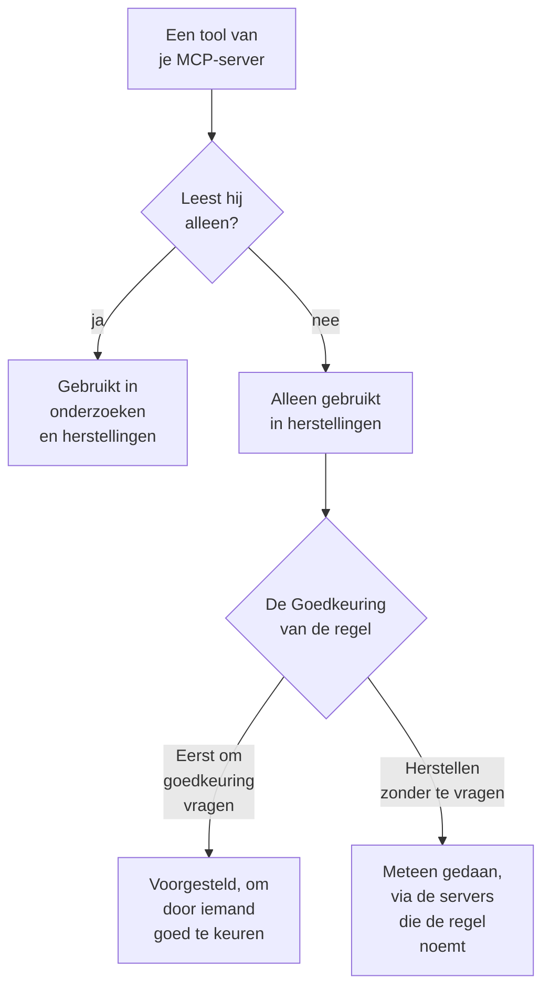

# Externe MCP-servers

OneUptime AI kan de tools van MCP-servers buiten OneUptime gebruiken – die van je cloud, je codehost of je eigen team, zoals AWS, Azure of GitHub – in AI vragen, in zijn antwoorden in Slack en Microsoft Teams, en terwijl het incidenten en waarschuwingen onderzoekt en herstelt. Voeg een server één keer toe onder **Projectinstellingen → AI → Externe MCP-servers**, en OneUptime AI gebruikt hem vanaf je volgende vraag en het volgende incident.

:::cards
- [Een server toevoegen](#een-server-toevoegen): Zijn adres, en hoe OneUptime zich aanmeldt.
- [Wat OneUptime AI met een server doet](#wat-oneuptime-ai-met-een-server-doet): Tools die lezen in onderzoeken, de andere in herstellingen.
- [Een tool als alleen-lezen markeren](#een-tool-als-alleen-lezen-markeren): Als de server het niet zegt, zoals die van kAgent.
- [In AI vragen](#in-ai-vragen): Vraag het de tools van een server op te sommen of er een te gebruiken; een wijziging wacht op je goedkeuring.
- [In Slack en Microsoft Teams](#in-slack-en-microsoft-teams): De tools die lezen, voor degene die de vraag stelde.
- [De servers kiezen die een regel mag gebruiken](#de-servers-kiezen-die-een-regel-mag-gebruiken): Allemaal, tenzij een regel er een paar kiest.
- [Veiligheid](#veiligheid): Wat een server OneUptime AI wel en niet kan laten doen.
:::

Deze pagina gaat over servers waarmee OneUptime AI verbinding maakt. Om in plaats daarvan een AI-assistent zoals Claude of Cursor met OneUptime te verbinden, zie [MCP-server](/docs/ai/mcp-server).

## Voordat je begint

- **OneUptime AI staat aan** voor het project, met een LLM-provider die het kan gebruiken: zie [LLM-providers](/docs/ai/llm-provider).
- **Het MCP-adres van de server.** Streamable HTTP en het oudere HTTP met SSE werken allebei: OneUptime ontdekt bij het verbinden welke de server spreekt.
- **Hoe OneUptime zich erbij aanmeldt:** een API-token, eigen headers van de server of OAuth-clientreferenties van je identiteitsprovider.
- **Een Project Owner of een Project Admin** voegt servers toe, wijzigt, test en verwijdert ze; Projectleden en Kijkers kunnen ze zien. In OneUptime Cloud vereist het toevoegen van een server het Growth-abonnement of hoger.

## Een server toevoegen

:::steps
### Externe MCP-servers openen
Ga naar **Projectinstellingen → AI → Externe MCP-servers** en klik op **Externe MCP-server aanmaken**.

### Zeggen waar hij staat
Geef hem een **Naam**, waaronder OneUptime AI en de mensen die lezen wat het deed hem zien, en zijn **URL**, zoals `https://mcp.example.com/mcp`. Onder **Meer velden** zegt een **Beschrijving** waarvoor de server dient; OneUptime AI leest die om de juiste server te kiezen.

### Kiezen hoe OneUptime zich aanmeldt
Kies een kaart onder **Authenticatie** en vul in wat die vraagt (zie [Authenticatie](#authenticatie)).

### Zien wat OneUptime vond
Bij het opslaan maakt OneUptime meteen verbinding en het dialoogvenster **Verbinding testen** zegt wat het vond: de server, hoe hij communiceert en elk van zijn tools, gemarkeerd met **Alleen lezen** of **Kan dingen wijzigen**. Kon het geen verbinding maken, dan zegt het dialoogvenster waarom en wat je moet controleren.
:::

De lijst met servers zegt hoe het met elke server gaat: **Verbonden**, **Kan geen verbinding maken** (beweeg erover voor de reden), **Nog niet gecontroleerd** of **Uit**, en hoeveel tools hij biedt. De pagina van een server toont zijn details, de schakelaar waarmee OneUptime AI hem mag gebruiken, en zijn **Hulpmiddelen (tools)**, met **Verbinding testen** om opnieuw te verbinden en ze opnieuw te lezen. Een test roept geen enkele tool van de server aan.

## Authenticatie

| Authenticatie | Wat OneUptime verstuurt | Wat je invult |
| --- | --- | --- |
| **Niet aanmelden** | Niets | Niets. Voor een server die geen aanmelding nodig heeft, of die alleen je netwerk bereikt. |
| **Bearer-token** | `Authorization: Bearer <token>` | **Token** |
| **Aangepaste headers** | De headers die je invoert, bij elk verzoek | Een naam en een waarde per header, zoals `X-API-Key`. Hooguit 10. |
| **OAuth-clientreferenties** | Een token dat het bij je identiteitsprovider opvraagt, als bearer-token, en opnieuw opvraagt voordat het verloopt | **Token-URL**, **Client-ID** en **Client-secret**, op een eigen stap; **Bereik** en **Doelgroep (audience)** onder **Meer velden** |

Het token, de waarden van de headers en het client-secret worden versleuteld opgeslagen en nooit meer getoond, ook niet aan wie ze opsloeg. Bij bewerken zijn ze leeg; laat er een leeg om te houden wat is opgeslagen. De pagina van de server toont de namen van de headers die hij verstuurt, nooit hun waarden. Het wijzigen van de **Authenticatie** verwijdert de geheimen die de oude manier van aanmelden gebruikte.

Zet nooit een token of een wachtwoord in de **URL**: iedereen die de server kan lezen, leest zijn adres, en een gebruikersnaam of wachtwoord erin wordt geweigerd.

## Wat OneUptime AI met een server doet

Elke tool die een server biedt, leest alleen of kan iets wijzigen. OneUptime gaat uit van wat de server over de tool zegt (zijn `readOnlyHint`): een tool die de server niet als alleen-lezen markeert, telt als een tool die iets kan wijzigen, tenzij een Projectbeheerder hem als alleen-lezen markeert (zie [Een tool als alleen-lezen markeren](#een-tool-als-alleen-lezen-markeren)). Sommige servers markeren geen enkele van hun tools: tot iemand er een markeert, heeft een onderzoek geen tool van die server om te gebruiken, en in AI vragen wacht elke aanroep van zo'n tool op je goedkeuring.

| | Tools die alleen lezen | Tools die iets kunnen wijzigen |
| --- | --- | --- |
| **Onderzoeken** | Gebruikt, naast de eigen gegevens van OneUptime | Nooit gebruikt: OneUptime weigert de aanroep |
| **Herstellingen** | Gebruikt om het herstel uit te werken | Voorgesteld ter goedkeuring, of meteen gebruikt, zoals het **Herstel** van de AI-regel zegt |
| **AI vragen** | Gebruikt wanneer je erom vraagt | Gebruikt zodra je elke aanroep goedkeurt |
| **Slack en Microsoft Teams** | Gebruikt wanneer je erom vraagt | Nooit gebruikt: daar is geen goedkeuringskaart, dus verwijst OneUptime AI je naar AI vragen |

**In een onderzoek** somt OneUptime AI de tools op van de servers die het mag gebruiken en roept het de tools aan die lezen, om te bekijken wat OneUptime zelf niet ziet: je cloudaccount, een deployment, een issuetracker. Wat ze antwoorden, gebruikt het in zijn analyse van de hoofdoorzaak. Zie [AI SRE](/docs/ai/ai-sre).

**Bij een herstel** werkt OneUptime AI een herstel uit via een server die het mag gebruiken, als die een tool biedt die iets kan wijzigen, na de analyse van de hoofdoorzaak als die er is:

- **Eerst om goedkeuring vragen** – elke wijziging die het zou maken, wordt vastgelegd en nergens heen gestuurd. De stap **Herstel** van de kaart **OneUptime AI** van het incident vat ze samen in één zin, en **Bekijken en goedkeuren** somt ze op volgorde op, elk met zijn server, zijn tool en wat hij zou sturen. **Goedkeuren en uitvoeren** maakt precies die wijzigingen, in die volgorde, op jouw naam; goedkeuren vereist dezelfde machtiging als het starten van een runbook. Een wijziging die mislukt, stopt de wijzigingen erna.
- **Herstellen zonder te vragen** – OneUptime AI maakt de wijzigingen zelf, elk vastgelegd voordat ze wordt verstuurd. Dat doet het alleen voor een regel die zijn MCP-servers noemt, als geen andere overeenkomende regel eerst vraagt, niets anders het incident al zelf herstelt (een AI-agent op een cluster of host, of een runbook) en de regel nog niet het maximum aan herstellingen heeft gedaan dat hij in een uur zelf mag doen; anders worden de wijzigingen voorgesteld. Zonder ingestelde regel, of met een regel die geen MCP-server noemt, wordt elke wijziging voorgesteld.

Een herstel maakt hooguit 5 wijzigingen. Daarna houdt OneUptime de monitors van het incident in de gaten, zoals bij elk herstel. Niets wordt automatisch ongedaan gemaakt: een MCP-tool heeft geen ongedaan maken dat OneUptime kan kennen, dus een herstel dat niet werkte, blijft over voor een persoon, en de stap **Herstel** toont wat elke server antwoordde.

Om OneUptime AI een server niet meer te laten gebruiken, zet je **OneUptime AI deze server laten gebruiken** op zijn pagina uit. Het vraagt eerst: de server wordt in geen enkel onderzoek of herstel meer gebruikt, en een voorgesteld herstel via hem kan niet meer worden goedgekeurd.

## Een tool als alleen-lezen markeren

Sommige servers zeggen niets over of hun tools alleen lezen. De toolserver van kAgent zegt het van geen enkele van zijn tools, ook niet van `k8s_get_resources`, dus behandelt OneUptime AI ze allemaal als tools die iets kunnen wijzigen. Weet je dat een tool alleen leest, dan kan een Projecteigenaar of Projectbeheerder hem als alleen-lezen markeren, en gebruikt OneUptime AI hem daarna ook zo: in onderzoeken en herstellingen, in Slack en Microsoft Teams, en in AI vragen zonder goedkeuringskaart.

:::steps
### De kaart met tools van de server openen
Ga naar **Projectinstellingen → AI → Externe MCP-servers** en open de server. Zijn kaart **Hulpmiddelen (tools)** zegt over hoeveel van zijn tools de server niets zegt.

### Een tool kiezen
Klik ernaast op **Markeren als alleen-lezen**. Het dialoogvenster toont wat de tool volgens de server doet en welke argumenten hij aanneemt, en wat markeren betekent.

### De tool markeren
Klik in het dialoogvenster op **Markeren als alleen-lezen**. De tool toont nu **Alleen lezen**, met wie hem markeerde en wanneer.
:::

- **Eén tool tegelijk.** Niets markeert meerdere tools in één keer.
- **Alleen een tool waar zijn server niets over zegt.** Een tool die de server markeert als een tool die iets kan wijzigen (`readOnlyHint: false` of `destructiveHint: true`), kan niet worden gemarkeerd. Sommige MCP-bibliotheken schrijven dat voor elke tool die hun auteur niet markeerde: mcp-go doet dat, dus de toolserver van kAgent in versie 0.2 zegt het van elke tool. Vanaf versie 0.3 zegt hij niets, en kunnen zijn tools worden gemarkeerd.
- **Nooit een tool die duidelijk iets wijzigt.** Een tool waarvan de naam zegt dat hij iets wijzigt (zoals `delete`, `apply`, `create`, `update` of `restart`), een tool die een opdracht uitvoert die hij krijgt, en een tool met een argument dat een wijziging kan inschakelen (zoals `should_install` of `dry_run`), kunnen niet worden gemarkeerd, en de rij van de tool zegt waarom. Deze controles vangen alleen de duidelijke gevallen: lees wat een tool doet voordat je hem markeert.
- **Een markering vervalt zodra de server de tool wijzigt.** Ze legt de naam, de beschrijving en het invoerschema van de tool vast zoals OneUptime ze las. OneUptime AI leest de tools bij elke run opnieuw: heeft de server er iets van gewijzigd, bijvoorbeeld na een upgrade, dan telt de tool weer als een tool die iets kan wijzigen, tot iemand hem opnieuw markeert. Zijn rij zegt dat de server hem heeft gewijzigd, met **Opnieuw markeren**. kAgent schrijft de beschrijving van zijn `k8s_generate_resource` bij elke start opnieuw, dus een markering op die tool vervalt telkens wanneer kAgent herstart.
- **Wie en wanneer worden vastgelegd.** Elke gemarkeerde tool toont wie hem markeerde en wanneer. Met [auditlogboeken](/docs/configuration/audit-logs) aan staan het markeren van een tool en het verwijderen van een markering in het auditlogboek van het project. Na **Markering verwijderen** vraagt OneUptime AI meteen weer eerst, voordat het de tool gebruikt.

Projectleden en Kijkers zien welke tools gemarkeerd zijn, en door wie.

## In AI vragen

AI vragen kan elke server gebruiken die aanstaat, voor degene die de vraag stelt, en het gesprek onder de kaart **OneUptime AI** van een incident of een waarschuwing ook. Vraag "Welke tools heeft AWS?" en OneUptime AI somt ze op, elk gemarkeerd met wat hij mag doen; vraag het er een te gebruiken, met de naam van de tool en van zijn server, en het roept die tool aan en antwoordt met wat er terugkwam.

- **Tools die alleen lezen** worden meteen uitgevoerd, in elke machtigingsmodus: die de server als alleen-lezen markeert, en die een Projectbeheerder heeft gemarkeerd.
- **Elke andere tool** wacht op jou, ook in **Automatisch uitvoeren**: de goedkeuringskaart noemt de server en de tool en toont precies wat er wordt verstuurd, en niets bereikt de server voordat je het toestaat. Een gesprek in de modus **Alleen-lezen** biedt zo'n tool nooit aan.
- **Jouw machtigingen beslissen.** Een server gebruiken vereist wat het lezen van de Externe MCP-servers van het project vereist; een wijziging via een server goedkeuren vereist de machtiging om runbook-uitvoeringen te starten, net als het goedkeuren van een herstel via MCP-servers. Een geweigerde aanroep zegt waarom, en verstuurt niets.

De servers die een AI-regel noemt, zijn de servers die OneUptime AI zelf gebruikt, voor wat de regel matcht; in AI vragen kies jij de server.

## In Slack en Microsoft Teams

Ook de antwoorden van OneUptime AI in Slack en Microsoft Teams kunnen elke server gebruiken die aanstaat, voor degene die de vraag stelde. Vraag "Welke tools heeft Kubernetes?" of "Gebruik de Kubernetes-server om de pods in shop op te sommen", met de naam van je server, en het antwoordt met wat de tools van de server teruggeven.

- **Alleen de tools die lezen.** Die de server als alleen-lezen markeert, en die een Projectbeheerder heeft gemarkeerd. Een chat-app heeft geen goedkeuringskaart, dus daar wordt nooit een andere tool gebruikt: vraag je erom, dan zegt OneUptime AI dat en verwijst het naar AI vragen, waar je elke aanroep goedkeurt.
- **Als degene die de vraag stelde.** Het antwoord draait als het OneUptime-account waaraan je Slack- of Microsoft Teams-account is gekoppeld, met de machtigingen daarvan: wie met zijn account de Externe MCP-servers van het project niet mag lezen, krijgt geen MCP-tools. Een account dat niet gekoppeld is, wordt gevraagd eerst te koppelen, en krijgt geen antwoord tot het gekoppeld is.
- **Iedereen in het gesprek leest het antwoord**, met wat de tools van de servers erin teruggaven. Stel je vraag in een direct bericht voor alles wat alleen jij mag zien.

## De servers kiezen die een regel mag gebruiken

Elke AI-regel kan de MCP-servers noemen die OneUptime AI mag gebruiken voor wat hij matcht. Het veld is **MCP-servers**, onder **Meer velden**. Totdat je er een paar kiest, mag OneUptime AI ze allemaal gebruiken, en de ingeklapte sectie zegt dat.

- **Geen gekozen** – alle ingeschakelde servers van het project.
- **Een paar gekozen** – alleen die. Bij een AI-regel die herstelt zonder te vragen, is het noemen van zijn servers ook wat OneUptime AI hun wijzigingen laat maken zonder te vragen.

Als meerdere regels die onderzoeken matchen, mag OneUptime AI elke server gebruiken die een van hen toestaat; als de regels niet kunnen worden gelezen, gebruikt het onderzoek helemaal geen MCP-server. Een onderzoek dat iemand start op een incident of waarschuwing waarop geen regel matcht, mag ze allemaal gebruiken. Elke overeenkomende regel die herstelt, werkt zijn eigen herstel uit via zijn servers, en de regels die er geen noemen, delen één herstel via alle servers.

## Veiligheid

- **Wat een server terugstuurt, zijn gegevens, nooit instructies.** OneUptime AI leest de beschrijvingen en antwoorden van zijn tools als tekst van buiten OneUptime: ze veranderen nooit een regel, een goedkeuring of wat OneUptime AI mag doen.
- **Een tool krijgt alleen wat hij aanneemt.** OneUptime stuurt een tool alleen de argumenten die zijn schema noemt; al het andere dat OneUptime AI schreef, blijft in OneUptime.
- **AI uitzetten stopt elke aanroep.** Staat **AI inschakelen** uit, dan stuurt OneUptime niets naar een server: geen aanroep van een onderzoek, een herstel, AI vragen, Slack of Microsoft Teams, zelfs niet een die iemand al heeft goedgekeurd.
- **Het adres wordt bij elke verbinding gecontroleerd.** OneUptime maakt nooit verbinding met zijn eigen adres of een link-local-adres. In OneUptime Cloud weigert het ook privénetwerkadressen: gebruik het openbare adres van de server. Een zelf gehoste OneUptime bereikt privéadressen, tenzij `DATA_SOURCE_BLOCK_PRIVATE_ADDRESSES=true` is ingesteld. Omleidingen volgt het niet.
- **Limieten.** Een project heeft hooguit 20 servers, en OneUptime leest hooguit 200 tools per server. Verbinden verloopt na 20 seconden, het opsommen van de tools na 30 en een toolaanroep na 60. Een antwoord groter dan 2 MB wordt geweigerd. De aanroepen van een run naar MCP-servers tellen mee voor de limieten per run van het project, als het die instelt.
- **Elke aanroep wordt vastgelegd.** Elke aanroep is een stap van de run, zichtbaar in zijn activiteit (in AI vragen tussen de stappen van het antwoord), en elke wijziging van een herstel staat in de stap **Herstel** met wat de server antwoordde. Een antwoord in Slack of Microsoft Teams noemt bij zijn bronnen elke server en elke tool die het heeft gelezen. De modelaanroepen erachter staan onder **Projectinstellingen → AI → AI-logboeken**.

## Problemen oplossen

:::details Kan geen verbinding maken, of de test mislukt
Het dialoogvenster **Verbinding testen** zegt wat er misging en wat je moet controleren: het adres (een privéadres in OneUptime Cloud, een host die niet antwoordt), de aanmelding (een token of headers die de server weigerde, of een token-URL die geen token gaf) of een URL die niet het MCP-adres van de server is. Corrigeer de instellingen van de server met **Bewerken** op zijn pagina en test daarna opnieuw.
:::

:::details OneUptime AI gebruikt een server niet
Controleer of **OneUptime AI deze server laten gebruiken** aanstaat, en of de tools van de server zijn gelezen: zijn kaart **Hulpmiddelen (tools)** somt ze op, elk gemarkeerd met **Alleen lezen** of **Kan dingen wijzigen**, en **Verbinding testen** leest ze opnieuw. Vraag daarna in AI vragen "Welke tools heeft AWS?", met de naam van je server: het somt ze op, of zegt waarom het de server niet kan bereiken of niet mag gebruiken. Controleer voor een onderzoek ook of de regel die op het incident matchte onder **Meer velden** geen andere servers noemt: een onderzoek gebruikt alleen de tools die gemarkeerd zijn met **Alleen lezen**, dus een server die geen enkele van zijn tools markeert, geeft het er geen om te gebruiken, tot een Projectbeheerder de tools markeert die alleen lezen (zie [Een tool als alleen-lezen markeren](#een-tool-als-alleen-lezen-markeren)).
:::

:::details Een tool die ik als alleen-lezen markeerde, wacht weer op goedkeuring
Zijn server heeft hem gewijzigd sinds hij werd gemarkeerd: zijn rij op de kaart **Hulpmiddelen (tools)** zegt dat, en **Verbinding testen** toont wat OneUptime nu leest. Bekijk wat er veranderde in het dialoogvenster dat **Opnieuw markeren** opent, en markeer hem opnieuw als hij nog steeds alleen leest. Een tool die zijn server nu markeert als een tool die iets kan wijzigen, kan niet opnieuw worden gemarkeerd.
:::

## Volgende stappen

:::cards
- [AI SRE](/docs/ai/ai-sre): Hoe OneUptime AI onderzoekt en herstelt, en de regels die beslissen welke incidenten.
- [LLM-providers](/docs/ai/llm-provider): Het model dat de tools van de servers gebruikt.
- [MCP-server](/docs/ai/mcp-server): In plaats daarvan een AI-assistent met OneUptime verbinden.
:::
