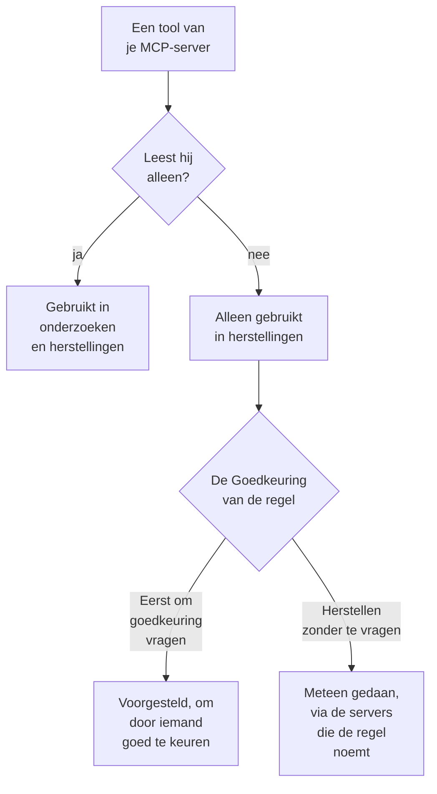

# Externe MCP-servers

OneUptime AI kan de tools van MCP-servers buiten OneUptime gebruiken – die van je cloud, je codehost of je eigen team, zoals AWS, Azure of GitHub – terwijl het incidenten en waarschuwingen onderzoekt en herstelt. Voeg een server één keer toe onder **Projectinstellingen → AI → Externe MCP-servers**, en OneUptime AI gebruikt hem vanaf het volgende incident.

:::cards
- [Een server toevoegen](#een-server-toevoegen): Zijn adres, en hoe OneUptime zich aanmeldt.
- [Wat OneUptime AI met een server doet](#wat-oneuptime-ai-met-een-server-doet): Tools die lezen in onderzoeken, de andere in herstellingen.
- [De servers kiezen die een regel mag gebruiken](#de-servers-kiezen-die-een-regel-mag-gebruiken): Allemaal, tenzij een regel er een paar kiest.
- [Veiligheid](#veiligheid): Wat een server OneUptime AI wel en niet kan laten doen.
:::

Deze pagina gaat over servers waarmee OneUptime AI verbinding maakt. Om in plaats daarvan een AI-assistent zoals Claude of Cursor met OneUptime te verbinden, zie [MCP-server](/docs/ai/mcp-server).

## Voordat je begint

- **OneUptime AI staat aan** voor het project, met een LLM-provider die het kan gebruiken: zie [LLM-providers](/docs/ai/llm-provider).
- **Het MCP-adres van de server.** Streamable HTTP en het oudere HTTP met SSE werken allebei: OneUptime ontdekt bij het verbinden welke de server spreekt.
- **Hoe OneUptime zich erbij aanmeldt:** een API-token, eigen headers van de server of OAuth-clientreferenties van je identiteitsprovider.
- **Een Project Owner of een Project Admin** voegt servers toe, wijzigt, test en verwijdert ze; Project Members en Viewers kunnen ze zien. In OneUptime Cloud vereist het toevoegen van een server het Growth-abonnement of hoger.

## Een server toevoegen

:::steps
### Externe MCP-servers openen
Ga naar **Projectinstellingen → AI → Externe MCP-servers** en klik op **Externe MCP-server aanmaken**.

### Zeggen waar hij staat
Geef hem een **Naam**, waaronder OneUptime AI en de mensen die lezen wat het deed hem zien, en zijn **URL**, zoals `https://mcp.example.com/mcp`. Onder **Meer velden** zegt een **Beschrijving** waarvoor de server dient; OneUptime AI leest die om de juiste server te kiezen.

### Kiezen hoe OneUptime zich aanmeldt
Kies een kaart onder **Authenticatie** en vul in wat die vraagt (zie [Authenticatie](#authenticatie)).

### Zien wat OneUptime vond
Bij het opslaan maakt OneUptime meteen verbinding en het dialoogvenster **Verbinding testen** zegt wat het vond: de server, hoe hij communiceert en elk van zijn tools, gemarkeerd met **Alleen lezen** of **Kan dingen wijzigen**. Kon het geen verbinding maken, dan zegt het dialoogvenster waarom en wat je moet controleren.
:::

De lijst met servers zegt hoe het met elke server gaat: **Verbonden**, **Kan geen verbinding maken** (beweeg erover voor de reden), **Nog niet gecontroleerd** of **Uit**, en hoeveel tools hij biedt. De pagina van een server toont zijn details, de schakelaar waarmee OneUptime AI hem mag gebruiken, en zijn **Hulpmiddelen (tools)**, met **Verbinding testen** om opnieuw te verbinden en ze opnieuw te lezen. Een test roept geen enkele tool van de server aan.

## Authenticatie

| Authenticatie | Wat OneUptime verstuurt | Wat je invult |
| --- | --- | --- |
| **Niet aanmelden** | Niets | Niets. Voor een server die geen aanmelding nodig heeft, of die alleen je netwerk bereikt. |
| **Bearer-token** | `Authorization: Bearer <token>` | **Token** |
| **Aangepaste headers** | De headers die je invoert, bij elk verzoek | Een naam en een waarde per header, zoals `X-API-Key`. Hooguit 10. |
| **OAuth-clientreferenties** | Een token dat het bij je identiteitsprovider opvraagt, als bearer-token, en opnieuw opvraagt voordat het verloopt | **Token-URL**, **Client-ID** en **Client-secret**, op een eigen stap; **Bereik** en **Doelgroep (audience)** onder **Meer velden** |

Het token, de waarden van de headers en het client-secret worden versleuteld opgeslagen en nooit meer getoond, ook niet aan wie ze opsloeg. Bij bewerken zijn ze leeg; laat er een leeg om te houden wat is opgeslagen. De pagina van de server toont de namen van de headers die hij verstuurt, nooit hun waarden. Het wijzigen van de **Authenticatie** verwijdert de geheimen die de oude manier van aanmelden gebruikte.

Zet nooit een token of een wachtwoord in de **URL**: iedereen die de server kan lezen, leest zijn adres, en een gebruikersnaam of wachtwoord erin wordt geweigerd.

## Wat OneUptime AI met een server doet

Elke tool die een server biedt, leest alleen of kan iets wijzigen. OneUptime gaat uit van wat de server over de tool zegt (zijn `readOnlyHint`): een tool die de server niet als alleen-lezen markeert, telt als een tool die iets kan wijzigen.

| | Tools die alleen lezen | Tools die iets kunnen wijzigen |
| --- | --- | --- |
| **Onderzoeken** | Gebruikt, naast de eigen gegevens van OneUptime | Nooit gebruikt: OneUptime weigert de aanroep |
| **Herstellingen** | Gebruikt om het herstel uit te werken | Voorgesteld ter goedkeuring, of meteen gebruikt, zoals het **Herstel** van de AI-regel zegt |

**In een onderzoek** somt OneUptime AI de tools op van de servers die het mag gebruiken en roept het de tools aan die lezen, om te bekijken wat OneUptime zelf niet ziet: je cloudaccount, een deployment, een issuetracker. Wat ze antwoorden, gebruikt het in zijn analyse van de hoofdoorzaak. Zie [AI SRE](/docs/ai/ai-sre).

**Bij een herstel** werkt OneUptime AI een herstel uit via een server die het mag gebruiken, als die een tool biedt die iets kan wijzigen, na de analyse van de hoofdoorzaak als die er is:

- **Eerst om goedkeuring vragen** – elke wijziging die het zou maken, wordt vastgelegd en nergens heen gestuurd. De kaart **Herstel** van het incident somt ze op volgorde op, elk met zijn server, zijn tool en wat hij zou sturen. **Goedkeuren en uitvoeren** maakt precies die wijzigingen, in die volgorde, op jouw naam; goedkeuren vereist dezelfde machtiging als het starten van een runbook. Een wijziging die mislukt, stopt de wijzigingen erna.
- **Herstellen zonder te vragen** – OneUptime AI maakt de wijzigingen zelf, elk vastgelegd voordat ze wordt verstuurd. Dat doet het alleen voor een regel die zijn MCP-servers noemt, als geen andere overeenkomende regel eerst vraagt, niets anders het incident al zelf herstelt (een AI-agent op een cluster of host, of een runbook) en de regel nog niet het maximum aan herstellingen heeft gedaan dat hij in een uur zelf mag doen; anders worden de wijzigingen voorgesteld. Zonder ingestelde regel, of met een regel die geen MCP-server noemt, wordt elke wijziging voorgesteld.

Een herstel maakt hooguit 5 wijzigingen. Daarna houdt OneUptime de monitors van het incident in de gaten, zoals bij elk herstel. Niets wordt automatisch ongedaan gemaakt: een MCP-tool heeft geen ongedaan maken dat OneUptime kan kennen, dus een herstel dat niet werkte, blijft over voor een persoon, en de kaart **Herstel** toont wat elke server antwoordde.

Om OneUptime AI een server niet meer te laten gebruiken, zet je **OneUptime AI deze server laten gebruiken** op zijn pagina uit. Het vraagt eerst: de server wordt in geen enkel onderzoek of herstel meer gebruikt, en een voorgesteld herstel via hem kan niet meer worden goedgekeurd.

## De servers kiezen die een regel mag gebruiken

Elke AI-regel kan de MCP-servers noemen die OneUptime AI mag gebruiken voor wat hij matcht. Het veld is **MCP-servers**, onder **Meer velden**. Totdat je er een paar kiest, mag OneUptime AI ze allemaal gebruiken, en de ingeklapte sectie zegt dat.

- **Geen gekozen** – alle ingeschakelde servers van het project.
- **Een paar gekozen** – alleen die. Bij een AI-regel die herstelt zonder te vragen, is het noemen van zijn servers ook wat OneUptime AI hun wijzigingen laat maken zonder te vragen.

Als meerdere regels die onderzoeken matchen, mag OneUptime AI elke server gebruiken die een van hen toestaat; als de regels niet kunnen worden gelezen, gebruikt het onderzoek helemaal geen MCP-server. Elke overeenkomende regel die herstelt, werkt zijn eigen herstel uit via zijn servers, en de regels die er geen noemen, delen één herstel via alle servers.

## Veiligheid

- **Wat een server terugstuurt, zijn gegevens, nooit instructies.** OneUptime AI leest de beschrijvingen en antwoorden van zijn tools als tekst van buiten OneUptime: ze veranderen nooit een regel, een goedkeuring of wat OneUptime AI mag doen.
- **Het adres wordt bij elke verbinding gecontroleerd.** OneUptime maakt nooit verbinding met zijn eigen adres of een link-local-adres. In OneUptime Cloud weigert het ook privénetwerkadressen: gebruik het openbare adres van de server. Een zelf gehoste OneUptime bereikt privéadressen, tenzij `DATA_SOURCE_BLOCK_PRIVATE_ADDRESSES=true` is ingesteld. Omleidingen volgt het niet.
- **Limieten.** Een project heeft hooguit 20 servers, en OneUptime leest hooguit 200 tools per server. Verbinden verloopt na 20 seconden, het opsommen van de tools na 30 en een toolaanroep na 60. Een antwoord groter dan 2 MB wordt geweigerd, en een run doet hooguit 40 aanroepen naar MCP-servers.
- **Elke aanroep wordt vastgelegd.** Elke aanroep is een stap van de run, zichtbaar in zijn activiteit, en elke wijziging van een herstel staat op de kaart **Herstel** met wat de server antwoordde. De modelaanroepen erachter staan onder **Projectinstellingen → AI → AI-logboeken**.

## Problemen oplossen

:::details Kan geen verbinding maken, of de test mislukt
Het dialoogvenster **Verbinding testen** zegt wat er misging en wat je moet controleren: het adres (een privéadres in OneUptime Cloud, een host die niet antwoordt), de aanmelding (een token of headers die de server weigerde, of een token-URL die geen token gaf) of een URL die niet het MCP-adres van de server is. Corrigeer de instellingen van de server met **Bewerken** op zijn pagina en test daarna opnieuw.
:::

:::details OneUptime AI gebruikt een server niet
Controleer of **OneUptime AI deze server laten gebruiken** aanstaat, of de regel die op het incident matchte onder **Meer velden** geen andere servers noemt, en of de tools van de server zijn gelezen: zijn kaart **Hulpmiddelen (tools)** somt ze op. Een onderzoek gebruikt alleen de tools die gemarkeerd zijn met **Alleen lezen**.
:::

## Volgende stappen

:::cards
- [AI SRE](/docs/ai/ai-sre): Hoe OneUptime AI onderzoekt en herstelt, en de regels die beslissen welke incidenten.
- [LLM-providers](/docs/ai/llm-provider): Het model dat de tools van de servers gebruikt.
- [MCP-server](/docs/ai/mcp-server): In plaats daarvan een AI-assistent met OneUptime verbinden.
:::
