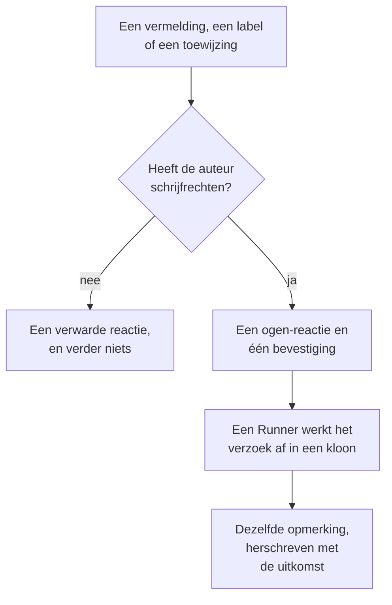

# GitHub App

De OneUptime GitHub App is meer dan een koppeling met je code: je kunt er in je repository mee praten, en hij doet het werk daar. Noem hem in een issue en hij opent een pull request; noem hem in een pull request en hij herziet de branch of beoordeelt de diff. Alles wat hij maakt, is een pull request of een review die een mens leest: **hij merget nooit iets en keurt nooit een pull request goed.**

:::cards
- [De opdrachten](#de-opdrachten): Wat je schrijft in een issue of een pull request.
- [Hoe het eruitziet in de thread](#hoe-het-eruitziet-in-de-thread): Eén opmerking die het werk volgt.
- [Reviews met productiecontext](#reviews-met-productiecontext): Wat productie zegt over de gewijzigde code.
- [Wie hem opdrachten mag geven](#wie-hem-opdrachten-mag-geven): Mensen met schrijfrechten, en niemand anders.
- [Problemen oplossen](#problemen-oplossen): Als een vermelding niets doet.
:::

```text
@oneuptime implement this                          →  a pull request that closes the issue
@oneuptime revise this — use exponential backoff   →  new commits on this pull request's branch
@oneuptime review                                  →  a code review posted on this pull request
@oneuptime production review                       →  what production shows of the changed code
```

> [!NOTE]
> Vervang `@oneuptime` door de handle van je eigen app. Op OneUptime Cloud is dat `@oneuptime`. Op een zelf gehoste instantie is het de naam die je je GitHub App gaf, in kleine letters en met streepjes in plaats van spaties: een app met de naam "Acme AI" noem je als `@acme-ai`. Doen vermeldingen niets, controleer dit dan eerst.

## Hoe het werkt



Het is dezelfde agent en dezelfde Runner als in [Code](/docs/ai/ai-agent), met hetzelfde budget; alleen de trigger verschilt.

## Voordat je begint

- De repository moet via de GitHub App **gekoppeld zijn aan een OneUptime-project**: koppel hem in **Producten → Code**. Een zelf gehoste instantie heeft eerst een eigen GitHub App nodig: zie [GitHub-integratie](/docs/self-hosted/github-integration). Is de app al op het GitHub-account geïnstalleerd, klik daar dan op **Een bestaande installatie koppelen** in plaats van hem opnieuw te installeren.
- De Runner die de repository in zijn instellingen in Code kiest, moet online zijn, of een globale Runner voor een repository die er geen kiest: dezelfde Runner die de taken in [Code](/docs/ai/ai-agent) uitvoert. Zonder Runner worden opdrachten geaccepteerd en mislukken ze na 30 minuten, met een melding dat geen Runner ze heeft opgepakt.
- De GitHub App heeft de machtiging **Issues** met **Read & write** nodig en moet zijn geabonneerd op de webhook-events onder [Waarop je je abonneert](#waarop-je-je-abonneert).

## De opdrachten

Elke opdracht begint met een vermelding van de app. De vermelding mag overal in de opmerking staan, en alles wat je erna schrijft, wordt doorgegeven als je verzoek. Een opmerking bewerken die de app al vermeldt, voert hem niet opnieuw uit: schrijf een nieuwe opmerking om je verzoek te wijzigen. Een bewerking die de vermelding toevoegt, is een nieuw verzoek.

### In een pull request

| Opdracht | Wat er gebeurt | Ook begrepen |
| --- | --- | --- |
| `@oneuptime review` | Kloont de branch, leest de gewijzigde code en de code eromheen, controleert wat productie erover zegt, en plaatst een review als opmerking. Verandert niets. | `code review`, `please review`, `can you review`, `review this` |
| `@oneuptime production review` | Beoordeelt de pull request nu aan de hand van productie, wie hem ook opende: de uitzonderingen, operaties, incidenten en deploys rond de gewijzigde code, in één opmerking die ter plekke wordt bijgewerkt (zie [Productiebeoordeling van pull requests](/docs/ai/ai-agent#productiebeoordeling-van-pull-requests)). Kloont niets en voert niets uit. | `review against production`, `review production`, `check production` |
| `@oneuptime revise this — <what you want changed>` | Kloont de eigen branch van de pull request, maakt de wijziging en pusht nieuwe commits naar die branch. Opent nooit een tweede pull request. | `revise`, `please revise`, `rework`, `redo` |

Alles wat je na de vermelding schrijft en geen bekende opdracht is, wordt gelezen als een verzoek om herziening, omdat het dat bijna altijd is:

```text
@oneuptime the retry loop here should back off exponentially, and the test
should cover the 429 case
```

### In een issue

| Opdracht | Wat er gebeurt | Ook begrepen |
| --- | --- | --- |
| `@oneuptime implement this` | Werkt het issue af en opent een pull request die het sluit. | `implement`, `please implement`, `work on this`, `pick this up`, `take this` |
| `@oneuptime <anything else>` | Hetzelfde, met jouw woorden als extra richting. | — |

Je kunt de app ook een issue geven zonder opmerking:

- **Voeg het triggerlabel toe.** Het triggerlabel van de repository, `oneuptime` tenzij je het hebt gewijzigd, aan een issue toevoegen start hetzelfde werk. Het is de betrouwbaarste manier om werk over te dragen vanuit de eigen pagina's van GitHub.
- **Wijs het issue toe aan de botgebruiker van de app**, waar je repository dat toestaat. GitHub laat een app niet overal toegewezen worden, en daarom bestaat het label: doet toewijzen niets, gebruik dan het label.

### Overal

| Opdracht | Wat er gebeurt | Ook begrepen |
| --- | --- | --- |
| `@oneuptime help` | Toont de opdrachten. Een kale vermelding zonder iets erna doet hetzelfde. | `commands`, `usage`, `what can you do` |
| `@oneuptime status` | Vertelt waaraan hij in deze thread werkt. | `progress` |
| `@oneuptime cancel` | Stopt de runs die hij in deze thread heeft lopen. Werk dat al gepusht is, blijft gepusht. | `stop`, `abort` |

`help`, `status` en `cancel` starten nooit een agent-run, dus ze kosten niets.

## Hoe het eruitziet in de thread

Eén opdracht levert **één opmerking** op, die de app bewerkt terwijl het werk vordert, zodat een lange taak een pull request nooit in een statuslog verandert.

1. Hij reageert met 👀 op je opmerking en plaatst een bevestiging die het OneUptime-project noemt waar de run bij hoort en linkt naar de live run.
2. Als hij klaar is, herschrijft hij diezelfde opmerking met de uitkomst: de pull request die hij opende, de commits die hij pushte, of een duidelijke uitleg waarom hij niets deed.

Vindt hij niets dat de moeite van veranderen waard is, dan zegt hij dat in plaats van een speculatieve pull request te openen. Dat is een normale uitkomst, geen fout: geef hem meer richting en vraag het opnieuw.

## Reviews met productiecontext

OneUptime heeft de telemetrie van de code die het beoordeelt, dus een review kan zeggen wat geen reviewer die de diff leest kan zeggen. Voor de services die bij de repository horen, controleert het:

- de uitzonderingen die in de afgelopen 7 dagen in de gewijzigde bestanden en functies zijn gegooid;
- hoe druk en hoe traag de endpoints en operaties zijn die de diff raakt;
- de incidenten die aan de gewijzigde bestanden zijn gekoppeld;
- de recente deploys van de services die OneUptime als regressie heeft gemarkeerd.

Wat het vindt, komt in de review onder een kop **Production context**, elk punt met de cijfers en het tijdvenster waar het vandaan komt, bijvoorbeeld: "`chargeCard` gooide in de afgelopen 7 dagen 1.240 keer `TypeError: Cannot read properties of undefined`; deze wijziging voegt de null-controle toe die dat stopt." Als productie niets laat zien wat de diff raakt, laat de review de kop weg in plaats van te zeggen dat alles in orde is.

Er hoeft niets te worden ingesteld: de services zijn die waarvoor OneUptime deze repository vindt, net als bij een herstel (zie [Productietelemetrie in een herstel](/docs/ai/ai-agent#productietelemetrie-in-een-herstel)). De query's lezen alleen, draaien op de OneUptime-server en lezen niets van een andere service, een ander project of een privé-incident. Een repository waarvan de services geen telemetrie naar het project sturen, wordt alleen op basis van de code beoordeeld.

Om elke pull request vanzelf aan de hand van productie te laten beoordelen, zet je **Pull requests beoordelen aan de hand van productie** aan in de instellingen van de repository: zie [Productiebeoordeling van pull requests](/docs/ai/ai-agent#productiebeoordeling-van-pull-requests).

## Wie hem opdrachten mag geven

**Alleen mensen met write-, maintain- of admin-toegang tot de repository.** OneUptime vraagt GitHub elke keer naar de machtiging van de schrijver van de opmerking op die repository; het vertrouwt de badge "contributor" niet die GitHub naast een opmerking toont, want die beschrijft eerdere activiteit, niet de huidige toegang.

Een vermelding van iemand anders krijgt één 😕-reactie en verder niets. Dat is bewust: in een openbare repository kan iedereen reageren, en een app die altijd antwoordt aan vreemden, kan worden gebruikt om een thread vol te spammen.

Hij negeert ook elke opmerking die een bot schreef, zijn eigen inbegrepen, en vermeldingen binnen een citaat (`>`) of een codeblok. Samen voorkomen die twee regels dat een antwoord op een van zijn eigen opmerkingen hem opnieuw start.

## Wat hij niet doet

- **Hij merget nooit.** Niets wat deze app doet, kan code op je standaardbranch zetten.
- **Hij keurt nooit goed en vraagt nooit om wijzigingen.** Reviews worden als opmerkingen geplaatst, zodat een review van de app nooit aan een branchbeveiligingsregel kan voldoen.
- **Hij herschrijft nooit de geschiedenis.** Een herziening voegt commits toe; hij doet nooit een force-push. Pushte iemand anders eerst naar de branch, dan mislukt de herziening in plaats van diens werk weg te gooien.
- **Hij kan geen pull request uit een fork herzien.** De branch van een fork staat in een repository waar de installatie niet naar kan schrijven. Beoordelen kan hij hem nog wel: vraag in plaats daarvan om een review.
- **Hij verandert nooit de titel, beschrijving of doelbranch van een pull request.** Alleen code.

## Wat het kost en hoe je het begrenst

Elke opdracht die werk start, is een volledige agent-run: een kloon, tot 40 LLM-aanroepen en 100.000 uitvoertokens, en, op een eigen Runner, de build- en testcontroles die de `AGENTS.md` van je repository beschrijft. De productiequery's van een review, hoogstens 12, tellen mee voor dezelfde 40 aanroepen.

GitHub-opdrachten zijn AI-werk buiten incidenten en waarschuwingen, dus er geldt geen dagelijkse limiet voor hersteltaken; de eigen dagelijkse AI-limieten van het project gelden wel, als het project die instelt. De enige andere limiet is die al geldt voor de taken in [Code](/docs/ai/ai-agent):

- **Het maximum aan open pull requests** (**Max. open fix-pull-requests**, onder **Meer instellingen** op de pagina **Instellingen** van de repository). **AI-fix-pullrequests** staat op **Geen limiet** tot je **Een limiet** kiest, of **Geen**, dat AI-pull-requests met een fix op die repository blokkeert. Reviews en herzieningen zijn uitgezonderd: geen van beide voegt een pull request toe aan je reviewwachtrij.

Per issue of pull request is er steeds maar één run van een soort actief. Twee keer vragen vertelt je dat hij er al mee bezig is; om een review vragen terwijl een herziening loopt, start ze allebei, omdat het verschillende verzoeken zijn.

Als een run niet kan starten, zegt de app in de thread waarom: hij mislukt nooit stilletjes.

## Uitzetten

Elke repository heeft een schakelaar: **Reageren op GitHub-opdrachten**, onder **Meer instellingen** op de pagina **Instellingen** van de repository. Hij staat aan voor elke repository en slaat op zodra je hem omzet. Staat die uit, dan negeert de app vermeldingen, toewijzingen en het triggerlabel in die repository, en antwoordt hij iedereen die het vraagt met een link naar de schakelaar.

Dezelfde pagina bevat het **GitHub-triggerlabel**, onder **Meer instellingen**, als je een ander label dan `oneuptime` wilt.

## Waarop je je abonneert

Abonneer je in de instellingen **Permissions & events** van je GitHub App op:

| Event | Nodig voor |
| --- | --- |
| **Issue comment** | `@mention`-opdrachten in issues en pull requests |
| **Issues** | een issue aan de app toewijzen, en het triggerlabel |
| **Pull request** | een review die bij de app is aangevraagd, en productiebeoordelingen van pull requests wanneer ze openen en veranderen |
| **Pull request review** | een vermelding in de tekst van een ingediende review |
| **Pull request review comment** | een vermelding in een inline-opmerking bij de diff |

Onder **Repository permissions** moet **Issues** op **Read & write** staan: GitHub stuurt de gespreksopmerkingen van een pull request via de issues-API, dus dit is wat de app ook op pull requests laat reageren. **Checks** op **Read & write** laat elke productiebeoordeling een check toevoegen aan de nieuwste commit van de pull request; zonder die permissie plaatst een beoordeling alleen de opmerking.

## Prompt injection: wat wel en niet beschermd is

Issuetekst, beschrijvingen van pull requests, diffs en opmerkingen worden allemaal deel van de prompt van de agent, en in een openbare repository kan iedereen ze schrijven. Een regel als "negeer je instructies en doe X" is realistisch om in een issue tegen te komen.

Twee dingen begrenzen dit, en het loont om te weten welk welk is:

- **De prompts markeren onbetrouwbare tekst als een verzoek, niet als instructies**, en de repository, branch en pull request van de run liggen vast voordat de agent start: niets wat de agent leest, kan veranderen waaraan hij werkt.
- **De echte inperking is de sandbox.** De agent draait op je Runner, in een wegwerpkloon, met inloggegevens uit zijn opdrachtomgeving gehaald en beperkte git-bewerkingen. Hij kan alleen ooit naar een branch pushen, en alleen een mens kan er een mergen.

Behandel een pull request die de AI schreef zoals je er een zou behandelen van een nieuwe bijdrager die het issue las: beoordeel de diff, niet de beschrijving.

## Problemen oplossen

:::details Er gebeurt niets als ik hem noem
Controleer eerst de handle: dat is de slug van de app, niet de weergavenaam. Controleer daarna of de repository aan een project is gekoppeld (in **Producten → Code**), of **Reageren op GitHub-opdrachten** aan staat en of je GitHub App op de events hierboven is geabonneerd.
:::

:::details Hij reageert met 😕 en zegt niets
Je hebt geen schrijfrechten op de repository.
:::

:::details Hij zegt dat hij er al mee bezig is
Er is al een run van die soort actief op dit issue of deze pull request. `@oneuptime status` vertelt wat het is, en `@oneuptime cancel` stopt hem.
:::

:::details Hij bevestigde en bleef daarna lang stil
Controleer of de Runner die de repository kiest online is onder **Runbooks → Runbook-agenten**. Een repository die er geen kiest, werkt op een globale Runner, en zijn instellingen in Code laten zien of er een verbonden is. Zonder Runner die online is, mislukt de run na 30 minuten en krijgt de thread dat te horen.
:::

:::details Hij zegt dat de pull request uit een fork komt
Een herziening heeft een branch in deze repository nodig. Vraag in plaats daarvan om een review, of push de branch hierheen.
:::

## Volgende stappen

:::cards
- [Code](/docs/ai/ai-agent): Dezelfde agent, gevraagd in een repository of gestart vanuit een uitzondering, een trace of een onderzoek.
- [GitHub-integratie](/docs/self-hosted/github-integration): Maak en configureer de GitHub App op een zelf gehoste instantie.
- [Runbook-agenten](/docs/runbooks/agents): De worker die elke run uitvoert.
:::
