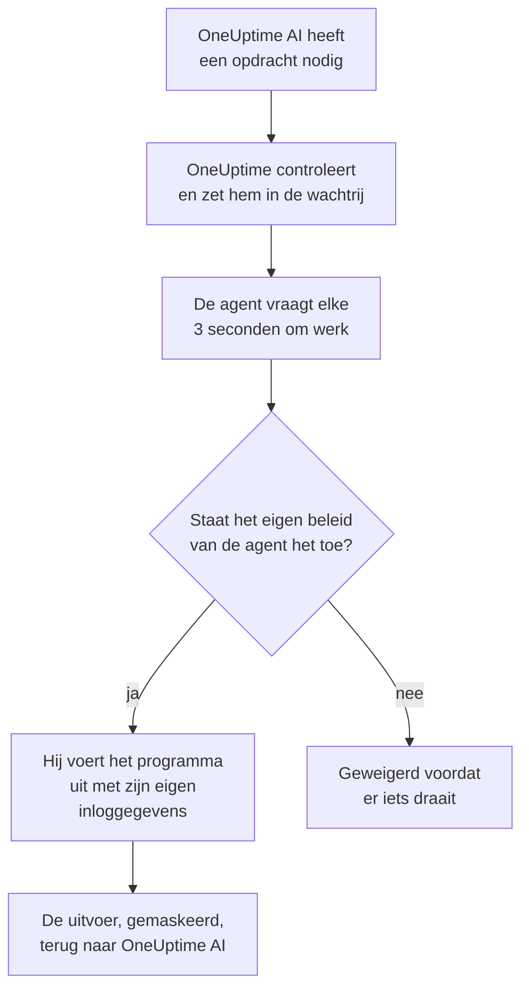

# AI-agents voor de infrastructuur

OneUptime AI kan verder kijken dan je telemetrie terwijl het een incident of waarschuwing onderzoekt. Een kleine agent die naast een van je resources is geïnstalleerd (een Docker- of Podman-host, een Docker Swarm-cluster, een Proxmox-cluster, een VMware vCenter, een Ceph-cluster, een databaseserver of een Linux-host) voert de alleen-lezen-opdrachten uit waar OneUptime AI om vraagt, zoals `docker logs --tail 200 web`, `pvesh get /cluster/status`, `ceph health detail`, `db long-queries --min-seconds 30` of `journalctl -u nginx -n 200 --no-pager`, en stuurt de uitvoer terug, zodat de oorzaakanalyse citeert wat de resource zelf zegt. Als je het toestaat, past dezelfde agent ook fixes toe (een container herstarten, een VM starten, een OSD weer als in markeren), elk door een opdrachtbeleid in een niveau ingedeeld en, tenzij je iets anders kiest, eerst door een mens goedgekeurd. AI vragen, geopend op de pagina van de resource, voert dezelfde alleen-lezen-opdrachten uit wanneer je erom vraagt (zie [AI vragen](/docs/ai/ask-ai)).

Een AWS-account, een Azure-abonnement of een Google Cloud-project heeft geen agent nodig om te worden onderzocht: OneUptime leest het live, via de alleen-lezen-koppeling waarmee het is gekoppeld. Alleen de fixes ervan hebben er een nodig, de Cloud-AI-agent, die in het account zelf draait en met één opdracht vanaf de pagina van het account wordt ingesteld (zie [In een cloudaccount](#in-een-cloudaccount)).

Deze agents zijn de **resource-AI-agents**. De dashboardpagina van elke resource heeft een sectie **AI** met drie pagina's:

- **Inzichten**: wat OneUptime AI de afgelopen 30 dagen over de resource heeft ontdekt: de problemen die steeds terugkomen en waarom, met wat AI vond en de stap die het voorstelt, de delen van de resource achter de meeste ervan, fixes die niet hielpen of op goedkeuring wachten, wat AI zelf heeft hersteld en de risico's die werden opgemerkt voordat iemand werd opgeroepen, met wat AI daar zelf deed als voetnoot. Het werkt zoals die van een cluster; zie [Wat AI op een cluster heeft geleerd](/docs/ai/ai-sre#wat-ai-op-een-cluster-heeft-geleerd).
- **Logboeken**: alles wat OneUptime AI op de resource heeft gedaan, het nieuwste eerst: elk onderzoek met zijn incident of waarschuwing en zijn samenvatting, elke fix die het voorstelde of uitvoerde en elke opdracht die het via de agent stuurde. (Deze pagina heette vroeger Inzichten.)
- **AI-agent**: of de agent verbonden is, wat AI op de resource mag doen (onderzoeken, en hoe fixes worden uitgevoerd), alles wat aandacht nodig heeft met de stap die het oplost en, in het menu **⋯** naast de status van de agent, **Verbinding testen** en **Agent resetten**.

Het **Overzicht** van de resource eindigt met een kaart **AI-agent** die de pagina van de AI-agent samenvat: of de agent verbonden is, of onderzoek aan staat, hoe fixes worden uitgevoerd (**Uit**, **Om goedkeuring vragen**, **Automatisch** of **Goedkeuring overslaan**) en wat aandacht nodig heeft, met een link naar de pagina van de AI-agent, waar je dit wijzigt.

:::cards
- [Ondersteunde resources](#ondersteunde-resources): Elf soorten resources, één image.
- [Een AI-agent installeren](#een-ai-agent-installeren): Naast een collector die je al draait, op een Linux-host, of met één opdracht in een cloudaccount.
- [Hoe fixes werken](#hoe-fixes-werken): Wat vanzelf mag draaien, wat op een mens wacht en wat nooit draait.
- [Beveiligingsmodel](#beveiligingsmodel): Drie controles op elke opdracht, en geen inloggegevens van OneUptime.
:::

## Hoe het werkt

De agent wacht nooit op een verbinding vanuit OneUptime: hij belt zelf naar OneUptime, vraagt om werk en voert alleen uit wat zijn eigen kopie van het opdrachtbeleid toestaat, met de inloggegevens die hij al heeft.



## De relatie met de Kubernetes-AI-agent

Kubernetes-clusters hebben een eigen agent, de Kubernetes-AI-agent, die met de Helm-chart van de Kubernetes-agent wordt geïnstalleerd; zie [Clustertoegang: laat OneUptime AI kubectl uitvoeren](/docs/ai/ai-sre#clustertoegang-laat-oneuptime-ai-kubectl-uitvoeren). Niets op deze pagina verandert die. De resource-AI-agents volgen hetzelfde ontwerp:

- **Dezelfde niveaus en modi.** Elke opdracht is **Read**, **SafeWrite**, **RiskyWrite** of **Denied**, en fixes staan op **Uit**, **Om goedkeuring vragen**, **Automatisch** of **Goedkeuring overslaan**, met dezelfde betekenis als op een cluster.
- **Dezelfde drie controles.** Hetzelfde opdrachtbeleid wordt afgedwongen door de AI-tools van OneUptime, opnieuw wanneer OneUptime de opdracht in de wachtrij zet, en nog eens door de agent voordat hij iets uitvoert.
- **Dezelfde regel voor inloggegevens.** De agent gebruikt alleen wat zijn eigen omgeving en mounts hem geven. OneUptime stuurt hem nooit inloggegevens.
- **Dezelfde standaardwaarden.** AI-onderzoeken staan standaard aan: een resource begint met onderzoek aan en fixes uit, net als een cluster, dus OneUptime AI onderzoekt met zijn agent zodra die verbinding maakt, en verandert niets tot iemand fixes toestaat (zie [Verbinding maken met OneUptime](#verbinding-maken-met-oneuptime)).

Wat anders is:

- **Eén image voor elke resource.** `oneuptime/resource-ai-agent` bedient alle elf soorten resources, en `ONEUPTIME_AI_AGENT_RESOURCE_TYPE` zegt welke een agent bedient. Hij draait naast de collector van de resource als één container extra, of in het cloudaccount dat hij bedient, niet vanuit een Helm-chart.
- **Schrijftoegang is een omgevingsvariabele.** Pas `ONEUPTIME_AI_ALLOW_WRITES=true` op de agent laat hem überhaupt fixes toepassen, en `ONEUPTIME_AI_WRITE_TARGETS` beperkt welke containers, services, VM's, OSD's, sessies of units ze mogen aanraken. Op een cluster doen de RBAC van de chart en `aiAgent.remediation.namespaces` dit.

Net als de Kubernetes-AI-agent is een resource-AI-agent geen Runner. Hij verschijnt nooit onder Runbooks → Runbook-agenten en wordt nooit gebruikt als Bash- of SSH-host voor runbooks.

## Ondersteunde resources

| Resource | `ONEUPTIME_AI_AGENT_RESOURCE_TYPE` | Agent | Registreert zich als (de variabele van de collector) | Voert uit | Bereikt de resource via |
| -------------------- | ---------------------------------- | --------------------- | ----------------------------------------------------------------------------------------------- | -------------------------------------------------------------------------------------------------------------------------------------------------- | -------------------------------------------------------------------------- |
| Docker-host | `docker` | Docker-AI-agent | `DOCKER_HOST_NAME` | `docker` | de Docker-socket, `/var/run/docker.sock` |
| Podman-host | `podman` | Podman-AI-agent | `PODMAN_HOST_NAME` | `docker`, via de Docker-compatibele API van Podman | de Podman-socket, `/run/podman/podman.sock` |
| Docker Swarm-cluster | `docker-swarm` (of `swarm`) | Docker Swarm-AI-agent | `DOCKER_SWARM_CLUSTER_NAME` | `docker` | de Docker-socket van een managernode |
| Proxmox-cluster | `proxmox` | Proxmox-AI-agent | `PROXMOX_CLUSTER_NAME` | `pvesh`-opdrachten, gestuurd naar de Proxmox VE-API (de agent bevat geen `pvesh`-binary) | `https://PVE_HOST:8006/api2/json`, met een Proxmox-API-token |
| VMware vCenter | `vmware` (of `vcenter`) | VMware-AI-agent | `VMWARE_VCENTER_NAME` | `govc` | de API van vCenter, met een vSphere-gebruiker |
| Ceph-cluster | `ceph` | Ceph-AI-agent | `CEPH_CLUSTER_NAME` | `ceph` | de monitors, met een `ceph.conf` en de keyring van de eigen client van de agent |
| Databaseserver | `database` (of `db`) | Database-AI-agent | `DATABASE_SERVER_ID`, of `DATABASE_SYSTEM` + `DATABASE_SERVER_ADDRESS` + `DATABASE_SERVER_PORT` | `db`: één bewerking uit een vaste diagnostische catalogus, nooit SQL | de eigen driver van de database, met een databaselogin |
| Host | `host` | Host-AI-agent | `HOST_NAME` (leeg: de eigen hostnaam van de host) | `systemctl`, `journalctl`, `df`, `free`, `uptime`, `ps`, `ss`, `ip`, `dmesg`, `lsblk`, `cat`, `top`, `uname`, `hostnamectl`, `timedatectl`, `kill` | `nsenter` in de namespaces van de host, vanuit een geprivilegieerde container |
| AWS-account | `aws` | Cloud-AI-agent | `AWS_ACCOUNT_ID` (leeg: het account waarin hij draait) | `cloud`: één bewerking uit een vaste catalogus, nooit een `aws`-opdracht | de AWS-API's, met eigen IAM-rollen |
| Azure-abonnement | `azure` | Cloud-AI-agent | `AZURE_SUBSCRIPTION_ID` (zijn installatieopdracht stelt het in) | `cloud`: één bewerking uit een vaste catalogus, nooit een `az`-opdracht | Azure Resource Manager, als de beheerde identiteit van zijn Container App |
| Google Cloud-project | `gcp` (of `google-cloud`) | Cloud-AI-agent | `GOOGLE_CLOUD_PROJECT` (leeg: het project waarin hij draait) | `cloud`: één bewerking uit een vaste catalogus, nooit een `gcloud`-opdracht | de Google Cloud-API's, als een eigen serviceaccount |

Databaseservers: de Database-AI-agent heeft diagnostiek voor PostgreSQL, MySQL (en MariaDB en Percona Server), Redis (en Valkey, KeyDB en Dragonfly) en MongoDB. Voor elke andere engine voert hij niets uit en zegt hij dat op de pagina van de AI-agent van de database.

**Verbinding testen**, in het menu **⋯** naast de status van de agent op de pagina van de AI-agent, voert deze alleen-lezen-opdrachten uit via de agent en toont hun uitvoer in de kaart van de agent:

| Resource | Wat Verbinding testen uitvoert |
| -------------------- | ---------------------------------------------------- |
| Docker-host | `docker version`, `docker info` |
| Podman-host | `docker version`, `docker info` |
| Docker Swarm-cluster | `docker version`, `docker node ls` |
| Proxmox-cluster | `pvesh get /version`, `pvesh get /cluster/status` |
| VMware vCenter | `govc about` |
| Ceph-cluster | `ceph health`, `ceph versions` |
| Databaseserver | `db ping`, `db version` |
| Host | `uptime`, `systemctl list-units --failed --no-pager` |
| AWS-account | `cloud whoami` |
| Azure-abonnement | `cloud whoami` |
| Google Cloud-project | `cloud whoami` |

Op een Docker Swarm-worker mislukt `docker node ls`: de Docker Swarm-AI-agent moet op een managernode draaien. Een agent die op een worker is gestart, registreert zich pas voor het cluster als zijn node een manager is, en het Docker Swarm-installatieprogramma laat hem weg op een node die geen manager is.

Op een cloudaccount toont `cloud whoami` het account waarin de Cloud-AI-agent handelt en als wie hij is aangemeld, of hij iets mag wijzigen, welke wijzigingen hij mag doorvoeren en welke tag hij eist, als die er is.

## Een AI-agent installeren

Elke resource-AI-agent is hetzelfde image, `oneuptime/resource-ai-agent:release`. Naast een collector of op een host heeft hij niets in het dashboard nodig: zodra hij draait, registreert hij zich bij OneUptime en verschijnt hij binnen een minuut op de pagina van de AI-agent van de resource. Die van een cloudaccount draait in het account, vanuit één opdracht die de pagina van het account voor hem schrijft (zie [In een cloudaccount](#in-een-cloudaccount)).

### Naast een collector

Voor Docker, Podman, Docker Swarm, Proxmox, VMware, Ceph en databaseservers draait de agent naast de collector die je al voor die resource gebruikt, en deelt hij diens `.env`: hij heeft al `ONEUPTIME_URL`, de ingestiesleutel en de naam van de resource. De `docker-compose.yml` van elke collector levert de agent als één service extra mee, en zijn `install.sh` start hem.

| Resource | Collector | Service van de AI-agent (en container) | Waar hij wordt ingesteld |
| -------------------- | ----------------------------------------------------------- | --------------------------------- | ------------------------------------------------------------------------------------- |
| Docker-host | [Docker-agent](/docs/telemetry/docker-host#ai-agent) | `oneuptime-docker-ai-agent` | `agents/DockerAgent/docker-compose.yml`; `install.sh` start hem als tweede container |
| Podman-host | [Podman-agent](/docs/telemetry/podman-host#ai-agent) | `oneuptime-podman-ai-agent` | `agents/PodmanAgent/docker-compose.yml`; `install.sh` start hem als tweede container |
| Docker Swarm-cluster | [Docker Swarm-agent](/docs/telemetry/docker-swarm#ai-agent) | `oneuptime-docker-swarm-ai-agent` | `agents/DockerSwarmAgent/docker-compose.yml`, op een managernode |
| Proxmox-cluster | [Proxmox-agent](/docs/telemetry/proxmox#ai-agent) | `oneuptime-proxmox-ai-agent` | `agents/ProxmoxAgent/docker-compose.yml` |
| VMware vCenter | [VMware-agent](/docs/telemetry/vmware#ai-agent) | `oneuptime-vmware-ai-agent` | `agents/VMwareAgent/docker-compose.yml` |
| Ceph-cluster | [Ceph-agent](/docs/telemetry/ceph#ai-agent) | `oneuptime-ceph-ai-agent` | `agents/CephAgent/docker-compose.yml`, met de eigen Ceph-client van de agent in `./ceph` |
| Databaseserver | [Database-agent](/docs/telemetry/databases#ai-agent) | `oneuptime-database-ai-agent` | `agents/DatabaseAgent/docker-compose.yml` |

Een collector die is geïnstalleerd voordat de AI-agent bestond, draait hem nog niet. Voer zijn `install.sh` opnieuw uit: die start nu ook de AI-agent (de installatieprogramma's voor Proxmox, VMware, Ceph, databases en Docker Swarm downloaden de huidige `docker-compose.yml`, die de service van de AI-agent bevat). Beheer je de bestanden zelf, voeg dan de service uit de `docker-compose.yml` van de collector toe aan de jouwe en voer `docker compose up -d` uit. De pagina van de AI-agent van de resource toont de precieze service voor die resource, met de naam al ingevuld.

Zonder de installatieprogramma's is de Docker-AI-agent één `docker run`:

```bash
docker run -d \
  --name oneuptime-docker-ai-agent \
  --user 0:0 \
  --restart unless-stopped \
  --read-only --tmpfs /tmp \
  -v /var/run/docker.sock:/var/run/docker.sock:ro \
  -e ONEUPTIME_URL="https://oneuptime.com" \
  -e ONEUPTIME_SERVICE_TOKEN="YOUR_TELEMETRY_INGESTION_TOKEN" \
  -e ONEUPTIME_AI_AGENT_RESOURCE_TYPE=docker \
  -e DOCKER_HOST_NAME="my-docker-host" \
  oneuptime/resource-ai-agent:release
```

`DOCKER_HOST_NAME` moet de naam zijn die de Docker-agent rapporteert. De installatieprogramma's voor Docker en Podman accepteren `--no-ai-agent` (of `ONEUPTIME_INSTALL_AI_AGENT=false`) om de AI-agent weg te laten, en het Docker Swarm-installatieprogramma ook. Wil je later een collector zonder hem draaien, verwijder dan zijn AI-agentservice uit `docker-compose.yml`, of verwijder zijn container met `docker rm -f`.

### Host-AI-agent

Een Linux-host die rapporteert via de [OpenTelemetry-collector op de host](/docs/telemetry/host-otel-collector) heeft geen OneUptime-container om naast te draaien, dus de Host-AI-agent heeft een eigen installatieprogramma (`agents/HostAIAgent`):

```bash
curl -fsSL https://raw.githubusercontent.com/OneUptime/oneuptime/master/agents/HostAIAgent/install.sh -o install.sh
sudo bash install.sh
```

Het vraagt om je OneUptime-URL, de telemetrie-ingestiesleutel van het project en de naam van de host, schrijft `/opt/oneuptime-host-ai-agent/.env` en `docker-compose.yml` en start de container `oneuptime-host-ai-agent`. Voeg `--systemd` toe om hem in plaats daarvan onder de systemd-unit `oneuptime-host-ai-agent` te draaien. Hij heeft Docker nodig (de systeemengine, niet rootless Docker) met de Compose-plug-in; rootful Podman kan dezelfde container draaien.

De Host-AI-agent voert de **eigen programma's van de host** uit: elke opdracht draait als `nsenter --target 1 --mount --uts --ipc --net --pid -- PROGRAM ARGS`, dat de namespaces van het init-proces van de host binnengaat. Daarvoor zijn `pid: host`, `privileged: true` en root nodig; zie [De Docker-socket en de Host-AI-agent zijn root op de host](#de-docker-socket-en-de-host-ai-agent-zijn-root-op-de-host). Laat `HOST_NAME` leeg om de hostnaam van de machine te gebruiken, die de collector als `host.name` rapporteert tenzij je die hebt gewijzigd; stel hem anders in op de naam die onder **Hosts** wordt getoond.

### In een cloudaccount

Een AWS-account, een Azure-abonnement of een Google Cloud-project heeft geen collector waarnaast een agent kan draaien, en OneUptime leest het zonder agent (zie [Cloudaccounts](#cloudaccounts)). De Cloud-AI-agent ervan, die de fixes doorvoert, draait in het account zelf en wordt vanaf de pagina van het account met één opdracht ingesteld, zonder compose-bestand en zonder `.env`:

1. Open onder Cloud → Accounts het account en kies **AI problemen laten oplossen** op de kaart **AI-agent** van het **Overzicht** ervan.
2. Beantwoord de enige vraag, **Hoe ver mag AI gaan?**: **Eerst aan mij vragen**, de standaard, zet **Oplossingen** op **Om goedkeuring vragen**, en **Veilige problemen zelf oplossen** zet ze op **Automatisch**. **Meer velden** bevat de rest: welke wijzigingen AI mag doorvoeren, de resources die het nooit mag wijzigen, alleen resources met de tag `oneuptime-ai=allow` wijzigen, **Goedkeuring overslaan**, de logboeken van het account lezen, en de variabelen van de agent om hem ergens anders te draaien.
3. Voer de getoonde opdracht uit in de eigen shell van de cloud, aangemeld bij dat account. Die schrijft de rol van de agent op basis van de ingeschakelde wijzigingen en start de agent, die binnen een paar minuten zelf verbinding maakt: je hoeft niets terug te plakken. Maakt hij geen verbinding, dan zegt zijn log waarom (zie [Logs en status](#logs-en-status)).

| Cloud | Uitvoeren in | Wat de opdracht aanmaakt |
| -------------------- | ------------------ | ------------------------------------------------------------------------------------------------------------------------------------------------------------------------------------------------------------------ |
| AWS-account | AWS CloudShell | Een CloudFormation-stack, `oneuptime-ai-agent`, die één ECS Fargate-taak draait. De taakrol mag alleen de schrijfrol `OneUptimeAiAgentWrite` aannemen, die de machtigingen van de ingeschakelde wijzigingen heeft. De sleutel waarmee hij verbinding maakt, staat in Secrets Manager, die alleen ECS leest. |
| Azure-abonnement | Azure Cloud Shell | Een Container App, `oneuptime-ai-agent`, in de resourcegroep `oneuptime-ai-agent`. De beheerde identiteit ervan heeft een aangepaste rol op het abonnement met de machtigingen van de ingeschakelde wijzigingen. De sleutel waarmee hij verbinding maakt, is een Container Apps-secret. |
| Google Cloud-project | Google Cloud Shell | Een Cloud Run-service, `oneuptime-ai-agent`, met altijd toegewezen CPU, die draait als het serviceaccount `oneuptime-ai-agent`, dat een aangepaste rol op het project heeft met de machtigingen van de ingeschakelde wijzigingen. De sleutel waarmee hij verbinding maakt, staat in Secret Manager, die alleen dat serviceaccount mag lezen. |

De opdracht werkt alleen in het account waarvoor ze is geschreven: op AWS maakt ze niets aan in een shell die bij een ander account is aangemeld, en de opdrachten voor Azure en Google Cloud noemen hun abonnement of project bij elke aanroep. Ze stelt `ONEUPTIME_AI_INVESTIGATION=true` in, `ONEUPTIME_AI_FIXES` volgens je antwoord, `ONEUPTIME_AI_ALLOW_WRITES=true`, en `ONEUPTIME_AI_CLOUD_ACCOUNT_ID` op het account waarvoor ze is geschreven. De agent registreert zich als het account waarin hij volgens zijn cloud draait en voegt er nooit een toe aan OneUptime: gestart in een ander account dan dat van zijn opdracht wordt hij geweigerd, en het account waarvoor de opdracht is geschreven zegt op zijn pagina waarom; gestart in een account dat geen koppeling van het project leest, wordt hij ook geweigerd, en zijn log zegt dat.

Om iets te wijzigen voer je de opdracht opnieuw uit: open **AI problemen laten oplossen** nog een keer, of kies **Wijzigen** op de pagina **AI-agent** van het account, en voer de opdracht uit die daar wordt geschreven. De rol bevat altijd alleen de ingeschakelde wijzigingen. De sectie **AI** van een cloudaccount heeft twee pagina's, **AI-agent** en **Logboeken**, en wat de agent kost, staat op [Een cloudaccount koppelen](/docs/telemetry/cloud-accounts#ai-problemen-laten-oplossen). Onder **Activiteit** legt de **Feed** van het account vast wanneer de agent verbinding maakt of opnieuw wordt ingesteld, en elke wijziging in wat OneUptime AI er mag doen, met wie die maakte.

### Verbinding maken met OneUptime

De agent registreert zich met **dezelfde identiteit die de collector rapporteert** (`DOCKER_HOST_NAME`, `PROXMOX_CLUSTER_NAME`, `CEPH_CLUSTER_NAME`, …; `ONEUPTIME_AI_AGENT_RESOURCE_NAME` overschrijft die), zodat hij precies de resource bedient die de telemetrie van de collector heeft aangemaakt. Heeft OneUptime nog geen resource met die naam, dan maakt de registratie hem aan, dus een naam die afwijkt van die van de collector levert je een tweede, lege resource op in plaats van een fout. Een database registreert zich met `DATABASE_SERVER_ID` als die is ingesteld, anders met zijn engine, adres en poort; een `DATABASE_SERVER_ID` die geen database van dit project is, wordt geweigerd.

Gebruikt de collector nog zijn standaardnaam (`docker-host`, `podman-host`, `docker-swarm`, `proxmox-cluster`, `vmware-vcenter`, `ceph`), dan rapporteert elke resource die met die standaard is geïnstalleerd in dezelfde resource in OneUptime, en kunnen opdrachten ervoor elk van hen bereiken. De agent waarschuwt hiervoor in zijn log; geef elke resource een unieke naam, op de collector en de agent.

Hij authenticeert met de telemetrie-ingestiesleutel van het project (de eerste die is ingesteld van `ONEUPTIME_API_KEY`, `ONEUPTIME_TELEMETRY_INGESTION_KEY` en `ONEUPTIME_SERVICE_TOKEN`, die de collectors al instellen) en krijgt een eigen sleutel. Al zijn aanroepen zijn HTTPS-`POST`s naar `<ONEUPTIME_URL>/resource-ai-agent-ingest/…`: hij registreert zich één keer bij het starten, stuurt elke 30 seconden een heartbeat (hij telt tot 5 minuten na de laatste als online), vraagt elke 3 seconden om werk en meldt zich af wanneer hij stopt. Een tweede agent met dezelfde identiteit wordt geweigerd zolang de eerste online is: een container die netjes stopt, meldt zich af, zodat zijn vervanger meteen wordt toegelaten, en na een crash of een kill neemt de vervanger het over zodra de oude na de eerste weigering 40 seconden niets heeft gestuurd. Wordt hij na 10 minuten nog steeds geweigerd, dan gebruikt een andere actieve agent dezelfde identiteit: de agent logt een fout die dat zegt en vraagt dan nog maar elke 5 minuten, tot je elke resource een eigen naam geeft of de andere agent stopt. Een project heeft hoogstens 250 resource-AI-agents, en er registreren zich hoogstens 30 nieuwe per uur. Zijn de 250 bereikt, dan worden agents waarvan al 7 dagen niets is gehoord verwijderd om plaats te maken voor een nieuwe (de resource behoudt zijn AI-instellingen, en zo'n agent die terugkomt, registreert zich gewoon opnieuw).

**Onderzoek** staat voor elke resource vanaf het begin aan, dus OneUptime AI onderzoekt met de agent zodra die verbinding maakt. Wat AI daarnaast op de resource mag doen, is een eigen instelling van de agent (zie [Wat AI mag doen, ingesteld door de agent](#wat-ai-mag-doen-ingesteld-door-de-agent)). Een agent die geen van beide instellingen noemt, gebruikt zijn standaardwaarden: hij zet **onderzoek** aan voor zijn resource en zet, als hij schrijven toestaat (`ONEUPTIME_AI_ALLOW_WRITES=true`), **Oplossingen** op **Om goedkeuring vragen**, en anders op **Uit**. Zijn standaardwaarden gelden alleen voor een resource waarvan niemand de AI-instellingen op de pagina van de AI-agent heeft gekozen: instellingen die iemand daar heeft opgeslagen, blijven zoals ze zijn tot de configuratie van de agent ze noemt, dus een resource waarvan iemand de schakelaar **Onderzoeken** heeft uitgezet, blijft uit. Een agent die ouder is dan deze instellingen, rapporteert geen van beide, en de pagina van de AI-agent stelt ze in, zoals voorheen.

**Agent resetten**, in hetzelfde menu **⋯** op de pagina van de AI-agent, laat OneUptime de sleutel van de agent vergeten zodra je bevestigt; wie hem ook had, is buitengesloten, en de echte agent registreert zich binnen enkele minuten opnieuw. De agent heeft een OneUptime-server nodig van dezelfde versie als zijn image, of nieuwer.

### Wat AI mag doen, ingesteld door de agent

Onderzoek en fixes worden ingesteld waar de agent draait (in de `.env` die hij met de collector deelt, of in de omgeving van zijn container), en OneUptime volgt ze:

| Variabele | Standaard | Wat het doet |
| ---------------------------- | ------- | ----------------------------------------------------------------------------------------------------------------------------------------------------------------------------------------------------------------------------------------------------- |
| `ONEUPTIME_AI_INVESTIGATION` | leeg | `true` laat AI tijdens het onderzoek de alleen-lezen-opdrachten hieronder uitvoeren; `false` beperkt het tot de gegevens die OneUptime al heeft. Leeg: aan. |
| `ONEUPTIME_AI_FIXES` | leeg | Hoe AI een fix mag toepassen: `off`, `ask-for-approval`, `automatic` of `bypass-approval` (zie [Fixmodi](#fixmodi)). Elke modus behalve `off` heeft ook `ONEUPTIME_AI_ALLOW_WRITES=true` nodig, en `off` houdt de agent zelfs daarmee alleen-lezen. Leeg: `ask-for-approval` als de agent schrijven toestaat, anders `off`. |

Bijvoorbeeld om AI fixes te laten toepassen waarbij een mens elke fix goedkeurt:

```bash
ONEUPTIME_AI_INVESTIGATION=true
ONEUPTIME_AI_FIXES=ask-for-approval
ONEUPTIME_AI_ALLOW_WRITES=true
```

Herstart daarna de agent (`docker compose up -d`, of voer voor een Docker- of Podman-host het `install.sh` van de collector opnieuw uit met deze waarden ingesteld). De agent rapporteert beide bij het registreren en bij elke heartbeat, en OneUptime past ze meteen toe op de resource. De pagina van de AI-agent van de resource toont ze dan alleen-lezen: **Wijzigen** toont deze regels voor de optie die je kiest in plaats van iets op te slaan, en OneUptime weigert een wijziging die ergens anders wordt gedaan (de API, Terraform, een master-admin) zolang de agent ze instelt. De lijst met toegestane opdrachten blijft op de pagina. Een waarde die de agent niet kan lezen, laat die instelling uit, en de agent logt welke.

## Wat een onderzoek mag uitvoeren

Een onderzoek voert alleen ooit **Read**-opdrachten uit: die bekijken de resource en veranderen niets. OneUptime AI ziet de resources die aan het incident of de waarschuwing zijn gekoppeld (via hun monitors en telemetrie, hoogstens 10 per signaal) waarvan de AI-agent verbonden is (een cloudaccount heeft er geen nodig) en de schakelaar **Onderzoeken** aan staat, en voert zoveel opdrachten uit als het onderzoek nodig heeft (tot 200 per onderzoek, een beveiliging tegen een op hol geslagen lus), elk geciteerd zoals elk ander bewijs. Elke opdracht is één programma met zijn argumenten, nooit via een shell, dus pipes, omleidingen, `;`, `&&`, `$(…)` en `sudo` worden geweigerd met een melding die dat zegt. Een opdracht krijgt standaard 30 seconden en hoogstens 2 minuten, en zijn uitvoer is op de agent begrensd tot 1024 KB. Niets van die uitvoer wordt afgekapt voordat OneUptime AI hem ziet: een lange uitvoer wordt pagina voor pagina getoond (de eerste 40.000 tekens, daarna de rest op verzoek). Als een agent een opdracht niet ophaalt, stuurt OneUptime AI die resource voor de rest van het onderzoek geen opdrachten meer.

Wat elke soort resource mag lezen, staat hieronder. Het is dezelfde lijst die AI zelf krijgt; alles wat er niet op staat, wordt geweigerd.

### Docker- en Podman-hosts

- Containers: `docker ps -a` (ook `-q`, `-n`, `-l`, `-s`, `--no-trunc`, `--filter`, `--format json`), `docker container inspect web`, `docker inspect --type container web`, `docker top web`, `docker port web`, `docker diff web`. Omgevingswaarden in de inspect-uitvoer komen gemaskeerd terug.
- Logs en activiteit: `docker logs --tail 200 web` of `docker logs --since 30m web`; een `--tail` van hoogstens 2000 of een `--since` is verplicht (zonder `--tail` moet `--since` een duur van hoogstens 24h zijn), en `-f` is nooit toegestaan; `docker stats --no-stream`; `docker events --since 30m --until 0s` (beide grenzen verplicht, `--until` als duur, zodat het venster altijd in het verleden sluit).
- De engine: `docker info`, `docker version`, `docker system df` (`-v` alleen als tabel: `-v --format json` print de opdrachtregel van elke buildstap), `docker images`, `docker image inspect nginx:1.27`, `docker network ls`, `docker network inspect bridge`, `docker volume ls`, `docker volume inspect data`.
- Alleen `--format json` (of `table` voor lijsten), nooit een Go-template, en geen van de globale flags van docker (`-H`, `--context`, `--config`, …): die zouden de CLI op een andere engine richten.

Een Podman-host draait dezelfde `docker`-CLI en hetzelfde beleid, via de Docker-compatibele API van Podman.

### Docker Swarm-clusters

- Nodes: `docker node ls`, `docker node ps node-1`, `docker node inspect node-1 --pretty`.
- Services: `docker service ls`, `docker service ps web --no-trunc`, `docker service inspect web --pretty` (omgevingswaarden komen gemaskeerd terug), `docker service logs --tail 200 web` (een `--tail` van hoogstens 2000 of een `--since` is verplicht, dat op zichzelf een duur van hoogstens 24h moet zijn; nooit `-f`).
- Stacks: `docker stack ls`, `docker stack ps shop`, `docker stack services shop`.
- De eigen engine van de manager: `docker ps -a`, `docker container inspect web`, `docker logs --tail 200 web`, `docker stats --no-stream`, `docker info`, `docker version`, `docker network ls` en de rest van de leesopdrachten van een Docker-host.

### Proxmox-clusters

Er zit geen `pvesh` in de agent. Een opdracht wordt geschreven in de grammatica van `pvesh` (`get` of `ls` en een API-pad, met opties als `--name value`), en de agent maakt er precies één `GET` naar de Proxmox VE-API van, met zijn eigen token. `--output-format json|json-pretty|text` kiest de uitvoer; querystrings worden niet geaccepteerd, en een schrijfactie moet zijn node noemen (nooit `localhost`).

- Het cluster: `pvesh get /version`, `pvesh get /cluster/status`, `pvesh get /cluster/resources --type vm`, `pvesh get /cluster/ha/status/current`, `pvesh get /cluster/log --max 50`, `pvesh get /cluster/tasks`, `pvesh get /nodes` en de lijsten voor replicatie, back-ups, pools en opslag.
- Een node: `pvesh get /nodes/pve1/status`, `pvesh get /nodes/pve1/services`, `pvesh get /nodes/pve1/storage`, `pvesh get /nodes/pve1/disks/list`, `pvesh get /nodes/pve1/rrddata --timeframe hour`, plus zijn netwerk, replicatie, APT-updates en Ceph-status.
- Taken en logs: `pvesh get /nodes/pve1/tasks --errors 1 --limit 20`, de status en het log van een taak, `pvesh get /nodes/pve1/syslog --limit 200`, `pvesh get /nodes/pve1/journal --lastentries 200`.
- Gasten (`qemu` voor VM's, `lxc` voor containers): `pvesh get /nodes/pve1/qemu`, `pvesh get /nodes/pve1/lxc`, `pvesh get /nodes/pve1/qemu/101/status/current`, `pvesh get /nodes/pve1/qemu/101/config` (geheimen zoals cloud-init-wachtwoorden komen gemaskeerd terug), openstaande wijzigingen, snapshots, `pvesh get /nodes/pve1/qemu/101/rrddata --timeframe hour` en informatie van de QEMU-gastagent zoals `pvesh get /nodes/pve1/qemu/101/agent/get-fsinfo`.
- Nooit: iets onder `/access` (gebruikers, API-tokens, ACL's), consoles (`vncproxy`, `termproxy`, `spiceproxy`), de QEMU-monitor, exec- en bestandsaanroepen van de gastagent.

### VMware vCenter

Eerst komt de opdracht, dan de flags, dan namen of inventarispaden (govc negeert flags die na een argument staan); `-dc DATACENTER` kiest een datacenter.

- `govc about`, `govc datacenter.info`, `govc ls /DC/vm`, `govc find . -type m -runtime.powerState poweredOff`: de versie en inventaris van de vCenter (`find` filtert alleen op namen, typen, status en runtime-eigenschappen; `ls -json` wordt geweigerd, omdat het elke eigenschap laadt van elk object dat het opsomt).
- `govc vm.info web-01`, `govc host.info esx-01`, `govc datastore.info datastore1`, `govc pool.info /DC/host/cluster1/Resources`: aan/uit-status, host, gastbesturingssysteem, IP-adres, VMware Tools, capaciteit. `vm.info` is alleen tekst: `-json` en `-e` worden geweigerd omdat ze de `extraConfig` van de VM printen, waar cloud-init-gegevens en wachtwoorden staan.
- `govc events -n 50 /DC/vm/web-01`, `govc tasks -n 50`: recente gebeurtenissen en taken (hoogstens 500, nooit `-f`).
- `govc metric.sample -n 12 /DC/vm/web-01 cpu.usage.average`, `govc metric.ls /DC/vm/web-01`, `govc object.collect -s /DC/vm/web-01 runtime.powerState` (alleen runtime- en statuseigenschappen), `govc host.service.ls -host esx-01`, `govc host.date.info -host esx-01`, `govc tags.ls`.
- Nooit: de flags voor verbinding, inloggegevens, TLS en debuggen (`-u`, `-k`, `-cert`, `-debug`, `-dump`, …), gastbewerkingen (`guest.*`), bestandstoegang op datastores, `esxcli`, `env` en elke opdracht die niet in de lijst staat.

### Ceph-clusters

- Het cluster: `ceph status` (of `ceph -s`), `ceph health detail`, `ceph df detail`, `ceph versions`, `ceph progress`, `ceph quorum_status`, `ceph log last 100`.
- De OSD's: `ceph osd tree`, `ceph osd df`, `ceph osd perf`, `ceph osd stat`, `ceph osd dump`, `ceph osd blocked-by`, `ceph osd find 3`, `ceph osd metadata 3`, `ceph osd ok-to-stop 3`, `ceph osd safe-to-destroy 3`.
- Pools en placement groups: `ceph osd pool ls detail`, `ceph osd pool stats`, `ceph osd pool get rbd size`, `ceph pg stat`, `ceph pg dump_stuck`, `ceph pg 1.2f query`, `ceph pg ls-by-osd 3`.
- Daemons, crashes en cephadm: `ceph mon stat`, `ceph mgr services`, `ceph mgr module ls`, `ceph fs status`, `ceph mds stat`, `ceph balancer status`, `ceph crash ls`, `ceph crash stat`, `ceph orch ps`, `ceph orch ls`, `ceph orch host ls`, `ceph orch device ls`.
- Voeg `--format json` (of `-f json`, `json-pretty`, `plain`) toe voor gestructureerde uitvoer. Geen andere optie wordt geaccepteerd (nooit `-c`, `--keyring`, `--id`, `--admin-daemon`, `-i`, `-o` of `-w`), en `auth`, `config-key`, `config`, `tell` en `daemon` draaien nooit.

### Databaseservers

`db` is geen programma: het noemt één bewerking uit een vaste diagnostische catalogus, die de agent via de eigen driver van de database uitvoert in een alleen-lezen-sessie, met een tijdslimiet op elke statement. OneUptime AI schrijft nooit SQL, een Redis-opdracht of MongoDB-shellcode. Flags bestaan alleen in de lange vorm (`--limit 20` of `--limit=20`).

- `db ping`, `db version`: of de server antwoordt, zijn versie en uptime.
- `db sessions --limit 20` (ook `--state active`, `--user`, `--database`; `db current-ops` is hetzelfde): de sessies en wat elke sessie uitvoert.
- `db long-queries --min-seconds 30`, `db blocking`, `db locks`: trage statements, en wie op een lock wacht en wie hem vasthoudt.
- `db replication`, `db connections`, `db database-sizes`, `db table-sizes --limit 20`, `db top-statements --limit 10`: replicatievertraging, verbindingen afgezet tegen de limiet, waar de ruimte en de tijd naartoe gaan.
- `db settings work_mem` (of elke instelling): nooit een instelling met inloggegevens zoals `requirepass`.
- Rapporten van de engine: `db slowlog`, `db info memory`, `db innodb-status`, `db memory`, `db keyspace`.

Querytekst in de uitvoer wordt genormaliseerd (elke string- en getalliteral wordt `?`), zodat de gegevens van je klanten in een statement OneUptime nooit bereiken.

### Hosts

- Services: `systemctl status nginx --no-pager -n 50`, `systemctl is-active nginx`, `systemctl list-units --failed --no-pager`, `systemctl list-timers --all`, `systemctl show nginx -p ActiveState,SubState,Result,NRestarts` (`-p` is verplicht, en alleen eigenschappen van de unitstatus zijn toegestaan: nooit `Environment` en nooit een unitbestand).
- Logs: `journalctl -u nginx -n 200 --no-pager`; elke leesactie heeft `-n` (hoogstens 2000) of `--since` nodig, nooit `-f`; ook `-p err`, `-k`, `-b`, `--until`, `-g`, `-t`, `-o short-iso|json`; `journalctl --list-boots`, `journalctl --disk-usage`.
- Bronnen: `uptime`, `free -m`, `df -h`, `df -i`, `lsblk -f`, `uname -a`, `hostnamectl`, `timedatectl`, `dmesg -T --level=err,warn`.
- Processen: `ps aux --sort=-%cpu`, `top -b -n 1 -o %MEM`. Wachtwoorden op opdrachtregels komen gemaskeerd terug.
- Netwerk: `ss -tulpn`, `ss -s`, `ip -br addr`, `ip route`, `ip route get 1.1.1.1`.
- Kerneltellers: `cat /proc/loadavg`, `cat /proc/meminfo`, `cat /proc/pressure/memory`, `cat /etc/os-release`; `cat` leest alleen een korte lijst `/proc`-bestanden en `/etc/os-release`, verder niets.
- Eén programma per opdracht, zonder pad genoemd: nooit een shell, `sudo` of een ander programma.

### Cloudaccounts

OneUptime leest een AWS-account, een Azure-abonnement of een Google Cloud-project zelf, live, via de alleen-lezen-koppeling van het account (zie [Een cloudaccount koppelen](/docs/telemetry/cloud-accounts)): deze leesbewerkingen draaien op OneUptime en hebben geen agent nodig, dus een onderzoek leest een gekoppeld account, of er nu een Cloud-AI-agent in draait of niet. Een opdracht is `cloud`, één bewerking uit een vaste catalogus en de id van één resource, precies zoals de inventaris van het account die vermeldt: een ARN zoals `arn:aws:ecs:us-east-1:123456789012:service/prod/web`, een Azure-resource-ID zoals `/subscriptions/00000000-0000-0000-0000-000000000000/resourceGroups/prod/providers/Microsoft.Web/sites/web`, of een volledige Google Cloud-resourcenaam zoals `//run.googleapis.com/projects/my-project/locations/us-central1/services/web`. Er is nooit een `aws`-, `az`- of `gcloud`-opdracht, en flags zijn alleen lang, elk één keer opgegeven.

- `cloud describe RESOURCE`: de live instellingen en status van de resource. Op AWS wordt een resource die geen ECS-service, EC2-instantie, RDS-instantie, Aurora-cluster, Auto Scaling-groep, Lambda-functie, Lambda-alias, SQS-wachtrij, doelgroep of load balancer is, gelezen uit de kopie die OneUptime van de laatste leesbeurt van het account bewaart, gemarkeerd als NOT LIVE.
- `cloud recent-events RESOURCE [--hours N] [--limit N]`: wat het platform onlangs met de resource heeft gedaan, zoals deployments en service-events, RDS-events, schaalactiviteiten, de status van de resource en vermeldingen in het activiteitenlogboek (`--hours` standaard 6, tot 72).
- `cloud target-health RESOURCE`: alleen op AWS, welke backends een doelgroep of load balancer als gezond telt, en waarom de andere dat niet zijn.
- `cloud quota-usage RESOURCE [--limit N]`: het gebruik van het account ten opzichte van de limieten voor de service van de resource, in de regio van de resource.
- `cloud read-logs RESOURCE [--filter TEXT] [--minutes N] [--limit N]`: de logregels van de resource, de nieuwste eerst, alleen die met `--filter` erin als die is opgegeven (`--minutes` standaard 60, tot 1440). Logregels kunnen klantgegevens bevatten, dus deze leesbewerking staat uit tot iemand **AI de logboeken van dit account laten lezen tijdens onderzoeken** aanzet, onder **Meer velden** in **AI problemen laten oplossen**, wat meteen wordt opgeslagen, zonder dat er een opdracht hoeft te worden uitgevoerd.
- `cloud whoami`: een leesbewerking die op de Cloud-AI-agent draait, met het account waarin hij handelt, of hij iets mag wijzigen en welke wijzigingen. **Verbinding testen**, in het menu **⋯** naast de status van de agent, voert hem uit.
- `cloud dry-run CHANGE RESOURCE [--flag value]`: de andere leesbewerking die op de Cloud-AI-agent draait, een wijziging precies zoals die zou draaien, gecontroleerd zonder die uit te voeren. De agent controleert haar zoals hij zou doen voordat hij haar uitvoert (zijn schrijftoegang, de wijzigingen die hij mag doen, het account, de vereiste tag, de staat van de resource en de grenzen van een schaling), leest de waarde die ze zou vervangen en stopt vóór de aanroep die haar uitvoert. Hij antwoordt of de wijziging zou draaien, wat ze zou vervangen en hoe ze ongedaan zou worden gemaakt, of waarom ze zou worden geweigerd.

`--limit` is standaard 50 rijen, hoogstens 200. Het antwoord van een leesbewerking wordt bij 64 KB afgekapt, op een regelgrens, en een account krijgt hoogstens 30 live leesbewerkingen per minuut. AI vragen, geopend op de pagina van een cloudresource, voert deze leesbewerkingen uit op het account van de resource.

## Hoe fixes werken

Fixes staan uit tot je ze aanzet, en daarvoor zijn twee instellingen op de agent nodig: `ONEUPTIME_AI_FIXES` op een andere modus dan `off` (zie [Wat AI mag doen, ingesteld door de agent](#wat-ai-mag-doen-ingesteld-door-de-agent)) en `ONEUPTIME_AI_ALLOW_WRITES=true` (zie [Schrijftoegang op de agent](#schrijftoegang-op-de-agent)). Eén van de twee alleen verandert niets. Een agent die ouder is dan `ONEUPTIME_AI_FIXES` neemt **Oplossingen** in plaats daarvan over van de pagina van de AI-agent van de resource. Fixes hebben ook nodig dat AI voor het project is ingeschakeld (**AI inschakelen** onder Projectinstellingen → AI → AI Features), wat zo is tenzij iemand het heeft uitgezet. Zet je het uit, dan stopt dat meteen elke opdracht die OneUptime AI stuurt, ook de volgende opdracht van een goedgekeurd plan en een rollback; alleen **Verbinding testen**, in het menu **⋯** naast de status van de agent, werkt nog. Twee projectschakelaars bepalen of er iets nieuws wordt hersteld: **Nieuwe incidenten automatisch herstellen** (op **Incidenten → AI → Instellingen**) en **Nieuwe waarschuwingen automatisch herstellen** (op **Waarschuwingen → AI → Instellingen**) beginnen uit, en totdat er een aan staat, wordt er niets nieuws van die soort hersteld. De rij **Oplossingen** van de pagina **AI-agent** laat zien hoe beide staan, met een link naar elke schakelaar die uit staat.

### Fixmodi

Fixes hebben dezelfde vier modi als op een Kubernetes-cluster; `ONEUPTIME_AI_FIXES` schrijft ze als `off`, `ask-for-approval`, `automatic` en `bypass-approval`:

- **Uit**: AI onderzoekt alleen.
- **Om goedkeuring vragen**: na de oorzaakanalyse stelt OneUptime AI met leesopdrachten een diagnose en stelt het kleinste plan op dat de oorzaak aanpakt, bijvoorbeeld `docker restart web`. Het plan verschijnt bij het incident of de waarschuwing met de motivering, het verwachte effect en de rollback; een mens keurt het met één klik goed, en OneUptime voert precies die opdrachten uit.
- **Automatisch**: veilige wijzigingen (**SafeWrite**) worden vanzelf uitgevoerd; een riskantere wijziging (**RiskyWrite**) wordt ter goedkeuring voorgesteld, tenzij de lijst met toegestane opdrachten van de resource precies de vorm ervan noemt.
- **Goedkeuring overslaan**: elke wijziging die het beleid toestaat, riskantere inbegrepen, wordt vanzelf uitgevoerd. Wat altijd een mens nodig heeft, wacht nog steeds op een mens.

Nadat een fix is uitgevoerd, houdt OneUptime de monitors van het incident of de waarschuwing in de gaten. Herstellen ze niet, dan wordt de rollback van het plan uitgevoerd en stelt OneUptime AI nog een plan op, met de mislukte poging voor ogen: hoogstens twee rondes per incident of waarschuwing. In de modus **Automatisch** vraagt die tweede ronde om goedkeuring; bij **Goedkeuring overslaan** wordt ook die vanzelf uitgevoerd. Onbewaakte fixes hebben een stroomonderbreker van drie per resource per uur: daarboven, of zolang een andere onbewaakte ronde van OneUptime AI dezelfde resource nog wijzigt of controleert, stelt een ronde zijn plan ter goedkeuring voor in plaats van het uit te voeren.

Een incident of waarschuwing krijgt één AI-fixbaan. Is het gekoppeld aan een Kubernetes-cluster waarvan de fixes aan staan, dan draait de ronde van het cluster en geen enkele resourceronde. Anders krijgt de eerste gekoppelde resource met fixes aan en een gereedstaande agent de ronde, in deze volgorde: Docker-host, Podman-host, Docker Swarm-cluster, Proxmox-cluster, VMware vCenter, Ceph-cluster, databaseserver, host, AWS-account, Azure-abonnement, Google Cloud-project. De ronde wijzigt alleen die resource.

### Veilig, riskanter en nooit

| Niveau | Wat het betekent | Wordt uitgevoerd |
| -------------- | ------------------------------------------------------------------------------------------------------------------------------------- | ------------------------------------------------------------------------------------------------------------ |
| **Read** | Bekijkt de resource en verandert niets | In onderzoeken en fixrondes, altijd |
| **SafeWrite** | Een omkeerbare wijziging aan precies één object met een naam: één container herstarten, één VM starten, één OSD als in markeren, één unit herstarten | Vanzelf bij **Automatisch** en **Goedkeuring overslaan**; na goedkeuring bij **Om goedkeuring vragen** |
| **RiskyWrite** | Een wijziging die iets kan platleggen of kan veranderen wat er draait: stoppen, killen, afsluiten, naar nul schalen, een nieuw image, meerdere objecten tegelijk | Vanzelf bij **Goedkeuring overslaan**, of bij **Automatisch** als de lijst met toegestane opdrachten hem noemt; anders na goedkeuring |
| **Denied** | Al het andere, vooral alles wat code uitvoert, gegevens verwijdert, inloggegevens leest of wat het beleid niet kent | Nooit, zelfs niet als een mens het goedkeurt |

Sommige riskantere wijzigingen **hebben altijd een mens nodig** in elke modus, Goedkeuring overslaan inbegrepen, en geen enkele vermelding op de lijst met toegestane opdrachten verandert dat; ze zijn als zodanig gemarkeerd in de tabellen hieronder.

### Fixes op Docker- en Podman-hosts

| | Opdrachten |
| ------------------- | ----------------------------------------------------------------------------------------------------------------------------------------------------------------------------------------------------------------------------------------------------------------------------------------------------- |
| **Veilig** | `docker restart web` (`-t 30` mag), `docker start web`, `docker unpause web`: één container |
| **Riskanter** | `docker stop web`, `docker kill -s TERM web` (TERM, INT, HUP, QUIT, USR1, USR2 of KILL), `docker pause web`, `docker update --memory 1g web` (ook `--memory-swap`, `--memory-reservation`, `--cpus`, `--cpu-shares`, `--restart`, `--pids-limit`) en `docker restart web api` (meerdere containers) |
| **Altijd een mens** | — |
| **Nooit** | `docker exec web sh`, `docker run nginx`, `docker rm web`, `docker system prune`, `docker cp web:/etc/passwd .`, `docker compose up -d`, create, build, pull, push, login, commit, save, load, wijzigingen aan netwerken en volumes, swarm-opdrachten en elke andere `update`-flag |

### Fixes op Docker Swarm-clusters

| | Opdrachten |
| ------------------- | --------------------------------------------------------------------------------------------------------------------------------------------------------------------------------------------------------------------------------------------------------------------------------------------------------------------------------------- |
| **Veilig** | `docker service update --force web` (een rolling restart), `docker service rollback web`, `docker service scale web=3` (naar 1 of meer): één service |
| **Riskanter** | `docker service scale web=0`, `docker service update --image nginx:1.27 web`, `docker service update --replicas 5 web`, `docker service update --limit-memory 1g web` (ook CPU-limieten, reserveringen en het updatebeleid), `docker node update --availability active node-1` |
| **Altijd een mens** | `docker node update --availability drain node-1`, `docker node update --availability pause node-1` |
| **Nooit** | `docker service rm web`, `docker stack deploy -c stack.yml shop`, `docker secret ls`, `docker node rm node-1`, `docker service update --env-add A=b web` (omgeving, mounts, secrets, netwerken, poorten, gebruiker), configs, promotie en labels van nodes, en `docker restart web`: één container op de manager wijzigen is geen Swarm-fix |

Vlak voordat een wijziging wordt uitgevoerd, zoeken de AI-agents voor Docker, Podman en Docker Swarm het doel ervan op in de engine en weigeren ze een wijziging waarvan het doel haar tot meer maakt dan haar niveau zegt: een container stoppen of killen die met `--rm` is gestart (docker zou hem en zijn anonieme volumes verwijderen), een gestopte eenmalige container starten die door `docker compose run` is gemaakt (zijn taak zou opnieuw draaien), en elke update, schaalwijziging of rollback van een Swarm-jobservice (`replicated-job` of `global-job`: elk daarvan voert de job opnieuw uit). Zo'n wijziging wordt aan een mens overgelaten, wie haar ook heeft goedgekeurd.

### Fixes op Proxmox-clusters

Een fix is `create` en een API-pad: één `POST` naar de Proxmox VE-API. `{type}` is `qemu` voor een VM en `lxc` voor een container. De agent volgt de taak die een fix start tot die stopt, zodat een gast die niet start als mislukte fix wordt gemeld, met het log van de taak.

| | Opdrachten |
| ------------------- | -------------------------------------------------------------------------------------------------------------------------------------------------------------------------------------------------------------------------------------------------------------------------------------------------------------------------------------------------------------------------------------------------------------------------------------------------------------------------------------------------------------------------- |
| **Veilig** | `pvesh create /nodes/pve1/qemu/101/status/start`, `pvesh create /nodes/pve1/lxc/102/status/start`, `pvesh create /nodes/pve1/qemu/101/status/resume`, `pvesh create /nodes/pve1/qemu/101/status/reboot`: één gast |
| **Riskanter** | `pvesh create /nodes/pve1/qemu/101/status/shutdown`, `pvesh create /nodes/pve1/qemu/101/status/stop`, `pvesh create /nodes/pve1/qemu/101/status/suspend`, `pvesh create /nodes/pve1/qemu/101/status/reset` en `pvesh create /nodes/pve1/services/pveproxy/restart` (starten, herstarten of herladen van pveproxy, pvedaemon, pvestatd, pve-ha-lrm, pve-ha-crm, spiceproxy, pvescheduler, pve-firewall, chrony, cron of postfix) |
| **Altijd een mens** | `pvesh create /nodes/pve1/qemu/101/migrate --target pve2`, `pvesh create /nodes/pve1/services/corosync/restart` (en het starten, herstarten of herladen van `pve-cluster`) |
| **Nooit** | `pvesh set /nodes/pve1/qemu/101/config --memory 4096` (elke configuratiewijziging), `pvesh delete /nodes/pve1/qemu/101`, `pvesh create /nodes/pve1/services/pveproxy/stop` (een nodeservice stoppen), `pvesh create /nodes/pve1/status --command reboot` (een node herstarten of afsluiten), `pvesh create /nodes/pve1/stopall`, `pvesh create /nodes/pve1/qemu/101/snapshot --snapname before`, `pvesh get /access/users`, `pvesh create /nodes/pve1/qemu/101/vncproxy`, `pvesh create /nodes/pve1/qemu/101/agent/exec --command ls` |

### Fixes op VMware vCenter

Elke VM wordt exact benoemd (het liefst met zijn volledige inventarispad, omdat govc een losse naam toepast op elke VM die hem draagt, in welke map dan ook) en elke ESXi-host alleen met zijn naam, omdat een pad een heel cluster kan aanduiden. Geen wildcards en geen managed-object-verwijzingen (`vm-42`), met de flags vóór de namen.

| | Opdrachten |
| ------------------- | -------------------------------------------------------------------------------------------------------------------------------------------------------------------------------------------------------------------------------------------------------------------------------------------------------------------------------------------------------------- |
| **Veilig** | `govc vm.power -on /DC/vm/web-01`, `govc vm.power -r /DC/vm/web-01` (een nette herstart van de gast via VMware Tools): één VM, benoemd met zijn inventarispad |
| **Riskanter** | `govc vm.power -s web-01` (de gast afsluiten), `govc vm.power -off web-01`, `govc vm.power -reset web-01`, `govc vm.power -suspend web-01` (`-force` alleen met `-off` of `-reset`), `govc vm.power -on web-01 web-02` (meerdere VM's), `govc vm.power -on web-01` (een losse naam: elke VM die web-01 heet), `govc host.maintenance.exit esx-01` |
| **Altijd een mens** | `govc vm.migrate -host esx-02 web-01`, `govc host.maintenance.enter esx-01` |
| **Nooit** | `govc vm.destroy web-01` (en create, clone, change, register), `govc snapshot.create -vm web-01 before`, `govc guest.run -vm web-01 ls`, `govc vm.info -e web-01`, `govc env`, `govc host.esxcli -host esx-01 system version get`, apparaten en schijven, bestandstoegang op datastores, hosts toevoegen, verwijderen, herstarten en afsluiten, machtigingen, rollen, sessies en licenties |

### Fixes op Ceph-clusters

Elke fix noemt één OSD (`3` of `osd.3`), PG (`1.2f`), daemon (zoals `ceph orch ps` hem opsomt), service of crashrapport.

| | Opdrachten |
| ------------------- | -------------------------------------------------------------------------------------------------------------------------------------------------------------------------------------------------------------------------------------------------------------------------------------------------------------------------------------------- |
| **Veilig** | `ceph osd in 3`, `ceph osd unset noout` (ook norebalance, nobackfill, norecover, noscrub, nodeep-scrub, pause), `ceph orch daemon restart osd.3`, `ceph pg scrub 1.2f`, `ceph pg deep-scrub 1.2f` en het archiveren van één crashrapport |
| **Riskanter** | `ceph osd out 3`, `ceph osd down 3`, `ceph osd set noout`, `ceph osd reweight 3 0.8`, `ceph pg repair 1.2f`, `ceph mgr fail`, `ceph orch daemon stop osd.3`, `ceph orch restart rgw.default`, `ceph crash archive-all`, `ceph balancer on` |
| **Altijd een mens** | `ceph osd set pause` (het stopt alle client-I/O), `ceph osd pool set rbd size 3` (en `min_size`) |
| **Nooit** | `ceph osd purge 3` (en destroy, rm, lost, wijzigingen aan de CRUSH-map), `ceph osd pool delete rbd` (en aanmaken, hernoemen of elke andere poolinstelling), `ceph auth ls`, `ceph config-key ls`, `ceph tell osd.3 injectargs --debug-osd 20`, `ceph --id admin status`, `config`, `daemon`, wijzigingen aan fs en mon, `mgr module enable`, `orch apply`, `crash rm` |

### Fixes op databaseservers

`12345` hieronder is een sessie-id zoals `db sessions` hem print: de PostgreSQL-pid, de id in de MySQL-processlist, de Redis-client-id of de MongoDB-opid. De agent zoekt de sessie eerst op en raakt nooit zijn eigen verbinding, een server- of replicatiethread of een sessie die er niet is aan.

| | Opdrachten |
| ------------------- | ----------------------------------------------------------------------------------------------------------------------------------------------------------------------------------------------------- |
| **Veilig** | `db cancel-query 12345`: annuleert de statement die één sessie uitvoert; de sessie blijft verbonden (PostgreSQL, MySQL/MariaDB, MongoDB) |
| **Riskanter** | `db terminate-session 12345`: verbreekt één sessie en draait zijn open transactie terug (PostgreSQL, MySQL/MariaDB, Redis) |
| **Altijd een mens** | — |
| **Nooit** | `db query "SELECT 1"`, `db sql DROP TABLE users`: geen SQL, geen wijzigingen van instellingen (`ALTER SYSTEM`, `SET GLOBAL`, `CONFIG SET`), geen `FLUSHALL`, geen `SHUTDOWN`, geen wijziging van schema, gegevens, gebruikers of replicatie |

### Fixes op hosts

Units worden met hun volledige naam benoemd: `systemctl restart nginx` herstart `nginx.service`.

| | Opdrachten |
| ------------------- | -------------------------------------------------------------------------------------------------------------------------------------------------------------------------------------------------------------------------------------------------------------------------------------------------------------------------------------------------------------------- |
| **Veilig** | `systemctl restart nginx`, `systemctl start nginx`, `systemctl reload nginx`, `systemctl reset-failed nginx` (ook `try-restart` en `reload-or-restart`): één service-, socket-, timer- of path-unit |
| **Riskanter** | `systemctl stop nginx`, `systemctl restart nginx php-fpm` (meerdere units), `journalctl --vacuum-size=500M` (ook `--vacuum-time`, `--vacuum-files`) en `systemctl reset-failed` zonder unit |
| **Altijd een mens** | `systemctl restart sshd` en elke andere wijziging aan een beschermde unit (ssh, `systemd-*`, udev, dbus, polkit, NetworkManager, networking, getty en autovt, docker, containerd, podman, kubelet, de firewall, `user@` en de units voor pakketupgrades zoals `apt-daily-upgrade` en `unattended-upgrades`), `systemctl restart docker`, `systemctl restart local-fs.target` (elke `.target`-, `.mount`-, `.automount`- of `.swap`-unit), `kill -TERM 4242` (een proces een signaal sturen) |
| **Nooit** | `systemctl enable nginx` (en disable, mask, edit), `systemctl daemon-reload`, `systemctl reboot` (en poweroff, halt, suspend, rescue en hun units zoals `reboot.target` en `runlevel6.target`), `systemctl start debug-shell` (een root-shell zonder wachtwoord), `systemctl cat nginx`, `systemctl show nginx -p Environment`, `journalctl -f -u nginx`, `ip link set eth0 down`, `kill -9 1`, `cat /etc/shadow`, `bash -c uptime`, `sudo systemctl restart nginx`, `dmesg --clear`, `ss -K` |

### Fixes op cloudaccounts

Een wijziging noemt één resource bij zijn id, zoals een leesbewerking dat doet, en draait alleen op een resource die de inventaris van het account vermeldt, zodat OneUptime AI nooit iets wijzigt waarvan OneUptime niet weet dat het er is. Voordat de agent een wijziging doorvoert, leest hij de waarde die de wijziging vervangt, zoals het aantal vóór een schaling of de versie vóór een rollback, en OneUptime schrijft het ongedaan maken van de wijziging op basis van die waarde, zodat een fix die niet hielp precies wordt teruggezet. Een resource waarvan de tags zeggen dat code hem declareert (een CloudFormation-stack, Terraform, Pulumi en dergelijke), krijgt zijn fix in elke modus alleen ter goedkeuring voorgesteld, omdat de volgende apply de oude waarde zou terugzetten; het plan noemt de code die hem beheert. Het niveau van een wijziging hangt af van het soort resource dat ze wijzigt:

| Wijziging | AWS | Azure | Google Cloud |
| -------------------- | --------------------------------------------- | --------------------------------------------------------------------------- | -------------------------------------------------- |
| `restart-service` | Veilig: ECS-service | Riskanter: App Service of Function App, Container App | — |
| `start-instance` | Veilig: EC2-instantie, RDS-instantie | Veilig: virtuele machine | Veilig: Compute Engine-VM |
| `scale-out` | Veilig: ECS-service, Auto Scaling-groep | Veilig: App Service-plan, VM-schaalset | Veilig: Cloud Run-service, beheerde instantiegroep |
| `scale-in` | Riskanter: ECS-service, Auto Scaling-groep | Riskanter: App Service-plan, VM-schaalset | Riskanter: Cloud Run-service, beheerde instantiegroep |
| `reboot-instance` | Riskanter: EC2-instantie, RDS-instantie | Riskanter: virtuele machine, flexibele PostgreSQL-server, flexibele MySQL-server | Riskanter: Compute Engine-VM, Cloud SQL-instantie |
| `roll-back-service` | Riskanter: ECS-service, Lambda-alias | Riskanter: App Service of Function App, Container App | Riskanter: Cloud Run-service |
| `set-concurrency` | Riskanter: Lambda-functie | — | Riskanter: Cloud Run-service |
| `fail-over-database` | Altijd een mens: Aurora-cluster, RDS-instantie | Altijd een mens: SQL-failovergroep | Altijd een mens: Cloud SQL-instantie |
| `stop-instance` | Altijd een mens: EC2-instantie | Altijd een mens: virtuele machine | Altijd een mens: Compute Engine-VM |
| `redrive-queue` | Altijd een mens: SQS-wachtrij | — | — |

`scale-out` blijft binnen het maximum van de groep, en verdubbelt het aantal hoogstens waar het platform geen maximum instelt; `scale-in` gaat nooit onder het minimum of naar nul. `roll-back-service` gaat naar de versie die daarvoor draaide, of naar de versie die `--to` noemt; op een App Service wisselt het een deploymentslot (`--slot`) terug. Uitgeschreven luidt een wijziging `cloud scale-out arn:aws:ecs:us-east-1:123456789012:service/prod/web --count 4`.

**Nooit**, zelfs niet als een mens het goedkeurt: iets verwijderen of beëindigen, IAM, beveiligingsgroepen en firewallregels, geheimen en sleutels, de inhoud van opslag en databases, instantietypen, snapshots en herstelacties, een wachtrij leegmaken, het minimum of maximum van een groep, en alles wat niet in de tabel staat.

Voordat iemand een fix goedkeurt die een cloudaccount wijzigt, doet OneUptime een proefrun van elke voorgestelde wijziging, en de kaart van de fix bij het incident of de waarschuwing toont het antwoord onder de wijziging: ze zou draaien, met de aanroep die ze zou doen en hoe ze ongedaan wordt gemaakt; ze zou worden geweigerd, en waarom; of de proefrun kon niet worden voltooid. **Proefrun herhalen** controleert nog eens. Een proefrun wijzigt niets: de agent stopt vóór de aanroep die de wijziging zou uitvoeren, en op AWS mag de sessie van de schrijfrol die hij gebruikt alleen lezen.

### De lijst met toegestane opdrachten

In de modus **Automatisch** laat de **Lijst met toegestane opdrachten** van de resource, op de pagina van de AI-agent, riskantere opdrachten die jij noemt zonder goedkeuring draaien. Hij wordt woord voor woord met de opdracht vergeleken, niet als tekst:

- `*` staat voor precies **één heel woord** (een naam, een id, een waarde), nooit voor een deel van een woord en nooit voor extra woorden of flags. `docker update --memory * web` staat elke geheugenlimiet voor `web` toe; `docker stop web-*` komt nergens mee overeen, omdat `*` nooit voor een deel van een woord staat.
- Elk woord van de opdracht moet in de vermelding staan, flags inbegrepen, en de vermelding moet na het programma minstens twee woorden hebben. `*` mag niet voor het werkwoord staan: `docker *` en `docker * web` worden geweigerd als je ze opslaat.
- Een vermelding die nooit vooraf een wijziging kan goedkeuren, wordt geweigerd: een alleen-lezen-opdracht (leesacties hebben nooit goedkeuring nodig), een opdracht die het beleid weigert, of een opdracht voor een ander soort resource. Een lijst bevat hoogstens 50 vermeldingen van hoogstens 500 tekens.
- Een vermelding met een `*` op de plek van het doel (`docker stop *` keurt vooraf het stoppen van **elke** container goed) vraagt je om bevestiging voordat ze wordt opgeslagen.
- Een Proxmox-pad is één woord en kan dus geen `*` bevatten: schrijf één vermelding per gast, zoals `pvesh create /nodes/pve1/qemu/100/status/shutdown`.
- Niets op de lijst met toegestane opdrachten gaat boven een wijziging die altijd een mens nodig heeft, of boven een opdracht die het beleid weigert.

Eén geldige vermelding per resource: `docker stop web` (Docker en Podman), `docker service update --image nginx:1.27 web` (Docker Swarm), `pvesh create /nodes/pve1/qemu/100/status/shutdown` (Proxmox), `govc vm.power -off web-01` (VMware), `ceph osd out 3` (Ceph), `db terminate-session 12345` (databases), `systemctl stop nginx` (hosts), `cloud scale-in arn:aws:ecs:us-east-1:123456789012:service/prod/web --count 2` (AWS), `cloud restart-service /subscriptions/00000000-0000-0000-0000-000000000000/resourceGroups/prod/providers/Microsoft.Web/sites/web` (Azure), `cloud reboot-instance //compute.googleapis.com/projects/my-project/zones/us-central1-a/instances/web-1` (Google Cloud).

### Wie hem mag wijzigen

Zolang de agent onderzoek en fixes instelt, veranderen die waar hij draait, wie je ook bent, en wat volgt geldt alleen voor de lijst met toegestane opdrachten. Voor een agent die ouder is dan deze instellingen en ze aan de pagina van de AI-agent overlaat: fixes aanzetten (elke stap vanaf **Uit**, naar **Om goedkeuring vragen** inbegrepen) en ze versoepelen (overschakelen naar **Automatisch** of **Goedkeuring overslaan**, of een vermelding aan de lijst toevoegen) vereist een Project Owner, een Project Admin of de machtiging **Edit AI Rule**, dezelfde mensen die een AI-regel mogen aanmaken die herstelt zonder te vragen. **Agent resetten** vereist dezelfde mensen. Aanscherpen (**Uit**, een minder autonome modus, vermeldingen van de lijst verwijderen) en de schakelaar **Onderzoeken** staan open voor iedereen die de resource mag bewerken, en dat geldt ook voor **Verbinding testen** en het goedkeuren van een fix die OneUptime AI ervoor voorstelt. Voor dit alles is de machtiging nodig om juist die resource te bewerken: een machtiging die beperkt is tot bepaalde labels, of tot de resources die van jou of je teams zijn, reikt alleen tot die resources, en een blokkaderegel met labels neemt de resources weg die ze dragen.

## Schrijftoegang op de agent

Wat de pagina van de AI-agent ook zegt, de agent zelf weigert elke wijziging tenzij hij met schrijftoegang is gestart. Zijn omgeving beslist:

| Variabele | Standaard | Wat het doet |
| -------------------------------- | ------- | -------------------------------------------------------------------------------------------------------------------------------------------------------------------------------------------------------------------------------------------------- |
| `ONEUPTIME_AI_ALLOW_WRITES` | `false` | Pas `true` laat de agent überhaupt wijzigingen uitvoeren. Al het andere (niet ingesteld, `false`, een typfout, `yes`) houdt hem alleen-lezen, en de agent logt een waarschuwing voor een waarde die `true` noch `false` is. |
| `ONEUPTIME_AI_WRITE_TARGETS` | leeg | Kommagescheiden globs van de doelen die een wijziging mag aanraken; `*` komt overeen met elke reeks tekens, en de vergelijking is hoofdlettergevoelig. Leeg betekent elk doel behalve de beschermde. Als hij is ingesteld, wordt een wijziging die haar doelen niet noemt geweigerd. |
| `ONEUPTIME_AI_PROTECTED_TARGETS` | leeg | Kommagescheiden globs van doelen die OneUptime AI nooit mag wijzigen, bovenop de doelen die de agent zelf beschermt. Niet-hoofdlettergevoelig vergeleken. |
| `ONEUPTIME_AI_CLOUD_OPERATIONS` | leeg | Alleen voor een Cloud-AI-agent: de kommagescheiden wijzigingen die hij mag doorvoeren, zoals `restart-service,scale-out`. Leeg: elke wijziging uit de catalogus, elk met zijn niveau. Een naam die de agent niet kent, wordt weggelaten, met een waarschuwing in zijn log. |
| `ONEUPTIME_AI_CLOUD_REQUIRED_TAG` | leeg | Alleen voor een Cloud-AI-agent: een tag als `key=value`, zoals `oneuptime-ai=allow`. De agent wijzigt dan alleen resources die die tag hebben (als label op Google Cloud), en op AWS staat zijn schrijfrol de wijzigingen alleen op die resources toe. Een waarde die geen `key=value` is, weigert elke wijziging. |

Stel ze in de `.env` in die de agent met de collector deelt (of in de omgeving van zijn container) en herstart hem met `docker compose up -d`. Een lijst met meer dan 64 vermeldingen, of met een vermelding van meer dan 256 tekens, houdt de agent alleen-lezen tot hij is gecorrigeerd. Die van een Cloud-AI-agent komen uit zijn installatieopdracht, zoals **Welke wijzigingen AI mag doorvoeren (hun risiconiveaus blijven gelden)**, **Resources die AI nooit mag wijzigen** en de tag onder **Meer velden** in **AI problemen laten oplossen** ze instellen: voer de opdracht opnieuw uit om ze te wijzigen.

De agent rapporteert deze instellingen bij elke heartbeat aan OneUptime, dus OneUptime weigert een fix daarbuiten al wanneer OneUptime AI hem voorstelt en opnieuw wanneer iemand hem goedkeurt; hij bereikt de agent nooit als mislukte fix. De agent weigert hem ook, voordat hij iets uitvoert.

### Schrijfdoelen per resource

| Resource | De doelen van een wijziging, zoals `ONEUPTIME_AI_WRITE_TARGETS` ze ziet | Voorbeeld |
| ----------------------- | ---------------------------------------------------------------------------------------------------------------------------------------------------------------------------------------------------- | ----------------------- |
| Docker- en Podman-hosts | containernamen of -id's, zoals de opdracht ze schrijft | `web-*,api-*` |
| Docker Swarm-clusters | servicenamen (`web`, niet `web=3`) en nodenamen | `web_*,api_*` |
| Proxmox-clusters | de VMID van een gast (`101`); een nodeservice als `<node>/<service>` (`pve1/pveproxy`) | `100,101,pve1/pveproxy` |
| VMware vCenter | VM- en hostnamen of inventarispaden, precies zoals de opdracht ze schrijft; vermeld beide vormen als je paden gebruikt | `web-*,/DC/vm/web/*` |
| Ceph-clusters | `osd.3` (of de opdracht nu `3` of `osd.3` schreef), een poolnaam, een PG-id, een daemonnaam, een servicenaam, `mgr.NAME`, `crash/ID` en `cluster` voor clusterbrede wijzigingen zoals `ceph osd set noout` | `osd.*,cluster` |
| Databaseservers | `session:<id>` | `session:*` |
| Hosts | volledige unitnamen (`nginx.service`), `pid:<pid>` voor een proces, `journal` voor het opschonen van de journal | `nginx.service,app-*` |
| Cloudaccounts | de id van de resource: een ARN, een Azure-resource-ID in kleine letters, of een volledige Google Cloud-resourcenaam | `arn:aws:ecs:*:123456789012:service/prod/*` |

### Wat de agent zelf beschermt

OneUptime AI wijzigt nooit de agent zelf of datgene waarin hij draait, wat `ONEUPTIME_AI_WRITE_TARGETS` ook zegt:

- **Docker, Podman en Docker Swarm:** de eigen container van de agent (op naam en id) en zijn Swarm-service, en de containers van de Docker-, Podman- en Docker Swarm-agents van OneUptime: de collectors, de Swarm-inventarispoller en hun AI-agents. Tot de agent zijn eigen container heeft gevonden, weigert hij elke wijziging.
- **VMware vCenter:** de VM die naar de host in `VCENTER_ENDPOINT` is genoemd (en zijn korte naam), normaal gesproken de vCenter-appliance zelf, met welk inventarispad een opdracht hem ook noemt. De agent kent de appliance alleen onder die naam: als `VCENTER_ENDPOINT` een IP-adres is (de agent waarschuwt dan bij het starten), of de VM van de appliance een andere naam heeft, zet die VM dan in `ONEUPTIME_AI_PROTECTED_TARGETS`.
- **Databaseservers:** de eigen sessie van de agent.
- **Hosts:** elke OneUptime-unit (`oneuptime-*`, die van de Host-AI-agent zelf inbegrepen), de OpenTelemetry-collector (`otelcol-contrib.service`, `otelcol.service`), de Docker-engine waarin hij draait (`docker.service`, `docker.socket`, `containerd.service`), en het eigen proces van de agent en de processen daarboven.
- **Proxmox:** de agent kan niet zien in welke gast hij draait. Draait hij in een VM of container van hetzelfde cluster, zet die VMID dan in `ONEUPTIME_AI_PROTECTED_TARGETS`; doe hetzelfde met de VM van de agent op VMware.
- **Cloudaccounts:** alles wat zijn installatieopdracht heeft aangemaakt: op AWS de stack `oneuptime-ai-agent`, het ECS-cluster en de ECS-service ervan, en de rollen `OneUptimeAiAgentTask` en `OneUptimeAiAgentWrite`; op Azure de resourcegroep `oneuptime-ai-agent`; op Google Cloud de Cloud Run-service en het serviceaccount `oneuptime-ai-agent`.

## Inloggegevens en minimale rechten

De agent gebruikt alleen de inloggegevens in zijn eigen omgeving en mounts, meestal die van de collector, uit dezelfde `.env`. Een job die inloggegevens meedraagt, wordt geweigerd: OneUptime stuurt ze nooit. Wat het opdrachtbeleid ook toestaat, de resource zelf laat de agent alleen doen wat die inloggegevens mogen, dus de inloggegevens zijn de harde grens. Geef onderzoeken een alleen-lezen-identiteit, en fixes een aparte met precies de rechten die ze nodig hebben.

| Resource | Wat de agent gebruikt | Voor onderzoeken | Voor fixes |
| ---------------------------- | --------------------------------------------------------------------------------------------------------------------------------------------------------------------------------------------------------------------------------------- | --------------------------------------------------------------------- | ---------------------------------------------------------------------------------------------------------------------------------------------------------------------------------------------------------------------------- |
| Docker, Podman, Docker Swarm | De socket van de engine, gemount in de container (`DOCKER_HOST` overschrijft waar hij staat) | Er bestaat geen alleen-lezen-socket: laat `ONEUPTIME_AI_ALLOW_WRITES` niet ingesteld | `ONEUPTIME_AI_WRITE_TARGETS` op de containers of services die AI mag wijzigen |
| Proxmox-cluster | `PVE_API_TOKEN_ID` / `PVE_API_TOKEN_SECRET` (het token van de collector), of `ONEUPTIME_AI_PVE_API_TOKEN_ID` / `ONEUPTIME_AI_PVE_API_TOKEN_SECRET` als die zijn ingesteld; `PVE_HOST`, `PVE_PORT`, `PVE_VERIFY_SSL`, `PVE_CA_FILE` | Het `PVEAuditor`-token van de collector | Een eigen token van de agent met `VM.PowerMgmt` (bijvoorbeeld de rol `PVEVMUser`) op `/vms`, of beter op een pool of losse VMID's; `Sys.Modify` op een node alleen als AI nodeservices mag herstarten |
| VMware vCenter | `VCENTER_USERNAME` / `VCENTER_PASSWORD` (de gebruiker van de collector), of `ONEUPTIME_AI_VCENTER_USERNAME` / `ONEUPTIME_AI_VCENTER_PASSWORD` als die zijn ingesteld; `VCENTER_ENDPOINT`, `VCENTER_INSECURE_SKIP_VERIFY`, `VCENTER_CA_FILE`, `GOVC_DATACENTER` | De gebruiker van de collector met de rol **Read-Only** | Een eigen gebruiker van de agent met `VirtualMachine.Interact.PowerOn`, `PowerOff`, `Reset` en `Suspend`, alleen verleend op de mappen die AI mag fixen; `Host.Config.Maintenance` en migratierechten alleen als je die fixes wilt |
| Ceph-cluster | De keyring van zijn eigen client, `client.oneuptime-ai`, en een minimale `ceph.conf`, gemount op `/etc/ceph` (`CEPH_CLIENT_ID`, `CEPH_CONF`, `CEPH_KEYRING`) | `mon 'allow r' mgr 'allow r' osd 'allow r'`, nooit de admin-keyring | De leescaps plus `allow command`-vermeldingen voor precies de fixes (de README van de Ceph-agent somt ze op) |
| Databaseserver | `DATABASE_USERNAME` / `DATABASE_PASSWORD` (de login van de collector), of `ONEUPTIME_AI_DATABASE_USERNAME` / `ONEUPTIME_AI_DATABASE_PASSWORD` als die zijn ingesteld; `DATABASE_ENDPOINT` en de TLS-instellingen | De monitoringlogin van de collector (`pg_monitor` op PostgreSQL) | Een eigen login van de agent die andere sessies signalen mag sturen: `pg_signal_backend` (PostgreSQL), `CONNECTION_ADMIN` (MySQL 8), `+client\|kill` (Redis-ACL), de actie `killop` (MongoDB) |
| Host | Niets: hij draait geprivilegieerd als root in de namespaces van de host | Laat `ONEUPTIME_AI_ALLOW_WRITES` niet ingesteld | `ONEUPTIME_AI_WRITE_TARGETS` op de units die AI mag wijzigen |
| Cloudaccounts | De identiteit van de plek waar hij draait: op AWS de rol van zijn ECS-taak, die alleen de schrijfrol in `ONEUPTIME_AI_AWS_WRITE_ROLE_ARN` mag aannemen; op Azure de beheerde identiteit van zijn Container App; op Google Cloud het serviceaccount van zijn Cloud Run-service | Niets: OneUptime leest het account via de alleen-lezen-koppeling ervan | De rol die zijn installatieopdracht schrijft: de machtigingen van de ingeschakelde wijzigingen en de leesbewerkingen die ze nodig hebben, verder niets. Op AWS neemt elke wijziging `OneUptimeAiAgentWrite` aan met een sessiebeleid voor alleen die ene wijziging op die ene resource |

De README's van de collectors bevatten de precieze opdrachten: de `pveum`-opdrachten voor een Proxmox-token voor fixes ([ProxmoxAgent](https://github.com/OneUptime/oneuptime/tree/master/agents/ProxmoxAgent)), de vSphere-rol voor fixes ([VMwareAgent](https://github.com/OneUptime/oneuptime/tree/master/agents/VMwareAgent)), de Ceph-caps voor lezen en fixes ([CephAgent](https://github.com/OneUptime/oneuptime/tree/master/agents/CephAgent)) en de databaserechten per engine ([DatabaseAgent](https://github.com/OneUptime/oneuptime/tree/master/agents/DatabaseAgent)). De rol van een Cloud-AI-agent wordt door zijn installatieopdracht geschreven: zet een wijziging uit en voer de opdracht opnieuw uit, dan verdwijnen de machtigingen ervan uit de rol.

## Beveiligingsmodel

### Drie handhavingspunten

Elke opdracht is een argumentenlijst, nooit een shellregel, en hetzelfde opdrachtbeleid (één kopie in OneUptime, een byte-identieke kopie in de agent) bepaalt op drie punten zijn niveau:

1. **De tools van OneUptime AI.** De onderzoekstool weigert alles behalve een Read; de fixtools weigeren Denied-opdrachten, passen de modus, de lijst met toegestane opdrachten en de door de agent gerapporteerde schrijftoegang toe, en sturen een wijziging die een mens nodig heeft ter goedkeuring.
2. **Wanneer OneUptime hem in de wachtrij zet.** Elke opdracht wordt opnieuw gecontroleerd: **AI inschakelen** moet nog aan staan (en wordt opnieuw gelezen wanneer de agent de opdracht ophaalt), een Denied-opdracht wordt geweigerd, een onderzoek mag alleen Reads in de wachtrij zetten, de resource moet van dit project zijn en zijn agent online, de schakelaar voor onderzoek of fixes moet aan staan, de job mag geen inloggegevens meedragen, en een wijziging moet binnen de door de agent gerapporteerde schrijftoegang vallen. Een project mag hoogstens 240 onderzoeksopdrachten, 30 fixopdrachten en 60 cloudproefruns per uur in de wachtrij zetten.
3. **Op de agent, voordat er iets draait.** De agent weigert een job die geen AI-opdracht voor zijn eigen resource is (de identiteit waarmee hij zich registreerde, en zijn OneUptime-id), een programma dat zijn resource niet draait, een opdracht die zijn eigen beleid weigert of hoger indeelt dan het niveau dat OneUptime stuurde, alles behalve een Read in een onderzoek, en een wijziging zolang `ONEUPTIME_AI_ALLOW_WRITES` niet `true` is of buiten zijn schrijfdoelen.

### Hoe een opdracht draait

- Eén programma, als argumentenlijst, nooit via een shell: pipes, omleidingen, `;`, `&&` en `$(…)` worden geweigerd voordat er iets draait, en `sudo` ook.
- Een omgeving die voor die ene opdracht wordt opgebouwd: niets van de agent zelf (niet zijn ingestiesleutel, niet zijn proxy-instellingen) bereikt het programma, en `docker`, `govc` en `ceph` krijgen voor die ene opdracht een privé, lege homedirectory onder `/tmp`. De `docker`-CLI krijgt een lege privé-`DOCKER_CONFIG`, zodat geen context of credential helper kan veranderen waar hij naartoe wijst; `govc` krijgt zijn inloggegevens in zijn omgeving, nooit op zijn opdrachtregel; `ceph` krijgt de eigen `--conf`, `--keyring` en `--id` van de agent, en een opdracht mag geen andere kiezen.
- Een tijdslimiet (hoogstens 2 minuten), waarna het programma wordt beëindigd; uitvoer begrensd op 50 KB.
- Geheimen in de uitvoer (omgevingswaarden in `docker inspect`, cloud-init-wachtwoorden van Proxmox, sleutels, tokens en wachtwoorden in logs en opdrachtregels) worden op de agent gemaskeerd voordat de uitvoer hem verlaat, en nogmaals door OneUptime voordat ze worden opgeslagen of aan het model worden getoond.
- De containers draaien met een alleen-lezen-rootbestandssysteem. De AI-agents voor Proxmox, VMware, Ceph en databases draaien als UID 1000 zonder capabilities.
- Een Cloud-AI-agent start helemaal geen programma: `cloud` noemt één bewerking uit zijn catalogus, die de agent uitvoert als de ene API-aanroep die erbij hoort, met de inloggegevens van de plek waar hij draait. De leesbewerkingen draaien op OneUptime, via de alleen-lezen-koppeling van het account.

### De Docker-socket en de Host-AI-agent zijn root op de host

Wees je bewust van wat twee van deze agents in handen hebben:

- **De socket van Docker en Podman is root op de host.** Wie ermee kan praten, kan een geprivilegieerde container starten die het bestandssysteem van de host mount. Hem alleen-lezen mounten (`:ro`) verandert daar niets aan: een proces kan nog steeds verbinding maken met een socket op een alleen-lezen-mount, en elke API-aanroep gaat erdoor. Op een Docker Swarm-manager bestuurt de socket de hele swarm. De AI-agents voor Docker, Podman en Docker Swarm draaien als root, omdat de socket van root is.
- **De Host-AI-agent is root op de host.** Hij draait geprivilegieerd, als root, in de pid-namespace van de host, en gaat voor elke opdracht de namespaces van de host binnen.

Voor geen van beide bestaan fijnmaziger inloggegevens, dus voor deze vier agents zijn het opdrachtbeleid, `ONEUPTIME_AI_ALLOW_WRITES` en `ONEUPTIME_AI_WRITE_TARGETS` de grens, niet het account. Het beleid voert nooit `exec`, `run`, `rm`, `prune`, een shell of een programma buiten zijn lijst uit, en de agent wijzigt nooit zichzelf of zijn collector. Is dat meer vertrouwen dan je erin wilt stellen, laat `ONEUPTIME_AI_ALLOW_WRITES` dan niet ingesteld (onderzoeken werken nog steeds), of draai de agent niet op die host.

### Wat OneUptime nooit stuurt

OneUptime stuurt een agent een opdracht (het programma, zijn argumenten en zijn niveau) en verder niets. Het stuurt nooit een wachtwoord, token, sleutel of verbindingsinstelling; een job die er een meedraagt, wordt geweigerd wanneer hij in de wachtrij wordt gezet, wanneer de agent hem ophaalt, en door de agent zelf. De eigen sleutel van de agent wordt bij de registratie aangemaakt en alleen de hash ervan wordt opgeslagen. De API van OneUptime toont een agent alleen aan mensen die zijn resource mogen lezen.

## Probleemoplossing

### Logs en status

Begin met het log van de agent en daarna met zijn status. Elke agent antwoordt op poort `3877` (de Kubernetes-AI-agent gebruikt 3876, zodat beide op één machine kunnen draaien), alleen op `127.0.0.1` van zijn eigen netwerk (`ONEUPTIME_AI_AGENT_HEALTH_HOST=0.0.0.0` biedt hem op elke interface aan, om de poort te publiceren), met `/status/live`, `/status/ready` (geen van beide wacht op OneUptime) en `/status`: of hij geregistreerd is, de resource die hij bedient, zijn laatste heartbeat en fout, of hij de resource kan bereiken en zo niet waarom, en of je OneUptime te oud voor hem is:

```bash
docker logs --tail 100 oneuptime-docker-ai-agent
docker exec oneuptime-docker-ai-agent wget -qO- http://127.0.0.1:3877/status
```

Gebruik de containernaam van je resource: `oneuptime-docker-ai-agent`, `oneuptime-podman-ai-agent` (met `podman` in plaats van `docker`), `oneuptime-docker-swarm-ai-agent`, `oneuptime-proxmox-ai-agent`, `oneuptime-vmware-ai-agent`, `oneuptime-ceph-ai-agent`, `oneuptime-host-ai-agent`. De service van de database-agent heeft geen vaste containernaam, dus gebruik `docker compose logs --tail=100 oneuptime-database-ai-agent` en `docker compose exec oneuptime-database-ai-agent wget -qO- http://127.0.0.1:3877/status` in `/opt/oneuptime-database-agent`. De Host-AI-agent gebruikt het netwerk van de host, dus `curl -s http://127.0.0.1:3877/status` werkt op de host zelf.

Een Cloud-AI-agent draait in zijn cloud, zonder container om met `exec` in te gaan: lees zijn log in de shell van de cloud met `aws logs tail /oneuptime/oneuptime-ai-agent --since 30m`, `az containerapp logs show --name oneuptime-ai-agent --resource-group oneuptime-ai-agent --tail 100` of `gcloud run services logs read oneuptime-ai-agent --region "$(gcloud run services list --filter "metadata.name=oneuptime-ai-agent" --format "value(region)" | head -1)" --limit 100`, en zijn status op de pagina **AI-agent** van het account, die dezelfde opdracht toont.

Een ontbrekende instelling laat de agent niet crashen: hij blijft draaien en gezond, zegt in zijn log en `/status` wat er ontbreekt en doet verder niets, zodat de container nooit in een lus herstart.

### Veelvoorkomende fouten

| Wat je ziet | Wat je doet |
| ------------------------------------------------------------------------------------- | --------------------------------------------------------------------------------------------------------------------------------------------------------------------------- |
| `ONEUPTIME_AI_AGENT_RESOURCE_TYPE is not set` (of een andere verplichte instelling) | Stel hem in de `.env` in die de agent met de collector deelt, en daarna `docker compose up -d`. |
| `This OneUptime server does not have the resource AI agent API` | Upgrade OneUptime, of draai de versie van het agentimage die bij je server past. De agent controleert het elke 5 minuten opnieuw. |
| `OneUptime refused the agent's API key` | Gebruik een niet-vastgezette telemetrie-ingestiesleutel van het project. |
| `OneUptime refused the registration: …` | Lees de rest van de regel: een onbekend resourcetype, een lege of te lange identiteit, een `DATABASE_SERVER_ID` van een ander project, of de agentlimiet van het project. Een Cloud-AI-agent wordt ook geweigerd in een account dat geen koppeling van het project leest, of in een ander account dan dat van zijn opdracht. |
| `Waiting for this …'s previous AI agent to go offline` | De oude container heeft zich niet afgemeld (een crash of een kill), dus de nieuwe neemt het over zodra de oude 40 seconden niets heeft gestuurd. Duurt het langer, dan gebruikt een andere agent deze identiteit. |
| Een waarschuwing dat de naam de standaardnaam van de collector is | Geef de resource een unieke naam op de collector en de agent. |
| `The agent cannot reach this … right now` | Controleer de socket-mount, het adres, de inloggegevens of de keyring die de melding noemt. De pagina van de AI-agent toont dezelfde reden. |
| `Refused by the …: … this agent is read-only` | Stel `ONEUPTIME_AI_ALLOW_WRITES=true` en `ONEUPTIME_AI_FIXES` op een andere modus dan `off` in, en herstart de agent. |
| `ONEUPTIME_AI_FIXES="…" is not one of …, so AI fixes stay off` | Gebruik `off`, `ask-for-approval`, `automatic` of `bypass-approval` (en `true` of `false` voor `ONEUPTIME_AI_INVESTIGATION`); tot dan blijft die instelling uit. |
| `ONEUPTIME_AI_FIXES=…, but … is not "true": the agent stays read-only` | Stel ook `ONEUPTIME_AI_ALLOW_WRITES=true` in, of `ONEUPTIME_AI_FIXES=off`. |
| Een opslaan dat is geweigerd omdat de agent bepaalt wat OneUptime AI mag doen | De agent stelt onderzoek en fixes in: wijzig ze waar hij draait. **Wijzigen** op de pagina van de AI-agent toont de regels voor elke optie. |
| Een fix die is geweigerd als `outside the targets` of omdat de agent een doel beschermt (`protects`) | Pas `ONEUPTIME_AI_WRITE_TARGETS` of `ONEUPTIME_AI_PROTECTED_TARGETS` aan, of laat die wijziging aan een mens over. |
| `OneUptime sent … as …, but this agent's policy reads it as …` | De agent en OneUptime draaien verschillende versies: draai de versie van het agentimage die bij je server past. |
| `pipes and redirects are not supported; run one command` | Verwacht: opdrachten draaien nooit via een shell. De weigering vertelt OneUptime AI om één opdracht tegelijk uit te voeren. |
| `Killed (timeout …)` | De resource antwoordde niet op tijd; zonder enige uitvoer kan de agent hem niet bereiken: controleer het netwerk ertussen. |
| Een fout van Proxmox, vCenter, Ceph of de database dat er een recht, rol of cap ontbreekt | De inloggegevens zijn de harde grens: verleen wat de melding noemt (zie [Inloggegevens en minimale rechten](#inloggegevens-en-minimale-rechten)), of laat die wijziging aan een mens over. |
| `The Cloud AI agent could not check its cloud: …` | Zijn rol, beheerde identiteit of serviceaccount is weg of mist een machtiging, of hij kan de API's van zijn cloud niet bereiken: voer de installatieopdracht opnieuw uit vanaf de pagina van het account. |
| `cloud … is not one of the changes this agent may make` | Zet de wijziging aan onder **Meer velden** in **AI problemen laten oplossen** en voer de opdracht opnieuw uit: die geeft de rol van de agent ook de machtigingen van die wijziging. |
| `the agent only changes resources that carry the …` | Geef de resource de tag `oneuptime-ai=allow` (een label op Google Cloud), of stel de agent opnieuw in zonder de tag. |

De README's van de agents voor [Proxmox](https://github.com/OneUptime/oneuptime/tree/master/agents/ProxmoxAgent), [VMware](https://github.com/OneUptime/oneuptime/tree/master/agents/VMwareAgent), [Ceph](https://github.com/OneUptime/oneuptime/tree/master/agents/CephAgent) en [databases](https://github.com/OneUptime/oneuptime/tree/master/agents/DatabaseAgent), en die van de [Host-AI-agent](https://github.com/OneUptime/oneuptime/tree/master/agents/HostAIAgent), hebben een tabel voor probleemoplossing voor hun eigen verbindingsfouten.

## Wat niet wordt gedekt

Kubernetes-clusters gebruiken de Kubernetes-AI-agent. Eén Cloud-AI-agent bedient één AWS-account, Azure-abonnement of Google Cloud-project, en er is geen agent voor een hele AWS Organization: een koppeling die een organisatie of een tenant leest, heeft een agent nodig in elk account, abonnement of project dat AI moet repareren. Een fix voor een resource die als code is gedeclareerd, blijft een voorstel: OneUptime AI opent geen pull request tegen die code. IoT-vloten en netwerkapparaten hebben geen AI-agent: daarop ingrijpen vereist apparaatinloggegevens, die OneUptime AI alleen gebruikt via een Runner die jij draait.

## Volgende stappen

:::cards
- [AI SRE](/docs/ai/ai-sre): Wat OneUptime AI met een incident doet en hoe over fixes wordt beslist.
- [Docker-agent](/docs/telemetry/docker-host): Installeer de collector waarnaast de Docker-AI-agent draait.
- [OpenTelemetry-collector op de host](/docs/telemetry/host-otel-collector): Laat een Linux-host rapporteren en voeg daarna de Host-AI-agent toe.
- [Een cloudaccount koppelen](/docs/telemetry/cloud-accounts): Koppel het account dat een Cloud-AI-agent bedient, en laat AI er daarna problemen in oplossen.
:::
