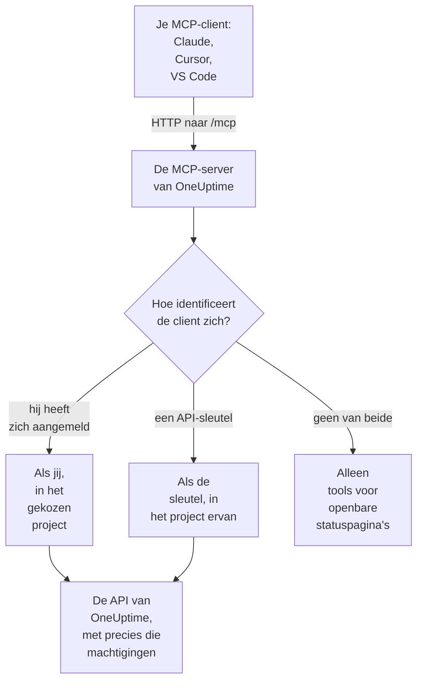

# MCP-server

Met de MCP-server van OneUptime kan een AI-assistent rechtstreeks met je OneUptime-project werken. Koppel Claude, Cursor, VS Code met GitHub Copilot of een andere client van het Model Context Protocol (MCP), en vraag hem een incident te bekijken, logs en traces op te vragen, een waarschuwing te bevestigen of een monitor in te stellen: hij roept de tools van OneUptime aan met jouw machtigingen, of met die van een API-sleutel.

:::cards
- [Een client koppelen](#een-client-koppelen): Geef je client het adres van de server en meld je aan.
- [Aanmelden met OneUptime](#aanmelden-met-oneuptime): Wat een gekoppelde client mag, en hoe je hem loskoppelt.
- [Je API-sleutel ophalen](#je-api-sleutel-ophalen): Voor een agent die zonder toezicht draait.
- [Problemen oplossen](#problemen-oplossen): Problemen met aanmelden, machtigingen en verbinding.
:::

Deze pagina gaat over AI-assistenten die verbinding maken met OneUptime. Om OneUptime AI in plaats daarvan de tools van andere MCP-servers te laten gebruiken, zoals die van AWS of GitHub, zie [Externe MCP-servers](/docs/ai/external-mcp-servers).

## Hoe het werkt

De MCP-server maakt deel uit van elke OneUptime-instantie, op `/mcp` op hetzelfde adres als het dashboard, en gebruikt het streamable HTTP-transport. Er hoeft niets geïnstalleerd te worden.

- **OneUptime Cloud**: `https://oneuptime.com/mcp`
- **Zelf gehost**: `https://your-oneuptime-domain.com/mcp`



De server is stateless: hij geeft geen sessie-id's uit en elk verzoek staat op zichzelf, zodat hij werkt achter load balancers en met meerdere replica's.

## Wat de tools afdekken

- **Monitoren**: monitoren aanmaken en configureren, hun status controleren en hun geschiedenis bekijken.
- **Incidentrespons**: incidenten aanmaken, bevestigen en oplossen, interne of openbare notities toevoegen en ze tot de oplossing volgen.
- **Waarschuwingen**: waarschuwingen bevestigen en oplossen, notities toevoegen en de toestanden en ernstniveaus van waarschuwingen beheren.
- **Teams en bereikbaarheid**: teams en bereikbaarheidsbeleid beheren.
- **Statuspagina's**: statuspagina's beheren en aankondigingen plaatsen.
- **Gepland onderhoud**: onderhoudsgebeurtenissen aanmaken en beheren.
- **Telemetrie**: logs, metrieken, traces, uitzonderingen, monitorlogs, beveiligingsgebeurtenissen en meer opvragen, alleen lezen.

Er zijn tools om aan te maken, op te halen, op te sommen, bij te werken, te verwijderen en te tellen voor 30 soorten records, tools om op te sommen en te tellen voor 9 soorten telemetrie, en tools speciaal voor incidentrespons. Alleen-lezen-tools hebben `readOnlyHint`, elke tool die iets wijzigt heeft `destructiveHint`, en alleen de tools voor openbare statuspagina's hebben `openWorldHint`, zodat een client alleen-lezen-aanroepen zelf kan uitvoeren en je vóór elke wijziging iets kan vragen. Een mislukte toolaanroep komt terug als toolresultaat (`isError: true`) met een `statusCode`, de details en een suggestie, niet als MCP-protocolfout, zodat de agent de fout kan lezen en zichzelf kan corrigeren.

## Voordat je begint

- Een OneUptime-instantie: OneUptime Cloud of zelf gehost.
- Een MCP-client, zoals Claude Code, Claude, VS Code met GitHub Copilot of Cursor.
- Een OneUptime-account om mee aan te melden, of een OneUptime-API-sleutel voor een agent die zonder toezicht draait. De tools voor openbare statuspagina's hebben geen van beide nodig.
- Op OneUptime Cloud het Growth-abonnement of hoger: een MCP-client koppelen is beschikbaar in dezelfde abonnementen als API-sleutels.

## Een client koppelen

Geef de client het adres van de server en verder niets. De eerste keer dat hij je gegevens nodig heeft, opent hij OneUptime in je browser zodat je je kunt aanmelden (zie [Aanmelden met OneUptime](#aanmelden-met-oneuptime)). Gebruik op een zelf gehoste instantie `https://your-oneuptime-domain.com/mcp` in plaats van `https://oneuptime.com/mcp`.

:::tabs
@tab Claude Code
```bash
claude mcp add --transport http oneuptime https://oneuptime.com/mcp
```
Voer daarna `/mcp` uit in Claude Code en kies **oneuptime** om je aan te melden.
@tab Claude
Open in Claude **Customize → Connectors**, kies **Add custom connector** en voer `https://oneuptime.com/mcp` in. Claude vraagt je om je bij OneUptime aan te melden de eerste keer dat het je gegevens nodig heeft.
@tab VS Code
Voeg dit toe aan je MCP-configuratie (zie [VS Code met GitHub Copilot](#vs-code-met-github-copilot) voor waar die staat). VS Code opent OneUptime om je aan te melden wanneer je de server start:
```json
{
  "servers": {
    "oneuptime": {
      "type": "http",
      "url": "https://oneuptime.com/mcp"
    }
  }
}
```
@tab Cursor
```json
{
  "mcpServers": {
    "oneuptime": {
      "url": "https://oneuptime.com/mcp"
    }
  }
}
```
:::

Elke andere client die MCP-autorisatie ondersteunt, werkt op dezelfde manier: geef hem het adres en hij ontdekt de rest zelf. Zie [Aanmelden (OAuth 2.1)](#aanmelden-oauth-21) voor het protocol.

Het dashboard heeft deze stappen ook, met het adres van je instantie al ingevuld: **Projectinstellingen → AI → MCP-server**. En vanuit elke resource (een monitor, een incident, een statuspagina enzovoort) klap je **Ontwikkelaars** uit in het zijmenu en kies je **AI-assistenten**: die pagina stelt ook prompts voor die de resource en de ID ervan noemen, zodat de assistent hem meteen vindt. Voor een resource waarvoor de MCP-server nog geen tools heeft, zoals een workflow, laat de pagina zien hoe een assistent die opdrachten kan uitvoeren er in plaats daarvan via de REST API mee kan werken.

## Aanmelden met OneUptime

De eenvoudigste manier om te koppelen is je MCP-client het adres van de server te geven en verder niets. De eerste keer dat de client je gegevens nodig heeft, opent hij een OneUptime-pagina in je browser:

:::steps
1. Meld je aan bij OneUptime, als je nog niet bent aangemeld.
2. Kies het project waarin de client moet werken.
3. Kies **Lezen en schrijven** of **Alleen lezen**.
4. Klik op **Autoriseren**.
:::

De client handelt dan als jou in dat project. Er is geen API-sleutel om aan te maken, te kopiëren of te roteren, en er wordt niets geheims in een configuratiebestand opgeslagen.

Wat een gekoppelde client kan:

- **Hij heeft jouw machtigingen, en nooit meer.** Wat je teams je in het project toestaan, kan de client ook. Verandert je rol of verlaat je het project, dan geldt dat vanaf het volgende verzoek van de client. Als je het project verlaat, wordt de client ook losgekoppeld: de autorisatie ervan wordt verwijderd, en als je terugkomt, verbind je hem opnieuw.
- **Alleen lezen betekent alleen lezen.** Een client die alleen-lezen is geautoriseerd, kan de tools `get_`, `list_` en `count_` gebruiken. Tools die aanmaken, bijwerken, verwijderen, bevestigen of oplossen, worden geweigerd, door de MCP-server en door de OneUptime-API erachter. Je kunt een client nooit meer toegang geven dan hij vroeg.
- **Hij geldt voor één project.** Om een tweede project te gebruiken, koppel je de client opnieuw en kies je dat project.
- **Hij werkt alleen via de MCP-server.** Het toegangstoken van de client wordt door het MCP-endpoint geaccepteerd en nergens anders. Het kan niet worden gebruikt om de REST API van OneUptime rechtstreeks aan te roepen.
- **Instantiebeheerders krijgen geen speciale behandeling.** Een client die een master-admin heeft gekoppeld, heeft wat de teams van die persoon in het project toekennen, geen toegang tot de hele instantie.

### Gekoppelde clients beheren

Elke client die door aanmelden is gekoppeld, staat op **Projectinstellingen → AI → MCP-server**, onder **Verbonden MCP-clients**, met wie hem heeft gekoppeld, wat hij mag en wanneer hij voor het laatst is gebruikt. Je ziet de clients die je zelf hebt gekoppeld; eigenaren en beheerders van het project zien die van iedereen.

Klik op **Disconnect** om een client af te melden. Hij werkt meteen niet meer.

Een client blijft gekoppeld zolang hij wordt gebruikt. Een client die 30 dagen niet is gebruikt, moet zich opnieuw aanmelden.

### Bepalen wie clients mag koppelen

Standaard kan elk projectlid een MCP-client koppelen. Om de leden van een team dat te verbieden, open je de pagina **Machtigingen** van het team, open je onderaan **Meer instellingen** en voeg je de machtiging **Authorize MCP Client** toe onder **Machtigingen blokkeren**. Clients die die leden al hadden gekoppeld, werken meteen niet meer.

Als het project single sign-on vereist, meld je dan in je browser met SSO aan bij het project voordat je een client autoriseert. De verbinding van de client duurt zo lang als die SSO-aanmelding; als die verloopt, of de SSO-provider waarmee je je aanmeldde wordt uitgezet of verwijderd, koppel je de client opnieuw.

Op OneUptime Cloud is een MCP-client koppelen beschikbaar in dezelfde abonnementen als API-sleutels (Growth en hoger).

In de Enterprise Edition wordt elke wijziging die een gekoppelde client maakt, in het auditlog vastgelegd onder de persoon die hem heeft gekoppeld, met de naam van de client. Wijzigingen met een API-sleutel tonen de naam van de sleutel.

## Je API-sleutel ophalen

Gebruik een API-sleutel voor een agent die zonder toezicht draait, zoals een geplande taak of een CI-pipeline, waar niemand is om zich aan te melden.

:::steps
### Maak de sleutel aan

Ga naar **Projectinstellingen → Geavanceerd → API-sleutels** en klik op **API-sleutel aanmaken**. Geef hem een naam, zoals "MCP Server".

### Kies wat hij mag

Kies onder **Toegang** **Viewer** voor een agent die alleen leest, of **Project Admin** voor een agent die ook aanmaakt, bijwerkt en verwijdert (zie [Machtigingen van API-sleutels](#machtigingen-van-api-sleutels)).

### Kopieer de sleutel

Klik op **API-sleutel aanmaken**: de pagina van de sleutel opent. Kopieer de sleutel daar.
:::

API-sleutels horen bij één project: de MCP-server haalt het project uit de sleutel, zodat aanmaaktools nooit een argument `projectId` nodig hebben.

> [!WARNING]
> Geef een AI-agent nooit een mastersleutel. Een master-API-sleutel van OneUptime wordt ook in deze header geaccepteerd en geeft beheerdertoegang tot de hele instantie. Gebruik altijd een project-API-sleutel met het minimum dat de agent nodig heeft: een alleen-lezen-sleutel is genoeg voor alle tools `get_`, `list_` en `count_`.

## Koppelen met een API-sleutel

Stuur de sleutel mee in de header `x-api-key`. Een verzoek met een API-sleutel wordt nooit gevraagd om aan te melden. Gebruik op een zelf gehoste instantie je eigen domein in plaats van `oneuptime.com`.

:::tabs
@tab Claude Code
```bash
claude mcp add --transport http oneuptime https://oneuptime.com/mcp --header "x-api-key: your-api-key-here"
```
@tab Claude Desktop
Voeg dit toe aan `claude_desktop_config.json`, in `~/Library/Application Support/Claude/` op macOS, `%APPDATA%\Claude\` op Windows of `~/.config/Claude/` op Linux:
```json
{
  "mcpServers": {
    "oneuptime": {
      "transport": "streamable-http",
      "url": "https://oneuptime.com/mcp",
      "headers": {
        "x-api-key": "your-api-key-here"
      }
    }
  }
}
```
@tab VS Code
De invoervariabele met `"password": true` vraagt om de sleutel wanneer de server start, in plaats van hem als platte tekst te bewaren:
```json
{
  "servers": {
    "oneuptime": {
      "type": "http",
      "url": "https://oneuptime.com/mcp",
      "headers": {
        "x-api-key": "${input:oneuptime-api-key}"
      }
    }
  },
  "inputs": [
    {
      "type": "promptString",
      "id": "oneuptime-api-key",
      "description": "OneUptime API Key",
      "password": true
    }
  ]
}
```
@tab Cursor
```json
{
  "mcpServers": {
    "oneuptime": {
      "url": "https://oneuptime.com/mcp",
      "headers": {
        "x-api-key": "your-api-key-here"
      }
    }
  }
}
```
:::

## VS Code met GitHub Copilot

VS Code 1.99 en later ondersteunt MCP-servers rechtstreeks in GitHub Copilot Chat.

:::steps
### Controleer wat je nodig hebt

VS Code 1.99 of later, met de GitHub Copilot-extensie geïnstalleerd en aangemeld, en GitHub Copilot Chat ingeschakeld.

### Open de MCP-configuratie

Druk op `Ctrl+Shift+P` (`Cmd+Shift+P` op macOS), typ "MCP: Open User Configuration" en druk op Enter. Dat opent of maakt het bestand `mcp.json`. Voor één workspace maak je in plaats daarvan `.vscode/mcp.json` daarin aan.

### Voeg OneUptime toe

Plak de VS Code-configuratie hierboven: die zonder sleutel om je aan te melden, of die met een API-sleutel.

### Start de server

Druk op `Ctrl+Shift+P` (`Cmd+Shift+P` op macOS), typ "MCP: List Servers" en kies **oneuptime** om hem te starten. VS Code vraagt je de eerste keer de server te vertrouwen, en daarna om je aan te melden of je API-sleutel in te voeren.

### Vraag het Copilot

Open GitHub Copilot Chat in agentmodus en vraag bijvoorbeeld "Welke monitoren heb ik in OneUptime?", "Laat me recente incidenten zien" of "Maak een nieuwe monitor aan voor https://example.com".
:::

## Authenticatie

De MCP-server werkt op drie manieren.

### Openbare tools (geen authenticatie nodig)

Zonder API-sleutel of aanmelding kan een client de openbare tools gebruiken:

- **`oneuptime_help`**: hulp en uitleg over de MCP-tools van OneUptime
- **`oneuptime_list_resources`**: de resources en wat je met elk kunt doen
- **`get_public_status_page_overview`**: het overzicht van een openbare statuspagina
- **`get_public_status_page_incidents`**: de incidenten van een openbare statuspagina
- **`get_public_status_page_scheduled_maintenance`**: de geplande onderhoudsgebeurtenissen ervan
- **`get_public_status_page_announcements`**: de aankondigingen ervan

De tools voor openbare statuspagina's nemen de ID van een statuspagina (een UUID) of de domeinnaam ervan. Om alleen deze te gebruiken, koppel je met het adres en zonder inloggegevens:

```json
{
  "mcpServers": {
    "oneuptime": {
      "transport": "streamable-http",
      "url": "https://oneuptime.com/mcp"
    }
  }
}
```

De eigenaren van een statuspagina kunnen MCP-toegang voor die pagina uitzetten: open op de statuspagina **MCP** in de sectie **AI** van het zijmenu en zet **MCP-server inschakelen** uit. De schakelaar slaat op zodra hij wordt omgezet. MCP-toegang staat standaard aan. Zolang die uit staat, geven de vier tools `get_public_status_page_*` een fout voor die statuspagina; de website van de statuspagina, de RSS-feed en de openbare JSON-API ervan worden niet geraakt, en de statuspaginatools die aanmelding vereisen (`get_status_page`, `list_status_pages` enzovoort) blijven werken voor het eigen project van de pagina.

### Aanmelden (OAuth 2.1)

Elke andere tool moet weten wie hem aanroept. Een client die geen inloggegevens stuurt en een van die tools aanroept, krijgt `401 Unauthorized` met een header `WWW-Authenticate` die verwijst naar de metadata van de beschermde resource van de server. Dat is het signaal waarop een MCP-client reageert om je aan te melden; `initialize`, `tools/list` en de openbare tools vragen er nooit om.

De server implementeert de [MCP-autorisatiespecificatie](https://modelcontextprotocol.io/specification/latest/basic/authorization):

- **Stroom**: OAuth 2.1-authorization code met PKCE (alleen `S256`). Toegangstokens worden verstuurd als `Authorization: Bearer`.
- **Ontdekking**: metadata van de beschermde resource (RFC 9728) en metadata van de autorisatieserver (RFC 8414). De uitgever en de resource zijn allebei `https://<host>/mcp`.
- **Clientidentiteit**: een Client ID Metadata Document (de client-ID is een `https`-URL die de server ophaalt), of dynamische clientregistratie (RFC 7591). Geen enkele client hoeft door een beheerder te worden geregistreerd.
- **Bereiken**: `mcp:read` voor de tools `get_`, `list_` en `count_`; `mcp:write` voegt elke tool toe die iets wijzigt en omvat `mcp:read`. Een alleen-lezen-token dat een schrijftool aanroept, krijgt `403` met `error="insufficient_scope"`.
- **Levensduur van tokens**: een toegangstoken is een uur geldig. Een refreshtoken is 30 dagen geldig en wordt bij elk gebruik vervangen; een refreshtoken gebruiken dat al vervangen is, beëindigt de verbinding.
- **Resource-indicatoren** (RFC 8707): een token wordt uitgegeven voor `https://<host>/mcp` en nergens anders geaccepteerd.
- **Intrekking** (RFC 7009): het intrekken van een van beide tokens beëindigt de verbinding.

### API-sleutel

Een agent die zonder toezicht draait, stuurt een OneUptime-API-sleutel mee in een van deze headers:

- `x-api-key`: je OneUptime-API-sleutel
- `Authorization`: een bearer-token met je API-sleutel (bijv. `Bearer your-api-key-here`)

Het schema `Bearer` is niet hoofdlettergevoelig. Een verzoek met een API-sleutel wordt nooit gevraagd om aan te melden.

Op OneUptime Cloud werken API-sleutels alleen zolang het project op **Growth** of hoger zit. Daaronder antwoordt elke tool die de sleutel nodig heeft met `402` en een melding die het abonnement noemt, en krijgt de agent te horen het niet opnieuw te proberen. Er wordt niets verwijderd: de sleutel werkt weer zoals hij is zodra het project weer op Growth zit, zonder iets opnieuw te koppelen. Een client die door aanmelden is gekoppeld, handelt als een persoon en blijft werken ([API-sleutels en SCIM onder hun abonnement](/docs/api-reference/api-reference#api-sleutels-en-scim-onder-hun-abonnement)).

## Beschikbare endpoints

| Endpoint | Methode | Beschrijving |
| --- | --- | --- |
| `/mcp` | POST | JSON-RPC-verzoeken voor toolaanroepen en andere bewerkingen |
| `/mcp` | GET | Zonder SSE-header `Accept`: een korte JSON-beschrijving van de server. Met zo'n header: `405`, omdat de stateless server geen losse SSE-stream biedt (clients die de specificatie volgen, gaan zonder verder) |
| `/mcp` | DELETE | Doet niets: de server is stateless, dus er is geen sessie om te beëindigen |
| `/mcp/health` | GET | Gezondheidscontrole |
| `/mcp/tools` | GET | De lijst met tools, als gewone REST |

MCP-clients die zich aanmelden, gebruiken ook de OAuth-endpoints hieronder. Een client vindt ze zelf; ze staan hier voor wie een client schrijft of een proxy inricht.

| Endpoint | Methode | Beschrijving |
| --- | --- | --- |
| `/mcp/.well-known/oauth-protected-resource` | GET | Metadata van de beschermde resource (RFC 9728). Ook op `/.well-known/oauth-protected-resource/mcp` |
| `/.well-known/oauth-authorization-server/mcp` | GET | Metadata van de autorisatieserver (RFC 8414). Ook op `/mcp/.well-known/oauth-authorization-server` |
| `/mcp/oauth/authorize` | GET | Autorisatie-endpoint: waar de client je browser heen stuurt om je aan te melden |
| `/mcp/oauth/token` | POST | Token-endpoint: wisselt een autorisatiecode of een refreshtoken in |
| `/mcp/oauth/register` | POST | Dynamische clientregistratie (RFC 7591) |
| `/mcp/oauth/revoke` | POST | Intrekking van tokens (RFC 7009) |

Om te controleren of de server draait en zijn tools op te sommen:

```bash
curl https://oneuptime.com/mcp/health
curl https://oneuptime.com/mcp/tools
```

## Tools voor incidentrespons

Naast de tools voor elk soort record heeft de server tools speciaal voor het reageren op incidenten en waarschuwingen:

- **`acknowledge_incident`** / **`resolve_incident`**: een incident naar de toestand Acknowledged of Resolved van het project zetten, zoals de knop in het dashboard doet
- **`acknowledge_alert`** / **`resolve_alert`**: hetzelfde voor waarschuwingen
- **`add_incident_note`**: een notitie aan een incident toevoegen met `visibility: "internal"` (alleen het team, de standaard) of `visibility: "public"` (geplaatst op de statuspagina). Markdown wordt ondersteund
- **`add_alert_note`**: een interne notitie aan een waarschuwing toevoegen

Een typische lus: `list_incidents` → `acknowledge_incident` → onderzoeken met `list_logs` → `add_incident_note` (openbaar) → `resolve_incident`.

De tool **`oneuptime_whoami`** geeft het project terug waartoe je inloggegevens behoren (de ID en de naam). Voor een client die zich heeft aangemeld, zegt hij ook als wie hij is aangemeld en of hij wijzigingen mag aanbrengen. Het is een goede eerste aanroep voor een agent om zich te oriënteren, en omdat aanmaaktools `projectId` uit de inloggegevens halen, hoeft de agent nooit een project-ID mee te geven.

## Telemetrie opvragen

Logs, metrieken, traces (spans), uitzonderingen, monitorlogs en de andere soorten telemetrie komen als alleen-lezen-tools `list_` en `count_` (`list_logs`, `list_metrics`, `list_spans`, `list_exception_instances`, `list_monitor_logs` en hun `count_`-tegenhangers). Telemetrie komt binnen via OpenTelemetry, dus er zijn geen aanmaaktools.

Vraag telemetrie altijd op met een tijdsbereik. Een queryveld neemt een waarde of een operatorobject:

```json
{
  "query": {
    "time": { "_type": "GreaterThan", "value": "2026-07-04T00:00:00.000Z" }
  },
  "sort": { "time": "DESC" },
  "limit": 50
}
```

De operatoren zijn `EqualTo`, `NotEqual`, `IsNull`, `NotNull`, `EqualToOrNull`, `GreaterThan`, `LessThan`, `GreaterThanOrEqual`, `LessThanOrEqual`, `InBetween`, `Search` en `Includes`. Sorteerwaarden zijn `"ASC"` of `"DESC"`.

## Veldselectie en paginering

De tools `get_` en `list_` nemen een optionele array `select` met veldnamen. Standaard komt elk leesbaar veld terug, behalve de zware (JSON-, zeer lange tekst- en HTML-kolommen), die in `select` moeten worden opgevraagd.

Lijsttools bladeren met `limit` (standaard 10, hoogstens 100) en `skip`, en elk lijstantwoord zegt precies wat het teruggaf:

```json
{
  "returnedCount": 10,
  "totalCount": 42,
  "skip": 0,
  "limit": 10,
  "hasMore": true,
  "data": ["..."]
}
```

## Gebruiksvoorbeelden

### Alledaagse vragen

```text
"What's the current status of all my monitors?"
"Show me incidents from the last 24 hours"
"List the teams in this project"
"Show me our on-call policies"
```

### Monitoren en incidenten

```text
"Create a new website monitor for https://example.com that checks every 5 minutes"
"Set up an API monitor for https://api.example.com/health with a 30-second timeout"
"Disable the monitor for staging.example.com while we're doing maintenance"
"Create a high-priority incident for the database outage affecting user authentication"
"Add a note to incident #123 saying 'Database connection restored, monitoring for stability'"
"Mark incident #456 as resolved"
```

### Statuspagina's

```text
"Update our status page to show 'Investigating Payment Issues' for the payment service"
"Create a status page announcement about scheduled maintenance this weekend"
```

### Vragen aan openbare statuspagina's (geen API-sleutel nodig)

Deze werken zonder inloggegevens, met alleen de tools voor openbare statuspagina's:

```text
"What's the current status of status.example.com?"
"Show me recent incidents from the OneUptime status page"
"Are there any scheduled maintenance events on status.acme.com?"
"Get the latest announcements from my public status page with ID abc123-..."
```

### Meerdere stappen tegelijk

```text
"Create a scheduled maintenance window for Saturday 2-4 AM, disable all monitors for api.example.com during that time, and update the status page"
"Show me all monitors that have been down in the last hour, create incidents for any that don't already have one"
```

## Machtigingen van API-sleutels

| Wat de agent doet | Kies onder **Toegang** |
| --- | --- |
| Leest alleen | **Viewer**, of voeg leesmachtigingen toe op de pagina van de sleutel |
| Maakt ook aan, werkt bij en verwijdert | **Project Admin**, of voeg de rol Project Admin toe op de pagina van de sleutel |

Geef elke sleutel het minimum dat hij nodig heeft, roteer sleutels regelmatig, gebruik een aparte sleutel voor elke omgeving en houd in OneUptime in de gaten wat elke sleutel doet.

## Configuratie bij zelf hosten

Aanmelden werkt direct op een zelf gehoste instantie. Twee instellingen veranderen dat:

| Omgevingsvariabele | Helm-waarde | Wat het doet |
| --- | --- | --- |
| `DISABLE_MCP_OAUTH` | `mcpOAuth.disabled` | Zet op `true` om aanmelden uit te zetten. De OAuth-endpoints worden niet meer aangeboden en de MCP-server accepteert alleen nog API-sleutels. Er wordt niets verwijderd; gekoppelde clients werken weer als het weer wordt aangezet. |
| `DISABLE_MCP_OAUTH_CLIENT_ID_METADATA_DOCUMENTS` | `mcpOAuth.disableClientIdMetadataDocuments` | Zet op `true` op een instantie die het internet niet kan bereiken. Een client kan zich identificeren met een URL die OneUptime ophaalt; met deze instelling registreren clients zich in plaats daarvan rechtstreeks bij je instantie, wat geen uitgaand verzoek nodig heeft. |

Als je een eigen reverse proxy voor OneUptime draait, stuur dan `/.well-known/oauth-protected-resource` en `/.well-known/oauth-authorization-server` (en alles daaronder) samen met `/mcp` door naar OneUptime. De meegeleverde ingress doet dat al.

De server bouwt elke OAuth-URL op uit de instellingen `HOST` en `HTTP_PROTOCOL`, dus die moeten overeenkomen met het adres waarmee mensen je instantie bereiken.

## Problemen oplossen

### Problemen met aanmelden

- **De client vraagt me nooit om aan te melden**: de client ondersteunt misschien geen MCP-autorisatie, of hij is geconfigureerd met een API-sleutelheader, die voorrang heeft. Verwijder de header om je in plaats daarvan aan te melden.
- **Mijn project is grijs op de autorisatiepagina**: de pagina zegt naast de projectnaam waarom: het abonnement van het project omvat het koppelen van MCP-clients niet, het project vereist SSO en deze browser heeft zich er niet met SSO bij aangemeld, of je team mag geen clients koppelen.
- **Een tool wordt geweigerd als "read-only"**: de client is alleen-lezen geautoriseerd. Koppel hem opnieuw en kies **Lezen en schrijven**.
- **De client werkt niet meer**: hij is losgekoppeld, is 30 dagen niet gebruikt, je bent uit het project verwijderd, of de SSO-aanmelding van het project is verlopen of de provider ervan is uitgezet. Koppel hem opnieuw.
- **Zelf gehost - de client zegt dat hij de autorisatieserver niet kan vinden**: controleer of `HOST` en `HTTP_PROTOCOL` overeenkomen met je openbare adres, en of je proxy de paden `/.well-known/oauth-*` doorstuurt.

### Machtigingsfouten

De API-sleutel, of bij een client die zich heeft aangemeld je eigen account, heeft de juiste machtigingen nodig: leestoegang om records op te sommen, schrijftoegang om ze aan te maken en bij te werken, en verwijdertoegang om ze te verwijderen.

### Verbindingsproblemen

Controleer of het OneUptime-adres klopt en bereikbaar is, of de API-sleutel geldig is en of het gezondheids-endpoint antwoordt (zie [Beschikbare endpoints](#beschikbare-endpoints)).

### Ongeldige API-sleutel

- Controleer de API-sleutel in je OneUptime-instellingen, zonder extra spaties of tekens
- Controleer of de sleutel niet is verlopen
- Op OneUptime Cloud betekent een `402` die zegt dat API-sleutels het Growth-abonnement nodig hebben, dat het project daaronder zit: upgrade het project onder **Projectinstellingen → Facturering en facturen → Facturering**, en dezelfde sleutel werkt weer

### Sessiefouten

De MCP-server is stateless: hij geeft geen sessie-id's uit en houdt ze niet bij, zodat elk verzoek tegen elke replica werkt. Een client die een header `mcp-session-id` van een oudere serverversie stuurt, kan die weglaten; hij wordt genegeerd. Werk een oudere clientconfiguratie bij die verwacht dat de server een sessie-id teruggeeft.

## Beschikbare resources

| Gebied | Records met tools om aan te maken, op te halen, op te sommen, bij te werken, te verwijderen en te tellen |
| --- | --- |
| Bewaking | Monitor, Monitor Status, Monitor Status Event |
| Incidenten | Incident, Incident State, Incident Severity, Incident State Timeline, Incident Public Note, Incident Internal Note, Incident Alert, Postmortem Status |
| Waarschuwingen | Alert, Alert State, Alert Severity, Alert State Timeline, Alert Internal Note |
| Statuspagina's | Status Page, Status Page Announcement |
| Gepland onderhoud | Scheduled Maintenance Event, Scheduled Maintenance State, Scheduled Maintenance State Timeline |
| Teams en bereikbaarheid | Team, On-Call Policy |
| Labels | Label |
| Beveiliging | Security Case, Security Case Note, Security Case Priority, Security Case Status, Security Detection, Security Playbook |

| Gebied | Telemetrie met alleen tools om op te sommen en te tellen |
| --- | --- |
| Observeerbaarheid | Log, Metric, Span, Exception Instance, Monitor Log |
| Beveiliging | Security Event, Threat Intel Indicator |
| Wijzigingen en kosten | Change Event, Kubernetes Cost Allocation |

De tools heten in snake case: `create_incident`, `get_incident`, `list_incidents`, `update_incident`, `delete_incident` en `count_incidents`, of `list_logs` en `count_spans` voor telemetrie.

## Volgende stappen

:::cards
- [AI vragen](/docs/ai/ask-ai): Vraag in plaats daarvan binnen OneUptime naar je project.
- [API-referentie van OneUptime](/docs/api-reference/api-reference): De REST API achter elke tool.
- [Machtigingen](/docs/permissions/index): Wat een rol, een team of een API-sleutel mag.
:::
