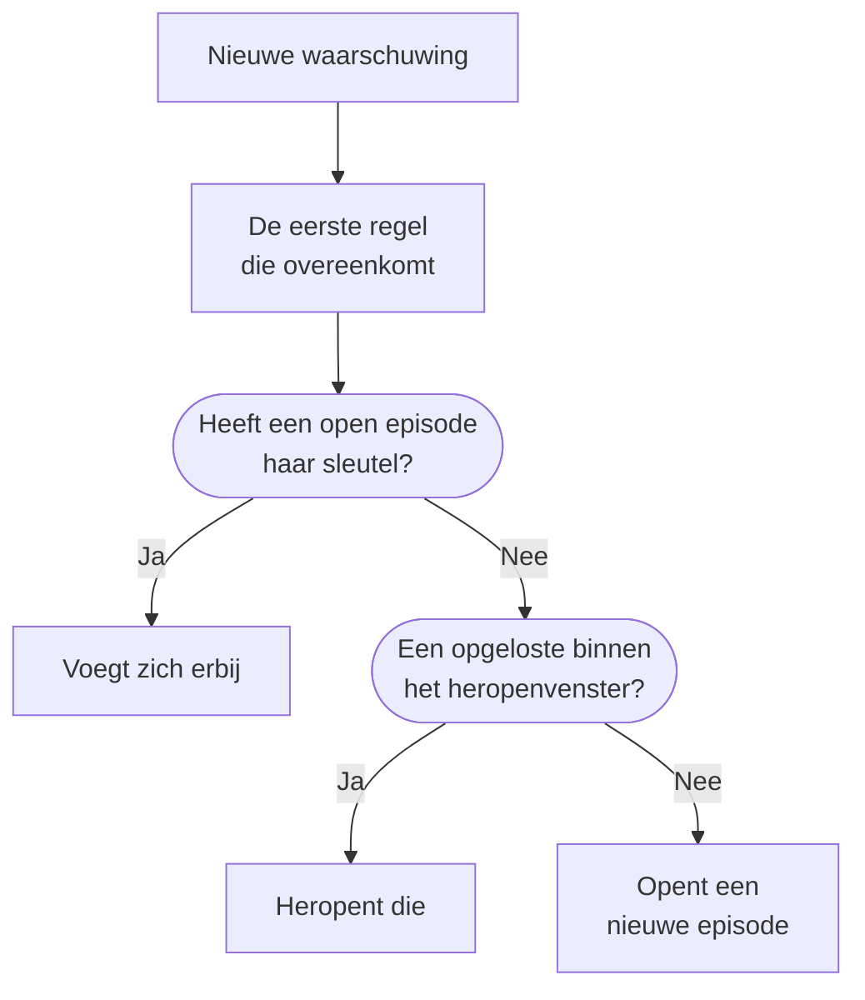

# Waarschuwingsepisoden en groeperingsregels

Als een database uitvalt, kunnen twintig monitors binnen enkele minuten twintig waarschuwingen aanmaken. Een episode brengt ze samen in één record dat je team in één keer bevestigt en oplost, en een groeperingsregel bepaalt welke waarschuwingen erin horen. Deze pagina laat zien hoe groeperen werkt, hoe je een regel instelt en hoe een episode zich gedraagt zodra ze open is.

:::cards
- [Hoe groeperen werkt](#hoe-groeperen-werkt): Regels, groeperingssleutels en tijdvensters.
- [Een groeperingsregel maken](#een-groeperingsregel-maken): Vanuit een sjabloon met één klik, of je eigen regel.
- [Hoe een episode zich gedraagt](#hoe-een-episode-zich-gedraagt): Haar ernst, haar statussen en wanneer ze wordt opgelost.
- [Wie een episode oproept](#wie-een-episode-oproept): Het bereikbaarheidsbeleid van de regel en dat van de waarschuwingen zelf.
:::

## Hoe groeperen werkt

Groeperen gebeurt één keer voor elke nieuwe waarschuwing, direct nadat haar bereikbaarheidsbeleid heeft gedraaid. De waarschuwing wordt getoetst aan je ingeschakelde groeperingsregels, van boven naar beneden in de lijst, en de eerste regel die overeenkomt, bepaalt haar episode. Een waarschuwing waarop geen regel overeenkomt, blijft op zichzelf.



- **De voorwaarden van de regel** bepalen op welke waarschuwingen ze van toepassing is. Een regel zonder voorwaarden geldt voor elke nieuwe waarschuwing.
- **De groeperingssleutel** bepaalt welke waarschuwingen een episode delen: die met dezelfde monitor, dezelfde ernst, dezelfde titel, of welke combinatie de regel ook gebruikt. Een regel die op niets groepeert, plaatst elke waarschuwing waarop ze overeenkomt in één episode.
- **Het tijdvenster** bepaalt hoe lang een episode waarschuwingen blijft opnemen. Staat het aan, dan voegt een waarschuwing zich alleen bij als ze binnen het venster na de laatste waarschuwing van de episode binnenkomt. Staat het uit, dan blijven overeenkomende waarschuwingen zich aansluiten tot de episode is opgelost.

Groeperen gebeurt wanneer een waarschuwing wordt aangemaakt. Een regel die je vandaag toevoegt, groepeert de waarschuwingen die daarna worden aangemaakt; de bestaande worden niet opnieuw gegroepeerd.

> [!NOTE]
> Een waarschuwing die al bevestigd wordt aangemaakt, kan zich bij een open episode voegen maar opent er nooit een, en een waarschuwing die opgelost wordt aangemaakt, wordt helemaal niet gegroepeerd. Zie [Al bevestigd of opgelost aangemaakt](/docs/alerts/index#al-bevestigd-of-opgelost-aangemaakt).

## Een groeperingsregel maken

Ga naar **Waarschuwingen → Regels → Groeperingsregels**. De sectie **Regels** van het zijmenu begint ingeklapt, dus klap haar eerst uit.

### Beginnen vanuit een sjabloon

Een project zonder groeperingsregels ziet vier kant-en-klare regels in plaats van een lege lijst; zodra je regels hebt, opent **Maken op basis van sjabloon** op de kaart ze. **Regel toevoegen** slaat er een op met één klik, ingeschakeld, aan het einde van de lijst en geldend voor elke nieuwe waarschuwing. Bewerk haar daarna zoals elke andere regel.

| Sjabloon                                             | Groepeert                                                                 | Tijdvenster |
| ---------------------------------------------------- | ------------------------------------------------------------------------- | ----------- |
| **Waarschuwingen van dezelfde monitor groeperen**    | Eén episode per monitor                                                   | 30 minuten  |
| **Waarschuwingen groeperen die tegelijk gebeuren**   | Eén gedeelde episode, welke monitor ook                                   | 10 minuten  |
| **Waarschuwingen groeperen op ernst**                | Eén episode per ernstniveau                                               | 30 minuten  |
| **Herhalingen van dezelfde waarschuwing groeperen**  | Eén episode per waarschuwingstitel, zonder te letten op cijfers en hoofdletters | 1 uur  |

### Je eigen regel maken

:::steps
#### Kiezen hoe je groepeert

Klik op **Aangepaste regel maken** onder de sjablonen, of op **Groeperingsregel voor waarschuwingen maken** op de kaart zodra je regels hebt. In de stap **Groepering** stelt **Waarschuwingen groeperen op** één vraag: **Monitor**, **Alles samen**, **Ernst**, **Titel** of **Aangepast**. De **Naam** volgt je antwoord tot je zelf een naam typt.

#### Het tijdvenster instellen

**Alleen waarschuwingen groeperen die kort na elkaar binnenkomen** staat aan, met een venster van 30 minuten. Wijzig de minuten, of zet het uit om één episode open te houden tot ze is opgelost.

#### Velden combineren, voor Aangepast

**Aangepast** voegt een stap **Groeperen op** toe met vijf schakelaars: **Groeperen op monitor**, **Groeperen op ernst van waarschuwing**, **Groeperen op titel van waarschuwing**, **Groeperen op waarschuwingslabels** en **Groeperen op monitorlabels**. Labels groeperen op hun exacte set.

#### Afbakenen

Bij **Welke waarschuwingen** groepeert **Alle waarschuwingen**, waar een nieuwe regel mee begint, elke nieuwe waarschuwing. Om de regel in te perken, kies **Alleen waarschuwingen die aan de voorwaarden voldoen** en voeg voorwaarden toe op monitors, ernstniveaus, labels, titels en beschrijvingen. Klik daarna op **Groeperingsregel voor waarschuwingen maken**.
:::

Al het andere wat een regel kan doen, staat ingeklapt onder **Meer velden** aan het einde van de stap **Groepering**, in drie groepen. Ingeklapt noemt de kop wat erin staat en zegt waarop elke instelling staat die de regel gebruikt, zodat het bewerken van een regel nooit verbergt wat ze doet.

| Groep                                | Instellingen                                                                                               |
| ------------------------------------ | ---------------------------------------------------------------------------------------------------------- |
| **Bereikbaarheid en eigenaarschap**  | **Bereikbaarheidsbeleid** dat draait wanneer de regel een episode opent, en **Episode-eigenaren**.         |
| **Episodelevenscyclus**              | **Recent opgeloste episodes heropenen**, **Wachten voordat een episode wordt opgelost** en **Stille episodes oplossen**, elk een schakelaar met zijn minuten. |
| **Details**                          | De **Beschrijving** van de regel, het **Episodetitelsjabloon**, het **Episodebeschrijvingssjabloon** en **Episodelabels**. |

Regels worden van boven naar beneden in de lijst gecontroleerd, en de eerste overeenkomst wint: sleep een regel om haar plek te wijzigen. Zet specifieke regels boven brede. De kolom **Groepering** in de lijst zegt in één zin wat elke regel doet, zoals "Eén episode per monitor".

## Titels van episodes

Zonder sjabloon krijgt een episode de naam van de monitor van haar eerste waarschuwing, of de eerste 50 tekens van de titel van de waarschuwing als die geen monitor heeft. Met een **Episodetitelsjabloon** of een **Episodebeschrijvingssjabloon** worden deze variabelen ingevuld. Typ `{{` in een van beide velden om er een te kiezen.

| Variabele              | Ingevuld met                                                                                    |
| ---------------------- | ----------------------------------------------------------------------------------------------- |
| `{{alertTitle}}`       | De titel van de eerste waarschuwing.                                                            |
| `{{alertDescription}}` | De beschrijving van de eerste waarschuwing.                                                     |
| `{{alertSeverity}}`    | De ernst van de eerste waarschuwing.                                                            |
| `{{monitorName}}`      | De naam van de monitor van de eerste waarschuwing.                                              |
| `{{alertCount}}`       | Hoeveel waarschuwingen de episode bevat, opnieuw geschreven als waarschuwingen erbij komen of vertrekken. |

Een variabele waarvoor de eerste waarschuwing geen waarde heeft, of een die niet in deze lijst staat, wordt weggelaten. Is de eerste waarschuwing privé, dan tonen `{{alertTitle}}` en `{{alertDescription}}` "Private alert", omdat de episode niet privé is.

## Hoe een episode zich gedraagt

Een episode doorloopt je waarschuwingsstatussen, dezelfde lijst die waarschuwingen gebruiken, en heeft haar eigen eigenaren, notities, hoofdoorzaak en herstelnotities.

- **Haar ernst stijgt met haar waarschuwingen.** Ze begint met de ernst van haar eerste waarschuwing, en neemt de ernst over van elke ernstigere waarschuwing die zich erbij voegt, waarbij "ernstiger" betekent: hoger in **Waarschuwingen → Instellingen → Ernst van waarschuwing**.
- **Haar status beweegt haar waarschuwingen.** Bevestig of los een episode op, of zet haar in een eigen status, en elke waarschuwing erin beweegt mee, behalve een waarschuwing die al in die status of erna staat.
- **Ze lost zichzelf op** zodra elke waarschuwing erin is opgelost. **Wachten voordat een episode wordt opgelost** houdt haar eerst zoveel minuten open, voor het geval een waarschuwing terugkomt.
- **Ze kan heropenen.** Met **Recent opgeloste episodes heropenen** aan heropent een overeenkomende waarschuwing die binnen de minuten na het oplossen van de episode binnenkomt die episode, in plaats van een nieuwe te openen. Dit is de enige stap terug omhoog in de lijst van statussen, en de waarschuwingen van de episode worden niet heropend.

> [!WARNING]
> **Stille episodes oplossen** lost een episode op wanneer er gedurende de ingestelde minuten geen nieuwe waarschuwing bij is gekomen, en lost ook elke waarschuwing op die er nog open in staat. Gebruik het voor ruis waarvan je zeker weet dat ze geen antwoord nodig heeft.

## Wie een episode oproept

Het eigen bereikbaarheidsbeleid van een waarschuwing draait wanneer ze wordt aangemaakt, vóór het groeperen, of ze zich nu bij een episode voegt of niet. Een episode voegt haar eigen beleid toe:

```mermaid title="Een waarschuwing die een episode opent, roept twee keer op; een die zich aansluit, één keer"
flowchart TB
    alert["Nieuwe waarschuwing"] --> own["Het eigen beleid van<br/>de waarschuwing draait"]
    own --> grouped{"Groepering"}
    grouped -->|"Opent een episode"| ep["Ook het beleid van<br/>de episode draait"]
    grouped -->|"Sluit aan bij een episode"| none["Verder draait er niets"]
```

- **Een nieuwe episode** voert het **Bereikbaarheidsbeleid** van de regel uit, plus dat van elke overeenkomende regel op het tabblad **Episode Rules** van **Waarschuwingen → Regels → Bereikbaarheidsregels**.
- **Een waarschuwing die zich bij een open episode voegt,** voert alleen haar eigen beleid uit. Dat van de episode draait niet opnieuw.
- **Wie de oproep van een episode beantwoordt,** bevestigt de episode, en daarmee elke waarschuwing erin.

> [!TIP]
> Om één keer per probleem op te roepen in plaats van één keer per waarschuwing, zet je het bereikbaarheidsbeleid op je groeperingsregels en laat je het weg bij de waarschuwingen: uit de criteria van de monitor, het aanmaakformulier en je bereikbaarheidsregels voor waarschuwingen.

Ook de eigenaren van de episode horen ervan: **Waarschuwingsepisode aangemaakt**, **Status van waarschuwingsepisode gewijzigd** en **Waarschuwing toegevoegd aan waarschuwingsepisode** staan standaard aan per e-mail, onder **Gebruikersinstellingen → Meldingsinstellingen**, op het tabblad **Waarschuwingen**. De **Episode-eigenaren** van de regel worden eigenaar van elke episode die ze opent, en worden ingelicht zoals elke andere eigenaar.

## Een episode met de hand aanmaken

:::steps
### Het formulier openen

Ga naar **Waarschuwingen → Alle episodes** en klik op **Episode aanmaken**. Het formulier **Nieuwe waarschuwingsepisode aanmaken** opent.

### De episode beschrijven

Vul bij **Episodedetails** de **Titel** in en, als je wilt, een **Ernst van waarschuwing** en een **Beschrijving**. **Initiële status** en **Labels** wachten onder **Meer velden**.

### Kiezen wie wordt opgeroepen en wie eigenaar is

Kies bij **Bereikbaarheid en eigenaren** een **Bereikbaarheidsbeleid** dat draait wanneer de episode wordt aangemaakt, en haar **Eigenaren**. Klik daarna op **Episode aanmaken**.

Elk team waarvan je lid bent, is onder **Eigenaren** één klik verwijderd, en de samenvatting noemt de eigenaarsregels die er meer zullen toevoegen.

### De waarschuwingen toevoegen

Open de pagina **Lidwaarschuwingen** van de episode, klik op **Waarschuwingen toevoegen** en vink de waarschuwingen aan die erbij horen, zoveel als u tegelijk nodig hebt. Wilt u liever bij de waarschuwingen beginnen, selecteer ze dan in de lijst **Waarschuwingen** en kies **Aan nieuwe episode toevoegen** onder **Bulkacties** (zie [Episodes](/docs/incidents/episodes)).
:::

Een episode die je zelf aanmaakt, heeft geen groeperingsregel, dus toont de lijst haar **Groeperingsregel** als **Manual**, en geen levenscyclusinstelling is erop van toepassing. Ze lost zichzelf nog steeds op zodra elke waarschuwing erin is opgelost.

## Wat elke pagina van een episode toont

| Sectie in het zijmenu | Pagina's                                                                    |
| --------------------- | --------------------------------------------------------------------------- |
| **Overzicht** | **Overzicht**, **Statustijdlijn** |
| **Onderzoek** | **Beschrijving**, **Hoofdoorzaak**, **Herstelnotities** |
| **Team** | **Eigenaren** |
| **Waarschuwingen** | **Lidwaarschuwingen** |
| **Notities** | **Privénotities** |
| **Ontwikkelaars** | **Terraform**, **API**, **AI-assistenten** |
| **Geavanceerd** | **Auditlogboeken**, **Episode verwijderen** |

**Ontwikkelaars** en **Geavanceerd** beginnen ingeklapt. Op het **Overzicht** noemt de kop de **Eigenaren** van de episode, teams eerst, en de eerste tegel, **Aangemaakt**, zegt wanneer de episode werd aangemaakt — **Automatisch**, als een groeperingsregel haar opende. De kaart **Wat er gebeurde** opent de pagina — de beschrijving van de episode en haar **Hoofdoorzaak** — dan **Alerts in this episode** en de **Episodefeed**, naast de kaart **Episodedetails**: haar nummer, status, ernst, aantal waarschuwingen, groeperingsregel en bereikbaarheidsbeleid. De kop heeft **Bevestigen** en **Oplossen**, en **Episode verplaatsen naar** in het menu **⋯**.

**Waarschuwingen → Actieve episodes** toont de episodes die nog niet zijn opgelost, en de badge ernaast telt ze.

## Probleemoplossing

:::details Een nieuwe waarschuwing voegde zich niet bij de episode die ik verwachtte
Controleer in deze volgorde: de regel is ingeschakeld; geen regel erboven kwam eerder overeen met de waarschuwing; de waarschuwing voldoet aan de voorwaarden van de regel; ze heeft dezelfde groeperingssleutel als de waarschuwingen van de episode, zoals dezelfde monitor; en, met het tijdvenster aan, ze kwam binnen het venster na de laatste waarschuwing van de episode binnen. Een waarschuwing die al bevestigd wordt aangemaakt, opent nooit een episode, en een die opgelost wordt aangemaakt, wordt nooit gegroepeerd.
:::

:::details We werden twee keer opgeroepen voor één probleem
Het eigen bereikbaarheidsbeleid van de waarschuwing draaide, en het beleid van de nieuwe episode draaide ook. Houd het beleid op de groeperingsregel, en haal het uit de criteria, het formulier of de bereikbaarheidsregels van de waarschuwing.
:::

:::details Een episode werd vanzelf opgelost
Elke waarschuwing erin was opgelost, dus werd de episode opgelost zodra haar wachttijd voorbij was. Staat **Stille episodes oplossen** aan, dan lost het ook een episode op die zo lang geen nieuwe waarschuwing kreeg.
:::

## Volgende stappen

:::cards
- [Waarschuwingsregels en instellingen](/docs/alerts/settings): De andere regels die op nieuwe waarschuwingen en episodes werken.
- [Waarschuwingsstatussen en ernstniveaus](/docs/alerts/states-and-severities): De statussen die een episode doorloopt.
- [Escalatieregels](/docs/on-call/escalation-rules): Hoe het beleid dat een episode uitvoert mensen oproept.
- [Incidentinstellingen en automatisering](/docs/incidents/settings): Groeperingsregels voor incidenten.
:::
