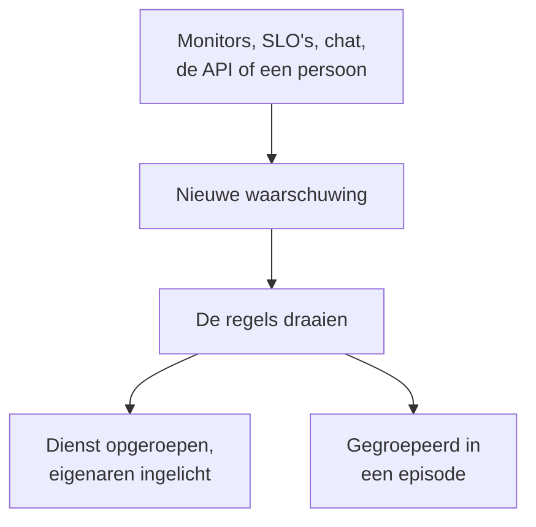

# Waarschuwingen – Overzicht

Een waarschuwing wijst je team op een probleem dat bekeken moet worden voordat je gebruikers het merken: een schijf die volloopt, een certificaat dat bijna verloopt, een foutpercentage dat langzaam stijgt. Een waarschuwing kan wie dienst heeft oproepen en haar eigenaren op de hoogte brengen, maar verschijnt nooit op een statuspagina en informeert nooit je abonnees. Deze pagina legt uit waar waarschuwingen vandaan komen, waar ze in het dashboard staan en hoe je team ermee werkt.

:::cards
- [Waarschuwingen en incidenten](#waarschuwingen-en-incidenten): Wat een probleem moet zijn, en hoe de twee samenhangen.
- [Waar waarschuwingen vandaan komen](#waar-waarschuwingen-vandaan-komen): Monitors, SLO's, chat, de API of met de hand.
- [Een waarschuwing met de hand aanmaken](#een-waarschuwing-met-de-hand-aanmaken): Twee stappen in het dashboard.
- [Op een waarschuwing reageren](#op-een-waarschuwing-reageren): Bevestig haar, los haar op of meld een incident.
:::

## Hoe het werkt

De meeste waarschuwingen worden aangemaakt door een monitor waarvan de criteria overeenkomen. Andere komen van een SLO die zijn foutbudget verbruikt, een beveiligingsregel, een oproep vanuit Slack of Microsoft Teams, of een persoon. Hoe ze ook binnenkomt, een waarschuwing is altijd hetzelfde record, en dezelfde regels draaien erop.

- **Regels geven haar vorm.** Privacy-, eigenaars-, label- en bereikbaarheidsregels draaien zodra een waarschuwing wordt aangemaakt, en runbook-regels starten de procedures die overeenkomen. Zie [Waarschuwingsregels en instellingen](/docs/alerts/settings).
- **Bereikbaarheidsbeleid roept mensen op.** Het beleid dat de waarschuwing noemt, plus het beleid dat haar bereikbaarheidsregels toevoegen, roept zijn mensen op totdat iemand de waarschuwing bevestigt.
- **Episodes bundelen de ruis.** Een groeperingsregel brengt samenhangende waarschuwingen onder in één episode, zodat twintig waarschuwingen van één storing één ding zijn om af te handelen. Zie [Waarschuwingsepisoden en groeperingsregels](/docs/alerts/episodes).

## Waarschuwingen en incidenten

Beide leggen een probleem vast, en beide kunnen wie dienst heeft oproepen. Het verschil is wie het probleem treft.

|                              | Waarschuwing                                           | Incident                                          |
| ---------------------------- | ------------------------------------------------------ | ------------------------------------------------- |
| **Wat het is**               | Een probleem dat je team moet bekijken voordat gebruikers er last van hebben | Een probleem dat je gebruikers treft, zoals een storing |
| **Op statuspagina's**        | Nooit                                                  | Kan verschijnen en informeert abonnees            |
| **Notities**                 | Privénotities, alleen voor je team                     | Openbare notities voor klanten, en privénotities  |
| **Beginstatussen**           | **Identified**, **Bevestigd**, **Opgelost**            | **Identified**, **Bevestigd**, **Opgelost**       |
| **Beginernstniveaus**        | **High**, **Low**                                      | Critical Incident, Major Incident, Minor Incident |
| **Nummers in een nieuw project** | `ALT-42`, en `AE-42` voor episodes                 | `INC-42`, en `IE-42` voor episodes                |

Maak een waarschuwing aan wanneer je team moet kijken voordat iemand buiten het team iets merkt, en meld een incident wanneer gebruikers worden getroffen. Blijkt een waarschuwing deel van een storing te zijn, meld dan een incident vanuit de waarschuwing, of koppel haar aan het incident dat haar verklaart: zie [Gekoppelde waarschuwingen](/docs/incidents/linked-alerts).

## Waar waarschuwingen vandaan komen

- **De criteria van een monitor.** Zet onder de **Acties** van een criterium **Wanneer filters overeenkomen, maak een waarschuwing aan.** aan en vul de waarschuwing in die het aanmaakt: **Waarschuwingstitel** en **Ernst**, dan, elk ingeklapt, **Beschrijving**, **Eigendom & labels**, **Bereikbaarheid** en **Meer velden**, met daarin **Waarschuwing automatisch oplossen**, **Privéwaarschuwing** en **Herstelnotities**. Een criterium houdt één open waarschuwing tegelijk aan, één per reeks bij een monitor die op een veld groepeert, en **Waarschuwing automatisch oplossen** lost haar op zodra het criterium niet meer overeenkomt. Zie [Een monitor maken](/docs/monitor/create-monitor) en [Incident- en waarschuwingstemplates](/docs/monitor/incident-alert-templating).
- **Met de hand.** Klik op **Waarschuwing maken** in de lijst met waarschuwingen, of op het tabblad **Waarschuwingen** van een monitor, host of andere resource, dat die resource voor je kiest. Zie [Een waarschuwing met de hand aanmaken](#een-waarschuwing-met-de-hand-aanmaken).
- **De verbruikssnelheid van een SLO.** Een regel voor de verbruikssnelheid kan een waarschuwing aanmaken wanneer een SLO zijn foutbudget te snel verbruikt. Zie [Waarschuwingen en incidenten voor verbruikssnelheid](/docs/slo/burn-rate-alerts).
- **Netwerklocaties en beveiligingsgebeurtenissen.** Een netwerklocatie die is ingesteld om te waarschuwen wanneer ze ongezond is, opent een waarschuwing zodra haar overzicht niet meer operationeel is, en je detectieregels voor beveiligingsgebeurtenissen openen ook waarschuwingen. Zie [Netwerklocaties (gezondheidsoverzicht en uptime)](/docs/monitor/network-sites) en [Beveiligingsgebeurtenissen (SIEM)](/docs/telemetry/security-events).
- **Een oproep.** `/oneuptime page` in Slack of Microsoft Teams opent een waarschuwing met je bericht als titel en roept de mensen op die je noemt. De oproepblokken van een workflow doen hetzelfde met de titel en het bericht die je ze meegeeft. Zie [Iemand oproepen vanuit Slack](/docs/workspace-connections/slack#iemand-oproepen-vanuit-slack) en [Paging](/docs/workflows/components#paging).
- **De API, Terraform en workflows.** Waarschuwingen zijn een gewone resource: `/api/alert`, de Terraform-resource `oneuptime_alert` en de stap **Create One Alert** van een workflow.

## Waar waarschuwingen in het dashboard staan

Open **Waarschuwingen** via het menu **Producten** in de bovenste balk. De lijst met waarschuwingen staat op `/dashboard/{projectId}/alerts`, en het zijmenu bevat alles rond waarschuwingen:

| Sectie            | Wat je daar doet                                                                                                          |
| ----------------- | ------------------------------------------------------------------------------------------------------------------------- |
| **Waarschuwingen** | **Alle waarschuwingen** en **Actieve waarschuwingen**, waarvan de rode badge de waarschuwingen telt die nog niet zijn opgelost. |
| **Episoden** | **Alle episodes** en **Actieve episodes**: gerelateerde waarschuwingen, gebundeld tot één probleem om aan te werken. |
| **AI**            | **Inzichten**, **Logboeken** en **Instellingen**: wat OneUptime AI van je waarschuwingen heeft geleerd, alles wat het heeft gedaan en wat het mag doen. |
| **Werkruimte**    | **Slack** en **Microsoft Teams**, afhankelijk van wat het project heeft gekoppeld, of **Slack of Teams koppelen** als het geen van beide heeft. |
| **Regels**        | **Groeperingsregels**, **Bereikbaarheidsregels**, **Eigenaarsregels**, **Runbook-regels**, **Privacyregels**, **Labelregels**, **Reminder Rules**. |
| **Instellingen**  | **Status waarschuwing**, **Ernst van waarschuwing**, **Notitie-sjablonen**, **Aangepaste velden**, **Metingen**, **Lidmaatschap van episodes**, **Nummering**. |

**Waarschuwingen** en **Episoden** zijn open; **AI**, **Werkruimte**, **Regels**, **Instellingen** en **Ontwikkelaars** beginnen ingeklapt, en een sectie gaat vanzelf open wanneer je op een van haar pagina's bent. De configuratie van waarschuwingen staat hier, niet in **Projectinstellingen**.

De lijst toont **Waarschuwingsnummer**, **Titel**, **Status**, **Ernst**, **Getroffen resources** (eerst de monitor van de waarschuwing), **Aangemaakt**, **Duur**, **Labels** en **Eigenaren**. Selecteer waarschuwingen om er meerdere tegelijk te bewerken: **Bevestigen**, **Oplossen**, **Status wijzigen**, **Ernst wijzigen**, **Aan mij toewijzen**, **Add Owner**, **Remove Owner**, **Add Labels**, **Remove Labels**, **Koppelen aan incident**, **Incident melden** of verwijderen.

Het menu **⋯** aan het eind van de rij van elke waarschuwing doet hetzelfde voor alleen die waarschuwing: **Bevestigen** en **Oplossen** zolang de waarschuwing die stap kan zetten, **Status wijzigen**, **Ernst wijzigen**, **Aan mij toewijzen** totdat je de eigenaar bent, en **Add Owner** om haar aan iemand anders over te dragen.

## Een waarschuwing met de hand aanmaken

:::steps
### Het formulier openen

Ga naar **Waarschuwingen → Alle waarschuwingen** en klik op **Waarschuwing maken**. Het formulier **Nieuwe waarschuwing aanmaken** opent op de eerste stap, **Waarschuwingsdetails**.

### De waarschuwing beschrijven

Vul de **Titel** in en kies een **Ernst van waarschuwing**; beide zijn verplicht. Voeg een **Beschrijving** toe als dat helpt. Onder **Meer velden**, ingeklapt, kun je een **Initiële status** kiezen, **Labels** toevoegen of **Privéwaarschuwing** aanzetten. Daar wacht ook **Eigenaren**: je wordt hoe dan ook eigenaar van de waarschuwing die je maakt, en elk team waarvan je lid bent, is onder de kiezer één klik verwijderd.

### Kiezen wat ze treft en wie wordt opgeroepen

Klik op **Volgende** om naar **Middelen en bereikbaarheid** te gaan. Kies de **Monitor** waar het om gaat en alle **Andere getroffen resources**, zoals hosts, Kubernetes-clusters of services. Kies bij **Bereikbaarheidsbeleid** het beleid dat moet draaien wanneer de waarschuwing wordt aangemaakt.

### Haar aanmaken

Klik op **Volgende** om de samenvatting te controleren en daarna op **Waarschuwing maken**. De eigen pagina van de waarschuwing opent, en de regels beginnen te draaien. In de samenvatting noemt de rij **Eigenaren** elke eigenaarsregel die iemand zal toevoegen, en wie: zie [Wie de eigenaar wordt](/docs/incidents/declaring-incidents#wie-de-eigenaar-wordt).
:::

Laat je **Initiële status** leeg, dan begint de waarschuwing waar elke nieuwe waarschuwing begint: in je aanmaakstatus, **Identified** in een nieuw project. Kies je een latere status, dan leg je een waarschuwing vast die al wordt afgehandeld, of die al voorbij is; zie [Al bevestigd of opgelost aangemaakt](#al-bevestigd-of-opgelost-aangemaakt).

## Wat er gebeurt wanneer een waarschuwing wordt aangemaakt

Zodra een waarschuwing wordt aangemaakt, doorloopt OneUptime deze stappen, in deze volgorde:

1. **Ze krijgt een nummer en een status.** Het waarschuwingsnummer komt van een teller per project en wordt met je voorvoegsel getoond (`ALT-42`). De waarschuwing begint in je aanmaakstatus, tenzij het formulier, de API of een workflow een andere koos.
2. **Privacyregels draaien eerst**, zodat alles daarna weet of de waarschuwing privé is.
3. **De feed en je chattools horen ervan.** Een vermelding **Waarschuwing aangemaakt** wordt in **Waarschuwing Feed** geschreven, en de kanalen die je Slack- en Microsoft Teams-regels noemen, worden ingelicht; een regel kan een kanaal voor de waarschuwing aanmaken.
4. **Eigenaren en labels worden toegevoegd**: die welke de criteria van de monitor of het verzoek noemen, daarna die van overeenkomende eigenaars- en labelregels.
5. **Bereikbaarheidsregels voegen hun beleid toe**, daarna starten runbook-regels de runbooks die overeenkomen.
6. **Bereikbaarheidsbeleid draait.** Elk beleid op de waarschuwing roept zijn mensen tegelijk op; als er één faalt, stopt dat de andere niet.
7. **Groeperingsregels plaatsen haar in een episode**, wanneer er een overeenkomt. Zie [Waarschuwingsepisoden en groeperingsregels](/docs/alerts/episodes).
8. **Herinneringen worden ingepland**, wanneer een herinneringsregel overeenkomt, en **OneUptime AI** onderzoekt de waarschuwing wanneer **Nieuwe waarschuwingen onderzoeken** aan staat onder **Waarschuwingen → AI → Instellingen**, en herstelt haar wanneer **Nieuwe waarschuwingen automatisch herstellen** aan staat. Zie [AI SRE](/docs/ai/ai-sre).

Een achtergrondtaak licht de eigenaren van de waarschuwing binnen een minuut in, en de workflowtrigger **On Create Alert** start elke workflow die erop is gebouwd.

### Al bevestigd of opgelost aangemaakt

Een waarschuwing die in een latere status begint, legt een probleem vast dat al wordt afgehandeld, dus wordt ze niet als nieuwe noodsituatie behandeld:

- **In of na je bevestigde status** draait geen bereikbaarheidsbeleid. De waarschuwing houdt haar beleid, en haar feed zegt in één regel waarom niemand is opgeroepen. Ze kan zich bij een open episode voegen, maar opent er nooit een, want dat zou via het beleid van de episode oproepen.
- **In of na je opgeloste status** is de waarschuwing voorbij: ze wordt in geen episode gegroepeerd, geen runbook of automatisch herstel werkt erop, OneUptime AI onderzoekt haar niet, en er wordt geen Slack- of Microsoft Teams-kanaal voor haar aangemaakt.

Haar regels, haar eigenaren, haar feed en haar eerste status gebeuren in beide gevallen toch. Incidenten volgen dezelfde regel: zie [Al bevestigd of opgelost gemeld](/docs/incidents/declaring-incidents#al-bevestigd-of-opgelost-gemeld).

## Op een waarschuwing reageren

Open de waarschuwing. De kop toont haar status, haar ernst, wanneer ze is aangemaakt en de monitor en episode waartoe ze behoort, met de knoppen die je volgende stap nodig heeft:

- **Bevestigen** zegt dat iemand ermee bezig is. Het voorkomt dat het bereikbaarheidsbeleid van de waarschuwing het volgende niveau oproept.
- **Oplossen** sluit haar. De waarschuwing verlaat **Actieve waarschuwingen**, en haar herinneringen stoppen.
- **Change state to**, in het menu **⋯** ernaast, zet haar in een eigen status, zoals "In onderzoek".
- **Incident melden** opent een nieuw incident, vooraf ingevuld vanuit de waarschuwing, wanneer blijkt dat het probleem gebruikers treft. Zie [Gekoppelde waarschuwingen](/docs/incidents/linked-alerts).

Een overgang naar een andere status vraagt om bevestiging, met een optionele privénotitie ingeklapt onder **Privénotitie toevoegen**. Wat elke status doet, staat op [Waarschuwingsstatussen en ernstniveaus](/docs/alerts/states-and-severities).

Terwijl je eraan werkt, leg je wat je leert vast als **Privénotities**, vul je de pagina's **Hoofdoorzaak** en **Herstel** in en voeg je **Eigenaren** toe. Het menu **Acties** van **Waarschuwing Feed** voert ook een runbook uit met **Execute Runbook**, of roept meer mensen op met **Bereikbaarheidsdienstbeleid uitvoeren**.

## Wat elke pagina van een waarschuwing toont

| Sectie in het zijmenu | Pagina's                                                                                                   |
| --------------------- | ---------------------------------------------------------------------------------------------------------- |
| **Overzicht** | **Overzicht** en **Statustijdlijn** |
| **Onderzoek** | **Beschrijving**, **Hoofdoorzaak**, **Herstel**, **Runbooks**, **Gekoppelde incidenten** |
| **Team** | **Bereikbaarheidsuitvoeringen** en **Eigenaren**: wie er voor de waarschuwing werd opgeroepen, en wie haar eigenaar is |
| **Meldingen**         | **Meldingslogboeken** en **AI-logboeken**: elk bericht dat over de waarschuwing is verstuurd, en alles wat AI ervoor deed |
| **Notities** | **Privénotities**                                                                                      |
| **Ontwikkelaars**     | **Terraform**, **API** en **AI-assistenten**: de waarschuwing vanuit code beheerd                          |
| **Geavanceerd** | **Aangepaste velden**, **Instellingen**, **Auditlogboeken**, **Waarschuwing verwijderen** |

**Overzicht**, **Onderzoek**, **Team** en **Notities** zijn open; de andere secties blijven ingeklapt tot je erop klikt.

- **Overzicht** — de kop noemt de **Eigenaren** van de waarschuwing, teams eerst, naast haar monitor en episode. De tegel **Aangemaakt** toont wanneer en waardoor ze werd aangemaakt, twee andere hoe lang het duurde voordat ze werd bevestigd en opgelost; hoe lang ze duurt staat naast haar status. De kaart **Wat er gebeurde** staat bovenaan de pagina — de beschrijving van de waarschuwing en haar **Hoofdoorzaak** — dan de kaart **AI Investigation**, met **Ask OneUptime AI** onderaan, en **Waarschuwing Feed** legt alles vast wat met de waarschuwing gebeurde. Daarnaast staan de kaart **Getroffen resources**, de kaart **Waarschuwingsdetails** en de metingen van de waarschuwing.
- **Statustijdlijn** — elke status waarin de waarschuwing heeft gestaan, wanneer en hoe lang. Zie [De statustijdlijn](/docs/alerts/states-and-severities#de-statustijdlijn).
- **Gekoppelde incidenten** — de incidenten waar deze waarschuwing deel van uitmaakt, met **Incident koppelen** en **Incident melden**.
- **Instellingen** — **Wie deze waarschuwing kan zien**, met de schakelaar **Privéwaarschuwing**, en **Herinneringen**, met **Herinneringen sturen**. Elke schakelaar slaat op zodra je hem omzet.

## Privéwaarschuwingen

Een privéwaarschuwing is alleen zichtbaar voor haar eigenaren, de eigenaar-gebruikers en de leden van haar eigenaar-teams, en voor de beheerders en eigenaren van je project. Niemand anders in het project kan haar openen.

Maak een waarschuwing privé met **Privéwaarschuwing** onder **Meer velden** in het aanmaakformulier of in de criteria van een monitor, met **Waarschuwingen → Regels → Privacyregels**, of later op haar pagina **Instellingen**, die **Deze waarschuwing privé maken?** vraagt voordat de waarschuwing wordt verborgen. Hoor je bij geen van deze mensen, dan verlies je zelf ook de toegang.

Een episode die door een privéwaarschuwing wordt geopend, is niet privé en toont dus nooit de titel of beschrijving van de waarschuwing: waar haar titel of beschrijving die zou bevatten, staat "Private alert".

## Wie van een waarschuwing hoort

- **Wie dienst heeft.** Het bereikbaarheidsbeleid van de waarschuwing roept zijn mensen op, elk zoals die het heeft ingesteld onder **Gebruikersinstellingen → Bereikbaarheidsregels**, op het tabblad **Waarschuwingen**. Wie de oproep beantwoordt, bevestigt de waarschuwing, en het oproepen stopt.
- **Haar eigenaren.** Per e-mail, tenzij ze andere kanalen kozen onder **Gebruikersinstellingen → Meldingsinstellingen**, op het tabblad **Waarschuwingen**: **Waarschuwing aangemaakt**, **Status van waarschuwing gewijzigd** en **Alert reminder** staan standaard aan, en **Notitie bij waarschuwing geplaatst** en **Toegevoegd als eigenaar van waarschuwing** staan uit tot iemand ze aanzet. Een waarschuwing zonder eigenaren licht in plaats daarvan de eigenaren van het project in.
- **Je chattools.** **Waarschuwingen → Werkruimte** bevat de Slack- en Microsoft Teams-regels die waarschuwingen en episodes in kanalen plaatsen. Zie [Slack](/docs/workspace-connections/slack) en [Microsoft Teams](/docs/workspace-connections/microsoft-teams).

## Probleemoplossing

:::details Niemand werd opgeroepen voor een nieuwe waarschuwing
Open de pagina **Bereikbaarheidsuitvoeringen** van de waarschuwing. Is die leeg, dan had de waarschuwing geen bereikbaarheidsbeleid: er werd er geen gekozen in het formulier of in de criteria van de monitor, en geen bereikbaarheidsregel kwam overeen. Is de waarschuwing al bevestigd of opgelost aangemaakt, dan zegt haar feed dat niemand werd opgeroepen, en waarom.
:::

:::details De monitor blijft falen, maar er verschijnt geen nieuwe waarschuwing
Een criterium houdt één open waarschuwing tegelijk aan. Tot die waarschuwing is opgelost, voegt de monitor niets nieuws toe voor hetzelfde criterium. Los haar op, of zet **Waarschuwing automatisch oplossen** aan zodat de monitor haar oplost wanneer het criterium niet meer overeenkomt.
:::

:::details Een collega kan een waarschuwing openen die ik niet kan vinden
De waarschuwing is waarschijnlijk privé. Vraag een projectbeheerder om je als eigenaar toe te voegen, of om **Privéwaarschuwing** uit te zetten op de pagina **Instellingen** van de waarschuwing.
:::

## Volgende stappen

:::cards
- [Waarschuwingsstatussen en ernstniveaus](/docs/alerts/states-and-severities): Wat bevestigen en oplossen doen, en hoe je eigen statussen toevoegt.
- [Waarschuwingsepisoden en groeperingsregels](/docs/alerts/episodes): Maak van een stroom waarschuwingen één ding om af te handelen.
- [Waarschuwingsregels en instellingen](/docs/alerts/settings): Automatisch oproepen, eigenaren toewijzen, labelen en herinneren.
- [Gekoppelde waarschuwingen](/docs/incidents/linked-alerts): Koppel waarschuwingen aan het incident dat ze verklaart.
:::
