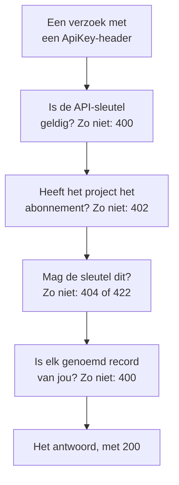

# OneUptime API-referentie

Alles wat je in het OneUptime-dashboard kunt doen, kun je ook via de REST API doen: terugkerend werk automatiseren, OneUptime koppelen aan je andere tools of je eigen integraties bouwen. Deze pagina laat zien hoe je je eerste verzoek doet, en de regels die elk verzoek volgt. Elk endpoint en elk veld staat in de [volledige API-referentie](/reference).

:::cards
- [Je eerste verzoek doen](#je-eerste-verzoek-doen): Een API-sleutel, één header en een curl-opdracht.
- [Verzoeken en antwoorden](#verzoeken-en-antwoorden): De zes verzoeken die elke resource heeft, en wat elke statuscode betekent.
- [Abonnementen en de API](#abonnementen-en-de-api): Wat een abonnement verkoopt, en wat daaronder blijft werken.
- [Records benoemen en schrijven](#records-benoemen-en-schrijven): ID's, verwijzingen, schakelaars en de velden die OneUptime invult.
- [Statussen en episodes](#statussen-en-episodes): De status waarin een record begint en die het doorloopt.
- [Wat een verzoek kan bereiken](#wat-een-verzoek-kan-bereiken): Lezen, wijzigen en verwijderen, één project tegelijk.
:::

## Hoe een verzoek wordt beantwoord

De API is opgebouwd volgens REST: standaard HTTP-methoden en -statuscodes, JSON erin en JSON eruit. Elk verzoek draagt een API-sleutel en doorloopt een paar controles. De eerste controle waar het op stukloopt, antwoordt met een statuscode en `{ "message": "..." }`, dus de melding zegt wat het tegenhield.



## Je eerste verzoek doen

Alle API-verzoeken worden geauthenticeerd met een API-sleutel. Een sleutel hoort bij één project en doet wat zijn machtigingen toestaan.

:::steps
### Een API-sleutel aanmaken

Open **Projectinstellingen → Geavanceerd → API-sleutels** en klik op **API-sleutel aanmaken**. Geef hem een **Naam** en kies onder **Toegang** wat hij mag: **Projectbeheerder**, **Projectlid**, **Kijker**, of **Machtigingen later kiezen** om losse machtigingen toe te voegen op de pagina van de sleutel. De sleutel verloopt over een jaar, tenzij je onder **Geavanceerd** een andere datum kiest.

### De sleutel kopiëren

De pagina van de sleutel opent. Kopieer de **API-sleutel** van de kaart **API-sleuteldetails** en houd hem buiten je code:

```bash
export ONEUPTIME_API_KEY="your-api-key"
```

### Een verzoek sturen

Toon de eerste tien monitors. De sleutel leest zijn eigen project, dus het verzoek noemt geen project:

```bash
curl -X POST 'https://oneuptime.com/api/monitor/get-list?skip=0&limit=10' \
  -H "ApiKey: $ONEUPTIME_API_KEY" \
  -H 'Content-Type: application/json' \
  -d '{ "select": { "name": true } }'
```

Het antwoord is `{ "data": [...], "count": ... }`: de monitors, en hoeveel er in totaal zijn. Gebruik bij een zelf gehoste installatie je eigen OneUptime-adres in plaats van `https://oneuptime.com`.
:::

### Voorbeelden voor elke resource

Elke resource in het OneUptime-dashboard heeft een sectie **Ontwikkelaars** in het zijmenu, ingeklapt tot je haar opent. De pagina **API** daarin heeft kant-en-klare `curl`-opdrachten voor die resource, gericht op jouw OneUptime en ingevuld met gegevens uit je eigen project: lezen, wijzigen en verwijderen vanaf de eigen pagina van de resource, of opsommen, tellen en aanmaken vanaf een lijstpagina (bijvoorbeeld **Monitoren**). De opdrachten lezen je API-sleutel uit de omgevingsvariabele `ONEUPTIME_API_KEY`.

De voorbeelden zijn voor de resource geschreven. In de lijst **Incidenten** bijvoorbeeld toont het lijstverzoek zijn antwoord met je eerste incident, vinden de filters incidenten die niet opgelost zijn, van één ernst, over één monitor of uit de laatste zeven dagen, met je eigen statussen, ernstniveaus en monitors, en meldt het aanmaakverzoek een incident met een van je ernstniveaus, met een regel over waar elk veld voor dient. De eigen pagina van een incident leest het met het echte antwoord, zet het op een ander van je ernstniveaus en heeft de gebruikelijke taken: het bevestigen en oplossen (met de eigen statussen van je project), en interne of openbare notities toevoegen. Elke API-pagina eindigt met de endpoints van de resource.

## Verzoeken en antwoorden

Elke resource heeft dezelfde verzoeken, onder `https://oneuptime.com/api` en het pad van de resource, zoals `/monitor` of `/incident`:

| Verzoek | Methode en pad | Wat de body bevat |
| --- | --- | --- |
| Opsommen | `POST /api/<resource>/get-list` | `query`, `select` en `sort` |
| Tellen | `POST /api/<resource>/count` | `query` |
| Eén lezen | `POST /api/<resource>/<id>/get-item` | `select` |
| Aanmaken | `POST /api/<resource>` | `{ "data": { ... } }` |
| Eén wijzigen | `PUT /api/<resource>/<id>` | `{ "data": { ... } }`, de te wijzigen velden |
| Eén verwijderen | `DELETE /api/<resource>/<id>` | Niets |

`POST /api/<resource>/<id>/update-item` en `POST /api/<resource>/<id>/delete-item` wijzigen en verwijderen ook één record, voor clients die alleen `POST` sturen.

### Filteren, sorteren en bladeren

Een lijst of een telling neemt een `query`. Een veld met een waarde komt overeen met die waarde; een object met een `_type` vergelijkt:

| `_type` | Komt overeen met |
| --- | --- |
| `Search` | Tekst die `value` bevat |
| `NotEqual` | Alles behalve `value` |
| `GreaterThan`, `LessThan` | Latere datums of grotere getallen, of eerdere en kleinere |
| `InBetween` | Datums of getallen tussen `startValue` en `endValue` |
| `Includes` | Een van de waarden in `value` |
| `IsNull`, `NotNull` | Geen waarde, of een willekeurige waarde |

Een veld van een record dat de resource noemt, filter je onder de relatie ervan: `"user": { "name": { "_type": "Search", "value": "ada" } }` vindt de teamleden van wie de gebruiker een naam heeft die „ada” bevat. Filteren op een veld vereist toestemming om het te lezen, via een relatie net als op de resource zelf: een filter op een veld dat je niet mag lezen, wordt geweigerd met een `422` die het veld noemt.

`select` noemt de velden die terugkomen, en `_id` komt altijd terug. `sort` ordent ze, `ASC` of `DESC`; zonder sortering komen de nieuwste eerst. Een lijst geeft 10 records terug tenzij je `limit` instelt, tot 10.000, en `skip` slaat er eerst zoveel over: blijf `skip` met `limit` verhogen tot je er `count` hebt. Voeg `?output-type=csv` toe aan een lijstverzoek voor CSV in plaats van JSON.

Bijvoorbeeld de monitors waarvan de naam „checkout” bevat, gemaakt sinds het begin van 2026, de nieuwste eerst:

```bash
curl -X POST 'https://oneuptime.com/api/monitor/get-list' \
  -H "ApiKey: $ONEUPTIME_API_KEY" \
  -H 'Content-Type: application/json' \
  -d '{
    "query": {
      "name": { "_type": "Search", "value": "checkout" },
      "createdAt": { "_type": "GreaterThan", "value": "2026-01-01T00:00:00.000Z" }
    },
    "select": { "name": true, "createdAt": true },
    "sort": { "createdAt": "DESC" },
    "limit": 100
  }'
```

Datums en ID's behalve `_id` komen verpakt terug, als `{ "_type": "DateTime", "value": "..." }` en `{ "_type": "ObjectID", "value": "..." }`: lees ze uit `value`.

Elke ID waarop een verzoek filtert of die het schrijft - `_id`, een veld zoals `monitorId` en elk record dat een relatie opsomt, zoals `"labels": [{ "_id": "..." }]` - is een UUID, verzonden als tekst of verpakt zoals hij terugkomt. Al het andere, zoals tekst die geen UUID is of een object in plaats van een ID, wordt geweigerd met een `400` die het veld noemt en zegt of het in `query` of in `data` stond, en er wordt niets gelezen of geschreven:

```text
Invalid ID for "currentIncidentStateId" in the query: "resolved". An ID is a UUID, such as "550e8400-e29b-41d4-a716-446655440000".
```

### Statuscodes

| Code | Wat het betekent | Meer lezen |
| --- | --- | --- |
| `200` | Het is gelukt. Een lijst of een telling antwoordt met de records die je mag lezen, geen als er geen zijn. | [Eén record lezen via zijn ID](#eén-record-lezen-via-zijn-id) |
| `400` | Het verzoek klopt niet: de API-sleutel is ongeldig, een waarde is niet toegestaan, een veld kan niet worden geschreven, een genoemd record is niet van jou, of het wijzigt meerdere projecten tegelijk. De melding zegt wat er mis is. | [Records die een verzoek noemt](#records-die-een-verzoek-noemt) |
| `402` | Het abonnement van het project bevat niet wat het verzoek gebruikt. De melding noemt het abonnement. | [Functies die je abonnement niet bevat](#functies-die-je-abonnement-niet-bevat) |
| `404` | Het record bestaat niet, staat in een ander project, of is er een die je niet mag lezen: hetzelfde antwoord in elk geval. | [Een record wijzigen of verwijderen dat je niet mag lezen](#een-record-wijzigen-of-verwijderen-dat-je-niet-mag-lezen) |
| `422` | Je mag dit niet: de API-sleutel heeft geen machtiging voor dit soort record, je mag het record lezen maar niet wijzigen, of de labels van een machtiging sluiten het uit. De melding zegt waarom. | [Een record wijzigen of verwijderen dat je niet mag lezen](#een-record-wijzigen-of-verwijderen-dat-je-niet-mag-lezen) |
| `500` | Er ging iets mis op de server. Als de eigenaar van een nieuw record niet kan worden geschreven, wordt het record weer verwijderd, zodat je het aanmaken opnieuw kunt proberen. | [Records die een verzoek noemt](#records-die-een-verzoek-noemt) |

## Abonnementen en de API

### Functies die je abonnement niet bevat

In OneUptime Cloud worden sommige resources in een abonnement verkocht: single sign-on-providers en SCIM-verbindingen in **Scale**; API-sleutels, piketroosters, en meldingsregels en samenvattingen voor Slack en Microsoft Teams in **Growth**, onder andere. Er een aanmaken, wijzigen of inschakelen vereist dat abonnement. Daaronder wordt het verzoek geweigerd met `402 Payment Required`, en de melding noemt het abonnement.

Sommige instellingen van een resource worden op dezelfde manier in een abonnement verkocht. Bijvoorbeeld: een statuspagina die privé is, die een van haar lijsten verbergt, of die eigen HTML, CSS of JavaScript heeft, e-mailrapporten, abonnees via sms, Slack, Microsoft Teams of webhook, of een IP-toelatingslijst; een dashboard dat openbaar wordt gedeeld, of zijn IP-toelatingslijst; de IP-toelatingslijst van een formulier; de auditlogboeken van een project. De gids van elk ervan, en het dashboard naast de instelling, noemen het abonnement dat nodig is. Zo'n instelling heeft haar abonnement nodig wanneer ze wordt geschreven - als de resource ermee wordt aangemaakt net als wanneer ze later wordt gewijzigd -, dus ook een aanmaak die er een onder het abonnement inschakelt, wordt met `402` geweigerd. Een instelling die op haar standaardwaarde blijft, of daarnaar wordt teruggezet, werkt in elk abonnement: een aanmaak die deze instellingen met rust laat gaat door, net als een Terraform-configuratie die ze niet instelt.

Wat een project al heeft, blijft beheerbaar ongeacht het abonnement, bijvoorbeeld na het einde van een proefperiode of als het abonnement omlaag gaat:

- je kunt die records verwijderen;
- je kunt er een uitschakelen, op een resource met een veld `isEnabled`, door `"isEnabled": false` te sturen en verder niets;
- je kunt de records opsommen en lezen die een project moet terugvinden nadat het abonnement omlaag is gegaan - om ze uit te schakelen, of om te zien wat is gestopt: single sign-on-providers, SCIM-verbindingen, API-sleutels en hun machtigingen, piketroosters, en meldingsregels en samenvattingen voor Slack en Microsoft Teams.

De gebruikelijke machtigingen bepalen nog steeds wie wat mag, precies zoals met het abonnement. De andere resources lezen die een abonnement verkoopt, zoals sjablonen, aangepaste velden, monitorgroepen, piketlogboeken en formulierinzendingen, vereist nog steeds het abonnement: ze lezen is de functie gebruiken. De machtigingen van een API-sleutel worden onder **Growth** niet één voor één verwijderd, omdat het verwijderen van een blokkeermachtiging de sleutel meer toegang zou geven; verwijder in plaats daarvan de sleutel.

### API-sleutels en SCIM onder hun abonnement

In OneUptime Cloud werken de API-sleutels van een project alleen zolang het project op **Growth** of hoger zit, en zijn SCIM-verbindingen - die van het project zelf en die van zijn statuspagina's - werken alleen volledig zolang het op **Scale** of hoger zit. Als het project onder dat abonnement zakt:

- Elk verzoek met een van de API-sleutels van het project wordt geweigerd met `402 Payment Required`, wat het ook vraagt: de REST API en alles wat die met een API-sleutel aanroept - Terraform, de `oneuptime`-CLI, MCP-clients die met een API-sleutel zijn verbonden, workflows die er een in een verzoekheader meesturen, en je eigen scripts. De melding noemt het abonnement: `API keys need the Growth plan. This project's plan does not include them, so its API keys stopped working. The keys are kept: upgrade the project to Growth in Project Settings > Billing and Invoices > Billing and they work again.`
- Zijn SCIM-verbindingen verwijderen alleen nog mensen. Mensen deactiveren en verwijderen, en ze uit groepen halen, werkt nog steeds, dus wie vertrekt verliest zijn toegang toch; elk SCIM-verzoek dat mensen of groepen zou toevoegen of wijzigen, wordt geweigerd met `402`, in het SCIM-foutformaat, zodat je identiteitsprovider laat zien waarom ([SCIM onder het abonnement Scale](/docs/identity/scim#onder-het-scale-abonnement)).

Er wordt niets verwijderd of uitgeschakeld. De sleutels en verbindingen blijven bewaard, en ze werken weer volledig, zoals ze zijn, zodra het project terug is op het abonnement: geen nieuwe sleutels om te maken, niets om opnieuw in te stellen in je identiteitsprovider. Een abonnementswijziging gaat binnen een minuut in.

Onder **Growth** toont **Projectinstellingen** > **Geavanceerd** > **API-sleutels** de sleutels die het project nog heeft en zegt dat ze zijn gestopt, zodat elk ervan in elk abonnement kan worden verwijderd (ingetrokken). Sleutels aanmaken of wijzigen vereist **Growth**. **Projectinstellingen** > **Facturering en facturen** > **Facturering** noemt hoeveel API-sleutels een lager abonnement stopt en hoeveel SCIM-verbindingen het beperkt, voor elk abonnement dat je kunt kiezen, en wat het abonnement van het project heeft gestopt; de eigenaren van het project krijgen een e-mail wanneer een abonnementswijziging ze stopt. De eigenaren van projecten die al onder deze abonnementen zaten toen dit begon, krijgen één e-mail die zegt wat is gestopt en hoe je het weer aanzet.

Alleen de API-sleutels en SCIM-verbindingen van een project zijn getroffen. Mensen niet: inloggen op het dashboard, en MCP-clients die via inloggen zijn verbonden, werken zoals voorheen. Ingestiesleutels voor telemetrie, probesleutels en agentsleutels zijn geen API-sleutels en blijven werken. Zelf gehoste installaties hebben geen abonnementen, dus voor hen verandert er niets.

## Records benoemen en schrijven

### De ID van een resource vinden

Verzoeken die één resource lezen, wijzigen of verwijderen, noemen die met haar ID, een UUID. Op de eigen pagina van de resource eindigt de detailkaart met een kleine regel **ID** die het begin van de ID toont: klik op de ID, of op de kopieerknop ernaast, om de hele ID te kopiëren. Lijsten die het aanbieden hebben **ID weergeven** in het menu **⋯** van een rij, en de ID is ook het laatste deel van het adres van de pagina. De ID van je project is het eerste op de kaart **Projectdetails** onder **Projectinstellingen → Project**.

### Records die een verzoek noemt

Veel resources noemen andere records: een monitor zijn labels en probes, een abonnee van een statuspagina zijn statuspagina, een netwerkapparaat zijn site, een lid van een incident het incident en de rol. Elke regel hieronder geldt net zo voor de API, Terraform en workflows:

| Als een verzoek | moet het | Anders |
| --- | --- | --- |
| een record via zijn ID noemt | een record van je project noemen | `400` |
| een record aanmaakt dat via een ander wordt gelezen, zoals een notitie | het aanmaken onder een record dat je mag lezen | `400`, of `422` zonder machtiging om dat soort record te lezen |
| een record onder een ander verplaatst | het verplaatsen onder een record dat je mag lezen | `400` |
| records opsomt, of er een in een eigen veld noemt | records noemen die je leesmachtiging bereikt | `400` |
| een instelling noemt die referenties bevat | komen van iemand die dat soort instelling mag lezen | `400` |
| een record aanmaakt of herlabelt met een machtiging die tot labels is beperkt | het record een van die labels geven | `422` |
| één record op twee manieren noemt | beide keren hetzelfde record noemen | `400` |

#### Elke ID moet van je project zijn

Elke ID die je stuurt voor een record dat een resource noemt, moet een record van je project zijn — de kiezers van het dashboard bieden niets anders aan — en verzoeken van Terraform en workflows houden zich aan hetzelfde. Een ID van een record van een ander project en een ID die niet bestaat, worden op dezelfde manier geweigerd, met een `400` die het veld en de ID noemt:

```text
This network device references records that are not in this project: Network Site "…". Please pick values from this project and try again.
```

Mensen worden op lidmaatschap gecontroleerd: iemand die geen lid van het project is, wordt op dezelfde manier geweigerd. Een globale probe, die elk project kan gebruiken, telt als die van je project. Een resource wijzigen controleert alleen de ID's die de wijziging toevoegt, dus een resource die iets noemt dat inmiddels is verdwenen, kan nog steeds worden opgeslagen.

#### Records die via een ander worden gelezen

Een record dat via een ander wordt gelezen - de notities en statustijdlijn van een incident of een waarschuwing, de aankondigingen, domeinen en groepen van een statuspagina - moet ook een record noemen dat je mag lezen, volgens de regel die het lezen ervan volgt: een incident buiten de labels of eigenaren die je machtiging om incidenten te lezen bereikt, met een label dat een blokkade op het lezen van incidenten wegneemt, of als privé gemarkeerd zonder dat jij bij de eigenaren hoort, direct of via een team (projecteigenaren en -beheerders zien elk privé-incident, elke privéwaarschuwing en -episode), wordt geweigerd met dezelfde `400`, en er wordt niets geschreven. Elke statuspagina die een aankondiging noemt, moet er een zijn die je mag lezen, en een sleutel waarvan de machtiging om statuspagina's te lezen er maar een paar bereikt, moet er minstens één noemen. Een machtiging om zo'n record aan te maken, vereist er een om het record te lezen waaronder het wordt aangemaakt; zonder die wordt de aanmaak geweigerd met een `422` die de machtigingen noemt die hem zouden toelaten:

```text
You do not have permissions to create Incident Internal Note. It is read through its Incident, and you need one of these permissions to read Incidents: …
```

Een wijziging die zo'n record verplaatst, volgt dezelfde regel: elk record dat ze als bovenliggend record toevoegt - een andere statuspagina voor een aankondiging, een andere service voor een record dat via zijn service wordt gelezen - moet er een zijn die je mag lezen, anders wordt de wijziging geweigerd met dezelfde `400` en wordt er niets geschreven. De bovenliggende records die een record al heeft, worden niet opnieuw gecontroleerd, en een wijziging die het onder geen enkel record laat, vereist een machtiging om dat soort record te lezen die ze allemaal bereikt, net als een aanmaak die er geen noemt.

#### Eigenaren

De eigenaren van een resource - de eigenaarsrecords van gebruikers en teams van een monitor, een piketbeleid, een dashboard en elke andere resource met eigenaren - worden op dezelfde manier gelezen via de resource die ze bezitten: ze opsommen, lezen, toevoegen en verwijderen vereist een machtiging om die resource te lezen, onder haar labels en eigenaren, en een eigenaarsrecord van een resource die je niet mag lezen, krijgt een antwoord alsof het niet bestaat. Ook het toevoegen en verwijderen ervan houdt zich aan het bereik van de machtiging die het toestaat: een met het bereik `Owned` bereikt alleen de eigenaren van resources waarvan jij of een van je teams eigenaar is, en het toevoegen van een eigenaar aan een andere resource wordt geweigerd met een `422` die dat zegt.

#### Records die een schrijfactie opsomt of noemt

De records die een aanmaak of wijziging opsomt - de monitors en piketbeleiden van een incident, de services van een waarschuwing, de statuspagina's van een geplande onderhoudsgebeurtenis, de runbooks van een regel - houden zich aan je machtiging om dat soort record te lezen als je er een hebt, en in elk geval aan een blokkade met labels op het lezen ervan: een record daarbuiten wordt geweigerd met dezelfde `400`. Een wijziging controleert alleen de records die ze aan een lijst toevoegt, dus de records die de lijst al bevat, blijven.

Het ene record dat een aanmaak of wijziging in een eigen veld noemt - de monitor van een waarschuwing, de monitor die een statuspaginaresource toont, de service van een kostenbudget, het incident waaraan een runbookuitvoering is gekoppeld - volgt dezelfde regel, onder elk van zijn twee namen: een record buiten je machtiging om dat soort record te lezen, of met een label dat een blokkade op het lezen ervan wegneemt, wordt geweigerd met dezelfde `400`. Een wijziging controleert het alleen als ze een ander record noemt dan het record dat het veld al bevat. De globale probes en AI-agents van OneUptime, die elk project kan gebruiken, blijven voor elk project open. De records die een sjabloon voor je invult, worden op dezelfde manier gecontroleerd zodra ze zijn ingevuld, voordat er iets wordt opgeslagen: de monitors, statuspagina's en piketbeleiden die een incidentsjabloon toevoegt aan een incident dat ermee wordt gemeld, moeten records zijn die je mag lezen, alsof je ze zelf had gekozen.

#### Instellingen die referenties bevatten

Een instelling die referenties bevat - een SMTP-server, een provider voor oproepen en sms, SNMP-referenties, een videogesprekverbinding, een API-sleutel, een externe MCP-server - wordt alleen genoemd door iemand die dat soort instelling mag lezen: `smtpConfig` en `callSmsConfig` van een statuspagina, `projectCallSMSConfig` van een beleid voor inkomende oproepen, `snmpCredentialProfile` van een netwerkapparaat of site, de videogesprekverbinding `videoCallConnection` van een incident of waarschuwing, `apiKey` van een API-sleutelmachtiging en `externalMcpServers` van een AI-regel. Er een noemen zonder machtiging om dat soort instelling te lezen - of met een die een blokkade zonder labels wegneemt - wordt geweigerd met dezelfde `400`, onder elk van haar twee namen; een wijziging die de instelling behoudt die een record al noemt, wordt niet gecontroleerd. Het zoeken naar nummers en de lijst met eigen nummers van een beleid voor inkomende oproepen vereisen hetzelfde lezen van de configuratie voor oproepen en sms die ze noemen.

#### Labels en eigenaren bij het aanmaken

Een aanmaakmachtiging die tot labels is beperkt, maakt alleen records aan die een van haar labels dragen - voor een record zonder eigen labels: records onder een record dat er een draagt -, tenzij een andere machtiging om dat soort record aan te maken het hele project bereikt, en een blokkade met labels op een aanmaakmachtiging weigert een record dat een van haar labels draagt. Een aanmaak daarbuiten wordt geweigerd met een `422` die de labels noemt:

```text
Your access lets you create Status Pages only with one of these labels: Production. Add one of them and try again.
```

Een aanmaakmachtiging met bereik **Owned** maakt een monitor, een statuspagina of een ander record met eigen eigenaren alleen aan voor een persoon, die een van de eigenaren wordt, en een notitie of een ander record dat zijn eigenaren overneemt van het record waar het bij hoort alleen onder een record dat jij of een van je teams bezit.

De maker wordt meteen na het opslaan van het record eigenaar, voordat er iets anders met het record gebeurt. Als de eigenaarsrij niet kan worden geschreven, wordt het record weer verwijderd en wordt de aanmaak geweigerd met een `500`, zodat er geen record achterblijft dat de maker niet kan bereiken.

#### Een wijziging van labels

Een wijziging van de labels die een record draagt - zijn eigen labels, of voor een record zonder eigen labels de records die het noemt - houdt zich op dezelfde manier aan je machtiging om dat soort record te wijzigen: met een machtiging die tot labels is beperkt, houdt het record er minstens één van, tenzij een andere machtiging om het te wijzigen het hele project bereikt, en een blokkade met labels op een wijzigingsmachtiging weigert het record een van haar labels te geven. Zo'n wijziging wordt geweigerd met een `422` die de labels noemt:

```text
Your access lets you change Monitors only with one of these labels: Production. Keep one of them and try again.
```

#### Een record op twee manieren noemen

Een record kan op twee manieren worden genoemd: via zijn ID-veld (`monitorId`), of via de relatie (`"monitor": { "_id": "…" }`), wat de formulieren van het dashboard sturen. Stuur een van de twee. Als een verzoek beide stuurt, moeten ze hetzelfde record noemen: een verzoek waarin de twee niet overeenkomen — twee verschillende ID's, of een ID en een lege waarde — wordt geweigerd met een `400` die beide velden noemt:

```text
Conflicting Monitor references were provided. monitorId and monitor are names for the same field and must hold the same value: send only one of them, or the same id in each.
```

Beide namen worden op dezelfde manier gecontroleerd. De regels voor het record dat je noemt, gelden onder welke naam je het ook stuurt: de bovenliggende groep van een statuspaginagroep moet op dezelfde statuspagina staan, een statuspagina accepteert hoogstens drie headerlinks, en de naam van een groep moet uniek zijn op haar statuspagina.

### Schakelaars

Een veld dat aan of uit staat - `isEnabled`, `isVisibleOnStatusPage`, `isArchived` en elk ander `true`- of `false`-veld - neemt `true` of `false`. Tekst en getallen die de database als een van beide leest, worden als die waarde opgevat, op dezelfde manier voor de API, Terraform en workflows: `"true"`, `"yes"`, `"on"`, `"1"` en `1` zijn `true`, en `"false"`, `"no"`, `"off"`, `"0"` en `0` zijn `false`, ongeacht hoofdletters. Alles wat OneUptime met het record doet, behandelt het ook als die waarde: een geplande onderhoudsgebeurtenis die met `"isVisibleOnStatusPage": "true"` wordt gestuurd, toont haar afbeeldingen op de statuspagina, en `"isEnabled": "false"` schakelt een resource onder haar abonnement uit zoals `false` dat doet. Elke andere waarde, zoals `"maybe"`, `""` of `2`, wordt geweigerd met een `400` die het veld noemt:

```text
isVisibleOnStatusPage must be true or false.
```

Een update die de waarden van een record schrijft zoals ze al zijn, verandert niets: ze start de workflows **On Update** van het record niet, stuurt geen live-updates en voegt geen auditlogregel toe. `false` geschreven over `false` telt als dezelfde waarde, net als `"false"` geschreven over `false`, een getal geschreven als tekst, een tijd geschreven als hetzelfde moment in een ander formaat, en labels geschreven als dezelfde labels in willekeurige volgorde. Als een update sommige waarden wijzigt en andere terugschrijft zoals ze zijn, noemt haar auditlogregel alleen de gewijzigde waarden, en hoort de **Fields to watch** van een workflow alleen die.

### Waar een project is gekocht

De reseller, het resellerabonnement en de resellerlicentie van een project (`resellerId`, `resellerPlanId`, `resellerLicenseId`, en de relaties `reseller` en `resellerPlan`) worden alleen door OneUptime ingesteld: als een project wordt aangemaakt met de promotiecode van een reseller, en als de reseller het abonnement wijzigt. Een aanmaak of wijziging van een project die er een van stuurt, wordt geweigerd met een `400` die het veld noemt, wie het ook stuurt:

```text
User is not allowed to create on resellerId column of Project. No permission allows it: the column is set by the server, not by a request.
```

### Wie een record heeft aangemaakt

OneUptime legt vast wie een record heeft aangemaakt — en wie het heeft gearchiveerd, opgelost, bevestigd of geactiveerd — op basis van het verzoek zelf: de ingelogde persoon, of niemand als het verzoek met een API-sleutel of vanuit een workflow komt. Deze velden (`createdByUserId` en de andere velden die op `ByUserId` eindigen, met hun relaties zoals `createdByUser`) zijn alleen-lezen, net als het moment waarop een record is gearchiveerd of opgelost (`archivedAt`, `markedAsResolvedAt`, `markedAsArchivedAt`): `isArchived` of `isResolved` aanzetten legt vast wie het deed en wanneer, en uitzetten wist beide. Een schakelaar sturen zoals hij al staat, behoudt wie hem omzette, en wanneer.

De API-referentie markeert deze velden als alleen-lezen. Een waarde die een verzoek voor een ervan meestuurt naast andere wijzigingen, wordt genegeerd, dus de rest van de wijziging gaat door; een update die verder niets stuurt, wordt geweigerd met een melding die de velden noemt. Records die OneUptime zelf namens iemand aanmaakt — een notitie die vanuit Slack of Microsoft Teams is geplaatst, een account dat via een uitnodiging is gemaakt — noemen die persoon.

## Statussen en episodes

### De status waarin een nieuw record begint

Een incident, een waarschuwing, een incidentepisode en een waarschuwingsepisode kunnen in elke status van je project worden aangemaakt, zoals het veld **Initiële status** van hun aanmaakformulieren doet: stuur `currentIncidentStateId` (incidenten en incidentepisodes) of `currentAlertStateId` (waarschuwingen en waarschuwingsepisodes), of de relatie. Het record begint in die status en zijn statustijdlijn begint ermee. Laat je het weg, dan begint het in de aanmaakstatus van je project, die met de markering `isCreatedState` — of, voor een incident dat vanuit een sjabloon met een begintoestand wordt gemeld, in die van het sjabloon. Een status van een ander project wordt geweigerd zoals elk ander record. `current_incident_state_id` en `current_alert_state_id` van Terraform werken op dezelfde manier. Een record dat in je bevestigd-status of daarna wordt aangemaakt, waarschuwt niemand, en een record dat als opgelost wordt aangemaakt, wordt bovendien niet gegroepeerd, niet automatisch hersteld en niet door AI onderzocht, en krijgt geen Slack- of Microsoft Teams-kanaal — zie [Al bevestigd of opgelost gemeld](/docs/incidents/declaring-incidents#al-bevestigd-of-opgelost-gemeld).

### De status van een record wijzigen

De status van een record verandert via een rij van zijn statustijdlijn - `POST /api/incident-state-timeline`, `/api/alert-state-timeline`, `/api/incident-episode-state-timeline`, `/api/alert-episode-state-timeline` of `/api/scheduled-maintenance-state-timeline` - of via een update die zijn huidige status schrijft (`currentIncidentStateId`, `currentAlertStateId`, `currentScheduledMaintenanceStateId`, of de relatie), wat dezelfde rij vastlegt. Hoe dan ook geldt één regel voor de overgang, voor een episode net als voor een incident, een waarschuwing of een geplande onderhoudsgebeurtenis: een status die in de volgorde van je project vóór de huidige status van het record ligt, wordt geweigerd voordat er iets wordt opgeslagen, net als de status waarin het al staat:

```text
Episode cannot transition to Acknowledged state from Resolved state because Acknowledged is before Resolved in the order of incident states.
```

Een per ongeluk ingestelde status herstel je door zijn rij uit de statustijdlijn van het record te verwijderen. Zie [Volgorde is een echte beperking](/docs/incidents/states-and-severities#de-volgorde-is-een-echte-beperking-geen-weergavevoorkeur).

### De episode waarin een incident of waarschuwing zit

`incidentEpisodeId` van een incident en `alertEpisodeId` van een waarschuwing — en hun relaties `incidentEpisode` en `alertEpisode` — noemen de laatste episode waaraan het is toegevoegd en waarvan het nog lid is, of niets. Ze zijn alleen-lezen: OneUptime stelt ze in op basis van de leden van de episode. Om een incident in een episode te zetten, maak je een Incident Episode Member aan (`POST /api/incident-episode-member` met `incidentEpisodeId` en `incidentId`); om het eruit te halen, verwijder je dat lid, en het incident noemt dan de laatste episode waarin het nog zit, of geen. Waarschuwingen werken op dezelfde manier via Alert Episode Members (`/api/alert-episode-member`, met `alertEpisodeId` en `alertId`). Groeperingsregels voegen incidenten en waarschuwingen op dezelfde manier aan episodes toe. Een aanmaak of update van een incident of waarschuwing die zijn episode meestuurt, wordt geweigerd, wie het ook stuurt — de API, Terraform, de MCP-tools of een workflow. In Terraform kunnen `incident_episode_id` en `alert_episode_id` worden gelezen maar niet ingesteld; de resources `oneuptime_incident_episode_member` en `oneuptime_alert_episode_member` beheren het lidmaatschap.

## Wat een verzoek kan bereiken

### Een record wijzigen of verwijderen dat je niet mag lezen

Een wijziging of verwijdering bereikt alleen de records die de API-sleutel - of de ingelogde persoon - mag lezen. Een record buiten zijn labels of eigenaren, achter een leesblokkade, of gelezen via een ander record dat hij niet mag lezen (de notitie van een incident, de aankondiging van een statuspagina), kan ook niet worden gewijzigd of verwijderd. Een machtiging om een soort record te wijzigen of te verwijderen, werkt samen met de machtiging om het te lezen, en een machtiging om de notities van een incident te wijzigen samen met een om incidenten te lezen.

Een verzoek dat één record via zijn ID wijzigt of verwijdert - `PUT /api/<resource>/<id>` of `POST /api/<resource>/<id>/update-item`, `DELETE /api/<resource>/<id>` of `POST /api/<resource>/<id>/delete-item` - en niets bereikt, antwoordt:

- `404` als het record niet bestaat, in een ander project staat, of er een is die je niet mag lezen - hetzelfde antwoord in elk geval:

```text
Incident not found.
```

- `422` als je het record mag lezen maar niet wijzigen of verwijderen, met de reden:

```text
You do not have permission to update this incident.
```

Een verwijdering die niets bereikte, antwoordde vroeger `200`. Updates en verwijderingen via een query, zoals de update- en verwijderstappen van een workflow, antwoorden met hoeveel records ze hebben gewijzigd, `0` als ze er geen hebben bereikt. Terraform leest een `404` bij `terraform destroy` als een resource die al weg is.

Telemetrie volgt dezelfde regel. Een verwijdering van logs, traces, metrics, uitzonderingen, profielen of sessieopnames bereikt de rijen van de resources - services, hosts, clusters en dergelijke - waarvan je de telemetrie zowel mag lezen als verwijderen, en gebeurt in één project tegelijk: een verzoek over al je projecten wordt geweigerd. Een verwijdering van één rij via zijn ID die niets bereikt, antwoordt `404` of `422` zoals hierboven.

### Wijzigingen gebeuren in één project tegelijk

Een update of verwijdering van de records van een project gebeurt in het project dat het verzoek noemt: de header `tenantid`, of voor een API-sleutel het eigen project van de sleutel. Een update of verwijdering van een ingelogde gebruiker die geen project noemt, of die met de header `is-multi-tenant-query` in al zijn projecten vraagt, wordt geweigerd met `400`:

```text
Changes to incidents are made in one project at a time. Please pass the project ID in the 'tenantid' header.
```

Zo'n verzoek mislukte vroeger met `500`. Leesverzoeken mogen nog steeds in al je projecten vragen.

### Eén record lezen via zijn ID

Het lezen van één record via zijn ID - `POST /api/<resource>/<id>/get-item` - antwoordt `404` als het record niet bestaat, in een ander project staat, of er een is die je niet mag lezen, hetzelfde antwoord in elk geval:

```text
Incident not found.
```

Vroeger antwoordde het `200` met een lege body. Een lijst (`get-list`) en een telling antwoorden nog steeds `200` met de records die je mag lezen, geen als er geen zijn. De Terraform-provider leest een `404` bij het verversen als een resource die weg is en haalt die uit de state, zodat het volgende plan haar opnieuw aanmaakt: geef de API-sleutel die hij gebruikt de machtigingen, en de labels, om elke resource te lezen die hij beheert. De MCP-tools beantwoorden een `404` met een fout die naar de bijbehorende lijsttool verwijst, en de CLI stopt met code `3`.

## De volledige endpointreferentie

Elke resource, elk endpoint en elk veld staat in de [OneUptime API-referentie](/reference). Die is in meerdere talen beschikbaar: je taal wordt uit je browser overgenomen, en je kunt op elk moment wisselen met de keuzelijst bovenaan de pagina.

## Problemen oplossen

:::details Elk verzoek antwoordt 400 Invalid API Key
De header `ApiKey` is leeg, is geen sleutel, of noemt een sleutel die is verlopen of opnieuw is ingesteld. Kopieer de sleutel opnieuw van zijn pagina onder **Projectinstellingen → Geavanceerd → API-sleutels**, waar ook zijn datum bij **Verloopt** staat.
:::

:::details Elk verzoek antwoordt 402 Payment Required
In OneUptime Cloud werken API-sleutels alleen zolang het project op het abonnement **Growth** of hoger zit. De sleutels blijven bewaard en werken weer zoals ze zijn zodra het project terug is op het abonnement: zie [API-sleutels en SCIM onder hun abonnement](#api-sleutels-en-scim-onder-hun-abonnement).
:::

:::details Elk verzoek antwoordt 422 You do not have permissions
De API-sleutel heeft geen machtiging voor dat soort record. Een sleutel die met **Machtigingen later kiezen** is gemaakt, kan niets tot hij er een krijgt: open hem onder **Projectinstellingen → Geavanceerd → API-sleutels** en klik dan op **Rol toevoegen** of **Machtiging toevoegen**. De melding noemt de machtigingen waarmee het verzoek wel door zou komen.
:::

:::details Een record dat ik in het dashboard zie, antwoordt 404
De API-sleutel leest alleen wat zijn machtigingen, en hun labels, bereiken, en een sleutel kan minder bereiken dan je eigen account. Geef de sleutel een machtiging die het record bereikt: zie [Eén record lezen via zijn ID](#eén-record-lezen-via-zijn-id).
:::

:::details Een update antwoordt 400 Invalid request body
Een update stuurt de te wijzigen velden binnen `data`, als `{ "data": { "name": "New name" } }`. Een body zonder dat wordt geweigerd, in plaats van `200` te antwoorden en niets te wijzigen:

```text
Invalid request body. The update payload should be an object of the form { "data": { ...fields to update... } }.
```
:::

:::details Een schrijfactie antwoordt 400 en noemt een veld en een ID
De ID noemt een record van een ander project, een record dat niet bestaat, of een record dat je machtigingen niet bereiken. Zie [Records die een verzoek noemt](#records-die-een-verzoek-noemt).
:::

## Volgende stappen

:::cards
- [Gebruikers, teams en machtigingen](/docs/permissions/index): Wat de machtigingen en labels van een API-sleutel bereiken.
- [Terraform-provider](/docs/terraform/index): OneUptime-resources als code beheren, via dezelfde API.
- [OneUptime-CLI](/docs/cli/index): De API aanroepen vanuit je terminal en je scripts.
- [MCP-server](/docs/ai/mcp-server): AI-assistenten met je project laten werken.
:::
