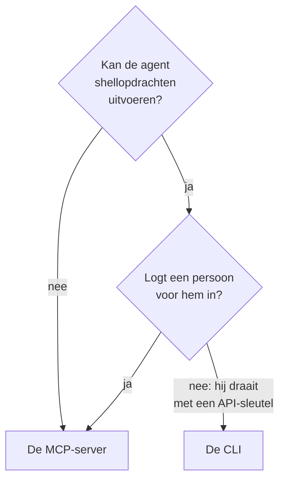

# CLI voor AI-agents

Een AI-agent die shellopdrachten kan uitvoeren, zoals een codeeragent in je editor of een job in je pipeline, kan met OneUptime werken via de CLI in plaats van via de [MCP-server](/docs/ai/mcp-server). Deze pagina zegt wanneer welke past, en hoe een agent de CLI installeert, zijn weg vindt en de antwoorden leest.

:::cards
- [De CLI of de MCP-server](#de-cli-of-de-mcp-server): Welke een agent moet gebruiken.
- [Instellen voor een agent](#instellen-voor-een-agent): Installeer hem en geef hem een sleutel in de omgeving.
- [Hoe een agent zijn weg vindt](#hoe-een-agent-zijn-weg-vindt): De bronnen, hun velden en de hulp.
- [De antwoorden lezen](#de-antwoorden-lezen): JSON van elke opdracht, fouten inbegrepen.
:::

## De CLI of de MCP-server

Beide bereiken de OneUptime-API en doen wat hun inloggegevens toestaan. Ze verschillen in wat de agent nodig heeft om ze te bereiken:



| | De CLI | De MCP-server |
| --- | --- | --- |
| De agent heeft nodig | Een shell en Node.js 22 of nieuwer | Een MCP-client, zoals Claude of Cursor |
| Hij logt in met | Een API-sleutel van het project, in `ONEUPTIME_API_KEY` | Je OneUptime-account, of een API-sleutel |
| Hij bereikt | Elke bron van de API, 450 en meer | De records en telemetrie waarvoor hij tools heeft, en tools voor incidentrespons |
| Hij past bij | Scripts die de agent schrijft om door mensen bewaard te worden, controles in een pipeline en werk met veel records | Een gesprek: een incident onderzoeken, een monitor opzetten |

Gebruik de CLI als de agent al opdrachten uitvoert, zoals een codeeragent doet, of als wat hij bouwt zonder hem moet blijven draaien: een script in een repository, een stap van een pipeline. Gebruik de MCP-server als een persoon in een chatclient met de agent praat, zodat de agent met diens rechten werkt en de client vóór een wijziging om bevestiging vraagt.

## Instellen voor een agent

Elke OneUptime biedt het installatiescript van de CLI voor zijn eigen release aan: de opdrachten hieronder downloaden het van `https://oneuptime.com`, dus vervang dat op een zelf gehoste OneUptime door je eigen URL. Het script wordt eerst opgeslagen als `install.sh`, zodat je het kunt lezen voordat je het uitvoert:

```bash
curl -fsSL https://oneuptime.com/install/cli -o install.sh
ONEUPTIME_URL=https://oneuptime.com bash install.sh
```

Geef de agent een API-sleutel van het project met alleen de toegang die zijn werk nodig heeft, in de omgeving in plaats van op de opdrachtregel, en laat hem eerst de sleutel controleren:

```bash
export ONEUPTIME_API_KEY="your-api-key"
export ONEUPTIME_URL=https://oneuptime.com
oneuptime whoami --check -o json
```

Maak de sleutel aan in **Projectinstellingen → Geavanceerd → API-sleutels**: zie [Een API-sleutel aanmaken](/docs/api-reference/api-reference#een-api-sleutel-aanmaken). Een sleutel die alleen mag lezen, laat de agent kijken, en verder niets.

## Hoe een agent zijn weg vindt

De CLI zegt wat hij kan, zonder API-sleutel en zonder verzoek:

| Opdracht | Wat hij antwoordt |
| --- | --- |
| `oneuptime resources -o json` | Elke bron: de opdracht, de namen, het API-pad, de bewerkingen en de acties ervan |
| `oneuptime incident fields -o json` | De velden van een bron: waarvoor elk dient, het type, of een aanmaak het nodig heeft, en de vlag |
| `oneuptime incident create --help` | De argumenten en vlaggen van een opdracht |

Een veld met een ID zegt van welke bron de ID is die het neemt, zodat de agent die bron eerst toont: `incidentSeverityId` neemt een ID uit `oneuptime incident-severity list`. Een veld dat een persoon noemt, neemt ook diens e-mailadres aan, zoals met `--user-email`.

## De antwoorden lezen

Laat de agent `-o json`, of `--json`, aan elke opdracht toevoegen. Elke opdracht antwoordt dan met JSON, ook die waarvan het antwoord een zin is, en een fout is één JSON-object in de standaardfoutuitvoer:

```bash
oneuptime incident acknowledge 6f1c2a40-3b1e-4c55-9a0b-3e2f8d7c1a11 -o json
```

```json
{
  "_id": "6f1c2a40-3b1e-4c55-9a0b-3e2f8d7c1a11",
  "action": "acknowledge",
  "changed": true,
  "state": {
    "_id": "0b7d5e2c-8f4a-4d1b-9c3e-5a6f7b8c9d0e",
    "name": "Acknowledged"
  }
}
```

De exitcode zegt wat er gebeurde: `0` als het is gelukt, `1` als het is mislukt, `2` als de API-sleutel ontbreekt of wordt geweigerd, en `3` als het record er niet is. De JSON van een fout heeft dezelfde code in `exitCode`, en in `hint` wat je daarna kunt doen. Zie [Uitvoerformaten](/docs/cli/output-formats#json) en [Exitcodes](/docs/cli/scripting#exitcodes).

## Volgende stappen

:::cards
- [Bewerkingen op bronnen](/docs/cli/resource-operations): Elke bewerking, met haar vlaggen en filters.
- [Opdrachtreferentie](/docs/cli/command-reference): Elke opdracht, optie en standaardwaarde.
- [MCP-server](/docs/ai/mcp-server): Verbind in plaats daarvan een chatclient met OneUptime.
:::
