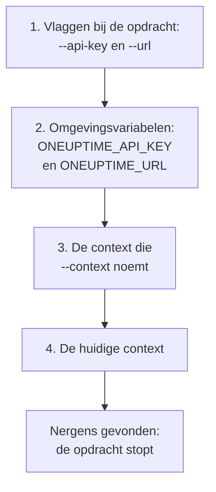

# Authenticatie

Elk verzoek dat de CLI verstuurt, draagt een API-sleutel van je project. Sla sleutels één keer op met `oneuptime login`, één context per omgeving, of geef ze aan een opdracht mee in vlaggen of omgevingsvariabelen, zoals scripts doen. Deze pagina laat elke manier zien, en welke een opdracht gebruikt als er meerdere zijn.

:::cards
- [Inloggen](#inloggen): Een API-sleutel en het adres van je OneUptime opslaan.
- [Contexten](#contexten): Een opgeslagen login per project of omgeving, en het wisselen ertussen.
- [Welke inloggegevens een opdracht gebruikt](#welke-inloggegevens-een-opdracht-gebruikt): Eerst vlaggen, dan omgevingsvariabelen, dan contexten.
- [Problemen oplossen](#problemen-oplossen): Geen inloggegevens gevonden, ongeldige sleutels en weigeringen.
:::

## Voordat je begint

Je hebt een API-sleutel van je project nodig. Maak er een aan in **Projectinstellingen → Geavanceerd → API-sleutels** met **API-sleutel aanmaken**, en geef hem de toegang die je opdrachten nodig hebben: zie [Een API-sleutel aanmaken](/docs/api-reference/api-reference#een-api-sleutel-aanmaken). Een sleutel doet wat zijn rechten toestaan: een sleutel die records alleen mag lezen, kan ze tonen en lezen, maar niet wijzigen.

Op OneUptime Cloud werken API-sleutels alleen zolang het project het **Growth**-abonnement of hoger heeft. Daaronder antwoordt elke opdracht met `API error (402)` en een melding die het abonnement noemt, tot het project wordt geüpgraded; dan werkt dezelfde sleutel weer. Zie [API-sleutels en SCIM onder hun abonnement](/docs/api-reference/api-reference#api-sleutels-en-scim-onder-hun-abonnement).

## Inloggen

`oneuptime login` slaat een API-sleutel en het adres van je OneUptime op als context, en maakt die de huidige context:

```bash
oneuptime login <api-key> <instance-url> [--context-name <name>]
```

| Argument of optie | Wat het is |
| --- | --- |
| `<api-key>` | Een API-sleutel van je project |
| `<instance-url>` | Het adres van je OneUptime: `https://oneuptime.com`, of dat van je eigen server, zoals `https://oneuptime.example.com` |
| `--context-name <name>` | De naam waaronder de context wordt opgeslagen. Standaard: `default` |

Bijvoorbeeld een context met de naam `production`:

```bash
oneuptime login <api-key> https://oneuptime.com --context-name production
```

Hij antwoordt `Logged in successfully. Context "production" is now active.` Een schuine streep aan het eind van het adres wordt verwijderd, en opnieuw inloggen onder dezelfde naam vervangt die context.

> [!NOTE]
> `login` slaat de sleutel op zonder OneUptime ernaar te vragen. Voer een opdracht uit, zoals `oneuptime incident count`, om te zien dat de sleutel werkt.

## Contexten

Een context is een opgeslagen login: een naam, een adres en een API-sleutel. Sla er een op per project of omgeving en kies er dan een voor alle opdrachten die volgen, of voor één opdracht.

:::steps
### Een context per omgeving opslaan

```bash
oneuptime login <production-api-key> https://oneuptime.com --context-name production
oneuptime login <staging-api-key> https://oneuptime.example.com --context-name staging
```

Elke login maakt zijn context de huidige, dus nu is `staging` de huidige.

### Ze tonen

```bash
oneuptime context list
```

```text
┌───┬────────────┬───────────────────────────────┐
│   │ Name       │ URL                           │
├───┼────────────┼───────────────────────────────┤
│   │ production │ https://oneuptime.com         │
├───┼────────────┼───────────────────────────────┤
│ * │ staging    │ https://oneuptime.example.com │
└───┴────────────┴───────────────────────────────┘
```

Het `*` markeert de huidige context. API-sleutels worden nooit getoond.

### Naar een andere context wisselen

```bash
oneuptime context use production
```

Hij antwoordt `Switched to context "production".` en de opdrachten die volgen gebruiken die.

### Een context voor één opdracht gebruiken

```bash
oneuptime incident list --context staging
```

De huidige context blijft zoals hij was.
:::

| Opdracht | Wat hij doet |
| --- | --- |
| `oneuptime context list` | Toont de opgeslagen contexten; `*` markeert de huidige. Met `-o json` van elke context de `name`, `apiUrl` en `isCurrent`, nooit de sleutel |
| `oneuptime context use <name>` | Maakt een opgeslagen context de huidige |
| `oneuptime context current` | Toont de naam, de URL en de API-sleutel van de huidige context, de sleutel verborgen op de eerste vier en laatste vier tekens na |
| `oneuptime context delete <name>` | Verwijdert een opgeslagen context. Was het de huidige, dan wordt de eerste overgebleven context de huidige |

## Welke inloggegevens een opdracht gebruikt

Een opdracht heeft een API-sleutel en een URL nodig. Hij haalt elk van de twee van de eerste van deze plaatsen die er een heeft:



Je kunt ze dus combineren: bijvoorbeeld een API-sleutel uit een omgevingsvariabele met de URL van de huidige context. Omgevingsvariabelen passen bij scripts en CI-jobs, die geen opgeslagen contexten hebben:

:::tabs
@tab Linux
```bash
export ONEUPTIME_API_KEY=<api-key>
export ONEUPTIME_URL=https://oneuptime.com
oneuptime incident list
```
@tab macOS
```bash
export ONEUPTIME_API_KEY=<api-key>
export ONEUPTIME_URL=https://oneuptime.com
oneuptime incident list
```
@tab Windows
```powershell
$env:ONEUPTIME_API_KEY = "<api-key>"
$env:ONEUPTIME_URL = "https://oneuptime.com"
oneuptime incident list
```
:::

Vlaggen gaan voor al het andere, voor één opdracht:

```bash
oneuptime --api-key <api-key> --url https://oneuptime.com incident list
```

> [!WARNING]
> Een sleutel die als vlag is meegegeven, komt in je shellgeschiedenis terecht, en andere gebruikers van de machine kunnen hem in de proceslijst zien. Gebruik op een gedeelde machine liever een context of een omgevingsvariabele.

## Controleren wat de CLI gaat gebruiken

`oneuptime whoami` toont de URL en de API-sleutel die de volgende opdracht gebruikt, en de context waar ze vandaan komen:

```bash
oneuptime whoami
```

```text
URL:     https://oneuptime.com
API Key: 4f1c****0a13
Context: production
```

Alleen de eerste vier en de laatste vier tekens van de sleutel worden getoond. De regel `Context` verschijnt alleen als de URL en de sleutel die van de context zelf zijn, en geen waarden die een vlag of een omgevingsvariabele heeft vervangen. `whoami` leest je instellingen zonder OneUptime aan te roepen: hij toont wat een opdracht zal versturen, niet of OneUptime het accepteert. Is er niets opgeslagen of ingesteld, dan antwoordt hij:

```text
Not authenticated. Run `oneuptime login` to authenticate.
```

## Het configuratiebestand

`oneuptime login` slaat contexten op in `~/.oneuptime/config.json`, in je thuismap (`%USERPROFILE%\.oneuptime\config.json` op Windows). De CLI maakt het zo aan dat alleen jouw gebruiker het kan lezen en schrijven (modus `0600`):

```json title="~/.oneuptime/config.json"
{
  "currentContext": "production",
  "contexts": {
    "production": {
      "name": "production",
      "apiUrl": "https://oneuptime.com",
      "apiKey": "<api-key>"
    },
    "staging": {
      "name": "staging",
      "apiUrl": "https://oneuptime.example.com",
      "apiKey": "<api-key>"
    }
  }
}
```

Het bestand bevat de API-sleutels zoals ze zijn: houd het buiten gedeelde mappen, back-ups en repository's. Om uit één context uit te loggen, verwijder je hem met `oneuptime context delete <name>`; om uit alle uit te loggen, verwijder je het bestand. Een sleutel die mogelijk is uitgelekt, blijft geldig tot je hem in OneUptime verwijdert, in **Projectinstellingen → Geavanceerd → API-sleutels**.

Uitvoerformaten en lijstgroottes worden hier niet opgeslagen: geef `-o` en `--limit` aan elke opdracht mee.

## Problemen oplossen

:::details De melding "No credentials found"
`Authentication error: No credentials found.` betekent dat geen vlag, omgevingsvariabele of opgeslagen context de opdracht zijn API-sleutel en URL heeft gegeven. Voer `oneuptime login` uit, of stel zowel `ONEUPTIME_API_KEY` als `ONEUPTIME_URL` in. De opdracht eindigt met code `2`.
:::

:::details De melding "API error (400): Invalid API Key"
De sleutel is geen API-sleutel van OneUptime, is verlopen of is opnieuw ingesteld. Kopieer hem opnieuw van zijn pagina in **Projectinstellingen → Geavanceerd → API-sleutels**, waar ook zijn datum onder **Verloopt** staat, en log opnieuw in onder dezelfde contextnaam. De opdracht eindigt met code `2`.
:::

:::details De melding "API error (402): API keys need the Growth plan"
Op OneUptime Cloud zit het project onder het **Growth**-abonnement, dus de API-sleutels ervan werken niet meer. Upgrade het project, en dezelfde sleutel werkt weer: in de CLI hoeft niets te veranderen.
:::

:::details De melding "API error (422): You do not have permissions"
De rechten van de sleutel reiken niet tot wat de opdracht vraagt. Geef de sleutel een rol of een recht op zijn pagina in **Projectinstellingen → Geavanceerd → API-sleutels**: de melding noemt de rechten die het verzoek zouden doorlaten.
:::

:::details De melding "Context "staging" does not exist"
Er is geen context met die naam opgeslagen. `oneuptime context list` toont de namen die er zijn.
:::

:::details whoami toont een andere URL of sleutel dan de context heeft
Een omgevingsvariabele of een vlag vervangt de waarde van de context. `env | grep ONEUPTIME` toont de variabelen die zijn ingesteld, en `unset ONEUPTIME_API_KEY ONEUPTIME_URL` brengt je terug naar je contexten.
:::

:::details Het verzoek naar het adres mislukt
`Error: Request failed to https://...` betekent dat de CLI OneUptime op dat adres niet kon bereiken. Controleer de URL met `oneuptime whoami`: het is het adres waarop je OneUptime opent, met `https://`, zoals `https://oneuptime.com`.
:::

## Volgende stappen

:::cards
- [Bewerkingen op bronnen](/docs/cli/resource-operations): Records tonen, lezen, maken, wijzigen, verwijderen en tellen.
- [Scripting en CI/CD](/docs/cli/scripting): Een pipeline zijn sleutel geven in omgevingsvariabelen.
- [OneUptime API-referentie](/docs/api-reference/api-reference): Wat een API-sleutel mag doen, en wat elk antwoord betekent.
:::
