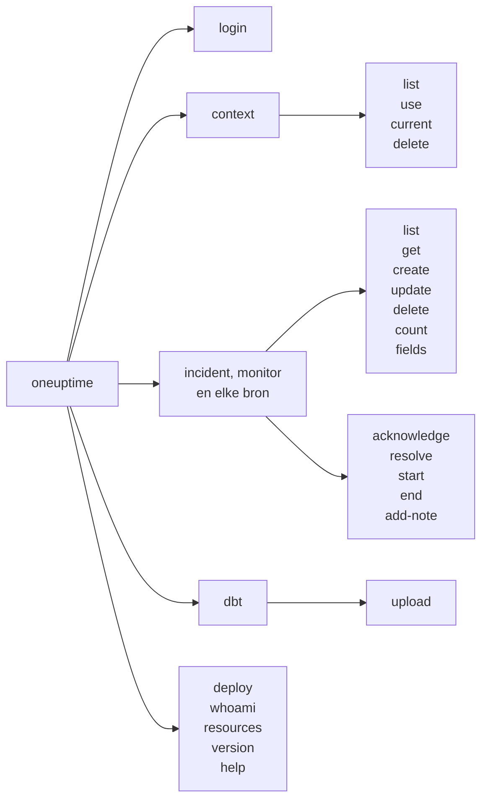

# Opdrachtreferentie

Elke opdracht van de CLI `oneuptime`, met zijn argumenten, opties en standaardwaarden. Voeg `--help` toe aan een opdracht om hetzelfde in je terminal te zien.

:::cards
- [Globale opties](#globale-opties): De opties die elke opdracht neemt.
- [Inloggen en contexten](#inloggen-en-contexten): login en de context-opdrachten.
- [Bronopdrachten](#opdrachten-voor-bronnen): De bewerkingen, velden en acties van elke bron.
- [Andere opdrachten](#andere-opdrachten): deploy, dbt upload, data-checks apply, whoami, resources, version en help.
:::

## De opdrachten



## Globale opties

| Optie | Wat hij doet | Standaard |
| --- | --- | --- |
| `--api-key <key>` | De API-sleutel voor deze opdracht | `ONEUPTIME_API_KEY`, dan de sleutel van de context |
| `--url <url>` | Het adres van je OneUptime voor deze opdracht | `ONEUPTIME_URL`, dan de URL van de context |
| `--context <name>` | De opgeslagen context voor deze opdracht | De huidige context |
| `-o, --output <format>` | `json`, `table` of `wide` | `table` in een terminal, `json` in een pipe |
| `--json` | Hetzelfde als `-o json` | |
| `--no-color` | Drukt af zonder kleuren | Kleuren, tenzij `NO_COLOR` is ingesteld |
| `-V, --version` | Drukt de versie van de CLI af | |
| `-h, --help` | Toont de hulp van een opdracht | |

De opties staan voor of na de opdracht: `oneuptime --context staging incident list` en `oneuptime incident list --context staging` doen hetzelfde.

Elke opdracht neemt `-o` en `--json` aan, dus de tabellen hieronder laten ze weg. Een opdracht waarvan het antwoord een zin is, zoals `delete`, drukt de zin af, tenzij `-o json` of `--json` om JSON vraagt: zie [Uitvoerformaten](/docs/cli/output-formats#json).

## Inloggen en contexten

### `oneuptime login`

Slaat een API-sleutel en een adres op als context, en maakt die de huidige. Zie [Inloggen](/docs/cli/authentication#inloggen).

```bash
oneuptime login <api-key> <instance-url> [--context-name <name>]
```

| Argument of optie | Verplicht | Wat het is | Standaard |
| --- | --- | --- | --- |
| `<api-key>` | Ja | Een API-sleutel van je project | |
| `<instance-url>` | Ja | Het adres van je OneUptime, zoals `https://oneuptime.com` | |
| `--context-name <name>` | Nee | De naam waaronder de context wordt opgeslagen | `default` |

### `oneuptime context list`

Toont de opgeslagen contexten; `*` markeert de huidige. API-sleutels worden nooit getoond: JSON geeft van elke context `name`, `apiUrl` en `isCurrent`.

```bash
oneuptime context list
```

### `oneuptime context use`

Maakt een opgeslagen context de huidige.

```bash
oneuptime context use <name>
```

| Argument | Verplicht | Wat het is |
| --- | --- | --- |
| `<name>` | Ja | De naam van een opgeslagen context |

### `oneuptime context current`

Toont de naam en de URL van de huidige context, en de API-sleutel ervan verborgen op de eerste vier en laatste vier tekens na.

```bash
oneuptime context current
```

### `oneuptime context delete`

Verwijdert een opgeslagen context. Was het de huidige, dan wordt de eerste overgebleven context de huidige.

```bash
oneuptime context delete <name>
```

| Argument | Verplicht | Wat het is |
| --- | --- | --- |
| `<name>` | Ja | De naam van een opgeslagen context |

## Opdrachten voor bronnen

`<resource>` is de opdracht van een soort record uit de tabel [Bronnen](#bronnen), zoals `incident` of `monitor`. Een bron heeft de bewerkingen die de API ervoor aanneemt, de meeste alle zes, en `oneuptime <resource> --help` toont die van de bron zelf. Zie [Bewerkingen op bronnen](/docs/cli/resource-operations) voor voorbeelden.

### `oneuptime <resource> list`

Toont records, de nieuwste eerst. Labels worden in plaats daarvan op naam getoond, genummerde labels eerst (`2. Team` vóór `10. Owner`).

```bash
oneuptime <resource> list [--query <json>] [--limit <n>] [--skip <n>] [--sort <json>] [--fields <names>] [--all]
```

| Optie | Wat hij doet | Standaard |
| --- | --- | --- |
| `--query <json>` | Een filter, als JSON | Elk record dat de sleutel mag lezen |
| `--limit <n>` | Het grootste aantal records om terug te geven, tot 10.000 | `10` |
| `--skip <n>` | Hoeveel records eerst worden overgeslagen | `0` |
| `--sort <json>` | De volgorde, als JSON: `{"<field>":"ASC"}` of `{"<field>":"DESC"}` | De nieuwste eerst |
| `--fields <names>` | De terug te geven velden, gescheiden door komma's; een veld van een gekoppeld record na een punt, zoals in `currentIncidentState.name` | Elk veld dat de sleutel mag lezen |
| `--all` | Elk passend record, 100 tegelijk, tot 100.000, in plaats van `--limit` en `--skip`. Alleen records: telemetrie heeft geen `--all` | |

### `oneuptime <resource> get`

Leest één record.

```bash
oneuptime <resource> get <id> [--fields <names>]
```

| Argument of optie | Verplicht | Wat het is |
| --- | --- | --- |
| `<id>` | Ja | De ID van het record, een UUID |
| `--fields <names>` | Nee | De terug te geven velden, gescheiden door komma's. Standaard: elk veld dat de sleutel mag lezen |

### `oneuptime <resource> create`

Maakt een record en drukt het af.

```bash
oneuptime <resource> create [--<field> <value>]... [--data <json>] [--file <path>]
```

| Optie | Verplicht | Wat het is |
| --- | --- | --- |
| `--<field> <value>` | De velden die een aanmaak moet opgeven | De waarde van een veld: `--title <text>`, `--incident-severity-id <id>`, `--labels <ids>`. `oneuptime <resource> create --help` toont ze. Alleen records |
| `--data <json>` | Nee | Het record, als JSON |
| `--file <path>` | Nee | Een JSON-bestand met het record. Samen met `--data` opgegeven, wordt het bestand gebruikt |

De vlaggen komen bovenop `--data` of `--file`. Een veld dat iemand noemt met een gebruikers-ID heeft ook een vlag die die persoon noemt met een e-mailadres: `--user-email` naast `--user-id`.

### `oneuptime <resource> update`

Wijzigt de velden die je opgeeft.

```bash
oneuptime <resource> update <id> [--<field> <value>]... [--data <json>] [--file <path>]
```

| Argument of optie | Verplicht | Wat het is |
| --- | --- | --- |
| `<id>` | Ja | De ID van het record |
| `--<field> <value>` | Nee | Een veld dat moet veranderen: `oneuptime <resource> update --help` toont ze. Alleen records |
| `--data <json>` | Nee | De velden die moeten veranderen, als JSON |
| `--file <path>` | Nee | Een JSON-bestand met de velden die moeten veranderen. Samen met `--data` opgegeven, wordt het bestand gebruikt |

### `oneuptime <resource> delete`

Verwijdert een record meteen, zonder te vragen.

```bash
oneuptime <resource> delete <id> [--force]
```

| Argument of optie | Verplicht | Wat het is |
| --- | --- | --- |
| `<id>` | Ja | De ID van het record |
| `--force` | Nee | Wordt geaccepteerd en verandert niets: `delete` vraagt nooit om bevestiging |

### `oneuptime <resource> count`

Telt records en drukt het getal af.

```bash
oneuptime <resource> count [--query <json>]
```

| Optie | Verplicht | Wat het is |
| --- | --- | --- |
| `--query <json>` | Nee | Een filter, als JSON. Zonder filter elk record dat de sleutel mag lezen |

### `oneuptime <resource> fields`

Toont de velden van de bron: waarvoor elk dient, het type, of een aanmaak het moet opgeven, en de vlag die het instelt. Hij leest ze uit de CLI zelf, zonder API-sleutel en zonder verzoek.

```bash
oneuptime <resource> fields
```

### `oneuptime <resource> acknowledge`

Verplaatst een incident, een waarschuwing of een episode van een van beide naar de bevestigd-status van je project, net als de knop in het dashboard. Een record dat al bevestigd is, of verder, blijft zoals het is.

```bash
oneuptime <resource> acknowledge <id>
```

| Argument | Verplicht | Wat het is |
| --- | --- | --- |
| `<id>` | Ja | De ID van het record |

### `oneuptime <resource> resolve`

Verplaatst een incident, een waarschuwing of een episode van een van beide naar de opgelost-status van je project.

```bash
oneuptime <resource> resolve <id>
```

| Argument | Verplicht | Wat het is |
| --- | --- | --- |
| `<id>` | Ja | De ID van het record |

### `oneuptime <resource> start`

Verplaatst een onderhoudsgebeurtenis naar de lopend-status van je project.

```bash
oneuptime <resource> start <id>
```

| Argument | Verplicht | Wat het is |
| --- | --- | --- |
| `<id>` | Ja | De ID van de gebeurtenis |

### `oneuptime <resource> end`

Verplaatst een onderhoudsgebeurtenis naar de beëindigd-status van je project.

```bash
oneuptime <resource> end <id>
```

| Argument | Verplicht | Wat het is |
| --- | --- | --- |
| `<id>` | Ja | De ID van de gebeurtenis |

### `oneuptime <resource> add-note`

Voegt een notitie toe aan een incident, een waarschuwing, een episode van een van beide of een onderhoudsgebeurtenis.

```bash
oneuptime <resource> add-note <id> --note <markdown> [--public]
```

| Argument of optie | Verplicht | Wat het is |
| --- | --- | --- |
| `<id>` | Ja | De ID van het record |
| `--note <markdown>` | Ja | De notitie, in Markdown |
| `--public` | Nee | Plaatst haar op de statuspagina's van het record, waar de abonnees ervan een bericht krijgen. Alleen incidenten, hun episoden en gepland onderhoud |

### Bronnen

Elke bron van de OneUptime-API is een opdracht, met de bewerkingen die de API ervoor aanneemt, `fields`, en de acties van de records die ze hebben:

{{CLI_RESOURCE_COMMANDS}}

De CLI verschijnt samen met OneUptime, dus `oneuptime resources` toont de opdrachten van de versie die je hebt geïnstalleerd.

### API-verzoeken

Elke bewerking is één verzoek aan de API, met de sleutel in de header `APIKey`. `<path>` is het API-pad van de bron, uit `oneuptime resources`: `/incident` voor `incident`, `/on-call-duty-policy` voor `on-call-policy`.

| Bewerking | Verzoek | Body |
| --- | --- | --- |
| `list` | `POST /api/<path>/get-list` | `query`, `select`, `skip`, `limit` en `sort` |
| `get` | `POST /api/<path>/<id>/get-item` | `select` |
| `create` | `POST /api/<path>` | `{"data": ...}` |
| `update` | `PUT /api/<path>/<id>/` | `{"data": ...}` |
| `delete` | `DELETE /api/<path>/<id>/` | Geen |
| `count` | `POST /api/<path>/count` | `query` |

Een actie leest de statussen van je project en het record, en maakt dan een rij in de statustijdlijn van het record, net als de knop in het dashboard: `acknowledge` op een incident maakt een `incident-state-timeline`. `add-note` maakt een `incident-internal-note`, of met `--public` een `incident-public-note`. Een e-mailvlag toont eerst de teamleden van het project met dat adres. Als OneUptime een veld weigert dat de sleutel niet mag lezen, vraagt een lijst of een leesbewerking opnieuw zonder dat veld.

## Andere opdrachten

### `oneuptime deploy`

Legt een deploy, of een andere wijziging, vast vanuit een pipeline: die wordt getekend op de grafieken van de service en gelezen door OneUptime AI wanneer het een incident onderzoekt. Hij schrijft met een telemetrie-ingestiesleutel, niet met een API-sleutel. Zie [Deploys en wijzigingen](/docs/telemetry/change-events).

```bash
oneuptime deploy [--service <name>] [--service-version <version>] [--previous-version <version>] [--commit <sha>] [--repository <url>] [--branch <name>] [--pull-request <number>] [--environment <name>] [--title <title>] [--description <text>] [--type <type>] [--time <time>] [--attribute <key=value...>] [--ingestion-key <key>]
```

| Optie | Verplicht | Wat het is | Standaard |
| --- | --- | --- | --- |
| `--service <name>` | Nee | De service die is gedeployd | Een wijziging voor het hele project |
| `--service-version <version>` | Nee | De gedeployde versie | |
| `--previous-version <version>` | Nee | De versie die erdoor werd vervangen | |
| `--commit <sha>` | Nee | De gedeployde commit | |
| `--repository <url>` | Nee | De repository waarin de commit staat | |
| `--branch <name>` | Nee | De gedeployde branch | |
| `--pull-request <number>` | Nee | De gedeployde pull request | |
| `--environment <name>` | Nee | De omgeving waarnaar is gedeployd | |
| `--title <title>` | Nee | De titel van de wijziging; een ander soort dan een deploy heeft er een nodig | `Deploy <version>` |
| `--description <text>` | Nee | Details van de wijziging | |
| `--type <type>` | Nee | Het soort wijziging, zoals `config-change` of `rollback` | `deployment` |
| `--time <time>` | Nee | Wanneer het gebeurde, zoals `2026-10-19T10:00:00Z` | Nu |
| `--attribute <key=value...>` | Nee | Meer attributen, als `key=value`, een of meer | |
| `--ingestion-key <key>` | Nee | Een telemetrie-ingestiesleutel van het project | `ONEUPTIME_TELEMETRY_INGESTION_KEY` |

### `oneuptime dbt upload`

Stuurt de artefacten van een dbt-project na een build, vanuit CI of een dbt Cloud-job, naar Data Observability. De modellen ervan verschijnen bij de tabellen die ze bouwen, met hun herkomst, de tests ervan verschijnen naast de controles van OneUptime en kunnen waarschuwingen aanmaken, en elke build is een uitvoering van de pipeline van het project. Hij leest `manifest.json` en `run_results.json` uit de doelmap van dbt, stuurt alleen wat Data Observability ervan leest en schrijft met een telemetrie-ingestiesleutel, niet met een API-sleutel. De pagina Documentatie van Data Observability, in je dashboard, toont hem in een CI-job.

```bash
oneuptime dbt upload [--target-path <dir>] [--manifest <file>] [--run-results <file>] [--project <name>] [--ingestion-key <key>]
```

| Optie | Verplicht | Wat het is | Standaard |
| --- | --- | --- | --- |
| `--target-path <dir>` | Nee | De map waarin dbt zijn artefacten heeft geschreven | `target` |
| `--manifest <file>` | Nee | Het manifest dat wordt verstuurd | `manifest.json` in de doelmap |
| `--run-results <file>` | Nee | De uitvoeringsresultaten die worden verstuurd | `run_results.json` in de doelmap |
| `--project <name>` | Nee | De naam van het dbt-project, alleen nodig als er geen manifest wordt verstuurd | Het project van het manifest |
| `--ingestion-key <key>` | Nee | Een telemetrie-ingestiesleutel van het project | `ONEUPTIME_TELEMETRY_INGESTION_KEY` |

### `oneuptime data-checks apply`

Laat de gegevenscontroles van het project overeenkomen met een YAML-bestand, zodat ze in een repository worden bewaard en als code worden beoordeeld. Een fout ergens in het bestand past niets toe en eindigt met een foutmelding. Het formaat van het bestand staat in [Controles en reconciliaties](/docs/data-observability/checks).

```bash
oneuptime data-checks apply <file> [--dry-run] [--prune]
```

| Optie | Verplicht | Wat het is | Standaard |
| --- | --- | --- | --- |
| `--dry-run` | Nee | Zegt wat er zou veranderen, en verandert niets | Uit |
| `--prune` | Nee | Verwijdert controles die een eerdere apply maakte en die het bestand niet meer noemt | Uit |

### `oneuptime whoami`

Toont de URL en de API-sleutel die de volgende opdracht gebruikt, met de sleutel gemaskeerd, en de context waar ze vandaan komen. Zonder `--check` roept hij OneUptime niet aan. Zie [Controleren wat de CLI gaat gebruiken](/docs/cli/authentication#controleren-wat-de-cli-gaat-gebruiken).

```bash
oneuptime whoami [--check]
```

| Optie | Verplicht | Wat het is |
| --- | --- | --- |
| `--check` | Nee | Vraagt OneUptime of het de sleutel aanneemt, en toont het project van de sleutel, de versie van je OneUptime en die van de CLI |

### `oneuptime resources`

Toont elk soort record waarvoor de CLI een opdracht heeft: de opdracht, enkelvoudige en meervoudige namen, het type en het API-pad, en het totaal. JSON geeft van elk `name`, `singularName`, `pluralName`, `modelType`, `apiPath`, `operations` en `actions`.

```bash
oneuptime resources [--type <type>]
```

| Optie | Verplicht | Wat het is | Standaard |
| --- | --- | --- | --- |
| `--type <type>` | Nee | `database` voor records, `analytics` voor telemetrie | Beide |

### `oneuptime version`

Drukt de versie van de CLI af, net als `oneuptime --version`.

```bash
oneuptime version
```

### `oneuptime help`

Toont de hulp van de CLI, of die van een opdracht.

```bash
oneuptime help [command]
```

## Omgevingsvariabelen

| Variabele | Wat hij doet |
| --- | --- |
| `ONEUPTIME_API_KEY` | De API-sleutel, als geen vlag `--api-key` er een geeft |
| `ONEUPTIME_URL` | Het adres van je OneUptime, als geen vlag `--url` er een geeft |
| `ONEUPTIME_TELEMETRY_INGESTION_KEY` | De telemetrie-ingestiesleutel waarmee `oneuptime deploy` schrijft, als geen vlag `--ingestion-key` er een geeft |
| `NO_COLOR` | Ingesteld op een willekeurige waarde, zet hij kleuren uit |

## Bestanden

| Bestand | Wat het bevat |
| --- | --- |
| `~/.oneuptime/config.json` | De opgeslagen contexten, hun API-sleutels en de huidige context |

## Exitcodes

| Code | Betekenis |
| --- | --- |
| `0` | Het is gelukt |
| `1` | Het is mislukt: OneUptime weigerde het verzoek, of de opdracht was fout |
| `2` | Geen bruikbare API-sleutel: niet gevonden, ongeldig of onder zijn abonnement |
| `3` | Niet gevonden: OneUptime antwoordde `404` |

Zie [Exitcodes](/docs/cli/scripting#exitcodes) voor voorbeelden.

## Volgende stappen

:::cards
- [CLI – Overzicht](/docs/cli/index): De CLI installeren en je eerste opdrachten uitvoeren.
- [Bewerkingen op bronnen](/docs/cli/resource-operations): Voorbeelden van elke bewerking.
- [Scripting en CI/CD](/docs/cli/scripting): De CLI in scripts en pipelines.
:::
