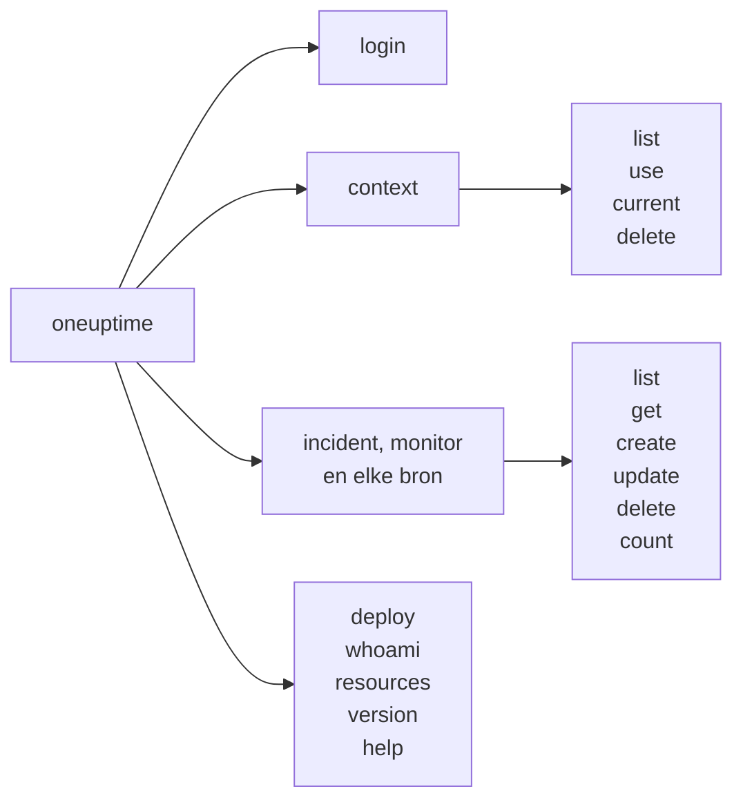

# Opdrachtreferentie

Elke opdracht van de CLI `oneuptime`, met zijn argumenten, opties en standaardwaarden. Voeg `--help` toe aan een opdracht om hetzelfde in je terminal te zien.

:::cards
- [Globale opties](#globale-opties): De opties die elke opdracht neemt.
- [Inloggen en contexten](#inloggen-en-contexten): login en de context-opdrachten.
- [Opdrachten voor bronnen](#opdrachten-voor-bronnen): list, get, create, update, delete en count.
- [Andere opdrachten](#andere-opdrachten): deploy, whoami, resources, version en help.
:::

## De opdrachten



## Globale opties

| Optie | Wat hij doet | Standaard |
| --- | --- | --- |
| `--api-key <key>` | De API-sleutel voor deze opdracht | `ONEUPTIME_API_KEY`, dan de sleutel van de context |
| `--url <url>` | Het adres van je OneUptime voor deze opdracht | `ONEUPTIME_URL`, dan de URL van de context |
| `--context <name>` | De opgeslagen context voor deze opdracht | De huidige context |
| `-o, --output <format>` | `json`, `table` of `wide` | `table` in een terminal, `json` in een pipe |
| `--no-color` | Drukt af zonder kleuren | Kleuren, tenzij `NO_COLOR` is ingesteld |
| `-V, --version` | Drukt de versie van de CLI af | |
| `-h, --help` | Toont de hulp van een opdracht | |

De opties staan voor of na de opdracht: `oneuptime --context staging incident list` en `oneuptime incident list --context staging` doen hetzelfde.

## Inloggen en contexten

### `oneuptime login`

Slaat een API-sleutel en een adres op als context, en maakt die de huidige. Zie [Inloggen](/docs/cli/authentication#inloggen).

```bash
oneuptime login <api-key> <instance-url> [--context-name <name>]
```

| Argument of optie | Verplicht | Wat het is | Standaard |
| --- | --- | --- | --- |
| `<api-key>` | Ja | Een API-sleutel van je project | |
| `<instance-url>` | Ja | Het adres van je OneUptime, zoals `https://oneuptime.com` | |
| `--context-name <name>` | Nee | De naam waaronder de context wordt opgeslagen | `default` |

### `oneuptime context list`

Toont de opgeslagen contexten; `*` markeert de huidige. API-sleutels worden nooit getoond.

```bash
oneuptime context list [-o <format>]
```

| Optie | Verplicht | Wat het is |
| --- | --- | --- |
| `-o, --output <format>` | Nee | `json`, `table` of `wide`. JSON geeft van elke context de `name`, `apiUrl` en `isCurrent` |

### `oneuptime context use`

Maakt een opgeslagen context de huidige.

```bash
oneuptime context use <name>
```

| Argument | Verplicht | Wat het is |
| --- | --- | --- |
| `<name>` | Ja | De naam van een opgeslagen context |

### `oneuptime context current`

Toont de naam en de URL van de huidige context, en de API-sleutel ervan verborgen op de eerste vier en laatste vier tekens na.

```bash
oneuptime context current
```

### `oneuptime context delete`

Verwijdert een opgeslagen context. Was het de huidige, dan wordt de eerste overgebleven context de huidige.

```bash
oneuptime context delete <name>
```

| Argument | Verplicht | Wat het is |
| --- | --- | --- |
| `<name>` | Ja | De naam van een opgeslagen context |

## Opdrachten voor bronnen

`<resource>` is de opdracht van een soort record, uit de tabellen bij [Bronnen](#bronnen), zoals `incident` of `monitor`. Zie [Bewerkingen op bronnen](/docs/cli/resource-operations) voor voorbeelden.

### `oneuptime <resource> list`

Toont records, de nieuwste eerst. Labels worden in plaats daarvan op naam getoond, genummerde labels eerst (`2. Team` vóór `10. Owner`).

```bash
oneuptime <resource> list [--query <json>] [--limit <n>] [--skip <n>] [--sort <json>] [-o <format>]
```

| Optie | Wat hij doet | Standaard |
| --- | --- | --- |
| `--query <json>` | Een filter, als JSON | Elk record dat de sleutel mag lezen |
| `--limit <n>` | Het grootste aantal records om terug te geven, tot 10.000 | `10` |
| `--skip <n>` | Hoeveel records eerst worden overgeslagen | `0` |
| `--sort <json>` | De volgorde, als JSON: `{"<field>":"ASC"}` of `{"<field>":"DESC"}` | De nieuwste eerst |
| `-o, --output <format>` | `json`, `table` of `wide` | `table` in een terminal, `json` in een pipe |

### `oneuptime <resource> get`

Leest één record. Alleen records: telemetrie heeft geen `get`.

```bash
oneuptime <resource> get <id> [-o <format>]
```

| Argument of optie | Verplicht | Wat het is |
| --- | --- | --- |
| `<id>` | Ja | De ID van het record, een UUID |
| `-o, --output <format>` | Nee | `json`, `table` of `wide` |

### `oneuptime <resource> create`

Maakt een record en drukt het af.

```bash
oneuptime <resource> create (--data <json> | --file <path>) [-o <format>]
```

| Optie | Verplicht | Wat het is |
| --- | --- | --- |
| `--data <json>` | Een van de twee | Het record, als JSON |
| `--file <path>` | Een van de twee | Een JSON-bestand met het record. Samen met `--data` opgegeven, wordt het bestand gebruikt |
| `-o, --output <format>` | Nee | `json`, `table` of `wide` |

### `oneuptime <resource> update`

Wijzigt de velden die je opgeeft. Alleen records: telemetrie heeft geen `update`.

```bash
oneuptime <resource> update <id> --data <json> [-o <format>]
```

| Argument of optie | Verplicht | Wat het is |
| --- | --- | --- |
| `<id>` | Ja | De ID van het record |
| `--data <json>` | Ja | De velden die moeten veranderen, als JSON |
| `-o, --output <format>` | Nee | `json`, `table` of `wide` |

### `oneuptime <resource> delete`

Verwijdert een record meteen, zonder te vragen. Alleen records: telemetrie heeft geen `delete`.

```bash
oneuptime <resource> delete <id> [--force]
```

| Argument of optie | Verplicht | Wat het is |
| --- | --- | --- |
| `<id>` | Ja | De ID van het record |
| `--force` | Nee | Wordt geaccepteerd en verandert niets: `delete` vraagt nooit om bevestiging |

### `oneuptime <resource> count`

Telt records en drukt het getal af.

```bash
oneuptime <resource> count [--query <json>] [-o <format>]
```

| Optie | Verplicht | Wat het is |
| --- | --- | --- |
| `--query <json>` | Nee | Een filter, als JSON. Zonder filter elk record dat de sleutel mag lezen |
| `-o, --output <format>` | Nee | `json`, `table` of `wide` |

### Bronnen

Records nemen `list`, `get`, `create`, `update`, `delete` en `count`:

| Gebied | Opdrachten |
| --- | --- |
| Monitoring | `monitor`, `monitor-status`, `monitor-status-event` |
| Incidenten | `incident`, `incident-state`, `incident-severity`, `incident-state-timeline`, `incident-public-note`, `incident-internal-note`, `incident-alert`, `postmortem-status` |
| Waarschuwingen | `alert`, `alert-state`, `alert-severity`, `alert-state-timeline`, `alert-internal-note` |
| Statuspagina's | `status-page`, `status-page-announcement` |
| Gepland onderhoud | `scheduled-maintenance-event`, `scheduled-maintenance-state`, `scheduled-maintenance-state-timeline` |
| Teams en dienst | `team`, `on-call-policy` |
| Beveiliging | `security-case`, `security-case-evidence`, `security-case-note`, `security-case-priority`, `security-case-status`, `security-case-task`, `security-detection`, `security-playbook` |
| Gegevensbeveiliging | `data-store`, `data-store-finding`, `data-store-access-entry`, `data-flow`, `data-security-issue`, `data-security-scan`, `custom-data-type`, `check-setting`, `residency-rule`, `data-security-setting` |
| Labels | `label` |

Telemetrie neemt `list`, `create` en `count`:

| Gebied | Opdrachten |
| --- | --- |
| Observeerbaarheid | `log`, `metric`, `span`, `exception-instance`, `monitor-log` |
| Beveiliging | `security-event`, `threat-intel-indicator` |
| Wijzigingen en kosten | `change-event`, `kubernetes-cost-allocation` |

De CLI verschijnt samen met OneUptime, dus `oneuptime resources` toont de opdrachten van de versie die je hebt geïnstalleerd.

### API-verzoeken

Elke bewerking is één verzoek aan de API, met de sleutel in de header `APIKey`. `<path>` is het API-pad van de bron, uit `oneuptime resources`: `/incident` voor `incident`, `/on-call-duty-policy` voor `on-call-policy`.

| Bewerking | Verzoek | Body |
| --- | --- | --- |
| `list` | `POST /api/<path>/get-list` | `query`, `select`, `skip`, `limit` en `sort` |
| `get` | `POST /api/<path>/<id>/get-item` | `select` |
| `create` | `POST /api/<path>` | `{"data": ...}` |
| `update` | `PUT /api/<path>/<id>/` | `{"data": ...}` |
| `delete` | `DELETE /api/<path>/<id>/` | Geen |
| `count` | `POST /api/<path>/count` | `query` |

## Andere opdrachten

### `oneuptime deploy`

Legt een deploy, of een andere wijziging, vast vanuit een pipeline: die wordt getekend op de grafieken van de service en gelezen door OneUptime AI wanneer het een incident onderzoekt. Hij schrijft met een telemetrie-ingestiesleutel, niet met een API-sleutel. Zie [Deploys en wijzigingen](/docs/telemetry/change-events).

```bash
oneuptime deploy [--service <name>] [--service-version <version>] [--previous-version <version>] [--commit <sha>] [--repository <url>] [--branch <name>] [--pull-request <number>] [--environment <name>] [--title <title>] [--description <text>] [--type <type>] [--time <time>] [--attribute <key=value...>] [--ingestion-key <key>]
```

| Optie | Verplicht | Wat het is | Standaard |
| --- | --- | --- | --- |
| `--service <name>` | Nee | De service die is gedeployd | Een wijziging voor het hele project |
| `--service-version <version>` | Nee | De gedeployde versie | |
| `--previous-version <version>` | Nee | De versie die erdoor werd vervangen | |
| `--commit <sha>` | Nee | De gedeployde commit | |
| `--repository <url>` | Nee | De repository waarin de commit staat | |
| `--branch <name>` | Nee | De gedeployde branch | |
| `--pull-request <number>` | Nee | De gedeployde pull request | |
| `--environment <name>` | Nee | De omgeving waarnaar is gedeployd | |
| `--title <title>` | Nee | De titel van de wijziging; een ander soort dan een deploy heeft er een nodig | `Deploy <version>` |
| `--description <text>` | Nee | Details van de wijziging | |
| `--type <type>` | Nee | Het soort wijziging, zoals `config-change` of `rollback` | `deployment` |
| `--time <time>` | Nee | Wanneer het gebeurde, zoals `2026-10-19T10:00:00Z` | Nu |
| `--attribute <key=value...>` | Nee | Meer attributen, als `key=value`, een of meer | |
| `--ingestion-key <key>` | Nee | Een telemetrie-ingestiesleutel van het project | `ONEUPTIME_TELEMETRY_INGESTION_KEY` |

### `oneuptime whoami`

Toont de URL en de API-sleutel die de volgende opdracht gebruikt, met gemaskeerde sleutel, en de context waar ze vandaan komen. Hij roept OneUptime niet aan. Zie [Controleren wat de CLI gaat gebruiken](/docs/cli/authentication#controleren-wat-de-cli-gaat-gebruiken).

```bash
oneuptime whoami
```

### `oneuptime resources`

Toont elk soort record waarvoor de CLI een opdracht heeft: de opdracht, de namen in enkelvoud en meervoud, het type en het API-pad, en het totaal.

```bash
oneuptime resources [--type <type>] [-o <format>]
```

| Optie | Verplicht | Wat het is | Standaard |
| --- | --- | --- | --- |
| `--type <type>` | Nee | `database` voor records, `analytics` voor telemetrie | Beide |
| `-o, --output <format>` | Nee | `json`, `table` of `wide`. JSON geeft van elk de `name`, `singularName`, `pluralName`, `modelType` en `apiPath` | `table` in een terminal, `json` in een pipe |

### `oneuptime version`

Drukt de versie van de CLI af, net als `oneuptime --version`.

```bash
oneuptime version
```

### `oneuptime help`

Toont de hulp van de CLI, of die van een opdracht.

```bash
oneuptime help [command]
```

## Omgevingsvariabelen

| Variabele | Wat hij doet |
| --- | --- |
| `ONEUPTIME_API_KEY` | De API-sleutel, als geen vlag `--api-key` er een geeft |
| `ONEUPTIME_URL` | Het adres van je OneUptime, als geen vlag `--url` er een geeft |
| `ONEUPTIME_TELEMETRY_INGESTION_KEY` | De telemetrie-ingestiesleutel waarmee `oneuptime deploy` schrijft, als geen vlag `--ingestion-key` er een geeft |
| `NO_COLOR` | Ingesteld op een willekeurige waarde, zet hij kleuren uit |

## Bestanden

| Bestand | Wat het bevat |
| --- | --- |
| `~/.oneuptime/config.json` | De opgeslagen contexten, hun API-sleutels en de huidige context |

## Exitcodes

| Code | Betekenis |
| --- | --- |
| `0` | Het is gelukt |
| `1` | Het is mislukt: OneUptime weigerde het verzoek, of de opdracht was fout |
| `2` | Geen bruikbare API-sleutel: niet gevonden, ongeldig of onder zijn abonnement |
| `3` | Niet gevonden: OneUptime antwoordde `404` |

Zie [Exitcodes](/docs/cli/scripting#exitcodes) voor voorbeelden.

## Volgende stappen

:::cards
- [CLI – Overzicht](/docs/cli/index): De CLI installeren en je eerste opdrachten uitvoeren.
- [Bewerkingen op bronnen](/docs/cli/resource-operations): Voorbeelden van elke bewerking.
- [Scripting en CI/CD](/docs/cli/scripting): De CLI in scripts en pipelines.
:::
