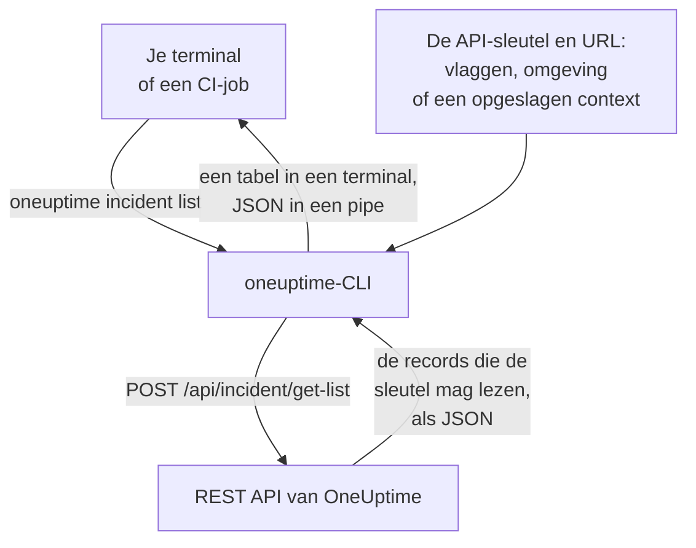

# CLI – Overzicht

De OneUptime-CLI, `oneuptime`, beheert je OneUptime-project vanuit een terminal of een script. Hij toont, leest, maakt, wijzigt, verwijdert en telt monitoren, incidenten, waarschuwingen, statuspagina's en de andere records die de OneUptime-API aanbiedt, met een API-sleutel van je project.

:::cards
- [Hoe de CLI werkt](#hoe-de-cli-werkt): Een opdracht, de API-verzoeken die hij stuurt, en zijn antwoord.
- [De CLI installeren](#de-cli-installeren): Het installatiescript dat je OneUptime aanbiedt, of npm.
- [Je eerste opdrachten uitvoeren](#je-eerste-opdrachten-uitvoeren): Sla je API-sleutel op, controleer hem en toon dan je incidenten.
- [De opdrachten in één oogopslag](#de-opdrachten-in-één-oogopslag): Elke opdracht, en de pagina die hem uitlegt.
:::

## Hoe de CLI werkt

De meeste opdrachten sturen één verzoek naar de REST API van OneUptime en drukken het antwoord af; een actie, zoals `acknowledge`, stuurt de paar verzoeken die de knop in het dashboard ook stuurt. De CLI haalt de API-sleutel en het adres van je OneUptime uit vlaggen, omgevingsvariabelen of een context die `oneuptime login` heeft opgeslagen. De sleutel bepaalt wat een opdracht mag lezen en wijzigen, precies zoals bij de API.



Elke bron van de OneUptime-API is een opdracht, 450 en meer, van `incident` en `monitor` tot `status-page-subscriber` en `telemetry-ingestion-key`, elk met de bewerkingen die de API ervoor aanneemt. De CLI verschijnt samen met OneUptime, dus de CLI van de versie van je OneUptime heeft een opdracht voor elke bron die je server heeft. Voer `oneuptime resources` uit om ze te tonen.

## Voordat je begint

- **Node.js en npm**, een actuele LTS-release, om de CLI te installeren.
- **Een API-sleutel van je project.** Maak er een aan in **Projectinstellingen → Geavanceerd → API-sleutels** met **API-sleutel aanmaken**: zie [Een API-sleutel aanmaken](/docs/api-reference/api-reference#een-api-sleutel-aanmaken).
- **Op OneUptime Cloud het Growth-abonnement of hoger.** De API-sleutels van een project werken alleen daarop: zie [API-sleutels en SCIM onder hun abonnement](/docs/api-reference/api-reference#api-sleutels-en-scim-onder-hun-abonnement).

## De CLI installeren

Elke OneUptime biedt het installatiescript van de CLI voor zijn eigen release aan: de opdrachten hieronder downloaden het van `https://oneuptime.com`, dus vervang dat op een zelf gehoste OneUptime door je eigen URL. Het script wordt eerst opgeslagen als `install.sh`, zodat je het kunt lezen voordat je het uitvoert. Het vraagt je OneUptime naar zijn versie en installeert de CLI van dezelfde versie met npm:

```bash
curl -fsSL https://oneuptime.com/install/cli -o install.sh
ONEUPTIME_URL=https://oneuptime.com bash install.sh
```

Of installeer het pakket `@oneuptime/cli` zelf vanuit npm. Het voegt de opdracht `oneuptime` toe, en `--version` drukt de geïnstalleerde versie af:

```bash
npm install -g @oneuptime/cli
oneuptime --version
```

De CLI verschijnt samen met OneUptime en heeft hetzelfde versienummer. Op een zelf gehoste OneUptime installeer je de CLI van de versie van je OneUptime, zodat de opdrachten passen bij de records die je server heeft:

```bash
npm install -g @oneuptime/cli@<your-oneuptime-version>
```

> [!WARNING]
> CLI-versies van vóór 14.0.64 stoppen zodra ze starten, met een fout als `Cannot find module 'Common/Models/DatabaseModels/Index'`. Installeer 14.0.64 of later met `npm install -g @oneuptime/cli@latest`. Is je zelf gehoste OneUptime ouder dan 14.0.64, [werk OneUptime dan eerst bij](/docs/installation/upgrading#hoe-u-upgradet) en installeer daarna de CLI van de versie waarnaar je hebt bijgewerkt.

## Je eerste opdrachten uitvoeren

:::steps
### Je API-sleutel opslaan

Log in met de sleutel en het adres van je OneUptime. De CLI slaat ze op als een context met de naam `default` en gebruikt die vanaf nu:

```bash
oneuptime login <your-api-key> https://oneuptime.com
```

Hij antwoordt `Logged in successfully. Context "default" is now active.` Gebruik op een zelf gehoste OneUptime het adres daarvan in plaats van `https://oneuptime.com`.

### De sleutel controleren

```bash
oneuptime whoami --check
```

`login` slaat de sleutel op zonder OneUptime ernaar te vragen. `--check` vraagt het wel: hij toont het project van de sleutel, de versie van je OneUptime en die van de CLI, en wat je moet installeren als die twee verschillen. Weigert OneUptime de sleutel, zie dan [Problemen oplossen](/docs/cli/authentication#problemen-oplossen).

### Je incidenten tonen

```bash
oneuptime incident list
```

De tien nieuwste incidenten verschijnen als tabel.

### Zien wat je nog meer kunt beheren

```bash
oneuptime resources
```

De lijst toont elk soort record waarmee je kunt werken, en de opdracht ervan, zoals `monitor`, `status-page` of `on-call-policy`. `oneuptime monitor fields` toont de velden van een monitor en de vlaggen die ze instellen.
:::

## De opdrachten in één oogopslag

| Opdracht | Wat hij doet | Meer lezen |
| --- | --- | --- |
| `oneuptime login <api-key> <instance-url>` | Slaat een API-sleutel en een adres op als context | [Authenticatie](/docs/cli/authentication#inloggen) |
| `oneuptime context list`, `use`, `current`, `delete` | Toont, wisselt, laat zien en verwijdert opgeslagen contexten | [Authenticatie](/docs/cli/authentication#contexten) |
| `oneuptime whoami` | Toont de URL en API-sleutel die de volgende opdracht gebruikt, en met `--check` of OneUptime de sleutel aanneemt | [Authenticatie](/docs/cli/authentication#controleren-wat-de-cli-gaat-gebruiken) |
| `oneuptime deploy` | Legt een deploy, of een andere wijziging, vast voor grafieken en OneUptime AI | [Deploys en wijzigingen](/docs/telemetry/change-events) |
| `oneuptime <resource> list`, `get`, `create`, `update`, `delete`, `count` | Werkt met één soort record | [Bewerkingen op bronnen](/docs/cli/resource-operations) |
| `oneuptime <resource> fields` | Toont de velden van een bron en de vlaggen die ze instellen | [Bewerkingen op bronnen](/docs/cli/resource-operations#de-velden-van-een-bron-bekijken) |
| `oneuptime <resource> acknowledge`, `resolve`, `start`, `end`, `add-note` | Doet wat de knoppen van het dashboard doen bij incidenten, waarschuwingen en gepland onderhoud | [Bewerkingen op bronnen](/docs/cli/resource-operations#bevestigen-oplossen-en-notities-toevoegen) |
| `oneuptime resources` | Toont de soorten records, met hun opdrachten | [Opdrachtreferentie](/docs/cli/command-reference#oneuptime-resources) |
| `oneuptime version` | Drukt de versie van de CLI af | [Opdrachtreferentie](/docs/cli/command-reference#oneuptime-version) |
| `oneuptime help [command]` | Toont de hulp van een opdracht | [Hulp krijgen](#hulp-krijgen) |

## Globale opties

Deze opties werken met elke opdracht, ervoor of erna:

| Optie | Wat hij doet |
| --- | --- |
| `--api-key <key>` | De API-sleutel voor deze opdracht, in plaats van de opgeslagen |
| `--url <url>` | Het adres van je OneUptime voor deze opdracht |
| `--context <name>` | Een opgeslagen context voor deze opdracht, in plaats van de huidige |
| `-o, --output <format>` | `table`, `json` of `wide`: zie [Uitvoerformaten](/docs/cli/output-formats) |
| `--json` | Hetzelfde als `-o json` |
| `--no-color` | Drukt af zonder kleuren |
| `-V, --version` | Drukt de versie van de CLI af |
| `-h, --help` | Toont de hulp van de opdracht |

## Hulp krijgen

Elke opdracht heeft zijn eigen hulp, met zijn argumenten, opties en standaardwaarden:

```bash
oneuptime --help
oneuptime help incident
oneuptime incident list --help
```

## Volgende stappen

:::cards
- [Authenticatie](/docs/cli/authentication): Contexten voor elke omgeving, en welke sleutel een opdracht gebruikt.
- [Bewerkingen op bronnen](/docs/cli/resource-operations): Records tonen, lezen, maken, wijzigen, verwijderen en tellen.
- [Uitvoerformaten](/docs/cli/output-formats): Tabellen voor mensen, JSON voor scripts.
- [Scripting en CI/CD](/docs/cli/scripting): Exitcodes, jq en pipelines.
- [CLI voor AI-agents](/docs/cli/ai-agents): Wanneer een agent de CLI uitvoert, en wanneer hij de MCP-server gebruikt.
- [Opdrachtreferentie](/docs/cli/command-reference): Elke opdracht, optie en standaardwaarde.
:::
