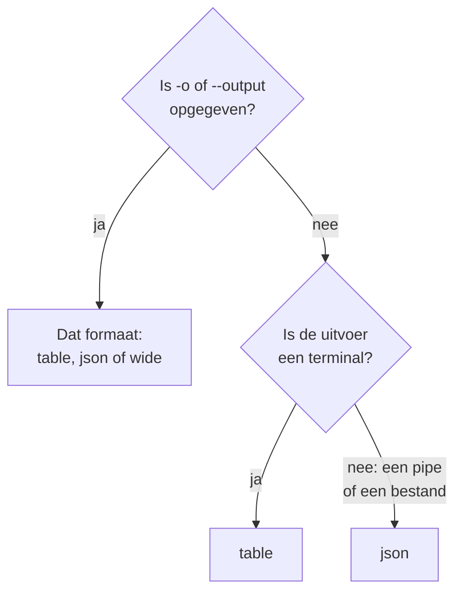

# Uitvoerformaten

De CLI drukt een tabel af als je het antwoord in een terminal leest, en JSON als een script of een ander programma het leest. Kies het formaat van elke opdracht met `-o` of `--output`, of vraag om JSON met `--json`.

:::cards
- [Hoe het formaat wordt gekozen](#hoe-het-formaat-wordt-gekozen): Een terminal krijgt een tabel, een pipe krijgt JSON.
- [Tabel](#tabel): Zes kolommen, elke waarde afgekapt op 60 tekens.
- [JSON](#json): Elk veld, volledig, voor scripts, jq en AI-agents.
- [Breed](#breed): Een tabel met elke kolom.
:::

## Hoe het formaat wordt gekozen



| Formaat | Wat het afdrukt | Het best voor |
| --- | --- | --- |
| `table` | Een tabel van hoogstens zes kolommen; één record als een rij per veld | Lezen in een terminal |
| `json` | Het antwoord zoals OneUptime het stuurde, ingesprongen met twee spaties | Scripts, `jq` en bestanden |
| `wide` | Een tabel met een kolom voor elk veld | Veel velden in één oogopslag vergelijken |

`-o` en `--json` werken bij elke opdracht, overal op de opdrachtregel. Een opdracht die records afdrukt, kiest zijn formaat zoals het diagram laat zien. Een opdracht waarvan het antwoord een zin is, zoals `delete` of `acknowledge`, drukt de zin af, in een terminal en in een pipe, tenzij `-o json` of `--json` om JSON vraagt. Elke andere waarde van `-o` wordt geweigerd voordat er een verzoek wordt verstuurd:

```text
error: option '-o, --output <format>' argument 'yaml' is invalid. Allowed choices are json, table, wide.
```

## Tabel

Een tabel is de standaard in een terminal. `oneuptime resources --type analytics` drukt bijvoorbeeld deze af:

```text
┌────────────────────────────┬────────────────────────────┬─────────────────────────────┬───────────┬─────────────────────────────┐
│ Command                    │ Singular                   │ Plural                      │ Type      │ API Path                    │
├────────────────────────────┼────────────────────────────┼─────────────────────────────┼───────────┼─────────────────────────────┤
│ audit-log                  │ Audit Log                  │ Audit Logs                  │ analytics │ /audit-log                  │
├────────────────────────────┼────────────────────────────┼─────────────────────────────┼───────────┼─────────────────────────────┤
│ change-event               │ Change Event               │ Change Events               │ analytics │ /change-events              │
├────────────────────────────┼────────────────────────────┼─────────────────────────────┼───────────┼─────────────────────────────┤
│ cloud-cost                 │ Cloud Cost                 │ Cloud Costs                 │ analytics │ /cloud-cost                 │
├────────────────────────────┼────────────────────────────┼─────────────────────────────┼───────────┼─────────────────────────────┤
│ exception-instance         │ Exception Instance         │ Exception Instances         │ analytics │ /exceptions                 │
├────────────────────────────┼────────────────────────────┼─────────────────────────────┼───────────┼─────────────────────────────┤
│ kubernetes-cost-allocation │ Kubernetes Cost Allocation │ Kubernetes Cost Allocations │ analytics │ /kubernetes-cost-allocation │
├────────────────────────────┼────────────────────────────┼─────────────────────────────┼───────────┼─────────────────────────────┤
│ log                        │ Log                        │ Logs                        │ analytics │ /logs                       │
├────────────────────────────┼────────────────────────────┼─────────────────────────────┼───────────┼─────────────────────────────┤
│ metric                     │ Metric                     │ Metrics                     │ analytics │ /metrics                    │
├────────────────────────────┼────────────────────────────┼─────────────────────────────┼───────────┼─────────────────────────────┤
│ monitor-log                │ Monitor Log                │ Monitor Logs                │ analytics │ /monitor-log                │
├────────────────────────────┼────────────────────────────┼─────────────────────────────┼───────────┼─────────────────────────────┤
│ network-flow               │ Network Flow               │ Network Flows               │ analytics │ /network-flow               │
├────────────────────────────┼────────────────────────────┼─────────────────────────────┼───────────┼─────────────────────────────┤
│ profile                    │ Profile                    │ Profiles                    │ analytics │ /profile                    │
├────────────────────────────┼────────────────────────────┼─────────────────────────────┼───────────┼─────────────────────────────┤
│ profile-sample             │ ProfileSample              │ ProfileSamples              │ analytics │ /profile-sample             │
├────────────────────────────┼────────────────────────────┼─────────────────────────────┼───────────┼─────────────────────────────┤
│ security-event             │ Security Event             │ Security Events             │ analytics │ /security-events            │
├────────────────────────────┼────────────────────────────┼─────────────────────────────┼───────────┼─────────────────────────────┤
│ slo-history                │ SLO History                │ SLO History                 │ analytics │ /slo-history                │
├────────────────────────────┼────────────────────────────┼─────────────────────────────┼───────────┼─────────────────────────────┤
│ span                       │ Span                       │ Spans                       │ analytics │ /span                       │
├────────────────────────────┼────────────────────────────┼─────────────────────────────┼───────────┼─────────────────────────────┤
│ threat-intel-indicator     │ Threat Intel Indicator     │ Threat Intel Indicators     │ analytics │ /threat-intel-indicators    │
└────────────────────────────┴────────────────────────────┴─────────────────────────────┴───────────┴─────────────────────────────┘

Total: 15 resources
```

Voor een lijst records toont een tabel hoogstens zes kolommen: eerst `_id`, `name`, `title`, `status`, `createdAt` en `updatedAt`, voor zover de records ze hebben, dan de volgende velden van de records op volgorde. De kolommen worden van het eerste record genomen. Een waarde langer dan 60 tekens wordt ingekort tot de eerste 57, gevolgd door `...`.

Eén record, zoals `get` en `create` het afdrukken, is een tabel van twee kolommen: de naam van het veld en de waarde ervan, één rij per veld.

OneUptime stuurt datums en de ID's van andere records als objecten, zoals `{"_type":"DateTime","value":"2026-10-14T09:12:44.000Z"}`, en een tabel toont ze als die tekst. Hun waarde staat in `value`: zie [JSON](#json).

## JSON

JSON is het antwoord zoals OneUptime het stuurde, ingesprongen met twee spaties: een lijst is een array van records, en één record is een object.

```bash
oneuptime incident list --limit 1 -o json
```

```json
[
  {
    "_id": "6f1c2a40-3b1e-4c55-9a0b-3e2f8d7c1a11",
    "createdAt": {
      "_type": "DateTime",
      "value": "2026-10-14T09:12:44.000Z"
    },
    "title": "Checkout API is down",
    "currentIncidentStateId": {
      "_type": "ObjectID",
      "value": "0b7d5e2c-8f4a-4d1b-9c3e-5a6f7b8c9d0e"
    }
  }
]
```

Een record heeft elk veld dat de sleutel mag lezen; dit is ingekort tot vier. De eigen `_id` van een record is tekst, en de andere ID's en de datums zijn objecten waarvan `value` ze bevat:

```bash
oneuptime incident list -o json | jq -r '.[] | "\(.createdAt.value)  \(.title)"'
```

Als de uitvoer geen terminal is, zoals in `oneuptime incident list | jq '.[].title'`, drukt de CLI JSON af zonder `-o json`. Schrijf `-o json` toch in scripts, zodat ze er niet van afhangen.

`--json` is hetzelfde als `-o json`. Een opdracht waarvan het antwoord een zin is, antwoordt dan met een object: `delete` met de `_id` van het record en `"deleted": true`, `acknowledge` met de status `state` waarin het record is. Als om JSON wordt gevraagd, is een fout één object in de standaardfoutuitvoer, telkens met dezelfde sleutels, en `exitCode` is de code waarmee de opdracht eindigt:

```bash
oneuptime incident get 6f1c2a40-3b1e-4c55-9a0b-3e2f8d7c1a11 --json
```

```json
{"error":{"message":"API error (404): Incident not found.","status":404,"exitCode":3,"hint":"`oneuptime incident list` shows the ones this key may read."}}
```

## Breed

`-o wide` is een tabel met een kolom voor elk veld van de records. Elke waarde wordt nog steeds afgekapt op 60 tekens, en records hebben veel velden, dus een brede tabel is erg breed: blader erdoor met `less -S`.

```bash
oneuptime incident list -o wide | less -S
```

## Kleuren

Tabelkoppen zijn cyaan; meldingen zijn groen als iets is gelukt, blauw voor informatie, geel voor waarschuwingen en voor wat je aan een fout kunt doen, en rood voor fouten. Zet kleuren uit met `--no-color`, of door `NO_COLOR` op een willekeurige waarde te zetten:

```bash
oneuptime incident list --no-color
NO_COLOR=1 oneuptime incident list
```

## Wat elke opdracht afdrukt

Records en aantallen gaan naar de standaarduitvoer, en fouten en waarschuwingen naar de standaardfoutuitvoer, zodat een pipe alleen het antwoord leest.

| Opdracht | In een tabel | In JSON |
| --- | --- | --- |
| Een `list` die niets vindt | `No results found.` | `[]` |
| Een `get` of een `create` | Een rij per veld | Het record |
| Een `count` | Het getal | Het getal |
| Een `update` | Een lege regel | `{}` |
| Een `delete` | `Monitor <id> deleted successfully.` | De `_id` van het record en `"deleted": true` |
| Een `acknowledge`, `resolve`, `start` of `end` | `Incident <id> acknowledged: it is in Acknowledged now.` | De `_id` van het record, de `action`, of het veranderd is (`changed`), en zijn `state` |
| Een fout | De fout, en dan wat je eraan kunt doen | `{"error": {...}}`, in de standaardfoutuitvoer |

## Volgende stappen

:::cards
- [Scripting en CI/CD](/docs/cli/scripting): De JSON lezen met jq in scripts en pipelines.
- [Bewerkingen op bronnen](/docs/cli/resource-operations): De bewerkingen waarvan dit de antwoorden zijn.
- [Opdrachtreferentie](/docs/cli/command-reference): Elke opdracht en elke optie.
:::
