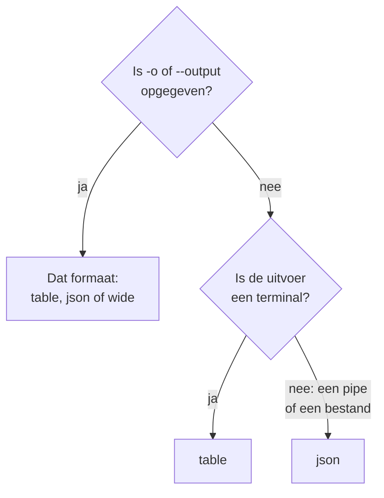

# Uitvoerformaten

De CLI drukt een tabel af als je het antwoord in een terminal leest, en JSON als een script of een ander programma het leest. Kies het formaat van elke opdracht met `-o` of `--output`.

:::cards
- [Hoe het formaat wordt gekozen](#hoe-het-formaat-wordt-gekozen): Een terminal krijgt een tabel, een pipe krijgt JSON.
- [Tabel](#tabel): Zes kolommen, elke waarde afgekapt op 60 tekens.
- [JSON](#json): Elk veld, volledig, voor scripts en jq.
- [Breed](#breed): Een tabel met elke kolom.
:::

## Hoe het formaat wordt gekozen



| Formaat | Wat het afdrukt | Het best voor |
| --- | --- | --- |
| `table` | Een tabel van hoogstens zes kolommen; één record als een rij per veld | Lezen in een terminal |
| `json` | Het antwoord zoals OneUptime het stuurde, ingesprongen met twee spaties | Scripts, `jq` en bestanden |
| `wide` | Een tabel met een kolom voor elk veld | Veel velden in één oogopslag vergelijken |

`-o` werkt bij elke opdracht die records afdrukt: `list`, `get`, `create`, `update` en `count` van een bron, `oneuptime resources` en `oneuptime context list`. Het mag overal op de opdrachtregel staan. Elke andere waarde wordt geweigerd voordat er een verzoek wordt verstuurd:

```text
error: option '-o, --output <format>' argument 'yaml' is invalid. Allowed choices are json, table, wide.
```

## Tabel

Een tabel is de standaard in een terminal. `oneuptime resources --type analytics` drukt bijvoorbeeld deze af:

```text
┌────────────────────────────┬────────────────────────────┬─────────────────────────────┬───────────┬─────────────────────────────┐
│ Command                    │ Singular                   │ Plural                      │ Type      │ API Path                    │
├────────────────────────────┼────────────────────────────┼─────────────────────────────┼───────────┼─────────────────────────────┤
│ log                        │ Log                        │ Logs                        │ analytics │ /logs                       │
├────────────────────────────┼────────────────────────────┼─────────────────────────────┼───────────┼─────────────────────────────┤
│ span                       │ Span                       │ Spans                       │ analytics │ /span                       │
├────────────────────────────┼────────────────────────────┼─────────────────────────────┼───────────┼─────────────────────────────┤
│ metric                     │ Metric                     │ Metrics                     │ analytics │ /metrics                    │
├────────────────────────────┼────────────────────────────┼─────────────────────────────┼───────────┼─────────────────────────────┤
│ exception-instance         │ Exception Instance         │ Exception Instances         │ analytics │ /exceptions                 │
├────────────────────────────┼────────────────────────────┼─────────────────────────────┼───────────┼─────────────────────────────┤
│ monitor-log                │ Monitor Log                │ Monitor Logs                │ analytics │ /monitor-log                │
├────────────────────────────┼────────────────────────────┼─────────────────────────────┼───────────┼─────────────────────────────┤
│ kubernetes-cost-allocation │ Kubernetes Cost Allocation │ Kubernetes Cost Allocations │ analytics │ /kubernetes-cost-allocation │
├────────────────────────────┼────────────────────────────┼─────────────────────────────┼───────────┼─────────────────────────────┤
│ security-event             │ Security Event             │ Security Events             │ analytics │ /security-events            │
├────────────────────────────┼────────────────────────────┼─────────────────────────────┼───────────┼─────────────────────────────┤
│ change-event               │ Change Event               │ Change Events               │ analytics │ /change-events              │
├────────────────────────────┼────────────────────────────┼─────────────────────────────┼───────────┼─────────────────────────────┤
│ threat-intel-indicator     │ Threat Intel Indicator     │ Threat Intel Indicators     │ analytics │ /threat-intel-indicators    │
└────────────────────────────┴────────────────────────────┴─────────────────────────────┴───────────┴─────────────────────────────┘

Total: 9 resources
```

Voor een lijst records toont een tabel hoogstens zes kolommen: eerst `_id`, `name`, `title`, `status`, `createdAt` en `updatedAt`, voor zover de records ze hebben, dan de volgende velden van de records op volgorde. De kolommen worden van het eerste record genomen. Een waarde langer dan 60 tekens wordt ingekort tot de eerste 57, gevolgd door `...`.

Eén record, zoals `get` en `create` het afdrukken, is een tabel van twee kolommen: de naam van het veld en de waarde ervan, één rij per veld.

OneUptime stuurt datums en de ID's van andere records als objecten, zoals `{"_type":"DateTime","value":"2026-10-14T09:12:44.000Z"}`, en een tabel toont ze als die tekst. Hun waarde staat in `value`: zie [JSON](#json).

## JSON

JSON is het antwoord zoals OneUptime het stuurde, ingesprongen met twee spaties: een lijst is een array van records, en één record is een object.

```bash
oneuptime incident list --limit 1 -o json
```

```json
[
  {
    "_id": "6f1c2a40-3b1e-4c55-9a0b-3e2f8d7c1a11",
    "createdAt": {
      "_type": "DateTime",
      "value": "2026-10-14T09:12:44.000Z"
    },
    "title": "Checkout API is down",
    "currentIncidentStateId": {
      "_type": "ObjectID",
      "value": "0b7d5e2c-8f4a-4d1b-9c3e-5a6f7b8c9d0e"
    }
  }
]
```

Een record heeft elk veld dat de sleutel mag lezen; dit is ingekort tot vier. De eigen `_id` van een record is tekst, en de andere ID's en de datums zijn objecten waarvan `value` ze bevat:

```bash
oneuptime incident list -o json | jq -r '.[] | "\(.createdAt.value)  \(.title)"'
```

Als de uitvoer geen terminal is, zoals in `oneuptime incident list | jq '.[].title'`, drukt de CLI JSON af zonder `-o json`. Schrijf `-o json` toch in scripts, zodat ze er niet van afhangen.

## Breed

`-o wide` is een tabel met een kolom voor elk veld van de records. Elke waarde wordt nog steeds afgekapt op 60 tekens, en records hebben veel velden, dus een brede tabel is erg breed: blader erdoor met `less -S`.

```bash
oneuptime incident list -o wide | less -S
```

## Kleuren

Tabelkoppen zijn cyaan; meldingen zijn groen als iets is gelukt, blauw voor informatie en rood voor fouten. Zet kleuren uit met `--no-color`, of door `NO_COLOR` op een willekeurige waarde te zetten:

```bash
oneuptime incident list --no-color
NO_COLOR=1 oneuptime incident list
```

## Wat elke opdracht afdrukt

Records en aantallen gaan naar de standaarduitvoer, en fouten naar de standaardfoutuitvoer, zodat een pipe alleen het antwoord leest.

| Opdracht | In een tabel | In JSON |
| --- | --- | --- |
| Een `list` die niets vindt | `No results found.` | `[]` |
| Een `get` of een `create` | Een rij per veld | Het record |
| Een `count` | Het getal | Het getal |
| Een `update` | Een lege regel | `{}` |
| Een `delete` | `Monitor <id> deleted successfully.` | Dezelfde regel |

## Volgende stappen

:::cards
- [Scripting en CI/CD](/docs/cli/scripting): De JSON lezen met jq in scripts en pipelines.
- [Bewerkingen op bronnen](/docs/cli/resource-operations): De bewerkingen waarvan dit de antwoorden zijn.
- [Opdrachtreferentie](/docs/cli/command-reference): Elke opdracht en elke optie.
:::
