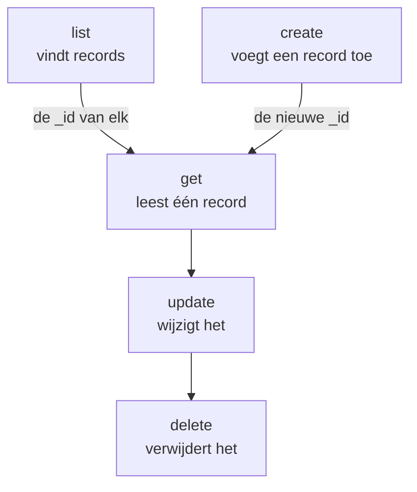

# Bewerkingen op bronnen

Elk soort record is een eigen opdracht, zoals `incident`, `monitor` of `status-page`, en elk neemt dezelfde bewerkingen: `list`, `get`, `create`, `update`, `delete` en `count`. Deze pagina laat elke bewerking zien, met filters, pagina's en de JSON waarin een record wordt geschreven.

:::cards
- [De opdracht voor een record vinden](#de-opdracht-voor-een-record-vinden): oneuptime resources toont ze allemaal.
- [Records tonen](#records-tonen): Filteren, sorteren en bladeren.
- [Een record maken](#een-record-maken): Uit JSON op de opdrachtregel of in een bestand.
- [Een record verwijderen](#een-record-verwijderen): Meteen, zonder ongedaan maken.
:::

## Hoe de bewerkingen samenhangen

Een record lezen, wijzigen en verwijderen vraagt om zijn ID. Tonen, tellen en maken vragen om geen, en een lijst of een aangemaakt record geeft je de ID's die de andere nemen:



Een ID is een UUID, zoals `6f1c2a40-3b1e-4c55-9a0b-3e2f8d7c1a11`. Je kunt er ook een kopiëren van de pagina van het record in OneUptime: zie [De ID van een resource vinden](/docs/api-reference/api-reference#de-id-van-een-resource-vinden).

## De opdracht voor een record vinden

```bash
oneuptime resources
```

De lijst toont elk soort record met zijn opdracht, zijn namen, zijn type en zijn API-pad. Er zijn twee typen:

| Type | Wat het bevat | Bewerkingen |
| --- | --- | --- |
| `database` | Records die je beheert: monitoren, incidenten, waarschuwingen, statuspagina's, teams en meer | `list`, `get`, `create`, `update`, `delete`, `count` |
| `analytics` | Telemetrie: logs, spans, metrics, uitzonderingen en andere gebeurtenissen | `list`, `create`, `count` |

Toon één type met `oneuptime resources --type database` of `--type analytics`. De [Opdrachtreferentie](/docs/cli/command-reference#bronnen) toont elke opdracht.

## Records tonen

```bash
oneuptime <resource> list [--query <json>] [--limit <n>] [--skip <n>] [--sort <json>] [-o <format>]
```

| Optie | Wat hij doet | Standaard |
| --- | --- | --- |
| `--query <json>` | Geeft alleen de records terug die passen: zie [Een lijst filteren](#een-lijst-filteren) | Elk record dat de sleutel mag lezen |
| `--limit <n>` | Het grootste aantal records om terug te geven, tot 10.000 | `10` |
| `--skip <n>` | Hoeveel passende records eerst worden overgeslagen | `0` |
| `--sort <json>` | De volgorde, zoals `{"createdAt":"ASC"}`, of `"DESC"` voor de nieuwste eerst | De nieuwste eerst |
| `-o, --output <format>` | `table`, `json` of `wide` | `table` in een terminal, `json` in een pipe |

```bash
# The ten newest incidents
oneuptime incident list

# The oldest monitors first, 50 at a time: the second page
oneuptime monitor list --sort '{"createdAt":"ASC"}' --limit 50 --skip 50

# Every field of each incident, as JSON
oneuptime incident list -o json
```

Een lijst vraagt OneUptime om elk veld van elk record dat de sleutel mag lezen. Een tabel toont er zes van; JSON toont ze allemaal (zie [Uitvoerformaten](/docs/cli/output-formats)). Om door alle records te bladeren, verhoog je `--skip` met `--limit` tot een pagina leeg terugkomt; `count` zegt hoeveel het er zijn.

### Een lijst filteren

`--query` neemt hetzelfde filter als de API: een veld met een waarde past bij die waarde, en een object met een `_type` vergelijkt.

| Filter | Past bij |
| --- | --- |
| `{"title":"Checkout API is down"}` | Records met precies die waarde |
| `{"title":{"_type":"Search","value":"checkout"}}` | Tekst die de waarde bevat |
| `{"createdAt":{"_type":"GreaterThan","value":"2026-10-01T00:00:00.000Z"}}` | Latere datums, of grotere getallen |
| `{"currentIncidentState":{"isResolvedState":false}}` | Een veld van een record dat de bron noemt: hier incidenten die niet zijn opgelost |

```bash
oneuptime incident list --query '{"title":{"_type":"Search","value":"checkout"}}'
```

[Filteren, sorteren en bladeren](/docs/api-reference/api-reference#filteren-sorteren-en-bladeren) in de API-referentie toont elke `_type`.

## Een record lezen

```bash
oneuptime <resource> get <id> [-o <format>]
```

```bash
oneuptime incident get 6f1c2a40-3b1e-4c55-9a0b-3e2f8d7c1a11
```

Een tabel toont één rij voor elk veld van het record, elke waarde afgekapt op 60 tekens; `-o json` toont de waarden volledig. Een ID die geen record noemt dat je sleutel mag lezen, krijgt als antwoord `Not found`, en de opdracht eindigt met code `3`.

## Een record maken

```bash
oneuptime <resource> create --data <json> [-o <format>]
oneuptime <resource> create --file <path> [-o <format>]
```

`--data` neemt het record als JSON, en `--file` leest het uit een JSON-bestand. Geef een van de twee; geef je ze allebei, dan wordt het bestand gebruikt. De velden zijn die van de API, en de [API-referentie](/reference) toont die van elke bron. Het project komt uit de API-sleutel, dus een record noemt het nooit.

```bash
# A manual monitor
oneuptime monitor create --data '{"name":"Checkout API","monitorType":"Manual"}'

# An incident with one of your severities
oneuptime incident create --data '{"title":"Checkout API is down","incidentSeverityId":"<severity-id>"}'

# The same incident, from a file
oneuptime incident create --file incident.json
```

De CLI drukt het nieuwe record af, met zijn `_id`. Een incident begint in de aangemaakt-status van je project, tenzij `currentIncidentStateId` een andere noemt: zie [De status waarin een nieuw record begint](/docs/api-reference/api-reference#de-status-waarin-een-nieuw-record-begint). Zo vind je de ID's van je ernstniveaus:

```bash
oneuptime incident-severity list -o json | jq -r '.[] | "\(._id)  \(.name)"'
```

> [!TIP]
> Zet op Windows de JSON in een bestand en gebruik `--file`: PowerShell en de opdrachtprompt zetten JSON op de opdrachtregel anders tussen aanhalingstekens dan Bash.

## Een record bijwerken

```bash
oneuptime <resource> update <id> --data <json> [-o <format>]
```

`--data` is verplicht en bevat alleen de velden die moeten veranderen:

```bash
# Rename a monitor
oneuptime monitor update <monitor-id> --data '{"name":"Checkout API (EU)"}'

# Move an incident to your resolved state
oneuptime incident update <incident-id> --data '{"currentIncidentStateId":"<resolved-state-id>"}'
```

OneUptime beantwoordt een update met een leeg object: de CLI drukt een lege regel af, of `{}` met `-o json`. Voer `get` uit om het record te zien zoals het nu is. Een incident zo naar een andere status verplaatsen legt de wijziging vast op zijn tijdlijn, net als het dashboard, en een status vóór de huidige wordt geweigerd. Zo vind je de ID van de opgeloste status, de eerste in de volgorde van je project:

```bash
oneuptime incident-state list --query '{"isResolvedState":true}' --sort '{"order":"ASC"}' --limit 1 -o json | jq -r '.[0]._id'
```

## Een record verwijderen

```bash
oneuptime <resource> delete <id>
```

```bash
oneuptime monitor delete 6f1c2a40-3b1e-4c55-9a0b-3e2f8d7c1a11
```

Hij antwoordt `Monitor 6f1c2a40-3b1e-4c55-9a0b-3e2f8d7c1a11 deleted successfully.`

> [!CAUTION]
> `delete` verwijdert het record meteen. De CLI vraagt je niet om te bevestigen, en het kan niet ongedaan worden gemaakt. Hij accepteert `--force`, voor scripts die ermee zijn geschreven, en `--force` verandert niets.

## Records tellen

```bash
oneuptime <resource> count [--query <json>]
```

```bash
# Every incident
oneuptime incident count

# Incidents that are not resolved
oneuptime incident count --query '{"currentIncidentState":{"isResolvedState":false}}'
```

De CLI drukt één getal af, hetzelfde in een tabel en in JSON, zodat een script het kan lezen zoals het is.

## Wat elk type kan

| Bewerking | `database` | `analytics` |
| --- | --- | --- |
| `list` | Ja | Ja |
| `get` | Ja | Nee |
| `create` | Ja | Ja |
| `update` | Ja | Nee |
| `delete` | Ja | Nee |
| `count` | Ja | Ja |

## Problemen oplossen

:::details De melding "Not found: API error (404)"
Het record bestaat niet, staat in een ander project, of de sleutel mag het niet lezen: OneUptime antwoordt in elk geval hetzelfde. Controleer de ID met `list`, en de rechten van de sleutel. De opdracht eindigt met code `3`.
:::

:::details De melding "API error (422): You do not have permissions to select on"
Een lijst of een leesbewerking vraagt om elk veld van het record, en de sleutel mag een ervan niet lezen: de melding noemt het veld en de rechten die het mogen lezen. Geef de sleutel een van die rechten.
:::

:::details De melding "Error: Invalid JSON"
De waarde van `--query`, `--sort` of `--data` is geen JSON. Zet hem in Bash en zsh tussen enkele aanhalingstekens; zet op Windows een record in een bestand en gebruik `--file`.
:::

:::details API error (400) bij het maken of bijwerken
OneUptime heeft een veld geweigerd: de melding noemt het. `No fields to update` betekent dat `--data` geen veld bevatte om te wijzigen.
:::

## Volgende stappen

:::cards
- [Uitvoerformaten](/docs/cli/output-formats): De antwoorden lezen als tabellen of als JSON.
- [Scripting en CI/CD](/docs/cli/scripting): Deze bewerkingen gebruiken in scripts en pipelines.
- [Opdrachtreferentie](/docs/cli/command-reference): Elke opdracht, optie en standaardwaarde.
:::
