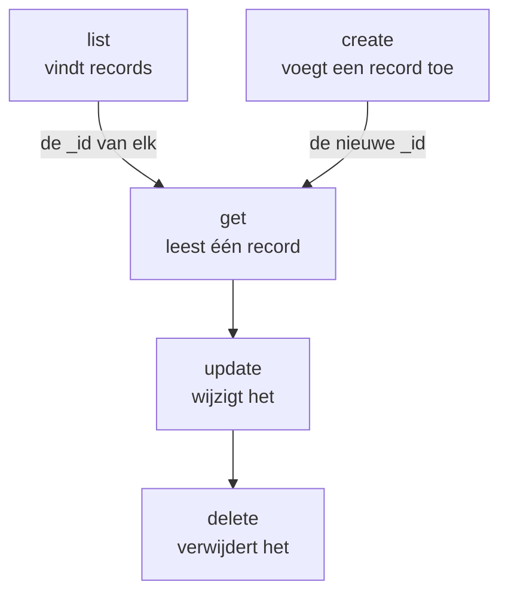

# Bewerkingen op bronnen

Elk soort record is een eigen opdracht, zoals `incident`, `monitor` of `status-page`, met de bewerkingen die de API ervoor aanneemt: voor de meeste `list`, `get`, `create`, `update`, `delete` en `count`. Deze pagina laat elke bewerking zien, met filters, pagina's en de vlaggen waarmee een record wordt geschreven, en de opdrachten die doen wat de knoppen van het dashboard doen.

:::cards
- [De opdracht voor een record vinden](#de-opdracht-voor-een-record-vinden): oneuptime resources toont ze allemaal.
- [Records tonen](#records-tonen): Filteren, sorteren en bladeren.
- [Een record maken](#een-record-maken): Een vlag voor elk veld, of het record als JSON.
- [Bevestigen, oplossen en notities toevoegen](#bevestigen-oplossen-en-notities-toevoegen): De knoppen van het dashboard, als opdrachten.
- [Een record verwijderen](#een-record-verwijderen): Meteen, zonder ongedaan maken.
:::

## Hoe de bewerkingen samenhangen

Een record lezen, wijzigen en verwijderen vraagt om zijn ID. Tonen, tellen en maken vragen om geen, en een lijst of een aangemaakt record geeft je de ID's die de andere nemen:



Een ID is een UUID, zoals `6f1c2a40-3b1e-4c55-9a0b-3e2f8d7c1a11`. Je kunt er ook een kopiëren van de pagina van het record in OneUptime: zie [De ID van een resource vinden](/docs/api-reference/api-reference#de-id-van-een-resource-vinden).

## De opdracht voor een record vinden

```bash
oneuptime resources
```

De lijst toont elk soort record met zijn opdracht, zijn namen, zijn type en zijn API-pad. Er zijn twee typen:

| Type | Wat het bevat |
| --- | --- |
| `database` | Records die je beheert: monitoren, incidenten, waarschuwingen, statuspagina's, teams en meer |
| `analytics` | Telemetrie: logs, spans, metrics, uitzonderingen en andere gebeurtenissen |

Toon één type met `oneuptime resources --type database` of `--type analytics`. De [Opdrachtreferentie](/docs/cli/command-reference#bronnen) toont elke opdracht.

Een bron neemt de bewerkingen aan die de API ervoor aanneemt. De meeste nemen ze alle zes aan; een bron die OneUptime zelf schrijft, zoals een e-maillogboek, is alleen-lezen. `oneuptime <resource> --help` toont de subopdrachten van een bron.

## De velden van een bron bekijken

`fields` toont de velden van een bron vanuit de CLI zelf, zonder API-sleutel en zonder verzoek:

```bash
oneuptime incident fields
```

Elk veld heeft zijn type, waarvoor het dient, of een aanmaak het moet opgeven, en de vlag die het instelt. Een veld met een ID noemt de bron waartoe de ID hoort: `incidentSeverityId` neemt er een uit `oneuptime incident-severity list`. Met `-o json` leest een script of een AI-agent hetzelfde, met dezelfde sleutels voor elk veld: `name`, `title`, `type`, `description`, `required`, `create`, `update`, `read`, `flag`, `emailFlag` en `relatedResource`.

## Records tonen

```bash
oneuptime <resource> list [--query <json>] [--limit <n>] [--skip <n>] [--sort <json>] [--fields <names>] [--all] [-o <format>]
```

| Optie | Wat hij doet | Standaard |
| --- | --- | --- |
| `--query <json>` | Geeft alleen de records terug die passen: zie [Een lijst filteren](#een-lijst-filteren) | Elk record dat de sleutel mag lezen |
| `--limit <n>` | Het grootste aantal records om terug te geven, tot 10.000 | `10` |
| `--skip <n>` | Hoeveel passende records eerst worden overgeslagen | `0` |
| `--sort <json>` | De volgorde, zoals `{"createdAt":"ASC"}`, of `"DESC"` voor de nieuwste eerst | De nieuwste eerst |
| `--fields <names>` | De terug te geven velden, gescheiden door komma's, zoals `title,createdAt` | Elk veld dat de sleutel mag lezen |
| `--all` | Elk passend record, pagina na pagina, in plaats van `--limit` en `--skip`. Alleen records | |
| `-o, --output <format>` | `table`, `json` of `wide` | `table` in een terminal, `json` in een pipe |

```bash
# The ten newest incidents
oneuptime incident list

# The oldest monitors first, 50 at a time: the second page
oneuptime monitor list --sort '{"createdAt":"ASC"}' --limit 50 --skip 50

# Every field of each incident, as JSON
oneuptime incident list -o json

# The title, the state and the creation date of every incident
oneuptime incident list --all --fields title,currentIncidentState.name,createdAt -o json
```

Een lijst vraagt OneUptime om elk veld van elk record dat de sleutel mag lezen. `--fields` vraagt in plaats daarvan om de velden die het noemt, en, na een punt, om een veld van een gekoppeld record, zoals in `currentIncidentState.name`. Een tabel toont zes velden; JSON toont ze allemaal (zie [Uitvoerformaten](/docs/cli/output-formats)). `--all` leest elke pagina, 100 records tegelijk, tot 100.000; `count` zegt hoeveel het er zijn.

Labels worden op naam getoond in plaats van de nieuwste eerst: labels waarvan de naam met een getal begint komen eerst, in de volgorde van dat getal (`2. Team` vóór `10. Owner`), daarna de andere alfabetisch. Wil je ze in een andere volgorde, geef dan `--sort` op.

### Een lijst filteren

`--query` neemt hetzelfde filter als de API: een veld met een waarde past bij die waarde, en een object met een `_type` vergelijkt.

| Filter | Past bij |
| --- | --- |
| `{"title":"Checkout API is down"}` | Records met precies die waarde |
| `{"title":{"_type":"Search","value":"checkout"}}` | Tekst die de waarde bevat |
| `{"createdAt":{"_type":"GreaterThan","value":"2026-10-01T00:00:00.000Z"}}` | Latere datums, of grotere getallen |
| `{"currentIncidentState":{"isResolvedState":false}}` | Een veld van een record dat de bron noemt: hier incidenten die niet zijn opgelost |

```bash
oneuptime incident list --query '{"title":{"_type":"Search","value":"checkout"}}'
```

[Filteren, sorteren en bladeren](/docs/api-reference/api-reference#filteren-sorteren-en-bladeren) in de API-referentie toont elke `_type`.

## Een record lezen

```bash
oneuptime <resource> get <id> [--fields <names>] [-o <format>]
```

```bash
oneuptime incident get 6f1c2a40-3b1e-4c55-9a0b-3e2f8d7c1a11
```

Een tabel toont één rij voor elk veld van het record, elke waarde afgekapt op 60 tekens; `-o json` toont de waarden volledig. Een ID die geen record noemt dat je sleutel mag lezen, krijgt als antwoord `Not found`, en de opdracht eindigt met code `3`.

## Een record maken

```bash
oneuptime <resource> create [--<field> <value>]... [--data <json>] [--file <path>] [-o <format>]
```

Elk veld dat een aanmaak aanneemt, heeft een vlag: `--title <text>`, `--incident-severity-id <id>`, `--labels <ids>` voor ID's gescheiden door komma's, `--is-visible-on-status-page [true|false]` voor een ja-of-nee-veld, waar als hij alleen wordt opgegeven, en `--monitor-steps <json>` voor een veld met JSON. `oneuptime <resource> create --help` toont ze, en [`fields`](#de-velden-van-een-bron-bekijken) zegt waarvoor elk dient. Het project komt uit de API-sleutel, dus een record noemt het nooit.

```bash
# A manual monitor
oneuptime monitor create --name "Checkout API" --monitor-type Manual

# An incident with one of your severities
oneuptime incident create --title "Checkout API is down" --incident-severity-id <severity-id>

# The same incident, from a file
oneuptime incident create --file incident.json
```

`--data` neemt het record als JSON, en `--file` leest het uit een JSON-bestand, met de velden van de API: de [API-referentie](/reference) toont die van elke bron. Geef je ze allebei, dan wordt het bestand gebruikt, en vlaggen komen bovenop een van beide.

Een veld dat iemand noemt met een gebruikers-ID heeft een tweede vlag die die persoon noemt met een e-mailadres: `--user-email` naast `--user-id`, `--owner-user-emails` naast `--owner-users`. De CLI zoekt de persoon tussen de leden van het project van de API-sleutel en de mensen die ervoor zijn uitgenodigd. Een teamlid dat wordt genoemd met een adres dat niemand in het project heeft, wordt uitgenodigd voor het project, net als bij uitnodigen vanuit het dashboard:

```bash
oneuptime team-member create --team-id <team-id> --user-email alice@example.com
```

De CLI drukt het nieuwe record af, met zijn `_id`. Een incident begint in de aangemaakt-status van je project, tenzij `currentIncidentStateId` een andere noemt: zie [De status waarin een nieuw record begint](/docs/api-reference/api-reference#de-status-waarin-een-nieuw-record-begint). Zo vind je de ID's van je ernstniveaus:

```bash
oneuptime incident-severity list -o json | jq -r '.[] | "\(._id)  \(.name)"'
```

> [!TIP]
> Geef op Windows de velden op met hun vlaggen, of zet de JSON in een bestand en gebruik `--file`: PowerShell en de opdrachtprompt zetten JSON op de opdrachtregel anders tussen aanhalingstekens dan Bash.

## Een record bijwerken

```bash
oneuptime <resource> update <id> [--<field> <value>]... [--data <json>] [--file <path>] [-o <format>]
```

Geef alleen de velden op die moeten veranderen, met hun vlaggen of als JSON:

```bash
# Rename a monitor
oneuptime monitor update <monitor-id> --name "Checkout API (EU)"

# Record an incident's root cause
oneuptime incident update <incident-id> --root-cause "A full disk on the primary database"
```

OneUptime beantwoordt een update met een leeg object: de CLI drukt een lege regel af, of `{}` met `-o json`. Voer `get` uit om het record te zien zoals het nu is. Om een incident naar een andere status te verplaatsen, geef je `--current-incident-state-id` op: de wijziging wordt vastgelegd op zijn tijdlijn, net als in het dashboard, en een status vóór de huidige wordt geweigerd. [`acknowledge` en `resolve`](#bevestigen-oplossen-en-notities-toevoegen) zoeken de status voor je op. Zo vind je de ID van de opgelost-status, de eerste in de volgorde van je project:

```bash
oneuptime incident-state list --query '{"isResolvedState":true}' --sort '{"order":"ASC"}' --limit 1 -o json | jq -r '.[0]._id'
```

## Bevestigen, oplossen en notities toevoegen

Incidenten, waarschuwingen, hun episoden en geplande onderhoudsgebeurtenissen hebben opdrachten voor wat de knoppen van het dashboard ermee doen:

| Opdracht | Wat hij doet | Bronnen |
| --- | --- | --- |
| `acknowledge <id>` | Verplaatst het record naar de bevestigd-status van je project | `incident`, `alert`, `incident-episode`, `alert-episode` |
| `resolve <id>` | Verplaatst het naar de opgelost-status van je project | Dezelfde vier |
| `start <id>` | Verplaatst de gebeurtenis naar de lopend-status van je project | `scheduled-maintenance-event` |
| `end <id>` | Verplaatst haar naar de beëindigd-status van je project | `scheduled-maintenance-event` |
| `add-note <id> --note <markdown>` | Voegt een notitie toe die alleen kan lezen wie het record kan zien, of met `--public` een op de statuspagina's van het record | Alle vijf |

```bash
oneuptime incident acknowledge 6f1c2a40-3b1e-4c55-9a0b-3e2f8d7c1a11
oneuptime incident add-note 6f1c2a40-3b1e-4c55-9a0b-3e2f8d7c1a11 --note "Rolled back the 14:05 deploy."
oneuptime incident resolve 6f1c2a40-3b1e-4c55-9a0b-3e2f8d7c1a11
```

`acknowledge` antwoordt `Incident 6f1c2a40-3b1e-4c55-9a0b-3e2f8d7c1a11 acknowledged: it is in Acknowledged now.` Een record dat al in die status is, of verder, blijft zoals het is: de opdracht zegt dat en eindigt met `0`. Met `-o json` antwoordt hij met de `_id` van het record, de `action`, of er iets is veranderd (`changed`), en de status `state` waarin het record is. Waarschuwingen en waarschuwingsepisoden nemen alleen interne notities aan.

## Een record verwijderen

```bash
oneuptime <resource> delete <id>
```

```bash
oneuptime monitor delete 6f1c2a40-3b1e-4c55-9a0b-3e2f8d7c1a11
```

Hij antwoordt `Monitor 6f1c2a40-3b1e-4c55-9a0b-3e2f8d7c1a11 deleted successfully.` Met `-o json` antwoordt hij met de `_id` van het record en `"deleted": true`.

> [!CAUTION]
> `delete` verwijdert het record meteen. De CLI vraagt je niet om te bevestigen, en het kan niet ongedaan worden gemaakt. Hij accepteert `--force`, voor scripts die ermee zijn geschreven, en `--force` verandert niets.

## Records tellen

```bash
oneuptime <resource> count [--query <json>]
```

```bash
# Every incident
oneuptime incident count

# Incidents that are not resolved
oneuptime incident count --query '{"currentIncidentState":{"isResolvedState":false}}'
```

De CLI drukt één getal af, hetzelfde in een tabel en in JSON, zodat een script het kan lezen zoals het is.

## Problemen oplossen

:::details De melding "Not found: API error (404)"
Het record bestaat niet, staat in een ander project, of de sleutel mag het niet lezen: OneUptime antwoordt in elk geval hetzelfde. Controleer de ID met `list`, en de rechten van de sleutel. De opdracht eindigt met code `3`.
:::

:::details De melding "Left out fields this API key may not read"
Een lijst of een leesbewerking vraagt om elk veld van het record, en OneUptime weigert een veld dat de sleutel niet mag lezen: de CLI vraagt opnieuw zonder dat veld, en noemt de weggelaten velden in de standaardfoutuitvoer. Geef de sleutel een recht dat ze leest, of noem de velden die je nodig hebt met `--fields`: een genoemd veld dat de sleutel niet mag lezen, stopt de opdracht met `API error (422)`.
:::

:::details De melding "Error: Invalid JSON"
De waarde van `--query`, `--sort` of `--data` is geen JSON. Zet hem in Bash en zsh tussen enkele aanhalingstekens; geef op Windows de velden op met hun vlaggen, of zet een record in een bestand en gebruik `--file`.
:::

:::details API error (400) bij het maken of bijwerken
OneUptime heeft een veld geweigerd: de melding noemt het, en `oneuptime <resource> fields` toont de velden met de vlaggen die ze instellen. Een opdracht die helemaal geen veld opgeeft, wordt geweigerd voordat hij wordt verstuurd, met de vlaggen om op te geven.
:::

:::details De melding "No one in this project, or invited to it, has the email address"
Een e-mailvlag noemt iemand die geen lid is van het project van de API-sleutel en er ook niet voor is uitgenodigd. Nodig de persoon uit met `oneuptime team-member create --team-id <team-id> --user-email <email>`, of noem hem met zijn gebruikers-ID.
:::

## Volgende stappen

:::cards
- [Uitvoerformaten](/docs/cli/output-formats): De antwoorden lezen als tabellen of als JSON.
- [Scripting en CI/CD](/docs/cli/scripting): Deze bewerkingen gebruiken in scripts en pipelines.
- [Opdrachtreferentie](/docs/cli/command-reference): Elke opdracht, optie en standaardwaarde.
:::
