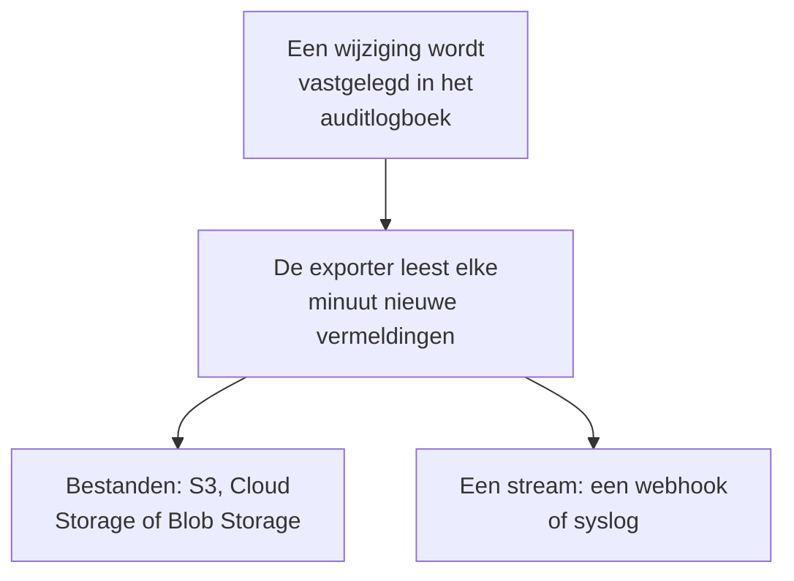

# Export van auditlogboek

Stuur het auditlogboek, zodra het wordt vastgelegd, naar opslag of een dienst naar keuze: Amazon S3 of S3-compatibele opslag, Google Cloud Storage, Azure Blob Storage, een webhook of syslog. Bewaar de vermeldingen daar zo lang als uw compliancecontroles vragen, en doorzoek ze in uw SIEM. De eigenaren en beheerders van een project exporteren het auditlogboek ervan vanuit de projectinstellingen, en master-admins exporteren dat van alle projecten vanuit het Admin Dashboard. Het hoort in OneUptime Cloud bij het Enterprise-abonnement, en bij de Enterprise Edition als u zelf host.

:::cards
- [Een export instellen](#een-export-instellen): Een bestemming kiezen, testen en opslaan.
- [Wat er wordt verzonden](#wat-er-wordt-verzonden): Eén JSON-object per vermelding, in een stabiel schema.
- [Wanneer vermeldingen worden verzonden](#wanneer-vermeldingen-worden-verzonden): Elke minuut, elke vermelding één keer, op volgorde.
- [Als een bestemming faalt](#als-een-bestemming-faalt): Nieuwe pogingen, de fout, en niets wordt overgeslagen.
:::

## Hoe een vermelding uw bestemming bereikt



- **Eén export, één bestemming.** Een project kan meerdere exports hebben, die elk elke vermelding naar hun eigen bestemming sturen.
- **Die van een project, of die van de instantie.** De export van een project verstuurt de vermeldingen van dat project. Een export die in het Admin Dashboard is ingesteld, verstuurt de vermeldingen van alle projecten die auditlogboeken vastleggen.
- **Vanaf het opslaan.** Een export verstuurt wat na het opslaan wordt vastgelegd, tenzij u **Exporteren vanaf** op een eerdere datum zet.

## Voordat u begint

- **In OneUptime Cloud: het Enterprise-abonnement.** Bij andere abonnementen toont de pagina wat de functie doet en hoe u die krijgt.
- **Als u zelf host: de Enterprise Edition**, met een licentie die auditlogboeken omvat. Zie [Enterprise Edition](/docs/self-hosted/enterprise).
- **Auditlogging ingeschakeld** in elk project dat u exporteert. Zie [Auditlogboeken](/docs/configuration/audit-logs).
- **Een Project Owner of Project Admin** om het auditlogboek van een project te exporteren, of een master-admin om dat van de instantie te exporteren.

## Een export instellen

:::steps
### De exportpagina openen

Ga voor een project naar **Projectinstellingen → Auditlogboeken → Export**. Ga voor de hele instantie in het Admin Dashboard naar **Instellingen → Export van auditlogboek**.

### Een bestemming kiezen

Klik op **Export toevoegen** en kies een van de zes bestemmingen hieronder. De bestemming van een export kan later niet meer worden gewijzigd.

### Invullen hoe die te bereiken is

Vul in wat de bestemming vraagt. Instellingen die de meeste mensen laten zoals ze zijn, wachten onder **Meer velden**, en **Installatiegids** opent de sectie van de bestemming op deze pagina.

### Een test sturen

Klik op **Testbestand schrijven** of **Testvermelding verzenden**. Opslag krijgt het bestand `oneuptime-audit-log-export-test.ndjson.gz` in zijn map, en een webhook of syslog krijgt één vermelding met de actie `Test`. Een mislukte test zegt wat u moet herstellen.

### Beginnen met exporteren

Klik op **Volgende**, geef de export een naam en klik op **Beginnen met exporteren**. De eerste vermeldingen komen binnen een paar minuten aan.
:::

De rij van de export toont hoe het ermee staat: **Exporteert**, **Mislukt**, **Gepauzeerd**, **Wacht op vermeldingen** of **Wordt gestart**. **Stuur een test** stuurt een test met de opgeslagen instellingen, en **Bewerken** wijzigt ze: inloggegevens die u leeg laat, houden de opgeslagen waarde.

## Bestemmingen

| Bestemming | Wat er aankomt | Meldt zich aan met |
| --- | --- | --- |
| [Amazon S3](#amazon-s3) | Gecomprimeerde NDJSON-bestanden | Een toegangssleutel |
| [S3-compatibele opslag](#s3-compatibele-opslag) | Gecomprimeerde NDJSON-bestanden | Een toegangssleutel |
| [Google Cloud Storage](#google-cloud-storage) | Gecomprimeerde NDJSON-bestanden | Een serviceaccountsleutel |
| [Azure Blob Storage](#azure-blob-storage) | Gecomprimeerde NDJSON-bestanden | Een SAS-token of een toegangssleutel |
| [Webhook](#webhook) | HTTPS-verzoeken | Een optionele header en ondertekeningsgeheim |
| [Syslog](#syslog) | RFC 5424-berichten | Niets |

### Amazon S3

| Veld | Wat u invult |
| --- | --- |
| **Bucket** | De bucket waarin de bestanden worden geschreven. |
| **Regio** | De regio van de bucket. Die staat eerst op `us-east-1`. |
| **Toegangssleutel-ID** | Een toegangssleutel die objecten naar de bucket mag schrijven. |
| **Geheime toegangssleutel** | Het geheim van de sleutel. |
| **Map** | Onder **Meer velden**. Leeg gelaten gaan de bestanden naar `oneuptime/audit-logs/`. |

De sleutel heeft alleen `s3:PutObject` op de map nodig:

```json
{
  "Version": "2012-10-17",
  "Statement": [
    {
      "Effect": "Allow",
      "Action": "s3:PutObject",
      "Resource": "arn:aws:s3:::my-audit-logs/oneuptime/audit-logs/*"
    }
  ]
}
```

### S3-compatibele opslag

Dezelfde velden als bij Amazon S3, na een **Endpoint**: het S3-adres van de opslag, zoals `https://minio.example.com:9000` of `https://<account>.r2.cloudflarestorage.com`. Zet **Regio** op de regio die de opslag verwacht: `us-east-1` voor MinIO en de standaard van Wasabi, `auto` voor Cloudflare R2.

### Google Cloud Storage

Vul de **Bucket** in en plak een **Serviceaccountsleutel** (JSON) waarvan het serviceaccount de rol Storage Object Creator op de bucket heeft. **Map** wacht onder **Meer velden**.

### Azure Blob Storage

Vul het **Opslagaccount** en de **Container** in, en kies onder **Aanmelden met** hoe de export zich aanmeldt: met een **SAS-token** met de machtigingen Create en Write op de container, of met een **Toegangssleutel** van het opslagaccount. Een SAS-token kan worden beperkt tot deze container en is daarom de veiligere keuze. **Cloud** en **Map** wachten onder **Meer velden**.

### Webhook

OneUptime stuurt elke batch met POST naar de **URL**, als JSON-array (`application/json`) of als één vermelding per regel (`application/x-ndjson`), zoals **Indeling van de body** aangeeft, met deze headers:

| Header | Waarde |
| --- | --- |
| `X-OneUptime-Event` | `audit-log-export` |
| `X-OneUptime-Batch-Id` | De id van de eerste vermelding van de batch: dezelfde batch draagt bij opnieuw verzenden dezelfde id. |
| `X-OneUptime-Entry-Count` | Hoeveel vermeldingen de body bevat. |
| `X-OneUptime-Signature` | `sha256=` en de HMAC-SHA256 van de body, met het **Ondertekeningsgeheim**, als dat is ingesteld. |

De **Inloggegevens**, zoals `Bearer <token>`, worden verzonden in de header die u onder **Headernaam** kiest, `Authorization` tenzij u die wijzigt. **Indeling van de body**, **Headernaam** en **Ondertekeningsgeheim** wachten onder **Meer velden**. Elk 2xx-antwoord telt als levering. Een `413` splitst de batch in tweeën, en elke andere weigering stuurt de hele batch later opnieuw.

### Syslog

Elke vermelding is één RFC 5424-bericht naar de **Host** en **Poort**, via TLS op poort `6514` tenzij **Protocol** TCP aangeeft, met facility 13 (log audit) en severity 6 (informational):

```text
<110>1 2026-10-24T09:15:03.000Z oneuptime.example.com oneuptime - audit-log - {"schemaVersion":1,"id":"..."}
```

Berichten worden gescheiden met octettelling (RFC 5425), tenzij **Berichtscheiding** één bericht per regel aangeeft. Een ontvanger waarvan een privé-CA het certificaat heeft ondertekend, heeft het certificaat van die CA nodig in **CA-certificaat**. Beide wachten onder **Meer velden**.

## Wat er wordt verzonden

Elke vermelding is één JSON-object, met de sleutels altijd in deze volgorde:

| Sleutel | Wat erin staat |
| --- | --- |
| `schemaVersion` | `1`. Een wijziging van het schema komt met een nieuwe versie. |
| `id` | De id van de vermelding. Dezelfde vermelding die twee keer wordt verzonden, heeft dezelfde id. |
| `createdAt` | Wanneer de wijziging is vastgelegd, in UTC. |
| `projectId` | Het project waarin de wijziging is gedaan. |
| `action` | `Create`, `Update`, `Delete` of `Download`. |
| `resourceType`, `resourceId`, `resourceName` | Wat er is gewijzigd. |
| `rootResourceType`, `rootResourceId` | De resource waartoe het behoort, zoals een SLO voor zijn regel. |
| `userId`, `userName`, `userEmail`, `userType` | Wie de wijziging heeft gedaan. |
| `apiKeyId`, `apiKeyName` | De API-sleutel waarmee ze is gedaan, als die er is. |
| `mcpOAuthGrantId`, `mcpClientName` | De MCP-client waarlangs ze is gedaan, als die er is. |
| `workflowId`, `workflowName` | De workflow die ze heeft gedaan, als die er is. |
| `changes` | Elk gewijzigd veld: `field`, met `oldValue` en `newValue`. |

Een bestand bevat één vermelding per regel, gecomprimeerd met gzip, en wordt opgeborgen onder het uur van zijn eerste vermelding: `oneuptime/audit-logs/2026/10/24/09/20261024T091503Z_<first entry id>.ndjson.gz`.

Sleutels, tokens en wachtwoorden gaan nooit naar buiten: ze worden vastgelegd als `[REDACTED]`, en velden die niemand mag lezen, ontbreken in elke vermelding.

## Wanneer vermeldingen worden verzonden

- **Elke minuut.** Vermeldingen die meer dan een minuut geleden zijn vastgelegd, worden gelezen, de oudste eerst, en in batches verzonden: tot 5.000 vermeldingen of 16 MB per bestand, en 500 vermeldingen per webhookverzoek of syslogverbinding.
- **Bestanden worden niet voor elke vermelding geschreven.** Een bestand wordt geschreven als een batch vol is of de eerste vermelding ervan vijf minuten oud is.
- **Elke vermelding één keer, op volgorde.** Na elke levering onthoudt de export de laatst verzonden vermelding, zodat een herstart of een andere worker daar verdergaat.
- **Een herhaling is te herkennen.** Een batch die na een crash opnieuw wordt verzonden, schrijft dezelfde bestandsnaam of draagt dezelfde `X-OneUptime-Batch-Id`, en elke vermelding draagt haar `id`.

## Als een bestemming faalt

Een batch wordt drie keer geprobeerd, met een paar seconden ertussen, waarna de export wacht voordat hij het opnieuw probeert: een minuut, dan twee, vier enzovoort, tot een uur. De rij zegt **Mislukt**, en **Fout bekijken** toont wat de bestemming antwoordde en wanneer de volgende poging is.

Er wordt niets overgeslagen: de vermeldingen wachten in het auditlogboek, en de volgende levering die lukt, haalt de achterstand in vanaf de oudste. Een vermelding die ouder is dan de bewaartermijn van het auditlogboek van haar project, wordt verwijderd voordat ze kan worden verzonden, dus herstel een mislukte export binnen die tijd.

Om een export te pauzeren, kiest u **Uitzetten** in het menu van zijn rij: hij houdt zijn plaats, en **Inschakelen** verstuurt wat er in de tussentijd is vastgelegd. In OneUptime Cloud stopt een project dat het Enterprise-abonnement verlaat met exporteren, en zijn exports wachten onder de upgradekaart, waar ze kunnen worden uitgeschakeld of verwijderd. Als u zelf host, stopt het exporteren zolang de licentie geen auditlogboeken omvat, en gaat het verder waar het was gebleven zodra een licentie ze omvat.

## Problemen oplossen

:::details De test zegt dat de toegang is geweigerd
De sleutel, het token of het serviceaccount mag niet schrijven waar de export schrijft. Geef het toestemming om objecten in de map te maken, zoals de sectie van elke bestemming hierboven laat zien, en stuur de test daarna opnieuw.
:::

:::details De test bereikt het adres niet
De export van een project in OneUptime Cloud kan geen privénetwerkadres bereiken. Als u zelf host, kan dat wel, tenzij `DATA_SOURCE_BLOCK_PRIVATE_ADDRESSES` `true` is, en een export die in het Admin Dashboard is ingesteld, kan het altijd. Loopback- en link-local-adressen worden nooit bereikt.
:::

:::details Er komt niets aan
Controleer of auditlogging in het project is ingeschakeld, en of iemand iets heeft gewijzigd nadat de export is opgeslagen. Opslag ontvangt pas een bestand als een batch vol of vijf minuten oud is.
:::

## Volgende stappen

:::cards
- [Auditlogboeken](/docs/configuration/audit-logs): Wat er wordt vastgelegd, en hoe lang het wordt bewaard.
- [Gebruikers, teams en machtigingen](/docs/permissions/index): Bepalen wie een export mag instellen.
- [Enterprise Edition](/docs/self-hosted/enterprise): Auditlogboeken op een zelf gehoste installatie.
:::
