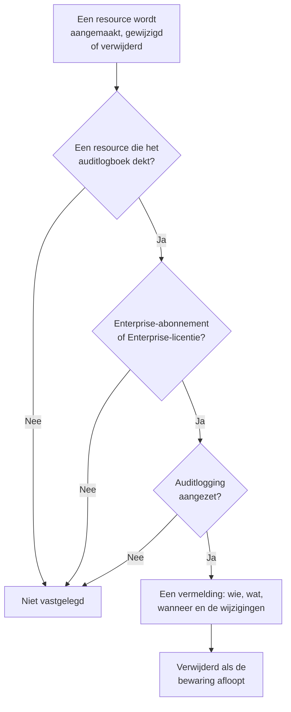

# Auditlogboeken

Het auditlogboek legt vast wie wat in uw project heeft gewijzigd: elke aanmaak, wijziging en verwijdering van de resources die het dekt, met de waarden ervoor en erna, en elke keer dat iemand zich aan- of afmeldt. Gebruik het om te achterhalen wie een monitor heeft uitgezet of een API-sleutel heeft gewijzigd, wie zich heeft aangemeld en waarvandaan, en om een verslag bij te houden voor compliancecontroles. Het hoort in OneUptime Cloud bij het Enterprise-abonnement, en bij de Enterprise Edition als u zelf host.

:::cards
- [Auditlogging aanzetten](#auditlogging-aanzetten): Het staat in elk project bij het begin uit.
- [Het auditlogboek lezen](#het-auditlogboek-lezen): Wie wat heeft gewijzigd, en wanneer.
- [Wat wordt vastgelegd](#wat-wordt-vastgelegd): De resources en acties die het dekt.
- [Aanmeldingen en sessies](#aanmeldingen-en-sessies): Wie zich heeft aangemeld, en hoe elke sessie eindigde.
- [Hoe lang vermeldingen blijven](#hoe-lang-vermeldingen-blijven): Van 7 tot 180 dagen.
:::

## Zo wordt een wijziging een vermelding

- **Het staat bij het begin uit.** Een project legt niets vast tot iemand auditlogging aanzet, en niets van vóór dat moment.
- **Het legt vast wat mensen doen.** Een wijziging door een persoon, een API-sleutel, een MCP-client of een workflow wordt vastgelegd. Een wijziging die OneUptime zelf doet, zoals die van een achtergrondtaak, blijft buiten beschouwing, tenzij u **Systeemgebeurtenissen opslaan** aanzet.
- **Vermeldingen kunnen niet worden gewijzigd.** Niemand kan een vermelding bewerken of verwijderen, niet in het dashboard en niet via de API. Een vermelding verdwijnt pas als de bewaring ervan afloopt.

## Voordat u begint

- **In OneUptime Cloud: het Enterprise-abonnement.** Bij andere abonnementen tonen de pagina's van het auditlogboek wat de functie doet en hoe u die krijgt.
- **Als u zelf host: de Enterprise Edition**, met een licentie die auditlogboeken omvat. Zie [Enterprise Edition](/docs/self-hosted/enterprise).
- **Een rol die het auditlogboek mag lezen.** Project Owner, Project Admin, Settings Admin of de machtiging **Read Audit Log**. Auditlogging aanzetten en de instellingen ervan wijzigen vraagt een Project Owner, een Project Admin of de machtiging om het project te bewerken.

## Auditlogging aanzetten

:::steps
### De instellingen van het auditlogboek openen

Ga naar **Projectinstellingen → Auditlogboeken → Instellingen**. **Auditlogboeken** is bij het begin ingeklapt in het zijmenu: klik erop om het te openen.

### De instellingen bewerken

Klik op **Edit Audit Log Settings**.

### Het aanzetten

Zet **Auditlogboeken inschakelen** aan, stel **Bewaring (dagen)** in en kies of u **Systeemgebeurtenissen opslaan** wilt. Klik op **Wijzigingen opslaan**.
:::

| Instelling | Beginwaarde | Wat die doet |
| --- | --- | --- |
| **Auditlogboeken inschakelen** | Uit | Legt vanaf nu wijzigingen aan de resources van het project vast. |
| **Bewaring (dagen)** | 7 | Hoeveel dagen elke vermelding blijft: van 7 tot 180. |
| **Systeemgebeurtenissen opslaan** | Uit | Legt ook de wijzigingen vast die OneUptime zelf doet, die geen persoon of sleutel heeft gestart. |

Een wijziging van deze instellingen geldt binnen een minuut.

## Het auditlogboek lezen

**Projectinstellingen → Auditlogboeken → Auditlogboeken** toont elke vermelding van het project, de nieuwste eerst:

| Kolom | Wat die toont |
| --- | --- |
| **Wanneer** | Hoe lang geleden, met datum en tijd. |
| **Actie** | `Create`, `Update` of `Delete`, `Download` voor een pakketopnamebestand dat iemand heeft gedownload, of `Sign In`, `Sign Out`, `Session Timeout` of `Session Revoked` voor een sessie. |
| **Resource** | De naam van de resource, die deze opent zolang die bestaat, en het type. |
| **Actor** | Wie de wijziging deed: een persoon, een API-sleutel, een workflow of `System` voor een wijziging die OneUptime zelf deed. Bij de wijziging van een persoon via een MCP-client staat welke. |
| **Wijzigingen** | Hoeveel velden zijn gewijzigd, of bij een aanmaak of verwijdering zijn vastgelegd. Bij een sessie: hoe die is aangemeld of waarom die eindigde. Klik erop om elk veld te zien. |

Filter op **Resourcetype**, **Resourcenaam**, **Actie**, **E-mailadres gebruiker** of **Tijd**. Een wijziging toont alleen de velden die zijn veranderd, ervoor en erna, en een opslag die niets verandert, voegt geen vermelding toe.

Een resource zonder eigen naam krijgt de naam van wat hem in OneUptime benoemt: een uitzondering haar type en het begin van haar bericht, met id's, adressen en alles wat op een geheim lijkt gemaskeerd, een uitvoering van een runbook zijn runbook, het telefoonnummer van een beleid voor inkomende oproepen het nummer zelf, en een sjabloon of een domein zijn eigen naam.

Monitors, incidenten, waarschuwingen, statuspagina's, SLO's en veel andere resources hebben ook een eigen pagina **Auditlogboeken**, in een ingeklapte sectie van hun zijmenu, zoals **Geavanceerd**. Die toont alleen de vermeldingen van die resource, samen met die van wat erbij hoort: de pagina van een SLO toont ook de regels en eigenaren.

## Wat wordt vastgelegd

Alles wat mensen in een project maken, wijzigen of verwijderen, wordt vastgelegd: monitors, incidenten, waarschuwingen, statuspagina's, workflows en hun stappen, wachtrijen, dashboards, piketbeleid, teams en wie erin zit, API-sleutels en elke instelling. **Resourcetype** zegt waar een vermelding over gaat, bijvoorbeeld `Monitor`, `Workflow` of `Queue`.

| Niet vastgelegd | Waarom |
| --- | --- |
| Logboeken van berichten | Elk is al de vastlegging van een e-mail, sms, oproep, pushmelding of chatbericht dat OneUptime heeft verzonden of ontvangen. |
| Vastleggingen van uitvoeringen | Elk is al de vastlegging van een workflowuitvoering, een piketescalatie, een scan, een import of een AI-uitvoering. |
| Wat agents en telemetrie rapporteren | Gevonden resources, metingen en gebruik veranderen bij elk rapport, niet omdat iemand ze heeft gewijzigd. |
| Activiteitenfeeds | Een feed toont wijzigingen die het auditlogboek al vastlegt. |
| De werkstatus van OneUptime | Sessies van lezers van statuspagina's, taken in de wachtrij en andere status die OneUptime bijhoudt terwijl het werkt. |
| De eigen meldingsinstellingen van een persoon | De adressen, nummers en persoonlijke piketregels van ieder persoon zijn alleen van hem of haar. |
| De eigen voorkeuren van een persoon | De producten die ieder persoon in de eigen bovenbalk vastzet, zijn alleen van hem of haar, en alleen die persoon ziet ze. |

Ook wordt vastgelegd wanneer een beheerder een meldingsmethode of een persoonlijke piketregel aan het account van iemand anders toevoegt of ervan verwijdert, zonder het adres of nummer zelf.

Velden die alleen OneUptime schrijft, zoals wanneer een host voor het laatst is gezien, ontbreken in elke vermelding, net als velden die niemand mag lezen. Schrijft OneUptime er een omdat iemand erom vroeg, zoals bij het samenvoegen van een uitzondering met een andere of het opnieuw instellen van een webhook-URL, dan legt de vermelding het vast als een wijziging van die persoon. Sleutels, tokens en wachtwoorden worden vastgelegd als `[REDACTED]`: de vermelding laat zien dat ze zijn gewijzigd, nooit hun waarde. De stappen van een workflow worden vastgelegd als wat er veranderde, met de namen van de instellingen van een stap maar nooit wat erin is getypt, en het verplaatsen van een stap op het canvas wordt niet vastgelegd.

Wat OneUptime doet omdat iemand erom vroeg, wordt ook als diens wijziging vastgelegd, of het project systeemgebeurtenissen opslaat of niet:

- Een uitvoering van een runbook starten, goedkeuren, voltooien, overslaan en annuleren. De stappen ervan worden vastgelegd als wat er met elke stap gedaan is, zoals `Approved "Restart the API" (step 3)`, nooit met wat een stap uitvoerde.
- Wat een regel verandert wanneer iemand die uitvoert: de labels en eigenaren die hij toevoegt, de records die een privacyregel privé maakt, de apparaten die een regel voor locatietoewijzing verplaatst, de apparaten en monitoren die een regel voor automatisch importeren aanmaakt, en wat een monitorregel van een statuspagina of een SLO aan die pagina of SLO verandert.
- Het telefoonnummer van een beleid voor inkomende oproepen kopen, koppelen en vrijgeven.
- Een data-alert oplossen dat iemand markeert als verwacht of als geen probleem.
- De link van een agendafeed opnieuw instellen.
- De teams waar iemand lid van wordt bij het aanmelden met SSO.

Wat een regel uit zichzelf doet, is een wijziging van OneUptime zelf, vastgelegd wanneer **Systeemgebeurtenissen opslaan** aan staat: labels en eigenaren die een regel toevoegt wanneer een record wordt aangemaakt, en een record dat hij dan privé maakt; de apparaten en monitoren die een regel voor automatisch importeren aanmaakt uit nieuwe scanresultaten; en wat een monitorregel van een statuspagina of een SLO verandert wanneer een regel, een monitor of een label wordt opgeslagen.

Het opnieuw instellen van de AI-agent van een host, een cluster of een cloudaccount wordt vastgelegd op de eigen pagina **Auditlogboeken** van die resource, als de wijziging van `aiAgentResetAt` door wie hem opnieuw instelde: wie, en wanneer. Hetzelfde geldt voor het maken van een sleutel voor de AI-agent van een cloudaccount: de sleutels staan er als gewijzigd, nooit met een sleutel of een hash. Wat een agent meldt wanneer hij verbinding maakt en zich meldt, blijft buiten beschouwing, zoals voorheen.

## Aanmeldingen en sessies

Elke keer dat een lid van het project zich bij OneUptime aanmeldt, legt het auditlogboek dat vast, en opnieuw wanneer die sessie eindigt. Een aanmelding geldt voor OneUptime, niet voor één project, dus elk project waarvan de persoon lid is, legt die vast.

| Actie | Wanneer het wordt vastgelegd |
| --- | --- |
| `Sign In` | Iemand meldt zich aan: met een wachtwoord of een inloglink, een passkey, Google, Microsoft, Vercel of single sign-on. |
| `Sign Out` | Diegene meldt zich af. |
| `Session Timeout` | OneUptime beëindigt de sessie omdat de tijd om is: de inactiviteitsduur of sessieduur die een serverbeheerder heeft ingesteld, of 30 dagen zonder gebruik. |
| `Session Revoked` | OneUptime beëindigt de sessie omdat het wachtwoord is gewijzigd, het account is geblokkeerd, of een serverbeheerder tweestapsverificatie heeft gereset of verplicht heeft gesteld. |

De **Resource** van een vermelding is de sessie, genoemd naar het apparaat waarop de aanmelding plaatsvond, zoals `Chrome 130 on macOS`. De **Actor** is de persoon van wie de sessie is, dus filteren op **E-mailadres gebruiker** vindt al diens aanmeldingen en sessies. De details vermelden hoe diegene zich aanmeldde en met welke tweede factor, het IP-adres en de plaats, en bij een geëindigde sessie wanneer die werd aangemeld, wanneer die het laatst werd gebruikt en wanneer die verliep. De eigen SSO-provider van een project wordt alleen in het auditlogboek van dat project genoemd.

Aanmeldingen en sessies worden vastgelegd, of het project systeemgebeurtenissen opslaat of niet. Een verstreken sessieduur of 30 dagen zonder gebruik wordt binnen enkele minuten vastgelegd. Een verstreken inactiviteitsduur wordt vastgelegd wanneer het open tabblad van de persoon of de mobiele app de volgende keer contact maakt met OneUptime.

## Hoe lang vermeldingen blijven

Elke vermelding blijft voor de **Bewaring (dagen)** die het project had toen die werd vastgelegd, en wordt daarna verwijderd. Een nieuwe bewaring geldt voor nieuwe vermeldingen: de vermeldingen die al zijn vastgelegd, houden hun data. Ook via de API is een bewaring een heel aantal dagen van 7 tot 180: elke andere waarde wordt geweigerd.

Om vermeldingen langer dan 180 dagen te bewaren, stuurt u ze zodra ze worden vastgelegd naar uw eigen opslag of SIEM: zie [Export van auditlogboek](/docs/configuration/audit-log-export). U kunt ze ook via de API lezen met een API-sleutel die **Read Audit Log** heeft, en ze opslaan waar u ze nodig hebt. Zie [OneUptime API-referentie](/docs/api-reference/api-reference).

## Als het abonnement of de licentie geen auditlogboeken meer omvat

- **In OneUptime Cloud** stopt een project dat het Enterprise-abonnement verlaat met vastleggen, en de pagina's van het auditlogboek tonen de upgradekaart tot het weer op dat abonnement zit.
- **Als u zelf host**, stopt auditlogging met vastleggen wanneer de Enterprise-proefperiode of de respijtperiode zonder licentie afloopt, of wanneer de licentie geen auditlogboeken omvat. Het auditlogboek meldt dat in rood. Vermeldingen die al zijn vastgelegd, blijven bewaard, en het vastleggen gaat met dezelfde instellingen verder zodra een licentie is geactiveerd. Zie [Als een licentie verloopt of ontbreekt](/docs/self-hosted/enterprise#als-een-licentie-verloopt-of-ontbreekt).

## Problemen oplossen

:::details Het auditlogboek is leeg
Auditlogging staat bij het begin uit en legt niets vast van vóór het aanzetten. Meldt de lijst dat auditlogging uit staat, volg dan de link naar de instellingen en zet het aan. Anders wijzigt u een monitor of een incident en vernieuwt u de lijst.
:::

:::details Er ontbreekt een wijziging in het auditlogboek
Controleer of de resource bij [Wat wordt vastgelegd](#wat-wordt-vastgelegd) staat, en of de wijziging is gedaan nadat auditlogging werd aangezet. Een wijziging die OneUptime zelf deed, wordt alleen vastgelegd met **Systeemgebeurtenissen opslaan** aan.
:::

## Volgende stappen

:::cards
- [Export van auditlogboek](/docs/configuration/audit-log-export): Het auditlogboek naar uw eigen opslag of SIEM sturen.
- [Gebruikers, teams en machtigingen](/docs/permissions/index): Bepalen wie het auditlogboek mag lezen.
- [Projectinstellingen](/docs/configuration/project-settings): De overige instellingen van het project.
- [Facturering en gebruik](/docs/configuration/billing): Het abonnement van het project wijzigen.
- [Enterprise Edition](/docs/self-hosted/enterprise): Auditlogboeken op een zelf gehoste installatie.
:::
