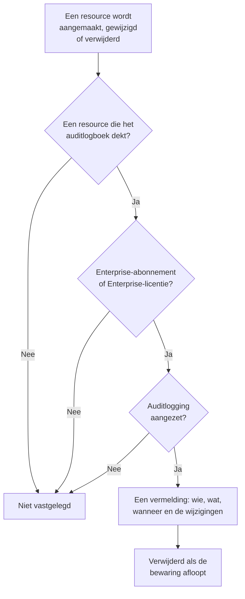

# Auditlogboeken

Het auditlogboek legt vast wie wat in uw project heeft gewijzigd: elke aanmaak, wijziging en verwijdering van de resources die het dekt, met de waarden ervoor en erna. Gebruik het om te achterhalen wie een monitor heeft uitgezet of een API-sleutel heeft gewijzigd, en om een verslag bij te houden voor compliancecontroles. Het hoort in OneUptime Cloud bij het Enterprise-abonnement, en bij de Enterprise Edition als u zelf host.

:::cards
- [Auditlogging aanzetten](#auditlogging-aanzetten): Het staat in elk project bij het begin uit.
- [Het auditlogboek lezen](#het-auditlogboek-lezen): Wie wat heeft gewijzigd, en wanneer.
- [Wat wordt vastgelegd](#wat-wordt-vastgelegd): De resources en acties die het dekt.
- [Hoe lang vermeldingen blijven](#hoe-lang-vermeldingen-blijven): Van 7 tot 180 dagen.
:::

## Zo wordt een wijziging een vermelding

- **Het staat bij het begin uit.** Een project legt niets vast tot iemand auditlogging aanzet, en niets van vóór dat moment.
- **Het legt vast wat mensen doen.** Een wijziging door een persoon, een API-sleutel, een MCP-client of een workflow wordt vastgelegd. Een wijziging die OneUptime zelf doet, zoals die van een achtergrondtaak, blijft buiten beschouwing, tenzij u **Systeemgebeurtenissen opslaan** aanzet.
- **Vermeldingen kunnen niet worden gewijzigd.** Niemand kan een vermelding bewerken of verwijderen, niet in het dashboard en niet via de API. Een vermelding verdwijnt pas als de bewaring ervan afloopt.

## Voordat u begint

- **In OneUptime Cloud: het Enterprise-abonnement.** Bij andere abonnementen tonen de pagina's van het auditlogboek wat de functie doet en hoe u die krijgt.
- **Als u zelf host: de Enterprise Edition**, met een licentie die auditlogboeken omvat. Zie [Enterprise Edition](/docs/self-hosted/enterprise).
- **Een rol die het auditlogboek mag lezen.** Project Owner, Project Admin, Settings Admin of de machtiging **Read Audit Log**. Auditlogging aanzetten en de instellingen ervan wijzigen vraagt een Project Owner, een Project Admin of de machtiging om het project te bewerken.

## Auditlogging aanzetten

:::steps
### De instellingen van het auditlogboek openen

Ga naar **Projectinstellingen → Auditlogboeken → Instellingen**. **Auditlogboeken** is bij het begin ingeklapt in het zijmenu: klik erop om het te openen.

### De instellingen bewerken

Klik op **Edit Audit Log Settings**.

### Het aanzetten

Zet **Auditlogboeken inschakelen** aan, stel **Bewaring (dagen)** in en kies of u **Systeemgebeurtenissen opslaan** wilt. Klik op **Wijzigingen opslaan**.
:::

| Instelling | Beginwaarde | Wat die doet |
| --- | --- | --- |
| **Auditlogboeken inschakelen** | Uit | Legt vanaf nu wijzigingen aan de resources van het project vast. |
| **Bewaring (dagen)** | 7 | Hoeveel dagen elke vermelding blijft: van 7 tot 180. |
| **Systeemgebeurtenissen opslaan** | Uit | Legt ook de wijzigingen vast die OneUptime zelf doet, die geen persoon of sleutel heeft gestart. |

Een wijziging van deze instellingen geldt binnen een minuut.

## Het auditlogboek lezen

**Projectinstellingen → Auditlogboeken → Auditlogboeken** toont elke vermelding van het project, de nieuwste eerst:

| Kolom | Wat die toont |
| --- | --- |
| **Wanneer** | Hoe lang geleden, met datum en tijd. |
| **Actie** | `Create`, `Update` of `Delete`, of `Download` voor een pakketopnamebestand dat iemand heeft gedownload. |
| **Resource** | De naam van de resource, die deze opent zolang die bestaat, en het type. |
| **Actor** | Wie de wijziging deed: een persoon, een API-sleutel, een workflow of `System` voor een wijziging die OneUptime zelf deed. Bij de wijziging van een persoon via een MCP-client staat welke. |
| **Wijzigingen** | Hoeveel velden zijn gewijzigd, of bij een aanmaak of verwijdering zijn vastgelegd. Klik erop om elk veld te zien. |

Filter op **Resourcetype**, **Resourcenaam**, **Actie**, **E-mailadres gebruiker** of **Tijd**. Een wijziging toont alleen de velden die zijn veranderd, ervoor en erna, en een opslag die niets verandert, voegt geen vermelding toe.

Monitors, incidenten, waarschuwingen, statuspagina's, SLO's en veel andere resources hebben ook een eigen pagina **Auditlogboeken**, in een ingeklapte sectie van hun zijmenu, zoals **Geavanceerd**. Die toont alleen de vermeldingen van die resource, samen met die van wat erbij hoort: de pagina van een SLO toont ook de regels en eigenaren.

## Wat wordt vastgelegd

| Resource | **Resourcetype** in het logboek |
| --- | --- |
| Monitors | `Monitor` |
| Incidenten | `Incident` |
| Waarschuwingen | `Alert` |
| Statuspagina's | `Status Page` |
| Geplande onderhoudsgebeurtenissen | `Scheduled Maintenance Event` |
| Piketbeleid | `On-Call Policy` |
| SLO's | `Service Level Objective` |
| De regels en eigenaren van een SLO | `SLO Burn Rate Rule`, `SLO Monitor Rule`, `Service Level Objective User Owner`, `Service Level Objective Team Owner` |
| Teams | `Team` |
| Aangepaste rollen, en de teams en API-sleutels die er een krijgen | `Custom Role`, `Team Custom Role`, `API Key Custom Role` |
| Labels | `Label` |
| Statussen en ernstniveaus van incidenten | `Incident State`, `Incident Severity` |
| Statussen en ernstniveaus van waarschuwingen | `Alert State`, `Alert Severity` |
| Monitorstatussen | `Monitor Status` |
| Statussen van gepland onderhoud | `Scheduled Maintenance State` |
| Incidentrollen | `Incident Role` |
| Postmortem-statussen | `Postmortem Status` |
| API-sleutels | `API Key` |
| MCP-clients die mensen koppelen | `MCP Client Authorization` |
| Inventarisitems | `Inventory Item` |
| Collectorconfiguraties | `Collector Config` |
| vCenters | `vCenter` |
| Pakketopnames, en hun downloads | `Packet Capture` |
| Beveiligingszaken en hun prioriteiten en statussen, playbooks en hun uitvoeringen, en beschermde entiteiten | `Security Case`, `Security Case Priority`, `Security Case Status`, `Security Playbook`, `Security Playbook Run`, `Protected Entity` |
| Exports van het auditlogboek | `Audit Log Export` |

Ook wordt vastgelegd wanneer een beheerder een meldingsmethode of een persoonlijke piketregel aan het account van iemand anders toevoegt of ervan verwijdert, zonder het adres of nummer zelf.

Andere gegevens staan niet in het auditlogboek, zoals wie in een team zit, of een machtiging die los aan een team is toegevoegd. Velden die niemand mag lezen, ontbreken in elke vermelding, en sleutels, tokens en wachtwoorden worden vastgelegd als `[REDACTED]`: de vermelding laat zien dat ze zijn gewijzigd, nooit hun waarde.

## Hoe lang vermeldingen blijven

Elke vermelding blijft voor de **Bewaring (dagen)** die het project had toen die werd vastgelegd, en wordt daarna verwijderd. Een nieuwe bewaring geldt voor nieuwe vermeldingen: de vermeldingen die al zijn vastgelegd, houden hun data.

Om vermeldingen langer dan 180 dagen te bewaren, stuurt u ze zodra ze worden vastgelegd naar uw eigen opslag of SIEM: zie [Export van auditlogboek](/docs/configuration/audit-log-export). U kunt ze ook via de API lezen met een API-sleutel die **Read Audit Log** heeft, en ze opslaan waar u ze nodig hebt. Zie [OneUptime API-referentie](/docs/api-reference/api-reference).

## Als het abonnement of de licentie geen auditlogboeken meer omvat

- **In OneUptime Cloud** stopt een project dat het Enterprise-abonnement verlaat met vastleggen, en de pagina's van het auditlogboek tonen de upgradekaart tot het weer op dat abonnement zit.
- **Als u zelf host**, stopt auditlogging met vastleggen wanneer de Enterprise-proefperiode of de respijtperiode zonder licentie afloopt, of wanneer de licentie geen auditlogboeken omvat. Het auditlogboek meldt dat in rood. Vermeldingen die al zijn vastgelegd, blijven bewaard, en het vastleggen gaat met dezelfde instellingen verder zodra een licentie is geactiveerd. Zie [Als een licentie verloopt of ontbreekt](/docs/self-hosted/enterprise#als-een-licentie-verloopt-of-ontbreekt).

## Problemen oplossen

:::details Het auditlogboek is leeg
Auditlogging staat bij het begin uit en legt niets vast van vóór het aanzetten. Meldt de lijst dat auditlogging uit staat, volg dan de link naar de instellingen en zet het aan. Anders wijzigt u een monitor of een incident en vernieuwt u de lijst.
:::

:::details Er ontbreekt een wijziging in het auditlogboek
Controleer of de resource bij [Wat wordt vastgelegd](#wat-wordt-vastgelegd) staat, en of de wijziging is gedaan nadat auditlogging werd aangezet. Een wijziging die OneUptime zelf deed, wordt alleen vastgelegd met **Systeemgebeurtenissen opslaan** aan.
:::

## Volgende stappen

:::cards
- [Export van auditlogboek](/docs/configuration/audit-log-export): Het auditlogboek naar uw eigen opslag of SIEM sturen.
- [Gebruikers, teams en machtigingen](/docs/permissions/index): Bepalen wie het auditlogboek mag lezen.
- [Projectinstellingen](/docs/configuration/project-settings): De overige instellingen van het project.
- [Facturering en gebruik](/docs/configuration/billing): Het abonnement van het project wijzigen.
- [Enterprise Edition](/docs/self-hosted/enterprise): Auditlogboeken op een zelf gehoste installatie.
:::
