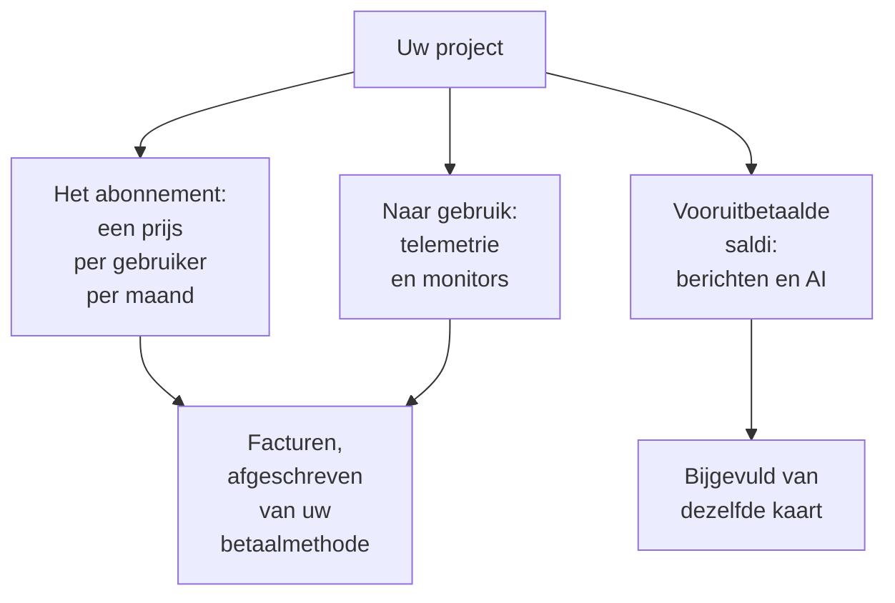

# Facturering en gebruik

In OneUptime Cloud betaalt een project voor zijn abonnement, per gebruiker, en voor wat het gebruikt: telemetrie, actieve monitors, en de berichten en het AI-werk die het uit vooruitbetaalde saldi betaalt. Deze pagina laat zien waar u elk daarvan ziet en wijzigt, en wie dat mag. Een zelf gehoste installatie heeft geen facturering en geen van deze pagina's.

:::cards
- [Uw abonnement en plaatsen](#uw-abonnement-en-plaatsen): Wat het abonnement kost, en wie als plaats telt.
- [Betaalmethoden](#betaalmethoden): De kaart waarvan uw facturen worden afgeschreven.
- [Facturen](#facturen): Betalen, downloaden en nagaan wat u hebt gebruikt.
- [Vooruitbetaalde saldi](#vooruitbetaalde-saldi): Berichten en AI, met de hand of automatisch bijgevuld.
:::

## Waarvoor een project betaalt

| Wat | Hoe het wordt berekend |
| --- | --- |
| Het abonnement | Een prijs per gebruiker per maand, maandelijks of jaarlijks gefactureerd. Iedereen in het project is een plaats. |
| Telemetrie | $0.10 per opgenomen GB, met 15 dagen bewaring. Langere bewaring kost meer, en bewaring korter dan 7 dagen wordt gefactureerd als 7 dagen: zie [Wat bewaring kost](/docs/telemetry/data-retention#wat-bewaring-kost). |
| Session replays | $2 per GB, met 15 dagen bewaring. |
| Actieve monitors | $1 per monitor per maand. Elke monitor behalve een handmatige is actief, ook als die is uitgeschakeld. |
| Sms, oproepen, WhatsApp en Telegram | Betaald uit het saldo van het project terwijl elk bericht wordt verstuurd. |
| OneUptime AI | Betaald uit de AI-tegoeden van het project, tenzij het op uw eigen LLM-provider draait. |

De [prijzenpagina](https://oneuptime.com/pricing) vergelijkt de abonnementen.

## Voordat u begint

- **OneUptime Cloud.** De sectie **Facturering en facturen** van **Projectinstellingen** bestaat alleen in OneUptime Cloud en is bij het begin ingeklapt: klik op de titel om die te openen.
- **Een rol die de facturering mag lezen.** Project Owners, mensen met **Manage Billing** en de drie factureringsrollen lezen elke factureringspagina. Zie [Wie wat mag](#wie-wat-mag).

## Uw abonnement en plaatsen

Ga naar **Projectinstellingen → Facturering en facturen → Facturering**. De kaart **Huidig abonnement** toont het abonnement van het project en de prijs per gebruiker, en **Plaatsen**: één voor elke persoon in het project.

Iemand telt als plaats vanaf het moment dat u die uitnodigt, nog voor de acceptatie, tot u die verwijdert. Om het aantal plaatsen te wijzigen, nodigt u mensen uit of verwijdert u ze: zie [Mensen uitnodigen](/docs/permissions/inviting-people).

## Het abonnement wijzigen

:::steps
### Eerst een betaalmethode toevoegen

Een abonnementswijziging heeft een betaalmethode nodig. Zonder betaalmethode opent **Change Plan** in plaats daarvan **Add a Payment Method**: zie [Betaalmethoden](#betaalmethoden).

### Op Change Plan klikken

Klik op de kaart **Huidig abonnement** op **Change Plan**. **Jaarplan** staat bij het begin aan: zet het uit om de maandprijzen te zien.

### Het abonnement kiezen

Elk abonnement toont zijn prijs per gebruiker. De opmerking onder de abonnementen zegt wat er met uw proefperiode gebeurt: **Your free trial carries over** zolang het project nog in de proefperiode zit, en **Changing plan does not start a free trial** zodra dat niet meer zo is.

### De wijziging opslaan

Klik op **Wijzigingen opslaan**. Een betaald abonnement wordt gefactureerd vanaf het moment dat u overstapt, en elke persoon die u daarop uitnodigt, wordt gefactureerd bij de uitnodiging.
:::

API-sleutels werken alleen met het Growth-abonnement of een hoger abonnement, en onder het Scale-abonnement verwijderen SCIM-koppelingen alleen nog mensen. Een abonnement dat ze stopt, zegt hoeveel het er betreft voordat u het kiest, en de pagina **Facturering** toont **Niet inbegrepen in dit abonnement** zolang ze gestopt zijn. Er wordt niets verwijderd: met een abonnement dat ze omvat, werken ze weer.

> [!NOTE]
> OneUptime gekocht via een wederverkoper of een cloudmarketplace (AWS Marketplace, Microsoft Marketplace, Google Cloud Marketplace of Vercel Marketplace)? De pagina **Facturering** zegt dat. Een wederverkoper wijzigt uw abonnement voor u, en een marketplace factureert het abonnement en het gebruik van het project via uw cloudrekening.

## Betaalmethoden

De kaart **Betaalmethoden** toont de kaarten van het project. Facturen worden automatisch van de standaardkaart afgeschreven.

:::steps
### Op Betaalmethode toevoegen klikken

Klik op de kaart **Betaalmethoden** op **Betaalmethode toevoegen**.

### De kaart invullen

Vul de betaalgegevens in en klik op **Save payment method**. De methode die u toevoegt, wordt de standaard, en het toevoegen ervan zet betalen naar gebruik aan. Uw abonnement verandert er niet door.
:::

- **Instellen als standaard** maakt een andere methode uit de lijst de methode waarvan facturen worden afgeschreven.
- **Re-sync Autopay**, bij de standaardmethode, herstelt een verlenging die nog een oudere kaart belast.
- Het project houdt minstens één betaalmethode: voeg een andere toe voordat u de laatste verwijdert.

## Factuuradres en factuurmail

De kaart **Bedrijfsgegevens / factuuradres** bevat wat uw facturen over u zeggen. Klik op **Bijwerken** en vul twee stappen in:

| Stap | Velden |
| --- | --- |
| **Factuuradres** | **Bedrijfsgegevens / factuuradres**: de juridische naam van uw bedrijf, het adres en het btw- of belastingnummer. **Land**: uw factuurland. |
| **Facturen** | **E-mail financiën / boekhouding**: waar facturen, ontvangstbewijzen en factureringsberichten heen gaan, meerdere adressen gescheiden door komma's. **Facturen per e-mail verzenden**: elke factuur daarheen sturen zodra die is uitgegeven. |

## Facturen

**Projectinstellingen → Facturering en facturen → Facturen** toont de facturen van het project, elk met **Factuurnummer**, **Factuurdatum**, **Bedrag** en **Factuurstatus**.

- **Factuur betalen** betaalt een factuur die nog openstaat.
- **Downloaden** opent de factuur als pdf. Bij een factuur die nog openstaat, staat dit in het menu **⋯** van de rij.

Als uw bank een betaling nog verwerkt, meldt OneUptime dat: sommige banken doen er tot 2 dagen over om een kaartbetaling te bevestigen, en de factuur werkt zichzelf bij. Betaal haar niet nog eens.

## Gebruiksgeschiedenis

**Projectinstellingen → Facturering en facturen → Gebruiksgeschiedenis** toont de telemetrie die het project heeft verstuurd, één rij per product, service en dag:

| Kolom | Wat die toont |
| --- | --- |
| **Product** | Logboeken, traces, metrieken en de andere soorten telemetrie. |
| **Dag** | De dag waarop die is verstuurd. |
| **Service** | De service, of de host, het cluster of de andere resource, die het heeft verstuurd. |
| **Geïngesteerde gegevens (in GB)** | Hoeveel er aankwam. |
| **Gegevensbewaring (in dagen)** | Hoe lang het wordt bewaard. |
| **Totale kosten** | Wat het kostte, in Amerikaanse dollars. |

Het gebruik van een dag verschijnt zodra de dag voorbij is. Filter op **Product**, **Dag** of **Service** om te vinden wat is gegroeid.

## Vooruitbetaalde saldi

Sms-berichten, oproepen, WhatsApp- en Telegram-berichten worden uit het saldo van het project betaald, en OneUptime AI uit de AI-tegoeden. U vult elk ervan vooraf aan:

| Saldo | Waar |
| --- | --- |
| Sms, oproepen, WhatsApp en Telegram | **Projectinstellingen → Meldingen → Meldingsinstellingen** |
| OneUptime AI | **Projectinstellingen → AI → AI-tegoeden** |

:::steps
### Nu bijvullen

Klik op de kaart **Huidig saldo** van de pagina op **Saldo bijvullen**. Vul een bedrag van $20 tot $1,000 in en klik op **Bijvullen**. Het bedrag wordt van de kaart van het project afgeschreven.

### Of automatisch laten bijvullen

Klik op de kaart **Automatisch bijvullen** op **Automatisch bijvullen bewerken** en zet **Automatisch opwaarderen inschakelen** aan. Het staat bij het begin uit. Staat het aan, dan vult OneUptime $20 bij zodra het saldo tot $10 daalt, of de bedragen die u kiest.
:::

Als een saldo niet kan betalen, wordt het bericht niet verstuurd of stopt OneUptime AI, en krijgen de eigenaren van het project een e-mail. Zie [Als een oproep niet wordt verstuurd](/docs/on-call/escalation-rules#wanneer-een-oproep-niet-wordt-verstuurd) en [Als de AI-tegoeden op zijn](/docs/ai/ai-sre#als-het-ai-tegoed-op-is).

## Wie wat mag

| Om | Het vraagt |
| --- | --- |
| De factureringspagina's te lezen: het abonnement, facturen, gebruik, saldi en betaalmethoden | Project Owner, **Manage Billing**, **Factureringsbeheerder**, **Factureringslid** of **Factureringskijker** |
| Een factuur te downloaden | Project Owner, Project Admin, **Manage Billing**, **Read Invoices**, **Factureringsbeheerder** of **Factureringslid** |
| Het factuuradres en de factuurmail te wijzigen | Project Owner, **Manage Billing**, **Factureringsbeheerder** of **Factureringslid** |
| Sms, oproepen, WhatsApp of Telegram aan of uit te zetten | Project Owner, **Manage Billing** of **Factureringsbeheerder** |
| Een betaalmethode toe te voegen | Project Owner, **Manage Billing** of **Create Payment Method** |
| Een factuur te betalen | Project Owner, **Manage Billing** of **Edit Invoices** |
| Het abonnement te wijzigen, een saldo bij te vullen of automatisch bijvullen te wijzigen | Project Owner of **Manage Billing** |

Een knop die u niet mag gebruiken, verschijnt vergrendeld en zegt wie het wel mag. Zie [Gebruikers, teams en machtigingen](/docs/permissions/index#teams) voor de factureringsrollen.

## Instellingen die een abonnement nodig hebben

In OneUptime Cloud hebben deze beheerinstellingen een abonnement nodig. Een pagina waarvan u het abonnement niet hebt, toont wat de functie doet en welk abonnement ze nodig heeft.

| Instelling | Het abonnement dat ze nodig heeft |
| --- | --- |
| Labels | Growth |
| API-sleutels | Growth |
| Uw eigen SMTP-servers en Twilio-accounts | Growth |
| Uw eigen LLM-providers | Growth |
| MCP-clients koppelen | Growth |
| Teams aanmaken | Scale |
| SSO, OIDC en SCIM | Scale |
| Bewaringsuitzonderingen | Scale |
| Auditlogboeken | Enterprise |

## Het abonnement opzeggen

Om niet meer voor een project te betalen, verwijdert u het: de facturering stopt wanneer het is verwijderd. Zie [Het project verwijderen](/docs/configuration/project-settings#het-project-verwijderen). Een project dat via een wederverkoper is gekocht, zegt u op bij de wederverkoper, en een project dat via een cloudmarketplace is gekocht, op de marketplace.

## Problemen oplossen

:::details "Add a payment method in Project Settings > Billing and Invoices > Billing before using paid monitoring or telemetry"
Een project met het Free-abonnement heeft een betaalmethode nodig voordat het actieve monitors aanmaakt of telemetrie verstuurt, omdat die naar gebruik worden betaald. Voeg er een toe onder [Betaalmethoden](#betaalmethoden). Handmatige monitors blijven gratis.
:::

:::details Een rode banner meldt onbetaalde facturen
Een project met onbetaalde facturen wordt inactief, en wordt verwijderd als ze onbetaald blijven. Open **Facturen** en klik bij elke factuur die nog openstaat op **Factuur betalen**.
:::

:::details Change Plan opent Add a Payment Method
Het project heeft nog geen betaalmethode. Voeg er een toe en wijzig daarna het abonnement.
:::

:::details De gebruiksgeschiedenis is leeg
Gebruik wordt per dag geteld, en een dag verschijnt zodra die voorbij is. Een project dat geen telemetrie heeft verstuurd, heeft geen rijen.
:::

## Volgende stappen

:::cards
- [Projectinstellingen](/docs/configuration/project-settings): Al het andere dat voor het hele project geldt.
- [Mensen uitnodigen](/docs/permissions/inviting-people): De mensen toevoegen voor wie uw plaatsen zijn.
- [Gegevensbewaring](/docs/telemetry/data-retention): Telemetrie zo lang bewaren als nodig, en niet langer.
- [Drop-filters en scrub-regels](/docs/telemetry/drop-filters-and-scrub-rules): Niet meer betalen voor telemetrie die u niet gebruikt.
:::
