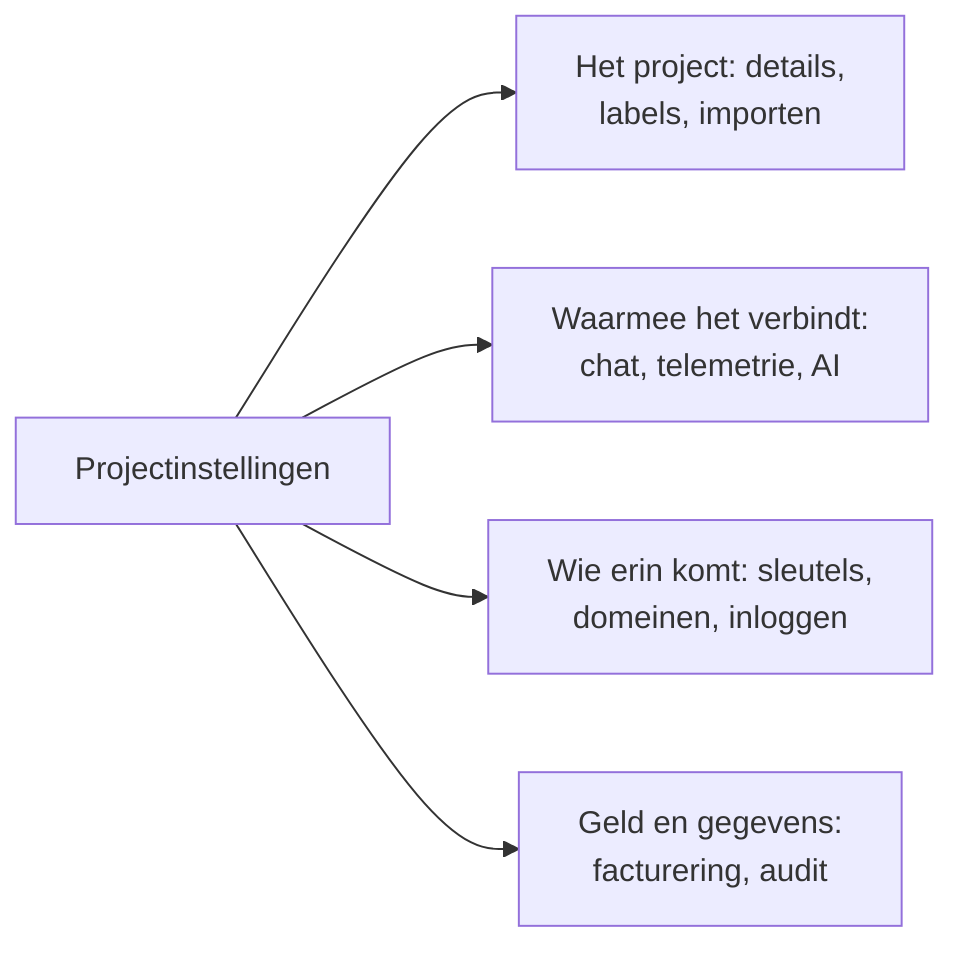

# Projectinstellingen

Projectinstellingen bevat wat voor het hele project geldt: de naam, de tools waarmee het is verbonden, de sleutels, hoe mensen inloggen, de facturering en het audittraject. Het meeste stelt u één keer in en bekijkt u zelden opnieuw. Deze pagina is er een kaart van, en behandelt de instellingen zonder eigen pagina: de projectdetails, labels, functievlaggen en het verwijderen van het project.

:::cards
- [Een instelling vinden](#een-instelling-vinden): Wat elke sectie van het zijmenu bevat.
- [De details van het project](#de-details-van-het-project): De naam, de ID en toegang voor ondersteuning.
- [Labels](#labels): Markeringen voor resources, machtigingen en regels.
- [Het project verwijderen](#het-project-verwijderen): Wat het vraagt, en wat er meegaat.
:::

## Projectinstellingen openen

Ga naar **Producten → Instellingen → Projectinstellingen**. Het zijmenu groepeert de pagina's in secties, en alleen **Basis** staat open bij het begin: klik op de titel van een sectie om die te openen. Een sectie opent vanzelf op elke pagina erin.

## Voordat u begint

- **Een rol die het project mag wijzigen.** Project Owners en Project Admins wijzigen de meeste van deze instellingen. Facturering, meldingskanalen en het verwijderen van het project vragen meer, zoals elke sectie zegt.
- **In OneUptime Cloud: het abonnement dat een instelling omvat.** Sommige instellingen hebben een abonnement nodig: zie [Instellingen die een abonnement nodig hebben](/docs/configuration/billing#instellingen-die-een-abonnement-nodig-hebben).

## Een instelling vinden

| Sectie | Pagina's | Waar u meer leest |
| --- | --- | --- |
| **Basis** | **Project**, **Labels** | [De details van het project](#de-details-van-het-project), [Labels](#labels) |
| **Werkruimte** | **Slack**, **Microsoft Teams**, **Video Calls** | [Slack](/docs/workspace-connections/slack), [Microsoft Teams](/docs/workspace-connections/microsoft-teams), [Videogesprekken](/docs/workspace-connections/video-calls) |
| **Telemetrie & APM** | **Ingestiesleutels**, **Gegevensbewaring** | [Ingestiesleutels](/docs/telemetry/ingestion-keys), [Gegevensbewaring](/docs/telemetry/data-retention) |
| **Meldingen** | **Meldingsinstellingen**, **Meldingslogboeken**, **Mobiele apps** | [Meldingen](#meldingen) |
| **AI** | **AI Features**, **LLM-providers**, **Externe MCP-servers**, **AI-tegoeden**, **AI-logboeken**, **MCP-server** | [LLM-providers](/docs/ai/llm-provider), [Externe MCP-servers](/docs/ai/external-mcp-servers), [MCP-server](/docs/ai/mcp-server), [AI SRE](/docs/ai/ai-sre#kostenbeheersing) |
| **Geavanceerd** | **Domeinen**, **API-sleutels**, **Functievlaggen**, **Importeren uit een andere tool** | [Eigen domeinen](/docs/status-pages/branding-and-domains#aangepaste-domeinen), [API-sleutels](/docs/permissions/index#api-sleutels), [Functievlaggen](#functievlaggen), [Overstappen van Opsgenie](/docs/moving-to-oneuptime/opsgenie) en de andere overstapgidsen |
| **Beveiliging** | **SSO**, **SCIM** | [SSO](/docs/identity/sso), [SCIM](/docs/identity/scim) |
| **Facturering en facturen** | **Facturering**, **Gebruiksgeschiedenis**, **Facturen** | [Facturering en gebruik](/docs/configuration/billing) |
| **Auditlogboeken** | **Auditlogboeken**, **Instellingen**, **Export** | [Auditlogboeken](/docs/configuration/audit-logs), [Export van auditlogboek](/docs/configuration/audit-log-export) |
| **Gevarenzone** | **Gevarenzone** | [Het project verwijderen](#het-project-verwijderen) |

**Facturering en facturen** en **AI-tegoeden** bestaan alleen in OneUptime Cloud: een zelf gehoste installatie heeft geen facturering.

## De details van het project

**Projectinstellingen → Basis → Project** bevat twee kaarten.

**Projectdetails** toont de naam van het project en de ID:

- **Projectnaam**: klik op **Project bewerken** om het project een andere naam te geven. Een naam heeft minstens 2 tekens. Hernoemen vraagt een Project Owner, of de machtiging om het project te bewerken of de facturering te beheren.
- **Project-ID**: kopieer deze voor de API, de CLI en Terraform, of als u ondersteuning schrijft.
- **Data Residency**: in OneUptime Cloud, waar de gegevens van uw project horen te staan, als OneUptime dat heeft vastgelegd. Alleen OneUptime stelt dit in.

**Toegang voor klantenondersteuning** bepaalt in OneUptime Cloud of het ondersteuningsteam van OneUptime het project mag openen. Zet **OneUptime-ondersteuning toegang geven tot dit project** aan als u hulp wilt: OneUptime vraagt het eerst, omdat ondersteuning dan alles in het project kan zien en wijzigen, en u klikt op **Ondersteuning toelaten**. Zet het uit zodra ze klaar zijn: dat wordt meteen opgeslagen. Project Owners en Project Admins wijzigen het.

## Labels

Labels zijn markeringen die u op monitors, incidenten, statuspagina's en andere resources zet. Ze filteren en groeperen lijsten, en ze beperken hoe ver de machtigingen van een team en de regels van het project reiken.

:::steps
### Labels openen

Ga naar **Projectinstellingen → Basis → Labels**.

### Een label aanmaken

Klik op **Label aanmaken**. Geef het een **Naam** en, als u wilt, een **Beschrijving**. **Labelkleur** is al gekozen, een kleur die nog geen label op de pagina gebruikt: kies een andere als u dat liever hebt. Klik op **Label aanmaken** om het op te slaan.
:::

In OneUptime Cloud vraagt het aanmaken en wijzigen van labels het Growth-abonnement. Zie [Labels](/docs/permissions/index#labels) voor hoe labels machtigingen beperken, en [Label- en eigenaarsregels](/docs/configuration/label-and-owner-rules) om resources bij het aanmaken een label te geven.

In een lijst worden de labels van een record onder elkaar getoond; zijn het er meer dan vier, dan ziet u de eerste drie met een link naar de rest. Overal waar labels worden opgesomd (in lijsten, op de pagina van een record en in elke labelkiezer), staan ze in natuurlijke volgorde: labels waarvan de naam met een getal begint komen eerst, in de volgorde van dat getal (`2. Team` vóór `10. Owner`), daarna de andere alfabetisch, ongeacht hoofdletters of kleine letters. Wilt u de volgorde van uw labels bepalen, begin hun namen dan met een getal, zoals `1. Category` en `2. Subcategory`.

### Een label archiveren

Om een label uit te faseren, archiveert u het via het menu **⋯** van de rij in plaats van het te verwijderen. Alles wat het label heeft, behoudt het, en u kunt er nog steeds op filteren, maar niemand kan het nog ergens aan toevoegen: elke labelkiezer laat het weg, en de API, Terraform en MCP weigeren het. Het dialoogvenster toont de regels en machtigingen die zijn ingesteld om het label te gebruiken; die blijven het gebruiken tot u ze wijzigt. Gearchiveerde labels staan apart, in de ingeklapte sectie **Gearchiveerde labels**, waar **Uit archief halen** er een terugzet. **Verwijderen** toont eerst alles waar het label vanaf zou gaan, en biedt **In plaats daarvan archiveren** aan.

## Meldingen

**Projectinstellingen → Meldingen** bevat hoe het project meldingen verstuurt:

- **Meldingsinstellingen**: de kaart **Meldingskanalen** zet sms, telefoongesprekken, WhatsApp en Telegram aan of uit voor het project. Alle vier staan bij het begin uit. Een Project Owner, een **Billing Admin** of iemand met **Manage Billing** zet ze aan. De pagina bevat ook de eigen mailservers van het project, onder **Aangepaste SMTP-configuraties** (zie [SMTP](/docs/emails/smtp)), en het eigen Twilio-account (zie [Twilio-integratie](/docs/self-hosted/twilio-integration)). In OneUptime Cloud bevat ze het saldo waaruit deze berichten worden betaald: zie [Vooruitbetaalde saldi](/docs/configuration/billing#vooruitbetaalde-saldi).
- **Meldingslogboeken**: elke melding die het project heeft verstuurd, met één tabblad per kanaal: **E-mail**, **SMS**, **WhatsApp**, **Telegram**, **Webhook**, **Oproep**, **Push** en **Werkruimte**.
- **Mobiele apps**: waar u de apps voor iOS en Android vindt. Zie [Apps – Overzicht](/docs/mobile-desktop-apps/index).

## Functievlaggen

**Projectinstellingen → Geavanceerd → Functievlaggen** zet optionele functies voor het project aan of uit. Elke functie is een schakelaar die wordt opgeslagen zodra u hem omzet. Vandaag bevat de pagina **Monitorgroepen**, uit in een nieuw project: zet het aan om monitorgroepen aan het menu Monitors toe te voegen. Uitzetten verwijdert geen enkele groep. Zie [Monitorgroepen](/docs/monitor/monitor-groups).

## Het project verwijderen

Een project verwijderen verwijdert alles erin, voor elk lid: de monitors, incidenten, statuspagina's, piketinstellingen en telemetrie. Niets brengt het terug.

:::steps
### De gevarenzone openen

Ga naar **Projectinstellingen → Gevarenzone**.

### Op Project verwijderen klikken

Klik op **Project verwijderen**. Een dialoogvenster vraagt om bevestiging.

### De naam van het project typen

Typ de naam precies zoals die is. **Project verwijderen** blijft vergrendeld tot u dat doet. In OneUptime Cloud vraagt het dialoogvenster ook waarom u vertrekt: het antwoord is optioneel.

### Bevestigen

Klik op **Project verwijderen**. OneUptime verwijdert het project en haalt u eruit.
:::

> [!CAUTION]
> Het verwijderen van het project kan niet ongedaan worden gemaakt. Het vraagt een Project Owner, of de machtiging om het project te verwijderen.

In OneUptime Cloud zegt u het abonnement van een project op door het te verwijderen: de facturering stopt wanneer het project is verwijderd. Een project dat via een cloudmarketplace wordt gefactureerd, krijgt een laatste afschrijving voor het gebruik, en de aankoop op de marketplace blijft actief tot u die daar opzegt.

## Problemen oplossen

:::details Er lijkt een sectie van het zijmenu te ontbreken
Elke sectie behalve **Basis** is bij het begin ingeklapt. Klik op de titel van de sectie om die te openen. Op een zelf gehoste installatie is er geen sectie **Facturering en facturen** en geen pagina **AI-tegoeden**.
:::

:::details Project bewerken is vergrendeld
Hernoemen vraagt een Project Owner, of de machtiging om het project te bewerken of de facturering te beheren. De vergrendelde knop noemt de machtiging die u nodig hebt.
:::

:::details Project verwijderen blijft vergrendeld in het dialoogvenster
Typ de naam van het project precies zoals het dialoogvenster die toont: hoofdletters en kleine letters tellen mee.
:::

## Volgende stappen

:::cards
- [Mensen uitnodigen](/docs/permissions/inviting-people): Uw team in het project halen.
- [Facturering en gebruik](/docs/configuration/billing): Uw abonnement, betaalmethoden, facturen en gebruik.
- [Auditlogboeken](/docs/configuration/audit-logs): Zien wie wat in het project heeft gewijzigd.
- [SSO](/docs/identity/sso): Mensen laten inloggen met uw identiteitsprovider.
:::
