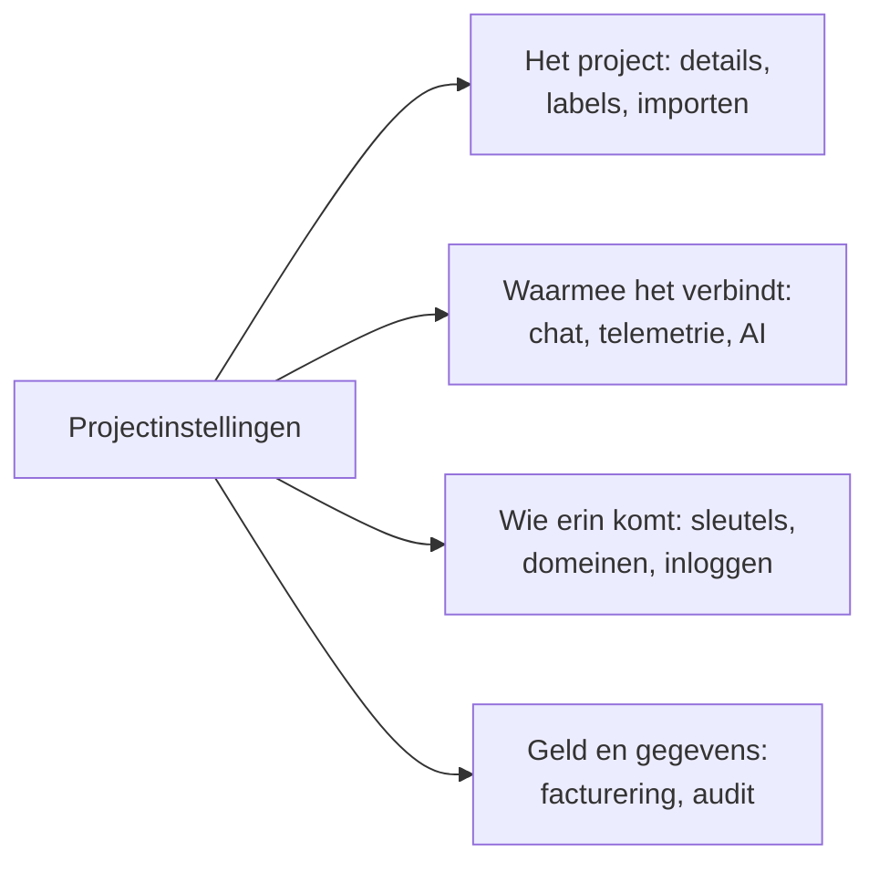

# Projectinstellingen

Projectinstellingen bevat wat voor het hele project geldt: de naam, de tools waarmee het is verbonden, de sleutels, hoe mensen inloggen, de facturering en het audittraject. Het meeste stelt u één keer in en bekijkt u zelden opnieuw. Deze pagina is er een kaart van, en behandelt de instellingen zonder eigen pagina: de projectdetails, labels en het verwijderen van het project.

:::cards
- [Een instelling vinden](#een-instelling-vinden): Wat elke sectie van het zijmenu bevat.
- [De details van het project](#de-details-van-het-project): De naam, de ID en toegang voor ondersteuning.
- [Unieke namen](#unieke-namen): Of twee records van hetzelfde soort een naam mogen delen.
- [Producten](#producten): De producten die dit project toont, en de producten die het verbergt.
- [Labels](#labels): Markeringen voor resources, machtigingen en regels.
- [Het project verwijderen](#het-project-verwijderen): Wat het vraagt, en wat er meegaat.
:::

## Projectinstellingen openen

Ga naar **Producten → Instellingen → Projectinstellingen**. Het zijmenu groepeert de pagina's in secties, en alleen **Basis** staat open bij het begin: klik op de titel van een sectie om die te openen. Een sectie opent vanzelf op elke pagina erin.

## Voordat u begint

- **Een rol die het project mag wijzigen.** Projecteigenaren en Projectbeheerders wijzigen de meeste van deze instellingen. Facturering, meldingskanalen en het verwijderen van het project vragen meer, zoals elke sectie zegt.
- **In OneUptime Cloud: het abonnement dat een instelling omvat.** Sommige instellingen hebben een abonnement nodig: zie [Instellingen die een abonnement nodig hebben](/docs/configuration/billing#instellingen-die-een-abonnement-nodig-hebben).

## Een instelling vinden

| Sectie | Pagina's | Waar u meer leest |
| --- | --- | --- |
| **Basis** | **Project**, **Producten**, **Labels** | [De details van het project](#de-details-van-het-project), [Unieke namen](#unieke-namen), [Producten](#producten), [Labels](#labels) |
| **Werkruimte** | **Slack**, **Microsoft Teams**, **Mattermost**, **Videogesprekken** | [Slack](/docs/workspace-connections/slack), [Microsoft Teams](/docs/workspace-connections/microsoft-teams), [Mattermost](/docs/workspace-connections/mattermost), [Videogesprekken](/docs/workspace-connections/video-calls) |
| **Telemetrie & APM** | **Ingestiesleutels**, **Gegevensbewaring**, **Gebruik** | [Ingestiesleutels](/docs/telemetry/ingestion-keys), [Gegevensbewaring](/docs/telemetry/data-retention), [Telemetriegebruik](/docs/telemetry/usage) |
| **Meldingen** | **Meldingskanalen**, **Meldingslogboeken**, **Mobiele apps** | [Meldingen](#meldingen) |
| **AI** | **AI-functies**, **LLM-providers**, **Externe MCP-servers**, **AI-tegoeden**, **AI-resultaten**, **AI-logboeken**, **MCP-server** | [LLM-providers](/docs/ai/llm-provider), [Externe MCP-servers](/docs/ai/external-mcp-servers), [MCP-server](/docs/ai/mcp-server), [AI SRE](/docs/ai/ai-sre#kostenbeheersing) |
| **Geavanceerd** | **Domeinen**, **API-sleutels**, **Importeren uit een andere tool** | [Eigen domeinen](/docs/status-pages/branding-and-domains#aangepaste-domeinen), [API-sleutels](/docs/permissions/index#api-sleutels), [Overstappen van Opsgenie](/docs/moving-to-oneuptime/opsgenie) en de andere overstapgidsen |
| **Beveiliging** | **SSO**, **SCIM** | [SSO](/docs/identity/sso), [SCIM](/docs/identity/scim) |
| **Facturering en facturen** | **Facturering**, **Facturen** | [Facturering en gebruik](/docs/configuration/billing) |
| **Auditlogboeken** | **Auditlogboeken**, **Instellingen**, **Export** | [Auditlogboeken](/docs/configuration/audit-logs), [Export van auditlogboek](/docs/configuration/audit-log-export) |
| **Gevarenzone** | **Project verwijderen** | [Het project verwijderen](#het-project-verwijderen) |

**Facturering en facturen** en **AI-tegoeden** bestaan alleen in OneUptime Cloud: een zelf gehoste installatie heeft geen facturering.

## De details van het project

**Projectinstellingen → Basis → Project** bevat de kaarten van het project: **Projectdetails**, **Unieke namen** en, in OneUptime Cloud, **Toegang voor klantenondersteuning**.

**Projectdetails** toont de naam van het project en de ID:

- **Projectnaam**: klik op **Project bewerken** om het project een andere naam te geven. Een naam heeft minstens 2 tekens. Hernoemen vraagt een Projecteigenaar, of de machtiging om het project te bewerken of de facturering te beheren.
- **Project-ID**: kopieer deze voor de API, de CLI en Terraform, of als u ondersteuning schrijft.
- **Data Residency**: in OneUptime Cloud, waar de gegevens van uw project horen te staan, als OneUptime dat heeft vastgelegd. Alleen OneUptime stelt dit in.

**Toegang voor klantenondersteuning** bepaalt in OneUptime Cloud of het ondersteuningsteam van OneUptime het project mag openen. Zet **OneUptime-ondersteuning toegang geven tot dit project** aan als u hulp wilt: OneUptime vraagt het eerst, omdat ondersteuning dan alles in het project kan zien en wijzigen, en u klikt op **Ondersteuning toelaten**. Zet het uit zodra ze klaar zijn: dat wordt meteen opgeslagen. Projecteigenaren en Projectbeheerders wijzigen het.

## Unieke namen

**Unieke namen**, onder **Projectinstellingen → Basis → Project**, bepaalt of twee records van hetzelfde soort in het project een naam mogen delen. Zolang **Unieke namen vereisen** aan staat, weigert OneUptime een naam die een ander record van hetzelfde soort al heeft, of die nu hier wordt getypt, via de API wordt verstuurd of in Terraform wordt ingesteld, en ongeacht hoofdletters en spaties: `API Health Check` en `api health check` zijn één naam. De schakelaar slaat op zodra u hem omzet. Projecteigenaren en Projectbeheerders wijzigen het.

In een nieuw project staat hij aan. Een project dat al bestond, houdt hem uit, omdat de API-clients en Terraform-configuraties van het project kunnen rekenen op namen die terugkomen: zet hem aan wanneer u er klaar voor bent.

Onder de schakelaar toont de kaart elke naam die het project al meer dan eens heeft, soort voor soort, met een link naar elk record en de dag waarop het is gemaakt. Een OpenStack-budget opent op de pagina **Uitgaven** van zijn cloud, en een werkruimtesamenvatting op het tabblad **Samenvatting** van zijn Slack-, Microsoft Teams- of Mattermost-pagina. AI-agenten hebben geen pagina in het dashboard, dus de kaart noemt ze zonder link en zegt dat erbij. De schakelaar aanzetten weigert niets wat al bestaat: die records blijven werken tot iemand ze hernoemt, en alleen een nieuw record of een hernoeming heeft een eigen naam nodig. Een record opnieuw opslaan met zijn eigen naam, in welke schrijfwijze ook, is geen hernoeming.

De eigen lijst van elke soort markeert die records ook, met **Zelfde naam als een ander item van het type monitor** (of sjabloon, sleutel enzovoort) en de dag waarop elk is gemaakt, en zegt boven de lijst hoeveel het er zijn. Een lijst markeert alleen de records die u kunt openen.

Wat de schakelaar ook zegt, een formulier waarschuwt terwijl u een naam typt die een ander record van dat soort al heeft, en linkt naar dat record. Zolang de schakelaar aan staat, zegt de waarschuwing ook dat opslaan zou worden geweigerd.

De schakelaar geldt voor de soorten die u een naam geeft en op naam kiest: monitoren, monitorgroepen, sondes, SLO's, de sjablonen voor incidenten, alerts, onderhoud en statuspagina's, API-sleutels, ingestiesleutels, aangepaste rollen, LLM-providers, pipelines, budgetten en verbindingen. Gebeurtenissen en vastleggingen van wat er gebeurde herhalen hun namen bewust en vallen erbuiten: incidenten, alerts, episodes, onderhoudsgebeurtenissen en aankondigingen op statuspagina's, net als wat OneUptime ontdekt, zoals hosts en pods. Teams, labels, dienstbeleid, dienstroosters, statuspagina's, workflows en enkele andere soorten hebben in elk project een eigen naam, wat de schakelaar ook zegt.

Wanneer OneUptime een record voor u een naam geeft, zoals een monitor uit een aanbeveling of een geïmporteerde, en de naam al bezet is, voegt het een nummer toe in plaats van hem te weigeren: `API Health Check 2`.

## Producten

**Projectinstellingen → Basis → Producten** kiest de producten die dit project toont in het menu **Producten**, op Start en in de lijst van Zoeken. Elk product heeft een schakelaar die opslaat zodra u hem omzet: aan toont het product. Gebruikers, Teams en Projectinstellingen worden altijd getoond, en **Alle producten tonen** toont ze weer allemaal.

Een verborgen product is niet uitgeschakeld. Het verhuist naar **Meer producten**, de laatste rij van het menu **Producten**: Zoeken vindt het nog steeds, de pagina's en de API blijven werken, en de gegevens blijven binnenkomen. Wie het heeft vastgezet, houdt het vastgezet.

Op een zelf gehoste server kan een hoofdbeheerder een product ook voor alle projecten uitschakelen, onder **Instellingen → Producten** in het Admin Dashboard (zie [Draai alleen wat u nodig hebt](/docs/installation/docker-compose#draai-alleen-wat-u-nodig-hebt)). Zo'n product heeft hier geen schakelaar: het toont **Uitgeschakeld op deze server**, met wie het kan inschakelen.

Elk product wordt getoond tot iemand het hier verbergt. Geen product wordt vanzelf verborgen: waarvoor het project volgens een Projecteigenaar of Projectbeheerder op Start bedoeld is, richt daar alleen de eerste stappen in, en een product dat nog niet is ingesteld, blijft op zijn plek in het menu.

Elk product zegt wat het voor dit project is: **In gebruik**, **Niet ingesteld** of, in OneUptime Cloud, het abonnement dat het nodig heeft. Zodra een verborgen product gegevens ontvangt, meldt Start dat aan de Projecteigenaren en Projectbeheerders en biedt **Tonen** of **Verborgen houden** aan.

Projecteigenaren, Projectbeheerders en iedereen die het project mag bewerken, wijzigen hem; alle anderen in het project kunnen hem zien.

Onder **Monitoren** voegt de schakelaar **Monitorgroepen** monitorgroepen toe aan het menu Monitoren. Hij staat uit in een nieuw project, wordt opgeslagen zodra u hem omzet, en uitzetten verwijdert geen enkele groep. Wijzigen vereist de rol Projecteigenaar, of een aangepaste rol met de machtiging Edit Project of Manage Billing. Zie [Monitorgroepen](/docs/monitor/monitor-groups).

## Labels

Labels zijn markeringen die u op monitors, incidenten, statuspagina's en andere resources zet. Ze filteren en groeperen lijsten, en ze beperken hoe ver de machtigingen van een team en de regels van het project reiken.

:::steps
### Labels openen

Ga naar **Projectinstellingen → Basis → Labels**.

### Een label aanmaken

Klik op **Label aanmaken**. Geef het een **Naam** en, als u wilt, een **Beschrijving**. **Labelkleur** is al gekozen, een kleur die nog geen label op de pagina gebruikt: kies een andere als u dat liever hebt. Klik op **Label aanmaken** om het op te slaan.
:::

In OneUptime Cloud vraagt het aanmaken en wijzigen van labels het Growth-abonnement. Zie [Labels](/docs/permissions/index#labels) voor hoe labels machtigingen beperken, en [Label- en eigenaarsregels](/docs/configuration/label-and-owner-rules) om resources bij het aanmaken een label te geven.

In een lijst worden de labels van een record onder elkaar getoond; zijn het er meer dan vier, dan ziet u de eerste drie met een link naar de rest. Overal waar labels worden opgesomd (in lijsten, op de pagina van een record en in elke labelkiezer), staan ze in natuurlijke volgorde: labels waarvan de naam met een getal begint komen eerst, in de volgorde van dat getal (`2. Team` vóór `10. Owner`), daarna de andere alfabetisch, ongeacht hoofdletters of kleine letters. Wilt u de volgorde van uw labels bepalen, begin hun namen dan met een getal, zoals `1. Category` en `2. Subcategory`.

### Een label archiveren

Om een label uit te faseren, archiveert u het via het menu **⋯** van de rij in plaats van het te verwijderen. Alles wat het label heeft, behoudt het, en u kunt er nog steeds op filteren, maar niemand kan het nog ergens aan toevoegen: elke labelkiezer laat het weg, en de API, Terraform en MCP weigeren het. Het dialoogvenster toont de regels en machtigingen die zijn ingesteld om het label te gebruiken; die blijven het gebruiken tot u ze wijzigt. Gearchiveerde labels staan apart, in de ingeklapte sectie **Gearchiveerde labels**, waar **Uit het archief halen** er een terugzet. **Verwijderen** toont eerst alles waar het label vanaf zou gaan, en biedt **In plaats daarvan archiveren** aan.

**Gebruikt door**, in het menu van de rij van een label, telt de records van elk soort die het label dragen, en opent ze een pagina tegelijk. Records die u niet mag openen, worden geteld maar niet genoemd.

Een label met dezelfde naam als een ander label, uit de tijd dat namen nog niet hoefden te verschillen, wordt gemarkeerd met **Zelfde naam als een ander label**, en de lijst zegt hoeveel het er zijn: vergelijk met **Gebruikt door** waar elk label wordt gebruikt, en hernoem er dan één met **Hernoemen** in de rij ervan.

## Meldingen

**Projectinstellingen → Meldingen** bevat hoe het project meldingen verstuurt:

- **Meldingskanalen**: de kaart **Meldingskanalen** zet sms, telefoongesprekken, WhatsApp en Telegram aan of uit voor het project. Alle vier staan bij het begin uit. Een Projecteigenaar, een **Factureringsbeheerder** of iemand met **Manage Billing** zet ze aan. De pagina bevat ook, ingeklapt onder **Meer instellingen**, hoe leden standaard worden opgeroepen, in **Standaardreeks voor nieuwe leden** en **Telefoon voor mensen met dienst** (zie [De standaardreeks](/docs/notifications/on-call-rules#de-standaardreeks)), of oproepen voor dienst de voicemail van een persoon onderscheiden, in **Voicemail bij oproepen voor dienst** (zie [Voicemail bij oproepen voor dienst](/docs/self-hosted/twilio-integration#voicemail-bij-oproepen-voor-dienst)), de eigen mailservers van het project, in **Aangepaste SMTP-configuraties** (zie [SMTP](/docs/emails/smtp)), en het eigen Twilio-account (zie [Twilio-integratie](/docs/self-hosted/twilio-integration)). In OneUptime Cloud bevat ze het saldo waaruit deze berichten worden betaald: zie [Vooruitbetaalde saldi](/docs/configuration/billing#vooruitbetaalde-saldi).
- **Meldingslogboeken**: elke melding die het project heeft verstuurd, met één tabblad per kanaal: **E-mail**, **SMS**, **WhatsApp**, **Telegram**, **Webhook**, **Oproep**, **Push** en **Werkruimte**. Het tabblad **Webhook** bewaart van elk adres alleen het schema en de host: de rest is het geheim van de webhook. Wat elke status betekent: [Meldingslogboeken](/docs/notifications/notification-logs).
- **Mobiele apps**: waar u de apps voor iOS en Android vindt. Zie [Apps – Overzicht](/docs/mobile-desktop-apps/index).

## Het project verwijderen

Een project verwijderen verwijdert alles erin, voor elk lid: de monitors, incidenten, statuspagina's, piketinstellingen en telemetrie. Niets brengt het terug.

:::steps
### De gevarenzone openen

Ga naar **Projectinstellingen → Gevarenzone → Project verwijderen**.

### Op Project verwijderen klikken

Klik op **Project verwijderen**. Een dialoogvenster vraagt om bevestiging.

### De naam van het project typen

Typ de naam precies zoals die is. **Project verwijderen** blijft vergrendeld tot u dat doet. In OneUptime Cloud vraagt het dialoogvenster ook waarom u vertrekt: het antwoord is optioneel.

### Bevestigen

Klik op **Project verwijderen**. OneUptime verwijdert het project en haalt u eruit.
:::

> [!CAUTION]
> Het verwijderen van het project kan niet ongedaan worden gemaakt. Het vraagt een Projecteigenaar, of de machtiging om het project te verwijderen.

In OneUptime Cloud zegt u het abonnement van een project op door het te verwijderen: de facturering stopt wanneer het project is verwijderd. Een project dat via een cloudmarketplace wordt gefactureerd, krijgt een laatste afschrijving voor het gebruik, en de aankoop op de marketplace blijft actief tot u die daar opzegt.

## Problemen oplossen

:::details Er lijkt een sectie van het zijmenu te ontbreken
Elke sectie behalve **Basis** is bij het begin ingeklapt. Klik op de titel van de sectie om die te openen. Op een zelf gehoste installatie is er geen sectie **Facturering en facturen** en geen pagina **AI-tegoeden**.
:::

:::details Project bewerken is vergrendeld
Hernoemen vraagt een Projecteigenaar, of de machtiging om het project te bewerken of de facturering te beheren. De vergrendelde knop noemt de machtiging die u nodig hebt.
:::

:::details Project verwijderen blijft vergrendeld in het dialoogvenster
Typ de naam van het project precies zoals het dialoogvenster die toont: hoofdletters en kleine letters tellen mee.
:::

:::details Een naam wordt geweigerd omdat het project unieke namen vereist
Een ander record van hetzelfde soort heeft de naam, ongeacht hoofdletters en spaties. Kies een andere naam, of hernoem eerst het andere record: **Unieke namen**, onder **Projectinstellingen → Basis → Project**, toont de namen die het project meer dan eens heeft, met een link naar elk record. Heeft alleen een gearchiveerd record de naam, haal dat record dan uit het archief of kies een andere naam.
:::

## Volgende stappen

:::cards
- [Mensen uitnodigen](/docs/permissions/inviting-people): Uw team in het project halen.
- [Facturering en gebruik](/docs/configuration/billing): Uw abonnement, betaalmethoden, facturen en gebruik.
- [Auditlogboeken](/docs/configuration/audit-logs): Zien wie wat in het project heeft gewijzigd.
- [SSO](/docs/identity/sso): Mensen laten inloggen met uw identiteitsprovider.
:::
