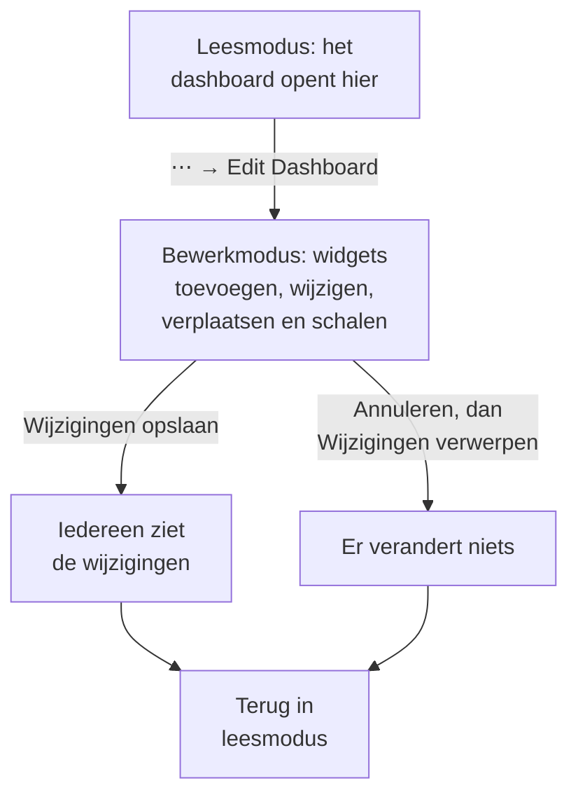

# Een dashboard maken

Om een dashboard te maken, open je **Producten → Dashboards**, klik je op **Dashboard aanmaken** en kies je een sjabloon, of **Blank Dashboard** om helemaal opnieuw te beginnen. Een sjabloon vult de naam van het dashboard voor je in (genummerd, zoals "Kubernetes Dashboard 2", als het project er al een heeft); bij een leeg dashboard geef je zelf een naam op. Klik op **Dashboard aanmaken** en het nieuwe dashboard opent. Een leeg dashboard opent op zijn lege canvas, met een knop **Widget toevoegen** voor de eerste widget.

:::cards
- [Het dashboard maken](#het-dashboard-maken): Begin vanuit een sjabloon of vanaf een leeg canvas.
- [Bewerken en opslaan](#bewerken-en-opslaan): Er verandert voor niemand iets totdat je op Wijzigingen opslaan klikt.
- [Een widget toevoegen](#een-widget-toevoegen): Kies hem uit de catalogus, stel hem in en zet hem op zijn plek.
- [Inzoomen op een piek](#inzoomen-op-een-piek): Sleep over een grafiek om het hele dashboard op dat moment te lezen.
:::

## Voordat je begint

Projecteigenaren en -beheerders kunnen elk dashboard maken en bewerken. Alle anderen hebben een teammachtiging nodig: `CreateDashboard` om dashboards te maken en `EditDashboard` om ze te wijzigen. Projectleden en kijkers kunnen dashboards lezen zonder een van beide. Wie een dashboard niet mag bewerken, opent toch het menu **⋯**, waar **Edit Dashboard** vergrendeld is en zegt welke machtiging nodig is.

## Het dashboard maken

:::steps
### Open de sjabloonkiezer

Open **Producten → Dashboards** en klik op **Dashboard aanmaken**. Het dialoogvenster **Maken op basis van sjabloon** toont **Blank Dashboard** en vijftien sjablonen, gegroepeerd naar wat ze bewaken.

### Kies een sjabloon

Klik op een kaart. Een sjabloon maakt zijn widgets, en vaak zijn variabelen, voor je aan; **Blank Dashboard** begint met een leeg canvas.

### Geef het dashboard een naam

De naam van een sjabloon is al ingevuld, genummerd voorbij de namen die het project al heeft. De naam van een leeg dashboard is leeg: typ er een. De beschrijving is optioneel, ingeklapt onder **Meer velden**, en je kunt haar later toevoegen op de pagina **Overzicht** van het dashboard.

### Maak het aan

Klik op **Dashboard aanmaken**. Het nieuwe dashboard opent: meteen met de widgets van een sjabloon, of met het lege canvas van een leeg dashboard, met **Widget toevoegen** erop.
:::

De sjablonen, per groep waaronder de kiezer ze toont:

| Groep | Sjablonen |
| --- | --- |
| Get Started | Blank Dashboard |
| Monitoring & APM | Monitor Dashboard, Metrics Dashboard, Real User Monitoring Dashboard, SLO Dashboard |
| Incident Response | Incident Dashboard, Alert Dashboard |
| Infrastructure | Kubernetes Dashboard, Kubernetes Cost Dashboard, Hosts Dashboard, Proxmox Dashboard, VMware Dashboard, Ceph Dashboard, Storage Array Dashboard, Docker Swarm Dashboard, Network Dashboard |

Een sjabloon is een vertrekpunt, geen koppeling: zodra het dashboard is gemaakt, pas je het aan zoals je wilt. Het sjabloon werkt het daarna niet meer bij.

## Bewerken en opslaan

Een dashboard opent in leesmodus. Om het te wijzigen, open je het menu **⋯** in de werkbalk en kies je **Edit Dashboard**. De werkbalk toont **Editing** naast de naam, en vervangt het tijdsbereik en de andere bedieningselementen door **Widget toevoegen**, **Variabelen**, **Annuleren** en **Wijzigingen opslaan**.

Je wijzigingen zijn alleen van jou totdat je ze opslaat. Tijdens het bewerken wordt niets opgeslagen, dus anderen zien het dashboard zoals het was.

- **Wijzigingen opslaan** slaat de widgets, hun plaatsen en formaten, de variabelen en het interval voor automatisch vernieuwen in één keer op, en gaat terug naar leesmodus. Als het opslaan wordt geweigerd, bijvoorbeeld omdat je intussen de machtiging bent kwijtgeraakt, blijf je in bewerkmodus met je wijzigingen en staat de reden boven het raster.
- **Annuleren** vraagt het eerst, omdat het je wijzigingen weggooit: **Wijzigingen verwerpen** gaat terug naar het dashboard zoals het was opgeslagen, en **Doorgaan met bewerken** brengt je terug naar je werk.

Tijdens het bewerken pauzeert het automatisch vernieuwen, en gaat een ingezoomd tijdsbereik terug naar het bereik dat je had gekozen.

## Een widget toevoegen

:::steps
### Open de widgetcatalogus

Klik op **Widget toevoegen**: in de werkbalk tijdens het bewerken, of op het canvas van een leeg dashboard. De catalogus groepeert zijn widgets naar wat ze tonen. Typ in het zoekvak om er een te vinden op naam of doel ("error budget", "pods"), en druk op Enter om het eerste resultaat toe te voegen.

### Kies een widget

Klik erop. De widget komt op de eerste vrije plek in het raster waar hij past, en zijn instellingen openen.

### Stel in wat hij toont

Het instellingenvenster toont een **Live Preview** van de widget boven de instellingen, en de preview volgt elke wijziging die je maakt. Kies wat de widget leest (een metrics-query, een filter, een tekst) en hoe hij eruitziet, en klik dan op **Klaar**.

### Zet hem op zijn plek

Sleep de widget om hem te verplaatsen, en sleep aan zijn randen of hoeken om het formaat te wijzigen. Zie [Widgets op het raster](#widgets-op-het-raster).
:::

[Dashboard-widgets](/docs/dashboards/widgets) beschrijft elke widget en zijn instellingen.

## Widgets op het raster

Het canvas is een raster van twaalf kolommen breed. Widgets klikken erop vast, en de pagina groeit naar beneden naarmate je rijen toevoegt. Terwijl je een widget sleept, toont een gestippelde omtrek waar hij terechtkomt, met zijn kolom en rij; terwijl je het formaat van een widget wijzigt, toont de omtrek zijn formaat in rastereenheden. Widgets die in de weg staan, schuiven opzij, zodat twee widgets nooit overlappen.

Elk soort widget heeft een kleinste formaat, zodat wat hij tekent leesbaar blijft: een grafiek is minstens zes kolommen breed en drie rijen hoog, terwijl één getal in één cel past.

Om een widget later te wijzigen, klik je er tijdens het bewerken op. Zijn instellingen openen opnieuw, met onderaan twee extra knoppen:

- **Duplicate Widget** voegt een kopie toe, met dezelfde instellingen, op de eerste vrije plek.
- **Widget verwijderen** verwijdert hem, zodra je het bevestigt.

## Tijdsbereik en automatisch vernieuwen

In leesmodus bepaalt de tijdsbereikkiezer van de werkbalk het venster dat elke grafiek-, getal-, log- en tracewidget leest. Kies een voorinstelling, van de afgelopen 5 minuten tot de afgelopen 3 maanden, of een eigen begin en einde. Telkens als het dashboard opent, begint het bij het afgelopen uur.

Lijsten met incidenten, waarschuwingen, monitors en resources tonen hun huidige toestand, wat het tijdsbereik ook is.

Naast het tijdsbereik leest het menu voor automatisch vernieuwen elke widget opnieuw elke 5 seconden, 10 seconden, 30 seconden, 1 minuut, 5 minuten of 15 minuten, met een aftelling tot de volgende vernieuwing. Laat het uit staan terwijl je onderzoek doet, zodat het beeld stil blijft staan. Om een interval het eigen interval van het dashboard te maken, kies je het, bewerk je daarna het dashboard en klik je op **Wijzigingen opslaan**: elk bezoek begint er dan mee.

De tijdsbereikkiezer, de variabelen en automatisch vernieuwen verschijnen zodra het dashboard een widget heeft.

### Inzoomen op een piek

Je hoeft de tijdsbereikkiezer er niet bij te pakken om naar een piek te kijken. Sleep over het interessante stuk van een lijn- of vlakgrafiek en het **hele dashboard** gaat naar dat venster, net alsof je het in de tijdsbereikkiezer had gekozen: elke widget die het tijdsbereik gebruikt, voert zijn query tegelijk opnieuw uit, zodat je één moment over het hele dashboard leest in plaats van één grafiek op een andere schaal dan zijn buren. Live lijsten blijven tonen wat er nu gebeurt, zoals altijd.

**Dubbelklik op een willekeurige grafiek** om het ongedaan te maken: het dashboard gaat terug naar het bereik dat het had voordat je begon in te zoomen, hoe vaak je ook verder bent ingezoomd. Zolang er een zoom actief is, verschijnt er een knop **Reset zoom** naast de tijdsbereikkiezer, en dubbelklikken op een dashboard dat niet is ingezoomd, doet niets.

Een ingezoomd venster ligt vast, dus het schuift niet meer mee terwijl automatisch vernieuwen aan staat; dat is bewust, want een venster dat midden in een onderzoek onder je wegschuift, zou erger zijn. Reset de zoom om het weer mee te laten schuiven.

Inzoomen werkt alleen in leesmodus; in bewerkmodus verplaatst en schaalt slepen de widgets. Staafdiagrammen zoomen op dezelfde manier in (sleep over de staven), en dubbelklikken op een ervan reset het dashboard zoals elke andere grafiek. Alleen slepen zoomt in: een gewone klik op een grafiek verandert nooit het tijdsbereik van het dashboard. Dezelfde gebaren werken op de grafieken in heel OneUptime; zie [Inzoomen op een tijdsbereik](/docs/telemetry/charts-and-time-ranges).

## Volledig scherm

**⋯ → Full Screen** toont de widgets van het dashboard op het hele scherm, voor een scherm aan de muur of een vergadering. Druk op Esc om het te verlaten.

## Tips voor dashboards die goed blijven

- **Eén onderwerp per dashboard.** Een paar gerichte dashboards zijn beter dan één pagina met alles wat je bewaakt.
- **Zet de belangrijkste widget bovenaan.** Mensen lezen van boven naar beneden, dus laat het eerste wat ze zien antwoord geven op "is dit gezond?"
- **Geef de secties een naam met Tekst-widgets.** Een korte kop om de paar rijen ("Latentie", "Fouten", "Capaciteit") maakt de pagina makkelijk te scannen, zelfs van de andere kant van de kamer.
- **Gebruik variabelen in plaats van kopieën.** Sta je op het punt hetzelfde dashboard te bouwen voor een tweede service, voeg dan een variabele `service` toe. Zie [Dashboard-variabelen en filters](/docs/dashboards/variables).
- **Maak een kopie voor een grote wijziging.** **Dashboard dupliceren**, op de pagina **Instellingen** van het dashboard, maakt een veilige kopie om je ideeën op uit te proberen.

## Volgende stappen

:::cards
- [Dashboard-widgets](/docs/dashboards/widgets): Elke widget, zijn instellingen, en welke je kiest.
- [Dashboard-variabelen en filters](/docs/dashboards/variables): Eén dashboard voor elke service, host of klant.
- [Delen en publieke dashboards](/docs/dashboards/sharing): Deel het dashboard buiten je team.
- [Dashboard-configuratie en machtigingen](/docs/dashboards/configuration): Eigenaren, labels, archiveren en wie wat mag.
:::
